# ProveeEventos — Domain-Driven Design (DDD)

**Archivo:** `ProveeEventos_DDD.md`  
**Versión:** 1.4  
**Fecha:** 24 de noviembre de 2026  
**Producto:** ProveeEventos  
**Alcance:** MVP / Fase 1  
**Estado:** Modelo de dominio propuesto, derivado de PRD v2.4, SRS v1.3, SAD v1.4 y API Specification OpenAPI 3.1.0 (contrato 1.4.0)  
**Audiencia:** Producto, arquitectura, desarrollo backend/frontend, QA y DevOps

---

## Control del documento

| Campo | Valor |
|---|---|
| Documento rector de producto | PRD v2.4 |
| Especificación de comportamiento | SRS v1.3 |
| Arquitectura de referencia | SAD v1.4 |
| Contrato HTTP | `ProveeEventos_API_Spec.yaml` |
| Idioma inicial | Español (Colombia) |
| Moneda inicial | COP |
| Mercado inicial | Ciudades principales de Colombia |
| Estilo de implementación | Monolito modular + worker asíncrono |
| Persistencia autoritativa | PostgreSQL |

## Historial de versiones

| Versión | Fecha | Descripción |
|---|---|---|
| 1.0 | 23-11-2026 | Primera definición del lenguaje ubicuo, subdominios, bounded contexts, agregados, invariantes, eventos y mapa de contextos |
| 1.1 | 23-11-2026 | Se incorporan las decisiones aprobadas de `Decisiones.md` (DEC-001 a DEC-018, TEC-001 a TEC-005) y se elimina la lista de decisiones pendientes |
| 1.2 | 23-11-2026 | Plan0001 (Review V1): máquina de estados de Booking y seguimiento de ítem, capacidad en la adjudicación (`ConfirmBooking`), RFQ sin reapertura con estado `CANCELADO`, eventos de dominio renombrados y nuevos, ADR-016..020, contextos alineados con el SAD, roles DEC-022 y verificación/suspensión ortogonales; propuestas pendientes de aprobación |
| 1.3 | 24-11-2026 | Plan0003 (Review V2): mapa de contextos con la convención consumidor → proveedor y todas las aristas del SAD §4.4; contrato `ConfirmBooking` único; activación de membresía (`MembershipActivated`); máquinas de Quotation (§15.6) y Offer (§15.7); grafo del ítem; triggers y estados terminales en §15; reglas normativas de Money y EventDate; ADR-016 en §14.2; solicitudes de titular y retención legal en BC-12 (propuestas pendientes de aprobación) |
| 1.3 (rev.) | 24-11-2026 | Aprobación de DEC-019..034, TEC-006..012 y ADR-016..022 (23-11-2026): se retiran las marcas de pendiente; sin cambios de comportamiento |
| 1.4 | 24-11-2026 | Plan0004 (Review V3): transiciones y atributos de la revisión por suspensión (§5.7, §15.4); grafo del ítem completo, con Instant Book desde rondas cerradas y cancelación del evento (§15.5); cierre de solicitudes sin oferta vigente (§15.2; DEC-035, pendiente); políticas de revisión y de cierre de ronda (§7); dos eventos nuevos y consumidores de seguimiento (§8.1); mapa de contextos completo (§11.1, §11.2); cierre actualizado (§23) |
| 1.4 (rev.) | 24-11-2026 | Aprobación de DEC-035..037 (fecha de registro 23-11-2026): se retiran las marcas de pendiente; la excepción del proveedor suspendido (§9.2) y el bloqueo compartido del proveedor (§10.3, §14.2, §14.3) quedan explícitos; referencias al PRD v2.4 |
| 1.4 (rev.) | 25-11-2026 | Se actualiza la referencia al contrato API 1.4.0; sin cambios en el modelo de dominio |

---

# 1. Propósito y alcance

Este documento define el modelo de dominio de ProveeEventos utilizando los principios de Domain-Driven Design (DDD). Su objetivo es que producto, arquitectura y desarrollo compartan una representación precisa del negocio y que las reglas críticas no queden dispersas entre controladores, consultas SQL, componentes de interfaz o procesos asíncronos.

El DDD complementa los documentos existentes:

- El **PRD** expresa la visión, propuesta de valor, alcance y reglas de negocio.
- El **SRS** convierte esa visión en comportamientos y requisitos verificables.
- El **SAD** establece módulos, capas, dependencias y decisiones de infraestructura.
- La **API Specification** define el contrato externo HTTP.
- Este **DDD** define el significado del negocio, los límites de consistencia y las responsabilidades de cada modelo.

El modelo se limita al MVP. Las capacidades identificadas en PRD/SRS como posteriores —pagos, WhatsApp Business Cloud API, webhooks, IA automatizada por API, chat interno, calendario externo, cotizador inverso, aplicación móvil nativa y API pública general— no se incorporan como capacidades activas del dominio MVP.

## 1.1 Objetivos

1. Establecer un lenguaje ubicuo y evitar que un mismo concepto tenga significados distintos entre módulos.
2. Definir subdominios y Bounded Contexts alineados con los módulos del SAD.
3. Identificar agregados, raíces de agregado, entidades y objetos de valor.
4. Definir invariantes y límites transaccionales.
5. Especificar eventos de dominio y sus consumidores.
6. Definir un mapa de contextos y dependencias permitidas.
7. Relacionar el modelo de dominio con los casos de uso y recursos API.
8. Hacer explícitas las decisiones aprobadas y su justificación (ver sección 17).

## 1.2 Principios de modelado

- El dominio no depende de Express, Prisma, PostgreSQL, Redis, Auth0, SendGrid ni Cloudinary.
- Las reglas de negocio se ejecutan en el dominio o en servicios de dominio; los casos de uso coordinan operaciones.
- Cada agregado protege sus propias invariantes.
- Una transacción de base de datos no debe abarcar innecesariamente múltiples agregados.
- Las operaciones que necesitan coordinar varios agregados se implementan mediante servicios de aplicación y transacciones explícitas.
- Los eventos de dominio representan hechos que ya ocurrieron; no son comandos ni simples notificaciones técnicas.
- Los efectos externos se publican de forma fiable mediante Transactional Outbox.
- Las lecturas de catálogo y comparación pueden utilizar proyecciones optimizadas, pero PostgreSQL conserva la fuente de verdad.
- Ningún dato enviado por el cliente puede establecer por sí solo el tenant, el rol o la autorización.
- Las reglas propuestas en este documento no amplían silenciosamente el alcance funcional: cuando falta definición, se etiqueta como decisión propuesta; las decisiones ya aprobadas se identifican con su ID de `Decisiones.md`.

---

# 2. Visión del dominio

## 2.1 Dominio central

El dominio central de ProveeEventos es la **contratación B2B de proveedores freelance para eventos mediante un proceso híbrido de descubrimiento, cotización, reserva instantánea y solicitud competitiva de ofertas**.

El valor diferencial no reside únicamente en publicar un catálogo. Se encuentra en coordinar dos formas de contratación:

1. **Instant Book:** el precio y las condiciones del paquete están suficientemente estandarizados para permitir una confirmación inmediata, siempre que exista capacidad.
2. **e-RFQ:** el servicio requiere una propuesta específica del proveedor; ProveeEventos distribuye solicitudes individuales en paralelo, recibe ofertas estructuradas, las compara y permite adjudicar una.

Ambos caminos convergen en un compromiso de contratación confirmado y trazable, que después alimenta el seguimiento del servicio y la elegibilidad para una reseña B2B.

## 2.2 Clasificación de subdominios

| Subdominio | Clasificación | Motivo |
|---|---|---|
| Cotización híbrida y contratación | Core Domain | Es el mecanismo central que reduce el tiempo y la fricción de compra B2B |
| RFQ, ofertas y adjudicación | Core Domain | Estandariza la competencia, comparación y selección de proveedores |
| Catálogo y elegibilidad de proveedores | Supporting Domain | Proporciona oferta confiable y comparable al proceso central |
| Disponibilidad y capacidad | Supporting Domain | Hace posible confirmar compromisos sin sobrecontratar |
| Eventos y plantillas | Supporting Domain | Aporta el contexto de negocio y reutilización para la compra |
| Organizaciones y membresías | Generic/Supporting Domain | Resuelve aislamiento y administración multiempresa |
| Identidad y acceso | Generic Domain | Autenticación delegada a Auth0 y autorización interna |
| Mensajería y notificaciones | Generic/Supporting Domain | Transporta comunicaciones sin ser fuente de verdad de contratación |
| Respuesta asistida de WhatsApp | Supporting Domain | Convierte manualmente respuestas externas en datos revisables |
| Reseñas B2B | Supporting Domain | Conserva reputación basada en contrataciones reales |
| Administración, taxonomía y auditoría | Supporting Domain | Mantiene integridad, moderación y trazabilidad |

La clasificación es estratégica y puede cambiar con la evolución del producto. No implica que cada subdominio deba convertirse en un microservicio.

---

# 3. Lenguaje ubicuo (Ubiquitous Language)

Los siguientes términos deben conservar el mismo significado en conversaciones de producto, código, API, base de datos, pruebas y documentación.

## 3.1 Actores y organización

| Término | Definición de dominio |
|---|---|
| Usuario | Identidad humana que accede a ProveeEventos. La autenticación se delega a Auth0; el modelo interno conserva su identidad y estado de acceso |
| Empresa organizadora | Organización cliente que contrata proveedores y constituye el tenant de los datos organizacionales |
| Membresía | Relación entre un usuario y una empresa, con un rol y estado dentro de esa empresa |
| Propietario (`PROPIETARIO`) | Único propietario principal de la empresa; nombra administradores y puede transferir la propiedad (DEC-008, DEC-022) |
| Administrador de empresa (`ADMIN_EMPRESA`) | Usuario que administra la empresa y sus coordinadores según permisos vigentes |
| Coordinador (`COORDINADOR`) | Usuario miembro que opera eventos, cotizaciones, solicitudes y seguimiento dentro de una empresa |
| Coordinador restringido (`COORDINADOR_RESTRINGIDO`) | Coordinador limitado a los eventos asignados; no adjudica ni cancela contrataciones |
| Proveedor | Persona o negocio que ofrece servicios para eventos. Su identidad es global y puede contratar con múltiples empresas |
| Administrador de plataforma (`ADMIN_PLATAFORMA`) | Actor con permisos operativos de plataforma, moderación, verificación y administración de taxonomía |
| Tenant | Frontera lógica de aislamiento de datos de una empresa organizadora. El proveedor no pertenece exclusivamente a un tenant |

## 3.2 Catálogo y oferta

| Término | Definición |
|---|---|
| Categoría | Agrupación principal de servicios, administrada por la plataforma |
| Subtipo | Especialización de una categoría |
| Perfil de proveedor | Información comercial, descriptiva, geográfica y operativa del proveedor |
| Portafolio | Evidencias multimedia asociadas al perfil del proveedor |
| Paquete de servicio | Oferta comercial publicada por un proveedor, con precio, alcance, exclusiones y modalidad |
| Modalidad de contratación | Forma en que puede contratarse un paquete: `INSTANT_BOOK` o `E_RFQ` |
| Disponibilidad | Capacidad declarada o bloqueada de un proveedor para una fecha |
| Capacidad diaria | Número máximo de eventos que el proveedor puede atender en una fecha; el valor predeterminado del MVP es dos, sujeto a la regla aprobada |
| Proveedor elegible | Proveedor que cumple los filtros de estado, verificación, categoría/subtipo, cobertura, capacidad y demás criterios aplicables |
| Catálogo visible | Conjunto de proveedores activos y verificados que pueden aparecer en búsqueda |

## 3.3 Evento y cotización

| Término | Definición |
|---|---|
| Evento | Contexto de compra propiedad de una empresa, con fecha, ubicación, asistentes, presupuesto y estado |
| Plantilla de evento | Configuración reutilizable de un tipo de evento y sus categorías sugeridas |
| Cotización | Propuesta de costos y selección de servicios para un evento, con versión y estado |
| Ítem de cotización | Necesidad concreta de servicio dentro de una cotización; puede estar estimada, seleccionada, enviada, confirmada o completada |
| Snapshot | Copia inmutable de los datos comerciales relevantes en un momento transaccional, por ejemplo nombre de paquete, precio y condiciones |
| Presupuesto referencial | Límite o estimación usada para señalar excesos; no constituye un cobro ni una autorización de pago |
| Bid Tabulation | Comparación normalizada de las ofertas recibidas para un ítem e-RFQ |

## 3.4 Contratación y RFQ

| Término | Definición |
|---|---|
| Reserva | Compromiso confirmado entre una empresa y un proveedor para un servicio y fecha |
| Contratación | Registro del compromiso comercial confirmado, ya sea por Instant Book o por adjudicación e-RFQ |
| Solicitud e-RFQ | Invitación individual enviada a un proveedor para que cotice un ítem de evento |
| Ciclo e-RFQ | Conjunto lógico de solicitudes paralelas para un mismo ítem y ronda de comparación |
| Oferta | Respuesta comercial estructurada de un proveedor a una solicitud e-RFQ |
| SLA | Plazo límite de respuesta de una solicitud |
| Magic Link | Credencial de capacidad limitada, de un solo uso y con expiración, que permite responder una solicitud específica sin iniciar sesión |
| Adjudicación | Decisión de seleccionar una oferta como ganadora para un ítem |
| No adjudicada | Oferta/solicitud que no fue seleccionada para la contratación |
| Origen de respuesta | Canal/proceso mediante el que se registró una oferta: formulario Magic Link o respuesta WhatsApp asistida |

## 3.5 Seguimiento y comunicación

| Término | Definición |
|---|---|
| Seguimiento de ítem | Estado operativo del servicio contratado durante el ciclo del evento |
| Reseña B2B | Evaluación de un proveedor realizada por una empresa después de una contratación completada |
| Notificación | Mensaje in-app o email generado por un hecho de negocio o una tarea del sistema |
| Intento de entrega | Registro técnico de un intento de enviar una notificación |
| WhatsApp Click-to-Chat | Apertura de una conversación mediante `wa.me`; no acredita que el mensaje haya sido enviado, entregado o recibido |
| Respuesta asistida | Texto o contenido recibido fuera de la plataforma, estructurado por una persona con ayuda del asistente y confirmado manualmente |
| Auditoría | Registro inmutable o protegido de una acción sensible con actor, recurso, instante y contexto |

## 3.6 Convenciones de nombres en código

- Código de dominio en inglés para consistencia técnica: `Organization`, `Membership`, `Provider`, `ServicePackage`, `Event`, `Quotation`, `QuotationItem`, `Booking`, `RfqRequest`, `Offer`, `Award`, `Review`.
- En la interfaz y documentación funcional se conservan los términos españoles del producto: Empresa, Proveedor, Paquete, Evento, Cotización, Reserva, Solicitud e-RFQ, Oferta y Adjudicación.
- Los enums del contrato API conservan los valores acordados en SRS/OpenAPI. No se traducen libremente en cada módulo.
- Evitar nombres genéricos como `Manager`, `Data`, `StatusInfo` o `Process` cuando un concepto del negocio más preciso esté disponible.

---

# 4. Bounded Contexts

Los Bounded Contexts definen límites semánticos. Se alinean con los módulos del SAD, pero no obligan a una separación física ni a una base de datos por módulo.

## 4.1 Mapa general de contextos

| ID | Bounded Context | Responsabilidad | Modelo propietario |
|---|---|---|---|
| BC-01 | Identity & Access | Identidad interna, roles y autorización | User, RoleAssignment, Invitation |
| BC-02 | Organizations & Tenancy | Empresas, membresías, planes y límites | Organization, Membership, PlanEntitlement |
| BC-03 | Provider Catalog | Perfiles, paquetes, portafolio y elegibilidad comercial | ProviderProfile, ServicePackage |
| BC-04 | Taxonomy & Templates | Categorías, subtipos y plantillas administradas | Category, Subtype, EventTemplate |
| BC-05 | Event Management | Eventos y su ciclo de vida | Event |
| BC-06 | Quotation | Cotización, ítems, versiones y snapshots | Quotation, QuotationItem |
| BC-07 | Availability & Booking | Capacidad, disponibilidad y compromisos | ProviderAvailability, Booking |
| BC-08 | RFQ & Offers | Solicitudes, SLA, ofertas, comparación y adjudicación | RfqRequest, Offer, Award |
| BC-09 | Assisted Response | Importación, estructuración y validación humana de respuestas externas | AssistedResponseDraft |
| BC-10 | Messaging & Notifications | Plantillas, notificaciones y entrega | Notification, DeliveryAttempt |
| BC-11 | Reviews | Calificaciones y respuestas | Review |
| BC-12 | Administration & Audit | Moderación, auditoría y operaciones administrativas | AuditRecord, ModerationCase |

## 4.2 BC-01 — Identity & Access

**Propósito:** representar a los usuarios de la plataforma y decidir qué operaciones pueden ejecutar a partir de su identidad y permisos internos.

**Responsabilidades:**
- vincular el usuario interno con el identificador de Auth0;
- mantener estado interno del usuario;
- resolver roles globales y asignaciones de rol;
- validar acceso a operaciones;
- gestionar invitaciones de usuarios cuando aplique.

**No es responsable de:**
- ser propietario de empresas o membresías;
- decidir el tenant activo sin consultar Organizations & Tenancy;
- almacenar contraseñas locales;
- contener reglas de negocio de reservas, ofertas o eventos.

**Modelo principal:**
- `User`
- `RoleAssignment` (roles globales `PROVEEDOR` y `ADMIN_PLATAFORMA`)

La `Invitation` pertenece a BC-02 Organizations & Tenancy; Identity solo vincula la identidad Auth0 del invitado cuando acepta.

**Regla de integración:** Auth0 autentica. ProveeEventos autoriza. Un token válido no concede acceso a cualquier tenant.

## 4.3 BC-02 — Organizations & Tenancy

**Propósito:** representar las empresas organizadoras, sus miembros y los límites de uso.

**Responsabilidades:**
- crear y mantener empresas;
- administrar membresías y coordinadores;
- resolver pertenencia de un usuario a una empresa;
- aplicar límites de plan;
- proporcionar el `TenantContext` para los casos de uso.

**Modelo principal:**
- `Organization`
- `Membership`
- `PlanEntitlement`
- `Invitation` (token de un solo uso con expiración; al aceptarse crea la `Membership`)
- `OwnershipTransfer` (transferencia pendiente de aceptación)
- `EventAssignment` (eventos asignados a un `COORDINADOR_RESTRINGIDO`; SRS-AUTH-011)
- `TenantContext` (objeto de valor de aplicación/seguridad; organización activa según TEC-006)

**Reglas:**
- una empresa es un tenant;
- un usuario puede tener una o más membresías si la política de producto lo permite;
- los proveedores no se modelan como miembros de la empresa cliente;
- `empresa_id` recibido desde el navegador nunca es evidencia de autorización;
- toda consulta o mutación de recursos empresariales se filtra por el tenant resuelto en servidor.

**Decisión aprobada (DEC-008, DEC-011):** una empresa puede tener varios administradores (`ADMIN_EMPRESA`) pero un único propietario principal (`PROPIETARIO`), además de coordinadores (`COORDINADOR`) con permisos predefinidos y un perfil restringido (`COORDINADOR_RESTRINGIDO`) limitado a eventos asignados (valores DEC-022). La transferencia de propiedad exige confirmación del propietario actual y aceptación del nuevo; si el propietario pierde acceso, se aplica un procedimiento de recuperación con soporte. No hay editor granular de permisos en el MVP.

## 4.4 BC-03 — Provider Catalog

**Propósito:** mantener la oferta comercial de los proveedores y responder qué proveedores y paquetes pueden ser considerados para una necesidad.

**Responsabilidades:**
- perfil comercial del proveedor;
- verificación como condición de visibilidad;
- portafolio;
- asociación a categorías y subtipos;
- paquetes, precios y condiciones;
- modalidad `INSTANT_BOOK` o `E_RFQ`;
- cobertura y atributos de búsqueda.

**Modelo principal:**
- `ProviderProfile`
- `ProviderCategoryAssignment`
- `PortfolioAsset`
- `ServicePackage`
- `PackagePrice`
- `CoverageArea` (si se modela como VO o entidad depende del nivel de detalle geográfico aprobado)

**Reglas:**
- solo proveedores `VERIFICADO` y activos aparecen en el catálogo;
- máximo cinco categorías principales por proveedor;
- un paquete debe apuntar a una categoría/subtipo coherente y activo;
- la identidad del proveedor es global, no tenant-scoped;
- las ediciones futuras del paquete no alteran snapshots de cotizaciones ni contrataciones históricas.

**No es responsable de:** confirmar una reserva, consumir capacidad o adjudicar una oferta.

## 4.5 BC-04 — Taxonomy & Templates

**Propósito:** administrar la estructura común de categorías/subtipos y las plantillas reutilizables.

**Responsabilidades:**
- mantener categorías y subtipos;
- asegurar consistencia jerárquica;
- administrar plantillas predefinidas;
- permitir plantillas personalizadas de empresa cuando el SRS lo habilita;
- mantener plantillas de WhatsApp como configuración de contenido.

**Modelo principal:**
- `Category`
- `Subtype`
- `EventTemplate`
- `TemplateCategory`
- `WhatsAppMessageTemplate`

**Reglas:**
- un subtipo pertenece a una categoría;
- no se puede asociar un paquete a un subtipo de otra categoría;
- una plantilla personalizada pertenece a su empresa;
- la taxonomía global se modifica mediante operaciones administrativas auditadas.

**Nota de límites:** las plantillas de evento se alojan conceptualmente aquí porque son configuración reusable. El agregado `Event` guarda una referencia y, al crearse, copia los datos necesarios para que cambios futuros de plantilla no alteren el evento existente.

## 4.6 BC-05 — Event Management

**Propósito:** administrar el contexto de un evento que origina una o varias cotizaciones.

**Responsabilidades:**
- crear, editar y clonar eventos;
- asociar plantilla;
- mantener fecha, ubicación, número de invitados y presupuesto referencial;
- controlar el ciclo de vida del evento;
- proteger la propiedad de empresa y coordinador.

**Modelo principal:** `Event` (aggregate root).

**Reglas:**
- todo evento pertenece a una empresa;
- el coordinador que lo opera debe tener membresía autorizada en esa empresa;
- la fecha y zona horaria se conservan con semántica local del evento;
- la plantilla de origen no se trata como fuente viva de datos;
- el evento no puede cambiar a estados incompatibles con sus compromisos sin respetar reglas de negocio.

## 4.7 BC-06 — Quotation

**Propósito:** convertir necesidades del evento en una propuesta económica comparable, versionada y lista para contratación.

**Responsabilidades:**
- crear cotizaciones rápidas e integrales;
- seleccionar candidatos y paquetes;
- crear ítems;
- calcular subtotales y totales;
- aplicar reglas de ranking y presupuesto referencial;
- generar snapshots;
- versionar la cotización;
- preparar documentos PDF;
- mantener el estado de seguimiento de cada ítem (`trackingStatus`) y su historial de transiciones (SRS-TRK-001..003), consumiendo eventos de RFQ, Booking y Reviews (TEC-010).

**Modelo principal:**
- `Quotation` (aggregate root)
- `QuotationItem` (entidad interna del agregado)
- `QuotationSnapshot` (VO/documento inmutable)
- `Money`, `Quantity`, `QuotationVersion` (VO)

**Reglas:**
- importes en decimal exacto y moneda explícita;
- un snapshot enviado o utilizado para una contratación no se reescribe;
- el ranking calidad-precio usa la fórmula del PRD y el fallback determinista definido en SRS;
- presupuesto referencial no equivale a autorización de pago;
- un ítem solo puede producir una contratación ganadora;
- la cotización conserva su historial de versiones.

**Límite:** Quotation no confirma disponibilidad ni reserva capacidad. Solicita una validación al contexto Availability & Booking.

## 4.8 BC-07 — Availability & Booking

**Propósito:** proteger la capacidad del proveedor y registrar compromisos confirmados.

**Responsabilidades:**
- consultar disponibilidad;
- gestionar bloqueos/cupos por fecha;
- ejecutar Instant Book;
- materializar una contratación cuando una oferta e-RFQ sea adjudicada;
- cancelar una contratación según la política por etapas aprobada (DEC-001): solicitud con motivo, aceptación o disputa de la contraparte y revisión (`CANCELACION_EN_REVISION`) sin liberar capacidad hasta resolverla;
- cerrar la contratación y devengar comisión según DEC-002 (servicio completado más confirmación del organizador en 5 días);
- conservar snapshots comerciales de la contratación;
- llevar el registro de comisiones (`CommissionRecord`): devengo, retención y reversión auditada (DEC-023, DEC-027; TEC-010).

**Modelo principal:**
- `ProviderAvailability` / `DailyCapacity`
- `Booking` (aggregate root)
- `BookingTermsSnapshot`
- `BookingOrigin` (VO: `INSTANT_BOOK` o `RFQ_AWARD`)
- `CommissionRecord` (agregado: contratación, base, porcentaje, importe, estado y referencia de factura externa)

**Reglas:**
- la capacidad tiene dos niveles (DEC-006): capacidad global del proveedor por fecha (2 por defecto) y capacidad específica por paquete como excepción; una reserva consume el cupo del paquete y el global salvo inventario independiente configurado;
- el proveedor no puede reducir la capacidad retroactivamente para invalidar reservas confirmadas;
- una consulta de disponibilidad es informativa; la confirmación revalida capacidad;
- la reserva consume capacidad de manera atómica;
- una reserva confirmada conserva precio y condiciones vinculantes;
- cancelados/rechazados no consumen cupo;
- no se permite sobrecontratar por concurrencia;
- el mismo comando idempotente no crea dos reservas.

**Importante:** la reserva Instant Book y la contratación resultante de una adjudicación convergen en el mismo concepto de `Booking`. No deben existir dos modelos de compromiso incompatibles.

## 4.9 BC-08 — RFQ & Offers

**Propósito:** gestionar el proceso competitivo de solicitud, recepción, comparación y adjudicación de ofertas.

**Responsabilidades:**
- crear solicitudes individuales por proveedor/ítem;
- distribuir solicitudes en paralelo;
- generar y validar Magic Links;
- controlar SLA y estados;
- recibir ofertas estructuradas;
- versionar correcciones de oferta conforme a la política aprobada;
- producir Bid Tabulation;
- adjudicar una sola oferta por ítem;
- coordinar creación de Booking.

**Modelo principal:**
- `RfqCycle` (aggregate root que agrupa una ronda, TEC-002)
- `RfqRequest` (aggregate root)
- `Offer` (aggregate root con revisiones inmutables, TEC-001)
- `MagicLinkGrant` (VO/entidad de seguridad)
- `Award` (registro de decisión asociado al ítem)
- `BidTabulation` (read model)

**Reglas:**
- máximo cinco proveedores invitados por ítem en un ciclo e-RFQ; TOP 3 predeterminado;
- cada solicitud representa una invitación individual a un proveedor;
- una solicitud puede no recibir oferta;
- respuesta aceptada solo dentro del SLA; la hora del servidor decide;
- Magic Link tiene alcance limitado, expiración y uso único;
- una oferta recibida no equivale a contratación;
- una adjudicación por ítem;
- la adjudicación es atómica y crea el compromiso contractual;
- las ofertas no seleccionadas pasan a `NO_ADJUDICADO`;
- una nueva ronda crea nuevas solicitudes; no reabre estados terminales.

**Decisión de modelado aprobada (TEC-001, TEC-002, DEC-005):** `RfqRequest` gobierna el ciclo de vida de la invitación y `Offer` es un agregado separado, referenciado por `requestId`, con revisiones inmutables para proteger historial y versionado. `RfqCycle` agrupa las solicitudes paralelas de una misma ronda para un ítem de cotización y garantiza el límite de 1–5 proveedores, el SLA común y las rondas posteriores. Una oferta enviada es inmutable; el proveedor puede crear revisiones mientras la solicitud siga abierta y no exista adjudicación; tras la adjudicación la oferta queda congelada.

## 4.10 BC-09 — Assisted Response

**Propósito:** convertir manualmente una respuesta externa de WhatsApp en una propuesta estructurada que una persona pueda revisar y confirmar.

**Responsabilidades:**
- generar prompt o formato de captura;
- importar JSON o texto estructurado;
- validar esquema, campos, importes y relación con solicitud;
- conservar borrador y procedencia;
- permitir confirmación humana;
- invocar el caso de uso de RFQ para registrar la oferta final.

**Modelo principal:** `AssistedResponseDraft`.

**Reglas críticas:**
- el MVP no recibe automáticamente mensajes de WhatsApp;
- abrir `wa.me` no prueba envío ni recepción;
- la IA no crea directamente una oferta aceptada;
- todo borrador requiere revisión y confirmación humana;
- el origen `WHATSAPP_IA_ASISTIDO` se conserva en la oferta;
- el borrador no puede modificar una solicitud distinta de la asociada.

Este contexto no es dueño del agregado `Offer`; entrega una propuesta al BC-08 mediante un caso de uso explícito.

## 4.11 BC-10 — Messaging & Notifications

**Propósito:** transportar comunicaciones y mantener registro de notificaciones sin asumir que el envío externo equivale a un cambio de estado de negocio.

**Responsabilidades:**
- notificaciones in-app;
- email transaccional;
- plantillas de mensajes;
- reintentos;
- intentos de entrega;
- tareas programadas de recordatorio y expiración;
- consumo de eventos publicados por otros contextos.

**Modelo principal:**
- `Notification`
- `DeliveryAttempt`
- `MessageTemplate`
- `NotificationPreference`

**Reglas:**
- el estado de entrega es independiente del estado de negocio;
- fallar un email no revierte una reserva o adjudicación ya confirmada;
- las notificaciones se disparan mediante outbox;
- los reintentos deben ser idempotentes;
- no se registra “WhatsApp enviado” solo porque se abrió un enlace `wa.me`.

## 4.12 BC-11 — Reviews

**Propósito:** registrar reputación B2B basada en servicios efectivamente contratados y completados.

**Responsabilidades:**
- validar elegibilidad;
- registrar evaluación;
- calcular promedio de dimensiones;
- permitir respuesta del proveedor;
- moderar reseñas;
- alimentar resumen de reputación del perfil.

**Modelo principal:** `Review` (aggregate root).

**Reglas:**
- solo una contratación completada habilita una reseña;
- una reseña por contratación;
- dimensiones de calificación de 1 a 5;
- promedio de la reseña = media de sus cuatro dimensiones;
- respuesta del proveedor no modifica la evaluación original;
- reseñas sujetas a moderación conforme a política.

## 4.13 BC-12 — Administration & Audit

**Propósito:** soportar operaciones privilegiadas y mantener trazabilidad de cambios sensibles.

**Responsabilidades:**
- verificación y suspensión de proveedores;
- administración de taxonomía y plantillas globales;
- moderación de reseñas;
- consulta de auditoría;
- operaciones administrativas controladas.

**Modelo principal:**
- `AuditRecord`
- `ModerationCase`
- `VerificationDecision`
- `DataSubjectRequest` (solicitud de titular: tipo, estado `RECIBIDA`/`EN_TRAMITE`/`RESUELTA`/`RECHAZADA`, responsable, fecha límite y resultado; SRS-ADM-012)
- `LegalHold` (retención legal sobre un recurso de cualquier contexto, con motivo, actor y fechas; los jobs de retención de cada contexto la consultan antes de archivar, anonimizar o eliminar)

**Reglas:**
- toda acción administrativa sensible registra actor, acción, recurso, fecha y motivo/contexto;
- la administración no modifica tablas ajenas mediante SQL ad hoc;
- cada contexto expone casos de uso administrativos propios;
- los registros de auditoría no se editan desde operaciones ordinarias.

---

# 5. Agregados y límites de consistencia

Un agregado es una frontera de consistencia transaccional. La raíz controla las modificaciones y garantiza las invariantes. No se debe crear un agregado gigantesco para todo el evento ni permitir que cualquier módulo modifique directamente sus tablas.

## 5.1 Catálogo de agregados

| Agregado | Raíz | Entidades internas | Objetos de valor clave |
|---|---|---|---|
| Organization | `Organization` | — | `OrganizationName`, `TaxId`, `PlanCode` |
| Membership | `Membership` | — | `MemberRole`, `MembershipStatus` |
| Provider Profile | `ProviderProfile` | `PortfolioAsset`, `ProviderCategoryAssignment` | `PhoneNumber`, `CoverageArea`, `VerificationStatus`, `AccountStatus` |
| Service Package | `ServicePackage` | — | `Money`, `PriceModel`, `ContractingMode`, `PackageTerms` (incluye inclusiones como VO), `TaxTreatment`, `PackageCapacity` |
| Category | `Category` | Subtypes pueden ser agregado independiente | `CategoryName`, `TaxonomyStatus` |
| Event Template | `EventTemplate` | `TemplateCategory` | `TemplateScope` |
| Event | `Event` | Datos propios del evento | `EventDate`, `Venue`, `GuestCount`, `Budget` |
| Quotation | `Quotation` | `QuotationItem`, snapshots | `Money`, `QuotationVersion`, `ItemSelection` |
| Provider Availability | `ProviderAvailability` | Cupos/bloqueos por fecha | `ServiceDate`, `Capacity`, `AvailabilityStatus` |
| Booking | `Booking` | Datos del compromiso y snapshot | `BookingTermsSnapshot`, `BookingStatus`, `BookingOrigin` |
| RFQ Cycle | `RfqCycle` | — | `RoundNumber`, `SlaHours`, `InvitationLimit` |
| RFQ Request | `RfqRequest` | `MagicLinkGrant` (entidad interna) | `SlaDeadline`, `RequestStatus`, `ResponseOrigin` |
| Offer | `Offer` | `OfferRevision` | `Money`, `OfferConditions`, `OfferValidity` |
| Award | `Award` | — | `AwardDecision`, `AwardedAt` |
| Assisted Response Draft | `AssistedResponseDraft` | Campos importados y observaciones | `SourceReference`, `ValidationResult` |
| Review | `Review` | — | `RatingScore`, `ReviewText` |
| Notification | `Notification` | `DeliveryAttempt` | `NotificationChannel`, `DeliveryStatus` |
| Audit Record | `AuditRecord` | — | `ActorReference`, `ResourceReference`, `AuditAction` |

## 5.2 Organization

**Raíz:** `Organization`

Atributos conceptuales:
- `organizationId`
- `legalName` / `displayName`
- `taxId`
- `contactDetails`
- `plan`
- `status`
- `createdAt`

Invariantes:
- NIT normalizado único según política de negocio;
- estado válido;
- plan perteneciente al catálogo configurado;
- los recursos empresariales se vinculan al identificador de organización.

Las membresías se modelan como agregados separados para evitar que una empresa con muchos coordinadores requiera cargar y bloquear toda su colección en cada modificación.

## 5.3 Membership

**Raíz:** `Membership`

Atributos:
- `membershipId`
- `organizationId`
- `userId`
- `role`
- `status`
- `invitedAt`
- `acceptedAt`

Estados (los del contrato API: `INVITADO`, `ACTIVO`, `SUSPENDIDO`) y transiciones:
- `INVITADO → ACTIVO` cuando el invitado acepta una invitación `PENDIENTE` y vigente (`acceptInvitation`); la invitación pasa a `ACEPTADA` y se emite `MembershipActivated`.
- Si la invitación pasa a `EXPIRADA` o `REVOCADA`, la membresía `INVITADO` no llega a activarse.
- `ACTIVO → SUSPENDIDO → ACTIVO` por acción administrativa (SRS-AUTH-007); el historial se conserva.

Invariantes:
- relación válida entre usuario y empresa;
- rol permitido dentro de la organización;
- no duplicar membresía activa para el mismo usuario/empresa;
- una operación solo se autoriza si la membresía está activa y el rol permite la acción.

La política de múltiples administradores y transferencia de propiedad está aprobada (DEC-008): un único `PROPIETARIO`, uno o más `ADMIN_EMPRESA` y transferencia con confirmación de ambas partes (valores DEC-022).

## 5.4 ProviderProfile y ServicePackage

`ProviderProfile` conserva la identidad comercial y estado de verificación. `ServicePackage` es un agregado independiente porque tiene precio, condiciones, modalidad y ciclo de edición propios.

Invariantes del perfil:
- no mostrar en catálogo si no está verificado y activo;
- máximo cinco categorías principales;
- portafolio asociado al proveedor propietario;
- teléfono y WhatsApp normalizados.

Invariantes del paquete:
- proveedor propietario existente;
- categoría/subtipo coherentes;
- modalidad soportada;
- precio exacto y no negativo;
- snapshot al cotizar/contratar para proteger historia.

## 5.5 Event

**Raíz:** `Event`

Atributos:
- `eventId`
- `organizationId`
- `coordinatorId`
- `templateReference`
- `name`
- `eventDate`
- `timeZone` (zona IANA, p. ej. `America/Bogota`)
- `startsAtUtc`
- `endsAtUtc`
- `localStartsAt`
- `guestCount`
- `venue`
- `estimatedBudget`
- `status`
- `createdAt`

Invariantes:
- pertenece a una empresa;
- el coordinador está autorizado en esa empresa;
- número de invitados positivo;
- fecha válida según la zona horaria del evento; sin offsets fijos como sustituto de la zona IANA;
- cambios de estado permitidos por la máquina de estados;
- clonar genera un nuevo identificador y no copia compromisos existentes.

El evento no contiene todas las cotizaciones como objetos embebidos; las cotizaciones son agregados independientes relacionados por `eventId`.

## 5.6 Quotation

**Raíz:** `Quotation`

Atributos:
- `quotationId`
- `eventId`
- `version`
- `status`
- `items`
- `subtotal`
- `commission` (solo dato de negocio cuando corresponda; no implica cobro)
- `total`
- `createdAt`
- `snapshotAt`

Invariantes:
- pertenece a un evento;
- versión válida;
- importes derivados de ítems y reglas de cálculo;
- no modificar snapshots históricos;
- un ítem no puede adjudicarse dos veces;
- la suma y redondeo se ejecutan con aritmética decimal.

`QuotationItem` es entidad interna del agregado para el MVP. Si el volumen o la concurrencia por ítem exige independencia, podrá extraerse como agregado separado mediante ADR.

## 5.7 ProviderAvailability y Booking

`ProviderAvailability` administra disponibilidad/capacidad por proveedor y fecha. `Booking` representa un compromiso ya confirmado.

Atributos conceptuales de `Booking`:
- `bookingId`
- `organizationId`
- `eventId`
- `quotationItemId`
- `providerId`
- `packageId` (opcional según origen)
- `origin`: `INSTANT_BOOK` o `RFQ_AWARD`
- `status`
- `serviceInterval` (inicio y fin del servicio; por defecto, el del evento) y `consumedLocalDates` (SRS-EVT-010)
- `quantity` (unidades de capacidad consumidas; 1 salvo paquetes con capacidad propia)
- `termsSnapshot` (campos según SAD ADR-019)
- `commissionStatus`
- `completedAt`
- `confirmedAt`
- `cancelledAt`
- `cancellationReason`
- `reviewOrigin` (`CONTRAPARTE` o `PLATAFORMA`, solo en revisión; SRS-BOOK-009)
- `organizerReviewDecision` (`MANTENER` o `CANCELAR`) y `reviewDecisionDueAt` (revisión de origen `PLATAFORMA`; SRS-ADM-013)

Invariantes:
- una reserva confirmada consume capacidad;
- no exceder capacidad diaria;
- no exceder ninguna capacidad aplicable (global del proveedor por fecha y, si existe, del paquete);
- una misma operación idempotente no crea dos reservas;
- el snapshot conserva precio, paquete, alcance y condiciones;
- cancelación requiere motivo, actor y auditoría; una cancelación disputada o sin respuesta en 72 h pasa a `CANCELACION_EN_REVISION` y no libera capacidad hasta resolverse;
- política de penalización/reembolso no existe en MVP y no debe inventarse (DEC-001);
- la comisión se devenga solo al completarse el servicio y confirmarse (o cerrarse automáticamente a los 5 días sin incidencia) y queda `RETENIDA` si hay disputa (DEC-002);
- el `termsSnapshot` es inmutable y las correcciones se registran como nuevo evento o documento rectificativo (DEC-018).

**Transacción crítica:** bloquear o actualizar de forma atómica el registro de capacidad, verificar cupo, crear Booking y registrar Outbox. El control definitivo vive en PostgreSQL, no en Redis ni en frontend.

## 5.8 RfqRequest y Offer

`RfqRequest` representa una invitación individual a un proveedor. `Offer` representa la respuesta comercial y su historial.

Atributos de `RfqRequest`:
- `requestId`
- `quotationItemId`
- `providerId`
- `channel`
- `status`
- `slaExpiresAt`
- `magicLinkTokenHash`
- `sentAt`
- `respondedAt`
- `responseOrigin`

Atributos de `Offer`:
- `offerId`
- `requestId`
- `revision`
- `price`
- `conditions`
- `includedItems`
- `excludedItems`
- `validUntil`
- `createdAt`
- `status`

Invariantes:
- una solicitud por proveedor/ítem/ciclo;
- el número de invitados por ciclo no supera cinco;
- una solicitud tiene un proveedor destinatario;
- la oferta pertenece a una solicitud;
- respuesta solo si solicitud está dentro del SLA y en estado aceptable;
- Magic Link solo responde a la solicitud asociada;
- token almacenado como hash;
- una oferta recibida no crea Booking automáticamente;
- una única adjudicación por ítem.

Política de edición aprobada (DEC-005): la oferta enviada es inmutable; cada revisión indica motivo y confirmación del proveedor de que reemplaza el precio/alcance anterior; la anterior queda como reemplazada; la tabla comparativa muestra por defecto la última revisión válida; tras vencer el SLA no se admiten revisiones; una nueva oferta requiere una nueva ronda (DEC-026). Una oferta con vigencia vencida no es adjudicable y puede revisarse mientras la solicitud siga abierta.

## 5.9 Award

`Award` registra la decisión de adjudicación para un ítem.

Invariantes:
- un solo ganador por ítem;
- oferta seleccionada pertenece a una solicitud del ítem;
- la solicitud/oferta debe estar en estado adjudicable;
- creación de Award y Booking debe coordinarse transaccionalmente;
- la adjudicación consume capacidad mediante `ConfirmBooking` (TEC-009); si el proveedor no tiene capacidad en las fechas del servicio, no se crea Award ni Booking y se responde conflicto de capacidad;
- la oferta adjudicada debe estar vigente (`validUntil` no vencido);
- solicitudes competidoras pasan a `NO_ADJUDICADO`;
- la notificación a proveedores se procesa después del commit mediante outbox.

La operación puede implementarse como servicio de dominio `AwardOffer` orquestado por un servicio de aplicación que invoca Booking. La atomicidad de “ganador único + booking confirmado” debe preservarse en una transacción de PostgreSQL dentro del monolito modular.

## 5.10 Review

**Raíz:** `Review`

Atributos:
- `reviewId`
- `bookingId`
- `eventId`
- `organizationId`
- `providerId`
- `punctuality`
- `serviceQuality`
- `communication`
- `valueForMoney`
- `average`
- `comment`
- `providerResponse`
- `status`
- `createdAt`

Invariantes:
- solo Booking completado permite reseña;
- una reseña por Booking;
- cada dimensión entre 1 y 5;
- promedio calculado por el dominio;
- la respuesta del proveedor no altera el puntaje;
- la moderación no debe destruir el registro original de auditoría.

## 5.11 Notification y AuditRecord

`Notification` administra el estado visible de una notificación para un usuario. `DeliveryAttempt` registra intentos de transporte. El éxito/fallo del transporte no altera el estado de negocio.

`AuditRecord` conserva la evidencia de cambios sensibles. No debe tratarse como un log técnico descartable.

---

# 6. Objetos de valor (Value Objects)

Los objetos de valor son inmutables, se comparan por valor y encapsulan validaciones que no dependen de identidad propia.

| Value Object | Contenido | Validaciones |
|---|---|---|
| `Money` | amount + currency | decimal exacto; moneda soportada; nunca float |
| `TaxId` | NIT normalizado | formato y unicidad aplicable |
| `EmailAddress` | email normalizado | formato válido |
| `PhoneNumber` | número E.164 | país/código y formato |
| `EventDate` | fecha local del evento + zona horaria | fecha válida; reglas de corte por zona |
| `GuestCount` | cantidad de asistentes | entero positivo |
| `Venue` | ubicación textual/geográfica | datos mínimos definidos por UX |
| `Budget` | importe y moneda | decimal exacto; no negativo |
| `PriceModel` | precio base y/o por persona | reglas de cálculo del paquete |
| `PackageTerms` | incluidos, excluidos y condiciones | contenido estructurado y versionable |
| `SlaDeadline` | instante UTC límite | comparación contra hora del servidor |
| `MagicLinkTokenHash` | hash del token | nunca almacenar token en claro |
| `RatingScore` | valor 1–5 | entero dentro del rango |
| `QuotationVersion` | identificador/número de versión | secuencia válida por cotización |
| `TenantContext` | organizationId, userId, roles/membership | derivado de identidad y autorización interna |
| `IdempotencyKey` | clave de operación + scope | unicidad y retención según política |
| `BookingTermsSnapshot` | copia de términos aceptados | inmutable una vez confirmado |
| `SourceReference` | referencia a texto/archivo importado | origen y relación con solicitud trazables |

## 6.1 Money y reglas de cálculo

Todos los importes se representan como decimal exacto. La moneda inicial es COP.

El dominio debe centralizar:
- suma de importes;
- multiplicación por cantidades;
- precio base y precio por persona;
- subtotal, comisión y total;
- reglas de redondeo;
- inclusión de IVA según configuración fiscal aplicable.

Reglas normativas (SRS-QUO-013; DEC-032):
- precisión interna `NUMERIC(14,2)`; nunca `float`;
- cada línea se redondea *half-up* al peso entero al presentarse y al congelarse en el snapshot; subtotales, comisión y total se calculan sobre líneas ya redondeadas;
- los importes en COP se presentan sin centavos;
- el mismo cálculo produce el mismo resultado en pantalla, PDF y snapshot.

La comisión registrada como dato de negocio no significa que exista un pago, factura o recaudo en el MVP.

## 6.2 EventDate y zona horaria

El SRS requiere fecha local de evento y timestamps operativos UTC. Decisión aprobada (DEC-007): cada evento guarda una zona horaria IANA (derivada de la ciudad y confirmada por el usuario), los instantes `startsAtUtc`/`endsAtUtc` y la fecha/hora local introducida. Los eventos de varios días o que cruzan medianoche usan un intervalo de inicio/fin; la disponibilidad diaria se calcula según la zona local del evento. Esto evita comparar fechas de evento como si fueran instantes UTC y permite expansión futura.

Reglas normativas:
- la zona horaria IANA es obligatoria en todo evento (en el MVP, normalmente `America/Bogota`); no hay valor por defecto implícito en el servidor;
- las fechas de capacidad de un servicio son todas las fechas locales que toca su intervalo, salvo que cruce medianoche y termine a las 06:00 locales o antes del día siguiente, en cuyo caso consume solo la fecha de inicio (`CapacityDatesPolicy`, SRS-EVT-010; DEC-025).

---

# 7. Servicios de dominio y políticas

Un servicio de dominio encapsula una regla que no pertenece naturalmente a una sola entidad.

| Servicio / Policy | Contexto | Responsabilidad |
|---|---|---|
| `ProviderEligibilityPolicy` | Provider Catalog | Determina si el proveedor puede mostrarse o participar |
| `ProviderRankingPolicy` | Quotation | Aplica ranking calidad-precio y fallback del SRS |
| `QuotationPricingService` | Quotation | Calcula subtotales, comisión referencial y total |
| `PlanLimitPolicy` | Organizations | Valida límites del plan configurado |
| `AvailabilityPolicy` | Availability & Booking | Determina cupos y bloqueos para una fecha |
| `BookingCapacityPolicy` | Availability & Booking | Impide exceder capacidad y máximo diario |
| `InstantBookEligibilityPolicy` | Quotation / Booking | Verifica que el paquete admita Instant Book y sus condiciones |
| `RfqInvitationPolicy` | RFQ & Offers | Limita proveedores por ciclo y evita duplicados |
| `SlaAcceptancePolicy` | RFQ & Offers | Acepta respuesta solo dentro del plazo |
| `MagicLinkAccessPolicy` | RFQ & Offers | Verifica hash, alcance, expiración y uso único |
| `OfferComparisonPolicy` | RFQ & Offers | Normaliza datos para Bid Tabulation |
| `AwardPolicy` | RFQ & Offers | Garantiza un ganador por ítem y elegibilidad de la oferta |
| `ReviewEligibilityPolicy` | Reviews | Verifica Booking completado y ausencia de reseña previa |
| `ReviewScoreCalculator` | Reviews | Calcula promedio de cuatro dimensiones |
| `CancellationPolicy` | Booking | Aplica la política por etapas (DEC-001): motivo y auditoría obligatorios, aceptación bilateral, revisión ante disputa, sin penalidad automática |
| `CapacityDatesPolicy` | Availability & Booking | Calcula las fechas locales que consume un servicio (DEC-025) |
| `SuspensionReviewPolicy` | Availability & Booking | Ventana de decisión de la organizadora y condición para que la administración resuelva (SRS-ADM-013; DEC-036) |
| `RoundClosurePolicy` | Quotation / RFQ & Offers | Cierra solicitudes sin oferta vigente y deriva el estado del ítem al terminar una ronda (SRS §9.2 y §9.3; DEC-035) |
| `CommissionPolicy` | Availability & Booking | Calcula base, porcentaje e importe de la comisión y su estado (DEC-023, DEC-027, DEC-032) |
| `NotificationRoutingPolicy` | Messaging | Decide destinatarios/canales según preferencias y reglas |
| `TenantAuthorizationPolicy` | Identity / Organizations | Comprueba pertenencia, rol y scope del recurso |

Los servicios de dominio no envían emails, no abren WhatsApp, no escriben en Redis y no conocen controladores HTTP.

---

# 8. Eventos de dominio

Los eventos expresan hechos del negocio. Se publican después de que el agregado confirma el cambio y se persisten en Outbox dentro de la misma transacción cuando desencadenan efectos externos.

## 8.1 Catálogo de eventos

| Evento | Se produce cuando | Consumidores típicos |
|---|---|---|
| `OrganizationCreated` | Se crea una empresa | Notifications, Audit |
| `MembershipInvited` | Se invita un coordinador/miembro | Notifications |
| `MembershipActivated` | El invitado acepta la invitación y la membresía pasa a `ACTIVO` (§5.3) | Audit, Notifications (aviso al administrador que invitó) |
| `ProviderProfileSubmitted` | Proveedor envía perfil a revisión | Administration, Notifications |
| `ProviderVerified` | Administración verifica proveedor | Catalog Search Projection, Notifications, Audit |
| `ProviderRejected` | Perfil es rechazado | Notifications, Audit |
| `ProviderSuspended` | Proveedor es suspendido | Catalog Search Projection, Notifications, Audit |
| `ServicePackagePublished` | Paquete se publica/activa | Catalog Search Projection |
| `ServicePackageChanged` | Cambian precio o condiciones | Search Projection; no modifica snapshots |
| `EventCreated` | Se crea evento | Audit |
| `EventCloned` | Se clona evento | Audit |
| `EventCancelled` | El organizador cancela el evento (SRS-EVT-009) | Quotation (cierra cotizaciones e ítems sin contratación), RFQ & Offers (revoca solicitudes abiertas), Availability & Booking (inicia la cancelación de contrataciones), Notifications, Audit |
| `EventCompleted` | El evento pasa a `COMPLETADO` (SRS §9.4) | Quotation (cierra cotizaciones), Audit |
| `QuotationCreated` | Se crea cotización | Audit |
| `QuotationVersionCreated` | Se genera nueva versión | PDF/Notifications |
| `QuotationItemSelected` | Se selecciona paquete/proveedor | Booking o RFQ Application |
| `BookingConfirmed` | Reserva confirmada | Notifications, Item Tracking (Quotation), Audit |
| `BookingCancellationRequested` | Una parte solicita cancelar (con motivo) | Notifications, Audit |
| `BookingCancellationDisputed` | La contraparte disputa o no responde en 72 h; pasa a `CANCELACION_EN_REVISION` | Administration, Notifications, Audit |
| `BookingCancelled` | Contratación cancelada por acuerdo, resolución o elección de la organizadora en una revisión de plataforma | Notifications, Capacity Release, Item Tracking, Audit |
| `BookingPlacedUnderPlatformReview` | La suspensión del proveedor pone una contratación futura en `CANCELACION_EN_REVISION` con origen `PLATAFORMA` (SRS-ADM-013) | Administration, Notifications, Audit |
| `BookingReviewDecisionRecorded` | La organizadora registra que quiere mantener una contratación en revisión de plataforma | Administration, Notifications, Audit |
| `ServiceMarkedDone` | El proveedor marca el servicio como realizado (`SERVICIO_REALIZADO`) | Notifications, Scheduler (plazo de 5 días), Item Tracking |
| `ServiceIncidentReported` | El organizador reporta una incidencia (`INCIDENCIA`) | Administration, Commission Record, Notifications, Audit |
| `BookingClosed` | La contratación pasa a `COMPLETADO` (confirmación del organizador, cierre automático a 5 días o resolución administrativa) | Commission Record, Reviews, Item Tracking, Notifications, Audit |
| `BookingNotDelivered` | La administración resuelve una incidencia como `NO_PRESTADO` | Commission Record, Capacity Release, Item Tracking, Audit |
| `CommissionAccrued` | Se devenga la comisión de una contratación cerrada | Commission Record (BC-07), Audit |
| `CommissionWithheld` | La comisión queda `RETENIDA` por incidencia | Commission Record (BC-07), Audit |
| `CommissionReversed` | Corrección auditada de un devengo erróneo | Commission Record (BC-07), Audit |
| `OfferRevised` | El proveedor crea una revisión de una oferta antes de la adjudicación | Bid Tabulation, Notifications, Audit |
| `OwnershipTransferred` | Se transfiere la propiedad de la empresa | Notifications, Audit |
| `RfqCycleCreated` | Se crea ronda de solicitudes | Messaging, Audit |
| `RfqRequestSent` | Solicitud enviada por canal soportado | SLA Scheduler, Notifications |
| `RfqRequestExpired` | SLA vence sin respuesta válida | RFQ, Notifications, Item Tracking |
| `RfqRequestCancelled` | Solicitud revocada (organizador, edición/cancelación del evento o administración) | Notifications, Bid Tabulation, Item Tracking, Audit |
| `OfferExpired` | La vigencia de una oferta vence sin adjudicación | Bid Tabulation, Notifications |
| `OfferReceived` | Se registra oferta válida | Bid Tabulation Projection, Notifications |
| `OfferRejected` | Proveedor rechaza solicitud | Bid Tabulation, Item Tracking, Notifications |
| `OfferAwarded` | Se adjudica oferta | Booking, Notifications, Audit |
| `OfferNotAwarded` | Solicitud/oferta no es seleccionada, o su solicitud se cierra sin oferta vigente | Bid Tabulation, Item Tracking, Notifications |
| `AssistedResponseImported` | Se importa borrador externo | Assisted Response |
| `AssistedResponseConfirmed` | Usuario confirma borrador | RFQ & Offers |
| `MagicLinkConsumed` | Se consume token válido | Audit |
| `ReviewSubmitted` | Empresa crea reseña | Provider Reputation Projection, Notifications, Moderation |
| `ReviewResponded` | Proveedor responde reseña | Notifications |
| `ReviewModerated` | Moderación cambia visibilidad | Reputation Projection, Audit |
| `NotificationDeliveryFailed` | Falla un intento de entrega | Retry Scheduler, Operations |

## 8.2 Reglas de publicación

1. No publicar un evento de negocio antes del commit.
2. Persistir Outbox en la misma transacción que la modificación que lo origina.
3. El worker puede procesar un mismo mensaje más de una vez; consumidores idempotentes.
4. Cada evento incluye `eventId`, `occurredAt`, `aggregateId`, `aggregateType`, `tenantId` cuando corresponda, `correlationId` y versión de esquema.
5. No incluir secretos, token Magic Link en claro ni información privada innecesaria.
6. La entrega externa no cambia retroactivamente el hecho de negocio.
7. Los eventos de dominio internos no son automáticamente contratos de integración pública.

## 8.3 Ejemplo de evento

```json
{
  "eventId": "uuid",
  "eventType": "BookingConfirmed",
  "eventVersion": 1,
  "occurredAt": "2026-11-23T18:00:00Z",
  "aggregateType": "Booking",
  "aggregateId": "booking-uuid",
  "tenantId": "organization-uuid",
  "correlationId": "request-correlation-id",
  "payload": {
    "bookingId": "booking-uuid",
    "eventId": "event-uuid",
    "providerId": "provider-uuid",
    "serviceDate": "2026-12-12",
    "origin": "INSTANT_BOOK"
  }
}
```

El ejemplo es ilustrativo; los identificadores y la fecha no representan datos reales.

---

# 9. Políticas e invariantes transversales

## 9.1 Multi-tenancy

- La empresa organizadora es el tenant.
- El proveedor es una entidad global.
- Los eventos, cotizaciones, solicitudes de compra, contrataciones y reseñas conservan la referencia a la empresa que origina la relación.
- Toda lectura o escritura empresarial valida tenant en servidor.
- Los workers reciben el tenant/correlation context y no omiten la autorización por ejecutarse en segundo plano.
- Las operaciones de `ADMIN_PLATAFORMA` se autorizan explícitamente y quedan auditadas.

## 9.2 Verificación de proveedor

- Solo proveedores `VERIFICADO` y activos aparecen en catálogo.
- `RECHAZADO` puede corregirse y reenviarse según flujo SRS.
- La verificación (`PENDIENTE`, `VERIFICADO`, `RECHAZADO`) y la cuenta (`ACTIVO`, `SUSPENDIDO`) son dimensiones independientes (DEC-031).
- Un proveedor con cuenta `SUSPENDIDO` no participa en nuevas contrataciones ni solicitudes; la reactivación conserva su verificación. Solo conserva la consulta de sus contrataciones vigentes y las acciones de ciclo sobre las que sigan en curso (SRS-AUTH-007, DEC-036).
- Las contrataciones históricas no desaparecen si un proveedor cambia de estado.

## 9.3 Capacidad y reserva

- La disponibilidad mostrada en búsqueda es orientativa.
- La confirmación ejecuta validación transaccional.
- La reserva confirmada consume capacidad.
- La capacidad tiene dos niveles (DEC-006): global por proveedor y fecha (2 por defecto) y por paquete como excepción; ambas se consumen de forma atómica mediante `ConfirmBooking` (TEC-009).
- Una contratación consume capacidad en cada fecha local que toca su servicio (DEC-025).
- La adjudicación e-RFQ consume capacidad igual que Instant Book.
- Redis puede ayudar a coordinar trabajo, pero no es la autoridad final de capacidad.

## 9.4 RFQ, SLA y Magic Link

- El ciclo puede invitar de uno a cinco proveedores por ítem; TOP 3 es el valor predeterminado.
- Cada solicitud es independiente y tiene un proveedor destinatario.
- La aceptación de una respuesta se decide con hora del servidor.
- El Magic Link es una credencial de capacidad limitada, expira y se consume una sola vez.
- El hash del token se almacena; nunca el token en claro.
- El token no permite enumerar solicitudes ni consultar datos ajenos.
- Una oferta recibida no equivale a contratación.

## 9.5 WhatsApp MVP

- El mensaje se construye a partir de plantillas deterministas.
- `wa.me` abre el cliente de WhatsApp; no acredita envío, entrega o recepción.
- El backend no recibe webhook de WhatsApp en MVP.
- El organizador importa o pega manualmente la respuesta.
- El asistente puede estructurarla, pero una persona debe validarla y confirmarla.
- No se registra una oferta como recibida hasta que la confirmación humana ejecute el caso de uso correspondiente.

## 9.6 Reseñas

- Solo una contratación completada habilita una reseña.
- Una reseña por contratación.
- Promedio = media de puntualidad, calidad de servicio, comunicación y relación precio-calidad.
- La respuesta del proveedor no altera la calificación.
- Moderación conserva trazabilidad.

## 9.7 Notificaciones

- La notificación es consecuencia de un hecho de negocio, no el hecho en sí.
- Fallo de email no revierte reserva, adjudicación ni oferta.
- Estado de entrega se registra separadamente.
- Reintentos y consumidores son idempotentes.

---

# 10. Flujos de dominio principales

## 10.1 Cotización integral híbrida

1. Coordinador autenticado solicita crear un evento.
2. Organizations resuelve `TenantContext`.
3. Event Management crea `Event`.
4. Quotation consulta catálogo y elegibilidad de proveedores.
5. Quotation crea una versión con ítems y estimaciones.
6. Para paquetes Instant Book, la aplicación solicita confirmación a Booking.
7. Para servicios complejos, RFQ crea solicitudes individuales a proveedores.
8. Se publica `RfqCycleCreated` y el worker despacha las comunicaciones.
9. Las ofertas válidas alimentan Bid Tabulation.
10. Coordinador compara y adjudica.
11. La adjudicación crea Booking y publica `BookingConfirmed`.
12. Messaging notifica a los participantes.
13. Quotation (seguimiento de ítem) y Reviews consumen el estado de contratación/completitud.

## 10.2 Instant Book

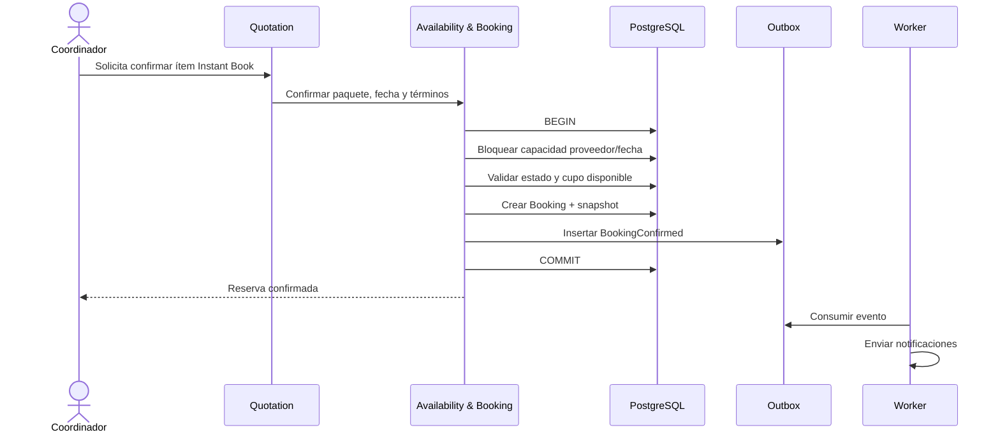

## 10.3 e-RFQ y adjudicación

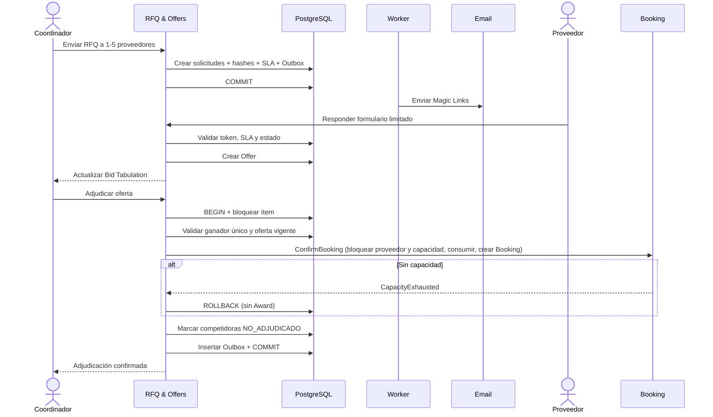

El diagrama representa el flujo lógico. La implementación debe garantizar que adjudicación, booking y ganador único sean atómicos en la transacción del monolito modular.

## 10.4 WhatsApp asistido

1. RFQ genera un mensaje a partir de una plantilla.
2. El navegador abre `wa.me`.
3. El proveedor responde en WhatsApp, fuera de ProveeEventos.
4. El organizador copia la respuesta o importa el contenido disponible.
5. Assisted Response genera prompt/estructura y valida el borrador.
6. El usuario revisa datos, precio y condiciones.
7. El usuario confirma.
8. RFQ crea la oferta con origen `WHATSAPP_IA_ASISTIDO`.
9. Bid Tabulation se actualiza.

No existe recepción automática de WhatsApp en este flujo MVP.

---

# 11. Mapa de contextos e integración

## 11.1 Relaciones entre contextos

**Convención:** cada fila es una dependencia *consumidor (downstream) → proveedor (upstream)*: el consumidor invoca un comando o una consulta publicada por el proveedor. Es la misma convención y el mismo conjunto de aristas que la matriz de dependencias del SAD §4.4, de la que esta tabla es la vista de dominio (TEC-010). Las relaciones por eventos de dominio se listan aparte porque no crean dependencia de código.

| Consumidor (downstream) | Proveedor (upstream) | Relación | Contrato |
|---|---|---|---|
| Organizations & Tenancy | Identity & Access | Organizations resuelve membresías sobre usuarios válidos | `UserId`, estado del usuario |
| Taxonomy & Templates | Organizations & Tenancy | Plantillas privadas pertenecen a un tenant | `TenantContext` |
| Provider Catalog | Identity & Access | El proveedor es un usuario con rol `PROVEEDOR` | `UserId`, estado del usuario |
| Provider Catalog | Taxonomy & Templates | Categorías y subtipos válidos | `CategoryId`, `SubtypeId`, lookup |
| Event Management | Organizations & Tenancy | Tenant, límites y asignación a coordinadores | `TenantContext`, `MembershipPolicy` |
| Event Management | Taxonomy & Templates | Plantilla y categorías sugeridas | `EventTemplateReference` / snapshot |
| Availability & Booking | Organizations & Tenancy | Tenant de la contratación | `TenantContext` |
| Availability & Booking | Provider Catalog | Estado del proveedor y del paquete, términos para el snapshot | `ProviderStatus`, `PackageTerms` |
| RFQ & Offers | Organizations & Tenancy | Tenant, límites del plan | `TenantContext`, `PlanLimitPolicy` |
| RFQ & Offers | Provider Catalog | Candidatos invitables y su canal | `ProviderCandidate` |
| RFQ & Offers | Availability & Booking | Contratación derivada de la adjudicación | `ConfirmBooking` (`ConfirmBookingCommand`) |
| Quotation | Organizations & Tenancy | Tenant y límites de uso | `TenantContext`, `PlanLimitPolicy` |
| Quotation | Event Management | Datos del evento | `EventId`, `EventSummary` |
| Quotation | Provider Catalog | Proveedores/paquetes elegibles | `ProviderCandidate`, `PackageSnapshotData` |
| Quotation | Taxonomy & Templates | Categorías de la plantilla | `CategoryId`, `SubtypeId` |
| Quotation | Availability & Booking | Disponibilidad indicativa y confirmación Instant Book | `AvailabilityQuery`, `ConfirmBooking` (`ConfirmBookingCommand`) |
| Quotation | RFQ & Offers | Ítem a cotizar competitivamente | `CreateRfqCycleCommand` |
| Assisted Response | RFQ & Offers | Borrador confirmado como oferta | `ConfirmAssistedOfferCommand` |
| Reviews | Organizations & Tenancy | Empresa autora de la reseña | `TenantContext` |
| Reviews | Availability & Booking | Elegibilidad (contratación `COMPLETADO`) | `BookingEligibilityQuery` |
| Messaging & Notifications | Identity & Access, Organizations & Tenancy, Taxonomy & Templates | Destinatarios, preferencias y plantillas | `RecipientQuery`, `NotificationTemplate` |
| Administration & Audit | Todos los contextos | Casos de uso administrativos publicados por cada contexto | Interfaces administrativas (nunca SQL ad hoc) |

**Relaciones por eventos (sin dependencia de código):**

| Publicador | Suscriptor | Eventos | Efecto |
|---|---|---|---|
| RFQ & Offers, Availability & Booking, Reviews | Quotation | `RfqRequestSent`, `RfqRequestExpired`, `RfqRequestCancelled`, `OfferRejected`, `OfferAwarded`, `OfferNotAwarded`, `BookingConfirmed`, `BookingCancelled`, `BookingClosed`, `ReviewSubmitted`… | Estado de seguimiento del ítem (§15.5) |
| Event Management | Quotation | `EventCancelled`, `EventCompleted` | Cierre de cotizaciones e ítems sin contratación (§15.6) |
| Availability & Booking | Reviews | `BookingClosed` | Habilita la reseña |
| Reviews | Provider Catalog | `ReviewSubmitted`, `ReviewModerated` | Reputación agregada (proyección) |
| Todos los contextos | Messaging & Notifications | Catálogo §8.1 vía outbox | Email e in-app |
| Todos los contextos | Administration & Audit | — (puerto `AuditRecorder` en `shared`) | Registro append-only |

## 11.2 Diagrama de contextos

Las flechas continuas van del consumidor al proveedor ("depende de") y son exactamente las de la tabla de §11.1: las 23 dependencias entre contextos más las 11 de Administration & Audit. Las punteadas son suscripciones a eventos; las dos que parten de todos los contextos (hacia Messaging & Notifications por outbox) se dibujan desde un único nodo.

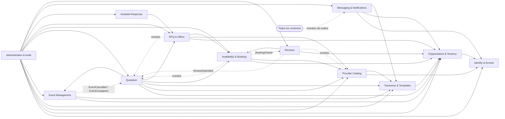

## 11.3 Reglas de dependencia

- Los módulos no consultan directamente tablas internas de otros módulos.
- Las dependencias se expresan mediante interfaces de aplicación, contratos de consulta o eventos.
- No se permite dependencia circular.
- `shared` contiene solo conceptos realmente transversales y estables: IDs, Money si es común, errores base, reloj, correlation ID y primitives técnicas sin reglas específicas.
- No convertir `shared` en un cajón de entidades de negocio.
- Los modelos de lectura pueden combinar datos de varios contextos sin convertirlos en agregados compartidos, siempre como proyección propia del consumidor alimentada por eventos (ADR-020) o compuesta con las consultas listadas en §11.1; nunca leyendo tablas de otro contexto (SAD §4.4).
- La API HTTP traduce DTO a comandos/queries; no constituye el modelo de dominio.

---

# 12. Read Models y CQRS pragmático

El MVP no requiere CQRS completo ni event sourcing. Se recomienda separar modelos de escritura y proyecciones de lectura solo donde mejore el rendimiento o simplifique comparaciones.

| Read Model | Fuentes | Uso |
|---|---|---|
| `ProviderSearchResult` | Provider Catalog + Taxonomy + Availability (consulta) + Reviews | Búsqueda y filtros |
| `QuotationComparisonView` | Quotation + Provider Catalog snapshots | Comparación de paquetes y estimaciones |
| `BidTabulationView` | RFQ Requests + Offers | Comparación normalizada |
| `OrganizationDashboardView` | Events + Quotations + Bookings + Notifications | Dashboard empresa |
| `ProviderDashboardView` | Provider + Packages + Availability + Bookings + Reviews | Dashboard proveedor |
| `ProviderReputationSummary` | Reviews | Promedio y conteo de reseñas |
| `NotificationInboxView` | Notifications | Bandeja in-app |
| `AdminAuditSearchView` | Audit | Consulta administrativa |

Reglas:
- los read models no autorizan mutaciones;
- una proyección puede reconstruirse desde datos autoritativos/eventos retenidos según estrategia;
- la disponibilidad mostrada es orientativa hasta confirmar;
- una oferta en Bid Tabulation no es una contratación;
- si una proyección está desactualizada, el comando de negocio vuelve a validar invariantes.

---

# 13. Relación con la API Specification

La API expone recursos y operaciones, pero no debe confundirse con agregados internos. Algunos endpoints representan consultas o comandos que coordinan más de un contexto.

| Recurso / grupo API | Bounded Context principal | Tipo de interacción |
|---|---|---|
| `/me`, preferencias | Identity & Access | Query/Command |
| `/organizations`, coordinadores | Organizations & Tenancy | Command/Query |
| `/providers`, `/providers/me`, paquetes y disponibilidad | Provider Catalog / Booking | Command/Query |
| `/catalog/categories`, `/catalog/providers` | Taxonomy / Provider Catalog | Query |
| `/event-templates` | Taxonomy & Templates | Command/Query |
| `/events` y clonación/estado | Event Management | Command/Query |
| `/quotations` y PDF | Quotation | Command/Query |
| `/bookings`, `/bookings/instant`, cancelación | Availability & Booking | Command/Query |
| `/rfq-requests` | RFQ & Offers | Command/Query |
| `/magic-links/form`, `/magic-links/response` (token en el cuerpo, TEC-008) | RFQ & Offers | Public capability query/command |
| `/assisted-response/*` | Assisted Response | Command |
| `/award` | RFQ & Offers + Booking | Command coordinado |
| `/reviews` | Reviews | Command/Query |
| `/notifications` | Messaging & Notifications | Query/Command |
| `/admin/*` | Administration & Audit + contexto dueño | Command/Query |

## 13.1 Reglas para handlers

- `POST /bookings/instant` invoca un caso de uso que verifica elegibilidad, disponibilidad, idempotencia y capacidad.
- La adjudicación invoca una operación de dominio que protege ganador único y crea Booking.
- Los endpoints Magic Link operan con un contexto de autorización limitado al token y a una solicitud.
- `POST .../assisted-response/confirm` no debe insertar directamente una fila Offer; debe invocar el caso de uso público del contexto RFQ.
- Los endpoints de lectura de catálogo no garantizan disponibilidad futura.
- El DTO nunca se pasa directamente como entidad de dominio sin validación y construcción explícita.

---

# 14. Persistencia y traducción al modelo relacional

El modelo de dominio no exige una tabla por clase ni una tabla por VO. La persistencia debe conservar invariantes y ownership.

## 14.1 Reglas de persistencia

1. PostgreSQL es la fuente de verdad.
2. IDs UUID según SRS.
3. Importes `NUMERIC/DECIMAL`, no `FLOAT`.
4. Timestamps operativos UTC; fecha de evento con semántica local y zona horaria.
5. Magic Link almacena hash, no token.
6. Snapshots se conservan en las transacciones relevantes.
7. Claves foráneas y restricciones únicas protegen integridad.
8. Índices únicos compuestos incluyen tenant cuando la unicidad sea local a empresa.
9. Toda tabla con propiedad empresarial incluye `organization_id` o una relación inequívoca al agregado propietario.
10. El proveedor es global; relaciones de contratación contienen empresa y proveedor.

## 14.2 Restricciones de integridad esenciales

| Regla | Protección recomendada |
|---|---|
| NIT único normalizado | Índice único |
| Usuario-email según política | Índice único normalizado |
| Membresía única usuario/empresa | Unique compuesto |
| Máximo cinco categorías proveedor | Regla de dominio + transacción/constraint auxiliar |
| Paquete-subtipo-categoría coherentes | FK/constraint y validación dominio |
| Una reseña por booking | Unique `booking_id` |
| Una adjudicación por ítem | Unique `quotation_item_id` |
| Un Magic Link consumido una vez | `consumed_at` + update condicional/lock |
| No duplicar reserva idempotente | Unique scope + idempotency key |
| Capacidad diaria no excedida | Filas únicas (proveedor, fecha) y (paquete, fecha) con `CHECK consumed <= capacity`, aseguradas con `INSERT … ON CONFLICT` y bloqueadas con `SELECT … FOR UPDATE` en orden fijo, después de la fila del proveedor en modo compartido (ADR-016 y ADR-017, DEC-036; SAD §7.1) |
| Oferta pertenece a solicitud | FK |
| Solicitud proveedor/ítem/ciclo única | Unique compuesto según definición de ciclo |

## 14.3 Decisiones registradas como ADR

Las decisiones de persistencia que antes requerían ADR están documentadas en el SAD §17 como ADR aprobados (23-11-2026):

- granularidad de agregado para `QuotationItem`: se mantiene dentro de `Quotation` (PROP-002); extraerlo requiere un ADR nuevo;
- representación de cupos diarios (DEC-006): **ADR-016** (tablas `provider_daily_capacity` y `package_daily_capacity` con contador `consumed`);
- concurrencia y aislamiento para Booking y Award: **ADR-017** (`READ COMMITTED` con bloqueos en orden fijo y reintentos; ampliado por DEC-036 con el bloqueo del proveedor);
- PostgreSQL Row-Level Security (TEC-005): **ADR-018** (evaluación en hardening);
- campos que se congelan en los snapshots (DEC-018): **ADR-019**;
- reconstrucción y retención de proyecciones: **ADR-020**.

---

# 15. Máquinas de estado del dominio

Los estados y transiciones del SRS son la referencia normativa. El DDD los organiza por agregado y evita mezclar estados técnicos con estados de negocio.

## 15.1 Provider Verification

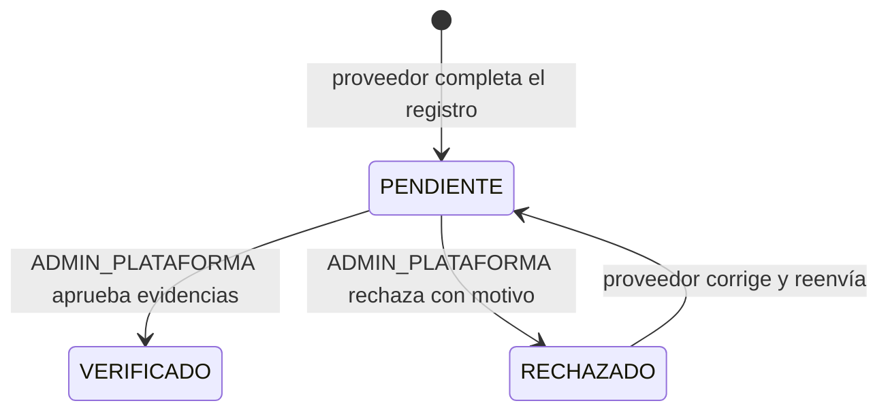

Estado de cuenta del proveedor, independiente de la verificación (DEC-031):

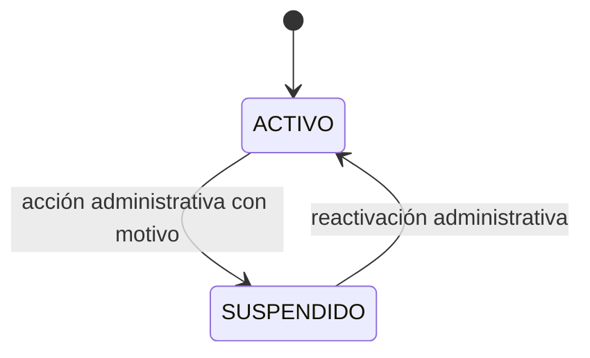

Visible en catálogo = `VERIFICADO` ∧ `ACTIVO` ∧ perfil publicable.

## 15.2 RFQ Request

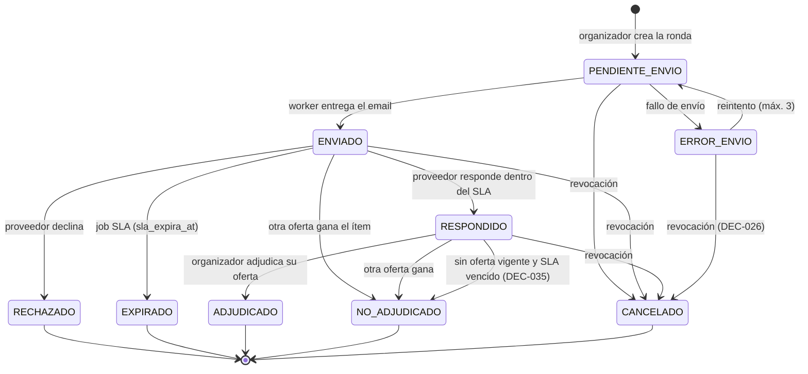

Los estados terminales (`RECHAZADO`, `EXPIRADO`, `ADJUDICADO`, `NO_ADJUDICADO`, `CANCELADO`) no se reabren. Para pedir una nueva oferta se crea una nueva ronda `RfqCycle`, que puede reinvitar al mismo proveedor (DEC-026). Una solicitud `RESPONDIDO` no pasa a `EXPIRADO` por SLA: la vigencia relevante es la de la oferta (`OfferExpired`). Cuando se queda sin oferta vigente y el SLA ya venció, se cierra en `NO_ADJUDICADO` (SRS §9.2; DEC-035). La aceptación de una respuesta se decide por timestamp de servidor y SLA.

## 15.3 Event

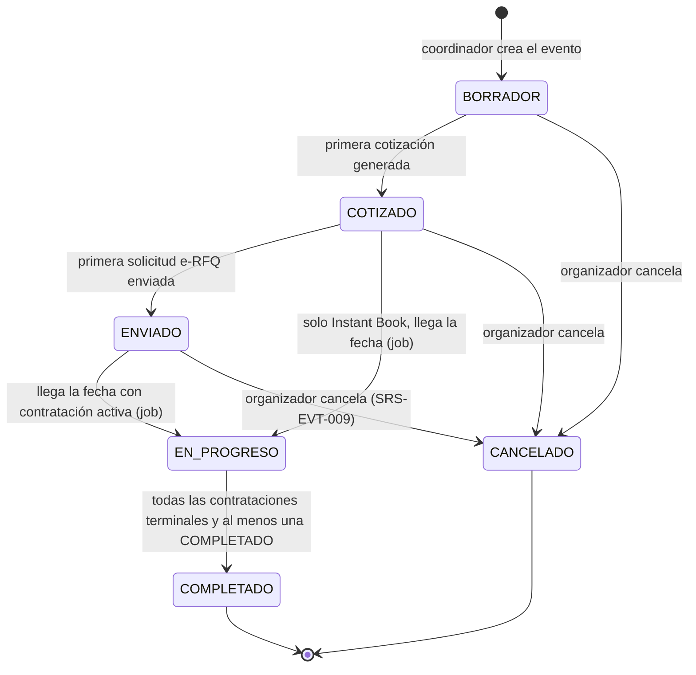

La cancelación sigue SRS-EVT-009 (DEC-024): solo si ninguna contratación está en `EN_PROGRESO` o posterior; revoca las RFQ abiertas e inicia la cancelación de cada contratación, que sigue su propio ciclo. No implica penalidad ni reembolso. El archivado de borradores es una marca (`archivedAt`), no un estado.

## 15.4 Booking

Máquina de estados de la contratación (SRS-BOOK-009, DEC-023):

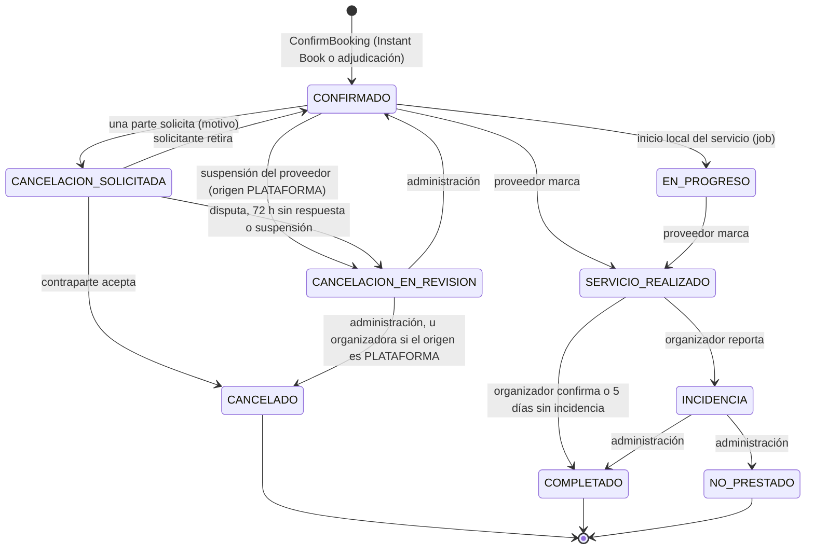

La capacidad se consume en todos los estados salvo `CANCELADO` y `NO_PRESTADO`; liberarla usa `ReleaseBookingCapacity`, con el mismo orden de bloqueo que `ConfirmBooking`. El estado de comisión (`CommissionRecord`) es `PENDIENTE` hasta `SERVICIO_REALIZADO`, `RETENIDA` en `INCIDENCIA`, `DEVENGADA` en `COMPLETADO`, `NO_APLICA` en `CANCELADO`/`NO_PRESTADO` y `REVERTIDA` por corrección auditada.

La revisión registra su origen (`CONTRAPARTE` o `PLATAFORMA`). Con origen `PLATAFORMA` (SRS-ADM-013, DEC-034) la organizadora elige cancelar o mantener; la ventana de decisión y la condición para que la administración resuelva están en SRS-ADM-013 (DEC-036).

## 15.5 Item Tracking

El estado de seguimiento del ítem es propiedad de `Quotation` (`QuotationItem.trackingStatus` e historial de transiciones, TEC-010) y se actualiza consumiendo eventos de RFQ, Booking y Reviews:

| Estado de Booking / hecho | Estado del ítem |
|---|---|
| Ítem creado | `COTIZADO` |
| Primer `RfqRequestSent` de la ronda | `ENVIADO` |
| Ronda terminada sin adjudicación en la que se recibió alguna oferta | `NO_ADJUDICADO` (interno) |
| Ronda terminada sin ofertas y al menos una solicitud expirada | `EXPIRADO` (interno) |
| Ronda terminada sin ofertas ni expiradas y al menos una solicitud rechazada | `RECHAZADO` (con solicitudes revocadas en la misma ronda: DEC-035) |
| Todas las solicitudes revocadas sin ofertas, con el evento vigente | `COTIZADO` (DEC-035) |
| Nueva ronda sobre un ítem `RECHAZADO`, `EXPIRADO`, `NO_ADJUDICADO` o `CANCELADO` | `ENVIADO` (DEC-026) |
| `BookingConfirmed` por Instant Book sobre un ítem sin contratación activa (E2) | `CONFIRMADO` |
| `BookingConfirmed`: `CONFIRMADO`, `CANCELACION_SOLICITADA`, `CANCELACION_EN_REVISION` | `CONFIRMADO` |
| `EN_PROGRESO`, `SERVICIO_REALIZADO`, `INCIDENCIA` | `EN_PROGRESO` |
| `BookingClosed` con `COMPLETADO` | `COMPLETADO` |
| `ReviewSubmitted` | `CALIFICADO` |
| `CANCELADO`, `NO_PRESTADO`, o evento cancelado sin contratación | `CANCELADO` (interno) |

El grafo completo, con disparadores, es el de SRS §9.3. Cuando una ronda termina sin adjudicación se aplica el primer destino que corresponda: `CANCELADO` (evento cancelado), `NO_ADJUDICADO`, `EXPIRADO`, `RECHAZADO`, `COTIZADO` (DEC-035).

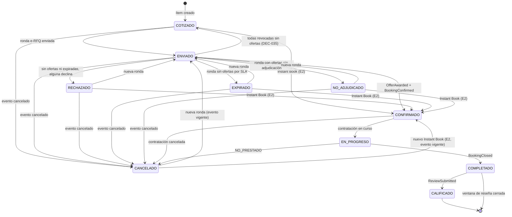

El estado del Booking no debe confundirse con el estado agregado del Evento.

## 15.6 Quotation

Estados de la cotización integral (SRS §9.6). La edición de una cotización generada vuelve a `BORRADOR` y la siguiente generación crea una versión nueva; las versiones anteriores son snapshots inmutables (DEC-018).

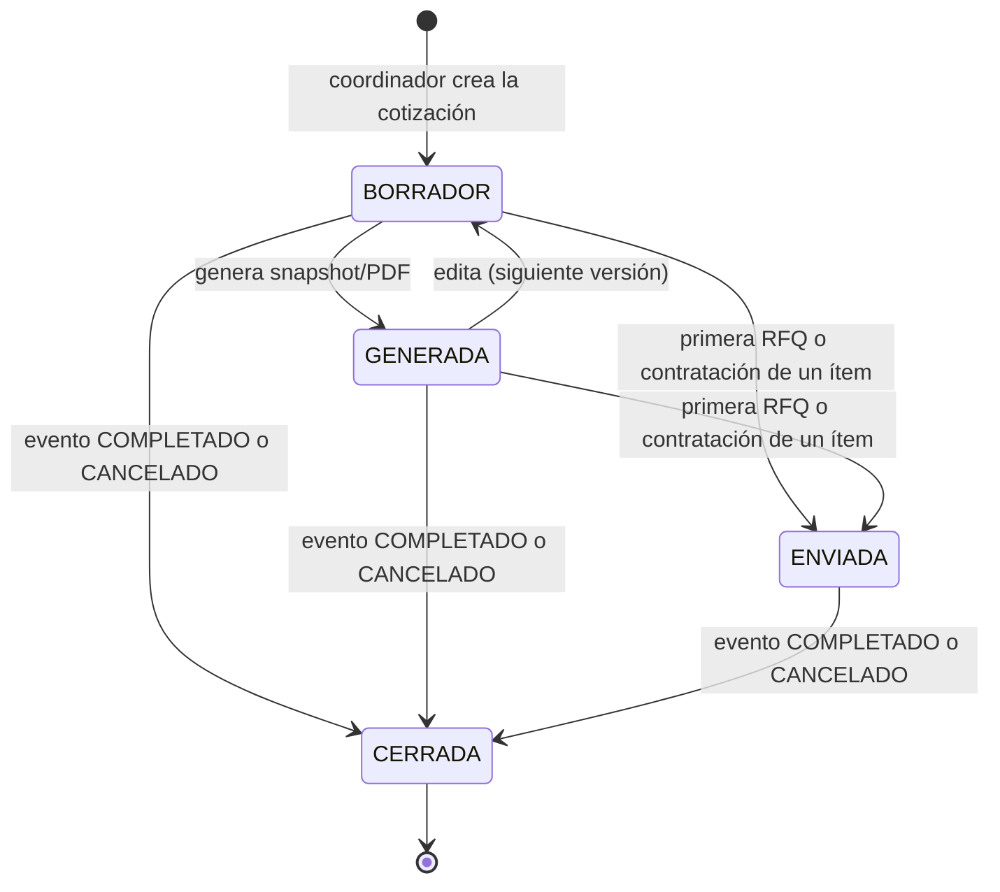

En `ENVIADA` se pueden añadir ítems y generar nuevas versiones del PDF, pero no eliminar ítems con solicitudes o contrataciones. `Quotation` consume `EventCompleted` y `EventCancelled` (§8.1) para cerrar la cotización.

## 15.7 Offer

Cada revisión de una oferta es un agregado `Offer` inmutable (TEC-001, DEC-005); su estado cambia solo por los hechos de la ronda (SRS §9.7):

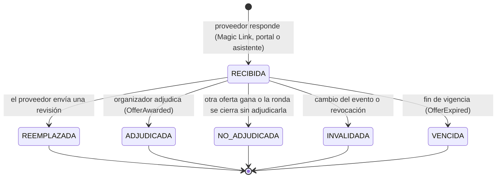

Solo una oferta `RECIBIDA` es adjudicable. La adjudicación cambia en la misma transacción la oferta a `ADJUDICADA`, su solicitud a `ADJUDICADO`, las competidoras a `NO_ADJUDICADA` y sus solicitudes a `NO_ADJUDICADO` (SAD §7.2).

---

# 16. Reglas de diseño para implementación

## 16.1 Estructura por contexto

```text
backend/src/modules/
  identity-access/
    domain/
    application/
    infrastructure/
    http/
  organizations/
    domain/
    application/
    infrastructure/
    http/
  provider-catalog/
    domain/
    application/
    infrastructure/
    http/
  taxonomy-templates/
    domain/
    application/
    infrastructure/
    http/
  event-management/
    domain/
    application/
    infrastructure/
    http/
  quotation/
    domain/
    application/
    infrastructure/
    http/
  availability-booking/
    domain/
    application/
    infrastructure/
    http/
  rfq-offers/
    domain/
    application/
    infrastructure/
    http/
  assisted-response/
    domain/
    application/
    infrastructure/
    http/
  messaging-notifications/
    domain/
    application/
    infrastructure/
    http/
  reviews/
    domain/
    application/
    infrastructure/
    http/
  administration-audit/
    domain/
    application/
    infrastructure/
    http/
```

Esta propuesta refina la estructura del SAD agrupando `Taxonomy & Templates` como contexto explícito. Si se conserva el nombre de carpeta `administration-audit`, debe seguir respetando ownership: la administración ejecuta casos de uso publicados por el contexto propietario y no modifica directamente sus tablas.

## 16.2 Capas internas

**Domain**
- entidades y agregados;
- objetos de valor;
- políticas y servicios de dominio;
- eventos de dominio;
- interfaces de repositorio necesarias para persistencia.

**Application**
- comandos y queries;
- handlers/casos de uso;
- coordinación entre agregados/contextos;
- autorización de operación;
- definición de transacciones;
- publicación a Outbox.

**Infrastructure**
- repositorios Prisma;
- adaptadores Auth0, SendGrid y Cloudinary;
- Redis/BullMQ;
- persistencia Outbox;
- proveedores externos.

**HTTP**
- controladores;
- DTO y validación de entrada;
- serialización;
- mapeo de errores y códigos HTTP.

## 16.3 Prohibiciones

- No colocar reglas de negocio en controladores.
- No importar Prisma desde Domain.
- No acceder a tablas de otro contexto mediante repositorios privados.
- No permitir que Redis sea fuente de verdad de capacidad.
- No enviar emails dentro de una transacción de Booking.
- No crear una oferta directamente desde el módulo Assisted Response sin validación del contexto RFQ.
- No aceptar `organizationId` del cliente como autorización.
- No reescribir snapshots históricos cuando cambia un paquete.
- No confundir `NotificationSent` con `BookingConfirmed`.
- No modelar WhatsApp como integración webhook en MVP.
- No registrar como contratación una oferta solo recibida.

---

# 17. Decisiones de modelado aprobadas

**Alcance:** las filas de esta sección resumen DEC-001..018 y TEC-001..005, aprobadas el 23-11-2026. DEC-019..034, TEC-006..012 y ADR-016..022 se aprobaron el 23-11-2026; su detalle está en `Decisiones.md` §4b y se citan en cada sección afectada. DEC-035..037 se aprobaron con fecha 23-11-2026 y afectan a §5.7, §7, §9.2, §10.3, §14.2 y §15.

## 17.1 Decisiones derivadas directamente de PRD/SRS/SAD

| ID | Decisión | Fuente / fundamento |
|---|---|---|
| DDD-001 | Empresa organizadora es el tenant | SRS multi-tenancy y SAD |
| DDD-002 | Proveedor es identidad comercial global, no subordinada a un tenant | SAD |
| DDD-003 | Separar solicitud RFQ de oferta recibida | SRS-DEC-009, TEC-001 |
| DDD-004 | Booking es entidad transaccional propia | SAD y SRS-DEC-010 |
| DDD-005 | Capacidad por fecha se modela como cupos, no solo booleano | SRS-DEC-004, DEC-006 |
| DDD-006 | Instant Book y adjudicación convergen en Booking | SAD flujos críticos |
| DDD-007 | Magic Link es token hash, limitado, expirado y de un solo uso | SRS Magic Link |
| DDD-008 | WhatsApp MVP no tiene webhook ni recepción automática | SRS-DEC-002 |
| DDD-009 | Respuesta asistida requiere confirmación humana | SRS-WA-005..008 |
| DDD-010 | Oferta recibida no equivale a contratación | RN-20 |
| DDD-011 | Una adjudicación ganadora por ítem | RN-15 |
| DDD-012 | Reseña requiere contratación completada | SRS-REV |
| DDD-013 | Notificación y delivery son distintos del estado de negocio | SAD |
| DDD-014 | PostgreSQL es autoridad transaccional; Redis no es fuente de verdad | SAD |

## 17.2 Propuestas de modelado aprobadas

| ID | Decisión | Motivo | Estado |
|---|---|---|---|
| PROP-001 | Modelar `Offer` como agregado independiente de `RfqRequest` | Historial de revisiones y concurrencia | Aprobada (TEC-001, DEC-005) |
| PROP-002 | Mantener `QuotationItem` dentro de `Quotation` inicialmente | Simplifica versión y consistencia del MVP | Vigente; extraer solo mediante ADR si el volumen lo exige |
| PROP-003 | Modelar `Membership` como agregado separado | Evita cargar y bloquear la colección de miembros | Vigente (DEC-008) |
| PROP-004 | Introducir `RfqCycle` como agrupador explícito | Hace inequívoco el límite de cinco invitados y las rondas | Aprobada (TEC-002) |
| PROP-005 | Mantener `EventTemplate` separado de `Event` y snapshotear valores al crear | Evita que editar la plantilla altere eventos existentes | Vigente (DEC-018) |
| PROP-006 | Implementar proyecciones de búsqueda/Bid Tabulation como read models | Mejora consulta sin duplicar autoridad | Vigente |
| PROP-007 | Modelar cancelación como transición explícita de Booking | Evita confundir rechazo con cancelación | Aprobada (DEC-001) |
| PROP-008 | Definir `organizationId` obligatorio en todas las relaciones de compra | Refuerza auditoría y aislamiento | Aprobada (TEC-005) |

## 17.3 Decisiones de producto aprobadas

Las decisiones antes pendientes se resolvieron en `Decisiones.md`, donde se documentan situación, alternativas, ventajas, costos y riesgos. El DDD las incorpora así:

| ID | Resolución adoptada | Justificación | Dónde impacta el dominio |
|---|---|---|---|
| DEC-001 | Cancelación por etapas, sin penalidades automáticas, con `CANCELACION_EN_REVISION` (valor DEC-022) | Evita inventar penalizaciones sin pagos; libera capacidad solo con decisión clara | BC-07, Booking (5.7), estados (15.4) |
| DEC-002 | Comisión devengada al completar el servicio y confirmar (5 días); `RETENIDA` en disputa (valor DEC-022) | Liga la comisión a un servicio cumplido | BC-07, Booking, evento `CommissionAccrued` |
| DEC-003 | Retención por categoría de dato, borrado lógico y `legal_hold` | Evita borrar evidencia y reduce acumulación de datos personales | BC-12, jobs de mantenimiento |
| DEC-004 | Ranking explicable 40/30/20/10, versionado | Reduce sesgo hacia perfiles con pocas reseñas | Read model `ProviderSearchResult`, política de ranking |
| DEC-005 | Ofertas inmutables con revisiones antes de adjudicar | Corrección sin perder trazabilidad | BC-08, Offer (5.8) |
| DEC-006 | Capacidad global (2) y por paquete | Conserva la regla simple sin limitar servicios con inventario | BC-07, ProviderAvailability |
| DEC-007 | Zona IANA por evento, UTC y fecha local | Evita errores de fecha y permite expansión | Event (5.5), `EventDate` (6.2) |
| DEC-008 | Un `PROPIETARIO`, varios `ADMIN_EMPRESA`, transferencia controlada (valores DEC-022) | Evita punto único de falla | BC-02, Membership (5.3) |
| DEC-009 | Verificación de proveedores por niveles | Evidencia proporcional al riesgo | BC-12, `VerificationDecision` |
| DEC-010 | Configuración fiscal explícita; comisión separada y congelada | No inferir obligaciones tributarias | Quotation, Booking, `Money` |
| DEC-011 | Roles fijos con permisos predefinidos | Menor complejidad y costo de QA | BC-01, BC-02 |
| DEC-012 | RPO ≤ 1 h, RTO ≤ 4 h | Protege reservas y adjudicaciones | Persistencia (14), operación |
| DEC-013 / DEC-014 | Hosting validado por criterios ponderados; región cercana a Colombia | Decisión informada sobre residencia de datos | Fuera del dominio; ver SAD |
| DEC-015 | Mapas limitados con captura manual | Maps no debe bloquear reservas | Adaptador de geolocalización |
| DEC-016 | React-PDF por defecto desde snapshot | Consistencia histórica y menos infraestructura | Quotation, snapshot |
| DEC-017 | Sesión BFF con cookies seguras | Reduce exposición de tokens | BC-01; ver SAD |
| DEC-018 | Snapshots inmutables de decisiones comerciales | Trazabilidad e integridad histórica | Booking, Quotation, Offer |
| TEC-003 | Idempotencia obligatoria | Evita reservas y adjudicaciones duplicadas | Casos de uso de Booking y Award |
| TEC-004 | Outbox transaccional | Efectos externos recuperables | Eventos de dominio (8.2) |
| TEC-005 | Tenant desde membresía; RLS como defensa adicional | Aislamiento multi-tenant | Todos los contextos |

---

# 18. Trazabilidad hacia requisitos

| Elemento de dominio | Requisitos SRS relacionados |
|---|---|
| Identity & Access | `SRS-AUTH-001` a `SRS-AUTH-012` |
| Organizations & Tenancy | `SRS-TEN-001` a `SRS-TEN-005`, `SRS-AUTH-009` a `SRS-AUTH-011` |
| Provider Catalog | `SRS-CAT-001` a `SRS-CAT-015` |
| Event Management | `SRS-EVT-001` a `SRS-EVT-011` |
| Quotation | `SRS-QUO-001` a `SRS-QUO-014` |
| Availability & Booking | `SRS-BOOK-001` a `SRS-BOOK-010` |
| RFQ & Offers | `SRS-RFQ-001` a `SRS-RFQ-013` |
| Magic Link | `SRS-MAGIC-001` a `SRS-MAGIC-006` |
| Assisted Response | `SRS-WA-001` a `SRS-WA-009` |
| Quotation (seguimiento de ítem) | `SRS-TRK-001` a `SRS-TRK-004` |
| Reviews | `SRS-REV-001` a `SRS-REV-008` |
| Administration & Audit | `SRS-ADM-001` a `SRS-ADM-013` |
| Messaging & Notifications | `SRS-NOT-001` a `SRS-NOT-006` |
| Taxonomy & Templates | `SRS-CAT-003`, `SRS-CAT-004`, `SRS-EVT-002` a `SRS-EVT-004`, `SRS-ADM-002` a `SRS-ADM-004`, `SRS-WA-001` |

---

# 19. Estrategia de pruebas de dominio

## 19.1 Pruebas unitarias de agregados y políticas

- no permitir paquete asociado a subtipo de otra categoría;
- no mostrar proveedor no verificado/suspendido;
- máximo cinco categorías principales por proveedor;
- cálculo de precios con decimal exacto;
- snapshot no cambia tras editar paquete;
- evento pertenece al tenant correcto;
- transición inválida de estado rechazada;
- no reservar si capacidad es cero;
- no superar capacidad diaria;
- idempotencia de Instant Book;
- no aceptar respuesta RFQ posterior al SLA;
- no consumir Magic Link más de una vez;
- no adjudicar dos ofertas para el mismo ítem;
- no convertir oferta recibida en Booking sin adjudicación;
- Assisted Response exige confirmación humana;
- reseña solo para Booking completado;
- una reseña por Booking;
- promedio de cuatro dimensiones correcto.

## 19.2 Pruebas de integración

- creación de evento y cotización dentro del tenant;
- búsqueda de catálogo con taxonomía y elegibilidad;
- reserva concurrente del último cupo;
- adjudicación concurrente de dos ofertas;
- Magic Link con token inválido, expirado, consumido y válido;
- outbox recupera notificación tras reinicio del worker;
- fallo de SendGrid no revierte operación de negocio;
- aislamiento de tenant en API y worker;
- proyección Bid Tabulation refleja ofertas confirmadas;
- cambio de paquete no altera contrataciones previas.

## 19.3 Pruebas de arquitectura

- Domain no importa frameworks/ORM/SDK;
- HTTP no contiene lógica de dominio;
- módulos no acceden a repositorios/tablas privados de otros módulos;
- no existen dependencias circulares;
- todos los eventos externos se publican mediante Outbox;
- operaciones críticas definen límite transaccional;
- endpoints están mapeados a casos de uso;
- enums y estados coinciden con SRS/OpenAPI.

---

# 20. Plan de implementación guiado por dominio

| Orden | Contexto | Entregable de dominio | Dependencia |
|---|---|---|---|
| 1 | Identity & Access | User, roles, autenticación delegada, autorización base | Fundaciones |
| 2 | Organizations & Tenancy | Organization, Membership, TenantContext, límites | 1 |
| 3 | Taxonomy & Templates | Category, Subtype, EventTemplate | 1, 2 |
| 4 | Provider Catalog | ProviderProfile, ServicePackage, elegibilidad | 1, 2, 3 |
| 5 | Event Management | Event, estados, clonación | 2, 3 |
| 6 | Quotation | Quotation, items, snapshots, comparación | 3, 4, 5 |
| 7 | Availability & Booking | capacidad, Booking, concurrencia e idempotencia | 4, 5, 6 |
| 8 | RFQ & Offers | solicitudes, Magic Link, SLA, ofertas, Bid Tabulation, Award | 2, 4, 6, 7 |
| 9 | Messaging & Notifications | outbox, email, notificaciones, tareas programadas | 1–8 |
| 10 | Assisted Response | importación y confirmación humana | 8, 9 |
| 11 | Reviews | elegibilidad, calificaciones y reputación | 7 |
| 12 | Administration & Audit | verificación, moderación, taxonomía y auditoría | 3, 4, 8, 11 |

El orden es una propuesta de implementación por dependencias del dominio y no reemplaza el plan de despliegue del SAD.

---

# 21. Criterios de aceptación del DDD

El modelo de dominio se considera listo para guiar la implementación cuando:

- producto valida el lenguaje ubicuo;
- arquitectura aprueba los bounded contexts;
- cada agregado tiene raíz, invariantes y límites transaccionales definidos;
- se aprueba el modelo de capacidad/booking;
- se aprueba el flujo atómico de adjudicación;
- se confirma el alcance de Magic Link y WhatsApp MVP;
- se acuerdan las políticas de oferta y cancelación;
- se definen los contratos entre contextos;
- las rutas OpenAPI se asignan a casos de uso;
- las pruebas de arquitectura pueden verificar las dependencias.

---

# 22. Glosario DDD

| Término | Significado |
|---|---|
| DDD | Domain-Driven Design |
| Ubiquitous Language | Lenguaje compartido por negocio y equipo técnico |
| Subdomain | Área de problema dentro del negocio |
| Bounded Context | Límite explícito dentro del cual un modelo tiene un significado consistente |
| Aggregate | Cluster de objetos que protege invariantes transaccionales |
| Aggregate Root | Única entrada para modificar un agregado |
| Entity | Objeto con identidad propia |
| Value Object | Objeto inmutable definido por sus valores |
| Domain Service | Regla de dominio que no pertenece naturalmente a una entidad |
| Domain Event | Hecho de negocio que ya ocurrió |
| Repository | Abstracción para recuperar y persistir agregados |
| Context Map | Mapa de relaciones e integración entre Bounded Contexts |
| Anti-Corruption Layer | Adaptador que protege el modelo propio de conceptos externos |
| Read Model | Proyección optimizada para consulta |
| CQRS | Separación de modelos de lectura y escritura |
| Transactional Outbox | Patrón para publicar eventos de forma fiable junto con una transacción |
| Invariant | Regla que debe mantenerse siempre válida |

Glosario consolidado: `Glosario.md`.

---

## 23. Cierre

Este DDD establece el modelo de dominio de referencia para ProveeEventos MVP. La decisión arquitectónica central es mantener un **monolito modular con límites de dominio explícitos**, donde cada contexto sea propietario de sus reglas y datos, y donde las operaciones de reserva y adjudicación estén protegidas por transacciones atómicas.

El dominio central se organiza alrededor de la cotización híbrida y la contratación: el flujo Instant Book y el flujo e-RFQ son distintos en su origen, pero ambos convergen en una contratación confirmada (`Booking`). El catálogo, los eventos, la capacidad, la mensajería y las reseñas soportan ese ciclo sin apropiarse de sus reglas.

Las decisiones de `Decisiones.md` están incorporadas al modelo con su justificación (sección 17). El siguiente paso recomendado es revisar y aprobar el mapa de contextos y los agregados Booking/RFQ/Offer antes de traducir el modelo a entidades Prisma y casos de uso concretos; el esquema físico parte de las decisiones aprobadas (DEC-001..037, TEC-001..012 y ADR-001..022).
