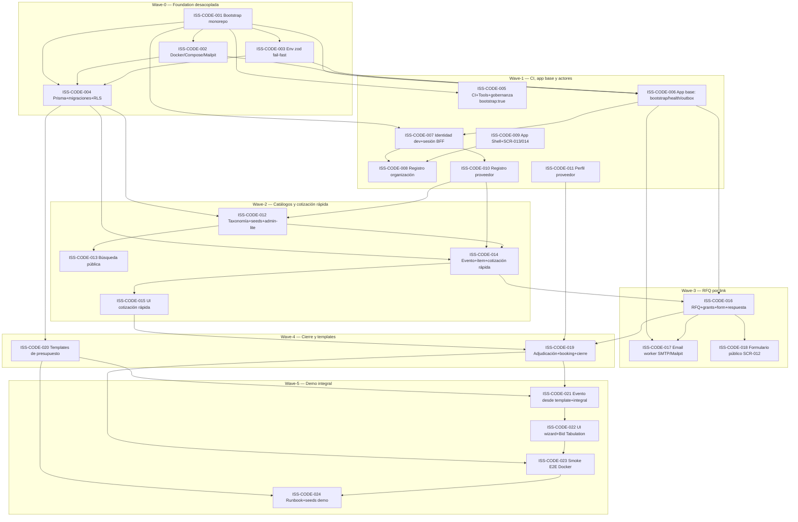
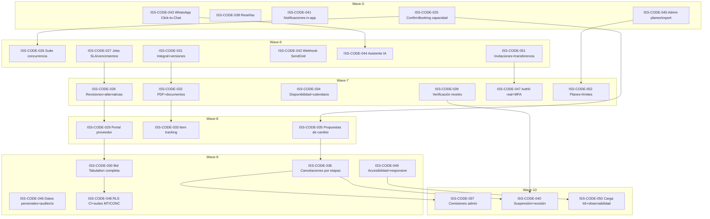

# ProveeEventos — Plan de Desarrollo y Backlog de Implementación (`ProveeEventos_ImplBacklog.md`)

## Cabecera y Metadatos del Documento

| Campo | Valor |
|---|---|
| Documento | Software Development Plan / Implementation Backlog + MVP Release Plan |
| Versión | 1.1 |
| Fecha | 2026-11-25 |
| Estructura | MVP en 2 Etapas — Etapa 1: Vertical Slice demo end-to-end en Docker/Docker Compose · Etapa 2: completitud del MVP (PRD v2.4) |
| Stack objetivo | Monorepo npm (`backend/` + `frontend/`, Node.js 26, TypeScript estricto), API Express, Next.js 14+ (BFF), Prisma + PostgreSQL 15/16 con PgBouncer, Redis/BullMQ, Mailpit (SMTP dev), Docker Compose |
| Épicas | **23** (`EP-01..EP-23`: 8 en Etapa 1, 15 en Etapa 2) |
| Historias de Usuario | **41** (`US-001..US-041`) |
| Issues de Codificación (`ISS-CODE`) | **61** (`ISS-CODE-001..061`; 58 con par + 3 de calidad self-test con paridad justificada) |
| Issues de Pruebas (`ISS-TEST`) | **58** (`ISS-TEST-001..061` con 026/048/050 reservados; paridad 58/58) |
| Total Issues | **119** (48 en MVP-Stage-1, 71 en MVP-Stage-2) |
| Distribución `model_tier` | **frontier 50 / economy 69** (sobre los 119 issues; en los 61 issues de código: 31/30) |
| Base normativa | PRD v2.4 · SRS v1.3 · SAD v1.4 · DDD v1.4 · API v1.4.0 · ADRs (71 + 001..022) · UXUI v1.1 (SCR-001..065) · TESTs (264 casos) · CICD v1.0 · Decisiones v1.6 |
| Consumidores | (1) script/agente creador de Issues en GitHub (`gh` CLI), (2) agentes codificadores/testers/validadores que toman Issues autónomamente |
| Historial | **1.0** (2026-11-25) versión auditada en `ProveeEventos_CrossAudit_Report.md` (101 Issues) · **1.1** (2026-11-25) cierre de brechas `RR-04`/`RR-09` con `EP-23` y `ISS-CODE/TEST-053..061`, parches de trazabilidad en 26 Issues y `blocks` regenerado (119 Issues) |

---

## Sección 1 — Propósito, Alcance e Inventario de Documentos Fuente

Este documento descompone el MVP de ProveeEventos en **GitHub Issues atómicos, desacoplados y ejecutables en paralelo** por múltiples agentes de IA, organizados en Épicas → Historias de Usuario → pares `ISS-CODE-NNN` ↔ `ISS-TEST-NNN` con metadatos completos (`allowed_paths`, `depends_on`, `parallel_wave`, `model_tier`, roles). La ejecución real se difiere a `Plan0003_MVP_Stage1_Execution.md` y `Plan0004_MVP_Stage2_Execution.md`; la creación mecánica de Issues en GitHub, a `Plan0002_GitHub_Issues_Creation.md`.

| # | Documento | Rol en este backlog |
|---|---|---|
| 1 | `ProveeEventos_PRD.md` v2.4 | Alcance funcional del MVP (79 `RF-*`, fases E1/E2), flujos críticos §10 (cotización integral, e-RFQ, reseñas) — fuente de Épicas e Historias |
| 2 | `ProveeEventos_SRS.md` v1.3 | Requisitos con ID estable `SRS-<AREA>-NNN`; §8 (12 escenarios de aceptación) define los smoke E2E de Etapa 1; criterios globales §11 alimentan el Release Plan |
| 3 | `ProveeEventos_SAD.md` v1.4 | 12 módulos §4.1 con capas, matriz de dependencias §4.4 (delimita `allowed_paths` por módulo), reglas de consistencia §7.1–7.6 (ConfirmBooking, Magic Link, Outbox, suspensión), jobs §8.2, errores §10.6–10.8 |
| 4 | `ProveeEventos_DDD.md` v1.4 | Agregados, invariantes y máquinas de estado §15 que cada Issue de código debe respetar; eventos de dominio §8.1 para el Outbox |
| 5 | `ProveeEventos_TDD.md` | 72 tablas, flujos transaccionales F1–F11, orden de bloqueo N1–N11, RLS (39 tablas, contexto `set_config`) — base de los Issues de persistencia y concurrencia |
| 6 | `ProveeEventos_API_Spec.yaml` v1.4.0 | Contrato: 151 operaciones, 20 `ErrorCode`, idempotencia/ETag/paginación — cada Issue de API cita sus `operationId` |
| 7 | `proveeeventos.prisma` | Artefacto fuente del schema (72 modelos, 55 enums; valores según DEC-022) que el Issue de persistencia adapta a `backend/src/prisma/schema.prisma` |
| 8 | `proveeeventos.sql` | DDL de migraciones 00–11 + `20_rls` (39 tablas RLS, roles `pe_*`, 91 CHECK, 18 triggers) que se traslada a `backend/src/prisma/` |
| 9 | `ProveeEventos_ADRs.md` | Normativa obligatoria: ADR-ARCH-001..010 (fronteras), ADR-DATA-001..021 (datos/concurrencia), ADR-TEST-001..006 (pruebas), ADR-GOV-001..007 (gobernanza anti-sabotaje) — citados en `forbidden_paths` y DoD |
| 10 | `ProveeEventos_UXUI.md` v1.1 | 65 pantallas `SCR-NNN`, flujos F-01..F-08, Design System (CMP-01..57), criterios QA-01..QA-15 — base de los Issues de frontend |
| 11 | `ProveeEventos_TESTs.md` | 264 casos `TC-CAT-NNN` trazados: cada `ISS-TEST-NNN` declara los casos que implementa y cada `ISS-CODE-NNN` los que su código debe hacer pasar |
| 12 | `ProveeEventos_CICD.md` v1.0 | Infraestructura Etapa 1 ya diseñada: monorepo, `docker-compose.yml` con 18 servicios (incl. Mailpit y dev-stubs), 3 workflows CI (`ci-quality-and-tests`, `adr-guard`, `ai-reviewer`), roles BD `pe_*`, scripts npm raíz, orden de arranque §13.1, AC-01..AC-17 — los Issues de Foundation implementan exactamente ese diseño |
| 13 | `Decisiones.md` v1.6 | DEC-001..037 y TEC-001..012 aprobados (TEC-013 pendiente): condicionan alcance por entrega (DEC-021) y mecanismos (TEC-006..012) |
| 14 | `Glosario.md` | Vocabulario único (`INSTANT_BOOK`, `E_RFQ`, orígenes de respuesta) usado en títulos y descripciones de Issues |
| 15 | `Trazabilidad.md` | Matriz SRS→operationId→eventos→entrega: validación de que cada Issue cubre requisitos sin duplicar operaciones |
| 16 | `CLAUDE.md` | Jerarquía de prevalencia y convención de enums; reglas del paquete de documentación |
| 17 | `Plans/Plan0001_CICDs.md`, `Reviews/ReviewsCICD_V1.md` | Contexto histórico del diseño CICD (solo lectura; no genera Issues) |

**Prevalencia:** PRD > SRS > SAD > DDD > API (CLAUDE.md / DEC-019); TDD manda en persistencia; CICD manda en infraestructura local/CI de Etapa 1 (§1.4 del propio CICD). Única decisión abierta relevante: TEC-013 (contrato 1.4.0) — los Issues de API se escriben contra el YAML ya presente y se revalidan si cambia.

---

## Sección 2 — Estrategia de Entrega en Dos Etapas del MVP

### 2.1 Alcance MVP Etapa 1 — Flujo End-to-End Demostrable en Docker (Vertical Slice)

Objetivo: que cualquier persona levante `npm ci && npm run env:init && npm run dev:up` y ejecute **dos recorridos completos sin mocks manuales**: (A) cotización rápida de un proveedor específico hasta cierre de contratación vía link por correo; (B) presupuesto de evento desde template con grupo de proveedores hasta adjudicación y cierre. Todo dentro de Docker Compose (`proveeeventos`), con correo visible en Mailpit (`http://localhost:8025`) y app en `http://localhost:3000`.

| Bloque | Alcance Etapa 1 | Épica | Fuente principal |
|---|---|---|---|
| Foundation / Wave-0 | Scaffolding monorepo, guardrails Capa 1/2 (`verify:adrs`, `adr-guard`, Semgrep/gitleaks), Docker Compose completo (API, Frontend, PostgreSQL+PgBouncer, Redis, Mailpit, dev-stubs), migraciones 00–11 + `20_rls`, seeds de referencia | EP-01 | CICD §5/§7/§13 |
| Bloque 1 | Registro/autenticación de organizador con sesión BFF (proveedor de identidad dev vía stub Auth0 del CICD §5.6 — sin contraseñas propias), App Shell y navegación base | EP-02 | SRS-AUTH-001/003/010, SCR-006/013/014 |
| Bloque 2 | Registro de proveedores (backend + `SCR-007`, perfil y canal `SCR-043`, estado `PENDIENTE`→`VERIFICADO` por admin-lite) | EP-03 | SRS-AUTH-002, SRS-CAT-001 |
| Bloque 3 | Catálogos maestros (21 categorías DEC-020, subtipos, cobertura) sembrados automáticamente + búsqueda pública básica | EP-04 | SRS-CAT-003/004/010/011 |
| Bloque 4 | Evento mínimo + ítem + cotización rápida/comparación para UN proveedor concreto (ranking 40/30/20/10) | EP-05 | SRS-EVT-001, SRS-QUO-001..005 |
| Bloque 5 | Aceptar proveedor → ronda e-RFQ de 1..N → Magic Link `/r#token` → correo REAL a Mailpit → formulario público móvil `SCR-012` (sin login) → respuesta/oferta → Bid Tabulation → adjudicación → contratación → cierre con comisión | EP-06 | SRS-RFQ-001..003/006/008/009, SRS-MAGIC-001..006, SRS-BOOK-002/004/008, TEC-008/009 |
| Bloque 6 | Templates de presupuesto de evento (rubros/categorías predefinidas) → evento multi-ítem → lanzamiento del mismo flujo para un GRUPO de proveedores (1–5 por ítem) | EP-07 | SRS-EVT-002, SRS-RFQ-001/002, PRD RF-PLT-01/02 |
| Bloque 7 | Despliegue local un comando, migración, seeds demo, smoke E2E Playwright de los 2 recorridos, runbook y verificación de salud | EP-08 | CICD §5.7/§8, SRS §8.2/8.4 |

**Piezas puente detectadas por la auditoría y agregadas obligatoriamente a Etapa 1** (regla de completitud del prompt):

| ID puente | Pieza | Por qué es indispensable | Fuente |
|---|---|---|---|
| P-P1 | Proveedor de identidad dev (stub Auth0: OIDC/JWKS/`/authorize`/`/oauth/token`) tras el puerto de identidad | SRS-NFR-SEC-002 prohíbe contraseñas propias; Auth0 real exige cuenta externa; el stub del CICD §5.6 permite JWT válido local sin almacenar secretos | CICD §5.6, TEC-007 |
| P-P2 | Transporte SMTP de desarrollo (Mailpit) para el adaptador de email | El flujo del link exige correo real visible; SendGrid productivo no aplica en local | CICD §5.4 (`mailpit`), SRS-NOT-001 |
| P-P3 | Event Management mínimo (crear evento, ítems, estados `BORRADOR`/`COTIZADO`) | La cotización rápida y los templates requieren evento+ítem como ancla de `quotation_item_id` | SRS-EVT-001/006, TDD F1 |
| P-P4 | Taxonomía sembrada (21 categorías + subtipos) y `Holiday`/referencia | Elegibilidad y rubros de template dependen de catálogo cargado al levantar el stack | DEC-020, seeds CICD §6.5 |
| P-P5 | Núcleo Outbox + BullMQ + worker (cola `outbox`, publicador 5 s, reconciliación 1 min) | Ningún efecto externo (correo) puede salir fuera de transacción (ADR-DATA-006); el email del link viaja por Outbox | SAD §7.4, CICD §5.4 (`worker`) |
| P-P6 | Contexto de tenant (`set_config`) + guardrails Prisma y errores `problem+json` + `/health/*` | RLS y roles `pe_*` ya están en migraciones; sin envoltorio de contexto nada es legible; errores/health son contrato del CICD | TDD §5.2, SAD §10.6/§10.8 |
| P-P7 | Seeds de datos demo (organización demo, 5–8 proveedores verificados demo con paquetes, plantillas de evento) | Los 2 recorridos demo necesitan datos listos tras `dev:up` | CICD §6.5, PRD §10 |
| P-P8 | Administración mínima (aprobar proveedor: verificación nivel 1) | Sin aprobación, el proveedor registrado no es visible/elegible y el flujo se detiene | SRS-ADM-001 (nivel 1), DEC-009 |

Fuera de Etapa 1 (va a Etapa 2 o Post-MVP): Instant Book, WhatsApp, reseñas, tracking completo, PDF/versiones completas, disponibilidad editable, cancelaciones con disputas, comisiones admin, planes, notificaciones in-app, administración completa, endurecimiento Auth0 real/RLS-CI/a11y/carga.

### 2.2 Alcance MVP Etapa 2 — Completitud del MVP (PRD v2.4)

| Épica | Alcance | Fuente principal |
|---|---|---|
| EP-09 Instant Book y capacidad dos niveles | `ConfirmBooking` completo, capacidad global/paquete (DEC-006/025), `SCR-023`, suite de concurrencia real | SRS-BOOK-001..006, ADR-TEST-003 |
| EP-10 RFQ completo | Jobs SLA/vencimientos (DEC-035), rondas múltiples y revisiones, portal de proveedor `SCR-049/050`, disponibilidad pública, Bid Tabulation completa | SRS-RFQ-004..013 |
| EP-11 Cotización integral, versiones y PDF | Selección/sustitución, snapshots/versiones (DEC-018), job de PDF, item tracking `SCR-018` | SRS-QUO-006..014, SRS-TRK-001..004 |
| EP-12 Disponibilidad y propuestas | Calendario/bloqueos `SCR-047`, propuestas de cambio y tarifa vinculante | SRS-CAT-009, SRS-BOOK-005 |
| EP-13 Cancelaciones y comisiones | Cancelación por etapas, disputas, comisiones admin/exportación/reversión | SRS-BOOK-007..010, DEC-001/002 |
| EP-14 Reseñas B2B | Reseñas 4 dimensiones, ventana 30 días, moderación | SRS-REV-001..008 |
| EP-15 Verificación y suspensión | Niveles de verificación, suspensión con revisión de contrataciones futuras (DEC-034/036) | SRS-ADM-001/005/013 |
| EP-16 Notificaciones completas | In-app + preferencias `SCR-039/040`, webhook SendGrid firmado, reintentos | SRS-NOT-001..006 |
| EP-17 WhatsApp | Click-to-Chat + plantillas, asistente IA asistido con confirmación humana `SCR-027` | SRS-WA-001..009 |
| EP-18 Administración y cumplimiento | Planes/exportaciones, datos personales + legal holds, auditoría, dashboard | SRS-ADM-007..012 |
| EP-19 Seguridad y RLS | Auth0 real + MFA, suites `TC-MT`/`TC-CONC` bloqueantes en CI, endurecimiento | SRS-NFR-SEC, ADR-TEST-003/004 |
| EP-20 Accesibilidad, E2E y carga | WCAG 2.1 AA (axe + manual), E2E completa, k6 Baseline/Spike/Soak, observabilidad | SRS-NFR-USA/PERF, TESTs §7/§11 |
| EP-21 Membresías avanzadas | Invitaciones completas, roles, transferencia de propiedad `SCR-036/037` | SRS-AUTH-006/009 |
| EP-22 Planes y límites | Planes PRUEBA/limites atómicos, vencimiento, `SCR-038` | SRS-TEN-003/004, DEC-029 |
| EP-23 Cierre de cobertura del MVP | Portafolio multimedia, paquetes, taxonomía administrable, plantillas propias/globales, ciclo y equipo del evento, empresa activa, superficie pública y legal, jobs de `scheduler`/`maintenance`, backups y restauración; cierra el riesgo **RR-04** (`Plans/Plan0006_BacklogGaps.md`) | SRS-CAT-002/004..007, SRS-EVT-004..008, SRS-TEN-005, SRS-ADM-002/003, SRS-NFR-AVL-001..005, SRS-NFR-PRIV-001, SRS-NFR-SCAL-006 |

### 2.3 Hitos y Entregables (M0–M6)

| Hito | Contenido | Criterio de salida (verificable) | Estimación agregada |
|---|---|---|---|
| **M0 — Foundation en Docker** | EP-01 completo (Wave-0/1): monorepo, compose, migraciones, CI, app base | `npm run dev:up` levanta stack sano (healthchecks 200); `npm run test:stack:up` verde; AC-01..AC-08 de CICD §13.3 | ~2 semanas |
| **M1 — Actores y catálogos** | EP-02+EP-03+EP-04 (Wave-1/2): organizador con sesión, proveedores registrados y visibles, catálogos sembrados | Checks del Ruleset en verde sobre `main` y activados por una persona (§4.8); registro organizador→login→ver organización; registro proveedor→aprobación admin-lite→visible en búsqueda pública | ~1 semana |
| **M2 — Cotización rápida demostrable** | EP-05 (Wave-2): evento+ítem+comparación de 1 proveedor | Recorrido A hasta "aceptar proveedor" sin errores | ~1 semana |
| **M3 — Flujo por link con correo real** | EP-06 (Wave-3): e-RFQ→Mailpit→formulario público→oferta→adjudicación→contratación→cierre | Recorrido A completo punto a punto; correo visible en Mailpit; cierre con comisión registrada | ~1.5 semanas |
| **M4 — Demo Etapa 1 completa** | EP-07+EP-08 (Wave-4): templates y flujo grupal + smoke E2E automatizado | Recorrido B completo; `npm run test:e2e:smoke` verde en local y CI; **Release Demo Etapa 1** | ~1.5 semanas |
| **M5 — MVP funcional completo** | EP-09..EP-18 + EP-21/22 (Wave-5..10) + EP-23 (Wave-11..13): todo el alcance funcional del MVP | Suites `test:unit/int/api/mt/conc/sec` verdes; smoke 12 escenarios SRS §8; calidad según gates de `ProveeEventos_TESTs.md` G-01..G-13 | ~5–6 semanas |
| **M6 — MVP endurecido (Release)** | EP-19+EP-20 (Wave-8/9): Auth0 real, RLS-CI, a11y, carga, observabilidad | Gates G-14..G-19 de TESTs; criterios de liberación §9.3; **Release MVP** | ~2 semanas |

Alineación de calendario: M0–M4 ≈ semanas 1–7 (equivalente vertical del arranque de E1 del PRD); M5–M6 ≈ semanas 8–15 (completitud E1 + E2 del PRD). Sin teams humanos intermedios: los hitos son puntos de corte de demos, no gates de aprobación humana salvo los marcados (integración del primer PR de gobernanza, CICD §7.6).

---

## Sección 3 — Estándares de GitHub Issues, Metadatos y Paralelismo

### 3.1 Taxonomía de Labels y Estados en GitHub

**Labels de estado (una activa por Issue; máquina de estados completa en §4):**

| Label | Significado | Quién lo transiciona |
|---|---|---|
| `status:backlog` | Creado, aún no elegible (dependencias sin `done`) | Creador de Issues / orquestador |
| `status:ready` | Elegible: todas las `depends_on` están en `status:done` | Script de promoción (o creador al crear sin dependencias) |
| `status:in-progress` | Reclamado por un agente con lease vigente | Agente (claim) |
| `status:in-review` | PR abierto esperando CI + `adr-guard` + `ai-reviewer` | Agente al abrir PR |
| `status:changes-requested` | CI rojo o revisión pide cambios | Bots (`ai-reviewer`, Actions) o revisor |
| `status:done` | Merged + criterios de aceptación verificados | Agente al cerrar tras merge |
| `status:blocked` | Impedimento técnico real; comentario con `BLOCKER_TYPE` y causa | Agente |
| `status:needs-human` | Escalado al environment `human-approval` (E1–E4 de adr-guard o decisiones E5–E7 del ai-reviewer) | `adr-guard` / `ai-reviewer` |

**Labels de clasificación (fijas, se asignan al crear el Issue):** `stage:mvp-1` | `stage:mvp-2` · `type:code` | `type:test` | `type:infra` | `type:docs` · `tier:frontier` | `tier:economy` · `role:<rol-id>` (uno por Issue; catálogo completo en §11) · `priority:P0|P1|P2` · `wave:0..9` · `epic:EP-01..EP-22`.

**Milestones:** `M0-Foundation`, `M1-Actores`, `M2-Cotizacion`, `M3-Link-Correo`, `M4-Demo-Etapa1`, `M5-MVP-Funcional`, `M6-Release-MVP` (§2.3).

### 3.2 Esquema YAML Obligatorio de Metadatos por Issue

Todo `ISS-CODE-NNN`/`ISS-TEST-NNN` inicia su cuerpo con este bloque YAML (parseable, sin omitir campos; los campos `paired_*` siempre presentes, con `null` cuando no aplica):

```yaml
---
issue_id: ISS-CODE-001          # ISS-CODE-NNN | ISS-TEST-NNN
type: code                      # code | test
stage: MVP-Stage-1              # MVP-Stage-1 | MVP-Stage-2
epic_id: EP-01
story_id: US-001
priority: P0                    # P0 | P1 | P2
estimate: M                     # XS (1-2h) | S (2-4h) | M (4-8h) | L (1-2d)
parallel_wave: Wave-0           # Wave-0..Wave-9
coder_role: Backend-Architect-Agent
tester_role: QA-Integration-Agent
validator_role: Arch-Reviewer-Agent
model_tier: frontier            # frontier | economy
paired_test_issue: ISS-TEST-001 # si type == code; null solo con excepción justificada
paired_code_issue: null         # si type == test; apunta al ISS-CODE-NNN hermano
depends_on: [ISS-CODE-000]      # IDs con status:done requeridos para iniciar
blocks: [ISS-CODE-005]          # Issues que dependen de este (inverso de depends_on, sin contar su par)
allowed_paths:                  # ÚNICAS rutas creables/modificables (anti-colisión)
  - backend/src/modules/providers/**
forbidden_paths:                # Rutas protegidas (requieren aprobación humana E1-E4 si se tocan)
  - docs/**
  - ProveeEventos_ADRs.md
  - backend/src/prisma/migrations/**
source_refs:                    # Trazabilidad exacta
  - PRD: Sec 6.2
  - SRS: SRS-CAT-001
  - UXUI: SCR-007
  - TESTs: TC-API-026
  - ADRs: [ADR-ARCH-001, ADR-SEC-010]
github_labels:
  - stage:mvp-1
  - type:code
  - tier:frontier
  - role:backend-architect
  - status:backlog        # status:ready solo si depends_on está vacío o todas están en done (§3.1)
---
```

Reglas del esquema: (1) `allowed_paths` nunca cruza módulos SAD §4.1 ajenos ni toca rutas protegidas de Capa 2 (CICD §7.4: `.github/**`, `Tools/**`, `package.json`, `tsconfig*`, `vitest*`, `playwright.config.*`, `docker/**`, `docker-compose.yml`, `scripts/**`, `backend/src/prisma/{bootstrap,rls}/**`, documentos normativos); (2) dos Issues de la misma `parallel_wave` sin relación de dependencia (directa o transitiva) tienen `allowed_paths` disjuntos; (3) `source_refs` incluye al menos 2 fuentes y los `TC-*` aplicables; (4) el par de pruebas comparte `story_id` y `epic_id` con su par de código.

### 3.3 Escala de Prioridades y Estimaciones

| Prioridad | Criterio | Ejemplo |
|---|---|---|
| `P0` | Bloquea el flujo demo Etapa 1 o es crítico de negocio/integridad (reservas, adjudicaciones, RLS, seguridad) | ISS del Magic Link, del `ConfirmBooking` |
| `P1` | Necesario para el MVP completo; sin él la demo sobrevive pero el flujo queda incompleto | Reseñas, tracking, propuestas de cambio |
| `P2` | Mejora operativa/UX que no bloquea ningún recorrido principal | Exportaciones CSV, dashboard de métricas |

| Estimación | Duración (agente concentrado) | Uso |
|---|---|---|
| `XS` | 1–2 h | Config puntual, seed, copy, smoke pequeño |
| `S` | 2–4 h | CRUD cerrado, pantalla de componentes existentes, suite unitaria de reglas cerradas |
| `M` | 4–8 h | Caso de uso con transacción, pantalla nueva con 2–3 componentes, suite de integración |
| `L` | 1–2 días | Flujo multi-módulo (adjudicación, wizard de templates), infraestructura CI, suites de concurrencia |

El `lease_expires_at` por defecto del claim = estimación × 2 con mínimo 2 h y máximo 6 h (§4.6).

### 3.4 Definition of Done (DoD)

**Arranque (Wave-0 y Wave-1):** hasta integrar ISS-CODE-005, ISS-TEST-001 e ISS-TEST-003, un `verify:*`, `build` o construcción de imagen cuyo objeto todavía no exista se declara «no aplicable» en el PR, con el Issue que lo creará, y no cuenta como fallo ni autoriza a desactivar el control.

**DoD de `ISS-CODE-NNN`:**
- [ ] Código dentro de `allowed_paths` exclusivamente; `forbidden_paths` intactos (verifica `adr-guard` Capa 2).
- [ ] `npm run verify:adrs && npm run verify:env && npm run verify:types && npm run verify:lint && npm run verify:format && npm run verify:deps` en verde (CICD §7.1).
- [ ] Los `TC-*` declarados en `source_refs` correspondientes a unit/int/api que cubren este código pasan (`npm run test:unit|int|api` según aplique).
- [ ] Casos de uso con efecto externo emiten solo vía Outbox; transacciones sin llamadas externas (ADR-DATA-005/006; lo valida `adr-guard` runtime).
- [ ] `npm run build` verde; imagen local compila (`docker compose build <svc>`).
- [ ] PR con `Closes #ISS` + enlace a su par; `ai-reviewer` veredicto `auto-aprobar` o aprobación humana si escala.

**DoD de `ISS-TEST-NNN`:**
- [ ] Suite ubicada en `backend/src/tests/<nivel>/**` (DISC-11 del CICD) dentro de `allowed_paths`.
- [ ] Cada caso `TC-CAT-NNN` de `source_refs` tiene ≥ 1 `it()`/`test()` nombrado con el ID.
- [ ] Sin `.skip/.only/.todo/xit/xdescribe`, sin `retry`, sin directivas de cobertura (ADR-GOV-003; bloquea `adr-guard`).
- [ ] `npm run test:<nivel-del-issue>` verde localmente y en CI (`integration-suite`).
- [ ] Mocks solo donde TESTs §2.1 lo permite (unitarias de dominio y terceros externos); integración contra PostgreSQL/Redis reales.
- [ ] PR enlazado a su par de código; el par debe alcanzar `done` (regla de cierre conjunto §4.7).

**DoD de Historia de Usuario:** ambos pares (`ISS-CODE`+`ISS-TEST`) en `status:done`; los criterios de aceptación de la Historia verificables con la demo de su hito; sin regresión en suites existentes.

**DoD de Etapa:** todas sus Historias `done` + criterios de liberación §9.3 de esa etapa + hito correspondiente demostrado (M0..M6).

## Sección 4 — Protocolo Operativo para Agentes Multi-Agente en GitHub (Agent Playbook)

Este playbook es **imperativo**: todo agente de IA que tome trabajo en el repositorio lo sigue paso a paso, sin excepciones.

### 4.1 Cómo leer el contexto (antes de tocar código)

1. Lee **solo** tu Issue asignado (cuerpo completo con su YAML), los Issues citados en `depends_on`/`blocks` si necesitas interfaces, y tu `source_refs` (secciones puntuales, no documentos completos).
2. Lee `ProveeEventos_ADRs.md` **solo** si tu Issue cita ADRs normativos de diseño (ADR-DATA/ADR-ARCH de tu módulo).
3. Lee el código existente **únicamente dentro de `allowed_paths`**. Jamás modifiques fuera de ellas; jamás "mejores" colaterales fuera de alcance.
4. No leas ni dependas de conversaciones o planes internos de orquestación: el Issue es la única fuente de tu trabajo.

### 4.2 Cómo buscar trabajo disponible

Filtro exacto (gh CLI o búsqueda equivalente):

```
is:open is:issue label:status:ready label:role:<mi-rol> label:tier:<mi-modelo>
```

Antes de reclamar, verifica en el Issue:
1. Todos los IDs de `depends_on` están en `status:done` (label + comentario de cierre con merge).
2. Ningún otro Issue en `status:in-progress` comparte rutas con tus `allowed_paths` (compara con la lista de Issues abiertos de tu misma `parallel_wave`; si tu Issue declara `wave:N`, solo puede convivir con Issues de `wave:N` con paths disjuntos).
3. Tu `model_tier` coincide con el label `tier:` (un agente `economy` no toma Issues `frontier`).

### 4.3 Cómo tomar (claim) un Issue atómicamente

1. Cambia el label `status:ready` → `status:in-progress` (API de labels; un solo update).
2. Publica inmediatamente el comentario estructurado de claim:

```yaml
claim:
  agent_id: <id-único-del-agente>
  model: <nombre-del-modelo>
  issue_id: ISS-CODE-016
  branch: feat/ISS-CODE-016-rfq-cycle-magic-link
  started_at: 2026-11-25T14:03:00Z
  lease_expires_at: 2026-11-25T17:03:00Z   # estimación × 2; min 2 h, max 6 h
```

3. **Regla de double-check:** 5 segundos después de publicar, relee los comentarios del Issue. Si existe otro claim con `started_at` anterior y estado vigente, **cede el Issue**: quita tu `status:in-progress` (vuelve a `status:ready`), borra/marca tu comentario con `claim: withdrawn`, y busca otro Issue. Nunca FORCE el label sobre un claim previo vigente.

### 4.4 Cómo ejecutar la tarea

1. `git fetch origin && git switch -c <branch> origin/main` — rama dedicada desde `main` actualizado (`feat/ISS-CODE-NNN-slug` o `test/ISS-TEST-NNN-slug`).
2. Implementa **exactamente** el alcance del Issue. Prohibido ampliar alcance; las mejoras detectadas se reportan como comentario `proposal:` (no se implementan).
3. Respeta `allowed_paths`/`forbidden_paths` al 100% (lo verifica `adr-guard` Capa 2; tocar rutas protegidas escala a aprobación humana E1–E4).
4. Validaciones locales obligatorias antes del PR (según el Issue): `npm run verify:adrs`, `npm run verify:env`, `npm run verify:types`, `npm run verify:lint`, los `npm run test:*` de tu alcance, `npm run build`, y para Issues de infra: `npm run dc -- config` + `npm run test:stack:up && npm run test:stack:down`.
5. Commit(s) convencionales pequeños; push de la rama; abre el PR con `Closes #<ISS>` (o `Refs` si el par aún no cierra), la plantilla del repo (Issue, `SRS-*`, `operationId`, ADRs) y el enlace al Issue par.
6. Cambia `status:in-progress` → `status:in-review` al abrir el PR.

### 4.5 Máquina de estados y transiciones de labels

```
status:backlog → status:ready → status:in-progress → status:in-review → status:done
                                     │                      │
                                     │                      └→ status:changes-requested → (corrige) → status:in-review
                                     └→ status:blocked (comentario: BLOCKER_TYPE + causa; vuelve a ready al resolverse)
status:needs-human ← (adr-guard E1-E4 / ai-reviewer E5-E7) ← status:in-review
```

* `status:changes-requested`: corrige en la misma rama, re-pushea; el PR re-dispara CI.
* `status:done`: solo tras **merge** del PR y verificación de que el pipeline quedó verde en `main`.
* `status:blocked`: tipos de bloqueo válidos — `BLOCKER_TYPE: dependency-stuck` (un `depends_on` reabierto), `BLOCKER_TYPE: env-broken` (stack Docker no levanta por causa externa), `BLOCKER_TYPE: spec-conflict` (el Issue contradice una fuente; escala a `status:needs-human` con referencias exactas). Nunca bloquees por dudas de diseño resolvibles con las fuentes.

### 4.6 Recuperación ante muerte de agente (Lease / Heartbeat)

1. Si un Issue lleva en `status:in-progress` más allá de su `lease_expires_at` **sin commits nuevos en su rama ni PR abierto**, cualquier agente elegible (mismo `role:` + `tier:`) puede reclamarlo.
2. Protocolo de takeover: publica comentario `takeover:` con tu `agent_id`, `started_at`, `lease_expires_at` (nuevo), cambia el label si el claim anterior ya expiró, y:
   * Busca la rama remota del claim anterior: si existe, haz `git fetch` y **continúa** desde el último commit (no dupliques trabajo; comenta qué reutilizas).
   * Si no hay rama, comienza de cero siguiendo el Issue.
3. Un agente vivo renueva su lease con un comentario `heartbeat:` (opcional) o con commits; cualquier actividad en la rama extiende la vigencia.
4. Jamás hagas takeover de un claim vigente (dentro de `lease_expires_at` con actividad).

### 4.7 Validación del par Código ↔ Prueba (regla de cierre conjunto)

1. El par `ISS-TEST-NNN` puede iniciarse **en paralelo** con su `ISS-CODE-NNN` (rama separada, pruebas por contrato desde `source_refs`/OpenAPI/`TESTs`), pero su CI completo solo será verde con el código del par integrado o presente en el PR conjunto.
2. **Un `ISS-CODE-NNN` no completa su Historia de Usuario hasta que su `ISS-TEST-NNN` pase CI y alcance `status:done`** (y viceversa). El merger del PR de código verifica que el Issue par esté al menos en `status:in-review` con rama activa; si el par quedó huérfano (sin claim 24 h), escala `status:needs-human` con `BLOCKER_TYPE: orphan-pair`.
3. Coordinación recomendada: el agente de pruebas comenta en el Issue de código el enlace de su rama (`test-branch:`) al iniciar; el agente de código hace lo propio (`code-branch:`).

### 4.8 Orden de arranque especial (CICD §7.6)

El **primer PR que crea `.github/`, `Tools/` y los controles de gobernanza** (ISS-CODE-005 y su par) se integra **por una persona**, no por el enjambre. El Ruleset (checks `verify-adrs`, `adr-guard`, `integration-tests`, `ai-reviewer`, `ci-gate`) lo activa una persona **cuando los cinco pasen en verde sobre `main`**. Eso exige integrar ISS-CODE-001..007 e ISS-CODE-009 con la línea base de pruebas (al menos una prueba real por suite: ISS-TEST-004 `int` y `mt`; ISS-TEST-006 `api`, `conc`, `sec` y `load/smoke.js`; ISS-TEST-009 `e2e` *smoke*) y configurar el proveedor del `ai-reviewer` (`INFRA-P-15`). **Hasta entonces, todo Pull Request a `main` lo revisa e integra una persona** y los agentes solo toman Issues `status:ready` cuya validación local pase; en ningún caso se activa `passWithNoTests` ni se omiten jobs. ISS-CODE-005 lleva el label adicional `bootstrap:true` y arranca en `status:needs-human`.

## Sección 5 — Grafo de Dependencias y Olas de Ejecución Paralela

Regla general: **dentro de una misma ola, dos Issues sin relación de dependencia (directa o transitiva) nunca comparten rutas en `allowed_paths`**. Una ola puede contener cadenas de `depends_on`; la elegibilidad la decide siempre `depends_on`. Cada `ISS-CODE-NNN` viaja con su par `ISS-TEST-NNN` (que trabaja en `backend/src/tests/**`, siempre disjunto del código). Los diagramas muestran los Issues de código; los pares de pruebas se asumen en la misma ola de su par, salvo `ISS-TEST-002` (Wave-1, porque verifica el stack con ISS-CODE-006) y `ISS-TEST-015` (Wave-3, porque verifica contra ISS-CODE-016). Las flechas son dependencias duras (`depends_on`).

### 5.1 Etapa 1 — Waves 0 a 5



| Ola | Pares (`ISS-CODE`) | Épicas | Verificación de no-colisión (`allowed_paths` disjuntos) |
|---|---|---|---|
| Wave-0 | 001–004 | EP-01 | Raíz/configs ∥ `docker/**`+Dockerfiles ∥ `*/config/env`+tests de env ∥ `backend/src/prisma/**`+`scripts/db/**` |
| Wave-1 | 005–011 | EP-01/02/03 | `Tools/**`+`.github/**`+`scripts/ci/**` ∥ `backend/src/{bootstrap,shared}/**` ∥ `modules/identity-access/**`+`frontend auth` ∥ `modules/organizations/**`+`app/registro` ∥ `app/(app)` shell ∥ `modules/provider-catalog/**`(registro)+`app/registro/proveedor` ∥ `app/proveedor/**` |
| Wave-2 | 012–015 | EP-04/05 | `modules/taxonomy-templates/**`+`modules/administration-audit/**`(verificación)+seeds referencia+`app/admin/**` ∥ `modules/provider-catalog/**`(search)+`app/proveedores/**` ∥ `modules/event-management/**`+`modules/quotation/**` ∥ frontend cotización/eventos |
| Wave-3 | 016–018 | EP-06 | `modules/rfq-offers/**` ∥ `modules/messaging-notifications/**`+adaptador email ∥ `frontend/src/app/r/**` |
| Wave-4 | 019–020 | EP-06/07 | `modules/rfq-offers/**`(award)+`modules/availability-booking/**`+`modules/quotation/**`(comisión) ∥ `modules/taxonomy-templates/**`(templates)+seeds plantillas |
| Wave-5 | 021,022,023,024 | EP-07/08 | `modules/event-management/**`+`modules/quotation/**` ∥ frontend plantillas/cotizaciones ∥ `backend/src/tests/e2e/**`+README ∥ `backend/src/prisma/seed/synthetic/**` |

### 5.2 Etapa 2 — Waves 5 a 10 (se ejecutan tras M4; la numeración `ISS-CODE-025..052` continúa la de Etapa 1)



| Ola | Pares (`ISS-CODE`) | Épicas | No-colisión por módulo SAD |
|---|---|---|---|
| Wave-5 | 025, 038, 041, 043, 045 | EP-09/14/16/17/18 | availability-booking ∥ reviews ∥ messaging-notifications ∥ rfq-offers(wa.me) ∥ administration-audit(planes) |
| Wave-6 | 026, 027, 031, 042, 044, 051 | EP-09/10/11/16/17/21 | availability-booking(concurrencia) ∥ rfq-offers(jobs) ∥ quotation ∥ messaging-notifications(webhook) ∥ assisted-response ∥ organizations |
| Wave-7 | 028, 032, 034, 039, 047, 052 | EP-10/11/12/15/19/22 | rfq-offers ∥ quotation ∥ availability-booking ∥ administration-audit(verificación) ∥ identity-access ∥ organizations(planes) |
| Wave-8 | 029, 033, 035 | EP-10/11/12 | rfq-offers(portal) ∥ quotation(tracking) ∥ availability-booking |
| Wave-9 | 030, 036, 046, 048, 049 | EP-10/13/18/19/20 | rfq-offers ∥ availability-booking ∥ administration-audit ∥ cross-cutting(RLS CI) ∥ frontend(a11y) |
| Wave-10 | 037, 040, 050 | EP-13/15/20 | comisiones (administration-audit + availability-booking) ∥ suspensión (administration-audit + availability-booking + provider-catalog + rfq-offers, subcarpetas propias) ∥ cross-cutting (carga/observabilidad) |
| Wave-11 | 053, 054, 055, 056 | EP-23 | `provider-catalog/media` ∥ `provider-catalog/packages` ∥ `taxonomy-templates/admin` ∥ `taxonomy-templates/event-templates` |
| Wave-12 | 057, 058, 059 | EP-23 | `event-management/lifecycle` ∥ `organizations/current` ∥ `frontend/(public)`+`frontend/(system)` |
| Wave-13 | 060, 061 | EP-23 | `jobs/scheduler`+`jobs/maintenance` ∥ `infra/ops`+`scripts/ops` |

**Estimación agregada por ola (pares CODE, suma de sus `estimate`):** Wave-0 ≈ L+L+M+L · Wave-1 ≈ L+L+M+S+M+S+S · Wave-2 ≈ M+M+L+S · Wave-3 ≈ L+M+M · Wave-4 ≈ L+M · Wave-5 ≈ M+M+S+S+M · Wave-6 ≈ L+L+L+S+M+M · Wave-7 ≈ M+M+M+M+L+S · Wave-8 ≈ M+M+M · Wave-9 ≈ M+L+M+L+L · Wave-10 ≈ M+L+L · Wave-11 ≈ L+L+M+M · Wave-12 ≈ L+M+M · Wave-13 ≈ M+M (detalle por Issue en Sección 8).

## Sección 6 — Backlog Ejecutable: MVP Etapa 1

Convenciones: cada par `ISS-CODE/ISS-TEST` comparte `story_id`; los Issues de pruebas trabajan siempre bajo `backend/src/tests/**` (DISC-11 de CICD). Épica EP-01 = Foundation y Docker (hitos M0).

### EP-01 — Foundation y Docker (Wave-0/Wave-1)

#### ISS-CODE-001: Bootstrap del monorepo npm y guardrails de raíz

```yaml
---
issue_id: ISS-CODE-001
type: code
stage: MVP-Stage-1
epic_id: EP-01
story_id: US-001
priority: P0
estimate: L
parallel_wave: Wave-0
coder_role: DevOps-Container-Agent
tester_role: QA-Integration-Agent
validator_role: Arch-Reviewer-Agent
model_tier: frontier
paired_test_issue: ISS-TEST-001
paired_code_issue: null
depends_on: []
blocks: [ISS-CODE-002, ISS-CODE-003, ISS-CODE-004, ISS-CODE-005]
allowed_paths:
  - package.json
  - package-lock.json
  - .nvmrc
  - .npmrc
  - .gitignore
  - .dockerignore
  - tsconfig.base.json
  - eslint.config.mjs
  - .dependency-cruiser.cjs
  - .prettierrc.json
  - backend/package.json
  - frontend/package.json
  - backend/tsconfig.json
  - frontend/tsconfig.json
  - backend/vitest.config.ts
  - .env.example
  - docker/images.env
  - scripts/dev/gen-env.sh
  - playwright.config.ts
  - Tools/eslint-plugin-pe/**
forbidden_paths:
  - .github/**
  - Tools/adr-guard/**
  - Tools/ai-reviewer/**
  - Tools/dev-stubs/**
  - scripts/ci/**
  - backend/src/**
  - frontend/src/**
source_refs:
  - CICD: Sec 3.2, 3.3, 5.1, 5.2, 13.1
  - ADRs: [ADR-STACK-001, ADR-STACK-002, ADR-GOV-003]
  - TESTs: TC-ARCH-001
github_labels:
  - stage:mvp-1
  - type:infra
  - tier:frontier
  - role:devops-container
  - status:ready
---
```

**Objetivo:** repo monorepo operable (`backend`+`frontend` como workspaces, un solo lockfile) con todos los scripts npm raíz de CICD §5.7/§13.2 declarados y el esqueleto de guardrails de raíz.
**Alcance técnico:** `package.json` raíz con `workspaces` y scripts literales (`env:init`, `dc`, `dev:up`, `dev:watch`, `dev:ps`, `dev:logs`, `dev:down`, `dev:reset`, `test:stack:up`, `test:stack:down`, `db:migrate`, `db:migrate:status`, `db:migrate:create`, `db:seed`, `db:psql`, `secrets:scan`, `verify:adrs`, `verify:env`, `verify:format`, `verify:types`, `verify:lint`, `verify:deps`, `verify:arch`, `build`, `test:unit|int|api|mt|conc|sec|arch|infra|e2e|e2e:smoke|load|load:full`); `docker/images.env` con las 11 imágenes etiqueta+digest de CICD §5.2; `.env.example` con marcadores `__GENERATE_*__` de CICD §3.3; `scripts/dev/gen-env.sh` (0755, umask 077, openssl, CICD §4.1); configs base (`tsconfig.base.json` strict, `eslint.config.mjs` con plugin propio `Tools/eslint-plugin-pe` placeholder de reglas Capa 3 vía registro local, `.prettierrc.json`, `.dependency-cruiser.cjs` con reglas de ADR-ARCH-002/003, `backend/vitest.config.ts` con `allowOnly:false`, `passWithNoTests:false`, `retry:0`, umbrales de TESTs §4.1); `.gitignore`/`.npmrc`/`.nvmrc` (=26)/`.dockerignore` allowlist; los `include` de los proyectos de Vitest cubren también `multi-tenant/`, `security/` e `infra/` (sin ellos `test:mt|sec|infra` no encuentran pruebas); `playwright.config.ts` en la raíz (`testDir: backend/src/tests/e2e`, `retries: 0`, URLs según CICD §13.4); **todas** las dependencias de ejecución y desarrollo de la Etapa 1 declaradas en los `package.json` con su lockfile (ningún Issue posterior de la etapa puede editarlos).
**Sincronización con el par:** `ISS-TEST-001` puede escribir en paralelo las pruebas de estructura (existence-checks) y los fixtures de arquitectura; se fusiona tras este merge porque sus rutas de verificación dependen de los archivos aquí creados.
**Criterios de aceptación:**
- [ ] `npm ci` en raíz instala workspaces sin errores (un solo `package-lock.json`).
- [ ] `npm run verify:format && npm run verify:types` verde (exit 0).
- [ ] `node -e "console.log(require('./package.json').scripts['dev:up'])"` imprime el comando literal de CICD §5.7.
- [ ] `bash scripts/dev/gen-env.sh` genera `.env` real sin marcadores `__GENERATE_` residuales y con permisos 0600.
- [ ] `verify:deps` (dependency-cruiser) y `verify:arch` (Vitest, proyectos `unit` y `architecture`) definidos literalmente como en ADR §6.1; la prueba de arquitectura **falla si dependency-cruiser analiza 0 archivos** (ADR-TEST-001).

#### ISS-TEST-001: Pruebas de estructura del monorepo y guardrails de raíz

```yaml
---
issue_id: ISS-TEST-001
type: test
stage: MVP-Stage-1
epic_id: EP-01
story_id: US-001
priority: P0
estimate: S
parallel_wave: Wave-0
coder_role: QA-Integration-Agent
tester_role: QA-Integration-Agent
validator_role: QA-Lead-Agent
model_tier: economy
paired_test_issue: null
paired_code_issue: ISS-CODE-001
depends_on: [ISS-CODE-001]
blocks: []
allowed_paths:
  - backend/src/tests/architecture/**
  - backend/src/tests/unit/config/vitest-config*.spec.ts
forbidden_paths:
  - package.json
  - Tools/**
  - .github/**
source_refs:
  - CICD: Sec 7.1, 13.3 (AC-01, AC-02)
  - TESTs: TC-ARCH-001/012
  - ADRs: [ADR-TEST-001, ADR-TEST-006]
github_labels:
  - stage:mvp-1
  - type:test
  - tier:economy
  - role:qa-integration
  - status:backlog
---
```

**Objetivo:** automatizar la verificación de estructura: scripts npm literales, imágenes por digest, banderas Vitest y reglas dependency-cruiser con fixtures.
**Alcance técnico:** pruebas en `backend/src/tests/architecture/` que: (a) fallan si dependency-cruiser analiza 0 archivos; (b) validan fixture inválido (dominio importando Prisma) y válido; (c) comprueban que `package.json` declara los 24+ scripts de CICD §13.2; (d) `docker/images.env` sin `:latest` y con `@sha256:` en las 11 líneas. Pruebas de configuración en `unit/config/` que igualan `vitest.config.ts` con los umbrales de TESTs §4.1.
**Sincronización con el par:** pruebas por contrato desde esta especificación; el CI completo solo cierra tras el merge del par.
**Criterios de aceptación:**
- [ ] `npm run verify:arch` falla con el fixture inválido presente y pasa sin él (demostrado en el PR).
- [ ] `npm run test:arch && npm run test:unit` verde.
- [ ] Cada test nombrado con el `TC-*` que cubre.

#### ISS-CODE-002: Infraestructura Docker local completa (API, Frontend, PostgreSQL+PgBouncer, Redis, Mailpit, dev-stubs)

```yaml
---
issue_id: ISS-CODE-002
type: code
stage: MVP-Stage-1
epic_id: EP-01
story_id: US-001
priority: P0
estimate: L
parallel_wave: Wave-0
coder_role: DevOps-Container-Agent
tester_role: QA-Integration-Agent
validator_role: Arch-Reviewer-Agent
model_tier: frontier
paired_test_issue: ISS-TEST-002
paired_code_issue: null
depends_on: [ISS-CODE-001]
blocks: [ISS-CODE-004, ISS-CODE-005, ISS-CODE-006, ISS-CODE-061]
allowed_paths:
  - docker-compose.yml
  - docker/pgbouncer/**
  - backend/Dockerfile
  - frontend/Dockerfile
  - Tools/dev-stubs/Dockerfile
  - Tools/dev-stubs/server.ts
forbidden_paths:
  - package.json
  - .github/**
  - backend/src/**
  - frontend/src/**
source_refs:
  - CICD: Sec 5.3-5.6, 5.7, 13.3 (AC-03..AC-08)
  - SRS: SRS-MAGIC-004
  - ADRs: [ADR-STACK-004, ADR-OBS-004]
github_labels:
  - stage:mvp-1
  - type:infra
  - tier:frontier
  - role:devops-container
  - status:backlog
---
```

**Objetivo:** `npm run dev:up` levanta el stack completo sano en un comando, con correo inspeccionable en Mailpit y dobles locales de Auth0/Cloudinary/SendGrid.
**Alcance técnico:** `docker-compose.yml` (CICD §5.4 literal: nombre `proveeeventos`, redes `edge`/`data` internal, 18 servicios con perfiles, healthchecks `/health/ready` api/worker y `/health/live` web, `x-hardening` con `no-new-privileges`+`cap_drop`, PostgreSQL/Redis sin puertos publicados, `mailpit` 127.0.0.1:8025, `dev-stubs` 127.0.0.1:4010); `docker/pgbouncer/{pgbouncer.ini,start.sh}` (pool_mode transaction, pools pe_api=20/pe_worker=15/pe_retention=5); Dockerfiles multi-stage (`backend`: base/deps/builder/dev/migrate/runner con USER node, HEALTHCHECK, CMD `node dist/bootstrap/server.js`; `frontend`: Next standalone; `dev-stubs`); `Tools/dev-stubs/server.ts` en TS puro (OIDC+JWKS+authorize+token+logout PKCE, Cloudinary, webhook SendGrid firmado ECDSA con `DEV_SENDGRID_WEBHOOK_PRIVATE_KEY`, refusal si APP_ENV fuera de development/test).
**Sincronización con el par:** `ISS-TEST-002` valida el compose con `docker compose config` y smoke del stack; ejecuta tras el merge.
**Criterios de aceptación:**
- [ ] `npm run dc -- config` válido (exit 0).
- [ ] `npm run dc -- --profile dev up -d --build --wait postgres redis mailpit dev-stubs` termina en 0 con esos servicios activos y sanos (incluido Mailpit `readyz`). `db-bootstrap`, `pgbouncer` (que depende de él) y `migrate` necesitan los scripts de ISS-CODE-004; el stack completo (`npm run dev:up`) se verifica en ISS-CODE-006, cuando existen API, worker y web.
- [ ] `curl -s http://127.0.0.1:4010/.well-known/jwks.json` devuelve JWKS; `http://127.0.0.1:8025` sirve Mailpit.
- [ ] hadolint sin errores en los 3 Dockerfiles (`npm run dc -- --profile tools run --rm secrets-scan` y hadolint del job `security-scan` pasan).
- [ ] `web` NO está en la red `data` (verificación con `docker inspect`, AC-08).

#### ISS-TEST-002: Verificación de infraestructura Docker (smoke de stack)

```yaml
---
issue_id: ISS-TEST-002
type: test
stage: MVP-Stage-1
epic_id: EP-01
story_id: US-001
priority: P0
estimate: S
parallel_wave: Wave-1
coder_role: QA-Integration-Agent
tester_role: QA-Integration-Agent
validator_role: QA-Lead-Agent
model_tier: economy
paired_test_issue: null
paired_code_issue: ISS-CODE-002
depends_on: [ISS-CODE-002, ISS-CODE-006]
blocks: []
allowed_paths:
  - backend/src/tests/infra/compose/**
forbidden_paths:
  - docker-compose.yml
  - Tools/**
source_refs:
  - CICD: Sec 5.7, 8.3, 13.3 (AC-05..AC-08)
  - TESTs: TC-INT-001/003
github_labels:
  - stage:mvp-1
  - type:test
  - tier:economy
  - role:qa-integration
  - status:backlog
---
```

**Objetivo:** suite de smoke de infraestructura que valida compose, roles BD y salud de servicios sobre el stack real de `pe-test`.
**Alcance técnico:** en `backend/src/tests/infra/compose/`: (a) `docker compose config` parseable y con 18 servicios; (b) tras `test:stack:up`: `pg_isready` por cada rol `pe_*` (login correcto, `rolbypassrls=false`), Redis responde AUTH+PING, Mailpit `readyz`, dev-stubs JWKS 200; (c) `psql` como `pe_api` sin contexto devuelve 0 filas en una tabla clase (a) (semilla de TESTs §8.3 P1). Este suite se ejecuta con `npm run test:stack:up` previo (documentado en el PR).
**Sincronización con el par:** requiere el compose del par y la aplicación de ISS-CODE-006; se ejecuta con `npm run test:infra` (CICD §13.2), fuera de `test:int`/`integration-suite` porque usa el stack levantado y no Testcontainers.
**Criterios de aceptación:**
- [ ] Suite verde contra `pe-test` en local (captura en PR).
- [ ] `rolbypassrls=false` asertado para los 6 roles.
- [ ] Exit no-cero si Mailpit o dev-stubs no responden.

#### ISS-CODE-003: Validación fail-fast de entorno (zod) en backend y frontend

```yaml
---
issue_id: ISS-CODE-003
type: code
stage: MVP-Stage-1
epic_id: EP-01
story_id: US-002
priority: P0
estimate: S
parallel_wave: Wave-0
coder_role: Backend-Architect-Agent
tester_role: QA-Integration-Agent
validator_role: Arch-Reviewer-Agent
model_tier: frontier
paired_test_issue: ISS-TEST-003
paired_code_issue: null
depends_on: [ISS-CODE-001]
blocks: [ISS-CODE-004, ISS-CODE-006]
allowed_paths:
  - backend/src/shared/config/env.ts
  - frontend/src/lib/config/env.ts
  - frontend/src/instrumentation.ts
forbidden_paths:
  - package.json
  - .env.example
  - backend/src/prisma/**
source_refs:
  - CICD: Sec 3.1, 3.4 (ENV-01..ENV-08, exit 78), 13.1
  - SRS: SRS-NFR-SEC-007
  - ADRs: [ADR-SEC-005, ADR-GOV-002]
github_labels:
  - stage:mvp-1
  - type:code
  - tier:frontier
  - role:backend-architect
  - status:backlog
---
```

**Objetivo:** ningún proceso arranca con configuración inválida o incompleta: esquemas zod por proceso con exit code 78 y reglas ENV-01..ENV-08.
**Alcance técnico:** `backend/src/shared/config/env.ts` con `apiEnvSchema`/`workerEnvSchema`/`seedEnvSchema` (roles `pe_*`, `DATABASE_URL` vía PgBouncer, `DIRECT_URL` directa, `RETENTION_DATABASE_URL`, `REDIS_URL`, `EMAIL_PROVIDER=smtp` solo development/test, `DOCUMENT_STORAGE_DRIVER=local` solo development/test, APP_ENV/NODE_ENV coherentes, marcadores sin sustituir → error); `frontend/src/lib/config/env.ts` server-only; reglas ENV-01..ENV-08 de CICD §3.4 tal cual; `frontend/src/instrumentation.ts` valida en `register()`. El código de §3.4 es parcial: las variables de CICD §3.2 que no aparecen en él se añaden al esquema del proceso que las usa, con el tipo y la obligatoriedad de §3.2.
**Sincronización con el par:** `ISS-TEST-003` cubre cada regla ENV con caso negativo y el caso de igualdad con `.env.example`.
**Criterios de aceptación:**
- [ ] Proceso con env inválida termina con **exit code 78** y mensaje sin valores secretos.
- [ ] `APP_ENV=production` con `EMAIL_PROVIDER=smtp` rechaza (opción solo-local).
- [ ] `npm run build` verde con los dos módulos compilando.

#### ISS-TEST-003: Pruebas del esquema de entorno (ENV-01..ENV-08)

```yaml
---
issue_id: ISS-TEST-003
type: test
stage: MVP-Stage-1
epic_id: EP-01
story_id: US-002
priority: P0
estimate: S
parallel_wave: Wave-0
coder_role: QA-Integration-Agent
tester_role: QA-Integration-Agent
validator_role: QA-Lead-Agent
model_tier: economy
paired_test_issue: null
paired_code_issue: ISS-CODE-003
depends_on: [ISS-CODE-003]
blocks: []
allowed_paths:
  - backend/src/tests/unit/config/env.spec.ts
  - backend/src/tests/unit/config/env.matrix.spec.ts
forbidden_paths:
  - backend/src/shared/config/env.ts
source_refs:
  - CICD: Sec 3.4, 12 (DC-08), 13.3
  - TESTs: TC-UNIT-003
github_labels:
  - stage:mvp-1
  - type:test
  - tier:economy
  - role:qa-integration
  - status:backlog
---
```

**Objetivo:** un caso por regla ENV-01..ENV-08 + igualdad de esquemas con `.env.example` (DC-08).
**Alcance técnico:** matriz de casos: faltantes, mal formados, opciones solo-local en producción, marcadores sin generar, exit 78, secretos nunca en el mensaje; prueba `env.matrix.spec.ts` que compara claves de `apiEnvSchema` contra `.env.example` y falla ante divergencia.
**Sincronización con el par:** contrato cerrado en CICD §3.4; pruebas escritas contra esa especificación.
**Criterios de aceptación:**
- [ ] ≥ 10 casos ENV en verde; DC-08 en verde.
- [ ] `npm run test:unit` verde.

#### ISS-CODE-004: Persistencia — schema Prisma, migraciones 00–11 + RLS 20, scripts de BD

```yaml
---
issue_id: ISS-CODE-004
type: code
stage: MVP-Stage-1
epic_id: EP-01
story_id: US-002
priority: P0
estimate: L
parallel_wave: Wave-0
coder_role: Backend-Architect-Agent
tester_role: QA-Integration-Agent
validator_role: Arch-Reviewer-Agent
model_tier: frontier
paired_test_issue: ISS-TEST-004
paired_code_issue: null
depends_on: [ISS-CODE-001, ISS-CODE-002, ISS-CODE-003]
blocks: [ISS-CODE-005, ISS-CODE-006, ISS-CODE-012, ISS-CODE-020, ISS-CODE-048, ISS-CODE-061]
allowed_paths:
  - backend/prisma.config.ts
  - backend/src/prisma/schema.prisma
  - backend/src/prisma/bootstrap/**
  - backend/src/prisma/rls/**
  - backend/src/prisma/migrations/**
  - backend/src/prisma/seed/index.ts
  - scripts/db/bootstrap.sh
  - scripts/db/apply-rls.sh
  - scripts/db/check-annex.ts
  - scripts/db/check-catalog.ts
  - backend/src/shared/infrastructure/database/**
  - backend/src/tests/support/**
forbidden_paths:
  - docker-compose.yml
  - backend/src/modules/**
  - .github/**
source_refs:
  - TDD: Sec 4, 5.2, 10.1-10.3
  - SAD: Sec 7.1
  - ADRs: [ADR-DATA-001, ADR-DATA-008, ADR-DATA-009, ADR-DATA-010, ADR-018]
  - TESTs: TC-INT-001/002/005/011/012, TC-MT-010..019
github_labels:
  - stage:mvp-1
  - type:code
  - tier:frontier
  - role:backend-architect
  - status:backlog
---
```

**Objetivo:** base de datos idéntica al diseño: 72 tablas desde migraciones reales (00_roles→11+`20_rls`), 39 tablas con `FORCE ROW LEVEL SECURITY`, roles `pe_*` sin BYPASSRLS y scripts de verificación.
**Alcance técnico:** adaptar `proveeeventos.prisma` (72 modelos, 55 enums) a `backend/src/prisma/schema.prisma` con `prisma.config.ts` (`DIRECT_URL`); trasladar `proveeeventos.sql` a migraciones `00_extensiones_roles`…`11_resenas` + `rls/20_rls.sql` (con `--|` rollbacks); `bootstrap/00_extensiones_roles.sql`; scripts `db/*` de CICD §6 (bootstrap una vez, apply-rls condicionado a `DB_APPLY_RLS`, check-annex/check-catalog contra el anexo TDD); cliente Prisma con envoltorio de contexto `set_config(..., true)` (transacción interactiva) + extensión `$extends` que rechaza operaciones sobre tablas clase (a) sin filtro de tenant (P-P6); seed framework `seed/index.ts` con `seedEnvSchema`, carpetas `reference/` y `synthetic/` vacías declaradas, que `seed/index.ts` carga por convención (los Issues posteriores añaden archivos sin editar el índice). El cliente con contexto de tenant vive en `backend/src/shared/infrastructure/database/`; el arnés de Testcontainers (bootstrap → `migrate deploy` → `rls/`, CICD §13.2) en `backend/src/tests/support/`.
**Sincronización con el par:** `ISS-TEST-004` ejecuta la batería de persistencia de TESTs §5.2/§8.3 contra PostgreSQL Testcontainers con migraciones desde cero.
**Criterios de aceptación:**
- [ ] `prisma validate` + `prisma format --check` verde (con `DIRECT_URL` de build).
- [ ] `npm run dc -- --profile test run --rm --build db-rls` crea BD desde cero con 72 tablas y `relforcerowsecurity=true` en 39 (query de verificación incluida).
- [ ] `prisma migrate diff --from-config-datasource --to-schema ... --exit-code` sin deriva.
- [ ] Segunda ejecución de migraciones idempotente.
- [ ] Consulta como `pe_api` sin `set_config` devuelve 0 filas en `organizations` (fail-closed).

#### ISS-TEST-004: Batería de persistencia — migraciones, integridad y RLS base

```yaml
---
issue_id: ISS-TEST-004
type: test
stage: MVP-Stage-1
epic_id: EP-01
story_id: US-002
priority: P0
estimate: M
parallel_wave: Wave-0
coder_role: QA-Integration-Agent
tester_role: QA-Integration-Agent
validator_role: QA-Lead-Agent
model_tier: frontier
paired_test_issue: null
paired_code_issue: ISS-CODE-004
depends_on: [ISS-CODE-004]
blocks: []
allowed_paths:
  - backend/src/tests/integration/persistence/**
  - backend/src/tests/multi-tenant/rls/**
forbidden_paths:
  - backend/src/prisma/**
source_refs:
  - TDD: Sec 10.3
  - TESTs: TC-INT-001..014, TC-MT-010..019, TC-API-001, TC-API-002, TC-API-010, TC-API-016, TC-INT-034, TC-INT-035, TC-INT-036, TC-INT-037
  - ADRs: [ADR-TEST-002, ADR-TEST-004]
github_labels:
  - stage:mvp-1
  - type:test
  - tier:frontier
  - role:qa-integration
  - status:backlog
---
```

**Objetivo:** implementar los casos de persistencia de `ProveeEventos_TESTs.md` que no dependen de módulos de negocio: migraciones (TC-INT-001/002), CHECK y únicos parciales (TC-INT-004..014), triggers de inmutabilidad (TC-INT-011) y los 7 patrones RLS generados por tabla (TC-MT-010..019) con el generador de clasificación (DT-10 de TESTs).
**Alcance técnico:** suites `integration/persistence/` y `multi-tenant/rls/` (los `TC-MT` viven en `multi-tenant/`, TESTs §15.1) contra Testcontainers PG15+PG16 con rol `pe_api`; generador parametrizado que lee la clasificación del esquema y falla si una tabla clase (a) carece de sus 7 patrones (TC-MT-017).
**Sincronización con el par:** consume solo migraciones y scripts del par; sin código de módulos.
**Criterios de aceptación:**
- [ ] `npm run test:int && npm run test:mt` verde en matriz PG15 y PG16 (local; CI lo replica).
- [ ] Cobertura de patrones: 39 tablas × 7 patrones reportados por el generador (salida en el log del PR).
- [ ] Cada caso nombrado con su `TC-INT-*`/`TC-MT-*`.

#### ISS-CODE-005: Pipeline CI y gobernanza (workflows, adr-guard, ai-reviewer) — integración por persona

```yaml
---
issue_id: ISS-CODE-005
type: code
stage: MVP-Stage-1
epic_id: EP-01
story_id: US-003
priority: P0
estimate: L
parallel_wave: Wave-1
coder_role: DevOps-Container-Agent
tester_role: QA-Integration-Agent
validator_role: Arch-Reviewer-Agent
model_tier: frontier
paired_test_issue: ISS-TEST-005
paired_code_issue: null
depends_on: [ISS-CODE-001, ISS-CODE-002, ISS-CODE-004]
blocks: [ISS-CODE-007]
allowed_paths:
  - .github/workflows/**
  - .github/adr-guard/**
  - .github/CODEOWNERS
  - .github/PULL_REQUEST_TEMPLATE.md
  - Tools/adr-guard/**
  - Tools/ai-reviewer/**
  - Tools/eslint-plugin-pe/**
  - scripts/ci/**
  - Tools/adr-guard/semgrep/**
forbidden_paths:
  - backend/src/**
  - frontend/src/**
  - docker-compose.yml
source_refs:
  - CICD: Sec 4.2, 7.3-7.6, 13.1 (orden 4-5), 13.3 (AC-09..AC-17)
  - ADRs: [ADR-GOV-001..007, ADR-TEST-006]
  - TESTs: Seccion 2.4 (AS-01..AS-10)
  - SRS: SRS-NFR-SCAL-004, SRS-NFR-SCAL-005
github_labels:
  - stage:mvp-1
  - type:infra
  - tier:frontier
  - role:devops-container
  - status:needs-human
  - bootstrap:true
---
```

**Objetivo:** activar los 3 workflows (`ci-quality-and-tests`, `adr-guard`, `ai-reviewer`) con los 16 jobs literales del CICD §7 y la gobernanza anti-sabotaje completa.
**Alcance técnico:** workflows con nombres/jobs/crons exactos (CICD §7.3–7.5); `Tools/adr-guard/cli.ts` (modo `static` y `runtime` y `approval` y `ruleset` + `wait-checks`) y `coverage-ratchet.ts`; `Tools/ai-reviewer/cli.ts` con variables `AI_REVIEWER_*` (fallo cerrado sin proveedor); reglas Semgrep en `Tools/adr-guard/semgrep/`; `gitleaks.toml`; `.github/adr-guard/{approvers.yml, suppressions.yml, ruleset.json}`; CODEOWNERS sobre rutas Capa 2 (incluye `ProveeEventos_TESTs.md`, `ProveeEventos_CICD.md`); plantilla de PR; scripts `scripts/ci/{prepare-env.sh, run-offline.sh, testcontainers-reaper-image.ts, compat-n1.sh}`; plugin ESLint `Tools/eslint-plugin-pe/` (anti `.skip/.only`, anti supresiones).
**Sincronización con el par:** `ISS-TEST-005` valida la detección con fixtures; el Ruleset lo activa después una persona, con las condiciones de §4.8 del Playbook.
**Criterios de aceptación:**
- [ ] PR con label `bootstrap:true` aprobado e integrado por una **persona** (CICD §7.6).
- [ ] Los 5 checks obligatorios existen en el PR del propio Issue (`verify-adrs`, `adr-guard`, `integration-tests`, `ai-reviewer`, `ci-gate`).
- [ ] `node Tools/adr-guard/cli.ts static --base main --head .` detecta un fixture de supresión (`eslint-disable`) y un `.skip` y falla.
- [ ] `ai-reviewer` sin `AI_REVIEWER_API_KEY` cierra el PR (fallo cerrado) — demostrado con dry-run local.
- [ ] gitleaks sobre el repo sin hallazgos.

#### ISS-TEST-005: Pruebas de los controles anti-sabotaje y del guard runtime

```yaml
---
issue_id: ISS-TEST-005
type: test
stage: MVP-Stage-1
epic_id: EP-01
story_id: US-003
priority: P0
estimate: M
parallel_wave: Wave-1
coder_role: QA-Security-Agent
tester_role: QA-Security-Agent
validator_role: QA-Lead-Agent
model_tier: frontier
paired_test_issue: null
paired_code_issue: ISS-CODE-005
depends_on: [ISS-CODE-005]
blocks: []
allowed_paths:
  - backend/src/tests/security/rules/**
  - backend/src/tests/architecture/governance/**
forbidden_paths:
  - Tools/**
  - .github/**
source_refs:
  - CICD: Sec 7.3-7.5
  - TESTs: Seccion 2.4 (AS-01..AS-10), TC-ARCH-009/012, TC-SEC-026, TC-SEC-027, TC-SEC-028, TC-SEC-029
  - ADRs: [ADR-GOV-003, ADR-TEST-006]
github_labels:
  - stage:mvp-1
  - type:test
  - tier:frontier
  - role:qa-security
  - status:backlog
---
```

**Objetivo:** demostrar que cada control anti-sabotaje detecta su caso: fixtures que FALLAN (`.skip`, `.only`, `eslint-disable`, ignores de cobertura, migración editada, reducción de TCs, rutas protegidas) y fixtures limpios que PASAN.
**Alcance técnico:** reglas Semgrep propias en `tests/security/rules/` (aserción trivial `expect(true)`, hardcoded secrets pattern); suite de gobernanza que ejecuta `adr-guard cli.ts static` contra un worktree con cada fixture negativo y aserta exit≠0.
**Sincronización con el par:** usa el CLI del par en modo solo-lectura contra worktrees temporales.
**Criterios de aceptación:**
- [ ] Matriz de ≥ 8 controles × (fixture negativo falla / positivo pasa) documentada en el PR.
- [ ] `npm run test:sec && npm run test:arch` verde.

#### ISS-CODE-006: App base — bootstrap API/worker, health, errores problem+json, Outbox y BullMQ

```yaml
---
issue_id: ISS-CODE-006
type: code
stage: MVP-Stage-1
epic_id: EP-01
story_id: US-003
priority: P0
estimate: L
parallel_wave: Wave-1
coder_role: Backend-Architect-Agent
tester_role: QA-Integration-Agent
validator_role: Arch-Reviewer-Agent
model_tier: frontier
paired_test_issue: ISS-TEST-006
paired_code_issue: null
depends_on: [ISS-CODE-002, ISS-CODE-003, ISS-CODE-004]
blocks: [ISS-CODE-007, ISS-CODE-012, ISS-CODE-016, ISS-CODE-017, ISS-CODE-027, ISS-CODE-041, ISS-CODE-059, ISS-CODE-061, ISS-TEST-002]
allowed_paths:
  - backend/src/bootstrap/**
  - backend/src/shared/**
  - backend/src/http/**
  - backend/src/tests/unit/observability/**
  - frontend/next.config.ts
  - frontend/postcss.config.mjs
  - frontend/src/app/layout.tsx
  - frontend/src/app/globals.css
  - frontend/src/app/health/**
  - frontend/src/lib/api/**
forbidden_paths:
  - backend/src/modules/**
  - backend/src/prisma/**
  - docker/**
source_refs:
  - SAD: Sec 4.2, 4.3, 7.4, 10.6, 10.8, 12.1
  - CICD: Sec 5.3 (CMD), 7.3
  - DDD: Sec 8.2
  - ADRs: [ADR-DATA-005, ADR-DATA-006, ADR-OBS-001, ADR-OBS-002, ADR-ARCH-004]
  - TESTs: TC-API-003/004, TC-INT-027..029, TC-ARCH-001/005/006
github_labels:
  - stage:mvp-1
  - type:code
  - tier:frontier
  - role:backend-architect
  - status:backlog
---
```

**Objetivo:** esqueleto ejecutable de API (:4000) y worker (:4001) con `/health/live`+`/health/ready`, errores `problem+json` con catálogo `ErrorCode`, logging Pino con correlationId, y el núcleo Transactional Outbox + BullMQ operativo (P-P5).
**Alcance técnico:** esqueleto web mínimo (Next.js App Router con salida `standalone`, layout raíz, `/health/live` y cliente de API solo servidor en `frontend/src/lib/api/`); `bootstrap/{app.ts,server.ts,worker.ts,container.ts}` con **registro de módulos por convención** (cada `modules/<módulo>/index.ts` y `jobs/<cola>/index.ts` exporta sus rutas, consumidores y jobs, y `bootstrap` los carga sin editarse); middleware de errores que mapea errores de dominio a los 20 `ErrorCode` (SAD §10.6) con `correlationId` (de `X-Correlation-Id` o nuevo, eco en header y body); `/health/live` (sin deps) y `/health/ready` (PG+Redis, 503 si caen); Pino JSON sin `console` con redacción de secretos; `shared/` mínimo de ADR-ARCH-004 (Money, errores base, reloj, puertos Outbox/AuditRecorder): tabla `outbox_events` escrita vía repositorio en la misma transacción; publicador con sondeo 5 s (`FOR UPDATE SKIP LOCKED`, batch 100, `attempts+1`, backoff 5s→15min, 10 intentos → `FALLIDO`) y reconciliación 1 min; `processed_events` para consumidores idempotentes; `idempotency_keys` con repositorio (inserta `EN_PROCESO` primera sentencia, `COMPLETADA` antes de COMMIT, SHA-256 del cuerpo, TTL 24 h); colas BullMQ declaradas (`outbox`, `email`, `notifications`, `documents`, `scheduler`, `rfq-sla`, `maintenance`) con conexión Redis y consumidor base idempotente.
**Sincronización con el par:** `ISS-TEST-006` implementa TC-INT-027..029 + TC-API-003/004 + TC-INT-033 (ciclo de idempotencia a nivel de repositorio) contra Testcontainers.
**Criterios de aceptación:**
- [ ] `npm run dev:up` → stack completo sano: `/health/ready` 200 en api y worker y `/health/live` 200 en web; con Redis detenido → 503 en api y worker.
- [ ] Error de dominio → `application/problem+json` con los 5 campos requeridos y `correlationId` eco.
- [ ] Rollback de transacción elimina también el evento de outbox (TC-INT-027 verde).
- [ ] Publicador procesa un evento `PENDIENTE`→`PUBLICADO` (verificado en BD tras 10 s).
- [ ] `npm run verify:arch` pasa: `shared/` sin entidades de negocio; sin `console`.

#### ISS-TEST-006: Pruebas de app base — health, errores, Outbox e idempotencia

```yaml
---
issue_id: ISS-TEST-006
type: test
stage: MVP-Stage-1
epic_id: EP-01
story_id: US-003
priority: P0
estimate: M
parallel_wave: Wave-1
coder_role: QA-Integration-Agent
tester_role: QA-Integration-Agent
validator_role: QA-Lead-Agent
model_tier: frontier
paired_test_issue: null
paired_code_issue: ISS-CODE-006
depends_on: [ISS-CODE-006]
blocks: []
allowed_paths:
  - backend/src/tests/integration/outbox/**
  - backend/src/tests/integration/idempotency/**
  - backend/src/tests/contract/health-errors/**
  - backend/src/tests/unit/shared/**
  - backend/src/tests/concurrency/idempotency/**
  - backend/src/tests/security/base/**
  - backend/src/tests/load/smoke.js
forbidden_paths:
  - backend/src/shared/**
  - backend/src/bootstrap/**
source_refs:
  - TESTs: TC-INT-027..033, TC-API-003/004, TC-UNIT-001..003, TC-CONC-005, TC-SEC-010, TC-API-029, TC-INT-043
  - SAD: Sec 10.6, 10.8
github_labels:
  - stage:mvp-1
  - type:test
  - tier:frontier
  - role:qa-integration
  - status:backlog
---
```

**Objetivo:** casos TC-INT-027..033 y TC-API-003/004 + unitarias de `Money` (TC-UNIT-001..003) sobre la app base.
**Alcance técnico:** suites `outbox/`, `idempotency/` (Testcontainers PG+Redis), `contract/health-errors/` (Supertest), `tests/unit/shared/money.spec.ts` (half-up, COP, exactitud).
**Sincronización con el par:** contrato cerrado; pruebas por especificación de TESTs.
**Criterios de aceptación:**
- [ ] `npm run test:int && npm run test:api && npm run test:unit` verde en PG15+PG16.
- [ ] Línea base de las suites obligatorias (§4.8): `TC-CONC-005` (versión de app base) en `concurrency/idempotency/`, `TC-SEC-010` en `security/base/` y `load/smoke.js` sobre `/health/*`; `npm run test:conc && npm run test:sec` verdes.
- [ ] Cada `TC-*` citado con ≥ 1 test nombrado.
- [ ] Cero mocks de Prisma/Redis (verificado por regla de arquitectura).

### EP-02 — Identidad de organizador y App Shell (Wave-1)

#### ISS-CODE-007: Adaptador de identidad (Auth0/stub dev) y sesión BFF

```yaml
---
issue_id: ISS-CODE-007
type: code
stage: MVP-Stage-1
epic_id: EP-01
story_id: US-004
priority: P0
estimate: M
parallel_wave: Wave-1
coder_role: Backend-Architect-Agent
tester_role: QA-Integration-Agent
validator_role: Arch-Reviewer-Agent
model_tier: frontier
paired_test_issue: ISS-TEST-007
paired_code_issue: null
depends_on: [ISS-CODE-005, ISS-CODE-006]
blocks: [ISS-CODE-008, ISS-CODE-009, ISS-CODE-010, ISS-CODE-047, ISS-TEST-009]
allowed_paths:
  - backend/src/modules/identity-access/**
  - backend/src/shared/security/**
  - frontend/src/lib/auth/**
  - frontend/src/app/ingresar/**
  - frontend/src/app/api/auth/**
  - frontend/src/middleware.ts
forbidden_paths:
  - Tools/dev-stubs/**
  - backend/src/modules/organizations/**
source_refs:
  - SRS: SRS-AUTH-003, SRS-AUTH-005, SRS-AUTH-010
  - UXUI: SCR-005
  - CICD: Sec 5.6 (stub OIDC/JWKS)
  - ADRs: [ADR-SEC-001, ADR-SEC-002, ADR-STACK-001]
  - TESTs: TC-INT-048, TC-API-005, TC-SEC-001
github_labels:
  - stage:mvp-1
  - type:code
  - tier:frontier
  - role:backend-architect
  - status:backlog
---
```

**Objetivo:** sesión BFF operativa en desarrollo usando el stub Auth0 del CICD (P-P1): login por OIDC, cookie HttpOnly, JWT validado por el API.
**Alcance técnico:** puerto `IdentityProvider` con dos adaptadores (`auth0` config-driven y `dev-stub` apuntando a `dev-stubs:4010` con OIDC discovery/JWKS/PKCE); BFF Next: rutas `/api/auth/login|callback|logout` con cookie `HttpOnly`+`Secure`+`SameSite=Lax` sin tokens en localStorage; validación de token en API (firma vía JWKS, issuer/audience/exp); resolución de `auth_subject`→`users` (upsert con email del token verificado); `getCurrentUser` (GET /me) mínimo. Auth0 real queda para ISS-CODE-047.
**Sincronización con el par:** `ISS-TEST-007` prueba con JWKS del stub: firma válida/inválida, expirado, issuer erróneo.
**Criterios de aceptación:**
- [ ] Login→callback→cookie de sesión; `/api/v1/me` 200 con usuario creado (email del token).
- [ ] Token con firma manipulada → 401 `UNAUTHENTICATED` (TC-SEC-001).
- [ ] Sin contraseñas propias almacenadas (búsqueda de `password` en migraciones = 0).

#### ISS-TEST-007: Pruebas de autenticación y sesión

```yaml
---
issue_id: ISS-TEST-007
type: test
stage: MVP-Stage-1
epic_id: EP-01
story_id: US-004
priority: P0
estimate: M
parallel_wave: Wave-1
coder_role: QA-Integration-Agent
tester_role: QA-Integration-Agent
validator_role: QA-Lead-Agent
model_tier: frontier
paired_test_issue: null
paired_code_issue: ISS-CODE-007
depends_on: [ISS-CODE-007]
blocks: []
allowed_paths:
  - backend/src/tests/integration/auth/**
  - backend/src/tests/contract/auth/**
forbidden_paths:
  - backend/src/modules/identity-access/**
source_refs:
  - TESTs: TC-INT-048, TC-API-005, TC-SEC-001
github_labels:
  - stage:mvp-1
  - type:test
  - tier:frontier
  - role:qa-integration
  - status:backlog
---
```

**Objetivo:** TC-INT-048 (JWKS stub), TC-API-005, TC-SEC-001 (tokens manipulados, cookie flags).
**Alcance técnico:** suites `integration/auth/` (validación de token contra JWKS del stub) y `contract/auth/` (Supertest: 401 sin/expirado/mal issuer; cookies HttpOnly/Secure/SameSite asertadas).
**Criterios de aceptación:**
- [ ] Suites verdes; cada `TC-*` con test nombrado; sin mocks de JWKS (usa el dev-stub).

#### ISS-CODE-008: Registro de organización y membresía propietaria

```yaml
---
issue_id: ISS-CODE-008
type: code
stage: MVP-Stage-1
epic_id: EP-02
story_id: US-005
priority: P0
estimate: M
parallel_wave: Wave-1
coder_role: Backend-Core-Agent
tester_role: QA-Integration-Agent
validator_role: Arch-Reviewer-Agent
model_tier: economy
paired_test_issue: ISS-TEST-008
paired_code_issue: null
depends_on: [ISS-CODE-007, ISS-CODE-009]
blocks: [ISS-CODE-010, ISS-CODE-014, ISS-CODE-020, ISS-CODE-051, ISS-CODE-052, ISS-CODE-058]
allowed_paths:
  - backend/src/modules/organizations/**
  - frontend/src/app/registro/**
  - frontend/src/app/seleccionar-organizacion/**
  - backend/src/prisma/seed/reference/plans/**
forbidden_paths:
  - backend/src/modules/identity-access/**
  - backend/src/prisma/migrations/**
  - backend/src/prisma/schema.prisma
source_refs:
  - SRS: SRS-AUTH-001, SRS-AUTH-010
  - API: registerOrganization, getCurrentOrganization
  - UXUI: SCR-006, SCR-010
  - ADRs: [ADR-DATA-008, ADR-ARCH-002]
  - TESTs: TC-UNIT-004..006, TC-API-006, TC-MT-001
github_labels:
  - stage:mvp-1
  - type:code
  - tier:economy
  - role:backend-core
  - status:backlog
---
```

**Objetivo:** organización creada con `PROPIETARIO` único (P-P: registro empresa) y organización activa en la sesión.
**Alcance técnico:** caso de uso `registerOrganization` (operationId del contrato; `Idempotency-Key`, NIT normalizado único, estado `PENDIENTE_VERIFICACION_EMAIL`→`ACTIVO` con verificación dev automática en el stub de email); `getCurrentOrganization`/`updateCurrentOrganization`; el registro asigna en la misma transacción el plan `PRUEBA` (`organization_plans`; TDD `registerOrganization`, SRS-TEN-004), sin el cual `createRfqCycle` no puede validar el cupo (TDD F3); la semilla de referencia de planes se crea aquí; middleware `X-Organization-Id` (TEC-006: 1 membresía implícita, varias → 400 `ORGANIZATION_REQUIRED`); UI `SCR-006` (form + `ValidationError.fieldErrors`) y selector `SCR-010` básico.
**Sincronización con el par:** `ISS-TEST-008` cubre unitarias de membresía y API del header.
**Criterios de aceptación:**
- [ ] `POST /api/v1/organizations` con clave de idempotencia crea organización+membresía PROPIETARIO (única).
- [ ] La organización creada tiene un plan `PRUEBA` vigente (verificado en BD).
- [ ] NIT duplicado → conflicto determinista; campos inválidos → 400 con `fieldErrors`.
- [ ] Usuario con 2 empresas sin header → 400 `ORGANIZATION_REQUIRED` (TC-API-006).

#### ISS-TEST-008: Pruebas de organización y contexto de tenant

```yaml
---
issue_id: ISS-TEST-008
type: test
stage: MVP-Stage-1
epic_id: EP-02
story_id: US-005
priority: P0
estimate: M
parallel_wave: Wave-1
coder_role: QA-Integration-Agent
tester_role: QA-Integration-Agent
validator_role: QA-Lead-Agent
model_tier: economy
paired_test_issue: null
paired_code_issue: ISS-CODE-008
depends_on: [ISS-CODE-008]
blocks: []
allowed_paths:
  - backend/src/tests/unit/organizations/**
  - backend/src/tests/contract/organizations/**
  - backend/src/tests/multi-tenant/api/**
  - backend/src/tests/factories/tenants.ts
forbidden_paths:
  - backend/src/modules/organizations/**
source_refs:
  - TESTs: TC-UNIT-004..008, TC-API-006/008/009, TC-MT-001/002/005
github_labels:
  - stage:mvp-1
  - type:test
  - tier:economy
  - role:qa-integration
  - status:backlog
---
```

**Objetivo:** unitarias de organizaciones (TC-UNIT-004..008) + API (TC-API-006/008/009) + primeros casos multi-tenant por API (TC-MT-001/002/005).
**Alcance técnico:** builders `seedTenant` A/B (factories de TESTs §3.2, versión Etapa 1: organizador+eventos mínimos); suites unit/api/multi-tenant con el middleware real.
**Criterios de aceptación:**
- [ ] `npm run test:unit|api|mt` verde; builders reutilizables exportados para olas siguientes.

#### ISS-CODE-009: App Shell, navegación y listado de eventos

```yaml
---
issue_id: ISS-CODE-009
type: code
stage: MVP-Stage-1
epic_id: EP-02
story_id: US-005
priority: P0
estimate: S
parallel_wave: Wave-1
coder_role: Frontend-App-Agent
tester_role: QA-E2E-Agent
validator_role: Arch-Reviewer-Agent
model_tier: economy
paired_test_issue: ISS-TEST-009
paired_code_issue: null
depends_on: [ISS-CODE-007]
blocks: [ISS-CODE-008, ISS-CODE-015, ISS-CODE-048, ISS-CODE-049, ISS-CODE-059]
allowed_paths:
  - frontend/src/app/(app)/**
  - frontend/src/components/shell/**
  - frontend/src/components/ui/**
forbidden_paths:
  - frontend/src/lib/auth/**
  - backend/**
source_refs:
  - UXUI: SCR-013, SCR-014, Sec 2.7 (CMP-35..37), Sec 8.1/8.2
  - SRS: SRS-EVT-011
  - TESTs: TC-E2E-019/021/023
github_labels:
  - stage:mvp-1
  - type:code
  - tier:economy
  - role:frontend-app
  - status:backlog
---
```

**Objetivo:** Design System base (botones/inputs/cards/toast según CMP) + App Shell responsive (sidebar/bottom nav) + `SCR-013/014` navegables con estado vacío.
**Alcance técnico:** componentes shell (Topbar/Sidebar/BottomNav con breakpoints UXUI §7.1), `SCR-013` inicio con accesos, `SCR-014` mis eventos (lista desde `listEvents` cuando exista; placeholder EmptyState hasta ISS-CODE-014), estados de carga/vacío/error (CMP-47..49), foco visible y skip-link.
**Sincronización con el par:** `ISS-TEST-009` hace smoke E2E del shell a 360/1280.
**Criterios de aceptación:**
- [ ] Recorrido login→`/app` con shell sin scroll horizontal a 360px.
- [ ] `data-testid="scr-013"` y `"scr-014"` presentes (convención UXUI §11.5).
- [ ] axe-core sin violaciones serious/critical en ambas pantallas.

#### ISS-TEST-009: Smoke E2E del App Shell

```yaml
---
issue_id: ISS-TEST-009
type: test
stage: MVP-Stage-1
epic_id: EP-02
story_id: US-005
priority: P1
estimate: S
parallel_wave: Wave-1
coder_role: QA-E2E-Agent
tester_role: QA-E2E-Agent
validator_role: QA-Lead-Agent
model_tier: economy
paired_test_issue: null
paired_code_issue: ISS-CODE-009
depends_on: [ISS-CODE-009, ISS-CODE-007]
blocks: []
allowed_paths:
  - backend/src/tests/e2e/shell/**
  - backend/src/tests/e2e/srs-section-8/bootstrap.spec.ts
forbidden_paths:
  - frontend/**
source_refs:
  - TESTs: TC-E2E-019/021/023
  - UXUI: QA-01..QA-03
github_labels:
  - stage:mvp-1
  - type:test
  - tier:economy
  - role:qa-e2e
  - status:backlog
---
```

**Objetivo:** Playwright (Chromium, 360+1280) sobre shell: navegación, estados de UI, axe.
**Criterios de aceptación:**
- [ ] `srs-section-8/bootstrap.spec.ts` (arranque: `/health/live` de la web y carga de la pantalla inicial) deja `npm run test:e2e:smoke` ejecutable y verde antes de activar el Ruleset (§4.8).
- [ ] Suite verde contra stack `dev`; sin `waitForTimeout`; axe 0 serious/critical.

### EP-03 — Registro de proveedores (Wave-1)

#### ISS-CODE-010: Registro de proveedor y envío a verificación

```yaml
---
issue_id: ISS-CODE-010
type: code
stage: MVP-Stage-1
epic_id: EP-03
story_id: US-006
priority: P0
estimate: M
parallel_wave: Wave-1
coder_role: Backend-Core-Agent
tester_role: QA-Integration-Agent
validator_role: Arch-Reviewer-Agent
model_tier: economy
paired_test_issue: ISS-TEST-010
paired_code_issue: null
depends_on: [ISS-CODE-007, ISS-CODE-008]
blocks: [ISS-CODE-011, ISS-CODE-012, ISS-CODE-014, ISS-CODE-053, ISS-TEST-011]
allowed_paths:
  - backend/src/modules/provider-catalog/**
  - frontend/src/app/registro/proveedor/**
  - frontend/src/app/cuenta/estado/**
forbidden_paths:
  - backend/src/modules/organizations/**
  - backend/src/modules/taxonomy-templates/**
source_refs:
  - SRS: SRS-AUTH-002, SRS-CAT-001, SRS-ADM-001 (nivel 1)
  - API: registerProvider, getMyProvider, updateMyProvider, submitProviderForReview
  - UXUI: SCR-007, SCR-008
  - ADRs: [ADR-SEC-003, ADR-DATA-008]
  - TESTs: TC-API-026, TC-UNIT-009, TC-MT-008
github_labels:
  - stage:mvp-1
  - type:code
  - tier:economy
  - role:backend-core
  - status:backlog
---
```

**Objetivo:** proveedor registrado (global, sin tenant) con perfil mínimo, `verificationStatus`=`PENDIENTE` y envío a revisión.
**Alcance técnico:** `registerProvider` (Idempotency-Key, NIT/persona natural, contacto canal `EMAIL_FORM|WHATSAPP|AMBOS`); `getMyProvider`/`updateMyProvider` con `ETag`/`If-Match` (412); `submitProviderForReview` → `ProviderProfileSubmitted`; UI `SCR-007` (form con validaciones UXUI §10.4) + `SCR-008` estado de cuenta; proveedor no visible públicamente hasta `VERIFICADO` (TC-UNIT-009 aplicado en query de visibilidad).
**Sincronización con el par:** `ISS-TEST-010` cubre registro, ETag y visibilidad condicionada.
**Criterios de aceptación:**
- [ ] Registro→`PENDIENTE`→submit→ estado de revisión; sin contacto público (QA-09).
- [ ] PATCH sin `If-Match` → 412 (TC-API-012 muestreado en este módulo).

#### ISS-TEST-010: Pruebas de registro y visibilidad de proveedor

```yaml
---
issue_id: ISS-TEST-010
type: test
stage: MVP-Stage-1
epic_id: EP-03
story_id: US-006
priority: P0
estimate: M
parallel_wave: Wave-1
coder_role: QA-Integration-Agent
tester_role: QA-Integration-Agent
validator_role: QA-Lead-Agent
model_tier: economy
paired_test_issue: null
paired_code_issue: ISS-CODE-010
depends_on: [ISS-CODE-010]
blocks: []
allowed_paths:
  - backend/src/tests/contract/providers/**
  - backend/src/tests/unit/provider-catalog/**
  - backend/src/tests/factories/providers.ts
forbidden_paths:
  - backend/src/modules/provider-catalog/**
source_refs:
  - TESTs: TC-API-012/026/031, TC-UNIT-009..011, TC-E2E-001 (parte de registro)
github_labels:
  - stage:mvp-1
  - type:test
  - tier:economy
  - role:qa-integration
  - status:backlog
---
```

**Objetivo:** TC-API-012/026/031 + TC-UNIT-009..011 + factory `seedProvider` compartida (TESTs §3.2).
**Criterios de aceptación:**
- [ ] `seedProvider` exporta variantes `VERIFICADO`/`ACTIVO`/`PENDIENTE`/`SUSPENDIDO` usadas por olas 2+; suites verdes.

#### ISS-CODE-011: Perfil y canal de proveedor (UI)

```yaml
---
issue_id: ISS-CODE-011
type: code
stage: MVP-Stage-1
epic_id: EP-03
story_id: US-006
priority: P1
estimate: S
parallel_wave: Wave-1
coder_role: Frontend-App-Agent
tester_role: QA-E2E-Agent
validator_role: Arch-Reviewer-Agent
model_tier: economy
paired_test_issue: ISS-TEST-011
paired_code_issue: null
depends_on: [ISS-CODE-010]
blocks: [ISS-CODE-019]
allowed_paths:
  - frontend/src/app/proveedor/**
  - frontend/src/components/provider/**
forbidden_paths:
  - frontend/src/app/(app)/**
  - backend/**
source_refs:
  - UXUI: SCR-042, SCR-043, SCR-048
  - SRS: SRS-CAT-001/008
  - TESTs: TC-E2E-001
github_labels:
  - stage:mvp-1
  - type:code
  - tier:economy
  - role:frontend-app
  - status:backlog
---
```

**Objetivo:** inicio de proveedor `SCR-042` (completitud), perfil/canal `SCR-043` y envío a revisión `SCR-048` operativos contra `getMyProvider`/`updateMyProvider`/`submitProviderForReview`.
**Criterios de aceptación:**
- [ ] Edición de canal con `If-Match` correcta; `data-testid="scr-043"`; estados de error visibles.

#### ISS-TEST-011: E2E de edición de perfil de proveedor

```yaml
---
issue_id: ISS-TEST-011
type: test
stage: MVP-Stage-1
epic_id: EP-03
story_id: US-006
priority: P2
estimate: XS
parallel_wave: Wave-1
coder_role: QA-E2E-Agent
tester_role: QA-E2E-Agent
validator_role: QA-Lead-Agent
model_tier: economy
paired_test_issue: null
paired_code_issue: ISS-CODE-011
depends_on: [ISS-CODE-011, ISS-CODE-010]
blocks: []
allowed_paths:
  - backend/src/tests/e2e/provider-profile/**
forbidden_paths:
  - frontend/**
source_refs:
  - TESTs: TC-E2E-001 (fragmento perfil)
github_labels:
  - stage:mvp-1
  - type:test
  - tier:economy
  - role:qa-e2e
  - status:backlog
---
```

**Objetivo:** recorrido E2E registro→login proveedor→editar canal→persistencia.
**Criterios de aceptación:**
- [ ] E2E verde en Chromium; persistencia verificada en UI tras reload.

### EP-04 — Catálogos maestros, aprobación mínima y búsqueda pública (Wave-2)

#### ISS-CODE-012: Taxonomía sembrada y aprobación de proveedores (admin-lite)

```yaml
---
issue_id: ISS-CODE-012
type: code
stage: MVP-Stage-1
epic_id: EP-04
story_id: US-007
priority: P0
estimate: M
parallel_wave: Wave-2
coder_role: Backend-Core-Agent
tester_role: QA-Integration-Agent
validator_role: Arch-Reviewer-Agent
model_tier: economy
paired_test_issue: ISS-TEST-012
paired_code_issue: null
depends_on: [ISS-CODE-004, ISS-CODE-006, ISS-CODE-010]
blocks: [ISS-CODE-013, ISS-CODE-014, ISS-CODE-020, ISS-CODE-039, ISS-CODE-045, ISS-CODE-054, ISS-CODE-055]
allowed_paths:
  - backend/src/modules/taxonomy-templates/**
  - backend/src/modules/administration-audit/**
  - backend/src/prisma/seed/reference/**
  - frontend/src/app/admin/**
  - backend/src/modules/provider-catalog/verification/**
  - backend/src/prisma/seed/synthetic/**
forbidden_paths:
  - backend/src/prisma/migrations/**
source_refs:
  - SRS: SRS-CAT-003/004, SRS-ADM-001 (nivel 1), SRS-ADM-002
  - API: listCategories, createSubtype, updateProviderVerification, listProvidersForAdmin
  - UXUI: SCR-055, SCR-056 (versión mínima)
  - PRD: RF-ADM-01, RF-CAT-04 (DEC-020)
  - TESTs: TC-UNIT-013/051, TC-API-028
github_labels:
  - stage:mvp-1
  - type:code
  - tier:economy
  - role:backend-core
  - status:backlog
---
```

**Objetivo:** catálogos base cargados automáticamente al levantar el stack (P-P4) y un admin-plataforma demo que puede aprobar proveedores (P-P8) para que el flujo continúe.
**Alcance técnico:** seeds de referencia (21 categorías `CAT-01..21` + subtipos por catálogo DEC-020, cargados por `npm run db:seed` en perfil dev/test, idempotentes); CRUD mínimo de subtipos; endpoints admin-lite con rol `ADMIN_PLATAFORMA` demo (usuario sembrado): `listProvidersForAdmin`/`updateProviderVerification` (niveles 1–2 con motivo y auditoría en `audit_logs`; el caso de uso vive en `provider-catalog/verification`, módulo escritor según SAD §4.1 y TDD, y `administration-audit` solo invoca su interfaz); `getProviderForAdmin` pertenece al contrato 1.4.0 (TEC-013, pendiente): no se implementa hasta su aprobación y `SCR-056` mínima usa los datos de `listProvidersForAdmin`; UI mínima `SCR-055/056` (tabla+aprobar/rechazar). `ADMIN_PLATAFORMA` demo solo existe en seeds de desarrollo. Los datos demo que consumen las olas siguientes se siembran aquí, en `seed/synthetic/` con `SEED_SYNTHETIC=true`: administrador de plataforma, una organización con `PROPIETARIO` y plan `PRUEBA` vigente, y de 5 a 8 proveedores `VERIFICADO`+`ACTIVO` con paquetes y usuarios del stub para ingresar como cada uno (P-P7).
**Sincronización con el par:** `ISS-TEST-012` valida seeds idempotentes, aprobación y BFLA básico.
**Criterios de aceptación:**
- [ ] `npm run dev:up` deja 21 categorías + subtipos cargados (verificable con `listCategories`).
- [ ] Aprobar proveedor `PENDIENTE` → `VERIFICADO` con registro de auditoría (su aparición en búsqueda se verifica en ISS-CODE-013).
- [ ] Rol no-admin en `/admin/*` → 403 (TC-API-028 muestreado).

#### ISS-TEST-012: Pruebas de catálogos y aprobación admin-lite

```yaml
---
issue_id: ISS-TEST-012
type: test
stage: MVP-Stage-1
epic_id: EP-04
story_id: US-007
priority: P0
estimate: S
parallel_wave: Wave-2
coder_role: QA-Integration-Agent
tester_role: QA-Integration-Agent
validator_role: QA-Lead-Agent
model_tier: economy
paired_test_issue: null
paired_code_issue: ISS-CODE-012
depends_on: [ISS-CODE-012]
blocks: []
allowed_paths:
  - backend/src/tests/contract/taxonomy/**
  - backend/src/tests/contract/admin-lite/**
  - backend/src/tests/integration/seeds/**
forbidden_paths:
  - backend/src/prisma/seed/**
source_refs:
  - TESTs: TC-UNIT-013/051, TC-API-028
github_labels:
  - stage:mvp-1
  - type:test
  - tier:economy
  - role:qa-integration
  - status:backlog
---
```

**Objetivo:** idempotencia de seeds, integridad taxonómica (TC-UNIT-013), aprobación con auditoría (TC-UNIT-051 parcial), BFLA admin (TC-API-028 muestreo).
**Criterios de aceptación:**
- [ ] Ejecutar seed 2 veces no duplica filas (conteos iguales); suites verdes.

#### ISS-CODE-013: Búsqueda pública de proveedores con filtros básicos

```yaml
---
issue_id: ISS-CODE-013
type: code
stage: MVP-Stage-1
epic_id: EP-04
story_id: US-008
priority: P0
estimate: M
parallel_wave: Wave-2
coder_role: Backend-Core-Agent
tester_role: QA-Integration-Agent
validator_role: Arch-Reviewer-Agent
model_tier: economy
paired_test_issue: ISS-TEST-013
paired_code_issue: null
depends_on: [ISS-CODE-012]
blocks: [ISS-CODE-014, ISS-CODE-048, ISS-CODE-053, ISS-CODE-054]
allowed_paths:
  - backend/src/modules/provider-catalog/**
  - frontend/src/app/proveedores/**
forbidden_paths:
  - backend/src/modules/administration-audit/**
source_refs:
  - SRS: SRS-CAT-010..015
  - API: searchProviders, getPublicProvider
  - UXUI: SCR-002, SCR-003
  - ADRs: [ADR-API-006, ADR-SEC-006]
  - TESTs: TC-API-031/014/015, TC-UNIT-023
github_labels:
  - stage:mvp-1
  - type:code
  - tier:economy
  - role:backend-core
  - status:backlog
---
```

**Objetivo:** catálogo público navegable (solo `VERIFICADO ∧ ACTIVO`), con filtros básicos (categoría, ciudad/cobertura), orden por precio/rating, paginación por cursor y SIN datos de contacto (QA-09).
**Alcance técnico:** `searchProviders` (cursor, `limit≤50`, filtro por categoría/subtipo/ubicación; proyección simple sobre `providers`+`service_packages` sin materializar `provider_search` completo — esa reconstrucción queda en Etapa 2), `getPublicProvider` con paquetes y precio "desde", la operación `listPublicPlans` es del contrato 1.4.0 (TEC-013, pendiente) y no se implementa en Etapa 1; UI `SCR-002` (cards + filtros en URL) y `SCR-003` (perfil público sin contacto).
**Criterios de aceptación:**
- [ ] Proveedor `PENDIENTE` invisible; `VERIFICADO` visible; 0 teléfonos/emails/NIT en payloads (TC-API-031).
- [ ] Paginación por cursor estable con inserción concurrente (TC-API-015).
- [ ] Sort inválido → 400 (validación de enum).

#### ISS-TEST-013: Pruebas de búsqueda pública sin contacto

```yaml
---
issue_id: ISS-TEST-013
type: test
stage: MVP-Stage-1
epic_id: EP-04
story_id: US-008
priority: P0
estimate: S
parallel_wave: Wave-2
coder_role: QA-Integration-Agent
tester_role: QA-Integration-Agent
validator_role: QA-Lead-Agent
model_tier: economy
paired_test_issue: null
paired_code_issue: ISS-CODE-013
depends_on: [ISS-CODE-013]
blocks: []
allowed_paths:
  - backend/src/tests/contract/catalog/**
forbidden_paths:
  - backend/src/modules/provider-catalog/**
source_refs:
  - TESTs: TC-API-031/014/015, TC-UNIT-023, TC-E2E-013
github_labels:
  - stage:mvp-1
  - type:test
  - tier:economy
  - role:qa-integration
  - status:backlog
---
```

**Objetivo:** TC-API-031/014/015 + TC-UNIT-023 (elegibilidad básica) + smoke E2E de descubrimiento (TC-E2E-013 en versión corta).
**Criterios de aceptación:**
- [ ] Escáner de claves del payload demuestra ausencia de contacto; suites verdes.

### EP-05 — Evento, ítem y cotización rápida de un proveedor (Wave-2)

#### ISS-CODE-014: Evento mínimo, ítem y cotización rápida con ranking

```yaml
---
issue_id: ISS-CODE-014
type: code
stage: MVP-Stage-1
epic_id: EP-05
story_id: US-009
priority: P0
estimate: L
parallel_wave: Wave-2
coder_role: Backend-Architect-Agent
tester_role: QA-Integration-Agent
validator_role: Arch-Reviewer-Agent
model_tier: frontier
paired_test_issue: ISS-TEST-014
paired_code_issue: null
depends_on: [ISS-CODE-008, ISS-CODE-010, ISS-CODE-012, ISS-CODE-013]
blocks: [ISS-CODE-015, ISS-CODE-016, ISS-CODE-057, ISS-TEST-015]
allowed_paths:
  - backend/src/modules/event-management/**
  - backend/src/modules/quotation/**
forbidden_paths:
  - backend/src/modules/availability-booking/**
  - backend/src/modules/rfq-offers/**
source_refs:
  - SRS: SRS-EVT-001/002/006/011, SRS-QUO-001..005/007/008
  - API: createEvent, listEvents, createQuotation, createQuickQuotation, getQuotation, updateQuotationSelections, listQuotations, listQuickQuotations, unmarkQuickQuotationFavorite, removeQuotationItem
  - DDD: Sec 5.7/5.9 (Quotation, Event), Sec 6.1 (Money), Sec 7 (QuotationPricingService, ProviderRankingPolicy)
  - UXUI: SCR-015 (versión mínima), SCR-019, SCR-021
  - TESTs: TC-UNIT-014..026, TC-INT-023/026, TC-API-013/040
github_labels:
  - stage:mvp-1
  - type:code
  - tier:frontier
  - role:backend-architect
  - status:backlog
---
```

**Objetivo:** el corazón de la demo (P-P3): evento con zona IANA, ítem anclado a categoría, cotización con `Money` exacto y ranking 40/30/20/10 explicado.
**Alcance técnico:** `createEvent`/`listEvents`/`getEvent` (estados `BORRADOR`/`COTIZADO` solo, transiciones TC-UNIT-014 versión mínima, `EventDate` IANA, `version` para `updateEvent`); ítems de cotización (`createQuotation`, `addQuotationItem`, selección/sustitución con `updateQuotationSelections`+ETag+412); `createQuickQuotation` (elegibilidad mínima: categoría+ubicación+verificado/activo; ranking `ProviderRankingPolicy` con pesos 40/30/20/10, desempate `published_at`, `ranking_version`; totales `QuotationPricingService` con comisión referencial 3% DEC-027 y redondeo half-up DEC-032); favoritos quick (`markQuickQuotationFavorite`).
**Sincronización con el par:** `ISS-TEST-014` implementa TC-UNIT-014..026 (versión Etapa 1) y TC-INT-023/026 + TC-API-013/040.
**Criterios de aceptación:**
- [ ] Cotización rápida de 1 proveedor devuelve precio estimado exacto y `ranking_version` reproducible.
- [ ] `updateQuotationSelections` con ETag viejo → 412 (TC-API-040).
- [ ] Snapshot `GENERADA` inmutable al pedir versión (TC-INT-023 básico).
- [ ] Totales idénticos recalculados 2 veces (determinismo DEC-032).

#### ISS-TEST-014: Pruebas de cotización rápida y totales exactos

```yaml
---
issue_id: ISS-TEST-014
type: test
stage: MVP-Stage-1
epic_id: EP-05
story_id: US-009
priority: P0
estimate: L
parallel_wave: Wave-2
coder_role: QA-Integration-Agent
tester_role: QA-Integration-Agent
validator_role: QA-Lead-Agent
model_tier: frontier
paired_test_issue: null
paired_code_issue: ISS-CODE-014
depends_on: [ISS-CODE-014]
blocks: []
allowed_paths:
  - backend/src/tests/unit/quotation/**
  - backend/src/tests/integration/quotation/**
  - backend/src/tests/contract/quotations/**
forbidden_paths:
  - backend/src/modules/quotation/**
source_refs:
  - TESTs: TC-UNIT-014..026, TC-INT-023/026, TC-API-013/040, TC-CONC-011 (optimista API)
github_labels:
  - stage:mvp-1
  - type:test
  - tier:frontier
  - role:qa-integration
  - status:backlog
---
```

**Objetivo:** batería de quotation de Etapa 1 (unit + integración + API) según IDs citados.
**Criterios de aceptación:**
- [ ] Suites verdes PG15+PG16; determinismo de totales asertado con 2 ejecuciones idénticas.

#### ISS-CODE-015: UI de cotización rápida y aceptación de proveedor

```yaml
---
issue_id: ISS-CODE-015
type: code
stage: MVP-Stage-1
epic_id: EP-05
story_id: US-009
priority: P0
estimate: M
parallel_wave: Wave-2
coder_role: Frontend-App-Agent
tester_role: QA-E2E-Agent
validator_role: Arch-Reviewer-Agent
model_tier: economy
paired_test_issue: ISS-TEST-015
paired_code_issue: null
depends_on: [ISS-CODE-009, ISS-CODE-014]
blocks: [ISS-CODE-019, ISS-CODE-022, ISS-CODE-049, ISS-CODE-057]
allowed_paths:
  - frontend/src/app/(app)/app/cotizacion-rapida/**
  - frontend/src/app/(app)/app/eventos/**
  - frontend/src/app/(app)/app/cotizaciones/**
  - frontend/src/components/quotation/**
forbidden_paths:
  - frontend/src/app/proveedor/**
  - frontend/src/app/r/**
source_refs:
  - UXUI: SCR-015, SCR-019, SCR-020, SCR-021, SCR-024, Sec 11.5 (QA-04)
  - SRS: SRS-QUO-001/003/005
  - TESTs: TC-E2E-002 (parcial)
github_labels:
  - stage:mvp-1
  - type:code
  - tier:economy
  - role:frontend-app
  - status:backlog
---
```

**Objetivo:** `SCR-019` (parámetros→tabla comparativa de 1..N proveedores) y `SCR-021` (detalle con selección y acción "Solicitar cotización formal" que lanza la ronda e-RFQ del Bloque 5).
**Alcance técnico:** wizard mínimo de evento (nombre+fecha+zona con CMP-10 versión básica), tabla comparativa ordenada por ranking con precio "desde", botón de solicitud formal que abre `SCR-024` (1 a 5 proveedores y SLA) y llama `createRfqCycle` vía BFF cuando exista (contrato-first), guardado de favorito.
**Criterios de aceptación:**
- [ ] Recorrido crear evento→cotizar categoría→seleccionar proveedor→"solicitar formal" dispara el flujo del Bloque 5 (en esta ola, contra el contrato con un doble de `createRfqCycle`; la ejecución real se verifica en ISS-TEST-015 tras ISS-CODE-016).
- [ ] Botón con doble click no duplica la solicitud (usa la misma `Idempotency-Key`, QA-05).

#### ISS-TEST-015: E2E de cotización rápida y lanzamiento formal

```yaml
---
issue_id: ISS-TEST-015
type: test
stage: MVP-Stage-1
epic_id: EP-05
story_id: US-009
priority: P0
estimate: M
parallel_wave: Wave-3
coder_role: QA-E2E-Agent
tester_role: QA-E2E-Agent
validator_role: QA-Lead-Agent
model_tier: economy
paired_test_issue: null
paired_code_issue: ISS-CODE-015
depends_on: [ISS-CODE-015, ISS-CODE-014, ISS-CODE-016]
blocks: []
allowed_paths:
  - backend/src/tests/e2e/quick-quotation/**
forbidden_paths:
  - frontend/**
source_refs:
  - TESTs: TC-E2E-002 (parcial 7 clics), TC-E2E-019
  - UXUI: QA-04, QA-05
github_labels:
  - stage:mvp-1
  - type:test
  - tier:economy
  - role:qa-e2e
  - status:backlog
---
```

**Objetivo:** recorrido E2E de la cotización rápida (≤7 clics F-02 parcial) y no-duplicación del botón formal.
**Criterios de aceptación:**
- [ ] Contador de interacciones ≤ 7 en el recorrido; doble click crea 1 sola ronda (verificación API).

### EP-06 — e-RFQ por link: correo real, formulario público y cierre de contratación (Wave-3/Wave-4)

#### ISS-CODE-016: Núcleo e-RFQ — ronda, grants Magic Link, formulario y respuesta

```yaml
---
issue_id: ISS-CODE-016
type: code
stage: MVP-Stage-1
epic_id: EP-06
story_id: US-010
priority: P0
estimate: L
parallel_wave: Wave-3
coder_role: Backend-Architect-Agent
tester_role: QA-Integration-Agent
validator_role: Arch-Reviewer-Agent
model_tier: frontier
paired_test_issue: ISS-TEST-016
paired_code_issue: null
depends_on: [ISS-CODE-006, ISS-CODE-014]
blocks: [ISS-CODE-017, ISS-CODE-018, ISS-CODE-019, ISS-CODE-027, ISS-CODE-043, ISS-CODE-048, ISS-TEST-015]
allowed_paths:
  - backend/src/modules/rfq-offers/**
  - backend/src/modules/quotation/rfq-launch/**
  - backend/src/shared/security/magic-link/**
forbidden_paths:
  - backend/src/modules/messaging-notifications/**
  - backend/src/modules/availability-booking/**
source_refs:
  - SRS: SRS-RFQ-001..003/006/007, SRS-MAGIC-001..006
  - API: createRfqCycle, getMagicLinkForm, submitMagicLinkResponse, getRfqRequest, listRfqRequests, rejectRfqRequest
  - SAD: Sec 7.3 (Magic Link), Sec 10.6 (MAGIC_LINK_INVALID)
  - TDD: F3 (creación de ronda), F4 (respuesta)
  - ADRs: [ADR-SEC-004]
  - DDD: Sec 5.8 (RfqCycle, RfqRequest, MagicLinkGrant, Offer)
  - TESTs: TC-UNIT-041/042/046/047/054, TC-INT-012, TC-API-020/021/022, TC-CONC-004
github_labels:
  - stage:mvp-1
  - type:code
  - tier:frontier
  - role:backend-architect
  - status:backlog
---
```

**Objetivo:** ronda e-RFQ de 1..5 proveedores con Magic Link seguro (`/r#token`, hash en BD, un solo uso) y respuesta pública que crea la oferta — sin login (P: Bloque 5).
**Alcance técnico:** `createRfqCycle` (Idempotency-Key, slots 1..5, SLA parametrizable {6,12,24,48} con `sla_expira_at`, estado `PENDIENTE_ENVIO`→`ENVIADO` tras despacho de email, snapshot del ítem en la solicitud); `MagicLinkGrant` (token **derivado por HMAC** con `TOKEN_DERIVATION_KEYS` y un nonce CSPRNG por credencial, con versión de clave, ADR-SEC-004 R1 y TDD ADR-DATA-06; la utilidad de derivación vive en `shared/security/magic-link`; solo hash en BD con `uq_magic_link_grants__token_hash`, estado `ACTIVO`→`CONSUMIDO`, enlace `/r#<token>`); `getMagicLinkForm` (POST exento de idempotencia, snapshot del formulario, cabeceras `Cache-Control: no-store`+`Referrer-Policy: no-referrer`, 404 `MAGIC_LINK_INVALID` indistinguible); `submitMagicLinkResponse` (consumo del grant + creación de `Offer RECIBIDA` en UNA transacción; rate limit por IP/hash 10 fallos/10 min → 429; reintento con misma `Idempotency-Key` no duplica); rechazo vía formulario (`OfferDecision=RECHAZO`); rate limiting básico del endpoint; el endpoint de ronda se expone desde `quotation/rfq-launch`, que arma el snapshot del ítem y llama `CreateRfqCycleCommand` (SAD §4.4: `rfq-offers` no depende de `quotation`); consumidor de los eventos de despacho que pasa la solicitud a `ENVIADO` o `ERROR_ENVIO` y emite `RfqRequestSent` (DDD §8.1).
**Sincronización con el par:** `ISS-TEST-016` implementa TC-UNIT-041/042/046/047/054 + TC-API-020/021/022 + TC-CONC-004 (consumo concurrente) sobre este módulo.
**Criterios de aceptación:**
- [ ] Ronda de 3 proveedores crea 3 solicitudes+3 grants con hash único; token jamás en logs (grep de captura de logs en pruebas).
- [ ] Formulario público accesible sin sesión y con cabeceras no-store/no-referrer (TC-API-021/022).
- [ ] Consumo doble del mismo token → 1 oferta + 1×`MAGIC_LINK_INVALID` (TC-CONC-004 versión N=20).
- [ ] `submitMagicLinkResponse` con grant ya consumido → 404 indistinguible de inexistente/expirado.

#### ISS-TEST-016: Pruebas del núcleo e-RFQ y Magic Link

```yaml
---
issue_id: ISS-TEST-016
type: test
stage: MVP-Stage-1
epic_id: EP-06
story_id: US-010
priority: P0
estimate: L
parallel_wave: Wave-3
coder_role: QA-Integration-Agent
tester_role: QA-Integration-Agent
validator_role: QA-Lead-Agent
model_tier: frontier
paired_test_issue: null
paired_code_issue: ISS-CODE-016
depends_on: [ISS-CODE-016]
blocks: []
allowed_paths:
  - backend/src/tests/integration/rfq/**
  - backend/src/tests/contract/magic-links/**
  - backend/src/tests/concurrency/magic-link/**
  - backend/src/tests/unit/rfq/**
forbidden_paths:
  - backend/src/modules/rfq-offers/**
source_refs:
  - TESTs: TC-UNIT-041/042/046/047/054, TC-API-020/021/022, TC-CONC-004, TC-MT-024
github_labels:
  - stage:mvp-1
  - type:test
  - tier:frontier
  - role:qa-integration
  - status:backlog
---
```

**Objetivo:** batería del núcleo RFQ/Magic Link: unitarias de políticas (SLA, uso único), API pública con cabeceras, consumo concurrente N=20 y aislamiento por token (TC-MT-024 versión Etapa 1).
**Criterios de aceptación:**
- [ ] TC-CONC-004 verde con barrera sincronizada (N=20, 100 repeticiones: exactamente 1 oferta).
- [ ] Token de solicitud A no da acceso a datos de B (TC-MT-024).
- [ ] Suites verdes PG15+PG16; cero `waitForTimeout` (expiraciones por UPDATE directo, DT-15 de TESTs).

#### ISS-CODE-017: Despacho de correo por Outbox con transporte SMTP de desarrollo (Mailpit)

```yaml
---
issue_id: ISS-CODE-017
type: code
stage: MVP-Stage-1
epic_id: EP-06
story_id: US-010
priority: P0
estimate: M
parallel_wave: Wave-3
coder_role: Backend-Core-Agent
tester_role: QA-Integration-Agent
validator_role: Arch-Reviewer-Agent
model_tier: economy
paired_test_issue: ISS-TEST-017
paired_code_issue: null
depends_on: [ISS-CODE-006, ISS-CODE-016]
blocks: [ISS-CODE-018, ISS-CODE-019, ISS-CODE-042, ISS-TEST-018]
allowed_paths:
  - backend/src/modules/messaging-notifications/**
  - backend/src/shared/infrastructure/email/**
  - backend/src/jobs/**
forbidden_paths:
  - backend/src/modules/rfq-offers/**
  - docker-compose.yml
source_refs:
  - SRS: SRS-NOT-001/004/005
  - SAD: Sec 7.4, 8.2 (cola email), 8.3
  - CICD: Sec 5.4 (mailpit), Sec 3.2 (EMAIL_PROVIDER=smtp)
  - TESTs: TC-INT-040/045, TC-LOAD-006 (referencia)
github_labels:
  - stage:mvp-1
  - type:code
  - tier:economy
  - role:backend-core
  - status:backlog
---
```

**Objetivo:** el correo del Magic Link llega REAL a Mailpit en desarrollo (P-P2), saliendo siempre por Outbox→cola `email`→worker (ADR-DATA-006).
**Alcance técnico:** puerto `EmailSender` con adaptador SMTP (nodemailer → `mailpit:1025`) y adaptador SendGrid diferido a Etapa 2 (interface ya declarada); plantilla de correo con el enlace `/r#<token>` render determinista (el worker **deriva de nuevo** el token con `shared/security/magic-link` a partir del identificador, el nonce y la versión de clave del evento (ADR-SEC-004; no viaja en outbox ni colas); el token solo aparece en el HTML final, jamás en logs del worker; el resultado del despacho se publica como evento que consume `rfq-offers` (ningún módulo escribe en tablas de otro)); job `email` con reintentos backoff (fallo SMTP → reintento, máx 3, sin revertir negocio); `DeliveryAttempt` con estado; consumidor idempotente vía `processed_events`+`dedupe_key`.
**Sincronización con el par:** `ISS-TEST-017` verifica llegada a Mailpit vía API HTTP de Mailpit (search messages), reintentos y dedupe.
**Criterios de aceptación:**
- [ ] Tras `createRfqCycle`, el correo aparece en `http://localhost:8025` con el enlace correcto (verificación por API de Mailpit en la prueba).
- [ ] Fallo SMTP simulado → 3 reintentos con backoff y `DeliveryAttempt` FALLIDO sin rollback del negocio (TC-INT-040).
- [ ] Ningún log contiene el token completo (TC-UNIT-047/SEC-022 muestreo).

#### ISS-TEST-017: Pruebas de despacho de email con Mailpit

```yaml
---
issue_id: ISS-TEST-017
type: test
stage: MVP-Stage-1
epic_id: EP-06
story_id: US-010
priority: P0
estimate: M
parallel_wave: Wave-3
coder_role: QA-Integration-Agent
tester_role: QA-Integration-Agent
validator_role: QA-Lead-Agent
model_tier: economy
paired_test_issue: null
paired_code_issue: ISS-CODE-017
depends_on: [ISS-CODE-017]
blocks: []
allowed_paths:
  - backend/src/tests/integration/email/**
  - backend/src/tests/infra/email/**
forbidden_paths:
  - backend/src/modules/messaging-notifications/**
source_refs:
  - TESTs: TC-INT-040/045, SRS-NOT-004
github_labels:
  - stage:mvp-1
  - type:test
  - tier:economy
  - role:qa-integration
  - status:backlog
---
```

**Objetivo:** en `infra/email/` (`npm run test:infra`, con el stack levantado), integración real con Mailpit (API REST `127.0.0.1:8025`): llegada y contenido del enlace; en `integration/email/` (sin Mailpit), reintentos ante fallo y dedupe.
**Criterios de aceptación:**
- [ ] Prueba recupera el mensaje de Mailpit y aserta el enlace `/r#` bien formado; reintentos verdes.

#### ISS-CODE-018: Formulario público de cotización móvil (SCR-012)

```yaml
---
issue_id: ISS-CODE-018
type: code
stage: MVP-Stage-1
epic_id: EP-06
story_id: US-010
priority: P0
estimate: M
parallel_wave: Wave-3
coder_role: Frontend-App-Agent
tester_role: QA-E2E-Agent
validator_role: Arch-Reviewer-Agent
model_tier: frontier
paired_test_issue: ISS-TEST-018
paired_code_issue: null
depends_on: [ISS-CODE-016, ISS-CODE-017]
blocks: [ISS-CODE-019, ISS-CODE-049]
allowed_paths:
  - frontend/src/app/r/**
  - frontend/src/components/magic-link/**
forbidden_paths:
  - frontend/src/app/(app)/**
  - frontend/src/lib/auth/**
source_refs:
  - UXUI: SCR-012, Sec 2.7 (CMP-52/56/16/21), Sec 8
  - SRS: SRS-MAGIC-003/005/006
  - TEC-008 (token en fragmento)
  - TESTs: TC-E2E-004/007/018, TC-SEC-008 (cabeceras)
github_labels:
  - stage:mvp-1
  - type:code
  - tier:frontier
  - role:frontend-app
  - status:backlog
---
```

**Objetivo:** formulario público mobile-first `SCR-012`: lee el token del fragmento, lo borra de la URL y responde sin sesión.
**Alcance técnico:** página `/r` client-side: `history.replaceState` tras leer `location.hash`; `getMagicLinkForm` para el snapshot (CMP-56) y countdown SLA (CMP-52); formulario oferta/rechazo (radios CMP-16, `MoneyInput` CMP-11, fecha/hora CMP-10, confirmación CMP-21); `submitMagicLinkResponse` con `Idempotency-Key` generada al primer intento y **reutilizada** en reintento de red ("no se duplicará"); estados expirado/usado/error (QA-01); sin recursos de terceros, sin `localStorage`, borrador solo en memoria.
**Sincronización con el par:** `ISS-TEST-018` = TC-E2E-004/007/018 contra stack `dev` con correo real de Mailpit.
**Criterios de aceptación:**
- [ ] Recorrido real: abrir correo de Mailpit→copiar enlace→responder→oferta creada (E2E punta a punta sin login).
- [ ] Fragmento desaparece de la URL tras carga; reintento de red reutiliza la clave (QA-05/TC-E2E-018).
- [ ] Enlace ya usado → estado explícito de expiración/uso (TC-E2E-007).

#### ISS-TEST-018: E2E del recorrido por link con correo real

```yaml
---
issue_id: ISS-TEST-018
type: test
stage: MVP-Stage-1
epic_id: EP-06
story_id: US-010
priority: P0
estimate: L
parallel_wave: Wave-3
coder_role: QA-E2E-Agent
tester_role: QA-E2E-Agent
validator_role: QA-Lead-Agent
model_tier: frontier
paired_test_issue: null
paired_code_issue: ISS-CODE-018
depends_on: [ISS-CODE-018, ISS-CODE-017]
blocks: []
allowed_paths:
  - backend/src/tests/e2e/magic-link/**
forbidden_paths:
  - frontend/**
source_refs:
  - TESTs: TC-E2E-004/007/018, SRS §8.4
github_labels:
  - stage:mvp-1
  - type:test
  - tier:frontier
  - role:qa-e2e
  - status:backlog
---
```

**Objetivo:** TC-E2E-018 completo (WebKit móvil 360) + TC-E2E-004 fragmento + TC-E2E-007 expirado, con obtención del enlace desde Mailpit (sin mocks).
**Criterios de aceptación:**
- [ ] E2E obtiene el token leyendo el correo en Mailpit; suite verde Chromium+WebKit móvil.

#### ISS-CODE-019: Adjudicación, contratación y cierre con comisión

```yaml
---
issue_id: ISS-CODE-019
type: code
stage: MVP-Stage-1
epic_id: EP-06
story_id: US-011
priority: P0
estimate: L
parallel_wave: Wave-4
coder_role: Backend-Architect-Agent
tester_role: QA-Integration-Agent
validator_role: Arch-Reviewer-Agent
model_tier: frontier
paired_test_issue: ISS-TEST-019
paired_code_issue: null
depends_on: [ISS-CODE-011, ISS-CODE-015, ISS-CODE-016, ISS-CODE-017, ISS-CODE-018]
blocks: [ISS-CODE-021, ISS-CODE-023, ISS-CODE-025, ISS-CODE-038]
allowed_paths:
  - backend/src/modules/rfq-offers/award/**
  - backend/src/modules/availability-booking/**
  - backend/src/modules/rfq-offers/bid-tabulation/**
  - backend/src/modules/quotation/item-tracking/**
  - frontend/src/app/(app)/app/cotizaciones/*/items/*/ofertas/**
  - frontend/src/app/(app)/app/contrataciones/**
  - frontend/src/app/proveedor/contrataciones/**
forbidden_paths:
  - backend/src/modules/messaging-notifications/**
source_refs:
  - SRS: SRS-RFQ-008/009/011, SRS-BOOK-002/004/008/009/010, SRS-QUO-008 (comisión)
  - SAD: Sec 7.2 (adjudicación), Sec 7.5 (ConfirmBooking), Sec 10.6 (AWARD_ALREADY_EXISTS, CAPACITY_EXHAUSTED)
  - TDD: F2 (adjudicación), F8 (cierre)
  - UXUI: SCR-025, SCR-028, SCR-029, SCR-051, SCR-052
  - API: getBidTabulation, awardRfqOffer, listBookings, getBooking, recordBookingCompletion, getBookingProviderContact, getBookingHistory
  - TESTs: "TC-INT-018/022, TC-API-019/036, TC-UNIT-036/040, TC-CONC-002/016 (versión Etapa 1: 1 proveedor)"
github_labels:
  - stage:mvp-1
  - type:code
  - tier:frontier
  - role:backend-architect
  - status:backlog
---
```

**Objetivo:** cierre completo del Bloque 5: Bid Tabulation, adjudicación atómica (ganador único), contratación `CONFIRMADO` con snapshot, cierre con comisión devengada.
**Alcance técnico:** `getBidTabulation` (comparación homogénea versión Etapa 1: 1..N ofertas del ítem); `awardRfqOffer` transaccional según SAD §7.2 (ítem FOR UPDATE → oferta `RECIBIDA` vigente → `ConfirmBooking` simplificado con capacidad 1 nivel Etapa 1 (verificación `consumed<capacity` global; capacidad de paquete queda en ISS-CODE-025) → `Award` insertado (únicos `uq_awards__*`) → competidoras `NO_ADJUDICADO/NO_ADJUDICADA` → grants `REVOCADO` → outbox `OfferAwarded`/`BookingConfirmed` (+`OfferNotAwarded` si hay perdedores); Booking con `BookingTermsSnapshot` inmutable y `CommissionRecord` `PENDIENTE`; `recordBookingCompletion` en los dos pasos de SRS-BOOK-008/009: el proveedor marca `MARCAR_REALIZADO` (`CONFIRMADO` o `EN_PROGRESO` → `SERVICIO_REALIZADO`) y después la organizadora envía `CONFIRMAR` (`SERVICIO_REALIZADO` → `COMPLETADO` + `BookingClosed` + `CommissionAccrued`, comisión `DEVENGADA`) o `REPORTAR_INCIDENCIA` (→ `INCIDENCIA`, comisión `RETENIDA`); `listBookings`/`getBooking`; la comisión la registra `availability-booking` (SAD §4.1) y el seguimiento del ítem lo actualiza `quotation/item-tracking` consumiendo `OfferAwarded`, `BookingConfirmed` y `BookingClosed` (SAD §4.4); UI mínima en `SCR-025` (tabla + botón adjudicar), `SCR-028/029` (listado/detalle y confirmación del servicio) y `SCR-051/052` (el proveedor marca el servicio realizado). Los jobs «Inicio de servicio» y «Cierre automático» (SAD §8.2) quedan fuera de la Etapa 1.
**Sincronización con el par:** `ISS-TEST-019` implementa TC-INT-018/022 + TC-API-019/036 + TC-CONC-002 (doble adjudicación versión N=10) + invariantes TC-CONC-016.
**Criterios de aceptación:**
- [ ] Adjudicación crea EXACTAMENTE 1 Award+Booking; doble adjudicación concurrente → 1 éxito + `409 AWARD_ALREADY_EXISTS` (TC-CONC-002).
- [ ] Rollback completo si no hay capacidad: sin Award ni Booking ni consumo (TC-INT-016 básico).
- [ ] Cierre: proveedor marca realizado y organizadora confirma → comisión `DEVENGADA` con % congelado del snapshot (TC-INT-022); `CONFIRMAR` sobre `CONFIRMADO` → `409 INVALID_STATE_TRANSITION`.
- [ ] Invariantes post-carrera de TC-CONC-016 verdes (contadores=fechas consumidas, outbox exacto).

#### ISS-TEST-019: Pruebas de adjudicación, contratación y cierre

```yaml
---
issue_id: ISS-TEST-019
type: test
stage: MVP-Stage-1
epic_id: EP-06
story_id: US-011
priority: P0
estimate: L
parallel_wave: Wave-4
coder_role: QA-Integration-Agent
tester_role: QA-Integration-Agent
validator_role: QA-Lead-Agent
model_tier: frontier
paired_test_issue: null
paired_code_issue: ISS-CODE-019
depends_on: [ISS-CODE-019]
blocks: []
allowed_paths:
  - backend/src/tests/integration/award/**
  - backend/src/tests/integration/booking/**
  - backend/src/tests/contract/award-booking/**
  - backend/src/tests/concurrency/award/**
forbidden_paths:
  - backend/src/modules/rfq-offers/**
source_refs:
  - TESTs: TC-INT-016/018/022, TC-API-019/036, TC-CONC-002/016, TC-MT-004, TC-API-033
github_labels:
  - stage:mvp-1
  - type:test
  - tier:frontier
  - role:qa-integration
  - status:backlog
---
```

**Objetivo:** los casos críticos de adjudicación/cierre de TESTs §§5.3/6.6/9 en versión Etapa 1, incluida la carrera de doble adjudicación con barrera.
**Criterios de aceptación:**
- [ ] TC-CONC-002 verde (N=10 × 100): exactamente 1 ganador; invariante TC-CONC-016 verde.
- [ ] `409 CAPACITY_EXHAUSTED` sin ganador (TC-API-019); suites PG15+PG16 verdes.

### EP-07 — Templates de presupuesto y flujo grupal (Wave-4/Wave-5)

#### ISS-CODE-020: Templates de presupuesto con rubros y semillas predefinidas

```yaml
---
issue_id: ISS-CODE-020
type: code
stage: MVP-Stage-1
epic_id: EP-07
story_id: US-012
priority: P0
estimate: M
parallel_wave: Wave-4
coder_role: Backend-Core-Agent
tester_role: QA-Integration-Agent
validator_role: Arch-Reviewer-Agent
model_tier: economy
paired_test_issue: ISS-TEST-020
paired_code_issue: null
depends_on: [ISS-CODE-004, ISS-CODE-008, ISS-CODE-012]
blocks: [ISS-CODE-021, ISS-CODE-022, ISS-CODE-024, ISS-CODE-056]
allowed_paths:
  - backend/src/modules/taxonomy-templates/event-templates/**
  - backend/src/prisma/seed/reference/event-templates/**
  - frontend/src/app/(app)/app/plantillas/**
forbidden_paths:
  - backend/src/modules/quotation/**
  - backend/src/prisma/migrations/**
source_refs:
  - SRS: SRS-EVT-002/003/004, SRS-ADM-003 (global)
  - API: listEventTemplates, getEventTemplate, createEventTemplate, updateEventTemplate, deactivateEventTemplate
  - PRD: RF-PLT-01/02 (6 plantillas predefinidas)
  - UXUI: SCR-032/033 (versión mínima)
  - TESTs: TC-UNIT-013
github_labels:
  - stage:mvp-1
  - type:code
  - tier:economy
  - role:backend-core
  - status:backlog
---
```

**Objetivo:** plantillas de presupuesto con rubros/categorías predefinidas (Boda, Quinceañera, Empresarial, Baby Shower, Grado, Temática) sembradas y CRUD de plantillas de organización.
**Alcance técnico:** `EventTemplate` con `TemplateCategory` (rubros por categoría del catálogo); seeds de las 6 plantillas PRD con rubros por defecto; CRUD de plantillas de organización con `ETag`/`If-Match` en update; las plantillas globales se leen con `listEventTemplates` (`listGlobalEventTemplates` es del contrato 1.4.0, TEC-013, pendiente: no se implementa en Etapa 1); UI mínima `SCR-032/033` (listar/duplicar/editar).
**Criterios de aceptación:**
- [ ] Tras seed, `listEventTemplates` devuelve las 6 plantillas PRD con rubros.
- [ ] Crear/editar/desactivar plantilla de organización funcional; update sin `If-Match` → 412.

#### ISS-TEST-020: Pruebas de templates y semillas

```yaml
---
issue_id: ISS-TEST-020
type: test
stage: MVP-Stage-1
epic_id: EP-07
story_id: US-012
priority: P1
estimate: S
parallel_wave: Wave-4
coder_role: QA-Integration-Agent
tester_role: QA-Integration-Agent
validator_role: QA-Lead-Agent
model_tier: economy
paired_test_issue: null
paired_code_issue: ISS-CODE-020
depends_on: [ISS-CODE-020]
blocks: []
allowed_paths:
  - backend/src/tests/integration/templates/**
  - backend/src/tests/contract/templates/**
forbidden_paths:
  - backend/src/prisma/seed/**
source_refs:
  - TESTs: TC-UNIT-013
github_labels:
  - stage:mvp-1
  - type:test
  - tier:economy
  - role:qa-integration
  - status:backlog
---
```

**Objetivo:** seeds idempotentes de 6 plantillas, CRUD con ETag, integridad de rubros.
**Criterios de aceptación:**
- [ ] Doble seed sin duplicados; suite API verde.

#### ISS-CODE-021: Evento desde template con cotización integral multi-ítem

```yaml
---
issue_id: ISS-CODE-021
type: code
stage: MVP-Stage-1
epic_id: EP-07
story_id: US-012
priority: P0
estimate: L
parallel_wave: Wave-5
coder_role: Backend-Architect-Agent
tester_role: QA-Integration-Agent
validator_role: Arch-Reviewer-Agent
model_tier: frontier
paired_test_issue: ISS-TEST-021
paired_code_issue: null
depends_on: [ISS-CODE-019, ISS-CODE-020]
blocks: [ISS-CODE-022, ISS-CODE-031, ISS-CODE-048]
allowed_paths:
  - backend/src/modules/event-management/clone-template/**
  - backend/src/modules/quotation/integral/**
forbidden_paths:
  - backend/src/modules/rfq-offers/**
  - backend/src/modules/taxonomy-templates/event-templates/**
source_refs:
  - SRS: SRS-EVT-002, SRS-QUO-006/007/008/009
  - API: createEvent (con `templateId`), createQuotation multi-ítem, getBidTabulation por ítem
  - PRD: RF-INT-01..03/05/07
  - DDD: Sec 5.9 (Quotation multi-ítem), Sec 7 (totals)
  - TESTs: TC-UNIT-019/021/025, TC-E2E-011 (multi-item parcial), TC-API-036
github_labels:
  - stage:mvp-1
  - type:code
  - tier:frontier
  - role:backend-architect
  - status:backlog
---
```

**Objetivo:** desde una plantilla, crear el evento con N ítems (uno por rubro) y su cotización integral con selección por ítem y totales en tiempo real.
**Alcance técnico:** creación de evento desde template (rubros→ítems con categoría/subtipo); cotización integral con selección de 1 proveedor por rubro y recálculo al sustituir (RF-INT-02/05); ronda grupal reutilizando `createRfqCycle` por ítem (1..5 proveedores cada uno); Bid Tabulation por ítem (`getBidTabulation` multi-ofertas ya soportado por ISS-CODE-019); totales consolidados (subtotal+comisión+total) con snapshot al congelar.
**Criterios de aceptación:**
- [ ] Evento desde plantilla "Boda" crea ≥ 4 ítems y permite cotizar cada rubro con grupo de proveedores.
- [ ] Sustituir proveedor de un rubro recalcula totales sin perder otras selecciones (TC-UNIT-025).
- [ ] Lanzamiento grupal: N ítems × M proveedores → solicitudes/grants correctos sin colisión de slots.

#### ISS-TEST-021: Pruebas del flujo integral desde template

```yaml
---
issue_id: ISS-TEST-021
type: test
stage: MVP-Stage-1
epic_id: EP-07
story_id: US-012
priority: P0
estimate: L
parallel_wave: Wave-5
coder_role: QA-Integration-Agent
tester_role: QA-Integration-Agent
validator_role: QA-Lead-Agent
model_tier: frontier
paired_test_issue: null
paired_code_issue: ISS-CODE-021
depends_on: [ISS-CODE-021]
blocks: []
allowed_paths:
  - backend/src/tests/integration/integral/**
forbidden_paths:
  - backend/src/modules/quotation/**
source_refs:
  - TESTs: TC-UNIT-019/021/025, TC-API-036, TC-E2E-011 parcial
github_labels:
  - stage:mvp-1
  - type:test
  - tier:frontier
  - role:qa-integration
  - status:backlog
---
```

**Objetivo:** recorrido integral multi-ítem en integración: plantilla→evento→rondas por rubro→ofertas→selección→totales exactos.
**Criterios de aceptación:**
- [ ] Recorrido completo verde; totales consistentes con la suma de líneas redondeadas (DEC-032).

#### ISS-CODE-022: UI wizard plantilla→evento→lanzamiento grupal y Bid Tabulation

```yaml
---
issue_id: ISS-CODE-022
type: code
stage: MVP-Stage-1
epic_id: EP-07
story_id: US-012
priority: P0
estimate: M
parallel_wave: Wave-5
coder_role: Frontend-App-Agent
tester_role: QA-E2E-Agent
validator_role: Arch-Reviewer-Agent
model_tier: frontier
paired_test_issue: ISS-TEST-022
paired_code_issue: null
depends_on: [ISS-CODE-015, ISS-CODE-020, ISS-CODE-021]
blocks: [ISS-CODE-023, ISS-CODE-049]
allowed_paths:
  - frontend/src/app/(app)/app/plantillas/**
  - frontend/src/app/(app)/app/cotizaciones/**
  - frontend/src/components/comparator/**
forbidden_paths:
  - frontend/src/app/r/**
source_refs:
  - UXUI: SCR-015 (wizard), SCR-021 (constructor TOP), SCR-025 (CMP-28 Comparator), F-02
  - SRS: SRS-QUO-003/006
  - TESTs: TC-E2E-002, TC-E2E-019
github_labels:
  - stage:mvp-1
  - type:code
  - tier:frontier
  - role:frontend-app
  - status:backlog
---
```

**Objetivo:** completar el Recorrido B (F-02): wizard de evento desde plantilla, constructor con preselección TOP por rubro, lanzamiento grupal y comparador `CMP-28` con "Adjudicar".
**Alcance técnico:** wizard 3 pasos (CMP-40: plantilla→detalles→confirmación); `SCR-021` con preselección del ranking por rubro; `SCR-025` tabla semántica accesible con sticky "Adjudicar" y confirmación (CMP-21); sigue ≤ 7 clics de F-02.
**Criterios de aceptación:**
- [ ] Recorrido B completo por UI con ≤ 7 clics (contador activo en la prueba).
- [ ] Comparator accesible (`<table>` semántica, axe 0 serious/critical a 360/1280).

#### ISS-TEST-022: E2E del recorrido B con template (≤7 clics)

```yaml
---
issue_id: ISS-TEST-022
type: test
stage: MVP-Stage-1
epic_id: EP-07
story_id: US-012
priority: P0
estimate: L
parallel_wave: Wave-5
coder_role: QA-E2E-Agent
tester_role: QA-E2E-Agent
validator_role: QA-Lead-Agent
model_tier: frontier
paired_test_issue: null
paired_code_issue: ISS-CODE-022
depends_on: [ISS-CODE-022]
blocks: []
allowed_paths:
  - backend/src/tests/e2e/template-journey/**
forbidden_paths:
  - frontend/**
source_refs:
  - TESTs: TC-E2E-002/004 (combinados), UXUI QA-04
github_labels:
  - stage:mvp-1
  - type:test
  - tier:frontier
  - role:qa-e2e
  - status:backlog
---
```

**Objetivo:** TC-E2E-002 completo en su versión Etapa 1: plantilla→evento→rondas→(respuesta de 1 proveedor por rubro vía links de Mailpit)→comparador→adjudicación por rubro.
**Criterios de aceptación:**
- [ ] Recorrido verde con respuestas reales obtenidas de Mailpit por 2 proveedores; ≤ 7 clics demostrado.

### EP-08 — Verificación end-to-end en Docker y runbook (Wave-5)

#### ISS-CODE-023: Smoke E2E automatizado de los 2 recorridos demo

```yaml
---
issue_id: ISS-CODE-023
type: code
stage: MVP-Stage-1
epic_id: EP-08
story_id: US-013
priority: P0
estimate: M
parallel_wave: Wave-5
coder_role: QA-E2E-Agent
tester_role: QA-E2E-Agent
validator_role: QA-Lead-Agent
model_tier: economy
paired_test_issue: ISS-TEST-023
paired_code_issue: null
depends_on: [ISS-CODE-019, ISS-CODE-022]
blocks: [ISS-CODE-024]
allowed_paths:
  - backend/src/tests/e2e/srs-section-8/**
forbidden_paths:
  - frontend/**
  - docker-compose.yml
source_refs:
  - SRS: Sec 8.2/8.4 (escenarios de aceptación)
  - CICD: Sec 7.3 (job e2e-smoke, DC-33)
  - TESTs: TC-E2E-001/002/004 (núcleo Etapa 1; §8.3 Instant Book es de Etapa 2)
  - UXUI: F-02/F-03
github_labels:
  - stage:mvp-1
  - type:test
  - tier:economy
  - role:qa-e2e
  - status:backlog
---
```

**Objetivo:** `npm run test:e2e:smoke` ejecuta los escenarios SRS §8.2 (cotización integral) y §8.4 (e-RFQ por email) versión Etapa 1 contra el stack `dev`, tal como los espera el job `e2e-smoke` de CI.
**Alcance técnico:** specs Playwright en `srs-section-8/section-8-2.spec.ts` y `section-8-4.spec.ts` (nomenclatura DC-33), con fixtures de prep (organización demo, proveedores verificados) vía los seeds `synthetic` de ISS-CODE-012; el cierre usa la sesión del proveedor demo (marca realizado) y la de la organizadora (confirma); obtención de links desde Mailpit API; aserciones de cierre con comisión.
**Criterios de aceptación:**
- [ ] `npm run test:e2e:smoke` verde en local con stack `dev` (captura en PR) y estructurado para el job CI `e2e-smoke`.
- [ ] Cero `waitForTimeout`; data-testid `scr-NNN` en todas las aserciones.

#### ISS-TEST-023: Verificación de salud y limpieza del stack de pruebas

```yaml
---
issue_id: ISS-TEST-023
type: test
stage: MVP-Stage-1
epic_id: EP-08
story_id: US-013
priority: P1
estimate: XS
parallel_wave: Wave-5
coder_role: QA-Integration-Agent
tester_role: QA-Integration-Agent
validator_role: QA-Lead-Agent
model_tier: economy
paired_test_issue: null
paired_code_issue: ISS-CODE-023
depends_on: [ISS-CODE-023]
blocks: []
allowed_paths:
  - backend/src/tests/infra/stack-health/**
forbidden_paths:
  - docker-compose.yml
source_refs:
  - CICD: Sec 8.1-8.4, 13.3
  - TESTs: TC-INT-001/042 (parcial)
github_labels:
  - stage:mvp-1
  - type:test
  - tier:economy
  - role:qa-integration
  - status:backlog
---
```

**Objetivo:** suite que valida el ciclo completo del stack: up→migraciones aplicadas→seeds→smoke→down limpio (equivalente scriptable del runbook).
**Criterios de aceptación:**
- [ ] Suite ejecuta `test:stack:up`, verifica `/health/ready` de api+worker, y `down` sin volúmenes huérfanos.

#### ISS-CODE-024: Runbook de demo, seeds sintéticos y Makefile de operaciones

```yaml
---
issue_id: ISS-CODE-024
type: code
stage: MVP-Stage-1
epic_id: EP-08
story_id: US-013
priority: P0
estimate: S
parallel_wave: Wave-5
coder_role: DevOps-Container-Agent
tester_role: QA-Integration-Agent
validator_role: Arch-Reviewer-Agent
model_tier: economy
paired_test_issue: ISS-TEST-024
paired_code_issue: null
depends_on: [ISS-CODE-020, ISS-CODE-023]
blocks: []
allowed_paths:
  - README.md
  - Makefile
  - backend/src/prisma/seed/synthetic/**
  - docs/demo-etapa-1.md
forbidden_paths:
  - package.json
  - docker-compose.yml
  - .github/**
source_refs:
  - CICD: Sec 5.7, 6.5, 8.1-8.4
  - PRD: Sec 10 (flujos demo)
  - TESTs: TC-E2E-013 (recorridos demo)
github_labels:
  - stage:mvp-1
  - type:docs
  - tier:economy
  - role:devops-container
  - status:backlog
---
```

**Objetivo:** cualquier persona ejecuta la demo en < 10 minutos con un comando y datos demo consistentes (P-P7).
**Alcance técnico:** README con quickstart (`npm ci && npm run env:init && npm run dev:up`, URLs app/API/Mailpit, credenciales demo); `docs/demo-etapa-1.md` con los 2 recorridos paso a paso con capturas de estados; ampliación de los seeds sintéticos que crea ISS-CODE-012 (hasta 6 o más proveedores con paquetes de categorías variadas y datos de ejemplo de los recorridos), idempotentes; Makefile con targets `demo-up`, `demo-reset`, `demo-smoke`.
**Criterios de aceptación:**
- [ ] `make demo-up && make demo-smoke` verde desde un clone limpio (verificado en el PR).
- [ ] `make demo-reset` deja el stack en estado inicial sin volúmenes huérfanos.

#### ISS-TEST-024: Prueba de reproducibilidad de la demo desde cero

```yaml
---
issue_id: ISS-TEST-024
type: test
stage: MVP-Stage-1
epic_id: EP-08
story_id: US-013
priority: P1
estimate: S
parallel_wave: Wave-5
coder_role: QA-Integration-Agent
tester_role: QA-Integration-Agent
validator_role: QA-Lead-Agent
model_tier: economy
paired_test_issue: null
paired_code_issue: ISS-CODE-024
depends_on: [ISS-CODE-024]
blocks: []
allowed_paths:
  - backend/src/tests/infra/demo-reproducibility/**
forbidden_paths:
  - README.md
  - Makefile
source_refs:
  - CICD: Sec 13.3 (AC-01)
github_labels:
  - stage:mvp-1
  - type:test
  - tier:economy
  - role:qa-integration
  - status:backlog
---
```

**Objetivo:** automatizar AC-01: desde un clone limpio, `env:init`+`dev:up` produce stack sano con seeds; doble ejecución idempotente.
**Criterios de aceptación:**
- [ ] Suite de reproducibilidad verde (corrida documentada en PR con tiempos).

---
**Cierre de Etapa 1:** 24 pares (`ISS-CODE-001..024` ↔ `ISS-TEST-001..024`), 13 Historias de Usuario, 8 Épicas. **Criterio de completitud del Bloque demo:** los recorridos A (TC-E2E: cotización rápida→link→cierre) y B (TC-E2E: template→grupal→adjudicación) corren en Docker sin mocks manuales; cualquier hueco detectado durante la ejecución de los agentes debe agregarse como Issue nuevo de EP-08 (no renumerar).

## Sección 7 — Backlog Ejecutable: MVP Etapa 2

Convención: continúa la numeración (`ISS-CODE-025..052` ↔ `ISS-TEST-025..052`). Cada Issue implementa el resto del alcance MVP definido en §2.2; los pares de pruebas citan los `TC-*` completos de `ProveeEventos_TESTs.md` ya no en versión Etapa 1 sino plena.

### EP-09 — Instant Book y capacidad dos niveles (Wave-5/Wave-6)

#### ISS-CODE-025: ConfirmBooking completo con capacidad global y de paquete

```yaml
---
issue_id: ISS-CODE-025
type: code
stage: MVP-Stage-2
epic_id: EP-09
story_id: US-014
priority: P0
estimate: L
parallel_wave: Wave-5
coder_role: Backend-Architect-Agent
tester_role: QA-Integration-Agent
validator_role: Arch-Reviewer-Agent
model_tier: frontier
paired_test_issue: ISS-TEST-025
paired_code_issue: null
depends_on: [ISS-CODE-019]
blocks: [ISS-CODE-026, ISS-CODE-034, ISS-CODE-036, ISS-CODE-040, ISS-CODE-048, ISS-CODE-050]
allowed_paths:
  - backend/src/modules/availability-booking/capacity/**
  - backend/src/modules/provider-catalog/packages-capacity/**
  - frontend/src/app/(app)/app/cotizaciones/*/items/*/reservar/**
  - backend/src/modules/quotation/instant-booking/**
forbidden_paths:
  - backend/src/modules/rfq-offers/**
  - backend/src/prisma/migrations/**
source_refs:
  - SRS: SRS-BOOK-001..006, SRS-EVT-010
  - SAD: Sec 7.1/7.5 (orden FOR SHARE→FOR UPDATE), Sec 16.5
  - TDD: F1/F6 (ConfirmBooking/ReleaseCapacity), Sec 5.1 (N1-N11)
  - DEC: DEC-006/025/036
  - API: createInstantBooking, getProviderAvailability, setProviderAvailability, getPublicProviderAvailability
  - UXUI: SCR-023, SCR-047 (parcial)
  - TESTs: TC-INT-015..017/020/024, TC-API-018/032, TC-UNIT-031..034
github_labels:
  - stage:mvp-2
  - type:code
  - tier:frontier
  - role:backend-architect
  - status:backlog
---
```

**Objetivo:** Instant Book E2 (modalidad `INSTANT_BOOK`) con `ConfirmBooking` único y capacidad en dos niveles (global 2 + por paquete DEC-006) en fechas locales DEC-025.
**Propiedad de módulo (SAD §4.1/§4.4):** `createInstantBooking` se expone desde `quotation/instant-booking`, que invoca `ConfirmBooking` de `availability-booking`, único escritor de capacidad y contratación.

**Alcance técnico:** `createInstantBooking` completo (Idempotency-Key, origen `INSTANT_BOOK`, `INSERT…ON CONFLICT` de filas de capacidad → proveedor `FOR SHARE` → capacidad global `FOR UPDATE` por fecha asc → paquete → revalidación → consumo → snapshot → outbox `BookingConfirmed`); `ReleaseBookingCapacity` simétrico; capacidad de paquete con `independentInventory`; tarifa vinculante con snapshot; reintentos solo `40P01`/`40001` (≤3, misma clave); UI `SCR-023` (botón reservar + estados de cupo desde `getPublicProviderAvailability`).
**Sincronización con el par:** `ISS-TEST-025` implementa TC-INT-015..017/020/024 y TC-API-018/032 completos.
**Criterios de aceptación:**
- [ ] Reserva multi-fecha consume cada fecha local (DEC-025; cruce de medianoche ≤06:00 consume solo inicio).
- [ ] Sin cupo → rollback total + `409 CAPACITY_EXHAUSTED` (TC-INT-016).
- [ ] Inventario independiente vs compartido consume las tablas correctas (TC-INT-017).

#### ISS-TEST-025: Pruebas de capacidad dos niveles e Instant Book

```yaml
---
issue_id: ISS-TEST-025
type: test
stage: MVP-Stage-2
epic_id: EP-09
story_id: US-014
priority: P0
estimate: L
parallel_wave: Wave-5
coder_role: QA-Integration-Agent
tester_role: QA-Integration-Agent
validator_role: QA-Lead-Agent
model_tier: frontier
paired_test_issue: null
paired_code_issue: ISS-CODE-025
depends_on: [ISS-CODE-025]
blocks: []
allowed_paths:
  - backend/src/tests/integration/capacity/**
  - backend/src/tests/contract/instant-booking/**
forbidden_paths:
  - backend/src/modules/availability-booking/**
source_refs:
  - TESTs: TC-INT-015..017/020/024, TC-API-018/032, TC-UNIT-031..034, TC-E2E-003
github_labels:
  - stage:mvp-2
  - type:test
  - tier:frontier
  - role:qa-integration
  - status:backlog
---
```

**Objetivo:** batería completa de capacidad/Instant Book según IDs citados (incluye CHECK de cupo y bloqueo manual sin invalidar reservas TC-INT-024).
**Criterios de aceptación:**
- [ ] Suites verdes PG15+PG16; TC-INT-024 verde (capacity=0 no invalida reservas vigentes).

#### ISS-CODE-026: Suite de concurrencia bloqueante contra PostgreSQL real

```yaml
---
issue_id: ISS-CODE-026
type: code
stage: MVP-Stage-2
epic_id: EP-09
story_id: US-014
priority: P0
estimate: L
parallel_wave: Wave-6
coder_role: QA-Security-Agent
tester_role: QA-Security-Agent
validator_role: QA-Lead-Agent
model_tier: frontier
paired_test_issue: null
paired_code_issue: ISS-CODE-025
depends_on: [ISS-CODE-025]
blocks: [ISS-CODE-048]
allowed_paths:
  - backend/src/tests/concurrency/**
forbidden_paths:
  - backend/src/modules/**
  - backend/src/tests/integration/**
source_refs:
  - SAD: Sec 16.5 (suite obligatoria bloqueante)
  - ADRs: [ADR-TEST-003]
  - TDD: Sec 10.3 (barrera N=20 × 100)
  - TESTs: TC-CONC-001..016 (todos)
github_labels:
  - stage:mvp-2
  - type:test
  - tier:frontier
  - role:qa-security
  - status:backlog
---
```

**Objetivo:** la suite `test:conc` completa (16 escenarios TC-CONC) corre en CI bloqueante con barrera sincronizada, N=20 × 100 repeticiones y `retry:0` (AS-09).
**Alcance técnico:** harness de barrera (todas las conexiones armadas y liberadas juntas), truncado entre escenarios, queries de auditoría post-carrera de TC-CONC-016 como helper reutilizable, mezcla aleatoria de 10 min (TC-CONC-015) con cero `40P01` post-reintento; escenarios Etapa 1 (002/004/005) migrados al harness completo.
**Criterios de aceptación:**
- [ ] `npm run test:conc` 100% verde en local (PG15+PG16) y en job CI `integration-suite` (matriz `conc`).
- [ ] TC-CONC-001/003/006/013/014 implementados (pendientes de Etapa 1).
- [ ] Falla dura ante cualquier sobreventa o adjudicación doble (TC-CONC-016).

### EP-10 — RFQ completo (Wave-6..Wave-9)

#### ISS-CODE-027: Jobs de SLA, vencimientos y cierre de rondas

```yaml
---
issue_id: ISS-CODE-027
type: code
stage: MVP-Stage-2
epic_id: EP-10
story_id: US-015
priority: P0
estimate: L
parallel_wave: Wave-6
coder_role: Backend-Architect-Agent
tester_role: QA-Integration-Agent
validator_role: Arch-Reviewer-Agent
model_tier: frontier
paired_test_issue: ISS-TEST-027
paired_code_issue: null
depends_on: [ISS-CODE-016, ISS-CODE-006]
blocks: [ISS-CODE-028, ISS-CODE-060]
allowed_paths:
  - backend/src/jobs/rfq-sla/**
  - backend/src/modules/rfq-offers/sla/**
forbidden_paths:
  - backend/src/modules/quotation/**
source_refs:
  - SRS: SRS-RFQ-004/005/010/012/013, SRS-RFQ-007 (congelado tras adjudicar)
  - SAD: Sec 8.2 (jobs «Expiración de SLA», «Vencimiento de ofertas»), Sec 8.4
  - DEC: DEC-035
  - API: listRfqAlternatives, getRfqRequest
  - TESTs: TC-INT-019/038/039, TC-UNIT-041/044/045
github_labels:
  - stage:mvp-2
  - type:code
  - tier:frontier
  - role:backend-architect
  - status:backlog
---
```

**Objetivo:** el reloj del negocio corre en PostgreSQL: expiración de SLA, vencimiento de ofertas, cierre `NO_ADJUDICADO` (DEC-035) y reenvíos con política de reintentos.
**Alcance técnico:** jobs «Expiración de SLA» y «Vencimiento de ofertas» (margen 30 s, una transacción por ítem, índices parciales `ix_rfq_requests__sla`/`ix_rfq_offers__validity`, no mutan terminales salvo la excepción DEC-035); `retryRfqDispatch` con `ERROR_ENVIO` (≤3, `ck_rfq_requests__reintentos`); `listRfqAlternatives` (sin datos de competencia); `cancelRfqRequest` con revocación de grants.
**Criterios de aceptación:**
- [ ] TC-INT-019/038/039 verdes: jobs exactos, job tardío no muta terminales.
- [ ] Precedencia de ítem DEC-035 aplicada y testeada (TC-UNIT-028 vía integración).

#### ISS-TEST-027: Pruebas de SLA, vencimientos y cierre de rondas

```yaml
---
issue_id: ISS-TEST-027
type: test
stage: MVP-Stage-2
epic_id: EP-10
story_id: US-015
priority: P0
estimate: M
parallel_wave: Wave-6
coder_role: QA-Integration-Agent
tester_role: QA-Integration-Agent
validator_role: QA-Lead-Agent
model_tier: frontier
paired_test_issue: null
paired_code_issue: ISS-CODE-027
depends_on: [ISS-CODE-027]
blocks: []
allowed_paths:
  - backend/src/tests/integration/sla/**
forbidden_paths:
  - backend/src/jobs/**
source_refs:
  - TESTs: TC-INT-019/038/039, TC-UNIT-041/044/045
github_labels:
  - stage:mvp-2
  - type:test
  - tier:frontier
  - role:qa-integration
  - status:backlog
---
```

**Objetivo:** los casos de SLA/vencimiento con tiempos fijados por UPDATE directo (DT-15); incluye carrera SLA vs respuesta en el límite (TC-CONC-009).
**Criterios de aceptación:**
- [ ] TC-CONC-009 verde: hora del servidor decide una única vez; sin doble estado.

#### ISS-CODE-028: Revisiones de oferta, alternativas y rondas múltiples

```yaml
---
issue_id: ISS-CODE-028
type: code
stage: MVP-Stage-2
epic_id: EP-10
story_id: US-015
priority: P1
estimate: M
parallel_wave: Wave-7
coder_role: Backend-Core-Agent
tester_role: QA-Integration-Agent
validator_role: Arch-Reviewer-Agent
model_tier: economy
paired_test_issue: ISS-TEST-028
paired_code_issue: null
depends_on: [ISS-CODE-027]
blocks: [ISS-CODE-029]
allowed_paths:
  - backend/src/modules/rfq-offers/revisions/**
  - backend/src/modules/rfq-offers/cycles/**
forbidden_paths:
  - backend/src/modules/quotation/**
source_refs:
  - SRS: SRS-RFQ-007/010/013, SRS-RFQ-009 (congelada tras adjudicar)
  - DEC: DEC-005/026
  - API: reviseRfqOffer, listRfqAlternatives, createRfqCycle (ronda N)
  - DDD: Offer inmutable + OfferRevision
  - TESTs: TC-UNIT-043..045/054, TC-INT-018 (rondas N), TC-API-035
github_labels:
  - stage:mvp-2
  - type:code
  - tier:economy
  - role:backend-core
  - status:backlog
---
```

**Objetivo:** oferta inmutable con revisiones trazables (motivo obligatorio, anterior `REEMPLAZADA`), rondas múltiples por ítem (máx 5, DEC-026) y alternativas tras rechazo/vencimiento.
**Criterios de aceptación:**
- [ ] Revisión crea oferta nueva inmutable; original `REEMPLAZADA`; tras adjudicación congelada (TC-UNIT-054).
- [ ] Segunda ronda sobre ítem sin adjudicar funciona con slots limpios (únicos por ronda).

#### ISS-TEST-028: Pruebas de revisiones y rondas múltiples

```yaml
---
issue_id: ISS-TEST-028
type: test
stage: MVP-Stage-2
epic_id: EP-10
story_id: US-015
priority: P1
estimate: M
parallel_wave: Wave-7
coder_role: QA-Integration-Agent
tester_role: QA-Integration-Agent
validator_role: QA-Lead-Agent
model_tier: economy
paired_test_issue: null
paired_code_issue: ISS-CODE-028
depends_on: [ISS-CODE-028]
blocks: []
allowed_paths:
  - backend/src/tests/integration/rfq-revisions/**
forbidden_paths:
  - backend/src/modules/rfq-offers/**
source_refs:
  - TESTs: TC-UNIT-043..045/054, TC-INT-018
github_labels:
  - stage:mvp-2
  - type:test
  - tier:economy
  - role:qa-integration
  - status:backlog
---
```

**Objetivo:** casos de revisiones/rondas citados; incluye reenvío concurrente (TC-CONC-010).
**Criterios de aceptación:**
- [ ] TC-CONC-010 verde: un solo reintento efectivo, `retry_count` nunca +2 ni >3.

#### ISS-CODE-029: Portal de proveedor autenticado y disponibilidad pública

```yaml
---
issue_id: ISS-CODE-029
type: code
stage: MVP-Stage-2
epic_id: EP-10
story_id: US-016
priority: P1
estimate: M
parallel_wave: Wave-8
coder_role: Backend-Core-Agent
tester_role: QA-Integration-Agent
validator_role: Arch-Reviewer-Agent
model_tier: economy
paired_test_issue: ISS-TEST-029
paired_code_issue: null
depends_on: [ISS-CODE-028]
blocks: [ISS-CODE-030, ISS-CODE-048]
allowed_paths:
  - backend/src/modules/rfq-offers/portal/**
  - frontend/src/app/proveedor/solicitudes/**
forbidden_paths:
  - frontend/src/app/r/**
  - backend/src/modules/messaging-notifications/**
source_refs:
  - SRS: SRS-RFQ-006 (portal), SRS-CAT-009
  - API: submitProviderPortalOffer, listRfqRequests (proveedor), getPublicProviderAvailability, listRfqOffers
  - UXUI: SCR-049, SCR-050
  - TESTs: TC-MT-008/025, TC-API-032
github_labels:
  - stage:mvp-2
  - type:code
  - tier:economy
  - role:backend-core
  - status:backlog
---
```

**Objetivo:** respuesta de proveedor también desde su portal autenticado (origen `PORTAL_PROVEEDOR`) + disponibilidad pública con estados limitados.
**Criterios de aceptación:**
- [ ] `submitProviderPortalOffer` solo sobre solicitudes propias `ENVIADO` (TC-MT-025); UI `SCR-049/050` con `data-testid`.
- [ ] Disponibilidad pública solo `DISPONIBLE|SIN_CAPACIDAD`, 62 días (TC-API-032).

#### ISS-TEST-029: Pruebas del portal de proveedor

```yaml
---
issue_id: ISS-TEST-029
type: test
stage: MVP-Stage-2
epic_id: EP-10
story_id: US-016
priority: P1
estimate: S
parallel_wave: Wave-8
coder_role: QA-Integration-Agent
tester_role: QA-Integration-Agent
validator_role: QA-Lead-Agent
model_tier: economy
paired_test_issue: null
paired_code_issue: ISS-CODE-029
depends_on: [ISS-CODE-029]
blocks: []
allowed_paths:
  - backend/src/tests/contract/provider-portal/**
forbidden_paths:
  - backend/src/modules/rfq-offers/**
source_refs:
  - TESTs: TC-MT-025, TC-API-032
github_labels:
  - stage:mvp-2
  - type:test
  - tier:economy
  - role:qa-integration
  - status:backlog
---
```

**Objetivo:** portal vs magic link: mismo caso de uso, orígenes distintos trazados.
**Criterios de aceptación:**
- [ ] Ofertas con origen correcto por canal; suites verdes.

#### ISS-CODE-030: Bid Tabulation completa y adjudicación por ítem (UI)

```yaml
---
issue_id: ISS-CODE-030
type: code
stage: MVP-Stage-2
epic_id: EP-10
story_id: US-016
priority: P1
estimate: M
parallel_wave: Wave-9
coder_role: Frontend-App-Agent
tester_role: QA-E2E-Agent
validator_role: Arch-Reviewer-Agent
model_tier: frontier
paired_test_issue: ISS-TEST-030
paired_code_issue: null
depends_on: [ISS-CODE-029]
blocks: [ISS-CODE-048, ISS-CODE-050]
allowed_paths:
  - frontend/src/components/comparator/**
  - frontend/src/app/(app)/app/cotizaciones/*/items/*/ofertas/**
forbidden_paths:
  - frontend/src/app/r/**
source_refs:
  - SRS: SRS-RFQ-008/009/011/012
  - UXUI: SCR-025 (CMP-28 completo), QA-09
  - TESTs: TC-API-036, TC-E2E-004 (completo), TC-E2E-014
github_labels:
  - stage:mvp-2
  - type:code
  - tier:frontier
  - role:frontend-app
  - status:backlog
---
```

**Objetivo:** comparador completo (precio firme, extras, vigencia, origen), marca de ofertas `VENCIDA` no adjudicables, avisos de cortesía visibles tras adjudicar.
**Criterios de aceptación:**
- [ ] Oferta vencida sin botón adjudicar; aviso de cortesía listado a no ganadores; axe limpio.

#### ISS-TEST-030: E2E completo del recorrido e-RFQ (SRS §8.4 pleno)

```yaml
---
issue_id: ISS-TEST-030
type: test
stage: MVP-Stage-2
epic_id: EP-10
story_id: US-016
priority: P1
estimate: M
parallel_wave: Wave-9
coder_role: QA-E2E-Agent
tester_role: QA-E2E-Agent
validator_role: QA-Lead-Agent
model_tier: economy
paired_test_issue: null
paired_code_issue: ISS-CODE-030
depends_on: [ISS-CODE-030]
blocks: []
allowed_paths:
  - backend/src/tests/e2e/rfq-complete/**
forbidden_paths:
  - frontend/**
source_refs:
  - TESTs: TC-E2E-004/014, SRS §8.4
github_labels:
  - stage:mvp-2
  - type:test
  - tier:economy
  - role:qa-e2e
  - status:backlog
---
```

**Objetivo:** TC-E2E-004/014 completos (5 proveedores, vencimientos, alternativas, adjudicación, cierre).
**Criterios de aceptación:**
- [ ] Suite verde; escenarios SRS §8.4 y F-03 sin atajos.

### EP-11 — Cotización integral, versiones y PDF (Wave-6..Wave-8)

#### ISS-CODE-031: Cotización integral completa con versiones y snapshots

```yaml
---
issue_id: ISS-CODE-031
type: code
stage: MVP-Stage-2
epic_id: EP-11
story_id: US-017
priority: P1
estimate: L
parallel_wave: Wave-6
coder_role: Backend-Architect-Agent
tester_role: QA-Integration-Agent
validator_role: Arch-Reviewer-Agent
model_tier: frontier
paired_test_issue: ISS-TEST-031
paired_code_issue: null
depends_on: [ISS-CODE-021]
blocks: [ISS-CODE-032]
allowed_paths:
  - backend/src/modules/quotation/versions/**
forbidden_paths:
  - backend/src/modules/rfq-offers/**
source_refs:
  - SRS: SRS-QUO-006..014
  - DEC: DEC-016/018/032
  - API: updateQuotationSelections, requestQuotationPdf, listQuotationDocuments, getDocument
  - TESTs: TC-UNIT-024/026, TC-INT-023/026, TC-API-037/040
  - UXUI: SCR-022
github_labels:
  - stage:mvp-2
  - type:code
  - tier:frontier
  - role:backend-architect
  - status:backlog
---
```

**Objetivo:** versionado completo de cotizaciones (snapshots inmutables DEC-018, `QuotationVersionCreated`), listado de documentos y estados de la máquina `Quotation` plena.
**Criterios de aceptación:**
- [ ] TC-UNIT-024/026 verdes en versión plena (CERRADA solo lectura; ENVIADA sin eliminar ítems comprometidos).
- [ ] TC-API-037: job de documento con URL firmada solo al dueño (documento ajeno → 404).

#### ISS-TEST-031: Pruebas de versionado de cotizaciones

```yaml
---
issue_id: ISS-TEST-031
type: test
stage: MVP-Stage-2
epic_id: EP-11
story_id: US-017
priority: P1
estimate: M
parallel_wave: Wave-6
coder_role: QA-Integration-Agent
tester_role: QA-Integration-Agent
validator_role: QA-Lead-Agent
model_tier: economy
paired_test_issue: null
paired_code_issue: ISS-CODE-031
depends_on: [ISS-CODE-031]
blocks: []
allowed_paths:
  - backend/src/tests/integration/quotation-versions/**
forbidden_paths:
  - backend/src/modules/quotation/**
source_refs:
  - TESTs: TC-UNIT-024/026, TC-INT-023
github_labels:
  - stage:mvp-2
  - type:test
  - tier:economy
  - role:qa-integration
  - status:backlog
---
```

**Objetivo:** snapshots idénticos entre versiones, historial de versiones y gatillos de congelación (PDF/envío RFQ).
**Criterios de aceptación:**
- [ ] 2 snapshots consecutivos difieren solo en lo editado; suite verde.

#### ISS-CODE-032: Generación de PDF desde snapshot (job documents)

```yaml
---
issue_id: ISS-CODE-032
type: code
stage: MVP-Stage-2
epic_id: EP-11
story_id: US-017
priority: P1
estimate: M
parallel_wave: Wave-7
coder_role: Backend-Core-Agent
tester_role: QA-Integration-Agent
validator_role: Arch-Reviewer-Agent
model_tier: economy
paired_test_issue: ISS-TEST-032
paired_code_issue: null
depends_on: [ISS-CODE-031]
blocks: [ISS-CODE-033]
allowed_paths:
  - backend/src/modules/quotation/pdf/**
  - backend/src/shared/infrastructure/pdf/**
forbidden_paths:
  - backend/src/modules/rfq-offers/**
source_refs:
  - SRS: SRS-QUO-011/012
  - DEC: DEC-016 (React-PDF por defecto)
  - TESTs: TC-INT-049, SRS-NFR-PERF-004 (p95<5s en carga)
github_labels:
  - stage:mvp-2
  - type:code
  - tier:economy
  - role:backend-core
  - status:backlog
---
```

**Objetivo:** PDF profesional generado desde el snapshot (no datos vivos) vía cola `documents`, con saltos de página y caracteres españoles correctos.
**Criterios de aceptación:**
- [ ] TC-INT-049 verde (30 ítems, acentos, snapshot como única fuente); estados del job `PENDIENTE`→`COMPLETADO`.

#### ISS-TEST-032: Pruebas del job de PDF

```yaml
---
issue_id: ISS-TEST-032
type: test
stage: MVP-Stage-2
epic_id: EP-11
story_id: US-017
priority: P2
estimate: S
parallel_wave: Wave-7
coder_role: QA-Integration-Agent
tester_role: QA-Integration-Agent
validator_role: QA-Lead-Agent
model_tier: economy
paired_test_issue: null
paired_code_issue: ISS-CODE-032
depends_on: [ISS-CODE-032]
blocks: []
allowed_paths:
  - backend/src/tests/integration/pdf/**
forbidden_paths:
  - backend/src/modules/quotation/pdf/**
source_refs:
  - TESTs: TC-INT-049
github_labels:
  - stage:mvp-2
  - type:test
  - tier:economy
  - role:qa-integration
  - status:backlog
---
```

**Objetivo:** PDF válido (parseable), importes idénticos al snapshot, fallo del job manejado.
**Criterios de aceptación:**
- [ ] Suite verde; PDF con ≥ 30 ítems generado < 5 s local (referencia PERF-004).

#### ISS-CODE-033: Seguimiento por ítem (Item Tracking)

```yaml
---
issue_id: ISS-CODE-033
type: code
stage: MVP-Stage-2
epic_id: EP-11
story_id: US-018
priority: P1
estimate: M
parallel_wave: Wave-8
coder_role: Backend-Core-Agent
tester_role: QA-Integration-Agent
validator_role: Arch-Reviewer-Agent
model_tier: economy
paired_test_issue: ISS-TEST-033
paired_code_issue: null
depends_on: [ISS-CODE-032]
blocks: [ISS-CODE-048, ISS-CODE-049]
allowed_paths:
  - backend/src/modules/quotation/tracking/**
  - frontend/src/app/(app)/app/eventos/*/seguimiento/**
forbidden_paths:
  - backend/src/modules/availability-booking/**
source_refs:
  - SRS: SRS-TRK-001..004, SRS §9.3 (precedencia)
  - DEC: DEC-035
  - API: getItemTracking, transitionItemTracking
  - UXUI: SCR-018
  - TESTs: TC-UNIT-027..029, TC-INT-042 (coherencia)
github_labels:
  - stage:mvp-2
  - type:code
  - tier:economy
  - role:backend-core
  - status:backlog
---
```

**Objetivo:** máquina de estados del ítem derivada de hechos (nadie edita a mano) con historial inmutable y precedencia DEC-035; vista tabla `SCR-018`.
**Criterios de aceptación:**
- [ ] Transiciones derivadas de eventos reales (adjudicación, cierre, reseña); `transitionItemTracking` rechaza las inválidas (TC-UNIT-027).
- [ ] Historial inmutable por trigger verificado (TC-INT-011 parcial); UI `SCR-018` con `data-testid`.

#### ISS-TEST-033: Pruebas de item tracking

```yaml
---
issue_id: ISS-TEST-033
type: test
stage: MVP-Stage-2
epic_id: EP-11
story_id: US-018
priority: P2
estimate: S
parallel_wave: Wave-8
coder_role: QA-Integration-Agent
tester_role: QA-Integration-Agent
validator_role: QA-Lead-Agent
model_tier: economy
paired_test_issue: null
paired_code_issue: ISS-CODE-033
depends_on: [ISS-CODE-033]
blocks: []
allowed_paths:
  - backend/src/tests/integration/tracking/**
forbidden_paths:
  - backend/src/modules/quotation/tracking/**
source_refs:
  - TESTs: TC-UNIT-027..029, TC-INT-042 (parcial)
github_labels:
  - stage:mvp-2
  - type:test
  - tier:economy
  - role:qa-integration
  - status:backlog
---
```

**Objetivo:** precedencia DEC-035 integrada y coherencia tracking↔contratación (verificación maintenance parcial).
**Criterios de aceptación:**
- [ ] Suites verdes; deriva simulada detectada por la verificación.

### EP-12 — Disponibilidad y propuestas de cambio (Wave-7/Wave-8)

#### ISS-CODE-034: Calendario de disponibilidad completo con bloqueos

```yaml
---
issue_id: ISS-CODE-034
type: code
stage: MVP-Stage-2
epic_id: EP-12
story_id: US-019
priority: P1
estimate: M
parallel_wave: Wave-7
coder_role: Backend-Core-Agent
tester_role: QA-Integration-Agent
validator_role: Arch-Reviewer-Agent
model_tier: economy
paired_test_issue: ISS-TEST-034
paired_code_issue: null
depends_on: [ISS-CODE-025]
blocks: [ISS-CODE-035]
allowed_paths:
  - backend/src/modules/provider-catalog/availability/**
  - frontend/src/app/proveedor/disponibilidad/**
  - backend/src/modules/availability-booking/availability/**
forbidden_paths:
  - backend/src/modules/availability-booking/capacity/**
source_refs:
  - SRS: SRS-CAT-009
  - ADR: ADR-016 (bloqueo manual = 0)
  - API: setProviderAvailability, getProviderAvailability
  - UXUI: SCR-047 (CMP-53)
  - TESTs: TC-INT-024, TC-UNIT-012, TC-CONC-011, TC-API-012
github_labels:
  - stage:mvp-2
  - type:code
  - tier:economy
  - role:backend-core
  - status:backlog
---
```

**Objetivo:** calendario `SCR-047` con "usados/capacidad" por fecha, bloqueo manual (capacity=0 sin invalidar reservas) y edición con `If-Match` (optimista TC-CONC-011).
**Propiedad de módulo (SAD §4.1/§4.4):** las tablas de otro módulo se escriben solo mediante un caso de uso de ese módulo, que este Issue añade en `availability-booking/availability`; ningún módulo escribe tablas ajenas.

**Criterios de aceptación:**
- [ ] TC-INT-024 verde; doble edición simultánea → 1 gana + 412 (TC-CONC-011); calendario refleja consumos de Instant Book.

#### ISS-TEST-034: Pruebas de disponibilidad y bloqueos

```yaml
---
issue_id: ISS-TEST-034
type: test
stage: MVP-Stage-2
epic_id: EP-12
story_id: US-019
priority: P2
estimate: S
parallel_wave: Wave-7
coder_role: QA-Integration-Agent
tester_role: QA-Integration-Agent
validator_role: QA-Lead-Agent
model_tier: economy
paired_test_issue: null
paired_code_issue: ISS-CODE-034
depends_on: [ISS-CODE-034]
blocks: []
allowed_paths:
  - backend/src/tests/integration/availability/**
forbidden_paths:
  - backend/src/modules/provider-catalog/**
source_refs:
  - TESTs: TC-INT-024, TC-CONC-011
github_labels:
  - stage:mvp-2
  - type:test
  - tier:economy
  - role:qa-integration
  - status:backlog
---
```

**Objetivo:** los casos citados en integración completa.
**Criterios de aceptación:**
- [ ] Suites verdes PG15+PG16.

#### ISS-CODE-035: Propuestas de cambio y tarifa vinculante

```yaml
---
issue_id: ISS-CODE-035
type: code
stage: MVP-Stage-2
epic_id: EP-12
story_id: US-019
priority: P1
estimate: M
parallel_wave: Wave-8
coder_role: Backend-Core-Agent
tester_role: QA-Integration-Agent
validator_role: Arch-Reviewer-Agent
model_tier: economy
paired_test_issue: ISS-TEST-035
paired_code_issue: null
depends_on: [ISS-CODE-034]
blocks: [ISS-CODE-036, ISS-CODE-048]
allowed_paths:
  - backend/src/modules/availability-booking/change-proposals/**
forbidden_paths:
  - backend/src/modules/quotation/**
source_refs:
  - SRS: SRS-BOOK-005
  - API: listBookingChangeProposals, proposeBookingChange, respondBookingChangeProposal
  - TESTs: TC-INT-012 (uq pendiente), TC-UNIT-035 (estados)
github_labels:
  - stage:mvp-2
  - type:code
  - tier:economy
  - role:backend-core
  - status:backlog
---
```

**Objetivo:** cambio de alcance solo por propuesta aceptada (tarifa vinculante), una propuesta `PENDIENTE` por booking (`uq_booking_change_proposals__pending`), precios ajustados auditados.
**Criterios de aceptación:**
- [ ] Aceptar propuesta ajusta snapshot auditable; segunda propuesta pendiente → rechazo determinista.

#### ISS-TEST-035: Pruebas de propuestas de cambio

```yaml
---
issue_id: ISS-TEST-035
type: test
stage: MVP-Stage-2
epic_id: EP-12
story_id: US-019
priority: P2
estimate: S
parallel_wave: Wave-8
coder_role: QA-Integration-Agent
tester_role: QA-Integration-Agent
validator_role: QA-Lead-Agent
model_tier: economy
paired_test_issue: null
paired_code_issue: ISS-CODE-035
depends_on: [ISS-CODE-035]
blocks: []
allowed_paths:
  - backend/src/tests/integration/change-proposals/**
forbidden_paths:
  - backend/src/modules/availability-booking/**
source_refs:
  - TESTs: TC-UNIT-035, TC-INT-012 (parcial)
github_labels:
  - stage:mvp-2
  - type:test
  - tier:economy
  - role:qa-integration
  - status:backlog
---
```

**Objetivo:** ciclo completo propuesta↔respuesta con precios auditados.
**Criterios de aceptación:**
- [ ] Suite verde; importes post-cambio coherentes con comisión.

### EP-13 — Cancelaciones por etapas y comisiones (Wave-9/Wave-10)

#### ISS-CODE-036: Cancelación por etapas con disputas

```yaml
---
issue_id: ISS-CODE-036
type: code
stage: MVP-Stage-2
epic_id: EP-13
story_id: US-020
priority: P1
estimate: L
parallel_wave: Wave-9
coder_role: Backend-Architect-Agent
tester_role: QA-Integration-Agent
validator_role: Arch-Reviewer-Agent
model_tier: frontier
paired_test_issue: ISS-TEST-036
paired_code_issue: null
depends_on: [ISS-CODE-025, ISS-CODE-035]
blocks: [ISS-CODE-037, ISS-CODE-040, ISS-CODE-049, ISS-CODE-050]
allowed_paths:
  - backend/src/modules/availability-booking/cancellation/**
  - frontend/src/app/(app)/app/contrataciones/**
  - frontend/src/app/proveedor/contrataciones/**
forbidden_paths:
  - backend/src/modules/administration-audit/**
source_refs:
  - SRS: SRS-BOOK-007/009, SRS-EVT-009
  - DEC: DEC-001
  - SAD: Sec 7.5 (ReleaseBookingCapacity), Sec 8.2 (jobs «Cancelación sin respuesta»)
  - API: recordBookingCancellation, respondBookingCancellation
  - UXUI: SCR-028/029/052, F-05
  - TESTs: TC-UNIT-037, TC-INT-020, TC-API-024, TC-CONC-008, TC-E2E-008/009
github_labels:
  - stage:mvp-2
  - type:code
  - tier:frontier
  - role:backend-architect
  - status:backlog
---
```

**Objetivo:** ciclo completo de cancelación F-05: solicitud→aceptar/retirar/disputar; 72 h sin respuesta → revisión; liberación de capacidad solo al `CANCELADO`; cancelación de evento en cascada.
**Criterios de aceptación:**
- [ ] TC-CONC-008 verde (respuestas simultáneas → 1 transición); TC-INT-020 verde (liberación por fechas sin `released_at`).
- [ ] Job 72 h → `CANCELACION_EN_REVISION` sin liberar cupo (TC-E2E-008 automatizado).

#### ISS-TEST-036: Pruebas de cancelación por etapas

```yaml
---
issue_id: ISS-TEST-036
type: test
stage: MVP-Stage-2
epic_id: EP-13
story_id: US-020
priority: P1
estimate: M
parallel_wave: Wave-9
coder_role: QA-Integration-Agent
tester_role: QA-Integration-Agent
validator_role: QA-Lead-Agent
model_tier: frontier
paired_test_issue: null
paired_code_issue: ISS-CODE-036
depends_on: [ISS-CODE-036]
blocks: []
allowed_paths:
  - backend/src/tests/integration/cancellation/**
forbidden_paths:
  - backend/src/modules/availability-booking/cancellation/**
source_refs:
  - TESTs: TC-UNIT-037, TC-INT-020, TC-CONC-008
github_labels:
  - stage:mvp-2
  - type:test
  - tier:frontier
  - role:qa-integration
  - status:backlog
---
```

**Objetivo:** matriz de etapas con capacidad exacta en cada estado.
**Criterios de aceptación:**
- [ ] Suites verdes; capacidad liberada solo en `CANCELADO`.

#### ISS-CODE-037: Comisiones — administración, exportación y reversión

```yaml
---
issue_id: ISS-CODE-037
type: code
stage: MVP-Stage-2
epic_id: EP-13
story_id: US-020
priority: P1
estimate: M
parallel_wave: Wave-10
coder_role: Backend-Core-Agent
tester_role: QA-Integration-Agent
validator_role: Arch-Reviewer-Agent
model_tier: economy
paired_test_issue: ISS-TEST-037
paired_code_issue: null
depends_on: [ISS-CODE-036]
blocks: [ISS-CODE-050]
allowed_paths:
  - backend/src/modules/administration-audit/commissions/**
  - frontend/src/app/admin/comisiones/**
  - backend/src/modules/availability-booking/commissions/**
forbidden_paths:
  - backend/src/modules/availability-booking/cancellation/**
source_refs:
  - SRS: SRS-BOOK-010, SRS-ADM-008/010
  - API: listCommissions, exportCommissions, reverseCommission, updateCommissionReferences
  - DEC: DEC-002/027/033
  - TESTs: TC-UNIT-036/040, TC-INT-022/044, TC-API-030
github_labels:
  - stage:mvp-2
  - type:code
  - tier:economy
  - role:backend-core
  - status:backlog
---
```

**Objetivo:** panel de comisiones `SCR-063` con exportación (REPEATABLE READ TC-INT-044), reversión auditada (`REVERTIDA` solo por corrección) y disputas resueltas por admin (`resolveBookingDispute`).
**Propiedad de módulo (SAD §4.1/§4.4):** las tablas de otro módulo se escriben solo mediante un caso de uso de ese módulo, que este Issue añade en `availability-booking/commissions`; ningún módulo escribe tablas ajenas.

**Criterios de aceptación:**
- [ ] TC-INT-044 verde (export consistente); reversión con auditoría; solo `ADMIN_PLATAFORMA` accede.

#### ISS-TEST-037: Pruebas de comisiones admin

```yaml
---
issue_id: ISS-TEST-037
type: test
stage: MVP-Stage-2
epic_id: EP-13
story_id: US-020
priority: P2
estimate: S
parallel_wave: Wave-10
coder_role: QA-Integration-Agent
tester_role: QA-Integration-Agent
validator_role: QA-Lead-Agent
model_tier: economy
paired_test_issue: null
paired_code_issue: ISS-CODE-037
depends_on: [ISS-CODE-037]
blocks: []
allowed_paths:
  - backend/src/tests/contract/commissions/**
forbidden_paths:
  - backend/src/modules/administration-audit/**
source_refs:
  - TESTs: TC-INT-044, TC-API-030
github_labels:
  - stage:mvp-2
  - type:test
  - tier:economy
  - role:qa-integration
  - status:backlog
---
```

**Objetivo:** export coherente y permisos admin.
**Criterios de aceptación:**
- [ ] Suites verdes; CSV con encabezados y totales coherentes.

### EP-14 — Reseñas B2B (Wave-5)

#### ISS-CODE-038: Reseñas, promedio y moderación de reportes

```yaml
---
issue_id: ISS-CODE-038
type: code
stage: MVP-Stage-2
epic_id: EP-14
story_id: US-021
priority: P1
estimate: M
parallel_wave: Wave-5
coder_role: Backend-Core-Agent
tester_role: QA-Integration-Agent
validator_role: Arch-Reviewer-Agent
model_tier: economy
paired_test_issue: ISS-TEST-038
paired_code_issue: null
depends_on: [ISS-CODE-019]
blocks: [ISS-CODE-048, ISS-CODE-049]
allowed_paths:
  - backend/src/modules/reviews/**
  - backend/src/modules/administration-audit/review-reports/**
  - frontend/src/app/(app)/app/contrataciones/*/calificar/**
  - frontend/src/app/proveedor/resenas/**
  - frontend/src/app/admin/moderacion/**
forbidden_paths:
  - backend/src/modules/availability-booking/**
source_refs:
  - SRS: SRS-REV-001..008, SRS-ADM-006
  - DEC: DEC-030
  - API: createReview, respondToReview, reportReview, listProviderReviews, listReviewReports, resolveReviewReport
  - UXUI: SCR-031/053/061
  - TESTs: TC-UNIT-050, TC-INT-012 (uq reseña), TC-API-025, TC-CONC-012, TC-MT-028
github_labels:
  - stage:mvp-2
  - type:code
  - tier:economy
  - role:backend-core
  - status:backlog
---
```

**Objetivo:** reseñas 4 dimensiones con ventana 30 días y una por contratación, promedio recalculado (`ck_reviews__promedio`), respuesta del proveedor, reporte y moderación.
**Criterios de aceptación:**
- [ ] TC-CONC-012 verde (doble reseña → 1); promedio exacto (CHECK); reporte+moderación con estados correctos; reseñas `VISIBLE` públicas y `OCULTA` privadas (TC-MT-028).

#### ISS-TEST-038: Pruebas de reseñas y moderación

```yaml
---
issue_id: ISS-TEST-038
type: test
stage: MVP-Stage-2
epic_id: EP-14
story_id: US-021
priority: P1
estimate: M
parallel_wave: Wave-5
coder_role: QA-Integration-Agent
tester_role: QA-Integration-Agent
validator_role: QA-Lead-Agent
model_tier: economy
paired_test_issue: null
paired_code_issue: ISS-CODE-038
depends_on: [ISS-CODE-038]
blocks: []
allowed_paths:
  - backend/src/tests/integration/reviews/**
  - backend/src/tests/contract/reviews/**
forbidden_paths:
  - backend/src/modules/reviews/**
source_refs:
  - TESTs: TC-UNIT-050, TC-CONC-012, TC-API-025, TC-MT-028, TC-E2E-006
github_labels:
  - stage:mvp-2
  - type:test
  - tier:economy
  - role:qa-integration
  - status:backlog
---
```

**Objetivo:** batería de reseñas citada (elegibilidad, ventana, unicidad, moderación, visibilidad pública).
**Criterios de aceptación:**
- [ ] Suites verdes; promedio coherente con CHECK en todos los casos.

### EP-15 — Verificación y suspensión de proveedores (Wave-7/Wave-8)

#### ISS-CODE-039: Verificación de proveedores por niveles (admin)

```yaml
---
issue_id: ISS-CODE-039
type: code
stage: MVP-Stage-2
epic_id: EP-15
story_id: US-022
priority: P1
estimate: M
parallel_wave: Wave-7
coder_role: Backend-Core-Agent
tester_role: QA-Integration-Agent
validator_role: Arch-Reviewer-Agent
model_tier: economy
paired_test_issue: ISS-TEST-039
paired_code_issue: null
depends_on: [ISS-CODE-012]
blocks: [ISS-CODE-040, ISS-CODE-046]
allowed_paths:
  - backend/src/modules/administration-audit/verification/**
  - frontend/src/app/admin/proveedores/**
  - backend/src/modules/provider-catalog/verification/**
forbidden_paths:
  - backend/src/modules/provider-catalog/availability/**
source_refs:
  - SRS: SRS-ADM-001
  - DEC: DEC-009/031
  - API: listProvidersForAdmin, getProviderForAdmin, updateProviderVerification
  - UXUI: SCR-055, SCR-056 (completa)
  - TESTs: TC-UNIT-051, TC-UNIT-009, TC-E2E-001/012 (admin)
github_labels:
  - stage:mvp-2
  - type:code
  - tier:economy
  - role:backend-core
  - status:backlog
---
```

**Objetivo:** verificación completa por niveles 1–3 (DEC-009) con evidencia, decisiones auditadas y máquina `PENDIENTE`→`VERIFICADO`|`RECHAZADO`→`PENDIENTE` plena; admin sustituye al admin-lite de Etapa 1.
**Propiedad de módulo (SAD §4.1/§4.4):** las tablas de otro módulo se escriben solo mediante un caso de uso de ese módulo, que este Issue añade en `provider-catalog/verification`; ningún módulo escribe tablas ajenas.

**Criterios de aceptación:**
- [ ] TC-UNIT-051 completo (incluye `RECHAZADO`→`PENDIENTE` al corregir); nivel 3 habilitado (E2); UI `SCR-055/056` completa con motivo y evidencia.

#### ISS-TEST-039: Pruebas de verificación por niveles

```yaml
---
issue_id: ISS-TEST-039
type: test
stage: MVP-Stage-2
epic_id: EP-15
story_id: US-022
priority: P1
estimate: S
parallel_wave: Wave-7
coder_role: QA-Integration-Agent
tester_role: QA-Integration-Agent
validator_role: QA-Lead-Agent
model_tier: economy
paired_test_issue: null
paired_code_issue: ISS-CODE-039
depends_on: [ISS-CODE-039]
blocks: []
allowed_paths:
  - backend/src/tests/integration/verification/**
forbidden_paths:
  - backend/src/modules/administration-audit/verification/**
source_refs:
  - TESTs: TC-UNIT-051/009
github_labels:
  - stage:mvp-2
  - type:test
  - tier:economy
  - role:qa-integration
  - status:backlog
---
```

**Objetivo:** matriz de verificación ⊥ cuenta (TC-UNIT-009) con decisiones auditadas.
**Criterios de aceptación:**
- [ ] 4 combinaciones de visibilidad correctas; suites verdes.

#### ISS-CODE-040: Suspensión de proveedor con revisión de contrataciones futuras

```yaml
---
issue_id: ISS-CODE-040
type: code
stage: MVP-Stage-2
epic_id: EP-15
story_id: US-023
priority: P0
estimate: L
parallel_wave: Wave-10
coder_role: Backend-Architect-Agent
tester_role: QA-Integration-Agent
validator_role: Arch-Reviewer-Agent
model_tier: frontier
paired_test_issue: ISS-TEST-040
paired_code_issue: null
depends_on: [ISS-CODE-039, ISS-CODE-025, ISS-CODE-036]
blocks: []
allowed_paths:
  - backend/src/modules/administration-audit/suspension/**
  - backend/src/modules/availability-booking/suspension-review/**
  - frontend/src/app/admin/proveedores/suspension/**
  - frontend/src/app/(app)/app/contrataciones/*/revision/**
  - backend/src/modules/provider-catalog/suspension/**
  - backend/src/modules/rfq-offers/suspension/**
forbidden_paths:
  - backend/src/modules/rfq-offers/portal/**
source_refs:
  - SRS: SRS-ADM-005/013, SRS-AUTH-007
  - SAD: Sec 7.6 (transacción única, FOR UPDATE), Sec 8.2 (job «Plazo de revisión por suspensión»)
  - DEC: DEC-034/036
  - API: setProviderSuspension, decideSuspensionReview, resolveBookingDispute, listDisputes
  - UXUI: SCR-030, SCR-062, F-06
  - TESTs: TC-INT-021, TC-UNIT-038/039, TC-CONC-006, TC-E2E-012, TC-MT-008 (bloqueos del suspendido)
github_labels:
  - stage:mvp-2
  - type:code
  - tier:frontier
  - role:backend-architect
  - status:backlog
---
```

**Objetivo:** suspensión en UNA transacción (proveedor FOR UPDATE → RFQ abiertas `CANCELADO`, ofertas `INVALIDADA`, grants revocados, bookings futuros `CANCELACION_EN_REVISION` origen `PLATAFORMA`) con ventana `min(72 h, inicio)` y decisión `MANTENER/CANCELAR`; proveedor suspendido solo consulta y acciones de ciclo.
**Propiedad de módulo (SAD §4.1/§4.4):** las tablas de otro módulo se escriben solo mediante un caso de uso de ese módulo, que este Issue añade en `provider-catalog/suspension`, `rfq-offers/suspension`; ningún módulo escribe tablas ajenas.

**Criterios de aceptación:**
- [ ] TC-INT-021 verde completo (transacción única + outbox + idempotencia de re-suspensión).
- [ ] TC-CONC-006 verde (suspensión concurrente con adjudicación/Instant Book).
- [ ] TC-E2E-012 automatizado (SCR-030/062/052).

#### ISS-TEST-040: Pruebas de suspensión y revisión

```yaml
---
issue_id: ISS-TEST-040
type: test
stage: MVP-Stage-2
epic_id: EP-15
story_id: US-023
priority: P0
estimate: L
parallel_wave: Wave-10
coder_role: QA-Integration-Agent
tester_role: QA-Integration-Agent
validator_role: QA-Lead-Agent
model_tier: frontier
paired_test_issue: null
paired_code_issue: ISS-CODE-040
depends_on: [ISS-CODE-040]
blocks: []
allowed_paths:
  - backend/src/tests/integration/suspension/**
forbidden_paths:
  - backend/src/modules/administration-audit/suspension/**
source_refs:
  - TESTs: TC-INT-021, TC-CONC-006, TC-UNIT-038/039
github_labels:
  - stage:mvp-2
  - type:test
  - tier:frontier
  - role:qa-integration
  - status:backlog
---
```

**Objetivo:** batería de suspensión incluida la carrera con adjudicación/Instant Book y la ventana de decisión.
**Criterios de aceptación:**
- [ ] Suites verdes PG15+PG16; ningún booking futuro queda `CONFIRMADO` tras suspensión concurrente.

### EP-16 — Notificaciones completas (Wave-5/Wave-6)

#### ISS-CODE-041: Notificaciones in-app y preferencias

```yaml
---
issue_id: ISS-CODE-041
type: code
stage: MVP-Stage-2
epic_id: EP-16
story_id: US-024
priority: P1
estimate: M
parallel_wave: Wave-5
coder_role: Backend-Core-Agent
tester_role: QA-Integration-Agent
validator_role: Arch-Reviewer-Agent
model_tier: economy
paired_test_issue: ISS-TEST-041
paired_code_issue: null
depends_on: [ISS-CODE-006]
blocks: [ISS-CODE-042, ISS-CODE-049, ISS-CODE-060]
allowed_paths:
  - backend/src/modules/messaging-notifications/in-app/**
  - frontend/src/app/notificaciones/**
  - frontend/src/app/cuenta/**
forbidden_paths:
  - backend/src/modules/rfq-offers/**
source_refs:
  - SRS: SRS-NOT-002/003, SRS-AUTH-008
  - API: listNotifications, markNotificationRead, updateMyPreferences
  - UXUI: SCR-039, SCR-040
  - TESTs: TC-MT-022 (aislamiento avisos), TC-UNIT-030 (render determinista)
github_labels:
  - stage:mvp-2
  - type:code
  - tier:economy
  - role:backend-core
  - status:backlog
---
```

**Objetivo:** notificaciones in-app por categoría con badge, preferencias por canal/categoría respetadas por el consumidor de outbox.
**Criterios de aceptación:**
- [ ] TC-MT-022 verde (avisos aislados por usuario/organización); preferencia desactivada no genera notificación (E2E parcial TC-E2E-017).

#### ISS-TEST-041: Pruebas de notificaciones in-app

```yaml
---
issue_id: ISS-TEST-041
type: test
stage: MVP-Stage-2
epic_id: EP-16
story_id: US-024
priority: P2
estimate: S
parallel_wave: Wave-5
coder_role: QA-Integration-Agent
tester_role: QA-Integration-Agent
validator_role: QA-Lead-Agent
model_tier: economy
paired_test_issue: null
paired_code_issue: ISS-CODE-041
depends_on: [ISS-CODE-041]
blocks: []
allowed_paths:
  - backend/src/tests/integration/notifications/**
forbidden_paths:
  - backend/src/modules/messaging-notifications/**
source_refs:
  - TESTs: TC-MT-022, TC-E2E-017 (preparación)
github_labels:
  - stage:mvp-2
  - type:test
  - tier:economy
  - role:qa-integration
  - status:backlog
---
```

**Objetivo:** aislamiento, dedupe (`uq_notifications__dedupe_key`) y preferencias.
**Criterios de aceptación:**
- [ ] Suites verdes; duplicado de evento no genera notificación doble.

#### ISS-CODE-042: Webhook SendGrid y estados de entrega de email

```yaml
---
issue_id: ISS-CODE-042
type: code
stage: MVP-Stage-2
epic_id: EP-16
story_id: US-025
priority: P1
estimate: M
parallel_wave: Wave-6
coder_role: Backend-Architect-Agent
tester_role: QA-Security-Agent
validator_role: Arch-Reviewer-Agent
model_tier: frontier
paired_test_issue: ISS-TEST-042
paired_code_issue: null
depends_on: [ISS-CODE-017, ISS-CODE-041]
blocks: [ISS-CODE-048, ISS-CODE-050]
allowed_paths:
  - backend/src/modules/messaging-notifications/webhook/**
forbidden_paths:
  - backend/src/shared/infrastructure/email/**
source_refs:
  - SRS: SRS-NOT-006
  - SAD: Sec 8.2/8.3
  - ADR: ADR-API-008 (firma + idempotencia)
  - API: receiveSendgridEvents
  - TESTs: TC-INT-046, TC-API-023, TC-SEC-017
github_labels:
  - stage:mvp-2
  - type:code
  - tier:frontier
  - role:backend-architect
  - status:backlog
---
```

**Objetivo:** webhook firmado (HMAC/ECDSA + timestamp anti-replay), idempotente por `sg_event_id`, que actualiza `dispatch_status` y emite `EmailDeliveryStatusChanged`.
**Criterios de aceptación:**
- [ ] TC-SEC-017 verde (replay con timestamp viejo → 401; duplicado ignorado); TC-INT-046/TC-API-023 verdes.

#### ISS-TEST-042: Pruebas de seguridad y entrega del webhook

```yaml
---
issue_id: ISS-TEST-042
type: test
stage: MVP-Stage-2
epic_id: EP-16
story_id: US-025
priority: P1
estimate: M
parallel_wave: Wave-6
coder_role: QA-Security-Agent
tester_role: QA-Security-Agent
validator_role: QA-Lead-Agent
model_tier: frontier
paired_test_issue: null
paired_code_issue: ISS-CODE-042
depends_on: [ISS-CODE-042]
blocks: []
allowed_paths:
  - backend/src/tests/security/webhook/**
  - backend/src/tests/integration/email-delivery/**
forbidden_paths:
  - backend/src/modules/messaging-notifications/webhook/**
source_refs:
  - TESTs: TC-SEC-017, TC-INT-046, TC-API-023
github_labels:
  - stage:mvp-2
  - type:test
  - tier:frontier
  - role:qa-security
  - status:backlog
---
```

**Objetivo:** firma/timestamp/dedupe con el dev-stub de SendGrid (clave ECDSA de desarrollo) y con fixture de firma inválida.
**Criterios de aceptación:**
- [ ] Matriz firma×timestamp×duplicado verde; 429 bajo ráfaga (TC-API-023).

### EP-17 — WhatsApp Click-to-Chat y asistente (Wave-5/Wave-6)

#### ISS-CODE-043: WhatsApp Click-to-Chat con plantillas deterministas

```yaml
---
issue_id: ISS-CODE-043
type: code
stage: MVP-Stage-2
epic_id: EP-17
story_id: US-026
priority: P1
estimate: M
parallel_wave: Wave-5
coder_role: Backend-Core-Agent
tester_role: QA-Integration-Agent
validator_role: Arch-Reviewer-Agent
model_tier: economy
paired_test_issue: ISS-TEST-043
paired_code_issue: null
depends_on: [ISS-CODE-016]
blocks: [ISS-CODE-044]
allowed_paths:
  - backend/src/modules/taxonomy-templates/whatsapp/**
  - backend/src/modules/rfq-offers/whatsapp/**
  - frontend/src/app/(app)/app/solicitudes/**
forbidden_paths:
  - backend/src/modules/messaging-notifications/**
source_refs:
  - SRS: SRS-WA-001/002/003/004, SRS-ADM-004
  - API: buildWhatsappClickToChat, listWhatsappTemplates, createWhatsappTemplate, listOrganizationWhatsappTemplates, createOrganizationWhatsappTemplate, updateOrganizationWhatsappTemplate, listAvailableWhatsappTemplates, updateWhatsappTemplate
  - DEC: DEC-021/022/028
  - UXUI: SCR-026, SCR-034/060
  - TESTs: TC-UNIT-030, TC-API-034, PRIV-008 (marcadores)
github_labels:
  - stage:mvp-2
  - type:code
  - tier:economy
  - role:backend-core
  - status:backlog
---
```

**Objetivo:** enlace `wa.me` prellenado con render determinista de plantillas (globales y de empresa), sin afirmar entrega y con acceso auditado (DEC-028).
**Criterios de aceptación:**
- [ ] Render byte-idéntico con la misma entrada (TC-UNIT-030); datos de contacto sustituidos por marcadores antes del prompt (PRIV-008); solo tras solicitud ENVIADO (auditado).

#### ISS-TEST-043: Pruebas de Click-to-Chat

```yaml
---
issue_id: ISS-TEST-043
type: test
stage: MVP-Stage-2
epic_id: EP-17
story_id: US-026
priority: P2
estimate: S
parallel_wave: Wave-5
coder_role: QA-Integration-Agent
tester_role: QA-Integration-Agent
validator_role: QA-Lead-Agent
model_tier: economy
paired_test_issue: null
paired_code_issue: ISS-CODE-043
depends_on: [ISS-CODE-043]
blocks: []
allowed_paths:
  - backend/src/tests/contract/whatsapp/**
forbidden_paths:
  - backend/src/modules/rfq-offers/whatsapp/**
source_refs:
  - TESTs: TC-UNIT-030, TC-API-034
github_labels:
  - stage:mvp-2
  - type:test
  - tier:economy
  - role:qa-integration
  - status:backlog
---
```

**Objetivo:** determinismo, audit trail y permisos.
**Criterios de aceptación:**
- [ ] 2 renders consecutivos idénticos; solicitud ajena → 404.

#### ISS-CODE-044: Asistente de respuesta WhatsApp asistida (validación + confirmación humana)

```yaml
---
issue_id: ISS-CODE-044
type: code
stage: MVP-Stage-2
epic_id: EP-17
story_id: US-027
priority: P1
estimate: M
parallel_wave: Wave-6
coder_role: Backend-Core-Agent
tester_role: QA-Integration-Agent
validator_role: Arch-Reviewer-Agent
model_tier: economy
paired_test_issue: ISS-TEST-044
paired_code_issue: null
depends_on: [ISS-CODE-043]
blocks: [ISS-CODE-048, ISS-CODE-049]
allowed_paths:
  - backend/src/modules/assisted-response/**
  - frontend/src/app/(app)/app/solicitudes/*/respuesta-asistida/**
forbidden_paths:
  - backend/src/modules/rfq-offers/**
source_refs:
  - SRS: SRS-WA-005..009
  - API: createAssistedResponsePrompt, getAssistedResponseSchema, validateAssistedResponse, confirmAssistedResponse
  - TESTs: TC-UNIT-048/049, TC-API-011 (exención), TC-SEC-018
github_labels:
  - stage:mvp-2
  - type:code
  - tier:economy
  - role:backend-core
  - status:backlog
---
```

**Objetivo:** flujo asistido completo: prompt (sin PII), esquema estricto, validación con loop de corrección y confirmación humana obligatoria que crea la oferta con origen `WHATSAPP_IA_ASISTIDO`.
**Criterios de aceptación:**
- [ ] TC-SEC-018 verde (esquema estático, mismatch → 409 `ASSISTED_RESPONSE_MISMATCH`); sin confirmación no hay oferta (TC-UNIT-048); UI `SCR-027` operable.

#### ISS-TEST-044: Pruebas del asistente asistido

```yaml
---
issue_id: ISS-TEST-044
type: test
stage: MVP-Stage-2
epic_id: EP-17
story_id: US-027
priority: P2
estimate: S
parallel_wave: Wave-6
coder_role: QA-Integration-Agent
tester_role: QA-Integration-Agent
validator_role: QA-Lead-Agent
model_tier: economy
paired_test_issue: null
paired_code_issue: ISS-CODE-044
depends_on: [ISS-CODE-044]
blocks: []
allowed_paths:
  - backend/src/tests/contract/assisted-response/**
forbidden_paths:
  - backend/src/modules/assisted-response/**
source_refs:
  - TESTs: TC-UNIT-048/049, TC-SEC-018, TC-E2E-005
github_labels:
  - stage:mvp-2
  - type:test
  - tier:economy
  - role:qa-integration
  - status:backlog
---
```

**Objetivo:** matriz de JSON válidos/inválidos y trazabilidad de origen.
**Criterios de aceptación:**
- [ ] Suites verdes; ofertas con origen trazado.

### EP-18 — Administración y cumplimiento (Wave-5/Wave-9)

#### ISS-CODE-045: Planes, suscripciones y exportaciones admin

```yaml
---
issue_id: ISS-CODE-045
type: code
stage: MVP-Stage-2
epic_id: EP-18
story_id: US-028
priority: P1
estimate: M
parallel_wave: Wave-5
coder_role: Backend-Core-Agent
tester_role: QA-Integration-Agent
validator_role: Arch-Reviewer-Agent
model_tier: economy
paired_test_issue: ISS-TEST-045
paired_code_issue: null
depends_on: [ISS-CODE-012]
blocks: [ISS-CODE-052, ISS-CODE-058]
allowed_paths:
  - backend/src/modules/administration-audit/plans/**
  - frontend/src/app/admin/cuentas/**
  - backend/src/modules/organizations/plans/**
forbidden_paths:
  - backend/src/modules/organizations/plan-usage/**
source_refs:
  - SRS: SRS-ADM-008/009
  - API: listPlans, createPlanVersion, updatePlan, setOrganizationPlan, listOrganizationsForAdmin, exportSubscriptions, getOrganizationForAdmin, setOrganizationSuspension
  - DEC: DEC-033
  - UXUI: SCR-057
  - TESTs: TC-API-028/030, TC-INT-010 (EXCLUDE vigencias)
github_labels:
  - stage:mvp-2
  - type:code
  - tier:economy
  - role:backend-core
  - status:backlog
---
```

**Objetivo:** CRUD de planes versionados (sin solape de vigencias), asignación a organizaciones y exportaciones para facturación externa (DEC-033).
**Propiedad de módulo (SAD §4.1/§4.4):** las tablas de otro módulo se escriben solo mediante un caso de uso de ese módulo, que este Issue añade en `organizations/plans`; ningún módulo escribe tablas ajenas.

**Criterios de aceptación:**
- [ ] `ex_organization_plans__sin_solape` verificado (TC-INT-010); exportaciones solo AP; UI `SCR-057`.

#### ISS-TEST-045: Pruebas de planes admin

```yaml
---
issue_id: ISS-TEST-045
type: test
stage: MVP-Stage-2
epic_id: EP-18
story_id: US-028
priority: P2
estimate: S
parallel_wave: Wave-5
coder_role: QA-Integration-Agent
tester_role: QA-Integration-Agent
validator_role: QA-Lead-Agent
model_tier: economy
paired_test_issue: null
paired_code_issue: ISS-CODE-045
depends_on: [ISS-CODE-045]
blocks: []
allowed_paths:
  - backend/src/tests/contract/admin-plans/**
forbidden_paths:
  - backend/src/modules/administration-audit/plans/**
source_refs:
  - TESTs: TC-INT-010, TC-API-028/030
github_labels:
  - stage:mvp-2
  - type:test
  - tier:economy
  - role:qa-integration
  - status:backlog
---
```

**Objetivo:** vigencias sin solape y permisos.
**Criterios de aceptación:**
- [ ] Suites verdes.

#### ISS-CODE-046: Datos personales, legal holds, auditoría y dashboard

```yaml
---
issue_id: ISS-CODE-046
type: code
stage: MVP-Stage-2
epic_id: EP-18
story_id: US-029
priority: P1
estimate: L
parallel_wave: Wave-9
coder_role: Backend-Architect-Agent
tester_role: QA-Security-Agent
validator_role: Arch-Reviewer-Agent
model_tier: frontier
paired_test_issue: ISS-TEST-046
paired_code_issue: null
depends_on: [ISS-CODE-039]
blocks: [ISS-CODE-055, ISS-CODE-056, ISS-CODE-060]
allowed_paths:
  - backend/src/modules/administration-audit/privacy/**
  - backend/src/modules/administration-audit/dashboard/**
  - frontend/src/app/admin/datos-personales/**
  - frontend/src/app/admin/auditoria/**
  - frontend/src/app/admin/**
forbidden_paths:
  - backend/src/modules/identity-access/**
source_refs:
  - SRS: SRS-ADM-007/011/012, SRS-NFR-SEC-009, PRIV-001..008, SRS-NFR-PRIV-002, SRS-NFR-PRIV-004, SRS-NFR-PRIV-007, SRS-NFR-PRIV-008
  - DEC: DEC-003/037
  - API: createDataSubjectRequest, listMyDataRequests, listDataSubjectRequests, resolveDataSubjectRequest, setLegalHold, releaseLegalHold, listLegalHolds, searchAuditLogs, getAdminDashboard
  - UXUI: SCR-041, SCR-064, SCR-065, SCR-054
  - TESTs: TC-UNIT-052/053, TC-SEC-024, TC-MT-019 (pe_retention)
github_labels:
  - stage:mvp-2
  - type:code
  - tier:frontier
  - role:backend-architect
  - status:backlog
---
```

**Objetivo:** derechos del titular desde la app (consulta/corrección/supresión con plazos DEC-037 en días hábiles y prórrogas), legal holds que bloquean la purga, auditoría consultable con filtros y dashboard de métricas.
**Criterios de aceptación:**
- [ ] TC-SEC-024 verde (consentimiento versionado, plazos con `Holiday` CO, purga respetando legal_hold); `pe_retention` único que borra (TC-MT-019); dashboard con métricas correctas.

#### ISS-TEST-046: Pruebas de privacidad y auditoría

```yaml
---
issue_id: ISS-TEST-046
type: test
stage: MVP-Stage-2
epic_id: EP-18
story_id: US-029
priority: P1
estimate: M
parallel_wave: Wave-9
coder_role: QA-Security-Agent
tester_role: QA-Security-Agent
validator_role: QA-Lead-Agent
model_tier: frontier
paired_test_issue: null
paired_code_issue: ISS-CODE-046
depends_on: [ISS-CODE-046]
blocks: []
allowed_paths:
  - backend/src/tests/security/privacy/**
forbidden_paths:
  - backend/src/modules/administration-audit/privacy/**
source_refs:
  - TESTs: TC-UNIT-052/053, TC-SEC-024, TC-MT-019
github_labels:
  - stage:mvp-2
  - type:test
  - tier:frontier
  - role:qa-security
  - status:backlog
---
```

**Objetivo:** Ley 1581 de punta a punta: consentimiento, solicitud con plazos hábiles, legal hold vs purga, auditoría solo AP.
**Criterios de aceptación:**
- [ ] Purga bloqueada con legal hold activo; liberación registrada; suites verdes.

### EP-19 — Seguridad productiva y RLS verificada (Wave-7/Wave-9)

#### ISS-CODE-047: Auth0 real, MFA y endurecimiento de sesión

```yaml
---
issue_id: ISS-CODE-047
type: code
stage: MVP-Stage-2
epic_id: EP-19
story_id: US-030
priority: P0
estimate: M
parallel_wave: Wave-7
coder_role: Backend-Architect-Agent
tester_role: QA-Security-Agent
validator_role: Arch-Reviewer-Agent
model_tier: frontier
paired_test_issue: ISS-TEST-047
paired_code_issue: null
depends_on: [ISS-CODE-007, ISS-CODE-051]
blocks: []
allowed_paths:
  - backend/src/modules/identity-access/auth0/**
  - backend/src/shared/security/auth0/**
  - frontend/src/lib/auth/auth0/**
forbidden_paths:
  - Tools/dev-stubs/**
  - backend/src/modules/organizations/**
source_refs:
  - SRS: SRS-AUTH-003/012, SRS-NFR-SEC-001..003, SRS-AUTH-004, SRS-NFR-SEC-004, SRS-NFR-SEC-006, SRS-NFR-SEC-008, SRS-NFR-SEC-012
  - DEC: DEC-017, TEC-007
  - ADRs: [ADR-SEC-001/002, ADR-STACK-001]
  - TESTs: TC-SEC-001..003, TC-INT-048, TC-SEC-012
github_labels:
  - stage:mvp-2
  - type:code
  - tier:frontier
  - role:backend-architect
  - status:backlog
---
```

**Objetivo:** sustituir el stub dev por Auth0 real (misma interfaz `IdentityProvider`): tenant/audience/issuer productivos, MFA y `max_age` para acciones sensibles (transferencia), expiración de sesión a 24 h con aviso.
**Criterios de aceptación:**
- [ ] El stub queda solo para `APP_ENV=development|test` (test de configuración lo impide en producción).
- [ ] TC-SEC-001..003/012 verdes contra Auth0 de prueba (tenant dev); aviso de sesión 2 min antes (TC-E2E-027).

#### ISS-TEST-047: Pruebas de Auth0 real y endurecimiento

```yaml
---
issue_id: ISS-TEST-047
type: test
stage: MVP-Stage-2
epic_id: EP-19
story_id: US-030
priority: P0
estimate: M
parallel_wave: Wave-7
coder_role: QA-Security-Agent
tester_role: QA-Security-Agent
validator_role: QA-Lead-Agent
model_tier: frontier
paired_test_issue: null
paired_code_issue: ISS-CODE-047
depends_on: [ISS-CODE-047]
blocks: []
allowed_paths:
  - backend/src/tests/security/auth0/**
forbidden_paths:
  - backend/src/modules/identity-access/auth0/**
source_refs:
  - TESTs: TC-SEC-001..003/012, TC-INT-048, TC-API-038, TC-SEC-004, TC-SEC-005, TC-SEC-006, TC-SEC-007, TC-SEC-009, TC-SEC-013, TC-SEC-014, TC-SEC-015, TC-SEC-019, TC-SEC-020, TC-SEC-021, TC-SEC-022, TC-SEC-023, TC-SEC-030, TC-SEC-031
github_labels:
  - stage:mvp-2
  - type:test
  - tier:frontier
  - role:qa-security
  - status:backlog
---
```

**Objetivo:** batería de tokens manipulados/revocados/MFA contra Auth0 real de pruebas.
**Criterios de aceptación:**
- [ ] Suites verdes; suspensión de usuario invalida acceso (TC-SEC-012).

#### ISS-CODE-048: RLS completa en CI y suites multi-tenant bloqueantes

```yaml
---
issue_id: ISS-CODE-048
type: code
stage: MVP-Stage-2
epic_id: EP-19
story_id: US-031
priority: P0
estimate: L
parallel_wave: Wave-9
coder_role: Backend-Architect-Agent
tester_role: QA-Security-Agent
validator_role: Arch-Reviewer-Agent
model_tier: frontier
paired_test_issue: null
paired_code_issue: null
depends_on: [ISS-CODE-004, ISS-CODE-009, ISS-CODE-013, ISS-CODE-016, ISS-CODE-021, ISS-CODE-025, ISS-CODE-026, ISS-CODE-029, ISS-CODE-030, ISS-CODE-033, ISS-CODE-035, ISS-CODE-038, ISS-CODE-042, ISS-CODE-044]
blocks: []
allowed_paths:
  - backend/src/tests/multi-tenant/**
  - backend/src/tests/security/multi-tenant/**
allowed_paths_note: este Issue consolida los casos TC-MT de todos los módulos; su modificación se limita a suites
forbidden_paths:
  - backend/src/modules/**
  - backend/src/prisma/**
source_refs:
  - ADRs: [ADR-TEST-004, ADR-DATA-008, ADR-018]
  - TDD: Sec 5.2 (39 tablas, 7 patrones)
  - TESTs: TC-MT-001..028 (todas), TC-SEC-011
  - SRS: SRS-NFR-SEC-005
github_labels:
  - stage:mvp-2
  - type:test
  - tier:frontier
  - role:backend-architect
  - status:backlog
---
```

**Objetivo:** cobertura TC-MT completa (28 casos, incluidos los canales API/caché/storage/jobs que los módulos habilitaron en Etapa 2) con RLS activa, rol `pe_api` y fallback 404 cross-tenant verificado en la UI (`ErrorState forbidden/404`, QA-10); **excepción de paridad justificada** (`paired_* = null`): es en sí un Issue de pruebas.
**Criterios de aceptación:**
- [ ] `npm run test:mt` 100% verde en CI (matriz PG15+PG16) bloqueante; TC-SEC-011 (matriz RBAC generada) completo.
- [ ] La generación por tabla cubre las 39 tablas clase (a) al estado final del esquema.

### EP-20 — Accesibilidad, carga y observabilidad (Wave-9/Wave-10)

#### ISS-CODE-049: Accesibilidad WCAG 2.1 AA completa y responsive

```yaml
---
issue_id: ISS-CODE-049
type: code
stage: MVP-Stage-2
epic_id: EP-20
story_id: US-032
priority: P1
estimate: L
parallel_wave: Wave-9
coder_role: Frontend-App-Agent
tester_role: QA-E2E-Agent
validator_role: Arch-Reviewer-Agent
model_tier: frontier
paired_test_issue: ISS-TEST-049
paired_code_issue: null
depends_on: [ISS-CODE-009, ISS-CODE-015, ISS-CODE-018, ISS-CODE-022, ISS-CODE-033, ISS-CODE-036, ISS-CODE-038, ISS-CODE-041, ISS-CODE-044]
blocks: []
allowed_paths:
  - frontend/src/components/a11y/**
  - frontend/src/tests-a11y/**
  - backend/src/tests/e2e/accessibility/**
forbidden_paths:
  - backend/src/modules/**
source_refs:
  - SRS: SRS-NFR-USA-001..008
  - UXUI: Sec 8 (WCAG 2.1 AA), QA-02/03/11/12, checklist §8.5
  - TESTs: TC-E2E-019..025/027/028
github_labels:
  - stage:mvp-2
  - type:code
  - tier:frontier
  - role:frontend-app
  - status:backlog
---
```

**Objetivo:** cerrar las brechas de accesibilidad del MVP completo: axe 0 serious/critical en todas las pantallas vivas (360/1280), teclado en todos los flujos, foco/ARIA/`timer` SLA, `prefers-reduced-motion`, NVDA/VoiceOver checklist automatizable parcialmente y manual en SCR-012/015/021/025/029/050.
**Criterios de aceptación:**
- [ ] TC-E2E-021..023/025 verdes sobre el catálogo completo de pantallas; checklist manual documentado (release gate G-15).

#### ISS-TEST-049: Suite de accesibilidad completa

```yaml
---
issue_id: ISS-TEST-049
type: test
stage: MVP-Stage-2
epic_id: EP-20
story_id: US-032
priority: P1
estimate: M
parallel_wave: Wave-9
coder_role: QA-E2E-Agent
tester_role: QA-E2E-Agent
validator_role: QA-Lead-Agent
model_tier: economy
paired_test_issue: null
paired_code_issue: ISS-CODE-049
depends_on: [ISS-CODE-049]
blocks: []
allowed_paths:
  - backend/src/tests/e2e/accessibility/axe-full/**
forbidden_paths:
  - frontend/**
source_refs:
  - TESTs: TC-E2E-019..025
github_labels:
  - stage:mvp-2
  - type:test
  - tier:economy
  - role:qa-e2e
  - status:backlog
---
```

**Objetivo:** barrido axe + teclado + reduced-motion sobre todas las pantallas del MVP a 360/1280 en Chromium y WebKit.
**Criterios de aceptación:**
- [ ] 0 violaciones serious/critical; informe por pantalla adjunto.

#### ISS-CODE-050: Carga k6 y observabilidad operativa

```yaml
---
issue_id: ISS-CODE-050
type: code
stage: MVP-Stage-2
epic_id: EP-20
story_id: US-033
priority: P1
estimate: L
parallel_wave: Wave-10
coder_role: Backend-Architect-Agent
tester_role: QA-Perf-Agent
validator_role: Arch-Reviewer-Agent
model_tier: frontier
paired_test_issue: null
paired_code_issue: null
depends_on: [ISS-CODE-025, ISS-CODE-030, ISS-CODE-036, ISS-CODE-037, ISS-CODE-042]
blocks: []
allowed_paths:
  - backend/src/tests/load/**
  - backend/src/shared/observability/**
  - backend/src/bootstrap/observability/**
forbidden_paths:
  - backend/src/modules/**
source_refs:
  - SRS: SRS-NFR-PERF-001..006, SRS-NFR-OBS-001..006, SRS-NFR-SCAL-001, SRS-NFR-SCAL-002
  - SAD: Sec 12 (SLO y alertas)
  - TESTs: TC-LOAD-001..008 (todos), TC-API-039
github_labels:
  - stage:mvp-2
  - type:code
  - tier:frontier
  - role:backend-architect
  - status:backlog
---
```

**Objetivo:** perfiles k6 (Smoke/Baseline/Spike/Stress/Soak + Outbox + RLS overhead + EXPLAIN) ejecutables y observabilidad mínima: métricas p50/p95/p99 por ruta, profundidad/edad de colas, alertas SAD §12 (5xx>2%, cola>5 min, SLA p99>2 min, outbox>10 min) y `/health/*` demostrado. **Excepción de paridad justificada**: el Issue es en sí infraestructura de verificación de carga (los perfiles son las pruebas).
**Criterios de aceptación:**
- [ ] `npm run test:load` (Smoke) verde post-merge; scripts de Baseline/Spike/Soak listos para pre-release (G-14).
- [ ] Métricas expuestas sin PII; alertas configuradas (G-19 parcial).

### EP-21 — Membresías avanzadas y transferencia (Wave-6)

#### ISS-CODE-051: Invitaciones completas y transferencia de propiedad

```yaml
---
issue_id: ISS-CODE-051
type: code
stage: MVP-Stage-2
epic_id: EP-21
story_id: US-034
priority: P1
estimate: M
parallel_wave: Wave-6
coder_role: Backend-Core-Agent
tester_role: QA-Integration-Agent
validator_role: Arch-Reviewer-Agent
model_tier: economy
paired_test_issue: ISS-TEST-051
paired_code_issue: null
depends_on: [ISS-CODE-008]
blocks: [ISS-CODE-047]
allowed_paths:
  - backend/src/modules/organizations/members/**
  - backend/src/modules/organizations/ownership/**
  - frontend/src/app/(app)/app/empresa/miembros/**
  - frontend/src/app/(app)/app/empresa/propiedad/**
  - backend/src/modules/identity-access/suspension/**
forbidden_paths:
  - backend/src/shared/security/**
source_refs:
  - SRS: SRS-AUTH-006/007/009/011
  - SAD: Sec 8.2 (job «Expiración de invitaciones y transferencias»)
  - DEC: DEC-008/011
  - API: inviteCoordinator, acceptInvitation, resendInvitation, revokeInvitation, listCoordinators, listInvitations, updateCoordinator, transferOrganizationOwnership, acceptOwnershipTransfer, rejectOwnershipTransfer, getPendingOwnershipTransfer, setUserSuspension, listUsersForAdmin
  - UXUI: SCR-036, SCR-037, SCR-009, SCR-010
  - TESTs: TC-UNIT-005..008, TC-CONC-014, TC-MT-026, TC-E2E-015/016/024
github_labels:
  - stage:mvp-2
  - type:code
  - tier:economy
  - role:backend-core
  - status:backlog
---
```

**Objetivo:** ciclo completo de membresías (invitar/aceptar/reenviar/revocar/expirar, roles, suspensión de usuarios) y transferencia de propiedad con confirmación reforzada y único `PROPIETARIO` (TC-CONC-014).
**Propiedad de módulo (SAD §4.1/§4.4):** las tablas de otro módulo se escriben solo mediante un caso de uso de ese módulo, que este Issue añade en `identity-access/suspension`; ningún módulo escribe tablas ajenas.

**Criterios de aceptación:**
- [ ] TC-CONC-014 verde (transferencia vs acciones del saliente); TC-MT-026 verde (token de invitación de B no acepta en A); TC-E2E-016 (MFA en transferencia).

#### ISS-TEST-051: Pruebas de membresías y transferencia

```yaml
---
issue_id: ISS-TEST-051
type: test
stage: MVP-Stage-2
epic_id: EP-21
story_id: US-034
priority: P1
estimate: M
parallel_wave: Wave-6
coder_role: QA-Integration-Agent
tester_role: QA-Integration-Agent
validator_role: QA-Lead-Agent
model_tier: economy
paired_test_issue: null
paired_code_issue: ISS-CODE-051
depends_on: [ISS-CODE-051]
blocks: []
allowed_paths:
  - backend/src/tests/integration/memberships/**
forbidden_paths:
  - backend/src/modules/organizations/**
source_refs:
  - TESTs: TC-UNIT-005..008, TC-CONC-014, TC-MT-026
github_labels:
  - stage:mvp-2
  - type:test
  - tier:economy
  - role:qa-integration
  - status:backlog
---
```

**Objetivo:** matriz de roles/membresías + expiraciones de invitaciones (job) + concurrencia de transferencia.
**Criterios de aceptación:**
- [ ] Suites verdes; siempre un único PROPIETARIO tras cada corrida.

### EP-22 — Planes, límites y vencimiento (Wave-7)

#### ISS-CODE-052: Límites de plan por organización con contadores atómicos

```yaml
---
issue_id: ISS-CODE-052
type: code
stage: MVP-Stage-2
epic_id: EP-22
story_id: US-035
priority: P1
estimate: M
parallel_wave: Wave-7
coder_role: Backend-Core-Agent
tester_role: QA-Integration-Agent
validator_role: Arch-Reviewer-Agent
model_tier: economy
paired_test_issue: ISS-TEST-052
paired_code_issue: null
depends_on: [ISS-CODE-008, ISS-CODE-045]
blocks: []
allowed_paths:
  - backend/src/modules/organizations/plan-usage/**
  - frontend/src/app/(app)/app/empresa/plan/**
forbidden_paths:
  - backend/src/modules/administration-audit/plans/**
source_refs:
  - SRS: SRS-TEN-003/004
  - SAD: Sec 8.2 (job «Vencimiento de plan»)
  - DEC: DEC-029
  - API: getPlanUsage, listPublicPlans
  - UXUI: SCR-038
  - TESTs: TC-MT-027, TC-API-027, TC-INT-038 (job vencimiento)
github_labels:
  - stage:mvp-2
  - type:code
  - tier:economy
  - role:backend-core
  - status:backlog
---
```

**Objetivo:** límites `EVENTOS_ACTIVOS/COTIZACIONES_MENSUALES/COORDINADORES/PLANTILLAS` con contadores atómicos (sin carreras, ADR-DATA-021), `409 PLAN_LIMIT_REACHED` solo al crear (nunca bloquea compromisos existentes), plan PRUEBA 90 días con vencimiento a solo-lectura operativa.
**Criterios de aceptación:**
- [ ] TC-MT-027 verde (límites independientes por organización); TC-API-027 verde; job de vencimiento (TC-INT-038 parcial) verde; UI `SCR-038` con consumo.

#### ISS-TEST-052: Pruebas de límites de plan

```yaml
---
issue_id: ISS-TEST-052
type: test
stage: MVP-Stage-2
epic_id: EP-22
story_id: US-035
priority: P1
estimate: S
parallel_wave: Wave-7
coder_role: QA-Integration-Agent
tester_role: QA-Integration-Agent
validator_role: QA-Lead-Agent
model_tier: economy
paired_test_issue: null
paired_code_issue: ISS-CODE-052
depends_on: [ISS-CODE-052]
blocks: []
allowed_paths:
  - backend/src/tests/integration/plan-limits/**
forbidden_paths:
  - backend/src/modules/organizations/plan-usage/**
source_refs:
  - TESTs: TC-MT-027, TC-API-027, TC-E2E-010
github_labels:
  - stage:mvp-2
  - type:test
  - tier:economy
  - role:qa-integration
  - status:backlog
---
```

**Objetivo:** agotamiento concurrente del límite sin bypass (contador atómico) y aislamiento entre organizaciones.
**Criterios de aceptación:**
- [ ] Ráfaga de creaciones al borde del límite respeta el número exacto permitido.

### EP-23 — Cierre de cobertura del MVP (brechas RR-04) (Wave-11..Wave-13)

**Objetivo de la épica:** implementar las capacidades exigidas por PRD/SRS, DDD, contrato y UX/UI que ningún Issue de `EP-01..EP-22` cubría, y cerrar las brechas de trazabilidad detectadas por la auditoría cruzada. Es la última épica de `MVP-Stage-2` y no modifica ni reordena nada de `MVP-Stage-1` (DB-14).

**Origen y evidencia:** `ProveeEventos_CrossAudit_Report.md` §5 riesgo **RR-04**; análisis reproducible `Plans/Plan0006_BacklogGaps_work/analiza_huecos.py` (antes del cierre: 34 operaciones netas, 43 requisitos, 11 pantallas, 4 jobs y 28 casos sin cita; tras `G05`/`G06`: **0** brechas fuera de la excepción `cloneEvent`) y clasificación en `Plans/Plan0006_BacklogGaps_work/brechas.md`.

**Excepción documentada:** `cloneEvent` no recibe Issue propio porque FIX-29 la sustituye por `createEvent` con `templateId`; se conserva en el contrato v1.4.0 y queda citada en `ISS-CODE-057` (DB-13, clasificada como `trazabilidad`).

**Historias de usuario:** `US-036` portafolio y paquetes del proveedor · `US-037` taxonomía y plantillas administrables · `US-038` ciclo de vida y equipo del evento · `US-039` panel de la empresa activa · `US-040` superficie pública y páginas legales · `US-041` operación y mantenimiento programado.

**Regla de cierre de la épica:** las 9 parejas `ISS-CODE-053..061` / `ISS-TEST-053..061` en `status:done`, `analiza_huecos.py` sin brechas fuera de las excepciones documentadas y `python3 -I Tools/check_package.py` en 0.

#### ISS-CODE-053: Portafolio multimedia del proveedor

```yaml
---
issue_id: ISS-CODE-053
type: code
stage: MVP-Stage-2
epic_id: EP-23
story_id: US-036
priority: P1
estimate: L
parallel_wave: Wave-11
coder_role: Backend-Architect-Agent
tester_role: QA-Integration-Agent
validator_role: Arch-Reviewer-Agent
model_tier: frontier
paired_test_issue: ISS-TEST-053
paired_code_issue: null
depends_on: [ISS-CODE-010, ISS-CODE-013]
blocks: []
allowed_paths:
  - backend/src/modules/provider-catalog/media/**
  - frontend/src/app/proveedor/portafolio/**
forbidden_paths:
  - backend/src/modules/provider-catalog/packages/**
  - backend/src/modules/taxonomy-templates/**
  - backend/src/shared/security/**
source_refs:
  - SRS: SRS-CAT-002, SRS-NFR-SEC-010, SRS-NFR-PRIV-003
  - DEC: DEC-016
  - API: createMediaUploadSignature, registerMedia, deleteMedia, reorderMedia, listMyMedia
  - UXUI: SCR-044
  - TESTs: TC-INT-047, TC-SEC-016, TC-SEC-025, TC-MT-021, TC-API-011
github_labels:
  - stage:mvp-2
  - type:code
  - tier:frontier
  - role:backend-architect
  - status:backlog
---
```

**Objetivo:** portafolio del proveedor con subida firmada a Cloudinary, validación en servidor por *magic bytes*, límites de cantidad y tamaño, orden curado y purga al eliminar.
**Alcance técnico:** puerto `MediaStorage` en `domain` con adaptador Cloudinary y doble de prueba; firma de subida con *scope* del proveedor y expiración corta (TC-SEC-025); `registerMedia` revalida MIME real, tamaño y autorización antes de persistir el registro (SRS-NFR-SEC-010); `reorderMedia` con `If-Match`; borrado que despublica el recurso y purga en Cloudinary mediante el job `documents` reutilizado.
**Sincronización:** consume el agregado `ProviderProfile` de `ISS-CODE-010` sin leer sus tablas internas; no toca `provider-catalog/packages/**` (ISS-CODE-054) ni la taxonomía (ISS-CODE-055).
**Criterios de aceptación:**
- [ ] TC-INT-047 verde: firma con scope correcto, registro válido, rechazo de SVG con `<script>`, ejecutable renombrado, PDF con payload y `filename` con `../../`.
- [ ] TC-SEC-025 verde: no se reordena ni elimina portafolio ajeno, firma expirada rechazada, archivo duplicado idempotente.
- [ ] TC-MT-021 verde: URL firmada de otro tenant/parte no abre.
- [ ] Límites del PRD aplicados en backend (no solo en UI) y error `VALIDATION_ERROR` por campo en el `problem+json`.

#### ISS-TEST-053: Pruebas de portafolio multimedia

```yaml
---
issue_id: ISS-TEST-053
type: test
stage: MVP-Stage-2
epic_id: EP-23
story_id: US-036
priority: P1
estimate: M
parallel_wave: Wave-11
coder_role: QA-Integration-Agent
tester_role: QA-Integration-Agent
validator_role: QA-Lead-Agent
model_tier: economy
paired_test_issue: null
paired_code_issue: ISS-CODE-053
depends_on: [ISS-CODE-053]
blocks: []
allowed_paths:
  - backend/src/tests/integration/media/**
  - backend/src/tests/security/media/**
  - backend/src/tests/multi-tenant/media/**
forbidden_paths:
  - backend/src/modules/provider-catalog/media/**
source_refs:
  - TESTs: TC-INT-047, TC-SEC-016, TC-SEC-025, TC-MT-021, TC-API-011
  - API: createMediaUploadSignature, registerMedia, deleteMedia, reorderMedia, listMyMedia
github_labels:
  - stage:mvp-2
  - type:test
  - tier:economy
  - role:qa-integration
  - status:backlog
---
```

**Objetivo:** suite de portafolio con doble de Cloudinary y casos negativos de archivo malicioso.
**Sincronización:** solo añade archivos bajo `tests/`; no modifica el módulo.
**Criterios de aceptación:**
- [ ] TC-SEC-016, TC-SEC-025, TC-MT-021 y TC-INT-047 verdes y citados en el reporte de cobertura.
- [ ] Sin llamadas de red reales: el adaptador se sustituye por el doble de prueba (SRS-NFR-SCAL-003).

#### ISS-CODE-054: Paquetes de servicio y modalidad de contratación

```yaml
---
issue_id: ISS-CODE-054
type: code
stage: MVP-Stage-2
epic_id: EP-23
story_id: US-036
priority: P1
estimate: L
parallel_wave: Wave-11
coder_role: Backend-Architect-Agent
tester_role: QA-Integration-Agent
validator_role: Arch-Reviewer-Agent
model_tier: frontier
paired_test_issue: ISS-TEST-054
paired_code_issue: null
depends_on: [ISS-CODE-012, ISS-CODE-013]
blocks: []
allowed_paths:
  - backend/src/modules/provider-catalog/packages/**
  - frontend/src/app/proveedor/paquetes/**
forbidden_paths:
  - backend/src/modules/provider-catalog/media/**
  - backend/src/modules/availability-booking/**
  - backend/src/modules/taxonomy-templates/**
source_refs:
  - SRS: SRS-CAT-004, SRS-CAT-005, SRS-CAT-006, SRS-CAT-007, SRS-BOOK-003
  - DEC: DEC-006
  - API: createPackage, updatePackage, deactivatePackage, getMyPackage, listMyPackages
  - UXUI: SCR-045/046
  - TESTs: TC-UNIT-011, TC-UNIT-023, TC-UNIT-032, TC-CONC-011, TC-MT-003, TC-INT-015, TC-API-012
github_labels:
  - stage:mvp-2
  - type:code
  - tier:frontier
  - role:backend-architect
  - status:backlog
---
```

**Objetivo:** CRUD de paquetes de servicio por categoría con precio exacto `COP`, capacidad propia del paquete, modalidad `INSTANT_BOOK`/`E_RFQ` y límite de cinco categorías por proveedor.
**Alcance técnico:** entidad `ServicePackage` con `Money` (decimal exacto, sin flotante) y validación de precio no negativo y dos decimales (`TC-UNIT-011`); unicidad por proveedor + categoría + nombre; `deactivatePackage` bloquea cuando existe contratación vigente y cae a archivado sin reutilización (`TC-UNIT-013` es de taxonomía, no se toca); `updatePackage` con `If-Match` y control optimista (`TC-CONC-011`); el paquete declara su capacidad propia para el inventario independiente de `ConfirmBooking` (`TC-UNIT-032`), sin implementar bloqueo aquí.
**Sincronización:** expone `listActivePackagesByProvider` para `ISS-CODE-025`; no implementa capacidad ni reservas. Los límites de plan se leen de `ISS-CODE-052` vía interfaz de aplicación (SRS-TEN-003).
**Criterios de aceptación:**
- [ ] TC-UNIT-011 y TC-CONC-011 verdes.
- [ ] TC-MT-003 verde: `updatePackage` de otro tenant responde `404` y deja el recurso intacto.
- [ ] Un paquete `INSTANT_BOOK` sin capacidad propia declarada se rechaza; `E_RFQ` sin capacidad es válido.
- [ ] El sexto paquete de una sexta categoría respeta el límite de cinco categorías del proveedor (SRS-CAT-005) con error de dominio explícito.

#### ISS-TEST-054: Pruebas de paquetes y modalidad

```yaml
---
issue_id: ISS-TEST-054
type: test
stage: MVP-Stage-2
epic_id: EP-23
story_id: US-036
priority: P1
estimate: M
parallel_wave: Wave-11
coder_role: QA-Integration-Agent
tester_role: QA-Integration-Agent
validator_role: QA-Lead-Agent
model_tier: economy
paired_test_issue: null
paired_code_issue: ISS-CODE-054
depends_on: [ISS-CODE-054]
blocks: []
allowed_paths:
  - backend/src/tests/unit/packages/**
  - backend/src/tests/integration/packages/**
  - backend/src/tests/multi-tenant/packages/**
forbidden_paths:
  - backend/src/modules/provider-catalog/packages/**
source_refs:
  - TESTs: TC-UNIT-011, TC-UNIT-032, TC-CONC-011, TC-MT-003, TC-API-012, TC-INT-015
github_labels:
  - stage:mvp-2
  - type:test
  - tier:economy
  - role:qa-integration
  - status:backlog
---
```

**Objetivo:** batería de paquetes (precio exacto, modalidad, capacidad propia, aislamiento y optimismo).
**Sincronización:** no reimplementa `ConfirmBooking`; verifica que el paquete publicado sea consumible por él.
**Criterios de aceptación:**
- [ ] TC-UNIT-011, TC-UNIT-032, TC-CONC-011, TC-MT-003 y TC-API-012 verdes.
- [ ] Caso de regresión: paquete desactivado deja de aparecer en `listActivePackagesByProvider`.

#### ISS-CODE-055: Taxonomía administrable sin despliegue

```yaml
---
issue_id: ISS-CODE-055
type: code
stage: MVP-Stage-2
epic_id: EP-23
story_id: US-037
priority: P1
estimate: M
parallel_wave: Wave-11
coder_role: Backend-Core-Agent
tester_role: QA-Integration-Agent
validator_role: Arch-Reviewer-Agent
model_tier: economy
paired_test_issue: ISS-TEST-055
paired_code_issue: null
depends_on: [ISS-CODE-012, ISS-CODE-046]
blocks: []
allowed_paths:
  - backend/src/modules/taxonomy-templates/admin/**
  - frontend/src/app/admin/taxonomia/**
forbidden_paths:
  - backend/src/modules/taxonomy-templates/event-templates/**
  - backend/src/modules/taxonomy-templates/whatsapp/**
  - backend/src/modules/provider-catalog/**
source_refs:
  - SRS: SRS-ADM-002, SRS-NFR-SCAL-006, SRS-CAT-003, SRS-CAT-004
  - DEC: DEC-020
  - API: createCategory, updateCategory, listCategoriesForAdmin, updateSubtype
  - UXUI: SCR-058
  - TESTs: TC-UNIT-013, TC-API-028, TC-API-031
github_labels:
  - stage:mvp-2
  - type:code
  - tier:economy
  - role:backend-core
  - status:backlog
---
```

**Objetivo:** alta y edición de categorías y subtipos desde el panel admin, con efecto inmediato en el catálogo público y sin despliegue (SRS-NFR-SCAL-006).
**Alcance técnico:** guardas de integridad taxonómica (`TC-UNIT-013`): desactivar una categoría con paquetes activos exige archivado, nunca borrado ni reutilización de identificadores; `updateSubtype` valida que no queden proveedores huérfanos; toda mutación registra auditoría con `ISS-CODE-046`; el orden de presentación es explícito y estable.
**Sincronización:** la caché de `ISS-CODE-013` se invalida por evento `TaxonomyChanged`; no escribe en `provider-catalog`.
**Criterios de aceptación:**
- [ ] TC-UNIT-013 verde: categoría con paquetes activos no se elimina.
- [ ] TC-API-028 verde: rol `COORDINADOR` y `PROVEEDOR` reciben `403`/`404` en `/admin/*`.
- [ ] Cambio de categoría visible en `listCategories` público sin reinicio ni despliegue.
- [ ] Toda mutación queda en el log de auditoría con actor, antes y después.

#### ISS-TEST-055: Pruebas de taxonomía administrable

```yaml
---
issue_id: ISS-TEST-055
type: test
stage: MVP-Stage-2
epic_id: EP-23
story_id: US-037
priority: P1
estimate: S
parallel_wave: Wave-11
coder_role: QA-Integration-Agent
tester_role: QA-Integration-Agent
validator_role: QA-Lead-Agent
model_tier: economy
paired_test_issue: null
paired_code_issue: ISS-CODE-055
depends_on: [ISS-CODE-055]
blocks: []
allowed_paths:
  - backend/src/tests/unit/taxonomy/**
  - backend/src/tests/integration/taxonomy/**
forbidden_paths:
  - backend/src/modules/taxonomy-templates/admin/**
source_refs:
  - TESTs: TC-UNIT-013, TC-API-028, TC-API-031
github_labels:
  - stage:mvp-2
  - type:test
  - tier:economy
  - role:qa-integration
  - status:backlog
---
```

**Objetivo:** integridad taxonómica, BFLA de admin y catálogo público sin contacto.
**Sincronización:** reutiliza el sembrado `seedReferenceData()` de 21 categorías (DEC-020).
**Criterios de aceptación:**
- [ ] TC-UNIT-013, TC-API-028 y TC-API-031 verdes.
- [ ] Sin regresiones en `ISS-TEST-012` (aprobación admin-lite).

#### ISS-CODE-056: Plantillas de evento propias y globales

```yaml
---
issue_id: ISS-CODE-056
type: code
stage: MVP-Stage-2
epic_id: EP-23
story_id: US-037
priority: P1
estimate: M
parallel_wave: Wave-11
coder_role: Backend-Core-Agent
tester_role: QA-Integration-Agent
validator_role: Arch-Reviewer-Agent
model_tier: economy
paired_test_issue: ISS-TEST-056
paired_code_issue: null
depends_on: [ISS-CODE-020, ISS-CODE-046]
blocks: []
allowed_paths:
  - backend/src/modules/taxonomy-templates/event-templates/**
  - frontend/src/app/(app)/app/plantillas/**
  - frontend/src/app/admin/plantillas-eventos/**
forbidden_paths:
  - backend/src/modules/taxonomy-templates/admin/**
  - backend/src/modules/quotation/**
  - backend/src/modules/event-management/**
source_refs:
  - SRS: SRS-EVT-002, SRS-EVT-003, SRS-EVT-004, SRS-ADM-003
  - DEC: DEC-020
  - API: getEventTemplate, updateEventTemplate, createGlobalEventTemplate, updateGlobalEventTemplate
  - UXUI: SCR-033, SCR-059
  - TESTs: TC-E2E-002, TC-API-028, TC-MT-003
github_labels:
  - stage:mvp-2
  - type:code
  - tier:economy
  - role:backend-core
  - status:backlog
---
```

**Objetivo:** editor completo de plantilla propia (SCR-033) y gestión de plantillas globales de plataforma (SCR-059), con rubros por categoría y sin despliegue (SRS-NFR-SCAL-006).
**Alcance técnico:** `EventTemplate` con `TemplateCategory` y `TemplateRubro`; la plantilla es del tenant y las globales son de plataforma (`AP`), nunca editables por una organización; `updateEventTemplate` con `If-Match` sobre plantillas propias y `updateGlobalEventTemplate` restringido a `ADMIN_PLATAFORMA`; cambio de plantilla global no reescribe eventos ya creados (snapshot, DEC-018); toda mutación audita.
**Sincronización:** extiende lo entregado en `ISS-CODE-020` (versión mínima de Stage 1) sin alterar `ISS-CODE-021`; `ISS-CODE-057` consume las plantillas para crear eventos.
**Criterios de aceptación:**
- [ ] TC-E2E-002 verde: plantilla → evento → cotización conserva rubros y montos.
- [ ] TC-API-028 verde: roles no administradores no pueden escribir plantillas globales.
- [ ] TC-MT-003 verde: plantilla de otra organización responde `404` y el recurso queda intacto.
- [ ] Editar una plantilla global no modifica eventos ya creados (verificado por snapshot).

#### ISS-TEST-056: Pruebas de plantillas de evento

```yaml
---
issue_id: ISS-TEST-056
type: test
stage: MVP-Stage-2
epic_id: EP-23
story_id: US-037
priority: P1
estimate: S
parallel_wave: Wave-11
coder_role: QA-Integration-Agent
tester_role: QA-Integration-Agent
validator_role: QA-Lead-Agent
model_tier: economy
paired_test_issue: null
paired_code_issue: ISS-CODE-056
depends_on: [ISS-CODE-056]
blocks: []
allowed_paths:
  - backend/src/tests/integration/event-templates/**
  - backend/src/tests/multi-tenant/event-templates/**
forbidden_paths:
  - backend/src/modules/taxonomy-templates/event-templates/**
source_refs:
  - TESTs: TC-E2E-002, TC-API-028, TC-MT-003
github_labels:
  - stage:mvp-2
  - type:test
  - tier:economy
  - role:qa-integration
  - status:backlog
---
```

**Objetivo:** cubrir plantillas propias, globales, aislamiento y no reescritura de eventos existentes.
**Criterios de aceptación:**
- [ ] TC-E2E-002, TC-API-028 y TC-MT-003 verdes sobre plantillas.
- [ ] Caso negativo: `ADMIN_EMPRESA` intenta `updateGlobalEventTemplate` y recibe `403`.

#### ISS-CODE-057: Detalle, ciclo de vida y equipo del evento

```yaml
---
issue_id: ISS-CODE-057
type: code
stage: MVP-Stage-2
epic_id: EP-23
story_id: US-038
priority: P0
estimate: L
parallel_wave: Wave-12
coder_role: Backend-Architect-Agent
tester_role: QA-E2E-Agent
validator_role: Arch-Reviewer-Agent
model_tier: frontier
paired_test_issue: ISS-TEST-057
paired_code_issue: null
depends_on: [ISS-CODE-014, ISS-CODE-015]
blocks: [ISS-CODE-060]
allowed_paths:
  - backend/src/modules/event-management/lifecycle/**
  - frontend/src/app/(app)/app/eventos/**
forbidden_paths:
  - backend/src/modules/availability-booking/**
  - backend/src/modules/rfq-offers/**
  - backend/src/modules/quotation/**
source_refs:
  - SRS: SRS-EVT-005, SRS-EVT-006, SRS-EVT-007, SRS-EVT-008, SRS-AUTH-011, SRS-TEN-002, SRS-BOOK-008
  - DEC: DEC-023, DEC-018
  - API: transitionEventStatus, reactivateEvent, getEventAssignees, setEventAssignees
  - UXUI: SCR-016, SCR-017
  - TESTs: TC-API-024, TC-E2E-014, TC-E2E-023, TC-MT-003
github_labels:
  - stage:mvp-2
  - type:code
  - tier:frontier
  - role:backend-architect
  - status:backlog
---
```

**Objetivo:** pantalla de detalle y edición del evento, máquina de estados completa (DEC-023), reapertura controlada, asignación a coordinador restringido y reglas de edición con compromisos vigentes.
**Alcance técnico:** grafo de transiciones de SRS §9.2/DEC-023 en `domain` — sin consultar Prisma; `COMPLETADO` no vuelve a `EN_PROGRESO` (`TC-API-024`); `reactivateEvent` es la única ruta de reversión y exige motivo auditado; `setEventAssignees` limita a `COORDINADOR_RESTRINGIDO` los eventos asignados (SRS-AUTH-011) y verifica pertenencia al tenant (SRS-TEN-002); editar un evento con contrataciones usa el flujo de compromisos de SRS-EVT-008 sin cancelar en silencio.
**Sincronización:** *clonar evento* se resuelve con `createEvent` + `templateId` (FIX-29), ya previsto en `ISS-CODE-014`; este Issue no modifica `availability-booking` ni `rfq-offers`. Los jobs de borradores inactivos viven en `ISS-CODE-060`.
**Criterios de aceptación:**
- [ ] TC-API-024 verde: `COMPLETADO → EN_PROGRESO` rechazado; edición con `ETag` desactualizado rechazada.
- [ ] TC-E2E-014 verde: `SERVICIO_REALIZADO` por proveedor y `COMPLETADO` automático a los 5 días (DEC-002).
- [ ] TC-E2E-023 verde: estados vacío/error/sin permiso de SCR-016.
- [ ] Un `COORDINADOR_RESTRINGIDO` no asignado recibe `403` en el detalle del evento (TC-MT-003 ampliado).

#### ISS-TEST-057: Pruebas de ciclo de vida y equipo del evento

```yaml
---
issue_id: ISS-TEST-057
type: test
stage: MVP-Stage-2
epic_id: EP-23
story_id: US-038
priority: P0
estimate: M
parallel_wave: Wave-12
coder_role: QA-E2E-Agent
tester_role: QA-E2E-Agent
validator_role: QA-Lead-Agent
model_tier: frontier
paired_test_issue: null
paired_code_issue: ISS-CODE-057
depends_on: [ISS-CODE-057]
blocks: []
allowed_paths:
  - backend/src/tests/integration/event-lifecycle/**
  - backend/src/tests/e2e/event-lifecycle/**
forbidden_paths:
  - backend/src/modules/event-management/lifecycle/**
source_refs:
  - TESTs: TC-API-024, TC-E2E-014, TC-E2E-023, TC-E2E-024, TC-MT-003, TC-INT-025
github_labels:
  - stage:mvp-2
  - type:test
  - tier:frontier
  - role:qa-e2e
  - status:backlog
---
```

**Objetivo:** matriz completa de transiciones y RBAC del evento en UI y API.
**Criterios de aceptación:**
- [ ] Todas las transiciones de DEC-023 probadas, incluida la prohibida.
- [ ] TC-E2E-024 verde: URL directa de SCR-016/017 con cada rol de la matriz.

#### ISS-CODE-058: Datos, plan y consumo de la empresa activa

```yaml
---
issue_id: ISS-CODE-058
type: code
stage: MVP-Stage-2
epic_id: EP-23
story_id: US-039
priority: P1
estimate: M
parallel_wave: Wave-12
coder_role: Frontend-App-Agent
tester_role: QA-Integration-Agent
validator_role: Arch-Reviewer-Agent
model_tier: economy
paired_test_issue: ISS-TEST-058
paired_code_issue: null
depends_on: [ISS-CODE-008, ISS-CODE-045]
blocks: []
allowed_paths:
  - backend/src/modules/organizations/current/**
  - frontend/src/app/(app)/app/empresa/**
forbidden_paths:
  - backend/src/modules/administration-audit/**
  - backend/src/modules/identity-access/**
source_refs:
  - SRS: SRS-TEN-001, SRS-TEN-003, SRS-TEN-004, SRS-TEN-005
  - DEC: DEC-029, DEC-018
  - API: getCurrentOrganization, updateCurrentOrganization, getPlanUsage, listPlans
  - UXUI: SCR-035
  - TESTs: TC-E2E-020, TC-API-006, TC-API-027
github_labels:
  - stage:mvp-2
  - type:code
  - tier:economy
  - role:frontend-app
  - status:backlog
---
```

**Objetivo:** pantalla `/app/empresa` con datos de la empresa, plan vigente y consumo de límites, editable solo por `PROPIETARIO` y `ADMIN_EMPRESA`.
**Alcance técnico:** lectura de la organización activa vía `X-Organization-Id` (TEC-006) sin permitir cambiar el tenant por parámetro; edición de datos con `If-Match` y auditoría; consumo proveniente de `ISS-CODE-052` (`getPlanUsage`) en solo lectura; el estado de plan (`PRUEBA`, vencido, excedido) se muestra con semántica no bloqueante, y el bloqueo real de acciones sigue en backend (SRS-TEN-004).
**Sincronización:** no implementa la facturación ni el cambio de plan (eso es `ISS-CODE-045`); no toca invitaciones (`ISS-CODE-051`).
**Criterios de aceptación:**
- [ ] TC-E2E-020 verde: el cambio de organización activa refresca datos, plan y consumo sin recargar la sesión.
- [ ] TC-API-006 verde: sin cabecera y con cabecera ajena se rechaza la operación.
- [ ] `COORDINADOR` y `COORDINADOR_RESTRINGIDO` ven la pantalla en modo lectura y reciben `403` al editar.

#### ISS-TEST-058: Pruebas de empresa activa, plan y consumo

```yaml
---
issue_id: ISS-TEST-058
type: test
stage: MVP-Stage-2
epic_id: EP-23
story_id: US-039
priority: P1
estimate: S
parallel_wave: Wave-12
coder_role: QA-Integration-Agent
tester_role: QA-Integration-Agent
validator_role: QA-Lead-Agent
model_tier: economy
paired_test_issue: null
paired_code_issue: ISS-CODE-058
depends_on: [ISS-CODE-058]
blocks: []
allowed_paths:
  - backend/src/tests/integration/organizations/current/**
  - backend/src/tests/multi-tenant/organizations-current/**
forbidden_paths:
  - backend/src/modules/organizations/current/**
source_refs:
  - TESTs: TC-E2E-020, TC-API-006, TC-API-027
github_labels:
  - stage:mvp-2
  - type:test
  - tier:economy
  - role:qa-integration
  - status:backlog
---
```

**Objetivo:** cubrir datos de empresa, cambio de organización activa y lectura de consumo.
**Criterios de aceptación:**
- [ ] TC-E2E-020, TC-API-006 y TC-API-027 verdes.
- [ ] El consumo mostrado coincide con el contador atómico de `ISS-CODE-052` tras operaciones concurrentes.

#### ISS-CODE-059: Superficie pública, documentos legales y páginas de sistema

```yaml
---
issue_id: ISS-CODE-059
type: code
stage: MVP-Stage-2
epic_id: EP-23
story_id: US-040
priority: P1
estimate: M
parallel_wave: Wave-12
coder_role: Frontend-App-Agent
tester_role: QA-E2E-Agent
validator_role: QA-Lead-Agent
model_tier: frontier
paired_test_issue: ISS-TEST-059
paired_code_issue: null
depends_on: [ISS-CODE-006, ISS-CODE-009]
blocks: []
allowed_paths:
  - frontend/src/app/(public)/**
  - frontend/src/app/(system)/**
  - frontend/src/components/marketing/**
forbidden_paths:
  - frontend/src/app/(app)/**
  - frontend/src/app/proveedor/**
  - frontend/src/app/admin/**
source_refs:
  - SRS: SRS-NFR-PRIV-001, SRS-NFR-COMP-001, SRS-NFR-COMP-002, SRS-NFR-COMP-003
  - DEC: DEC-019
  - API: listCategories, listPublicPlans, getPublicProvider
  - UXUI: SCR-001, SCR-004, SCR-011
  - TESTs: TC-E2E-013, TC-E2E-021, TC-E2E-026, TC-E2E-028
github_labels:
  - stage:mvp-2
  - type:code
  - tier:frontier
  - role:frontend-app
  - status:backlog
---
```

**Objetivo:** landing pública con categorías y planes, documentos legales versionados y páginas de sistema (403, 404, error, sin conexión), en el shell público con `SEO` básico y presupuesto de rendimiento.
**Alcance técnico:** rutas de `/` y `/legal/{documento}` renderizadas del lado servidor; el contenido legal se sirve por documento versionado y se enlaza al consentimiento registrado (SRS-NFR-PRIV-001, SRS-NFR-PRIV-006); SCR-011 implementa las cuatro variantes con el mismo `ErrorState` y sin filtrar detalles técnicos; la landing no llama a la API con token (no hay sesión) y cumple `TC-E2E-026` (Lighthouse móvil 4G) y `TC-E2E-021` (axe-core).
**Sincronización:** no duplica el catálogo público de `ISS-CODE-013`; consume sus operaciones. No toca el shell autenticado de `ISS-CODE-009`.
**Criterios de aceptación:**
- [ ] TC-E2E-013 verde desde SCR-001: filtros en URL compartible y navegación a detalle público.
- [ ] TC-E2E-021 y TC-E2E-026 verdes en SCR-001 (axe-core sin violaciones graves, presupuesto de Lighthouse cumplido).
- [ ] TC-E2E-028 verde: recorrido manual asistido de SCR-004 y SCR-011 con NVDA/`VoiceOver`.
- [ ] Ningún documento legal ni página de error muestra datos personales ni trazas (SRS-NFR-PRIV-005, SRS-NFR-SEC-011).

#### ISS-TEST-059: Pruebas de superficie pública y páginas de sistema

```yaml
---
issue_id: ISS-TEST-059
type: test
stage: MVP-Stage-2
epic_id: EP-23
story_id: US-040
priority: P1
estimate: M
parallel_wave: Wave-12
coder_role: QA-E2E-Agent
tester_role: QA-E2E-Agent
validator_role: QA-Lead-Agent
model_tier: frontier
paired_test_issue: null
paired_code_issue: ISS-CODE-059
depends_on: [ISS-CODE-059]
blocks: []
allowed_paths:
  - frontend/src/tests/e2e/public/**
  - frontend/src/tests/a11y/public/**
forbidden_paths:
  - frontend/src/app/(public)/**
  - frontend/src/app/(system)/**
source_refs:
  - TESTs: TC-E2E-013, TC-E2E-021, TC-E2E-026, TC-E2E-028
  - UXUI: SCR-001, SCR-004, SCR-011
github_labels:
  - stage:mvp-2
  - type:test
  - tier:frontier
  - role:qa-e2e
  - status:backlog
---
```

**Objetivo:** E2E, accesibilidad automatizada y manual, y presupuesto de rendimiento de la superficie pública.
**Criterios de aceptación:**
- [ ] TC-E2E-013, TC-E2E-021, TC-E2E-026 y TC-E2E-028 verdes en Chromium, Firefox y WebKit.
- [ ] Las cuatro variantes de SCR-011 se alcanzan de forma determinista en la prueba (404, 403, error de cliente, sin conexión).

#### ISS-CODE-060: Jobs de `scheduler` y `maintenance`

```yaml
---
issue_id: ISS-CODE-060
type: code
stage: MVP-Stage-2
epic_id: EP-23
story_id: US-041
priority: P1
estimate: M
parallel_wave: Wave-13
coder_role: Backend-Core-Agent
tester_role: QA-Integration-Agent
validator_role: Arch-Reviewer-Agent
model_tier: economy
paired_test_issue: ISS-TEST-060
paired_code_issue: null
depends_on: [ISS-CODE-027, ISS-CODE-041, ISS-CODE-046, ISS-CODE-057]
blocks: []
allowed_paths:
  - backend/src/jobs/scheduler/**
  - backend/src/jobs/maintenance/**
forbidden_paths:
  - backend/src/jobs/rfq-sla/**
  - backend/src/jobs/outbox/**
  - backend/src/modules/**
source_refs:
  - SRS: SRS-NOT-001, SRS-REV-008, SRS-EVT-007, SRS-ADM-012
  - SAD: Sec 8.2 (jobs «Recordatorio de evento próximo», «Aviso de calificación», «Borradores inactivos», «Purga por retención»), Sec 7.4
  - DEC: DEC-002, DEC-003
  - TESTs: TC-INT-038, TC-UNIT-052, TC-E2E-017
github_labels:
  - stage:mvp-2
  - type:code
  - tier:economy
  - role:backend-core
  - status:backlog
---
```

**Objetivo:** implementar los cuatro jobs de SAD §8.2 que ningún Issue cubría: recordatorio de evento próximo, aviso de calificación, borradores inactivos y purga por retención.
**Alcance técnico:** cada job es un consumidor idempotente de su cola, con clave de deduplicación estable (`bookingId`+tipo, `eventId`+día) y fecha de referencia leída de PostgreSQL, nunca del reloj del proceso; un job ejecutado tarde **no** altera solicitudes ni eventos ya terminales (SAD §8.2); borradores: aviso a los 83 días y `archivedAt` a los 90 (SRS-EVT-007); purga: respeta categoría de retención y `LegalHold` (TC-UNIT-052, DEC-003) y usa el usuario `pe_retention`; recordatorios y avisos se materializan como filas de outbox/notificación, no como envío directo.
**Sincronización:** los jobs de `rfq-sla` (expiración, vencimiento de ofertas, cierre automático) pertenecen a `ISS-CODE-027` y no se modifican; `ISS-CODE-041` aporta el modelo de notificación y `ISS-CODE-046` el `LegalHold`. El registro de los 12 jobs en el arranque del worker debe seguir enumerándolos por nombre exacto para `TC-INT-038`.
**Criterios de aceptación:**
- [ ] TC-INT-038 verde con los cuatro nombres exactos de job y su condición de disparo.
- [ ] TC-UNIT-052 verde: recurso con `legal_hold` activo no se purga.
- [ ] Ejecutar dos veces el mismo job no duplica avisos ni recordatorios (idempotencia verificada).
- [ ] Job con reloj adelantado no cambia el estado de un evento `ARCHIVADO` ni de una contratación terminal.

#### ISS-TEST-060: Pruebas de jobs de `scheduler` y `maintenance`

```yaml
---
issue_id: ISS-TEST-060
type: test
stage: MVP-Stage-2
epic_id: EP-23
story_id: US-041
priority: P1
estimate: S
parallel_wave: Wave-13
coder_role: QA-Integration-Agent
tester_role: QA-Integration-Agent
validator_role: QA-Lead-Agent
model_tier: economy
paired_test_issue: null
paired_code_issue: ISS-CODE-060
depends_on: [ISS-CODE-060]
blocks: []
allowed_paths:
  - backend/src/tests/integration/jobs/scheduler/**
  - backend/src/tests/integration/jobs/maintenance/**
forbidden_paths:
  - backend/src/jobs/scheduler/**
  - backend/src/jobs/maintenance/**
source_refs:
  - TESTs: TC-INT-038, TC-UNIT-052, TC-E2E-017
github_labels:
  - stage:mvp-2
  - type:test
  - tier:economy
  - role:qa-integration
  - status:backlog
---
```

**Objetivo:** cubrir los cuatro jobs con reloj congelado y doble ejecución.
**Criterios de aceptación:**
- [ ] TC-INT-038 verde para los cuatro jobs añadidos, sin romper los ocho restantes.
- [ ] TC-UNIT-052 y TC-E2E-017 verdes (purga con retención y notificaciones con preferencias desactivadas).

#### ISS-CODE-061: Operación — backups, restauración y persistencia de colas

```yaml
---
issue_id: ISS-CODE-061
type: code
stage: MVP-Stage-2
epic_id: EP-23
story_id: US-041
priority: P1
estimate: M
parallel_wave: Wave-13
coder_role: DevOps-Container-Agent
tester_role: QA-Integration-Agent
validator_role: Arch-Reviewer-Agent
model_tier: frontier
paired_test_issue: ISS-TEST-061
paired_code_issue: null
depends_on: [ISS-CODE-002, ISS-CODE-004, ISS-CODE-006]
blocks: []
allowed_paths:
  - infra/ops/**
  - scripts/ops/**
  - docs/runbooks/**
forbidden_paths:
  - backend/src/modules/**
  - frontend/src/**
  - docker-compose.yml
source_refs:
  - SRS: SRS-NFR-AVL-001, SRS-NFR-AVL-002, SRS-NFR-AVL-003, SRS-NFR-AVL-004, SRS-NFR-AVL-005
  - SAD: Sec 8.2 (persistencia de colas), Sec 7.4 (reconciliación del Outbox tras restauración)
  - CICD: G-17 (respaldo/restauración), nightly
  - TESTs: TC-INT-032
github_labels:
  - stage:mvp-2
  - type:code
  - tier:frontier
  - role:devops-container
  - status:backlog
---
```

**Objetivo:** política de respaldo automático diario, restauración PITR probada con RTO ≤ 4 h y RPO ≤ 1 h, procedimiento post-restauración y colas recuperables tras reinicio.
**Alcance técnico:** script de respaldo (`scripts/ops/`) y de restauración con verificación de integridad; runbook en `docs/runbooks/` con pasos, responsables y ventana; post-restauración ejecuta la reconciliación del Outbox (`PUBLICADO` recientes < 24 h → `PENDIENTE`) y verifica contadores de capacidad contra las contrataciones (`TC-INT-032`); Redis configurado con persistencia y reencolado desde el outbox para las siete colas de SAD §8.2, de modo que una tarea crítica no se pierda al reiniciar el worker; define la comprobación periódica de restauración y su registro como evidencia de `G-17`.
**Sincronización:** no modifica la aplicación; consume los scripts de `ISS-CODE-004` y la topología de `ISS-CODE-002`. La observabilidad de `ISS-CODE-050` no se toca.
**Criterios de aceptación:**
- [ ] TC-INT-032 verde en un entorno restaurado: eventos `PUBLICADO` recientes vuelven a `PENDIENTE` y se republican sin duplicar efectos.
- [ ] Restauración completa ejecutada de principio a fin dentro del RTO declarado y con evidencia adjunta al runbook.
- [ ] Reinicio del worker con tareas en vuelo no pierde ninguna tarea crítica (verificado por conteo antes/después).
- [ ] El runbook cubre también el escenario de pérdida total de Redis.

#### ISS-TEST-061: Pruebas de restauración y persistencia de colas

```yaml
---
issue_id: ISS-TEST-061
type: test
stage: MVP-Stage-2
epic_id: EP-23
story_id: US-041
priority: P1
estimate: S
parallel_wave: Wave-13
coder_role: QA-Integration-Agent
tester_role: QA-Integration-Agent
validator_role: QA-Lead-Agent
model_tier: economy
paired_test_issue: null
paired_code_issue: ISS-CODE-061
depends_on: [ISS-CODE-061]
blocks: []
allowed_paths:
  - backend/src/tests/integration/ops/restore/**
forbidden_paths:
  - infra/ops/**
  - scripts/ops/**
source_refs:
  - TESTs: TC-INT-032, TC-INT-041
  - SRS: SRS-NFR-AVL-004, SRS-NFR-AVL-005
github_labels:
  - stage:mvp-2
  - type:test
  - tier:economy
  - role:qa-integration
  - status:backlog
---
```

**Objetivo:** prueba automatizable del procedimiento de restauración y de la reconciliación posterior.
**Criterios de aceptación:**
- [ ] TC-INT-032 verde de forma reproducible contra el entorno de pruebas.
- [ ] Ausencia de efectos duplicados: cada evento del outbox reconciliado se publica una sola vez.

---

**Cierre del backlog completo:** **119 Issues** = 61 `ISS-CODE` (58 con par `ISS-TEST` + 3 Issues de calidad `type:test` con paridad exceptuada y justificada en su propio YAML) + 58 `ISS-TEST`. La paridad CODE↔TEST es 58/58 sobre los Issues de codificación, con las excepciones `ISS-CODE-026/048/050` documentadas. La fuente autoritativa de conteos es la Sección 8.

## Sección 8 — Matriz Resumen de Pares (Codificación ↔ Pruebas) y Estimaciones

| Etapa | Wave | Épica | Issue Código | Issue Test Par | Prioridad | Estimación | Modelo | Coder Role | Tester Role | Validator Role | Dependencias |
|---|---|---|---|---|---|---|---|---|---|---|---|
| MVP-Stage-1 | Wave-0 | EP-01 | ISS-CODE-001 | ISS-TEST-001 | P0 | L | frontier | DevOps-Container-Agent | QA-Integration-Agent | Arch-Reviewer-Agent | [] |
| MVP-Stage-1 | Wave-0 | EP-01 | ISS-CODE-002 | ISS-TEST-002 | P0 | L | frontier | DevOps-Container-Agent | QA-Integration-Agent | Arch-Reviewer-Agent | [ISS-CODE-001] |
| MVP-Stage-1 | Wave-0 | EP-01 | ISS-CODE-003 | ISS-TEST-003 | P0 | S | frontier | Backend-Architect-Agent | QA-Integration-Agent | Arch-Reviewer-Agent | [ISS-CODE-001] |
| MVP-Stage-1 | Wave-0 | EP-01 | ISS-CODE-004 | ISS-TEST-004 | P0 | L | frontier | Backend-Architect-Agent | QA-Integration-Agent | Arch-Reviewer-Agent | [ISS-CODE-001, ISS-CODE-002, ISS-CODE-003] |
| MVP-Stage-1 | Wave-1 | EP-01 | ISS-CODE-005 | ISS-TEST-005 | P0 | L | frontier | DevOps-Container-Agent | QA-Integration-Agent | Arch-Reviewer-Agent | [ISS-CODE-001, ISS-CODE-002, ISS-CODE-004] |
| MVP-Stage-1 | Wave-1 | EP-01 | ISS-CODE-006 | ISS-TEST-006 | P0 | L | frontier | Backend-Architect-Agent | QA-Integration-Agent | Arch-Reviewer-Agent | [ISS-CODE-002, ISS-CODE-003, ISS-CODE-004] |
| MVP-Stage-1 | Wave-1 | EP-01 | ISS-CODE-007 | ISS-TEST-007 | P0 | M | frontier | Backend-Architect-Agent | QA-Integration-Agent | Arch-Reviewer-Agent | [ISS-CODE-005, ISS-CODE-006] |
| MVP-Stage-1 | Wave-1 | EP-02 | ISS-CODE-008 | ISS-TEST-008 | P0 | M | economy | Backend-Core-Agent | QA-Integration-Agent | Arch-Reviewer-Agent | [ISS-CODE-007, ISS-CODE-009] |
| MVP-Stage-1 | Wave-1 | EP-02 | ISS-CODE-009 | ISS-TEST-009 | P0 | S | economy | Frontend-App-Agent | QA-E2E-Agent | Arch-Reviewer-Agent | [ISS-CODE-007] |
| MVP-Stage-1 | Wave-1 | EP-03 | ISS-CODE-010 | ISS-TEST-010 | P0 | M | economy | Backend-Core-Agent | QA-Integration-Agent | Arch-Reviewer-Agent | [ISS-CODE-007, ISS-CODE-008] |
| MVP-Stage-1 | Wave-1 | EP-03 | ISS-CODE-011 | ISS-TEST-011 | P1 | S | economy | Frontend-App-Agent | QA-E2E-Agent | Arch-Reviewer-Agent | [ISS-CODE-010] |
| MVP-Stage-1 | Wave-2 | EP-04 | ISS-CODE-012 | ISS-TEST-012 | P0 | M | economy | Backend-Core-Agent | QA-Integration-Agent | Arch-Reviewer-Agent | [ISS-CODE-004, ISS-CODE-006, ISS-CODE-010] |
| MVP-Stage-1 | Wave-2 | EP-04 | ISS-CODE-013 | ISS-TEST-013 | P0 | M | economy | Backend-Core-Agent | QA-Integration-Agent | Arch-Reviewer-Agent | [ISS-CODE-012] |
| MVP-Stage-1 | Wave-2 | EP-05 | ISS-CODE-014 | ISS-TEST-014 | P0 | L | frontier | Backend-Architect-Agent | QA-Integration-Agent | Arch-Reviewer-Agent | [ISS-CODE-008, ISS-CODE-010, ISS-CODE-012, ISS-CODE-013] |
| MVP-Stage-1 | Wave-2 | EP-05 | ISS-CODE-015 | ISS-TEST-015 | P0 | M | economy | Frontend-App-Agent | QA-E2E-Agent | Arch-Reviewer-Agent | [ISS-CODE-009, ISS-CODE-014] |
| MVP-Stage-1 | Wave-3 | EP-06 | ISS-CODE-016 | ISS-TEST-016 | P0 | L | frontier | Backend-Architect-Agent | QA-Integration-Agent | Arch-Reviewer-Agent | [ISS-CODE-006, ISS-CODE-014] |
| MVP-Stage-1 | Wave-3 | EP-06 | ISS-CODE-017 | ISS-TEST-017 | P0 | M | economy | Backend-Core-Agent | QA-Integration-Agent | Arch-Reviewer-Agent | [ISS-CODE-006, ISS-CODE-016] |
| MVP-Stage-1 | Wave-3 | EP-06 | ISS-CODE-018 | ISS-TEST-018 | P0 | M | frontier | Frontend-App-Agent | QA-E2E-Agent | Arch-Reviewer-Agent | [ISS-CODE-016, ISS-CODE-017] |
| MVP-Stage-1 | Wave-4 | EP-06 | ISS-CODE-019 | ISS-TEST-019 | P0 | L | frontier | Backend-Architect-Agent | QA-Integration-Agent | Arch-Reviewer-Agent | [ISS-CODE-011, ISS-CODE-015, ISS-CODE-016, ISS-CODE-017, ISS-CODE-018] |
| MVP-Stage-1 | Wave-4 | EP-07 | ISS-CODE-020 | ISS-TEST-020 | P0 | M | economy | Backend-Core-Agent | QA-Integration-Agent | Arch-Reviewer-Agent | [ISS-CODE-004, ISS-CODE-008, ISS-CODE-012] |
| MVP-Stage-1 | Wave-5 | EP-07 | ISS-CODE-021 | ISS-TEST-021 | P0 | L | frontier | Backend-Architect-Agent | QA-Integration-Agent | Arch-Reviewer-Agent | [ISS-CODE-019, ISS-CODE-020] |
| MVP-Stage-1 | Wave-5 | EP-07 | ISS-CODE-022 | ISS-TEST-022 | P0 | M | frontier | Frontend-App-Agent | QA-E2E-Agent | Arch-Reviewer-Agent | [ISS-CODE-015, ISS-CODE-020, ISS-CODE-021] |
| MVP-Stage-1 | Wave-5 | EP-08 | ISS-CODE-023 | ISS-TEST-023 | P0 | M | economy | QA-E2E-Agent | QA-E2E-Agent | QA-Lead-Agent | [ISS-CODE-019, ISS-CODE-022] |
| MVP-Stage-1 | Wave-5 | EP-08 | ISS-CODE-024 | ISS-TEST-024 | P0 | S | economy | DevOps-Container-Agent | QA-Integration-Agent | Arch-Reviewer-Agent | [ISS-CODE-020, ISS-CODE-023] |
| MVP-Stage-2 | Wave-5 | EP-09 | ISS-CODE-025 | ISS-TEST-025 | P0 | L | frontier | Backend-Architect-Agent | QA-Integration-Agent | Arch-Reviewer-Agent | [ISS-CODE-019] |
| MVP-Stage-2 | Wave-6 | EP-09 | ISS-CODE-026 | — (self-test) | P0 | L | frontier | QA-Security-Agent | QA-Security-Agent | QA-Lead-Agent | [ISS-CODE-025] |
| MVP-Stage-2 | Wave-6 | EP-10 | ISS-CODE-027 | ISS-TEST-027 | P0 | L | frontier | Backend-Architect-Agent | QA-Integration-Agent | Arch-Reviewer-Agent | [ISS-CODE-016, ISS-CODE-006] |
| MVP-Stage-2 | Wave-7 | EP-10 | ISS-CODE-028 | ISS-TEST-028 | P1 | M | economy | Backend-Core-Agent | QA-Integration-Agent | Arch-Reviewer-Agent | [ISS-CODE-027] |
| MVP-Stage-2 | Wave-8 | EP-10 | ISS-CODE-029 | ISS-TEST-029 | P1 | M | economy | Backend-Core-Agent | QA-Integration-Agent | Arch-Reviewer-Agent | [ISS-CODE-028] |
| MVP-Stage-2 | Wave-9 | EP-10 | ISS-CODE-030 | ISS-TEST-030 | P1 | M | frontier | Frontend-App-Agent | QA-E2E-Agent | Arch-Reviewer-Agent | [ISS-CODE-029] |
| MVP-Stage-2 | Wave-6 | EP-11 | ISS-CODE-031 | ISS-TEST-031 | P1 | L | frontier | Backend-Architect-Agent | QA-Integration-Agent | Arch-Reviewer-Agent | [ISS-CODE-021] |
| MVP-Stage-2 | Wave-7 | EP-11 | ISS-CODE-032 | ISS-TEST-032 | P1 | M | economy | Backend-Core-Agent | QA-Integration-Agent | Arch-Reviewer-Agent | [ISS-CODE-031] |
| MVP-Stage-2 | Wave-8 | EP-11 | ISS-CODE-033 | ISS-TEST-033 | P1 | M | economy | Backend-Core-Agent | QA-Integration-Agent | Arch-Reviewer-Agent | [ISS-CODE-032] |
| MVP-Stage-2 | Wave-7 | EP-12 | ISS-CODE-034 | ISS-TEST-034 | P1 | M | economy | Backend-Core-Agent | QA-Integration-Agent | Arch-Reviewer-Agent | [ISS-CODE-025] |
| MVP-Stage-2 | Wave-8 | EP-12 | ISS-CODE-035 | ISS-TEST-035 | P1 | M | economy | Backend-Core-Agent | QA-Integration-Agent | Arch-Reviewer-Agent | [ISS-CODE-034] |
| MVP-Stage-2 | Wave-9 | EP-13 | ISS-CODE-036 | ISS-TEST-036 | P1 | L | frontier | Backend-Architect-Agent | QA-Integration-Agent | Arch-Reviewer-Agent | [ISS-CODE-025, ISS-CODE-035] |
| MVP-Stage-2 | Wave-10 | EP-13 | ISS-CODE-037 | ISS-TEST-037 | P1 | M | economy | Backend-Core-Agent | QA-Integration-Agent | Arch-Reviewer-Agent | [ISS-CODE-036] |
| MVP-Stage-2 | Wave-5 | EP-14 | ISS-CODE-038 | ISS-TEST-038 | P1 | M | economy | Backend-Core-Agent | QA-Integration-Agent | Arch-Reviewer-Agent | [ISS-CODE-019] |
| MVP-Stage-2 | Wave-7 | EP-15 | ISS-CODE-039 | ISS-TEST-039 | P1 | M | economy | Backend-Core-Agent | QA-Integration-Agent | Arch-Reviewer-Agent | [ISS-CODE-012] |
| MVP-Stage-2 | Wave-10 | EP-15 | ISS-CODE-040 | ISS-TEST-040 | P0 | L | frontier | Backend-Architect-Agent | QA-Integration-Agent | Arch-Reviewer-Agent | [ISS-CODE-039, ISS-CODE-025, ISS-CODE-036] |
| MVP-Stage-2 | Wave-5 | EP-16 | ISS-CODE-041 | ISS-TEST-041 | P1 | M | economy | Backend-Core-Agent | QA-Integration-Agent | Arch-Reviewer-Agent | [ISS-CODE-006] |
| MVP-Stage-2 | Wave-6 | EP-16 | ISS-CODE-042 | ISS-TEST-042 | P1 | M | frontier | Backend-Architect-Agent | QA-Security-Agent | Arch-Reviewer-Agent | [ISS-CODE-017, ISS-CODE-041] |
| MVP-Stage-2 | Wave-5 | EP-17 | ISS-CODE-043 | ISS-TEST-043 | P1 | M | economy | Backend-Core-Agent | QA-Integration-Agent | Arch-Reviewer-Agent | [ISS-CODE-016] |
| MVP-Stage-2 | Wave-6 | EP-17 | ISS-CODE-044 | ISS-TEST-044 | P1 | M | economy | Backend-Core-Agent | QA-Integration-Agent | Arch-Reviewer-Agent | [ISS-CODE-043] |
| MVP-Stage-2 | Wave-5 | EP-18 | ISS-CODE-045 | ISS-TEST-045 | P1 | M | economy | Backend-Core-Agent | QA-Integration-Agent | Arch-Reviewer-Agent | [ISS-CODE-012] |
| MVP-Stage-2 | Wave-9 | EP-18 | ISS-CODE-046 | ISS-TEST-046 | P1 | L | frontier | Backend-Architect-Agent | QA-Security-Agent | Arch-Reviewer-Agent | [ISS-CODE-039] |
| MVP-Stage-2 | Wave-7 | EP-19 | ISS-CODE-047 | ISS-TEST-047 | P0 | M | frontier | Backend-Architect-Agent | QA-Security-Agent | Arch-Reviewer-Agent | [ISS-CODE-007, ISS-CODE-051] |
| MVP-Stage-2 | Wave-9 | EP-19 | ISS-CODE-048 | — (self-test) | P0 | L | frontier | Backend-Architect-Agent | QA-Security-Agent | Arch-Reviewer-Agent | [ISS-CODE-004, ISS-CODE-009, ISS-CODE-013, ISS-CODE-016, ISS-CODE-021, ISS-CODE-025, ISS-CODE-026, ISS-CODE-029, ISS-CODE-030, ISS-CODE-033, ISS-CODE-035, ISS-CODE-038, ISS-CODE-042, ISS-CODE-044] |
| MVP-Stage-2 | Wave-9 | EP-20 | ISS-CODE-049 | ISS-TEST-049 | P1 | L | frontier | Frontend-App-Agent | QA-E2E-Agent | Arch-Reviewer-Agent | [ISS-CODE-009, ISS-CODE-015, ISS-CODE-018, ISS-CODE-022, ISS-CODE-033, ISS-CODE-036, ISS-CODE-038, ISS-CODE-041, ISS-CODE-044] |
| MVP-Stage-2 | Wave-10 | EP-20 | ISS-CODE-050 | — (self-test) | P1 | L | frontier | Backend-Architect-Agent | QA-Perf-Agent | Arch-Reviewer-Agent | [ISS-CODE-025, ISS-CODE-030, ISS-CODE-036, ISS-CODE-037, ISS-CODE-042] |
| MVP-Stage-2 | Wave-6 | EP-21 | ISS-CODE-051 | ISS-TEST-051 | P1 | M | economy | Backend-Core-Agent | QA-Integration-Agent | Arch-Reviewer-Agent | [ISS-CODE-008] |
| MVP-Stage-2 | Wave-7 | EP-22 | ISS-CODE-052 | ISS-TEST-052 | P1 | M | economy | Backend-Core-Agent | QA-Integration-Agent | Arch-Reviewer-Agent | [ISS-CODE-008, ISS-CODE-045] |
| MVP-Stage-2 | Wave-11 | ISS-CODE-053 | ISS-TEST-053 | P1 | L | frontier | Backend-Architect-Agent | QA-Integration-Agent | Arch-Reviewer-Agent | [ISS-CODE-010, ISS-CODE-013] |
| MVP-Stage-2 | Wave-11 | ISS-CODE-054 | ISS-TEST-054 | P1 | L | frontier | Backend-Architect-Agent | QA-Integration-Agent | Arch-Reviewer-Agent | [ISS-CODE-012, ISS-CODE-013] |
| MVP-Stage-2 | Wave-11 | ISS-CODE-055 | ISS-TEST-055 | P1 | M | economy | Backend-Core-Agent | QA-Integration-Agent | Arch-Reviewer-Agent | [ISS-CODE-012, ISS-CODE-046] |
| MVP-Stage-2 | Wave-11 | ISS-CODE-056 | ISS-TEST-056 | P1 | M | economy | Backend-Core-Agent | QA-Integration-Agent | Arch-Reviewer-Agent | [ISS-CODE-020, ISS-CODE-046] |
| MVP-Stage-2 | Wave-12 | ISS-CODE-057 | ISS-TEST-057 | P0 | L | frontier | Backend-Architect-Agent | QA-E2E-Agent | Arch-Reviewer-Agent | [ISS-CODE-014, ISS-CODE-015] |
| MVP-Stage-2 | Wave-12 | ISS-CODE-058 | ISS-TEST-058 | P1 | M | economy | Frontend-App-Agent | QA-Integration-Agent | Arch-Reviewer-Agent | [ISS-CODE-008, ISS-CODE-045] |
| MVP-Stage-2 | Wave-12 | ISS-CODE-059 | ISS-TEST-059 | P1 | M | frontier | Frontend-App-Agent | QA-E2E-Agent | QA-Lead-Agent | [ISS-CODE-006, ISS-CODE-009] |
| MVP-Stage-2 | Wave-13 | ISS-CODE-060 | ISS-TEST-060 | P1 | M | economy | Backend-Core-Agent | QA-Integration-Agent | Arch-Reviewer-Agent | [ISS-CODE-027, ISS-CODE-041, ISS-CODE-046, ISS-CODE-057] |
| MVP-Stage-2 | Wave-13 | ISS-CODE-061 | ISS-TEST-061 | P1 | M | frontier | DevOps-Container-Agent | QA-Integration-Agent | Arch-Reviewer-Agent | [ISS-CODE-002, ISS-CODE-004, ISS-CODE-006] |

**Totales por Etapa** (conversión horaria de la escala: XS = 1.5 h · S = 3 h · M = 6 h · L = 1.5 d = 12 h; los conteos de Modelo corresponden a los Issues CODE de la matriz):

| Etapa | Pares CODE↔TEST | Issues CODE | XS | S | M | L | Horas (CODE) | Frontier | Economy |
|---|---|---|---|---|---|---|---|---|---|
| **MVP-Stage-1** | 24 | 24 | 0 | 4 | 11 | 9 | 186 h | 13 | 11 |
| **MVP-Stage-2** | 34 | 37 | 0 | 0 | 24 | 13 | 300 h | 18 | 19 |
| **Total MVP** | **58** | **61** | **0** | **4** | **35** | **22** | **486 h** | **31** | **30** |

Nota: la columna «Pares CODE↔TEST» cuenta las filas con par explícito `ISS-TEST` (24 + 34 = 58 pares, paridad 58/58); las 3 filas restantes son los Issues de calidad con paridad exceptuada (`ISS-CODE-026`, `ISS-CODE-048`, `ISS-CODE-050`, marcados «— (self-test)»).

**Leyenda de estimaciones (escala del documento):** XS = 1-2 h · S = 2-4 h · M = 4-8 h · L = 1-2 d.

## Sección 9 — MVP Release Plan

### 9.1 Funcionalidades Incluidas

**MVP Etapa 1 — Demo funcional end-to-end en Docker (hitos M0–M4, 24 pares, ~186 h de agentes):**
1. Infraestructura reproducible: monorepo, Docker Compose (PostgreSQL 15/16+PgBouncer, Redis, Mailpit, dev-stubs), migraciones 00–11+`20_rls`, seeds de referencia y demo, CI con gobernanza anti-sabotaje (ADR-GOV, CICD AC-01..AC-17).
2. Identidad de organizador con sesión BFF vía proveedor de identidad dev (sin contraseñas propias); registro de empresa y organización activa.
3. Registro de proveedores con perfil/canal y flujo de aprobación por administración mínima.
4. Catálogos maestros (21 categorías + subtipos) sembrados y búsqueda pública sin exposición de contacto.
5. Evento + ítem + cotización rápida de un proveedor concreto con ranking 40/30/20/10 y totales exactos.
6. e-RFQ por link: solicitud 1..5, correo real a Mailpit, formulario público móvil sin login, respuesta/oferta, Bid Tabulation, adjudicación atómica, contratación con snapshot, cierre con comisión devengada.
7. Templates de presupuesto (6 predefinidas) → evento multi-ítem → lanzamiento grupal → adjudicación por rubro.
8. Smoke E2E automatizado de los 2 recorridos demo + runbook y Makefile.

**MVP Etapa 2 — MVP completo (hitos M5–M6, 34 pares, ~300 h):** Instant Book con capacidad dos niveles; RFQ completo (SLA/jobs, revisiones, rondas, portal proveedor); cotización integral con versiones/PDF/tracking; disponibilidad con bloqueos y propuestas de cambio; cancelaciones por etapas con disputas y comisiones admin; reseñas B2B con moderación; verificación por niveles y suspensión con revisión; notificaciones in-app + webhook SendGrid; WhatsApp Click-to-Chat + asistente asistido; administración completa (planes, exportaciones, datos personales con legal holds, auditoría, dashboard); Auth0 real + MFA; RLS verificada en CI con suites `TC-MT`/`TC-CONC` bloqueantes; accesibilidad WCAG 2.1 AA completa; carga k6 + observabilidad con alertas; membresías avanzadas y transferencia de propiedad; límites de plan; y, desde el **cierre de cobertura `EP-23`** (Wave-11..13, `ISS-CODE-053..061`, riesgo **RR-04**), portafolio multimedia del proveedor, paquetes con su modalidad, taxonomía administrable, plantillas propias/globales de evento, ciclo y equipo del evento, empresa activa, superficie pública y legal, jobs de `scheduler`/`maintenance` y backups con restauración verificada.

### 9.2 Funcionalidades Excluidas (Post-MVP, justificadas)

| Excluida | Justificación | Fuente |
|---|---|---|
| WhatsApp Cloud API con webhooks de recepción | MVP sin webhook de recepción; Click-to-Chat manual | SRS-WA-004, ADR-006 |
| Comparador lado a lado (3 proveedores) y versiones Económica/Estándar/Premium | Fase 3 del PRD | RF-COT-04, RF-INT-04 |
| Pasarela de pagos (MercadoPago/PayU) y cobro en línea | MVP con cobro manual/exportación DIAN | DEC-033, Fase 3 PRD |
| Kanban de seguimiento, chat interno, Google Calendar, push | Fase 2 del PRD | RF-SEG-05 |
| Backups/PITR operativos, monitoreo y alertas de producción | Etapa 1 no aplica; contrato CD diferido a infraestructura cloud | CICD §9/§10, INFRA-P-12/13 |
| Despliegue a Vercel/Railway y staging productivo | Candidato pendiente de prueba de aceptación (DEC-013); este backlog entrega Docker local; el CD remoto es plan posterior | CICD §2.3/§7.7, INFRA-P-01 |
| API pública, multi-idioma, PWA, app nativa, IA de recomendación | Fase 3–4 del PRD | PRD §15 |
| Verificación de proveedores por terceros externos automatizada | Nivel 3 manual en MVP | DEC-009 |

### 9.3 Criterios para Liberar (Release Readiness Criteria)

**Etapa 1 (Release "Demo Docker") — criterios binarios:**
- [ ] `make demo-up && make demo-smoke` verde desde clone limpio (AC-01..AC-08 de CICD).
- [ ] Recorrido A y B completos punto a punto sin mocks manuales; correo visible en Mailpit.
- [ ] `npm run test:unit && npm run test:int && npm run test:api && npm run test:mt && npm run test:conc && npm run test:sec` verdes en CI (checks Ruleset obligatorios activos).
- [ ] `npm run test:e2e:smoke` (escenarios SRS §8.2/8.4) verde en CI.
- [ ] 0 hallazgos críticos/altos en Semgrep/npm audit/gitleaks; 0 violaciones ADR (adr-guard).
- [ ] Seeds demo idempotentes; runbook `docs/demo-etapa-1.md` verificado por una persona ajena al enjambre.

**Etapa 2 (Release MVP) — todo lo anterior más:**
- [ ] Suites `test:mt` y `test:conc` al 100% contra RLS activa en PG15+PG16 (bloqueantes).
- [ ] Los 12 escenarios SRS §8 verdes en Chromium (smoke) y suite E2E completa en Chromium+WebKit (post-merge).
- [ ] WCAG 2.1 AA: 0 violaciones serious/critical de axe + checklist manual NVDA/VoiceOver sin bloqueos (gates G-11/G-15 de `ProveeEventos_TESTs.md`).
- [ ] Perfiles de carga Baseline/Spike/Soak pasan thresholds k6; Stress con punto de quiebre ≥ 500 VU documentado (G-14).
- [ ] SAST/SCA/DAST sin hallazgos críticos/altos abiertos (G-08/G-16); métricas y alertas SAD §12 activas (G-19).
- [ ] Criterios globales de aceptación del MVP de SRS §11 (ítems 8, 18, 19, 20) firmados por negocio (G-18).

### 9.4 Migración y Carga Inicial

* **Migraciones:** un solo flujo forward (`prisma migrate deploy` con rol `pe_migrator` vía `DIRECT_URL`), versionadas e inmutables (editar una migración integrada = rechazo de `adr-guard`, CICD §7.4); RLS vía script `db-rls` condicionado (`DB_APPLY_RLS`) alineado con la etapa J (ADR-018). Roll-forward ante migración defectuosa integrada; jamás editar historial (CICD §8.6).
* **Seeds de referencia** (todos los ambientes dev/test): 21 categorías+subtipos (DEC-020), 6 plantillas de presupuesto (PRD RF-PLT), planes y tasas de comisión 3% (DEC-027), festivos Colombia (`Holiday`, DEC-037), plantillas WhatsApp base.
* **Seeds demo Etapa 1** (perfil dev): organización demo con `PROPIETARIO`, admin-plataforma demo, 6 proveedores verificados con paquetes de categorías variadas (capacidad 2, modalidad E_RFQ) — idempotentes, ejecutados por `npm run db:seed`.
* **Carga inicial Etapa 2/piloto:** organización piloto real, proveedores del piloto con verificación nivel 1–2, plantillas de la empresa; **sin copiar datos de producción sin anonimización y autorización** (SAD §13.2).

### 9.5 Plan Piloto

* **Alcance:** 3–5 organizaciones organizadoras reales y 15–20 proveedores verificados de las 3 categorías de mayor demanda, con e-RFQ por email + Magic Link y cotización rápida habilitados; Instant Book y WhatsApp visibles como beta solo si M5 terminó.
* **Duración:** 4 semanas (2 de onboarding guiado + 2 de operación con eventos reales de bajo valor).
* **Escenarios guiados:** los 12 de SRS §8 como guiones de onboarding; sesión de entrenamiento de 1 h por actor con el runbook de demo.
* **Recolección de feedback:** Issues etiquetados `pilot-feedback` con plantilla (paso, expectativa, resultado, severidad propuesta); triage semanal con priorización a la cola del backlog (nuevos Issues P1/P2 o hotfixes); métricas de §9.7 medidas desde telemetría del piloto.

### 9.6 Estrategia de Soporte

| Severidad | Definición | Respuesta objetivo | Flujo |
|---|---|---|---|
| `SEV-1` | Flujo demo/piloto caído o riesgo de pérdida/corrupción de datos | Contención < 1 h; fix o rollback < 4 h (RTO objetivo) | Issue `hotfix` P0 + revisión humana; rollback local por reetiquetado (CICD §8.5) |
| `SEV-2` | Función crítica degradada (links no llegan, adjudicación falla) | < 4 h hábiles | Issue P0/P1 + workaround documentado |
| `SEV-3` | Función secundaria con alternativa manual | < 2 días hábiles | Issue P1/P2 al backlog |
| `SEV-4` | Cosmético/documentación | Siguiente iteración | Issue P2 |

* Canales durante el piloto: correo de soporte dedicado + canal de WhatsApp con protocolo de captura (`correlationId` del banner de error, CMP-44); todo incidente genera Issue con `correlationId` para correlación con logs.
* Hotfixes: rama `hotfix/...` desde `main`, mismo pipeline bloqueante (sin saltarse guardrails).
* Sin SLA 24/7 en esta fase (sin producción pública); los objetivos rigen solo el piloto.

### 9.7 Métricas de Éxito (KPIs)

**Producto (piloto, ventana de 4 semanas):**

| KPI | Objetivo | Medición |
|---|---|---|
| Tasa de finalización de cotización rápida | ≥ 70% de inicios culminan con solicitud formal | telemetría anonymizada |
| Tasa de respuesta de proveedores vía link | ≥ 50% de links respondidos dentro del SLA elegido | grants `CONSUMIDO`/enviados; solicitudes `RESPONDIDO`/`EXPIRADO` |
| Tiempo de armado de presupuesto con template | Mediana ≤ 15 min de creación a envío grupal | timestamps evento vs. última ronda enviada |
| Tasa de contratación cerrada | ≥ 25% de rondas terminan en Booking `COMPLETADO` | `Award`/`BookingClosed` por ronda |
| Incidentes SEV-1/SEV-2 por semana | ≤ 2 | triage de soporte |

**Ingeniería (entrega por agentes):**

| KPI | Objetivo | Medición |
|---|---|---|
| PRs aprobados por `ai-reviewer` sin intervención humana | ≥ 70% | veredictos del workflow `ai-reviewer` |
| Violaciones de ADR integradas a `main` | **0** | `adr-guard` + auditoría de merges |
| Estabilidad del stack Docker | `dev:up` sano en ≥ 95% de ejecuciones; smoke verde en ≥ 95% de corridas de CI | jobs `build`/`e2e-smoke` |
| Re-trabajo (PRs a `changes-requested`) | ≤ 20% de los PRs | labels de estados |
| Cobertura mínima sostenida | `domain` ≥ 90%, `application` ≥ 80%, sin regresión (ratchet) | `coverage-ratchet` del job `verify-adrs` |

## Sección 10 — Registro de Decisiones Autónomas de Planificación (`DB-nn`)

| ID | Decisión | Justificación |
|---|---|---|
| DB-01 | Reutilizar los inventarios estructurados de 16 fuentes producidos por esta misma sesión (`Plans/Plan0001_TESTs.md`) y leer íntegramente solo la fuente nueva (`ProveeEventos_CICD.md`) | Mismo repositorio y mismo estado documental en la misma jornada; evita relanzar 5 subagentes de lectura sin pérdida de fidelidad |
| DB-02 | La partición Etapa 1/Etapa 2 corta el MVP **verticalmente** (flujos demo punta a punta primero) y no sigue las fases E1/E2 del PRD como cortes | El prompt exige demo temprana; Instant Book/WhatsApp caen en Etapa 2 (coincide con PRD E2) y piezas E1 sin rol en la demo (reseñas, tracking, admin completo) van a Etapa 2 |
| DB-03 | Identidad de desarrollo vía stub Auth0 del CICD (OIDC/JWKS local) detrás del puerto `IdentityProvider`; Auth0 real diferido a `ISS-CODE-047` | SRS-NFR-SEC-002 prohíbe contraseñas propias; el diseño CICD §5.6 ya define el stub; misma interfaz permite el reemplazo sin tocar módulos |
| DB-04 | Etapa 1 consume capacidad **global 1 nivel** (verificación `consumed<capacity`) y la capacidad dos niveles (DEC-006) llega con `ISS-CODE-025` | SRS-BOOK-003 fija capacidad global en E1 y por paquete en E2: la simplificación es exactamente el alcance normativo de Etapa 1 |
| DB-05 | Numeración continua `ISS-CODE-001..052` / `ISS-TEST` con los números 026/048/050 **reservados** (ocupados por issues de calidad en la serie CODE) | Los IDs son estables y no se renumeran (regla del prompt); el hueco espejo documenta la excepción de paridad |
| DB-06 | 3 Issues de calidad (`ISS-CODE-026/048/050`) con `paired_test_issue: null` justificado; `ISS-CODE-026` además declara `paired_code_issue: ISS-CODE-025` porque es el lado de pruebas del par de ConfirmBooking | Son en sí mismos suites de verificación (concurrencia, multi-tenant, carga): no existe un "test del test" razonable; encajan en la excepción del prompt (infraestructura de verificación) y se documenta en cada YAML |
| DB-07 | Los números de ola (`Wave-0..10`) son **por etapa**; el par `stage` + `parallel_wave` identifica la cola de ejecución | Permite reusar la semántica de olas sin colisión de nombres entre etapas; §5.1/§5.2 listan las olas por etapa |
| DB-08 | El filtro anti-placeholder excluye enums entre backticks y la fila de definición (heredado de `DT-09` de `ProveeEventos_TESTs.md`) | DEC-022 exige enums en MAYÚSCULAS que colisionan con la palabra de marca; el filtro solo exonera literales citados |
| DB-09 | `ISS-CODE-048` (multi-tenant integral) y `ISS-CODE-050` (carga/observabilidad) son los últimos gates de Wave-9/10 y dependen de casi todo el backlog | Consolidan los canales que los demás módulos habilitan; ejecutarlos antes generaría trabajo muerto |
| DB-10 | Un solo `coder_role` por Issue y regla de tier estricta (un agente `economy` jamás toma un Issue `frontier`) | Anti-colisión de responsabilidad y asignación de modelos determinista (criterio 6 del prompt) |
| DB-11 | Conversión de estimaciones a horas para agregados: XS=1.5, S=3, M=6, L=12 | Necesaria para totales de §8 y proyección de hitos; el lease real del claim usa estimación×2 (§3.3), no estas horas |
| DB-12 | El PR de gobernanza (`ISS-CODE-005`) se integra por una persona con `bootstrap:true` + `status:needs-human` inicial | CICD §7.6 ordena integración humana del primer PR de controles antes de activar el Ruleset |
| DB-13 | Cada brecha de cobertura se clasifica **funcional** (ningún Issue implementa la capacidad → Issue nuevo) o **de trazabilidad** (la capacidad existe pero no se cita → parche de `source_refs`) | Creada tras la auditoría cruzada (RR-04): de 35 operaciones sin mención, solo 20 exigían código nuevo; crear 35 Issues habría duplicado trabajo ya planificado |
| DB-14 | El cierre de brechas vive en **una sola épica nueva `EP-23`**, en `MVP-Stage-2`, olas `Wave-11..Wave-13` | Preserva intacta la Etapa 1 ya validada punta a punta (FIX-04..FIX-19) y el DAG auditado; RR-04 exige cerrar «antes de M5», no antes de M1 |
| DB-15 | Numeración nueva `ISS-CODE-053..061` / `ISS-TEST-053..061`, sin renumerar ningún Issue existente | Los IDs son estables y no se reutilizan (regla del paquete y del prompt de backlog) |
| DB-16 | Los parches de trazabilidad tocan únicamente `source_refs` y criterios de Issues existentes; **nunca** `allowed_paths`, `depends_on` ni `parallel_wave` | Cambiar rutas o dependencias invalidaría las olas y la matriz anti-colisión verificadas por la auditoría cruzada |
| DB-17 | Se regenera `blocks` como inverso exacto de `depends_on` en los 119 Issues tras añadir `EP-23` | Mantiene la invariante exigida en §3.2 (FIX-19); ningún Issue nuevo queda sin declarar en el `blocks` de sus predecesores |
| DB-18 | Los planes nuevos se numeran con el siguiente libre (`Plan0007+`) y `Plans/INDICE.md` es la fuente única de qué número corresponde a qué ejecución; los nombres históricos no se renombran | Un número identificaba varias ejecuciones y ya causó confusión (`Reviews/ReviewTDD_V5.md` P-06); renombrar los archivos rompería citas en `CLAUDE.md` y `Reviews/` |

## Sección 11 — Tabla Maestra de Roles de Agentes

| Rol ID | Función | Responsabilidades exactas | Modelo recomendado | Documentación obligatoria de lectura | Herramientas / Permisos |
|---|---|---|---|---|---|
| `Backend-Architect-Agent` | Codificador | Casos de uso transaccionales (adjudicación, ConfirmBooking, Magic Link, Outbox), adaptadores críticos (identidad, email), envoltorio de contexto de tenant, jobs de negocio; mantiene invariantes DDD y orden de bloqueo | `frontier` | Su Issue + `source_refs`; SAD §4/§7/§10; TDD §5/§10; DDD (agregados del módulo); ADR-DATA-001..021; `ProveeEventos_TESTs.md` (casos citados) | Node 26/TS, Prisma, `$queryRaw` parametrizado, Docker/psql contra `pe_api`/`pe_worker`, `npm run verify:*` |
| `Backend-Core-Agent` | Codificador | CRUDs y endpoints sobre patrones ya establecidos por el Architect (repos, factories, validadores de contrato reutilizados); seeds de datos de negocio | `economy` | Su Issue + `source_refs`; módulo objetivo existente (capas y convenciones); ADR-API-001..008 (contrato) | Node/TS, Prisma cliente, Supertest para pre-verificación, Docker |
| `Frontend-App-Agent` | Codificador | Pantallas Next.js con componentes CMP del Design System, server actions del BFF, estados de UI §10.4, convención `data-testid="scr-NNN"`; accesibilidad de sus pantallas | `economy` (mixto: `frontier` en wizard/comparator/a11y) | Su Issue + `source_refs`; UXUI (pantallas y componentes citados); ADR-ARCH-008 (sin autoridad de negocio en cliente) | Next 14+, Tailwind+shadcn, Playwright para pre-verificación, axe |
| `DevOps-Container-Agent` | Codificador | Dockerfiles/compose, PgBouncer, dev-stubs, workflows CI, `adr-guard`/`ai-reviewer` CLI, scripts `scripts/**`, gobernanza `.github/**` | `frontier` | CICD completo (§3–§8, §13); ADR-GOV-001..007; ADR-STACK-003 | Docker+Compose v2, gh CLI, openssl, hadolint/gitleaks/Semgrep, GitHub Actions |
| `QA-Domain-Agent` | Tester | Unitarias de dominio (reglas cerradas, máquinas de estado, cálculos) y factories/builders de `backend/src/tests` | `economy` | Su Issue; `ProveeEventos_TESTs.md` §4 (casos TC-UNIT); DDD §15/§19 | Vitest (banderas anti-sabotaje), sin BD/red |
| `QA-Integration-Agent` | Tester | Suites de integración/API contra PostgreSQL/Redis reales por Testcontainers; factories de semillas por tenant | `economy` (mixto: `frontier` en persistence/booking/rfq) | Su Issue; TESTs §5/§6/§8; ADR-TEST-002/004; TDD §10.3 | Vitest, Testcontainers, Supertest, psql (SQLSTATE) |
| `QA-E2E-Agent` | Tester | Journeys Playwright (escenarios SRS §8, flujos UXUI), smoke de stack, obtención de links vía Mailpit API | `economy` (mixto: `frontier` en template-journey) | Su Issue; UXUI §3/§11.5 (QA-01..15); TESTs §7 | Playwright (Chromium/WebKit, `retries:0`), Mailpit API, axe |
| `QA-Security-Agent` | Tester | Suites de concurrencia (barrera N=20×100), multi-tenant por tabla, seguridad dirigida (webhook, privacidad, auth), reglas Semgrep propias | `frontier` | Su Issue; TESTs §8/§9/§10; ADR-TEST-003/004; SAD §7/§16.5 | Vitest+barrera, Testcontainers multi-PG, Semgrep, psql |
| `QA-Perf-Agent` | Tester | Perfiles k6 con thresholds, evidencia `EXPLAIN (ANALYZE, BUFFERS)`, observación de pool/colas/RSS | `frontier` | Su Issue; TESTs §11; SRS-NFR-PERF; SAD §12 | k6 (imagen fijada), psql, scripts `scripts/ci` |
| `QA-Lead-Agent` | Validador | Revisión de PRs de pruebas: paridad de `TC-*` citados, ausencia de skips/supresiones, cobertura de casos, aislamiento de datos; decide bloqueos de suite | `frontier` | `ProveeEventos_TESTs.md` (Sección 2.4 y DoD); ADR-TEST-005/006; ADR-GOV-003 | gh CLI (reviews), CI checks, CLI `adr-guard` en modo lectura |
| `Arch-Reviewer-Agent` | Validador | Revisión de PRs de código: capas/fronteras (SAD §4.3-4.4), `allowed_paths`, contrato OpenAPI, inmutabilidad de migraciones; escala E1–E4 a humano cuando corresponde | `frontier` | ADR-ARCH/ADR-GOV; SAD §4/§10; `Tools/adr-guard` (reglas de Capa 2) | gh CLI, CLI `adr-guard`, oasdiff, check_package/check_openapi |

Reglas de la tabla: los IDs de rol coinciden **exactamente** con los valores de `coder_role`/`tester_role`/`validator_role` del YAML de los Issues (label `role:<rol-id>` derivado en kebab-case); un Issue tiene exactamente un rol de cada tipo; los validadores jamás son el autor del PR (CICD §7.4, aprobación ≠ autor ≠ último push).

<!-- FIN-ENTREGABLE -->
