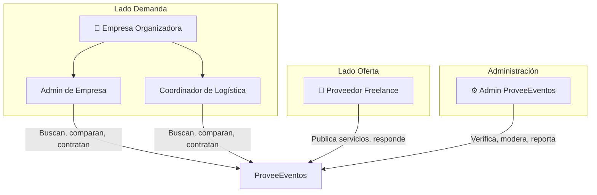
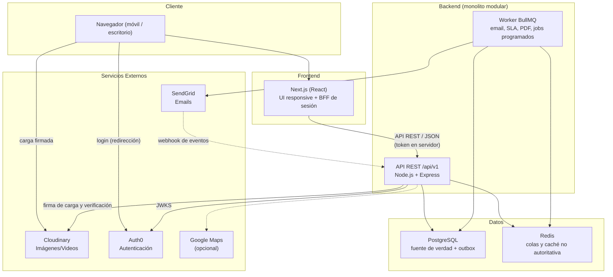
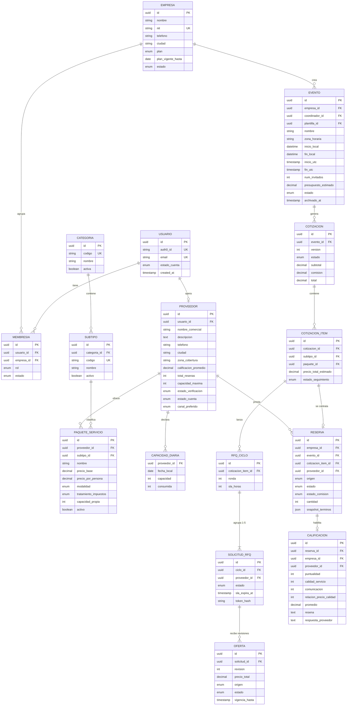
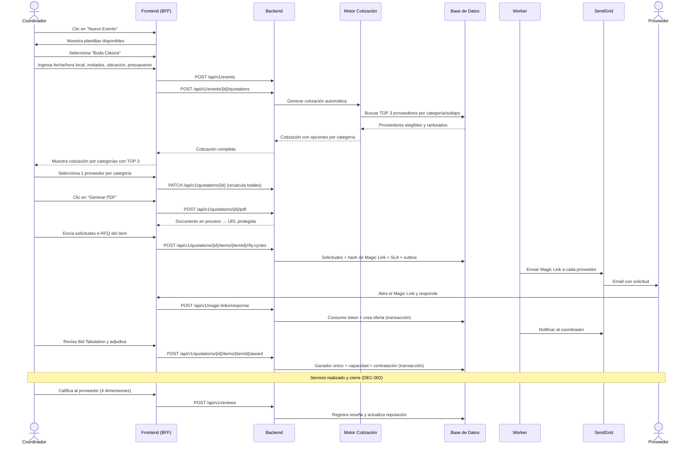
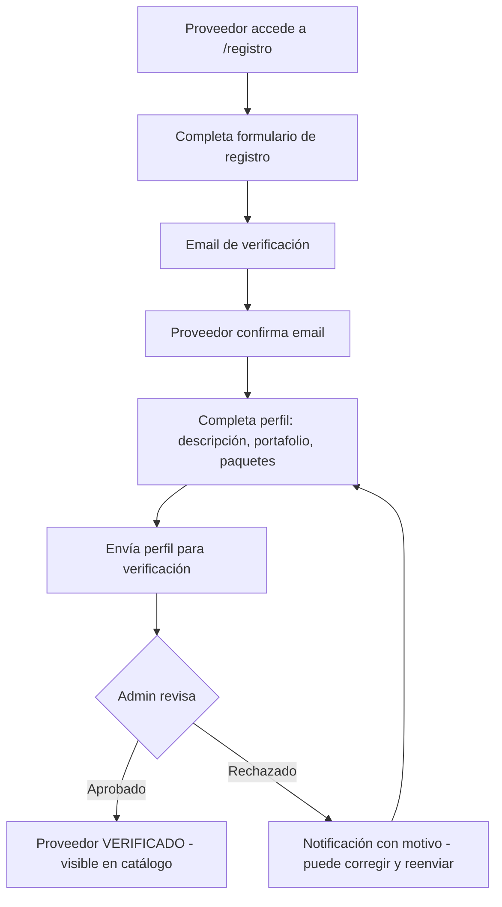
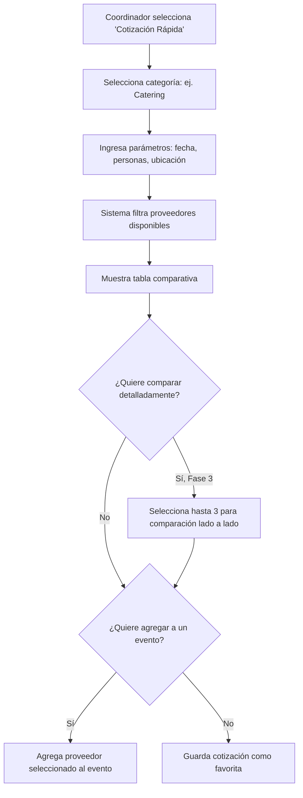
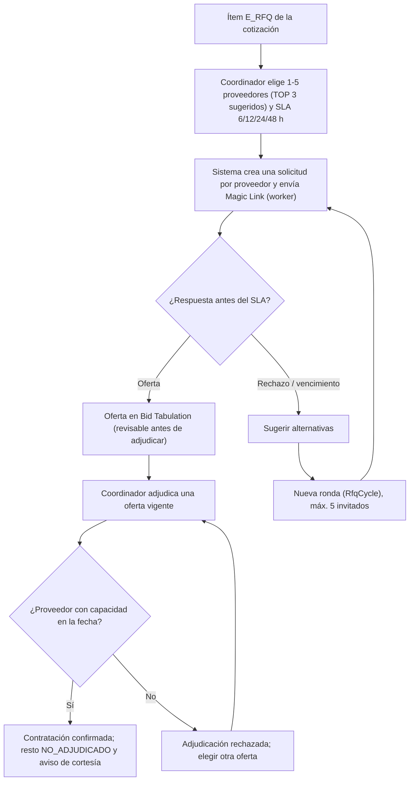
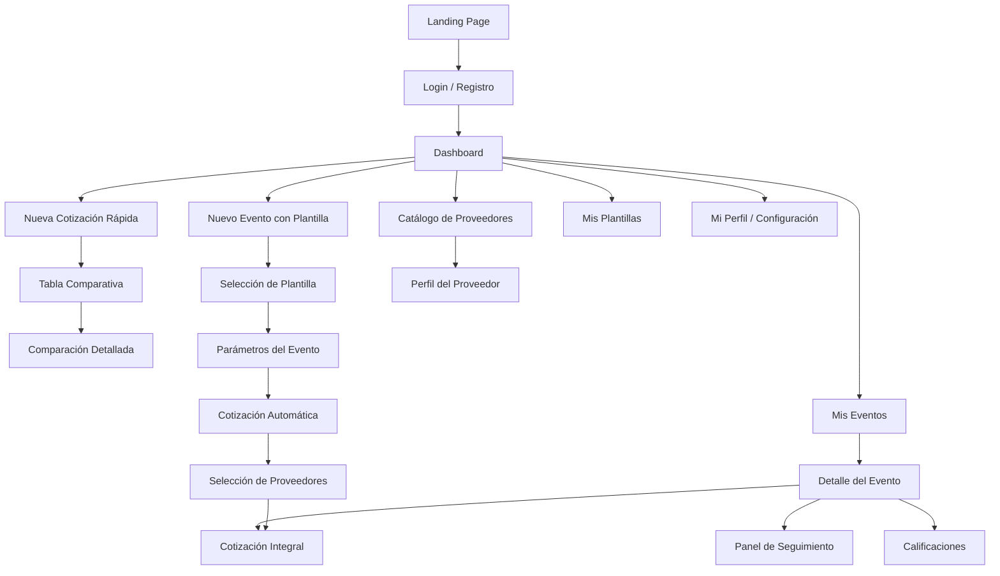
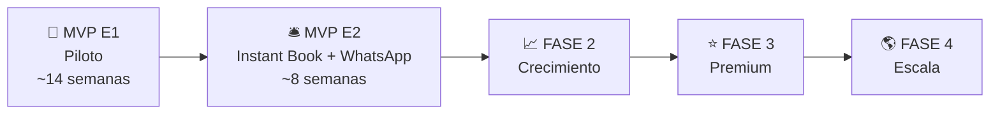

# ProveeEventos — Product Requirements Document (PRD)

**Versión:** 2.4  
**Fecha:** 24 de noviembre de 2026  
**Autor:** Ruby Esperanza Murcia Nieto  
**Estado:** Consolidado. Decisiones DEC-001..018 (Anexo A) y DEC-019..037 (`Decisiones.md` §4b) aprobadas  

## Historial de versiones

| Versión | Fecha | Descripción |
|---|---|---|
| 1.0 | 19-11-2026 | Primera versión del PRD |
| 2.2 | 23-11-2026 | Consolidación (DEC-019, propuesta pendiente de aprobación): incorpora el alcance real especificado en el SRS (Instant Book, e-RFQ, Magic Link, SLA, Bid Tabulation, WhatsApp asistido, cancelación y cierre, membresías), la taxonomía de 21 categorías (DEC-020), las entregas E1/E2 (DEC-021) y las decisiones aprobadas. Las versiones intermedias 2.0–2.1 no se conservaron; SRS, SAD y DDD ya citaban esta versión como "PRD v2.2" |
| 2.3 | 24-11-2026 | Plan0003 (Review V2): entidades de solicitud de titular y retención legal en §9.1; enums de estado de cotización y de oferta en §9.2; plantillas WhatsApp y Click-to-Chat en E2, adelantables a E1 si hay capacidad (DEC-021, pendiente) |
| 2.3 (rev.) | 24-11-2026 | Aprobación de DEC-019..034, TEC-006..012 y ADR-016..022 (23-11-2026): se retiran las marcas de pendiente; sin cambios de comportamiento |
| 2.4 | 24-11-2026 | Aprobación de DEC-035..037: el criterio de RF-ADM-05 recoge la excepción del proveedor suspendido sobre sus contrataciones vigentes (DEC-036), que antes contradecía el SRS |

---

## Tabla de Contenidos

1. [Visión General](#1-visión-general)
2. [Problema a Resolver](#2-problema-a-resolver)
3. [Objetivos del Producto](#3-objetivos-del-producto)
4. [Usuarios y Personas](#4-usuarios-y-personas)
5. [Alcance del Producto](#5-alcance-del-producto)
6. [Requerimientos Funcionales](#6-requerimientos-funcionales)
7. [Requerimientos No Funcionales](#7-requerimientos-no-funcionales)
8. [Arquitectura del Sistema](#8-arquitectura-del-sistema)
9. [Modelo de Datos](#9-modelo-de-datos)
10. [Flujos de Usuario](#10-flujos-de-usuario)
11. [Pantallas y Wireframes](#11-pantallas-y-wireframes)
12. [Reglas de Negocio](#12-reglas-de-negocio)
13. [Integraciones](#13-integraciones)
14. [Modelo de Monetización](#14-modelo-de-monetización)
15. [Plan de Fases y Roadmap](#15-plan-de-fases-y-roadmap)
16. [Métricas de Éxito (KPIs)](#16-métricas-de-éxito-kpis)
17. [Riesgos y Mitigaciones](#17-riesgos-y-mitigaciones)
18. [Glosario](#18-glosario)
19. [Anexo A. Decisiones de producto aprobadas](#anexo-a-decisiones-de-producto-aprobadas)
20. [Anexo B. Taxonomía inicial](#anexo-b-taxonomía-inicial-dec-020)
21. [Anexo C. Plantillas predefinidas](#anexo-c-plantillas-predefinidas)
22. [Anexo D. Plantillas WhatsApp globales iniciales](#anexo-d-plantillas-whatsapp-globales-iniciales)

Módulos funcionales añadidos en la v2.2: §6.10 a §6.15.

---

## 1. Visión General

### 1.1 Declaración del Producto

**ProveeEventos** es una plataforma web B2B que centraliza la búsqueda, comparación y cotización de proveedores freelance para la producción de eventos sociales. Permite a las empresas organizadoras de eventos armar cotizaciones completas en minutos en lugar de horas, comparando costo y calidad de servicio entre múltiples proveedores de forma simultánea.

### 1.2 Propuesta de Valor

> Ahorrar tiempo a las agencias y empresas organizadoras de eventos al centralizar la búsqueda de todos los proveedores freelance en una sola plataforma, con cotización automática y comparación transparente.

### 1.3 Visión a Largo Plazo

Convertirse en la plataforma de referencia en Latinoamérica para la contratación de proveedores de eventos, con un ecosistema completo que incluya cotización, contratación, pagos y calificación, eliminando por completo el proceso manual de cotización multicanal.

---

## 2. Problema a Resolver

### 2.1 Situación Actual

Las empresas organizadoras de eventos sociales enfrentan los siguientes problemas al buscar proveedores:

| Problema | Impacto |
|----------|---------|
| Búsqueda dispersa en múltiples canales (Facebook, WhatsApp, directorios, boca a boca) | Pérdida de **3 a 8 horas** por evento en cotización |
| No existe un estándar para comparar proveedores | Decisiones basadas en intuición, no en datos |
| Las calificaciones disponibles son del público general, no de profesionales | Riesgo de contratar proveedores no confiables |
| Cada cotización requiere contacto individual con cada proveedor | Proceso repetitivo y propenso a errores |
| No hay manera de reutilizar configuraciones de eventos anteriores | Se empieza de cero cada vez |

### 2.2 Pregunta Problema

> ¿Cómo pueden las empresas organizadoras de eventos comparar proveedores de forma rápida y segura sin perder tiempo buscando en diferentes páginas web?

### 2.3 Competencia Actual

| Competidor | Tipo | Debilidad Principal |
|------------|------|-------------------|
| Grupos de Facebook | Red social | Sin estructura, sin calificaciones verificadas, sin cotización |
| Bodas.net | Directorio web | Solo enfocado en bodas, dirigido al cliente final (B2C), no B2B |
| Directorios locales | Anuncios web | Sin comparación de precios, sin calificaciones, genérico |

### 2.4 Diferenciador Clave

ProveeEventos se diferencia porque:
- Es **exclusivamente B2B** (empresas organizadoras → proveedores freelance)
- Las **calificaciones son dadas por empresas**, no por el público general
- Ofrece **cotización automática y comparativa** en tiempo real
- Permite armar **plantillas reutilizables** por tipo de evento

---

## 3. Objetivos del Producto

### 3.1 Objetivos de Negocio

| ID | Objetivo | Métrica | Meta (Año 1) |
|----|----------|---------|---------------|
| ON-01 | Captar empresas organizadoras | Empresas activas (de pago + prueba) | 100 empresas, 70 de pago (ver §16.0) |
| ON-02 | Construir base de proveedores verificados | Proveedores activos en la plataforma | 500 proveedores |
| ON-03 | Generar ingresos recurrentes | MRR de suscripción (Monthly Recurring Revenue) | $14.805.000 COP/mes (ver §16.4) |
| ON-04 | Facilitar transacciones B2B | Contrataciones cerradas (`COMPLETADO`) por la plataforma | 200/mes |

### 3.2 Objetivos de Producto

| ID | Objetivo | Métrica | Meta |
|----|----------|---------|------|
| OP-01 | Reducir tiempo de cotización | Tiempo promedio para cotizar un evento completo | < 15 minutos |
| OP-02 | Facilitar la comparación | Proveedores comparados por cotización | ≥ 3 por categoría |
| OP-03 | Alta satisfacción de usuario | NPS (Net Promoter Score) | ≥ 50 |
| OP-04 | Retención de empresas | Churn rate mensual | < 5% |

---

## 4. Usuarios y Personas

### 4.1 Tipos de Usuario

### 4.2 Personas

#### Persona 1: Laura — Coordinadora de Logística

| Atributo | Detalle |
|----------|---------|
| **Edad** | 32 años |
| **Rol** | Coordinadora de logística en empresa de eventos |
| **Educación** | Profesional en administración |
| **Comportamiento** | Busca referencias en internet antes de contratar |
| **Dolor principal** | Pasa 4-6 horas por evento contactando proveedores uno a uno por WhatsApp |
| **Necesidad** | Ver todos los proveedores con precios y calificaciones en un solo lugar |
| **Meta** | Armar la cotización de un evento completo en menos de 20 minutos |

#### Persona 2: Carlos — Dueño de Empresa de Eventos

| Atributo | Detalle |
|----------|---------|
| **Edad** | 45 años |
| **Rol** | Director/dueño de agencia de eventos |
| **Educación** | Técnico en producción de eventos |
| **Comportamiento** | Aprueba cotizaciones y toma decisiones de presupuesto |
| **Dolor principal** | No tiene visibilidad clara del costo total vs. calidad de los proveedores |
| **Necesidad** | Reportes consolidados, comparación de costos entre eventos similares |
| **Meta** | Tomar decisiones informadas rápidamente y mejorar márgenes de ganancia |

#### Persona 3: Andrés — Proveedor Freelance (DJ)

| Atributo | Detalle |
|----------|---------|
| **Edad** | 28 años |
| **Rol** | DJ freelance para eventos |
| **Comportamiento** | Publica en redes sociales, depende del boca a boca |
| **Dolor principal** | No tiene un canal profesional para llegar a empresas de eventos |
| **Necesidad** | Una plataforma donde mostrar su portafolio y recibir solicitudes formales |
| **Meta** | Recibir al menos 10 solicitudes nuevas al mes desde la plataforma |

### 4.3 Segmentación del Mercado Objetivo

| Dimensión | Segmento |
|-----------|----------|
| **Demográfico** | Empresas y profesionales de 25-50 años, nivel técnico/profesional, ingresos medios |
| **Geográfico** | Inicialmente ciudades principales de Colombia |
| **Psicográfico** | Personas prácticas, que valoran la puntualidad y la eficiencia |
| **Comportamental** | Buscan referencias en internet, compran semanalmente o mensualmente, fieles a plataformas fáciles de usar |

---

## 5. Alcance del Producto

### 5.1 Dentro del Alcance (MVP)

El MVP se entrega en dos partes (DEC-021). El detalle verificable de cada capacidad está en `ProveeEventos_SRS.md`.

**Entrega E1 — Piloto**
- ✅ Registro y autenticación de empresas organizadoras y proveedores (Auth0; sesión gestionada en servidor)
- ✅ Membresías de empresa: propietario, administradores, coordinadores y coordinador restringido (DEC-008, DEC-011)
- ✅ Catálogo de proveedores con perfiles, portafolio, paquetes, precios y calificaciones
- ✅ Taxonomía de 21 categorías y subtipos administrables (DEC-020)
- ✅ Verificación de proveedores, niveles 1 y 2 (DEC-009)
- ✅ Filtros de búsqueda (categoría, subtipo, modalidad, precio, calificación, zona, fecha, capacidad)
- ✅ Cotización rápida por categoría con tabla comparativa y favoritos
- ✅ Seis plantillas predefinidas de eventos, plantillas personalizadas y clonación de eventos
- ✅ Cotización integral automática del evento (TOP 3 por categoría/subtipo)
- ✅ Solicitudes e-RFQ en paralelo a 1–5 proveedores con SLA de 6, 12, 24 o 48 h
- ✅ Respuesta del proveedor mediante Magic Link por email (sin iniciar sesión) o desde su portal
- ✅ Bid Tabulation y adjudicación atómica de un único ganador, con control de capacidad del proveedor
- ✅ Cancelación por etapas y cierre del servicio con devengo de comisión (DEC-001, DEC-002)
- ✅ Panel de seguimiento por evento e ítem (tabla)
- ✅ Generación de PDF de cotización desde snapshot
- ✅ Calificación B2B post-servicio en cuatro dimensiones
- ✅ Notificaciones por email e in-app
- ✅ Administración: verificación, taxonomía, plantillas, moderación, planes, disputas y auditoría

**Entrega E2**
- ✅ Instant Book con tarifa vinculante y capacidad de dos niveles: global por fecha y por paquete (DEC-006)
- ✅ Plantillas de WhatsApp y enlaces Click-to-Chat (`wa.me`); pueden adelantarse a E1
- ✅ Asistente de respuesta WhatsApp con IA asistida e importación de JSON con revisión humana
- ✅ Verificación de proveedores nivel 3 (evidencia del servicio en categorías de riesgo)
- ✅ Transferencia de propiedad de la empresa

### 5.2 Fuera del Alcance (MVP) — Fases Posteriores

- ❌ Pasarela de pagos integrada y cobro automático de suscripciones o comisiones (Fase 3)
- ❌ WhatsApp Business Cloud API, webhooks de WhatsApp y notas de voz (Fase 2)
- ❌ IA automatizada mediante API oficial (Fase 2) e IA para recomendaciones (Fase 4)
- ❌ Chat en tiempo real entre organizador y proveedor (Fase 2)
- ❌ Panel Kanban, notificaciones push, Google Calendar y analítica avanzada (Fase 2)
- ❌ Comparación lado a lado y versiones automáticas Económica/Estándar/Premium (Fase 3)
- ❌ Cotizador inverso, Semáforo de Precio Justo y sinergia geográfica avanzada (Fase 3)
- ❌ Perfiles destacados y badge premium (Fase 3)
- ❌ Aplicación móvil nativa, API pública, contratos digitales y multi-idioma (Fase 4)
- ❌ Varios usuarios por proveedor (equipo de proveedor) (Fase 2)

---

## 6. Requerimientos Funcionales

### 6.1 Módulo de Autenticación y Usuarios

| ID | Requerimiento | Prioridad | Criterio de Aceptación |
|----|--------------|-----------|----------------------|
| RF-AUTH-01 | El sistema debe permitir el registro de empresas organizadoras con: nombre de empresa, NIT, nombre del contacto, email, teléfono, ciudad, contraseña | Alta | El usuario recibe un email de verificación y puede acceder tras confirmarlo |
| RF-AUTH-02 | El sistema debe permitir el registro de proveedores freelance con: nombre/nombre comercial, categoría de servicio principal, email, teléfono, ciudad, contraseña | Alta | El proveedor queda en estado "pendiente de verificación" hasta que el admin lo apruebe |
| RF-AUTH-03 | El sistema debe permitir inicio de sesión con email y contraseña | Alta | El usuario accede a su dashboard según su rol |
| RF-AUTH-04 | El sistema debe permitir recuperación de contraseña vía email | Alta | El usuario recibe un enlace para restablecer su contraseña válido por 24 horas |
| RF-AUTH-05 | El sistema debe gestionar roles: Admin Empresa, Coordinador, Proveedor, Admin Plataforma | Alta | Cada rol solo ve las funcionalidades que le corresponden |
| RF-AUTH-06 | Una empresa organizadora puede invitar a múltiples coordinadores bajo su cuenta | Media | El coordinador recibe una invitación por email y se asocia a la empresa |

---

### 6.2 Módulo de Catálogo de Proveedores

| ID | Requerimiento | Prioridad | Criterio de Aceptación |
|----|--------------|-----------|----------------------|
| RF-CAT-01 | El proveedor debe poder crear y editar su perfil con: nombre comercial, descripción, categoría(s) de servicio, zona de cobertura, portafolio (hasta 20 fotos y 5 videos), datos de contacto | Alta | El perfil se muestra correctamente en el catálogo público |
| RF-CAT-02 | El proveedor debe poder crear paquetes de servicio con: nombre del paquete, descripción, precio base, precio por persona (si aplica), qué incluye, qué no incluye | Alta | Los paquetes se muestran ordenados en su perfil |
| RF-CAT-03 | El proveedor debe poder gestionar su calendario de disponibilidad marcando fechas ocupadas | Alta | Las fechas ocupadas se reflejan al momento de la cotización |
| RF-CAT-04 | El sistema debe organizar proveedores en categorías predefinidas | Alta | Las categorías se muestran como filtros en la búsqueda |
| RF-CAT-05 | El sistema debe permitir buscar proveedores con filtros combinados: categoría, rango de precio, calificación mínima, zona geográfica, disponibilidad en fecha, capacidad mínima de personas | Alta | Los resultados se actualizan dinámicamente al aplicar/quitar filtros |
| RF-CAT-06 | El sistema debe mostrar en la lista de resultados: foto principal, nombre, categoría, precio desde, calificación promedio, número de reseñas | Alta | La información se muestra en formato de tarjetas (cards) |
| RF-CAT-07 | El sistema debe permitir ordenar resultados por: precio (menor a mayor / mayor a menor), calificación (mayor a menor), relación calidad-precio, más recientes | Media | El orden se aplica inmediatamente al seleccionarlo |
| RF-CAT-08 | El proveedor debe poder indicar su capacidad máxima de atención (ej: "hasta 300 personas") | Media | Este dato se usa como filtro en la búsqueda |

**Categorías de Servicio Predefinidas** (DEC-020; códigos estables que no se reutilizan, alineados con SRS-CAT-003):

| Código | Categoría | Icono |
|--------|-----------|-------|
| CAT-01 | Venue / Lugar del evento | 📍 |
| CAT-02 | Catering / Banquetes | 🍽️ |
| CAT-03 | Fotografía | 📸 |
| CAT-04 | Video / Filmación | 🎬 |
| CAT-05 | DJ / Música en vivo | 🎵 |
| CAT-06 | Decoración / Ambientación | 🎨 |
| CAT-07 | Floristería | 🌸 |
| CAT-08 | Iluminación | 💡 |
| CAT-09 | Sonido / Audiovisuales | 🔊 |
| CAT-10 | Mobiliario / Alquiler | 🪑 |
| CAT-11 | Transporte | 🚐 |
| CAT-12 | Tortas y Postres | 🎂 |
| CAT-13 | Animación / Entretenimiento | 🎪 |
| CAT-14 | Invitaciones / Papelería | ✉️ |
| CAT-15 | Coreografía | 💃 |
| CAT-16 | Maestro de ceremonias | 🎤 |
| CAT-17 | Bar, Coctelería y Bebidas | 🍸 |
| CAT-18 | Personal y Staffing | 🧑‍💼 |
| CAT-19 | Infraestructura, Carpas y Energía | ⛺ |
| CAT-20 | Regalos, Recordatorios y Merchandising | 🎁 |
| CAT-21 | Otros | ➕ |

**Subtipos:** cada categoría tiene subtipos administrables; el catálogo inicial está en el Anexo B. Un proveedor se asocia a máximo cinco categorías y a múltiples subtipos dentro de ellas.

---

### 6.3 Módulo de Cotización Rápida por Categoría

| ID | Requerimiento | Prioridad | Criterio de Aceptación |
|----|--------------|-----------|----------------------|
| RF-COT-01 | El usuario debe poder seleccionar una categoría de servicio para cotizar | Alta | Se muestra la lista de categorías disponibles |
| RF-COT-02 | El usuario debe poder ingresar los parámetros de búsqueda: fecha del evento, número de personas, ubicación del evento, presupuesto máximo (opcional) | Alta | Los campos se validan antes de buscar |
| RF-COT-03 | El sistema debe generar una tabla comparativa de proveedores que cumplan los criterios, mostrando: nombre, paquete recomendado, precio unitario, precio total estimado, calificación, servicios incluidos | Alta | La tabla muestra mínimo los proveedores disponibles (hasta 20), ordenados por relación calidad-precio |
| RF-COT-04 | El usuario debe poder seleccionar hasta 3 proveedores para comparación detallada "lado a lado" (fuera del MVP) | Fase 3 | Se muestra una vista de comparación con todas las características alineadas |
| RF-COT-05 | El usuario debe poder guardar una cotización por categoría como favorita | Media | La cotización se guarda y es accesible desde "Mis cotizaciones" |
| RF-COT-06 | El usuario debe poder solicitar cotización formal a un proveedor directamente desde la tabla comparativa | Alta | El proveedor recibe una notificación con los detalles del requerimiento |

---

### 6.4 Módulo de Plantillas de Eventos

| ID | Requerimiento | Prioridad | Criterio de Aceptación |
|----|--------------|-----------|----------------------|
| RF-PLT-01 | El sistema debe ofrecer plantillas predefinidas por tipo de evento, cada una con las categorías de servicio típicas preseleccionadas | Alta | Al seleccionar una plantilla, se cargan automáticamente las categorías de servicio necesarias |
| RF-PLT-02 | El usuario debe poder modificar una plantilla (agregar o quitar categorías de servicio) antes de generar la cotización | Alta | Los cambios se reflejan en la cotización resultante |
| RF-PLT-03 | El usuario debe poder crear plantillas personalizadas desde cero seleccionando las categorías deseadas | Alta | La plantilla personalizada se guarda en la cuenta del usuario |
| RF-PLT-04 | El usuario debe poder guardar una plantilla personalizada con un nombre para reutilizarla en futuros eventos | Media | La plantilla aparece en la lista de "Mis plantillas" |
| RF-PLT-05 | El sistema debe permitir duplicar y modificar plantillas existentes | Media | Se crea una copia editable de la plantilla original |

**Plantillas Predefinidas (MVP):**

| Plantilla | Categorías Incluidas |
|-----------|---------------------|
| **🎂 Boda Clásica** | Venue, Catering, Fotografía, Video, DJ, Decoración, Floristería, Iluminación, Transporte, Torta, Invitaciones |
| **🎈 Quinceañera** | Venue, Catering, DJ, Fotografía, Video, Decoración, Torta, Coreografía |
| **🎄 Evento Empresarial** | Venue, Catering, Audiovisuales, Iluminación, Mobiliario, Maestro de ceremonias |
| **👶 Baby Shower** | Venue, Catering, Decoración, Fotografía, Torta |
| **🎓 Grado** | Venue, Catering, Fotografía, DJ, Decoración |
| **🎉 Fiesta Temática** | Venue, Catering, DJ, Decoración, Mobiliario, Iluminación, Animación |

---

### 6.5 Módulo de Cotización Integral del Evento

| ID | Requerimiento | Prioridad | Criterio de Aceptación |
|----|--------------|-----------|----------------------|
| RF-INT-01 | Tras seleccionar una plantilla e ingresar los parámetros del evento (fecha, invitados, ubicación, presupuesto), el sistema debe generar automáticamente una cotización mostrando el TOP 3 de proveedores por cada categoría de servicio | Alta | Se muestra una vista con secciones por categoría, cada una con 3 opciones de proveedor |
| RF-INT-02 | El usuario debe poder seleccionar un proveedor por categoría para armar la cotización final | Alta | Al seleccionar, el total se recalcula automáticamente |
| RF-INT-03 | El sistema debe mostrar un resumen consolidado con: cada servicio seleccionado, proveedor, precio, subtotal general, comisión de la plataforma (si aplica), total estimado | Alta | El resumen se actualiza en tiempo real al cambiar selecciones |
| RF-INT-04 | El usuario debe poder generar versiones de cotización: Económica (proveedores más baratos), Estándar (mejor relación calidad-precio), Premium (mejor calificados) con un solo clic (fuera del MVP) | Fase 3 | Se generan 3 versiones automáticamente con los proveedores correspondientes |
| RF-INT-05 | El usuario debe poder intercambiar cualquier proveedor individual sin perder el resto de la selección | Alta | Solo se recalcula la línea modificada y el total |
| RF-INT-06 | El sistema debe permitir exportar la cotización integral como PDF con formato profesional | Alta | El PDF incluye logo de la empresa, desglose completo, fecha y datos del evento |
| RF-INT-07 | El usuario debe poder guardar la cotización integral como borrador para editarla después | Media | La cotización aparece en "Mis eventos" con estado "Borrador" |
| RF-INT-08 | El sistema debe alertar si algún proveedor seleccionado no tiene disponibilidad en la fecha del evento | Alta | Se muestra una alerta visual junto al proveedor no disponible con sugerencia de alternativa |

---

### 6.6 Módulo de Solicitud y Seguimiento

| ID | Requerimiento | Prioridad | Criterio de Aceptación |
|----|--------------|-----------|----------------------|
| RF-SEG-01 | El usuario debe poder enviar la cotización final como solicitud formal a todos los proveedores seleccionados simultáneamente | Alta | Cada proveedor recibe una notificación por email con los detalles de la solicitud |
| RF-SEG-02 | El proveedor debe poder aceptar o rechazar la solicitud, y en caso de aceptar, confirmar o ajustar el precio | Alta | El estado del proveedor se actualiza en el panel del organizador |
| RF-SEG-03 | El sistema debe mantener un seguimiento de estado por proveedor dentro de cada evento | Alta | Los estados posibles son: Cotizado → Enviado → Confirmado → Rechazado → En progreso → Completado → Calificado |
| RF-SEG-04 | El sistema debe enviar notificaciones por email al organizador cuando un proveedor responde | Alta | El email contiene el estado de respuesta y un link directo al evento |
| RF-SEG-05 | El sistema debe mostrar un panel de control del evento con el estado de todos los proveedores en vista tipo Kanban o tabla | Alta | El organizador puede ver de un vistazo cuáles han confirmado y cuáles faltan |
| RF-SEG-06 | Si un proveedor rechaza, el sistema debe sugerir automáticamente alternativas disponibles | Media | Se muestran los siguientes mejores proveedores de la misma categoría |

---

### 6.7 Módulo de Calificaciones y Reseñas

| ID | Requerimiento | Prioridad | Criterio de Aceptación |
|----|--------------|-----------|----------------------|
| RF-CAL-01 | Después de un evento completado, el organizador debe poder calificar a cada proveedor con una puntuación de 1 a 5 estrellas | Alta | La calificación se suma al promedio del perfil del proveedor |
| RF-CAL-02 | La calificación debe incluir dimensiones específicas: Puntualidad, Calidad del servicio, Comunicación, Relación precio-calidad | Alta | Cada dimensión tiene su propia puntuación de 1-5 |
| RF-CAL-03 | El organizador debe poder dejar una reseña escrita (máximo 500 caracteres) | Media | La reseña se muestra en el perfil del proveedor identificando la empresa que la escribió |
| RF-CAL-04 | Las calificaciones solo son válidas de empresas hacia proveedores (B2B) | Alta | Solo usuarios con rol de empresa organizadora pueden calificar |
| RF-CAL-05 | El proveedor debe poder responder a una reseña (máximo 300 caracteres) | Media | La respuesta se muestra debajo de la reseña original |

---

### 6.8 Módulo de Administración de la Plataforma

| ID | Requerimiento | Prioridad | Criterio de Aceptación |
|----|--------------|-----------|----------------------|
| RF-ADM-01 | El admin debe poder aprobar o rechazar el registro de nuevos proveedores | Alta | El proveedor recibe notificación del resultado |
| RF-ADM-02 | El admin debe poder gestionar (crear, editar, desactivar) categorías de servicio | Alta | Los cambios se reflejan inmediatamente en el catálogo |
| RF-ADM-03 | El admin debe poder gestionar las plantillas predefinidas de eventos | Media | Se pueden crear, editar y desactivar plantillas |
| RF-ADM-04 | El admin debe tener un dashboard con métricas: usuarios registrados, proveedores activos, eventos creados, cotizaciones generadas, ingresos | Alta | Los datos se actualizan en tiempo real |
| RF-ADM-05 | El admin debe poder suspender cuentas de usuarios o proveedores que incumplan las políticas | Alta | La cuenta suspendida no puede acceder al sistema. Excepción: el proveedor suspendido conserva la consulta de sus contrataciones vigentes y las acciones de ciclo sobre las que sigan en curso (SRS-AUTH-007, DEC-036); sus contrataciones futuras pasan a revisión (SRS-ADM-013, DEC-034) |
| RF-ADM-06 | El admin debe poder moderar reseñas reportadas como inapropiadas | Media | Las reseñas reportadas se muestran en una cola de moderación |

---

### 6.9 Módulo de Notificaciones

| ID | Requerimiento | Prioridad | Criterio de Aceptación |
|----|--------------|-----------|----------------------|
| RF-NOT-01 | El sistema debe enviar notificaciones por email para: registro exitoso, nueva solicitud de cotización, respuesta de proveedor, recordatorio de evento próximo, solicitud de calificación post-evento | Alta | Los emails se envían en un máximo de 5 minutos después del evento trigger |
| RF-NOT-02 | El sistema debe mostrar notificaciones in-app en el panel del usuario | Alta | El icono de notificaciones muestra un badge con el conteo de no leídas |
| RF-NOT-03 | El usuario debe poder configurar qué notificaciones desea recibir por email | Media | Las preferencias se guardan en el perfil del usuario |

---

### 6.10 Módulo de Instant Book y Capacidad (Entrega E2)

| ID | Requerimiento | Prioridad | Criterio de Aceptación |
|----|--------------|-----------|----------------------|
| RF-BOOK-01 | Cada paquete declara exactamente una modalidad: `INSTANT_BOOK` (precio vinculante y reserva inmediata) o `E_RFQ` (requiere oferta firme) | Alta | La modalidad se configura en el paquete, no se infiere de la categoría (SRS-CAT-007) |
| RF-BOOK-02 | El organizador puede reservar al instante un paquete `INSTANT_BOOK` si hay disponibilidad y capacidad | Alta | La reserva queda confirmada con snapshot inmutable de precio y condiciones (SRS-BOOK-001..004) |
| RF-BOOK-03 | Un proveedor no supera su capacidad: dos eventos por fecha por defecto, con capacidad propia por paquete como excepción | Alta | Dos reservas simultáneas por el último cupo: solo una se confirma (SRS-BOOK-002/003, DEC-006) |
| RF-BOOK-04 | La tarifa confirmada es vinculante; un cambio de alcance requiere aceptación explícita | Alta | El proveedor no puede subir el precio unilateralmente (SRS-BOOK-005) |
| RF-BOOK-05 | Repetir la petición de reserva no crea reservas duplicadas | Alta | Idempotencia por clave (SRS-BOOK-006) |

### 6.11 Módulo de e-RFQ, SLA y Magic Link (Entrega E1)

| ID | Requerimiento | Prioridad | Criterio de Aceptación |
|----|--------------|-----------|----------------------|
| RF-RFQ-01 | Para un ítem de modalidad `E_RFQ`, el organizador invita de 1 a 5 proveedores (TOP 3 sugeridos) en una ronda | Alta | Se crea una solicitud independiente por proveedor (SRS-RFQ-001..003) |
| RF-RFQ-02 | El organizador elige un SLA de 6, 12, 24 o 48 horas | Alta | Vencido el SLA, la solicitud expira y no admite respuesta (SRS-RFQ-004/005) |
| RF-RFQ-03 | El proveedor responde por email mediante un Magic Link de un solo uso, sin iniciar sesión, desde el móvil | Alta | El enlace expira al responder, al vencer el SLA o al revocarse (SRS-MAGIC-001..005) |
| RF-RFQ-04 | El proveedor también puede responder o rechazar desde su portal autenticado | Alta | La oferta registra su origen (SRS-RFQ-006) |
| RF-RFQ-05 | La oferta enviada es inmutable; se corrige con revisiones trazables antes de la adjudicación | Alta | El historial de revisiones se conserva (SRS-RFQ-007, DEC-005) |
| RF-RFQ-06 | Si un proveedor rechaza o no responde, el sistema sugiere alternativas para una nueva ronda | Media | La nueva ronda respeta el máximo de 5 invitados (SRS-RFQ-010, DEC-026) |
| RF-RFQ-07 | Un fallo de envío a un proveedor no afecta a los demás y puede reintentarse | Alta | Estado de entrega individual (SRS-RFQ-003, SRS-RFQ-013) |

### 6.12 Módulo de Bid Tabulation y Adjudicación (Entrega E1)

| ID | Requerimiento | Prioridad | Criterio de Aceptación |
|----|--------------|-----------|----------------------|
| RF-BID-01 | Las ofertas de un ítem se comparan en una tabla homogénea (precio firme, extras, condiciones, disponibilidad, hora y origen) | Alta | El contenido original del proveedor no se altera (SRS-RFQ-008) |
| RF-BID-02 | El organizador adjudica una sola oferta por ítem | Alta | Una segunda adjudicación concurrente se rechaza (SRS-RFQ-009) |
| RF-BID-03 | La adjudicación crea la contratación y consume la capacidad del proveedor | Alta | Si el proveedor ya no tiene cupo, la adjudicación se rechaza (SRS-RFQ-009, TEC-009) |
| RF-BID-04 | Los proveedores no seleccionados reciben aviso sin datos de la competencia | Media | El aviso no revela precios ajenos (SRS-RFQ-011) |

### 6.13 Módulo de WhatsApp Click-to-Chat y Respuesta Asistida (Entrega E2)

Las plantillas WhatsApp y el enlace Click-to-Chat pueden adelantarse a E1 si hay capacidad en el equipo (DEC-021); el asistente de respuesta con IA permanece en E2.

| ID | Requerimiento | Prioridad | Criterio de Aceptación |
|----|--------------|-----------|----------------------|
| RF-WA-01 | El sistema mantiene plantillas de mensaje WhatsApp globales y personalizadas por empresa | Media | Variables sustituidas de forma determinista, sin IA (SRS-WA-001/002) |
| RF-WA-02 | El sistema genera un enlace `wa.me` prellenado que el usuario envía desde su WhatsApp | Media | La plataforma no afirma que el mensaje fue enviado ni entregado (SRS-WA-003) |
| RF-WA-03 | El organizador pega la respuesta recibida y obtiene un prompt para estructurarla con una herramienta de IA externa autorizada | Media | Sin automatizar sesiones de terceros (SRS-WA-005) |
| RF-WA-04 | El JSON importado se valida contra un esquema estricto y requiere revisión humana | Alta | La IA no adjudica, no confirma reservas ni cambia precios (SRS-WA-006/007) |
| RF-WA-05 | La oferta importada queda marcada con su origen asistido | Media | Origen `WHATSAPP_IA_ASISTIDO` trazable (SRS-WA-008) |

### 6.14 Módulo de Cancelación, Cierre del Servicio y Comisión (Entrega E1)

| ID | Requerimiento | Prioridad | Criterio de Aceptación |
|----|--------------|-----------|----------------------|
| RF-CIE-01 | Una contratación confirmada puede cancelarse por acuerdo de ambas partes, con motivo | Alta | Disputada o sin respuesta pasa a revisión y no libera capacidad (SRS-BOOK-007, DEC-001) |
| RF-CIE-02 | El proveedor marca el servicio como realizado y el organizador lo confirma o reporta una incidencia en 5 días | Alta | Sin respuesta ni incidencia se cierra automáticamente (SRS-BOOK-008, DEC-002) |
| RF-CIE-03 | La comisión solo se devenga al cerrar el servicio; queda retenida si hay incidencia | Alta | Ofertas no adjudicadas y servicios cancelados no generan comisión (SRS-BOOK-010) |
| RF-CIE-04 | La administración resuelve cancelaciones en revisión e incidencias con auditoría | Alta | Cada resolución registra actor y motivo (SRS-ADM-010) |

### 6.15 Módulo de Membresías y Propiedad de Empresa (Entrega E1; transferencia en E2)

| ID | Requerimiento | Prioridad | Criterio de Aceptación |
|----|--------------|-----------|----------------------|
| RF-MEM-01 | Cada empresa tiene un único propietario, uno o más administradores y coordinadores | Alta | Roles fijos sin editor granular (SRS-AUTH-009, DEC-008, DEC-011) |
| RF-MEM-02 | Un coordinador restringido solo accede a los eventos que se le asignan y no adjudica ni cancela | Media | Pruebas negativas entre coordinadores (SRS-AUTH-011) |
| RF-MEM-03 | La propiedad se transfiere con confirmación del propietario actual y aceptación del nuevo | Media | Requiere autenticación reforzada (SRS-AUTH-009/012) |
| RF-MEM-04 | Un usuario con varias empresas elige la empresa activa | Media | El tenant se valida en servidor (SRS-AUTH-010) |

---

## 7. Requerimientos No Funcionales

### 7.1 Rendimiento

| ID | Requerimiento | Criterio |
|----|--------------|---------|
| RNF-01 | Tiempo de carga de la página principal | < 2 segundos |
| RNF-02 | Tiempo de generación de cotización automática | < 3 segundos |
| RNF-03 | Tiempo de búsqueda y filtrado de proveedores | < 1 segundo |
| RNF-04 | Tiempo de generación de PDF | < 5 segundos |
| RNF-05 | Soporte de usuarios concurrentes | Mínimo 500 simultáneos |

### 7.2 Seguridad

| ID | Requerimiento |
|----|--------------|
| RNF-06 | Las credenciales las gestiona Auth0; ProveeEventos no almacena contraseñas (SRS-NFR-SEC-002) |
| RNF-07 | Toda la comunicación debe ser sobre HTTPS/TLS 1.2+ |
| RNF-08 | Las sesiones deben expirar tras 24 horas de inactividad; se gestionan en servidor con cookies `HttpOnly`/`Secure` y sin tokens en `localStorage` (DEC-017) |
| RNF-09 | Protección contra inyección SQL, XSS y CSRF |
| RNF-10 | Los datos financieros (precios, cotizaciones) deben tener auditoría de cambios |
| RNF-11 | Cumplimiento de la Ley 1581 de 2012 (Protección de Datos Personales — Colombia) |

### 7.3 Usabilidad

| ID | Requerimiento |
|----|--------------|
| RNF-12 | La interfaz debe ser responsive (adaptable a desktop, tablet y móvil) |
| RNF-13 | La plataforma debe ser usable sin capacitación previa (interfaz intuitiva) |
| RNF-14 | El flujo de cotización completa (desde seleccionar plantilla hasta generar PDF) no debe requerir más de 7 clics |
| RNF-15 | El sistema debe estar en idioma español (Colombia) |
| RNF-16 | Los montos deben mostrarse en pesos colombianos (COP) con formato de puntos como separador de miles |

### 7.4 Disponibilidad y Escalabilidad

| ID | Requerimiento |
|----|--------------|
| RNF-17 | Disponibilidad mínima del 99.5% (uptime) |
| RNF-18 | Backups automáticos diarios de la base de datos, con recuperación a un punto en el tiempo para un RPO objetivo ≤ 1 hora (DEC-012) |
| RNF-19 | La arquitectura debe permitir escalar horizontalmente para soportar crecimiento |
| RNF-20 | Tiempo máximo de recuperación ante desastre (RTO): 4 horas |

### 7.5 Compatibilidad

| ID | Requerimiento |
|----|--------------|
| RNF-21 | Compatible con Chrome 90+, Firefox 90+, Safari 14+, Edge 90+ |
| RNF-22 | Funcional en dispositivos con resolución mínima de 360px de ancho |

---

## 8. Arquitectura del Sistema

### 8.1 Diagrama de Arquitectura

Resumen; la arquitectura de referencia completa está en `ProveeEventos_SAD.md`.

La sesión web la gestiona el servidor de Next.js con cookies `HttpOnly`/`Secure` (DEC-017); los tokens no llegan al JavaScript del navegador. Los emails se envían desde el worker a partir del outbox transaccional (TEC-004).

### 8.2 Stack Tecnológico

| Capa | Tecnología | Justificación |
|------|-----------|---------------|
| **Frontend** | Next.js 14+ (React) | SSR para SEO, App Router, componentes server/client, BFF de sesión |
| **UI Framework** | Tailwind CSS + shadcn/ui | Diseño rápido, consistente y responsive |
| **Backend** | Node.js 20+ + Express | Mismo ecosistema que el frontend, alta performance para I/O |
| **Worker** | BullMQ (proceso separado) | Email, expiración de SLA, PDF y tareas programadas sin bloquear la API |
| **ORM** | Prisma | Type-safe, migraciones versionadas, soporte PostgreSQL |
| **Base de datos** | PostgreSQL 15+ | Fuente de verdad transaccional de capacidad, reservas y adjudicaciones |
| **Colas / caché** | Redis | Colas BullMQ y caché no autoritativa; no guarda sesiones ni decide reservas |
| **Autenticación** | Auth0 | Credenciales, MFA y recuperación; roles y tenant los resuelve ProveeEventos |
| **Almacenamiento** | Cloudinary | Optimización automática de imágenes, CDN incluido |
| **Email** | SendGrid | Deliverability alta, plantillas, webhook de eventos |
| **PDF** | React-PDF (Puppeteer solo si el prototipo lo exige) | Generación de cotizaciones con formato profesional desde un snapshot (DEC-016) |
| **Hosting** | Vercel (frontend) + Railway (backend + DB), validado con prueba de aceptación técnica y región cercana a Colombia | Deploy automático, escalable, económico para MVP (DEC-013, DEC-014) |
| **Monitoreo** | Sentry + Vercel Analytics | Errores en tiempo real + métricas de rendimiento |

---

## 9. Modelo de Datos

### 9.1 Diagrama Entidad-Relación

> **Nota v2.2:** este ERD es **conceptual**. El modelo vigente para implementar está en `ProveeEventos_SAD.md` §6.4 y `ProveeEventos_DDD.md` §5 (agregados, invariantes y snapshots). Importes en decimal exacto; timestamps en UTC; fecha local y zona IANA por evento (DEC-007).

Entidades adicionales omitidas del diagrama por brevedad: portafolio, plantilla de evento y sus categorías, plantilla WhatsApp, notificación, intento de entrega, adjudicación, registro de comisión, auditoría, outbox, clave de idempotencia, invitación, borrador de respuesta asistida, solicitud de titular de datos (consulta, corrección o supresión, Ley 1581) y retención legal (`legal_hold`) (ver SRS §4.1 y §4.6, y DDD §5 y BC-12).

### 9.2 Enumeraciones del Modelo

Valores según DEC-022: estados y roles de negocio en español; códigos técnicos de modalidad, canal y origen conservados.

| Enum | Valores |
|------|---------|
| **Rol de membresía** | `PROPIETARIO`, `ADMIN_EMPRESA`, `COORDINADOR`, `COORDINADOR_RESTRINGIDO` |
| **Rol global** | `PROVEEDOR`, `ADMIN_PLATAFORMA` |
| **Estado de verificación del proveedor** | `PENDIENTE`, `VERIFICADO`, `RECHAZADO` (DEC-031) |
| **Estado de cuenta** | `ACTIVO`, `SUSPENDIDO` (DEC-031) |
| **Plan** | `PRUEBA`, `BASICO`, `PRO`, `ENTERPRISE` (DEC-029) |
| **Modalidad de paquete** | `INSTANT_BOOK`, `E_RFQ` |
| **Canal preferido** | `EMAIL_FORM`, `WHATSAPP`, `AMBOS` |
| **Estado de evento** | `BORRADOR`, `COTIZADO`, `ENVIADO`, `EN_PROGRESO`, `COMPLETADO`, `CANCELADO` (archivado es una marca, no un estado) |
| **Estado de seguimiento del ítem** | `COTIZADO`, `ENVIADO`, `CONFIRMADO`, `RECHAZADO`, `EN_PROGRESO`, `COMPLETADO`, `CALIFICADO`; internos: `CANCELADO`, `EXPIRADO`, `NO_ADJUDICADO` |
| **Estado de solicitud e-RFQ** | `PENDIENTE_ENVIO`, `ENVIADO`, `RESPONDIDO`, `RECHAZADO`, `EXPIRADO`, `ADJUDICADO`, `NO_ADJUDICADO`, `ERROR_ENVIO`, `CANCELADO` |
| **Estado de reserva** | `CONFIRMADO`, `CANCELACION_SOLICITADA`, `CANCELACION_EN_REVISION`, `CANCELADO`, `EN_PROGRESO`, `SERVICIO_REALIZADO`, `INCIDENCIA`, `COMPLETADO`, `NO_PRESTADO` (DEC-023) |
| **Estado de comisión** | `PENDIENTE`, `RETENIDA`, `DEVENGADA`, `NO_APLICA`, `REVERTIDA` (DEC-023) |
| **Origen de oferta** | `EMAIL_MAGIC_LINK`, `PORTAL_PROVEEDOR`, `WHATSAPP_IA_ASISTIDO` |
| **Estado de cotización** | `BORRADOR`, `GENERADA`, `ENVIADA`, `CERRADA` (SRS §9.6) |
| **Estado de oferta** | `RECIBIDA`, `REEMPLAZADA`, `ADJUDICADA`, `NO_ADJUDICADA`, `INVALIDADA`, `VENCIDA` (SRS §9.7) |
| **Tipo de Media (Portafolio)** | `IMAGEN`, `VIDEO` |

La versión Económica/Estándar/Premium de cotización pertenece a la Fase 3.

---

## 10. Flujos de Usuario

### 10.1 Flujo Principal: Cotización Integral con Plantilla

Las rutas corresponden al contrato `ProveeEventos_API_Spec.yaml` (prefijo `/api/v1`).

### 10.2 Flujo: Registro de Proveedor

### 10.3 Flujo: Cotización Rápida por Categoría

### 10.4 Flujo: e-RFQ con Magic Link, rondas y adjudicación

---

## 11. Pantallas y Wireframes

### 11.1 Mapa de Navegación

### 11.2 Descripción de Pantallas Principales

| # | Pantalla | Elementos Clave | Acciones del Usuario |
|---|----------|-----------------|---------------------|
| 1 | **Landing Page** | Hero con propuesta de valor, CTA "Registrarse", beneficios, testimonios, planes de precios | Registrarse o iniciar sesión |
| 2 | **Login** | Redirección a Auth0 (Universal Login): email + contraseña, "Olvidé contraseña", registro | Autenticarse |
| 3 | **Registro** | Toggle Empresa/Proveedor, formulario dinámico según tipo | Crear cuenta |
| 4 | **Dashboard Organizador** | KPIs (eventos activos, cotizaciones pendientes), eventos recientes, alertas, accesos rápidos | Navegar a secciones principales |
| 5 | **Dashboard Proveedor** | Solicitudes nuevas, próximos eventos, calificación actual, perfil completeness | Responder solicitudes |
| 6 | **Catálogo de Proveedores** | Barra de búsqueda, filtros laterales, grid de tarjetas de proveedores con foto, nombre, categoría, calificación, precio desde | Filtrar, ver perfil, cotizar |
| 7 | **Perfil del Proveedor** | Header con foto y datos, galería de portafolio, lista de paquetes con precios, calendario de disponibilidad, reseñas B2B | Ver detalle, solicitar cotización |
| 8 | **Nuevo Evento** | Selector de plantillas (cards con icono y nombre), formulario de parámetros | Seleccionar plantilla, configurar evento |
| 9 | **Cotización Automática** | Secciones colapsables por categoría, cada una con TOP 3 proveedores en mini-tabla, radio button para seleccionar, total acumulado en sidebar fijo | Seleccionar proveedores, ver total |
| 10 | **Cotización Integral** | Tabla resumen con todos los servicios seleccionados, desglose de costos, botones: Cambiar proveedor, Generar PDF, Enviar a proveedores | Revisar, ajustar, exportar, enviar |
| 11 | **Tabla Comparativa** | Tabla con columnas: proveedor, paquete, precio, calificación, incluye; filtros superiores; ordenamiento | Comparar, seleccionar |
| 12 | **Seguimiento de Evento** | Tabla con estado de cada ítem/proveedor (Kanban en Fase 2), timeline del evento, acciones pendientes | Monitorear estados |
| 13 | **Calificación Post-Evento** | Formulario por proveedor: estrellas por dimensión, campo de reseña | Calificar |
| 14 | **Admin: Dashboard** | Métricas globales, usuarios nuevos, proveedores pendientes de verificación, reportes | Gestionar plataforma |

---

## 12. Reglas de Negocio

| ID | Regla | Detalle |
|----|-------|---------|
| RN-01 | Un proveedor solo aparece en búsquedas si su estado es **VERIFICADO** | Proveedores pendientes o suspendidos no son visibles en el catálogo |
| RN-02 | La calificación promedio se calcula como el promedio de las 4 dimensiones (puntualidad, calidad, comunicación, precio-calidad) | Se actualiza automáticamente tras cada nueva calificación |
| RN-03 | Solo empresas que contrataron efectivamente a un proveedor pueden calificarlo | La calificación solo se habilita cuando el item de cotización está en estado COMPLETADO |
| RN-04 | El ranking "relación calidad-precio" es explicable, versionado y configurable: calidad ajustada (promedio bayesiano de reseñas verificadas) 40 %, precio relativo 30 %, proximidad/cobertura 20 % y relevancia operativa 10 %, tras aplicar filtros de elegibilidad (DEC-004) | A mayor calificación y menor precio relativo, mejor ranking; los pesos se calibran con datos del piloto y la fórmula `calificación_promedio / (precio_total / precio_promedio_categoria)` queda como referencia inicial |
| RN-05 | Un proveedor puede pertenecer a máximo 5 categorías | Evita perfiles genéricos que no aporten valor |
| RN-06 | Los **eventos** en estado BORRADOR, y sus cotizaciones en borrador, se archivan automáticamente (marca `archivedAt`) tras 90 días de inactividad | Se envía notificación de advertencia 7 días antes; la purga física sigue la política de retención por categoría de dato (DEC-003) |
| RN-07 | El presupuesto ingresado por el organizador es referencial | El sistema muestra proveedores que excedan el presupuesto pero los marca visualmente |
| RN-08 | Un proveedor no puede tener más de 2 eventos en la misma fecha (capacidad global predeterminada) | Un paquete puede declarar capacidad propia como excepción (venues, equipos, personal por unidades); el sistema marca conflictos de disponibilidad (DEC-006) |
| RN-09 | La comisión de la plataforma aplica solo sobre contrataciones cerradas | Se devenga cuando el servicio se completa y el organizador lo confirma (o tras 5 días sin incidencia); si hay disputa queda en espera; si el proveedor rechaza o se cancela antes de ejecutarse, no se genera comisión (DEC-002) |
| RN-10 | El tratamiento de impuestos es una configuración explícita por proveedor/servicio | El precio mostrado indica si incluye impuestos, si no aplican o si el proveedor debe confirmarlos; la comisión es independiente y no se infiere tratamiento tributario (DEC-010) |

---

## 13. Integraciones

### 13.1 MVP

| Integración | Propósito | Prioridad |
|-------------|----------|-----------|
| **SendGrid** | Envío de emails transaccionales y notificaciones | Alta |
| **Cloudinary** | Almacenamiento y optimización de imágenes de portafolio | Alta |
| **Auth0** | Autenticación, autorización y gestión de sesiones | Alta |
| **Google Maps API** | Autocompletado de direcciones y cálculo de cercanía proveedor-evento | Media |

### 13.2 Post-MVP

| Integración | Propósito | Fase |
|-------------|----------|------|
| **MercadoPago / PayU** | Pasarela de pagos para anticipos y suscripciones | Fase 3 |
| **WhatsApp Business API** | Notificaciones por WhatsApp a proveedores | Fase 2 |
| **Google Calendar** | Sincronización de eventos con calendario del organizador | Fase 2 |
| **Google Analytics 4** | Tracking de comportamiento de usuarios | Fase 2 |

---

## 14. Modelo de Monetización

### 14.1 Planes de Suscripción (Empresas Organizadoras)

Los planes son **datos configurables con vigencia** (código, precio, límites, fechas), administrados por `ADMIN_PLATAFORMA`, no constantes de código (DEC-029).

| Característica | Plan Prueba | Plan Básico | Plan Pro | Plan Enterprise |
|---------------|-------------|-------------|----------|-----------------|
| **Código** | `PRUEBA` | `BASICO` | `PRO` | `ENTERPRISE` |
| **Precio mensual** | $0 COP (90 días) | $99.000 COP | $249.000 COP | $499.000 COP |
| Eventos activos simultáneos | 10 | 3 | 10 | Ilimitados |
| Cotizaciones por mes | 50 | 10 | 50 | Ilimitadas |
| Coordinadores por cuenta | 3 | 1 | 3 | Ilimitados |
| Plantillas personalizadas | 10 | 2 | 10 | Ilimitadas |
| Exportación a PDF | ✅ | ✅ | ✅ | ✅ |
| Comparación lado a lado (Fase 3) | — | ❌ | ✅ | ✅ |
| Versiones automáticas eco/std/premium (Fase 3) | — | ❌ | ✅ | ✅ |
| Reportes y analytics | ❌ | ❌ | Básico | Avanzado |
| Soporte | Email | Email | Email + Chat | Dedicado |

Comportamiento ante límites (DEC-029): al alcanzar un límite se rechaza crear el recurso nuevo (`PLAN_LIMIT_REACHED`), nunca se bloquean operaciones sobre reservas o RFQ existentes. Con el plan vencido, la cuenta queda en solo lectura para operaciones nuevas y puede seguir gestionando sus compromisos.

### 14.2 Ingresos por Proveedor

| Fuente | Descripción | Monto |
|--------|-------------|-------|
| **Registro** | Crear perfil y recibir solicitudes | Gratis |
| **Perfil Destacado** (Fase 3) | Aparecer primero en búsquedas de su categoría | $79.000 COP/mes |
| **Badge Verificado Premium** (Fase 3) | Sello especial de confianza | $49.000 COP/mes |

### 14.3 Comisión por Transacción

| Concepto | Regla |
|--------|-----------|
| Porcentaje | 3 %, versionado y congelado en el snapshot de cada contratación (DEC-010, DEC-018) |
| Quién la paga | La empresa organizadora (DEC-027) |
| Base | Precio acordado del servicio, incluidos los extras aceptados, **antes de impuestos** (DEC-027) |
| Devengo | Al cerrarse el servicio: el organizador confirma o pasan 5 días sin incidencia; queda `RETENIDA` si hay incidencia; no aplica a servicios cancelados o no prestados (DEC-002, DEC-023) |

La plataforma no sustituye la factura del proveedor ni infiere su tratamiento tributario (DEC-010). La regla de la comisión requiere validación contable y tributaria profesional en Colombia.

### 14.4 Proceso de Cobro en el MVP

El MVP no integra pagos (DEC-033):

1. Cada mes, `ADMIN_PLATAFORMA` exporta las comisiones `DEVENGADA` del periodo y las suscripciones activas (SRS-ADM-008).
2. ProveeEventos emite sus facturas fuera del sistema mediante un proveedor de facturación electrónica habilitado ante la DIAN.
3. Los pagos recibidos se concilian manualmente y su referencia se registra en la plataforma.
4. Las comisiones revertidas por corrección quedan auditadas (`REVERTIDA`).

---

## 15. Plan de Fases y Roadmap

### 15.1 Fases de Desarrollo

El plan original de 12 semanas cubría solo el alcance de la v1.0 (catálogo, plantillas, cotización, PDF y envío simple de solicitudes). El alcance consolidado de la v2.2 se divide en dos entregas (DEC-021). Las duraciones son estimaciones iniciales para un equipo pequeño y deben recalcularse con el backlog.

### MVP — Entrega E1 (Piloto, semanas 1-14)

El orden sigue SAD §20 y DDD §20.

| Semana | Entregable |
|--------|-----------|
| 1-2 | Repositorios, CI/CD, ambientes, PostgreSQL/Prisma, Auth0 y BFF, logging; diseño UX de los flujos principales |
| 3-4 | Identidad, empresas, membresías, organización activa, RBAC y pruebas de aislamiento multi-tenant; landing page |
| 5-6 | Taxonomía semilla (Anexo B), perfil de proveedor, portafolio, paquetes, búsqueda y filtros, verificación niveles 1–2 |
| 7-8 | Eventos, plantillas y clonación; cotización rápida e integral, ranking, snapshots y PDF |
| 9-10 | e-RFQ: rondas, Magic Link, SLA, outbox y worker, emails, Bid Tabulation, revisiones de oferta |
| 11 | Adjudicación con control de capacidad (`ConfirmBooking`), cancelación por etapas |
| 12 | Cierre del servicio y comisión, seguimiento por ítem, reseñas, notificaciones in-app |
| 13 | Administración: moderación, planes, disputas, exportación de comisiones, auditoría |
| 14 | Hardening: seguridad, concurrencia, carga, backup/restauración, UAT y despliegue del piloto |

**Entregables E1:** registro y membresías, catálogo verificado con 21 categorías y subtipos, 6 plantillas, cotización rápida e integral, e-RFQ con Magic Link y SLA, Bid Tabulation, adjudicación, cancelación y cierre, seguimiento en tabla, PDF, reseñas B2B en cuatro dimensiones, notificaciones y panel admin.

### MVP — Entrega E2 (semanas 15-22)

| Semana | Entregable |
|--------|-----------|
| 15-17 | Instant Book con tarifa vinculante, capacidad por paquete e idempotencia |
| 18-19 | Plantillas WhatsApp y Click-to-Chat (salvo que se adelanten a E1) y asistente de respuesta con IA asistida |
| 20 | Verificación nivel 3 y transferencia de propiedad de empresa |
| 21-22 | Hardening, pruebas de concurrencia Instant Book/adjudicación y lanzamiento general |

### FASE 2 — Crecimiento

- WhatsApp Business Cloud API, webhooks y notas de voz
- IA automatizada con API oficial para estructurar respuestas
- Chat interno entre organizador y proveedor
- Panel de seguimiento tipo Kanban
- Notificaciones push
- Google Calendar sync y analítica avanzada (Google Analytics 4)
- Equipo de proveedor (varios usuarios por proveedor)
- Mejoras de UX basadas en el piloto

### FASE 3 — Premium

- Comparador "lado a lado" de proveedores (hasta 3)
- Versiones automáticas de cotización (económica/estándar/premium)
- Cotizador inverso, Semáforo de Precio Justo y sinergia geográfica avanzada
- Dashboard de analytics para empresas
- Integración con pasarela de pagos (MercadoPago/PayU) para anticipos y suscripciones
- Perfil destacado y badge verificado premium para proveedores
- PWA opcional

### FASE 4 — Escala

- Aplicación móvil nativa
- Expansión a otras ciudades y países; multi-idioma
- IA para recomendación de proveedores según histórico
- API pública para integraciones
- Programa de fidelización y referidos
- Gestión de contratos digitales

---

## 16. Métricas de Éxito (KPIs)

### 16.0 Supuestos de cálculo

Propuesta recalculada en la v2.2; negocio debe validar los supuestos.

| Supuesto | Valor |
|---|---|
| Mezcla de planes de pago | 50 % Básico, 35 % Pro, 15 % Enterprise |
| ARPU de suscripción | 0,50 × 99.000 + 0,35 × 249.000 + 0,15 × 499.000 = **$211.500 COP/mes** |
| Empresas activas al mes 12 | 100, de las cuales 70 de pago y 30 en `PRUEBA` |
| Margen bruto de suscripción | 80 % |
| Churn mensual objetivo | 5 % |
| Valor promedio de una contratación cerrada | $2.000.000 COP |
| Comisión | 3 % → $60.000 COP por contratación cerrada |

### 16.1 Métricas de Adquisición

| KPI | Definición | Meta Mes 3 (piloto E1) | Meta Mes 6 | Meta Mes 12 |
|-----|-----------|------------|------------|-------------|
| Empresas activas | Empresas con cuenta activa (incluye `PRUEBA`) | 30 | 60 | 100 |
| Empresas de pago | Empresas con plan `BASICO`, `PRO` o `ENTERPRISE` | 0 (piloto en prueba) | 35 | 70 |
| Proveedores verificados | Proveedores `VERIFICADO` y `ACTIVO` | 100 | 300 | 500 |
| Tasa de conversión landing | Visitantes → registros | 5 % | 7 % | 10 % |

### 16.2 Métricas de Activación y Uso

| KPI | Definición | Meta |
|-----|-----------|------|
| Tiempo promedio de cotización | Desde iniciar evento hasta generar PDF | < 15 min |
| Cotizaciones creadas/mes | Total de cotizaciones generadas | 50 → 500 |
| Proveedores invitados por ítem e-RFQ | Promedio de solicitudes por ronda | ≥ 3 |
| Tasa de respuesta e-RFQ | Solicitudes respondidas antes del SLA / enviadas | ≥ 60 % |
| Contrataciones cerradas/mes | Reservas que llegan a `COMPLETADO` | 10 (mes 3) → 200 (mes 12) |

### 16.3 Métricas de Retención

| KPI | Definición | Meta |
|-----|-----------|------|
| Churn rate mensual | % de empresas de pago que cancelan suscripción | < 5 % |
| Conversión de prueba | Empresas `PRUEBA` que pasan a un plan de pago | ≥ 40 % |
| DAU/MAU ratio | Usuarios activos diarios / mensuales | > 30 % |
| NPS | Net Promoter Score (encuesta trimestral) | ≥ 50 |

### 16.4 Métricas de Revenue

| KPI | Definición | Cálculo | Meta Mes 12 |
|-----|-----------|---------|-------------|
| MRR de suscripción | Ingresos recurrentes mensuales por suscripciones | 70 empresas de pago × $211.500 | $14.805.000 COP |
| Comisión devengada mensual | Comisiones `DEVENGADA` del mes | 200 contrataciones × $60.000 | $12.000.000 COP |
| ARPU | Ingreso promedio de suscripción por empresa de pago | Mezcla de planes (§16.0) | $211.500 COP |
| LTV | Valor de vida de una empresa de pago | ARPU × margen ÷ churn = 211.500 × 0,8 ÷ 0,05 | $3.384.000 COP |
| CAC | Costo de adquirir una empresa de pago | — | < $200.000 COP (LTV/CAC ≈ 17) |

Nota: la meta anterior de MRR ($5.000.000 COP) no era coherente con 100 empresas suscritas ni con un ARPU de $150.000 (que daban $15.000.000) y el LTV de $1.800.000 no cuadraba con un churn del 5 %. Las cifras de esta tabla se derivan de los supuestos de §16.0.

---

## 17. Riesgos y Mitigaciones

| # | Riesgo | Probabilidad | Impacto | Mitigación |
|---|--------|-------------|---------|-----------|
| R1 | Baja adopción inicial por empresas organizadoras | Alta | Alto | Plan `PRUEBA` de 90 días (DEC-029), alianzas con gremios de eventos |
| R2 | Pocos proveedores registrados al inicio (catálogo vacío) | Alta | Alto | Seed del catálogo con 50-100 proveedores invitados manualmente antes del lanzamiento |
| R3 | Los proveedores no actualizan precios ni disponibilidad | Media | Medio | Recordatorios automáticos, gamificación del perfil, penalizar perfiles desactualizados en ranking |
| R4 | Competidores más grandes entran al mercado B2B | Media | Alto | Construir comunidad fuerte, diferenciarse por calificaciones B2B verificadas |
| R5 | Organizadores usan la plataforma solo para cotizar pero contratan por fuera | Alta | Alto | Contacto directo revelado solo tras RFQ enviada, reserva o adjudicación (DEC-028); beneficios por contratar dentro (historial, soporte, reseñas) |
| R6 | Problemas de rendimiento con crecimiento de datos | Baja | Medio | Proyección de búsqueda, índices, paginación, caché no autoritativa |
| R7 | Calificaciones falsas o manipuladas | Media | Medio | Solo empresas con contratación completada califican; reporte y moderación (DEC-030) |
| R8 | Incumplimiento de normativa de datos personales | Baja | Alto | Asesoría legal desde el inicio, cumplimiento Ley 1581/2012, política de privacidad clara |
| R9 | El alcance no cabe en el plazo previsto | Alta | Alto | Entregas E1/E2 (DEC-021), backlog estimado por módulo, recorte explícito antes de ampliar plazos |
| R10 | Comisión mal calculada o con tratamiento fiscal erróneo | Media | Alto | Regla de comisión versionada (DEC-027), redondeo definido (DEC-032), validación contable antes de facturar (DEC-033) |
| R11 | Transferencia internacional de datos a subprocesadores (Auth0, SendGrid, Cloudinary, Maps, Sentry) | Media | Alto | Inventario de subprocesadores, análisis legal de transferencia, minimización de datos enviados (DEC-014) |
| R12 | Fricción del proveedor freelance con Magic Link, revisiones o tarifas vinculantes | Media | Medio | Formulario móvil sin login, Instant Book opcional en E2, acompañamiento en el piloto |

---

## 18. Glosario

| Término | Definición |
|---------|-----------|
| **B2B** | Business to Business — modelo de negocio entre empresas |
| **Empresa Organizadora** | Empresa que se dedica profesionalmente a organizar eventos sociales |
| **Proveedor Freelance** | Profesional independiente o microempresa que ofrece servicios para eventos |
| **Cotización Rápida** | Comparación de proveedores dentro de una sola categoría de servicio |
| **Cotización Integral** | Cotización completa del evento con todos los proveedores seleccionados por categoría |
| **Plantilla de Evento** | Configuración predefinida de categorías de servicio asociadas a un tipo de evento |
| **Motor de Cotización** | Componente del sistema que filtra, rankea y presenta proveedores automáticamente |
| **Calificación B2B** | Puntuación otorgada por una empresa organizadora a un proveedor tras un evento real |
| **MRR** | Monthly Recurring Revenue — ingreso mensual recurrente por suscripciones |
| **NPS** | Net Promoter Score — métrica de satisfacción y lealtad del cliente |
| **MVP** | Minimum Viable Product — versión mínima funcional del producto |
| **SaaS** | Software as a Service — modelo de distribución de software basado en suscripción |
| **COP** | Peso colombiano — moneda oficial de Colombia |

Glosario consolidado: `Glosario.md`.

---

## Anexo A. Decisiones de producto aprobadas

Las decisiones antes abiertas se resolvieron en `Decisiones.md` (situación, alternativas, ventajas, costos y riesgos). Este anexo resume la resolución adoptada y su justificación; el detalle normativo está en el SRS, SAD y DDD. Las decisiones fiscales, de privacidad, contratación y residencia de datos deben validarse con profesionales competentes en Colombia.

| ID | Resolución adoptada | Justificación |
|---|---|---|
| DEC-001 | Cancelación por etapas con motivo y aceptación bilateral; sin penalidades ni reembolsos automáticos en el MVP | Sin pagos ni marco contractual validado, una penalización automática sería conflictiva |
| DEC-002 | Comisión devengada al completar el servicio y confirmar el organizador (5 días; `RETENIDA` en disputa, valor DEC-022) | Liga la comisión a un servicio cumplido, no a una oferta |
| DEC-003 | Retención por categoría de dato, borrado lógico y `legal_hold` | Evita borrar evidencia y reduce datos personales acumulados |
| DEC-004 | Ranking explicable 40/30/20/10, versionado y configurable | Reduce sesgo hacia pocas reseñas y es explicable |
| DEC-005 | Ofertas inmutables con revisiones trazables antes de adjudicar | Corrección sin perder trazabilidad |
| DEC-006 | Capacidad global (2 por fecha) más capacidad por paquete | Regla simple para el piloto sin limitar venues o equipos |
| DEC-007 | Zona IANA por evento, timestamps UTC y fecha local | Evita errores de fechas y permite expansión |
| DEC-008 | Varios administradores, un propietario principal y transferencia controlada | Evita punto único de falla |
| DEC-009 | Verificación de proveedores por niveles según riesgo | No excluye proveedores pequeños y permite endurecer controles |
| DEC-010 | Configuración fiscal explícita por proveedor/servicio | No inferir obligaciones tributarias |
| DEC-011 | Roles fijos con permisos predefinidos | Menor complejidad y costo de QA |
| DEC-012 | RPO ≤ 1 h y RTO ≤ 4 h | Protege reservas y adjudicaciones |
| DEC-013 / DEC-014 | Hosting validado por criterios ponderados; región cercana a Colombia | Decisión informada sobre costo, seguridad y residencia de datos |
| DEC-015 | Mapas limitados a autocompletado, geocodificación y distancia aproximada | Controla costos y evita bloqueos |
| DEC-016 | React-PDF por defecto desde snapshot | Menos infraestructura y consistencia histórica |
| DEC-017 | Sesión en servidor con cookies seguras | Reduce exposición de tokens |
| DEC-018 | Snapshots inmutables de decisiones comerciales | Trazabilidad e integridad histórica |

---

## Anexo B. Taxonomía inicial (DEC-020)

Catálogo semilla aprobado (DEC-020). Códigos estables `CAT-xx-NN`; nunca se reutilizan. El administrador puede crear, editar, activar y desactivar subtipos (SRS-ADM-002).

### CAT-01 — Venue / Lugar del evento

| Código | Subtipo | Descripción |
|---|---|---|
| CAT-01-01 | Salón social | Salón cerrado para bodas, quinces y celebraciones sociales. |
| CAT-01-02 | Finca o casa campestre | Espacio rural o campestre con zonas verdes y áreas al aire libre. |
| CAT-01-03 | Hotel o centro de convenciones | Salones para eventos con servicios de alojamiento o logística hotelera. |
| CAT-01-04 | Restaurante con salón privado | Espacio gastronómico con área reservada para el evento. |
| CAT-01-05 | Auditorio o sala de conferencias | Sala con sillería fija o montable para ceremonias y eventos corporativos. |
| CAT-01-06 | Terraza o rooftop | Espacio al aire libre en altura con aforo limitado. |

### CAT-02 — Catering / Banquetes

| Código | Subtipo | Descripción |
|---|---|---|
| CAT-02-01 | Menú servido | Servicio a la mesa con entrada, plato fuerte y postre. |
| CAT-02-02 | Buffet | Estaciones de comida de autoservicio para los invitados. |
| CAT-02-03 | Estaciones de cocina en vivo | Cocineros que preparan platos frente a los invitados. |
| CAT-02-04 | Pasabocas y cóctel | Bocados fríos y calientes para recepciones de pie. |
| CAT-02-05 | Refrigerios corporativos | Desayunos, almuerzos ligeros y coffee break para empresas. |
| CAT-02-06 | Comida típica colombiana | Bandeja paisa, sancocho, lechona y otros platos regionales. |

### CAT-03 — Fotografía

| Código | Subtipo | Descripción |
|---|---|---|
| CAT-03-01 | Cobertura de evento completo | Registro fotográfico del evento de principio a fin. |
| CAT-03-02 | Sesión de pareja o familia | Sesión fotográfica previa o posterior al evento. |
| CAT-03-03 | Fotografía de ceremonia | Registro de ceremonia religiosa o civil. |
| CAT-03-04 | Fotomatón o cabina de fotos | Cabina con impresión inmediata para los invitados. |
| CAT-03-05 | Fotografía corporativa | Retratos de equipo y cobertura institucional. |

### CAT-04 — Video / Filmación

| Código | Subtipo | Descripción |
|---|---|---|
| CAT-04-01 | Video highlights | Resumen editado de corta duración del evento. |
| CAT-04-02 | Video de evento completo | Grabación y edición integral del evento. |
| CAT-04-03 | Video de ceremonia | Grabación de la ceremonia con edición independiente. |
| CAT-04-04 | Video con drone | Tomas aéreas incluidas en la producción. |
| CAT-04-05 | Transmisión en vivo | Streaming del evento para invitados que no asisten de forma presencial. |

### CAT-05 — DJ / Música en vivo

| Código | Subtipo | Descripción |
|---|---|---|
| CAT-05-01 | DJ | Música con equipo de sonido y animación básica. |
| CAT-05-02 | Orquesta | Agrupación de vientos, percusión y cuerdas para bailes sociales. |
| CAT-05-03 | Mariachi | Agrupación tradicional mexicana con repertorio para celebraciones. |
| CAT-05-04 | Grupo vallenato | Acordeón, caja y guacharaca para ambientes costeños y tradicionales. |
| CAT-05-05 | Banda de rock o pop | Música en vivo con instrumentos eléctricos y repertorio contemporáneo. |
| CAT-05-06 | Cuarteto de cuerdas | Música clásica o ambiental para ceremonias y cócteles. |

### CAT-06 — Decoración / Ambientación

| Código | Subtipo | Descripción |
|---|---|---|
| CAT-06-01 | Decoración de mesas | Centros de mesa, manteles y elementos decorativos para mesas. |
| CAT-06-02 | Ambientación temática | Escenografía y ambientación según el tema del evento. |
| CAT-06-03 | Arcos y backdrop | Estructuras decorativas para la ceremonia o el fondo de fotos. |
| CAT-06-04 | Decoración de salón completo | Diseño e instalación integral del espacio del evento. |
| CAT-06-05 | Decoración infantil | Ambientación para baby shower y fiestas infantiles. |

### CAT-07 — Floristería

| Código | Subtipo | Descripción |
|---|---|---|
| CAT-07-01 | Arreglos para ceremonia | Ornamentación floral del altar y de la zona de la ceremonia. |
| CAT-07-02 | Centros de mesa florales | Arreglos florales para las mesas de los invitados. |
| CAT-07-03 | Ramo de novia y bouquets | Ramos para novias, damas y madrinas. |
| CAT-07-04 | Flores para escenografía | Instalaciones florales de gran formato para el espacio. |

### CAT-08 — Iluminación

| Código | Subtipo | Descripción |
|---|---|---|
| CAT-08-01 | Iluminación ambiental LED | Luces de color y ambientación general del salón. |
| CAT-08-02 | Iluminación de pista de baile | Luces móviles y efectos para la pista. |
| CAT-08-03 | Iluminación arquitectónica | Realce de fachadas, columnas y jardines. |
| CAT-08-04 | Iluminación de escenario | Iluminación para presentaciones y tarimas. |
| CAT-08-05 | Luces de jardín y exterior | Iluminación para zonas exteriores y accesos. |

### CAT-09 — Sonido / Audiovisuales

| Código | Subtipo | Descripción |
|---|---|---|
| CAT-09-01 | Sonido y PA | Equipo de amplificación para discursos y música. |
| CAT-09-02 | Pantalla y proyección | Pantallas LED y proyectores para presentaciones. |
| CAT-09-03 | Microfonía inalámbrica | Micrófonos inalámbricos para oradores y presentadores. |
| CAT-09-04 | Transmisión y grabación de audio | Mezcla y registro de audio del evento. |

### CAT-10 — Mobiliario / Alquiler

| Código | Subtipo | Descripción |
|---|---|---|
| CAT-10-01 | Mesas y sillas | Mobiliario básico para banquetes y eventos. |
| CAT-10-02 | Sillas tipo Tiffany o Chiavari | Sillas decorativas para bodas y eventos formales. |
| CAT-10-03 | Lounge y mobiliario de descanso | Sofás, mesas bajas y puffs para zonas de descanso. |
| CAT-10-04 | Vajilla, cristalería y cubiertos | Menaje para banquetes y recepciones. |
| CAT-10-05 | Mantelería y cubremantel | Textiles para mesas y mesas de regalos. |
| CAT-10-06 | Tarimas y pistas de baile | Plataformas para escenario o pista de baile. |

### CAT-11 — Transporte

| Código | Subtipo | Descripción |
|---|---|---|
| CAT-11-01 | Buses para invitados | Transporte grupal entre los sitios del evento. |
| CAT-11-02 | Carro de lujo para novios | Vehículo de gala con conductor para novios o anfitriones. |
| CAT-11-03 | Vehículo clásico | Autos antiguos para la llegada o salida del evento. |
| CAT-11-04 | Van para grupos pequeños | Transporte en van para grupos reducidos de invitados. |
| CAT-11-05 | Transporte ejecutivo corporativo | Traslados para ejecutivos e invitados de empresas. |

### CAT-12 — Tortas y Postres

| Código | Subtipo | Descripción |
|---|---|---|
| CAT-12-01 | Torta de bodas | Torta de varios pisos con diseño personalizado. |
| CAT-12-02 | Torta para quinceañera | Torta temática para la celebración de quince años. |
| CAT-12-03 | Mesa de postres | Surtido de postres y dulces para banquetes. |
| CAT-12-04 | Cupcakes y postres individuales | Porciones individuales para recepciones. |
| CAT-12-05 | Torta infantil | Torta para baby shower y cumpleaños. |

### CAT-13 — Animación / Entretenimiento

| Código | Subtipo | Descripción |
|---|---|---|
| CAT-13-01 | Animador infantil | Juegos y actividades recreativas para niños. |
| CAT-13-02 | Show de magia | Magia de cerca o en escenario para invitados. |
| CAT-13-03 | Artistas circenses y zancos | Shows de malabares y personajes en zancos. |
| CAT-13-04 | Animación para adultos | Juegos y dinámicas de integración para adultos. |
| CAT-13-05 | Personajes temáticos | Personajes disfrazados para fiestas temáticas. |
| CAT-13-06 | Cabina de karaoke | Entretenimiento musical para los invitados. |

### CAT-14 — Invitaciones / Papelería

| Código | Subtipo | Descripción |
|---|---|---|
| CAT-14-01 | Invitaciones impresas | Diseño e impresión de invitaciones físicas. |
| CAT-14-02 | Invitaciones digitales | Diseño y envío de invitaciones en formato digital. |
| CAT-14-03 | Menú y tarjetería de mesa | Menús, nombres de mesa y tarjetas para los invitados. |
| CAT-14-04 | Save the date y papelería de evento | Tarjetas de anuncio y papelería de apoyo al evento. |

### CAT-15 — Coreografía

| Código | Subtipo | Descripción |
|---|---|---|
| CAT-15-01 | Coreografía de quince años | Montaje del vals o baile sorpresa de la quinceañera. |
| CAT-15-02 | Coreografía de primer baile | Montaje del primer baile de la pareja. |
| CAT-15-03 | Coreografía grupal | Montaje para grupos de invitados. |
| CAT-15-04 | Clases de baile social | Talleres de baile previos al evento. |

### CAT-16 — Maestro de ceremonias

| Código | Subtipo | Descripción |
|---|---|---|
| CAT-16-01 | Maestro de ceremonias social | Conducción de celebraciones sociales. |
| CAT-16-02 | Presentador corporativo | Conducción de eventos empresariales y conferencias. |
| CAT-16-03 | Animador bilingüe | Conducción en español e inglés. |
| CAT-16-04 | Conductor de ceremonia de grado | Conducción de ceremonias académicas y de graduación. |

### CAT-17 — Bar, Coctelería y Bebidas

| Código | Subtipo | Descripción |
|---|---|---|
| CAT-17-01 | Barra libre | Servicio de bebidas con barra abierta para los invitados. |
| CAT-17-02 | Barra de cócteles de autor | Barman con coctelería personalizada para el evento. |
| CAT-17-03 | Barra de cerveza artesanal | Cervezas artesanales y licores en barra. |
| CAT-17-04 | Mocktails y bebidas sin alcohol | Bebidas sin alcohol para los invitados. |
| CAT-17-05 | Estación de café | Barista y café para eventos corporativos y sociales. |

### CAT-18 — Personal y Staffing

| Código | Subtipo | Descripción |
|---|---|---|
| CAT-18-01 | Meseros | Personal de servicio para banquetes y recepciones. |
| CAT-18-02 | Barman | Personal para la operación de la barra. |
| CAT-18-03 | Personal de seguridad | Vigilancia y control de acceso al evento. |
| CAT-18-04 | Recepcionistas y auxiliares de registro | Atención y registro de invitados. |
| CAT-18-05 | Auxiliar de cocina | Apoyo al equipo de cocina durante el evento. |
| CAT-18-06 | Valet parking | Servicio de parqueadero para los invitados. |

### CAT-19 — Infraestructura, Carpas y Energía

| Código | Subtipo | Descripción |
|---|---|---|
| CAT-19-01 | Carpas y toldos | Estructuras temporales para eventos al aire libre. |
| CAT-19-02 | Plantas eléctricas | Generación de energía de respaldo para el evento. |
| CAT-19-03 | Pisos modulares | Pisos temporales para carpas y zonas al aire libre. |
| CAT-19-04 | Baños portátiles | Sanitarios temporales para eventos al aire libre. |
| CAT-19-05 | Sistema eléctrico temporal | Acometida y tableros eléctricos provisionales. |

### CAT-20 — Regalos, Recordatorios y Merchandising

| Código | Subtipo | Descripción |
|---|---|---|
| CAT-20-01 | Recordatorios de evento | Detalles personalizados para los invitados. |
| CAT-20-02 | Dulceros | Dulces y empaques para los invitados. |
| CAT-20-03 | Merchandising corporativo | Artículos con logotipo para empresas. |
| CAT-20-04 | Detalles de regalo personalizados | Obsequios para novios, padrinos o graduandos. |
| CAT-20-05 | Cajas de regalo para invitados | Cajas armadas con detalles para los asistentes. |

### CAT-21 — Otros

| Código | Subtipo | Descripción |
|---|---|---|
| CAT-21-01 | Otro servicio | Servicio no clasificado; requiere descripción. |

---

## Anexo C. Plantillas predefinidas

Cada plantilla de §6.4 se traduce a sus categorías con 1 a 3 subtipos recomendados del Anexo B. Son propuestas de arranque, editables por el usuario según RF-PLT-02.

### Boda Clásica

| Categoría | Subtipos recomendados |
|---|---|
| CAT-01 Venue / Lugar del evento | CAT-01-01 Salón social; CAT-01-02 Finca o casa campestre |
| CAT-02 Catering / Banquetes | CAT-02-01 Menú servido; CAT-02-03 Estaciones de cocina en vivo |
| CAT-03 Fotografía | CAT-03-01 Cobertura de evento completo; CAT-03-03 Fotografía de ceremonia |
| CAT-04 Video / Filmación | CAT-04-02 Video de evento completo; CAT-04-01 Video highlights |
| CAT-05 DJ / Música en vivo | CAT-05-01 DJ; CAT-05-02 Orquesta |
| CAT-06 Decoración / Ambientación | CAT-06-04 Decoración de salón completo; CAT-06-03 Arcos y backdrop |
| CAT-07 Floristería | CAT-07-01 Arreglos para ceremonia; CAT-07-03 Ramo de novia y bouquets |
| CAT-08 Iluminación | CAT-08-01 Iluminación ambiental LED; CAT-08-03 Iluminación arquitectónica |
| CAT-11 Transporte | CAT-11-02 Carro de lujo para novios; CAT-11-01 Buses para invitados |
| CAT-12 Tortas y Postres | CAT-12-01 Torta de bodas |
| CAT-14 Invitaciones / Papelería | CAT-14-01 Invitaciones impresas; CAT-14-02 Invitaciones digitales |

### Quinceañera

| Categoría | Subtipos recomendados |
|---|---|
| CAT-01 Venue / Lugar del evento | CAT-01-01 Salón social |
| CAT-02 Catering / Banquetes | CAT-02-01 Menú servido |
| CAT-05 DJ / Música en vivo | CAT-05-01 DJ; CAT-05-02 Orquesta |
| CAT-03 Fotografía | CAT-03-01 Cobertura de evento completo |
| CAT-04 Video / Filmación | CAT-04-02 Video de evento completo |
| CAT-06 Decoración / Ambientación | CAT-06-02 Ambientación temática; CAT-06-04 Decoración de salón completo |
| CAT-12 Tortas y Postres | CAT-12-02 Torta para quinceañera |
| CAT-15 Coreografía | CAT-15-01 Coreografía de quince años; CAT-15-04 Clases de baile social |

### Evento Empresarial

| Categoría | Subtipos recomendados |
|---|---|
| CAT-01 Venue / Lugar del evento | CAT-01-03 Hotel o centro de convenciones; CAT-01-05 Auditorio o sala de conferencias |
| CAT-02 Catering / Banquetes | CAT-02-02 Buffet; CAT-02-05 Refrigerios corporativos |
| CAT-09 Sonido / Audiovisuales | CAT-09-01 Sonido y PA; CAT-09-02 Pantalla y proyección; CAT-09-03 Microfonía inalámbrica |
| CAT-08 Iluminación | CAT-08-04 Iluminación de escenario |
| CAT-10 Mobiliario / Alquiler | CAT-10-01 Mesas y sillas; CAT-10-04 Vajilla, cristalería y cubiertos |
| CAT-16 Maestro de ceremonias | CAT-16-02 Presentador corporativo |

### Baby Shower

| Categoría | Subtipos recomendados |
|---|---|
| CAT-01 Venue / Lugar del evento | CAT-01-01 Salón social; CAT-01-04 Restaurante con salón privado |
| CAT-02 Catering / Banquetes | CAT-02-04 Pasabocas y cóctel; CAT-02-02 Buffet |
| CAT-06 Decoración / Ambientación | CAT-06-05 Decoración infantil |
| CAT-03 Fotografía | CAT-03-01 Cobertura de evento completo |
| CAT-12 Tortas y Postres | CAT-12-05 Torta infantil; CAT-12-03 Mesa de postres |

### Grado

| Categoría | Subtipos recomendados |
|---|---|
| CAT-01 Venue / Lugar del evento | CAT-01-05 Auditorio o sala de conferencias; CAT-01-01 Salón social |
| CAT-02 Catering / Banquetes | CAT-02-01 Menú servido |
| CAT-03 Fotografía | CAT-03-01 Cobertura de evento completo |
| CAT-05 DJ / Música en vivo | CAT-05-01 DJ; CAT-05-05 Banda de rock o pop |
| CAT-06 Decoración / Ambientación | CAT-06-04 Decoración de salón completo |

### Fiesta Temática

| Categoría | Subtipos recomendados |
|---|---|
| CAT-01 Venue / Lugar del evento | CAT-01-04 Restaurante con salón privado; CAT-01-06 Terraza o rooftop |
| CAT-02 Catering / Banquetes | CAT-02-02 Buffet; CAT-02-04 Pasabocas y cóctel |
| CAT-05 DJ / Música en vivo | CAT-05-01 DJ |
| CAT-06 Decoración / Ambientación | CAT-06-02 Ambientación temática |
| CAT-10 Mobiliario / Alquiler | CAT-10-01 Mesas y sillas; CAT-10-03 Lounge y mobiliario de descanso |
| CAT-08 Iluminación | CAT-08-02 Iluminación de pista de baile |
| CAT-13 Animación / Entretenimiento | CAT-13-05 Personajes temáticos; CAT-13-02 Show de magia |

---

## Anexo D. Plantillas WhatsApp globales iniciales

Una plantilla por cada categoría usada en el Anexo C. Variables permitidas (SRS-WA-001): `{{nombre_proveedor}}`, `{{subtipo_servicio}}`, `{{fecha_evento}}`, `{{num_invitados}}`, `{{ubicacion_evento}}`, `{{link_formulario}}`.

| Código | Categoría | Texto |
|---|---|---|
| WA-CAT-01 | CAT-01 Venue / Lugar del evento | Hola {{nombre_proveedor}}, te escribimos desde ProveeEventos. Tenemos una solicitud de {{subtipo_servicio}} para el evento del {{fecha_evento}}. Si te interesa cotizar, completa el formulario en {{link_formulario}}. Gracias. |
| WA-CAT-02 | CAT-02 Catering / Banquetes | Hola {{nombre_proveedor}}, te escribimos desde ProveeEventos. Buscamos {{subtipo_servicio}} para {{num_invitados}} invitados el {{fecha_evento}}. Puedes cotizar en {{link_formulario}}. Gracias. |
| WA-CAT-03 | CAT-03 Fotografía | Hola {{nombre_proveedor}}, te escribimos desde ProveeEventos. Solicitan {{subtipo_servicio}} para el evento del {{fecha_evento}}. Completa el formulario de cotización en {{link_formulario}}. Gracias. |
| WA-CAT-04 | CAT-04 Video / Filmación | Hola {{nombre_proveedor}}, te escribimos desde ProveeEventos. Hay una solicitud de {{subtipo_servicio}} para el {{fecha_evento}}. Puedes responder desde {{link_formulario}}. Gracias. |
| WA-CAT-05 | CAT-05 DJ / Música en vivo | Hola {{nombre_proveedor}}, te escribimos desde ProveeEventos. Buscamos {{subtipo_servicio}} para el evento del {{fecha_evento}} en {{ubicacion_evento}}. Cotiza en {{link_formulario}}. Gracias. |
| WA-CAT-06 | CAT-06 Decoración / Ambientación | Hola {{nombre_proveedor}}, te escribimos desde ProveeEventos. Solicitan {{subtipo_servicio}} para el {{fecha_evento}}. Si podemos avanzar, completa el formulario en {{link_formulario}}. Gracias. |
| WA-CAT-07 | CAT-07 Floristería | Hola {{nombre_proveedor}}, te escribimos desde ProveeEventos. Tenemos una solicitud de {{subtipo_servicio}} para el evento del {{fecha_evento}}. Cotiza aquí: {{link_formulario}}. Gracias. |
| WA-CAT-08 | CAT-08 Iluminación | Hola {{nombre_proveedor}}, te escribimos desde ProveeEventos. Buscamos {{subtipo_servicio}} para el evento del {{fecha_evento}} en {{ubicacion_evento}}. Completa el formulario en {{link_formulario}}. Gracias. |
| WA-CAT-09 | CAT-09 Sonido / Audiovisuales | Hola {{nombre_proveedor}}, te escribimos desde ProveeEventos. Hay una solicitud de {{subtipo_servicio}} para el {{fecha_evento}}. Puedes cotizar en {{link_formulario}}. Gracias. |
| WA-CAT-10 | CAT-10 Mobiliario / Alquiler | Hola {{nombre_proveedor}}, te escribimos desde ProveeEventos. Solicitan {{subtipo_servicio}} para {{num_invitados}} invitados el {{fecha_evento}}. Responde en {{link_formulario}}. Gracias. |
| WA-CAT-11 | CAT-11 Transporte | Hola {{nombre_proveedor}}, te escribimos desde ProveeEventos. Buscamos {{subtipo_servicio}} para el {{fecha_evento}} desde {{ubicacion_evento}}. Cotiza en {{link_formulario}}. Gracias. |
| WA-CAT-12 | CAT-12 Tortas y Postres | Hola {{nombre_proveedor}}, te escribimos desde ProveeEventos. Tenemos una solicitud de {{subtipo_servicio}} para el evento del {{fecha_evento}}. Completa el formulario en {{link_formulario}}. Gracias. |
| WA-CAT-13 | CAT-13 Animación / Entretenimiento | Hola {{nombre_proveedor}}, te escribimos desde ProveeEventos. Buscamos {{subtipo_servicio}} para el {{fecha_evento}}. Si te interesa, cotiza en {{link_formulario}}. Gracias. |
| WA-CAT-14 | CAT-14 Invitaciones / Papelería | Hola {{nombre_proveedor}}, te escribimos desde ProveeEventos. Solicitan {{subtipo_servicio}} para {{num_invitados}} invitados del {{fecha_evento}}. Cotiza en {{link_formulario}}. Gracias. |
| WA-CAT-15 | CAT-15 Coreografía | Hola {{nombre_proveedor}}, te escribimos desde ProveeEventos. Hay una solicitud de {{subtipo_servicio}} para el {{fecha_evento}}. Completa el formulario en {{link_formulario}}. Gracias. |
| WA-CAT-16 | CAT-16 Maestro de ceremonias | Hola {{nombre_proveedor}}, te escribimos desde ProveeEventos. Buscamos {{subtipo_servicio}} para el evento del {{fecha_evento}} en {{ubicacion_evento}}. Cotiza en {{link_formulario}}. Gracias. |

Mensajes renderizados por sustitución determinista; sin IA (SRS-WA-002).

---

> **Documento preparado para:** Desarrollo del sistema ProveeEventos  
> **Próximo paso:** documentos de construcción y backlog (`Plans/Plan0002.md`). Las decisiones DEC-019..037 y TEC-006..012 quedaron aprobadas con fecha 23-11-2026 (`Decisiones.md` §4b)
