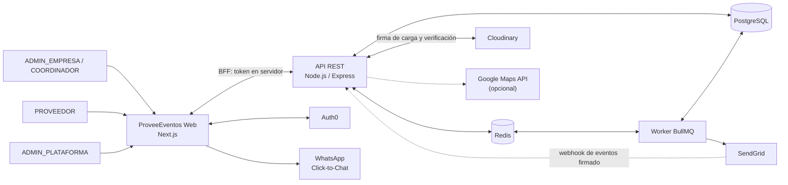
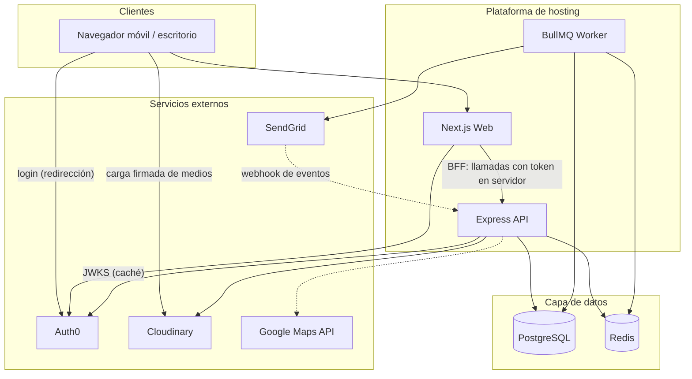
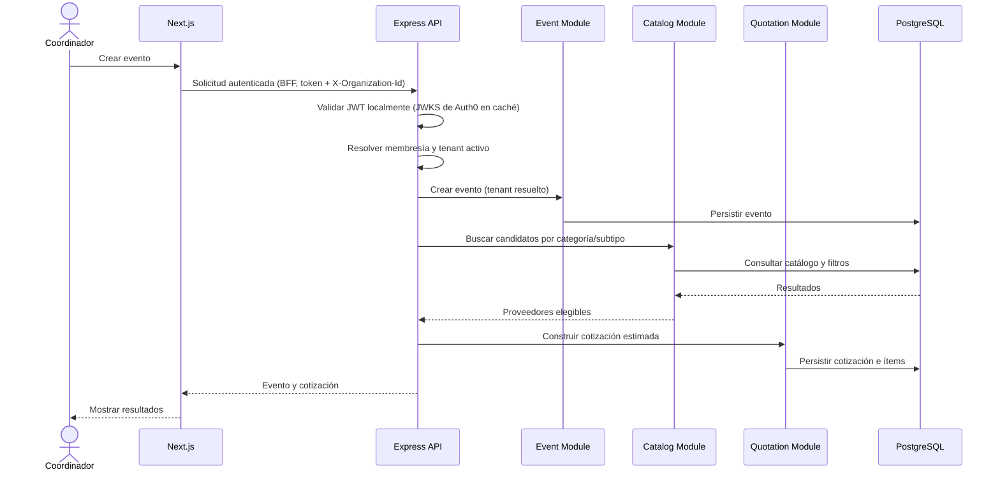
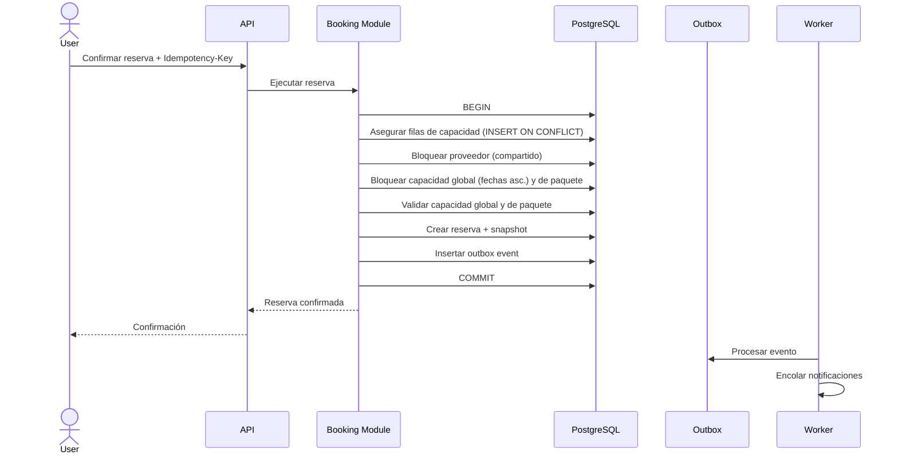
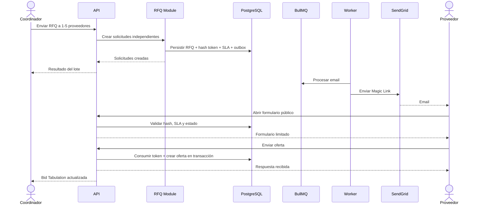
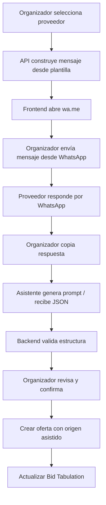
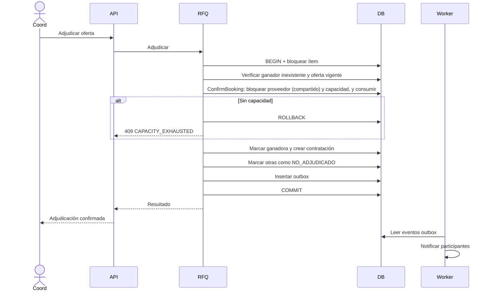

# ProveeEventos — Software Architecture Document (SAD)

**Archivo:** `ProveeEventos_SAD.md`  
**Versión:** 1.4  
**Fecha:** 24 de noviembre de 2026  
**Documentos de entrada:** `ProveeEventos_PRD.md` v2.4 y `ProveeEventos_SRS.md` v1.3  
**Estado:** Propuesta de arquitectura de referencia para el MVP (Fase 1)  
**Audiencia:** Producto, arquitectura, desarrollo, QA, DevOps y operaciones

---

## Control del documento

| Campo | Valor |
|---|---|
| Producto | ProveeEventos |
| Tipo | Plataforma web B2B multiempresa |
| Mercado inicial | Ciudades principales de Colombia |
| Idioma / moneda | Español (Colombia) / COP |
| Alcance arquitectónico | MVP / Fase 1 |
| Estilo principal | Monolito modular + procesamiento asíncrono |
| API de aplicación | REST/JSON, versionada |
| Persistencia principal | PostgreSQL |
| Estado de decisiones | Aprobadas en `Decisiones.md`: DEC-001 a DEC-037 y TEC-001 a TEC-012 (sección 19 y `Decisiones.md` §4b); ADR-001 a ADR-022 aprobados |

## Historial de versiones

| Versión | Fecha | Descripción |
|---|---|---|
| 1.0 | 20-11-2026 | Primera arquitectura derivada del PRD v2.2 y SRS 1.0 |
| 1.1 | 23-11-2026 | Se incorporan las decisiones aprobadas de `Decisiones.md` (capacidad, zona horaria, snapshots, RPO, sesión Auth0, hosting, PDF, mapas, outbox, multi-tenant) y se elimina la lista de decisiones pendientes |
| 1.2 | 23-11-2026 | Plan0001 (Review V1): `ConfirmBooking` único y capacidad en la adjudicación (TEC-009), outbox detallado, jobs programados, proyección de búsqueda, webhook de SendGrid, SLO, criterios de hosting, suite de concurrencia, Magic Link en fragmento (TEC-008), controles de seguridad; propuestas pendientes de aprobación |
| 1.3 | 24-11-2026 | Plan0003 (Review V2): Magic Link completo (§7.3), precondiciones y reintento de `ConfirmBooking` (§7.5), flujo y degradación de Auth0 (§9.1), contrato de errores, concurrencia e idempotencia (TEC-011, pendiente), paginación (TEC-012, pendiente) y endpoints operativos (§10.6–§10.8), mecanismo de rate limiting, cifrado, XSS y SSRF (§11.1), modelos de lectura en §4.4, entidades de titular y retención legal (§6.3) |
| 1.3 (rev.) | 24-11-2026 | Aprobación de DEC-019..034, TEC-006..012 y ADR-016..022 (23-11-2026): se retiran las marcas de pendiente; sin cambios de comportamiento |
| 1.4 | 24-11-2026 | Plan0004 (Review V3): suspensión de proveedor con contrataciones futuras (§7.6) y su serialización con la confirmación (DEC-036, pendiente); jobs de vencimiento de ofertas (DEC-035, pendiente) y de plazo de revisión; anti-cache de Magic Link solo con `Cache-Control`; reseñas públicas por cursor; mecanismo de detección de scraping; prueba de concurrencia de suspensión; pie de documento sin número de versión |
| 1.4 (rev.) | 24-11-2026 | Aprobación de DEC-035..037 (fecha de registro 23-11-2026): se retiran las marcas de pendiente; ADR-017 queda ampliado por DEC-036; los diagramas §15.2 y §15.5 muestran el bloqueo del proveedor; se explicita la autorización del proveedor suspendido (§7.6, §11.2); referencias al PRD v2.4 |

---

# 1. Introducción

## 1.1 Propósito

Este documento define la arquitectura de software de ProveeEventos para convertir los requisitos del PRD y del SRS en una estructura técnica implementable. Describe:

- los límites y responsabilidades de los componentes;
- la organización interna del backend;
- la comunicación entre frontend, API, base de datos, colas y proveedores externos;
- los patrones de persistencia y consistencia;
- los flujos críticos;
- la estrategia de seguridad multi-tenant;
- el despliegue, observabilidad, recuperación y escalabilidad;
- las decisiones arquitectónicas y sus consecuencias.

Este SAD no sustituye al SRS ni define los contratos completos de endpoints. Los contratos concretos de la API se especificarán en `ProveeEventos_API_Spec.yaml` (OpenAPI), después de aprobar los límites de módulos descritos aquí.

## 1.2 Fuentes y jerarquía

1. `ProveeEventos_PRD.md` v2.2: visión, alcance, stack de referencia, modelo de datos, reglas y fases.
2. `ProveeEventos_SRS.md` v1.0: requisitos funcionales, reglas consolidadas, requisitos no funcionales, estados y criterios de aceptación.
3. Este SAD: decisiones de arquitectura y organización técnica.

Cuando una decisión arquitectónica no esté explícitamente definida por las fuentes, se identifica como **propuesta SAD** o **pendiente de aprobación**. No se considera una nueva capacidad funcional.

## 1.3 Alcance

La arquitectura cubre el MVP:

- autenticación y autorización por roles;
- empresas organizadoras y coordinadores;
- perfiles y catálogo de proveedores;
- taxonomía de categorías y subtipos;
- paquetes, precios y disponibilidad;
- eventos y plantillas;
- cotización;
- Instant Book;
- e-RFQ y Magic Links;
- Bid Tabulation y adjudicación;
- WhatsApp Click-to-Chat y captura asistida de respuestas;
- notificaciones y email;
- generación de PDF;
- seguimiento de eventos;
- reseñas B2B;
- administración y auditoría.

No implementa como capacidades activas del MVP: WhatsApp Business Cloud API, webhooks de WhatsApp, automatización de IA mediante API, chat interno, Kanban, Google Calendar, pagos, API pública, aplicación móvil nativa, cotizador inverso ni analítica avanzada.

## 1.4 Principios arquitectónicos

1. **MVP operable primero:** minimizar infraestructura y operación sin sacrificar integridad.
2. **Modularidad explícita:** cada dominio tiene responsabilidad, interfaces y dependencias controladas.
3. **Consistencia transaccional:** reservas y adjudicaciones se protegen en base de datos, no solo en frontend.
4. **Seguridad por defecto:** autorización en backend y aislamiento de tenant en cada acceso.
5. **Integraciones desacopladas:** proveedores externos detrás de adaptadores.
6. **Asincronía para tareas diferibles:** email, recordatorios, expiración SLA, generación PDF pesada y limpieza.
7. **Evolución sin sobrearquitectura:** permitir extraer módulos sin empezar con microservicios.
8. **Trazabilidad:** cada decisión debe poder relacionarse con requisitos SRS y pruebas.

---

# 2. Contexto y límites del sistema

## 2.1 Actores

| Actor | Interacción principal |
|---|---|
| `ADMIN_EMPRESA` | Administra empresa, coordinadores, eventos, cotizaciones y configuración |
| `COORDINADOR` | Busca proveedores, crea eventos, cotiza, reserva, lanza e-RFQ y califica |
| `PROVEEDOR` | Gestiona perfil, paquetes, disponibilidad, reservas y respuestas |
| `ADMIN_PLATAFORMA` | Verifica proveedores, administra taxonomía y plantillas, modera y audita |
| Proveedor de identidad | Autentica usuarios y emite tokens |
| SendGrid | Envía correo transaccional y enlaces |
| Cloudinary | Almacena y entrega medios |
| WhatsApp del usuario | Abre Click-to-Chat mediante `wa.me`; no ofrece confirmación al backend en MVP |
| Servicio de mapas | Autocompletado geográfico opcional según disponibilidad y configuración |

## 2.2 Diagrama de contexto



## 2.3 Responsabilidad del sistema

ProveeEventos es responsable de la lógica de negocio, permisos, integridad transaccional, persistencia de datos, generación de solicitudes y registro de estados.

Los proveedores externos no son fuentes de verdad del negocio:
- Auth0 valida identidad, pero ProveeEventos determina rol, tenant y permisos internos.
- SendGrid transporta emails, pero ProveeEventos registra el estado de notificación y la relación con el evento.
- Cloudinary almacena medios, pero ProveeEventos controla propiedad, asociación y autorización.
- `wa.me` abre una conversación; no demuestra envío, entrega ni recepción.
- La respuesta asistida importada desde WhatsApp solo se convierte en oferta tras validación y confirmación humana.

---

# 3. Estilo arquitectónico

## 3.1 Decisión: monolito modular

**Propuesta SAD:** implementar un backend desplegable principal como monolito modular, acompañado de un proceso worker independiente que reutiliza los módulos de aplicación y dominio.

No se propone iniciar con microservicios independientes.

### Justificación

- El alcance MVP tiene un equipo y un producto acotados; dividirlo en servicios remotos aumentaría despliegues, observabilidad, consistencia distribuida y costo operativo.
- Los flujos de cotización, reserva, adjudicación y tenant requieren transacciones y reglas coordinadas.
- Los límites de dominio pueden mantenerse explícitos dentro del mismo repositorio backend.
- Los módulos de mayor carga o independencia podrán extraerse en el futuro mediante sus interfaces y eventos internos.

### Consecuencias

Ventajas:
- menor complejidad de infraestructura;
- transacciones ACID sencillas;
- depuración y pruebas de integración más directas;
- menos comunicación remota entre módulos;
- despliegue inicial más económico.

Costos y límites:
- el backend requiere disciplina para evitar dependencias cruzadas;
- una falla del proceso API puede afectar varios módulos;
- el escalado inicial es por réplicas de API/worker, no por dominio;
- extracción futura exige contratos internos estables y ownership claro de datos.

## 3.2 Unidades desplegables

| Unidad | Responsabilidad | Escalado |
|---|---|---|
| Web | Aplicación Next.js responsive | Horizontal según tráfico web |
| API | REST, autenticación, autorización y casos de uso | Horizontal; instancias sin estado |
| Worker | Tareas BullMQ y procesos programados | Réplicas según profundidad de cola |
| PostgreSQL | Persistencia transaccional | Vertical inicial; réplicas/HA según necesidad |
| Redis | Colas, locks auxiliares y caché no autoritativa | Según carga; persistencia acorde a colas |
| Cloudinary | Archivos multimedia | Servicio administrado |
| Auth0 / SendGrid | Servicios externos | Servicio administrado |

**Importante:** API y Worker pueden compartir código y módulos del backend, pero se ejecutan como procesos separados para que las tareas de larga duración no bloqueen las peticiones HTTP.

**Flujo de peticiones:** el navegador nunca llama a la API con un token. Llama al servidor Next.js (BFF), que mantiene la sesión en cookies `HttpOnly` y reenvía la petición a la API con el token de acceso y la cabecera `X-Organization-Id` (DEC-017, TEC-006). Los emails solo los envía el worker a partir del outbox (TEC-004); la API no llama a SendGrid directamente. La única excepción pública es el formulario Magic Link, que llama a la API mediante el BFF sin sesión (TEC-008).

## 3.3 Diagrama de contenedores



---

# 4. Organización del backend por dominios

## 4.1 Módulos

Los módulos del backend coinciden uno a uno con los 12 Bounded Contexts del DDD (§4) y usan sus mismos nombres de carpeta (TEC-010).

| Módulo (carpeta) | Contexto DDD | Responsabilidad | Datos principales |
|---|---|---|---|
| `identity-access` | BC-01 Identity & Access | Usuario interno, vínculo Auth0, roles globales y autorización base | Usuario, asignación de rol global |
| `organizations` | BC-02 Organizations & Tenancy | Empresa, membresías e invitaciones, organización activa, planes y límites | Empresa, membresía, invitación, plan, transferencia de propiedad |
| `provider-catalog` | BC-03 Provider Catalog | Perfil, verificación, portafolio, paquetes, cobertura y contacto | Proveedor, paquete, medio, decisión de verificación |
| `taxonomy-templates` | BC-04 Taxonomy & Templates | Categorías, subtipos, plantillas de evento y plantillas WhatsApp | Categoría, subtipo, plantilla de evento, plantilla WhatsApp |
| `event-management` | BC-05 Event Management | Eventos, ciclo de vida, clonación, asignación a coordinadores restringidos | Evento, asignación |
| `quotation` | BC-06 Quotation | Cotización rápida e integral, ítems, ranking, snapshots, PDF y **seguimiento por ítem** (`QuotationItem.trackingStatus` e historial, actualizado por eventos) | Cotización, ítem, versión/snapshot, historial de seguimiento, documento |
| `availability-booking` | BC-07 Availability & Booking | Capacidad por fecha y paquete, `ConfirmBooking`, contratación, cancelación, cierre y **registro de comisiones** (`CommissionRecord`) | Capacidad diaria, contratación, snapshot, registro de comisión |
| `rfq-offers` | BC-08 RFQ & Offers | Rondas, solicitudes, Magic Links, SLA, ofertas y revisiones, Bid Tabulation y adjudicación | Ciclo RFQ, solicitud, oferta, adjudicación, hash de token |
| `assisted-response` | BC-09 Assisted Response | Prompt, redacción de datos, importación y validación de JSON de WhatsApp | Borrador de respuesta asistida |
| `messaging-notifications` | BC-10 Messaging & Notifications | Email, notificaciones in-app, preferencias, intentos de entrega y webhook de SendGrid | Notificación, preferencia, intento de entrega |
| `reviews` | BC-11 Reviews | Calificaciones, reputación, respuesta del proveedor y reportes | Reseña, reporte |
| `administration-audit` | BC-12 Administration & Audit | Moderación, disputas, exportaciones, solicitudes de titulares, `legal_hold` y consulta de auditoría | Registro de auditoría, caso de moderación/disputa, solicitud de titular |

## 4.2 Estructura de carpetas sugerida

```text
backend/
  src/
    bootstrap/
      app.ts
      server.ts
      worker.ts
      container.ts
    shared/
      domain/          # IDs, Money, errores base, reloj, puerto de auditoría
      application/
      infrastructure/  # outbox, idempotencia, transacciones
      http/
      errors/
      security/
      observability/
    modules/
      identity-access/
        domain/
        application/
        infrastructure/
        http/
      organizations/
      provider-catalog/
      taxonomy-templates/
      event-management/
      quotation/
      availability-booking/
      rfq-offers/
      assisted-response/
      messaging-notifications/
      reviews/
      administration-audit/
    jobs/
      queues/
      processors/
      schedules/
    prisma/
      schema.prisma
      migrations/
    tests/
      unit/
      integration/
      contract/
      architecture/
      concurrency/
```

La estructura es orientativa, pero la separación por módulo es obligatoria como convención de ingeniería. No se recomienda organizar todo el backend únicamente por tipo técnico (`controllers/`, `services/`, `repositories/`) porque eso facilita dependencias cruzadas y dificulta ownership.

## 4.3 Capas internas por módulo

1. **Domain:** entidades, value objects, reglas puras, invariantes y eventos de dominio.
2. **Application:** casos de uso, orquestación, autorización de operación y límites transaccionales.
3. **Infrastructure:** Prisma repositories, Redis, Auth0, SendGrid, Cloudinary y adaptadores externos.
4. **HTTP:** controladores, validación de DTO, serialización y mapeo de errores.

Reglas:
- Domain no importa Express, Prisma, Redis ni SDK externos.
- HTTP no implementa reglas de negocio.
- Application depende de interfaces, no de SDK concretos.
- Infrastructure implementa interfaces definidas por el dominio/aplicación.
- Un módulo no accede directamente a tablas internas de otro módulo; usa interfaces/casos de uso publicados.
- Los casos de uso que modifican datos definen explícitamente su transacción.

## 4.4 Matriz de dependencias permitidas

Derivada del mapa de contextos del DDD (§11). Una dependencia significa que el consumidor invoca interfaces de aplicación (comandos o consultas) del proveedor. La matriz es **acíclica** (TEC-010).

| Módulo consumidor | Puede consultar/usar | Contrato |
|---|---|---|
| `identity-access` | — | — |
| `organizations` | `identity-access` | `UserId`, estado del usuario |
| `taxonomy-templates` | `organizations` | Tenant de las plantillas privadas |
| `provider-catalog` | `identity-access`, `taxonomy-templates` | Lookup de categoría/subtipo |
| `event-management` | `organizations`, `taxonomy-templates` | `TenantContext`, snapshot de plantilla |
| `availability-booking` | `organizations`, `provider-catalog` | Estado de proveedor y paquete, términos para el snapshot |
| `rfq-offers` | `organizations`, `provider-catalog`, `availability-booking` | Candidatos, `ConfirmBooking` (adjudicación) |
| `quotation` | `organizations`, `event-management`, `provider-catalog`, `taxonomy-templates`, `availability-booking`, `rfq-offers` | `EventSummary`, candidatos, disponibilidad indicativa, `ConfirmBooking` (Instant Book), `CreateRfqCycleCommand` |
| `assisted-response` | `rfq-offers` | `ConfirmAssistedOfferCommand` |
| `reviews` | `organizations`, `availability-booking` | Elegibilidad (contratación `COMPLETADO`) |
| `messaging-notifications` | `identity-access`, `organizations`, `taxonomy-templates` | Destinatarios, preferencias y plantillas; consume eventos de todos los módulos vía outbox |
| `administration-audit` | Interfaces administrativas de todos los módulos | Casos de uso administrativos publicados por cada módulo; nunca SQL ad hoc |

Reglas que evitan ciclos:
- `rfq-offers` no depende de `quotation`: el comando `CreateRfqCycleCommand` lleva el snapshot del ítem (categoría, subtipo, evento, fecha, invitados, alcance). La unicidad del ganador por `quotationItemId` se protege en `rfq-offers`.
- `availability-booking` no depende de `quotation` ni de `event-management`: recibe en `ConfirmBooking` el intervalo del servicio y los términos.
- El estado de seguimiento del ítem (`quotation`) y la reputación se actualizan **por eventos de dominio** (`BookingConfirmed`, `BookingClosed`, `OfferAwarded`, `ReviewSubmitted`…), no por llamadas de `availability-booking`, `rfq-offers` o `reviews` hacia `quotation`.
- Ningún módulo depende de `messaging-notifications` ni de `administration-audit`: las notificaciones se piden por outbox y la auditoría se escribe mediante un puerto append-only definido en `shared` (`AuditRecorder`), cuya implementación inyecta `bootstrap`.

**Modelos de lectura:** un modelo de lectura que combina datos de varios contextos (Bid Tabulation, dashboard, búsqueda de catálogo) es una proyección propia del módulo consumidor, alimentada por eventos de dominio (ADR-020), o se compone en el módulo consumidor llamando a las interfaces de consulta listadas en esta matriz. No lee tablas de otros módulos, así que no requiere una excepción en las pruebas de arquitectura.

Las dependencias concretas se validarán con pruebas de arquitectura (`tests/architecture`, §16.4), que fallan ante un ciclo o una dependencia no listada, sin excepciones.

---

# 5. Arquitectura de frontend

## 5.1 Stack de referencia

- Next.js 14+ / React.
- TypeScript.
- Tailwind CSS.
- shadcn/ui.
- Cliente HTTP tipado generado o validado contra OpenAPI una vez publicado.

## 5.2 Organización sugerida

```text
frontend/
  src/
    app/
      (public)/
      (auth)/
      (organizer)/
      (provider)/
      (admin)/
      magic-link/
    features/
      identity/
      catalog/
      events/
      quotation/
      booking/
      rfq/
      bid-tabulation/
      provider-dashboard/
      reviews/
      administration/
    components/
      ui/
      layout/
      feedback/
    lib/
      api/
      auth/
      validation/
      formatting/
      permissions/
```

## 5.3 Responsabilidades

- La UI presenta estados, captura entradas y solicita operaciones a la API.
- No contiene reglas autoritativas de capacidad, adjudicación, SLA, tenant ni elegibilidad.
- Los permisos visuales mejoran UX, pero nunca sustituyen autorización backend.
- La UI usa estados explícitos: carga, vacío, error, sin permiso, no encontrado, expirado, procesando y éxito.
- Las pantallas del proveedor y Magic Link serán mobile-first.
- Los importes se presentan en COP; el backend conserva precisión decimal.

## 5.4 Autenticación en navegador

El patrón aprobado (DEC-017) es una sesión gestionada en servidor (BFF) con cookies `HttpOnly`, `Secure` en producción y `SameSite` apropiado al flujo, expiración y renovación controladas, y protección CSRF en operaciones mutables. Los tokens de acceso no se exponen al JavaScript del navegador ni se guardan en `localStorage`. La API valida issuer, audience, firma y expiración, y resuelve roles y tenant desde la base de datos. La elección concreta del SDK debe seguir las recomendaciones vigentes de Auth0/Next.js al implementar y coordinar dominios y callbacks entre frontend y backend.

El frontend nunca decide el rol definitivo ni el tenant de un recurso. La API deriva identidad del token validado y resuelve la membresía interna.

---

# 6. Arquitectura de datos y persistencia

## 6.1 Motor principal

**Decisión propuesta:** PostgreSQL 15+ como fuente de verdad transaccional y Prisma como ORM/migraciones.

PostgreSQL almacena:
- usuarios y relaciones internas;
- empresas y membresías;
- proveedores, categorías, subtipos y paquetes;
- disponibilidad y reservas;
- eventos, plantillas y cotizaciones;
- solicitudes RFQ, ofertas y adjudicaciones;
- notificaciones, reseñas y auditoría.

Redis no sustituye PostgreSQL ni será fuente de verdad para reservas, adjudicaciones, ofertas o estados financieros.

## 6.2 Estrategia multi-tenant

El SRS define que cada empresa organizadora es un tenant y que los proveedores pueden trabajar con múltiples empresas.

**Decisión aprobada (TEC-005):** aislamiento lógico mediante `empresa_id` en cada entidad propiedad de la empresa y comprobación obligatoria en repositorios/casos de uso. La identidad del proveedor es global y no pertenece a un tenant único.

Reglas:
1. Todo recurso propiedad de empresa contiene `empresa_id` o deriva inequívocamente de una entidad que lo contiene.
2. La API obtiene `user_id`, roles y membresías desde el contexto autenticado interno.
3. No se acepta `empresa_id` enviado por cliente como prueba de autorización.
4. Las consultas por ID se filtran por tenant en la misma operación de lectura/escritura.
5. Los índices únicos compuestos incluyen tenant cuando la unicidad sea local a empresa.
6. Los procesos worker reciben el contexto de tenant y lo validan igual que las peticiones HTTP.
7. `ADMIN_PLATAFORMA` usa permisos explícitos y auditoría; no se convierte en una excepción invisible.

**Defensa adicional (TEC-005):** el tenant se resuelve desde la membresía autenticada y todos los repositorios/casos de uso exigen `organizationId`; es obligatorio desde la primera migración y se acompaña de pruebas negativas sistemáticas. PostgreSQL Row-Level Security se evalúa como defensa en profundidad, tras validar compatibilidad con Prisma, pools de conexiones y contexto transaccional, nunca como sustituto de la autorización.

## 6.3 Entidades y agregados principales

| Agregado | Entidades | Invariantes relevantes |
|---|---|---|
| Organización | Empresa, Usuario, Membresía/Coordinador | Membresía válida y límites de plan |
| Proveedor | Proveedor, Categoría, Subtipo, Paquete, Portafolio | Máximo cinco categorías; paquete ligado a subtipo activo |
| Evento | Evento, Plantilla | Evento pertenece a una empresa |
| Cotización | Cotización, CotizaciónItem, Snapshot | Snapshot inmutable al enviar o generar PDF |
| Booking | Disponibilidad, Reserva/Contratación | Capacidad global por proveedor/fecha (2 por defecto) y capacidad por paquete como excepción; nunca se excede ninguna capacidad aplicable |
| RFQ | RfqCycle, SolicitudRFQ, OfertaRFQ (revisiones inmutables), TokenMagicLink, Adjudicación | Una solicitud por proveedor/ítem/ciclo; entre 1 y 5 invitados por ciclo; un ganador por ítem |
| Review | Calificación, RespuestaProveedor | Solo contratación completada puede originar calificación |
| Notification | Notificación, DeliveryAttempt | Estado de envío separado del estado de negocio |
| Audit | AuditLog | Actor, acción, recurso, fecha y correlación |
| Privacidad y retención (`administration-audit`) | SolicitudTitular, RetencionLegal (`legal_hold`) | Toda solicitud tiene estado, responsable y resultado; un recurso con retención activa no se archiva, anonimiza ni elimina (SRS-ADM-012) |

## 6.4 Ajustes de modelo recomendados respecto al ERD conceptual

El ERD del PRD es una base conceptual. Para implementar los requisitos SRS sin ambigüedad se recomienda:

- Separar `SolicitudRFQ` de `OfertaRFQ` (TEC-001); una solicitud puede no recibir oferta y la oferta es un agregado independiente con revisiones inmutables y estado propio (DEC-005). Introducir `RfqCycle` como agrupador de las solicitudes paralelas de una ronda (TEC-002), con el límite de 1–5 proveedores garantizado en base de datos.
- Modelar reserva/contratación como entidad transaccional propia, no depender únicamente del estado de `COTIZACION_ITEM`.
- Modelar capacidad diaria como contador/cupo o capacidad consumida, no solo booleano `ocupado`, en dos niveles: capacidad global del proveedor por fecha (por defecto 2) y capacidad por paquete/recurso como excepción; una reserva consume el cupo del paquete y el global salvo inventario independiente configurado (DEC-006).
- Añadir entidad de membresía con roles `PROPIETARIO` (único), `ADMIN_EMPRESA`, `COORDINADOR` y `COORDINADOR_RESTRINGIDO` (valores DEC-022), y soporte para varios administradores con transferencia controlada de propiedad (DEC-008, DEC-011).
- Mantener snapshots inmutables de paquete, precio y desglose, alcance, configuración fiscal aplicada, porcentaje y base de comisión, condiciones aceptadas, versión de oferta adjudicada, proveedor, evento, actor y fecha en el momento de la reserva/adjudicación (DEC-018). Las correcciones se registran como nuevo evento o documento rectificativo.
- Mantener hashes de Magic Link, nunca el token en claro.
- Mantener `created_at`, `updated_at`, actor y motivo en cambios críticos.
- Usar `Decimal/Numeric` para importes y precisión definida; no `float`. Representación: `amount NUMERIC(14,2)` más `currency`, con un único helper de cálculo y redondeo *half-up* al peso por línea (DEC-032, SRS-QUO-013).
- Usar UTC para timestamps y guardar por evento la zona IANA, `startsAtUtc`/`endsAtUtc` y la fecha/hora local introducida (DEC-007); la disponibilidad diaria se calcula con la fecha local del evento y no se usan offsets fijos.
- Registrar configuración fiscal con vigencia desde/hasta y comisión versionada, separadas del precio del proveedor (DEC-010).

Estos ajustes no amplían el alcance funcional; son estructuras para hacer cumplir los requisitos ya establecidos.

## 6.5 Índices y restricciones críticas

Índices iniciales:
- `EVENTO(empresa_id, fecha_evento, estado)`;
- `COTIZACION(evento_id, created_at)`;
- `COTIZACION_ITEM(cotizacion_id, estado)`;
- `PROVEEDOR(estado_verificacion, ciudad)`;
- `PAQUETE_SERVICIO(proveedor_id, categoria_id, subtipo_id, activo)`;
- `SOLICITUD_RFQ(proveedor_id, estado_rfq, sla_expira_at)`;
- `NOTIFICACION(usuario_id, leida, created_at)`;
- índices de búsqueda por categoría, subtipo, ciudad, modalidad y precio, ajustados tras medir consultas reales.

Restricciones:
- NIT único normalizado para empresa.
- Email externo único conforme al proveedor de identidad y política de cuentas.
- Subtipo pertenece a categoría.
- Paquete pertenece a proveedor y subtipo consistente.
- Una sola adjudicación ganadora por ítem.
- Un token Magic Link solo puede consumirse una vez.
- Una reserva no puede incrementar ocupación por encima de capacidad.
- Las claves foráneas no deben permitir borrar físicamente historial transaccional referenciado.

## 6.6 Búsqueda de catálogo

MVP: consultas PostgreSQL con índices adecuados, filtros combinados y paginación determinista. No introducir Elasticsearch/OpenSearch hasta que volumen, latencia o relevancia de búsqueda lo justifiquen.

**Proyección de búsqueda (propuesta SAD):** tabla de proyección `provider_search` (o vista materializada), con una fila por paquete publicable. Contiene: categoría/subtipo, ciudad y cobertura, coordenadas, modalidad, precio desde, capacidad máxima, foto principal, reputación agregada y los componentes del ranking precalculados por subtipo (calidad bayesiana, posición de precio relativa y completitud). La actualizan los eventos `ProviderVerified`, `ProviderSuspended`, `ServicePackagePublished`, `ServicePackageChanged` y `ReviewModerated`, más un refresco nocturno completo. En consulta solo se calcula la proximidad. Búsqueda de texto en español con las extensiones `unaccent` y `pg_trgm`. Objetivo: SRS-NFR-PERF-003 (< 1 s). La proyección nunca autoriza mutaciones (ADR-020).

La lógica de filtros:
- AND entre dimensiones;
- OR entre varios valores dentro de una dimensión;
- ordenamiento determinista;
- disponibilidad consultada como dato indicativo;
- la reserva siempre vuelve a validar capacidad transaccionalmente.

---

# 7. Consistencia, transacciones y concurrencia

## 7.1 Reserva Instant Book

**Regla central:** PostgreSQL es la autoridad de capacidad. Redis no decide si una reserva puede confirmarse.

Flujo (TEC-009; usa el caso de uso único `ConfirmBooking` de §7.5):
1. Validar usuario, rol, tenant, evento, ítem y paquete fuera de la transacción.
2. Calcular las fechas locales que consume el servicio según la zona IANA del evento (SRS-EVT-010, DEC-025) y la cantidad requerida.
3. Iniciar transacción PostgreSQL (`READ COMMITTED`, ADR-017).
4. Asegurar que existen las filas de capacidad: `INSERT … ON CONFLICT DO NOTHING` en `provider_daily_capacity` para cada fecha (capacidad global por defecto 2) y, si el paquete tiene capacidad propia, en `package_daily_capacity` (ADR-016). Sin esta fila previa, `SELECT … FOR UPDATE` no bloquearía nada y dos transacciones podrían pasar a la vez.
5. Bloquear en orden fijo: primero la fila del proveedor en modo compartido (`FOR SHARE`, a través de la interfaz de `provider-catalog`; DEC-036) y después, con `SELECT … FOR UPDATE`, las filas globales de capacidad en orden ascendente de fecha y las del paquete. El orden fijo evita interbloqueos.
6. Volver a validar estado del proveedor (verificado y activo), paquete, precio y bloqueos manuales.
7. Comprobar que `consumed + quantity ≤ capacity` en todas las filas bloqueadas (global y, si aplica, paquete, salvo inventario independiente configurado).
8. Crear la contratación (`Booking` en `CONFIRMADO`) y su snapshot inmutable.
9. Incrementar `consumed` en las filas bloqueadas.
10. Registrar el evento de dominio en outbox.
11. Confirmar la transacción.
12. Responder éxito; si no hay capacidad, responder `409 CAPACITY_EXHAUSTED` sin crear la contratación. Ante un deadlock o un error de serialización, reintentar hasta 3 veces.

La transacción debe ser corta. No se realizan llamadas a Auth0, SendGrid, Cloudinary ni otros servicios externos dentro de la transacción.

### Idempotencia

- El cliente envía `Idempotency-Key` en la operación de reserva.
- La API guarda clave, usuario/tenant, operación y resultado asociado.
- Una repetición con la misma clave devuelve el resultado anterior.
- Reutilizar una clave con payload diferente se rechaza.
- La unicidad se protege en PostgreSQL.

## 7.2 Adjudicación e-RFQ

Flujo:
1. Verificar que el usuario puede gestionar el ítem (no `COORDINADOR_RESTRINGIDO`) y que la oferta pertenece a una solicitud del ítem.
2. Iniciar transacción.
3. Bloquear el ítem de cotización o usar actualización condicional por estado.
4. Comprobar que no existe ganador y que la oferta está vigente (`offerValidityUntil`, SRS-RFQ-012).
5. Invocar `ConfirmBooking` (§7.5, TEC-009) **dentro de la misma transacción**: asegura y bloquea las filas de capacidad del proveedor, valida y consume la capacidad y crea la contratación con su snapshot. Si no hay capacidad, se aborta la transacción completa: no hay ganador y se responde `409 CAPACITY_EXHAUSTED`.
6. Marcar la oferta elegida como adjudicada y registrar el `Award`.
7. Marcar las demás solicitudes/ofertas como `NO_ADJUDICADO` según reglas de estado.
8. Insertar eventos outbox para avisos a todos los participantes.
9. Confirmar transacción.

El orden de bloqueo es siempre ítem → proveedor en modo compartido (DEC-036) → capacidad global (fechas ascendentes) → capacidad del paquete, igual que en Instant Book, para que una adjudicación y una reserva concurrentes sobre el mismo proveedor y fecha no se interbloqueen.

Una restricción única o mecanismo equivalente en base de datos impide más de un ganador. El frontend no es mecanismo de exclusión.

## 7.3 Magic Link

- El token se genera con fuente criptográficamente segura.
- Se almacena únicamente hash seguro del token.
- El enlace tiene propósito limitado a una solicitud concreta.
- Se valida expiración, estado de solicitud, proveedor destinatario y consumo previo.
- **Vigencia:** el token expira en `sla_expira_at` de su solicitud. Se invalida antes por cualquiera de los disparadores de SRS-MAGIC-002: respuesta válida (consumo), revocación o cancelación de la solicitud (incluida la causada por editar o cancelar el evento, SRS-EVT-008/009, o por suspender al proveedor, SRS-ADM-013) e invalidación administrativa. La invalidación cambia el estado del registro del token en la misma transacción que la causa.
- El consumo y creación de oferta ocurren en una sola transacción.
- Un token usado, vencido o revocado no puede volver a utilizarse.
- No incluir token en logs, analítica, referer ni mensajes de error.
- **Token fuera de la ruta (TEC-008):** el email enlaza a `https://<web>/r#<token>`. El fragmento no viaja al servidor web, así que no queda en logs de acceso de proxies ni del hosting. La página lee el fragmento, lo borra de la barra de direcciones (`history.replaceState`) y llama `POST /api/v1/magic-links/form` y `POST /api/v1/magic-links/response` con el token en el cuerpo.
- Las aperturas automáticas de escáneres de correo (por ejemplo, Safe Links) no ejecutan JavaScript, no consumen el token y no cuentan como apertura.
- Configurar `Referrer-Policy: no-referrer` en la página pública del formulario y evitar recursos de terceros innecesarios en ella.
- **Cabeceras anti-cache:** la página `/r` y todas las respuestas de `POST /magic-links/form|response`, de éxito o de error, llevan `Cache-Control: no-store` y `Referrer-Policy: no-referrer`. No se usa `Pragma`: es una directiva de petición de HTTP/1.0, declarada obsoleta por RFC 9111, sin efecto definido en respuestas.
- **Rate limiting específico (§11.1):** por IP y por hash de token; tras 10 intentos fallidos en 10 minutos desde una IP se responde `429` con `Retry-After`. Los intentos con tokens inexistentes no revelan si el token existió.
- **Auditoría del ciclo completo:** emisión, apertura medible (sin contar escáneres), consumo, rechazo (con motivo: vencido, usado, revocado, inexistente), expiración y revocación, sin registrar el token ni su hash completo.
- **Sin datos personales en la URL:** el enlace contiene solo el fragmento con el token; nombres, emails, teléfonos y datos del evento se obtienen por `POST` tras validar el token.

## 7.4 Outbox y publicación fiable de tareas

**Decisión aprobada (TEC-004):** patrón Transactional Outbox para efectos externos derivados de cambios críticos.

En la misma transacción de negocio se inserta un registro `outbox_event`. Un worker lo publica/procesa y marca el resultado. Esto evita el caso “la reserva se confirmó pero el proceso cayó antes de encolar el email”.

Esquema mínimo de `outbox_event`:

| Columna | Uso |
|---|---|
| `id` (UUID) | Identificador del evento; clave de idempotencia de los consumidores |
| `event_type`, `event_version` | Tipo y versión del esquema del evento (DDD §8.2) |
| `aggregate_type`, `aggregate_id`, `organization_id` | Origen y tenant |
| `payload` (JSONB) | Datos mínimos; sin tokens ni datos personales innecesarios |
| `correlation_id` | Trazabilidad |
| `status` | `PENDIENTE`, `PUBLICADO`, `FALLIDO` |
| `attempts`, `available_at`, `last_error` | Reintentos con backoff |
| `created_at`, `published_at` | Auditoría operativa |

Un job de reconciliación (cola `outbox`, cada minuto) publica los eventos `PENDIENTE` con `available_at` vencido y detecta los que llevan demasiado tiempo sin publicarse (alerta). Tras una restauración (§14.4) se reprocesan los pendientes.

Los consumidores deben ser idempotentes. BullMQ puede entregar tareas más de una vez; el diseño no debe depender de entrega exactamente una vez.

## 7.5 Confirmación de compromisos única (`ConfirmBooking`)

**Decisión aprobada (TEC-009):** Instant Book (§7.1) y adjudicación (§7.2) usan un único caso de uso del módulo Availability & Booking:

`ConfirmBooking(origin, organizationId, eventId, quotationItemId, providerId, packageId?, quantity, serviceInterval, terms)`

- **Precondiciones del llamador:** en la adjudicación (§7.2), el llamador ya abrió la transacción, bloqueó el ítem y verificó que la oferta está `RECIBIDA` y vigente y que no existe ganador; en Instant Book, el llamador validó la idempotencia. `ConfirmBooking` no repite esas comprobaciones, pero sí revalida el estado del proveedor y del paquete.
- Se ejecuta dentro de la transacción del llamador; no abre una propia cuando se invoca desde la adjudicación.
- Implementa los pasos 2 a 10 de §7.1, con el mismo orden de bloqueo.
- Devuelve la contratación creada o un error de dominio `CapacityExhausted`.
- **Reintento:** si la transacción completa falla por deadlock o error de serialización, el caso de uso del llamador la reintenta desde el principio hasta 3 veces con backoff aleatorio (§7.1, ADR-017); el reintento reutiliza la misma clave de idempotencia y nunca reintenta un `CapacityExhausted`.
- Es la única ruta que incrementa `consumed`; la liberación de capacidad (cancelación aceptada o `NO_PRESTADO`) usa la operación simétrica `ReleaseBookingCapacity` con el mismo orden de bloqueo.

Así se garantiza que no exista sobreventa entre canales y que la regla de capacidad tenga una sola implementación.

## 7.6 Suspensión de proveedor con contrataciones futuras

Implementa DEC-034, DEC-036 y SRS-ADM-013. El caso de uso `SetProviderSuspension` es de `administration-audit` y llama a las interfaces publicadas de los demás módulos (§4.4) dentro de **una sola transacción**:

1. `provider-catalog`: bloquea la fila del proveedor con `FOR UPDATE` y pasa su cuenta a `SUSPENDIDO`.
2. `rfq-offers`: revoca las solicitudes abiertas (`CANCELADO`), marca sus ofertas no adjudicadas como `INVALIDADA` e invalida los Magic Links (§7.3).
3. `availability-booking`: pasa cada contratación `CONFIRMADO` o `CANCELACION_SOLICITADA` con inicio futuro a `CANCELACION_EN_REVISION` con origen `PLATAFORMA` y fija el fin de la ventana de decisión. No toca la capacidad.
4. Inserta en el outbox `ProviderSuspended`, `RfqRequestCancelled` y `BookingPlacedUnderPlatformReview`, y registra la auditoría con las contrataciones afectadas.

La transacción no hace llamadas externas. Repetir la suspensión de un proveedor ya suspendido no cambia nada.

**Serialización con la confirmación:** `ConfirmBooking` bloquea la fila del proveedor con `FOR SHARE` antes de las filas de capacidad. Así, una confirmación simultánea termina antes de la suspensión y su contratación entra en el paso 3, o se ejecuta después y se rechaza al revalidar el estado del proveedor. Ante un deadlock se aplica el reintento de §7.5.

**Decisión de la organizadora:** el caso de uso `DecideSuspensionReview` es de `availability-booking`. Con `CANCELAR`, pasa la contratación a `CANCELADO` y libera la capacidad con `ReleaseBookingCapacity`; con `MANTENER`, registra la elección y emite `BookingReviewDecisionRecorded`, sin cambiar el estado. La ventana, el cambio de elección y la condición para que la administración resuelva siguen SRS-ADM-013. El job «Plazo de revisión por suspensión» (§8.2) marca los casos con la ventana cerrada.

**Proveedor suspendido:** la autorización le permite solo consultar sus contrataciones vigentes y ejecutar las acciones de ciclo sobre las que sigan en curso (SRS-AUTH-007); las políticas de `availability-booking` lo comprueban y todo lo demás se rechaza con `403 FORBIDDEN`.

---

# 8. Procesamiento asíncrono

## 8.1 Redis y BullMQ

Redis/BullMQ se utilizará para:
- envío de email transaccional;
- recordatorios de SLA;
- expiración de solicitudes;
- notificaciones de adjudicación y no adjudicación;
- generación de PDF si la carga lo amerita;
- limpieza/archivo de borradores;
- reintentos controlados de integraciones;
- procesamiento de outbox.

No se utilizará para persistir la verdad final de una reserva, oferta, adjudicación ni saldo/comisión.

## 8.2 Colas sugeridas

| Cola | Trabajos | Prioridad |
|---|---|---|
| `outbox` | Publicación de eventos de dominio | Alta |
| `email` | Magic Links, invitaciones, avisos | Alta |
| `rfq-sla` | Expirar solicitudes y recordatorios | Alta |
| `notifications` | Notificaciones in-app y avisos derivados | Media |
| `documents` | Generar PDF | Media |
| `scheduler` | Transiciones temporales y recordatorios (ver abajo) | Alta |
| `maintenance` | Archivo de borradores, purga por retención y tareas de mantenimiento | Baja |

Jobs programados (cola `scheduler` salvo indicación), todos idempotentes y basados en datos persistidos en PostgreSQL:

| Job | Regla | Fuente |
|---|---|---|
| Expiración de SLA | `ENVIADO → EXPIRADO` al vencer `sla_expira_at` (cola `rfq-sla`) | SRS-RFQ-004 |
| Inicio de servicio | Contratación `CONFIRMADO → EN_PROGRESO` al llegar el inicio local; evento `→ EN_PROGRESO` | SRS-BOOK-009, SRS §9.4 |
| Cancelación sin respuesta | `CANCELACION_SOLICITADA → CANCELACION_EN_REVISION` a las 72 h | SRS-BOOK-009 |
| Cierre automático | Recordatorios durante el plazo y `SERVICIO_REALIZADO → COMPLETADO` a los 5 días sin incidencia | SRS-BOOK-008, DEC-002 |
| Recordatorio de evento próximo | Aviso a organizador y proveedores antes del evento | SRS-NOT-001 |
| Aviso de calificación | Tras `COMPLETADO`, aviso y recordatorio dentro de la ventana de 30 días | SRS-REV-008 |
| Borradores inactivos | Aviso a los 83 días y archivo (`archivedAt`) a los 90 (cola `maintenance`) | SRS-EVT-007 |
| Expiración de invitaciones y transferencias | `PENDIENTE → EXPIRADA` | SRS-AUTH-006, SRS-AUTH-009 |
| Vencimiento de plan | Paso a solo lectura al vencer el plan | SRS-TEN-004 |
| Purga por retención | Eliminación o anonimización según categoría y `legal_hold` (cola `maintenance`) | SRS-EVT-007, SRS-ADM-012, DEC-003 |
| Vencimiento de ofertas | `RECIBIDA → VENCIDA` al llegar la vigencia; cierra la solicitud sin oferta vigente y con SLA vencido (`RESPONDIDO → NO_ADJUDICADO`; DEC-035) | SRS-RFQ-012 |
| Plazo de revisión por suspensión | Al cerrarse la ventana de decisión, marca el caso como pendiente de la administración y le avisa; no cambia el estado (DEC-036) | SRS-ADM-013 |

## 8.3 Reintentos y fallos

- Reintentos exponenciales con jitter para errores transitorios.
- No reintentar indefinidamente errores permanentes (dirección inválida, payload rechazado).
- Límite de intentos configurable.
- Cola de fallidos / dead-letter lógica para inspección y reproceso.
- Registrar `job_id`, correlation ID, entidad relacionada y proveedor externo.
- No registrar secretos, tokens Magic Link completos ni datos personales innecesarios.
- La falla de envío a un proveedor no debe cancelar las demás solicitudes e-RFQ del mismo lote.

## 8.4 SLA

El reloj de SLA se basa en `sla_expira_at` persistido en PostgreSQL. La cola programa el trabajo de expiración, pero al ejecutarse vuelve a consultar el estado y la hora del servidor. Una tarea duplicada o tardía no debe modificar una solicitud rechazada, adjudicada o terminal, ni marcar `EXPIRADO` una ya respondida. La única excepción sobre una solicitud `RESPONDIDO` es su cierre en `NO_ADJUDICADO` cuando no le queda oferta vigente y el SLA venció (SRS-RFQ-012; DEC-035).

La regla de aceptación en el límite temporal será la del SRS: la hora de recepción del servidor decide y se acepta si es menor o igual al vencimiento.

---

# 9. Integraciones y adaptadores

## 9.1 Auth0

Responsabilidad externa: autenticación, gestión de credenciales, recuperación y emisión de tokens.

Responsabilidad interna:
- mapear `sub`/identificador externo a `Usuario`;
- validar firma, issuer, audience, expiración y claims;
- resolver roles y membresías en base de datos;
- aplicar estado activo/suspendido;
- no aceptar roles enviados por el navegador como autoridad.

**Flujo de inicio de sesión (DEC-017):**
1. El navegador pide `/auth/login` al BFF (Next.js).
2. El BFF redirige a Auth0 con Authorization Code + PKCE, `state` y `nonce` guardados en una cookie temporal cifrada.
3. Auth0 autentica (MFA cuando aplica, SRS-AUTH-012) y redirige a `/auth/callback` con el código.
4. El BFF valida `state`, intercambia el código por tokens en el servidor, valida el ID token (`nonce`, firma, issuer, audience) y crea la sesión en una cookie `HttpOnly`, `Secure`, `SameSite=Lax` cifrada. El navegador nunca recibe el access token.
5. En cada petición a la API, el BFF adjunta el access token y `X-Organization-Id` (TEC-006); renueva el token con refresh token rotatorio antes de su expiración.
6. El cierre de sesión borra la cookie y llama al endpoint de logout de Auth0.

**Rotación de secretos y claves:**
- El secreto de cliente de Auth0 y la clave de cifrado de la cookie de sesión se rotan al menos una vez al año y de inmediato ante sospecha de exposición. La clave de sesión admite dos versiones activas durante la rotación para no cerrar todas las sesiones.
- La API guarda en caché el JWKS de Auth0 (TTL 10 minutos) y lo recarga una vez cuando llega un token con `kid` desconocido; así acepta la rotación de claves de firma de Auth0 sin despliegue.

**Degradación ante caída de Auth0:**
- Las sesiones vigentes siguen operando: la API valida tokens con el JWKS en caché y no llama a Auth0 por petición.
- Los nuevos inicios de sesión y las renovaciones fallan con un mensaje claro y `503 DEPENDENCY_UNAVAILABLE`; el BFF no cierra sesiones activas por un fallo de renovación hasta que el token expire.
- El adaptador usa timeout de 3 s y circuit breaker (abre tras 5 fallos en 1 minuto, reintento cada 30 s) y emite alerta (§12.5).

Interfaz interna sugerida: `IdentityProviderPort`.

## 9.2 SendGrid

Responsabilidad: transporte de email transaccional.

Adaptador: `EmailProviderPort`.

El dominio solicita mensajes mediante plantillas versionadas. El worker registra intentos, identificador externo, resultado y errores saneados. El envío de Magic Link no debe exponer tokens en logs.

**Estado de entrega (SRS-NOT-006):** la API expone un webhook público `POST /api/v1/webhooks/sendgrid/events` que verifica la firma de SendGrid (Event Webhook firmado con clave pública) y su marca de tiempo, y es idempotente por el identificador del evento. Los eventos `delivered`, `bounce`, `dropped` y `spamreport` actualizan `DeliveryAttempt` y el `dispatchStatus` de la solicitud; un rebote permanente marca la solicitud e-RFQ como `ERROR_ENVIO`. El dominio remitente se autentica con SPF, DKIM y DMARC.

## 9.3 Cloudinary

Responsabilidad: almacenamiento, transformación y entrega de imágenes/videos.

Adaptador: `MediaStoragePort`.

Flujo recomendado:
1. API autoriza al usuario y genera autorización/firma de carga de alcance limitado.
2. Navegador carga el archivo a Cloudinary según el flujo aprobado.
3. API verifica identificador, tipo, tamaño, propietario y asociación antes de guardar referencia.
4. Eliminación o sustitución respeta ownership y política de retención.

No confiar en extensión del archivo enviada por el cliente.

## 9.4 WhatsApp Click-to-Chat

En MVP:
- ProveeEventos prepara texto determinístico a partir de plantilla.
- El navegador abre `wa.me`.
- El usuario revisa y envía el mensaje desde WhatsApp.
- La plataforma no marca el mensaje como enviado/entregado por el hecho de abrir el enlace.
- La respuesta entrante se copia manualmente y pasa por el asistente de estructuración.

Adaptador/interfaz sugerida: `WhatsAppLinkBuilder`, no `WhatsAppMessagingProvider`, para dejar claro que no existe API de transporte en MVP.

## 9.5 Asistente de respuesta WhatsApp

El sistema no automatiza login, scraping ni sesiones web de terceros. En MVP:
1. el usuario pega texto recibido;
2. el sistema genera prompt/instrucciones;
3. el usuario obtiene JSON desde herramienta externa por su cuenta;
4. importa JSON;
5. backend valida esquema, límites y consistencia;
6. usuario revisa y confirma;
7. se crea oferta con origen `WHATSAPP_IA_ASISTIDO`.

La IA no es fuente autoritativa ni puede adjudicar, confirmar reserva o cambiar estado transaccional por sí sola.

## 9.6 Google Maps

El PRD contempla Google Maps para autocompletado y cercanía; el SRS permite captura manual si el servicio falla. Se trata como integración opcional y no crítica para disponibilidad, cotización o reserva. Alcance aprobado en el MVP (DEC-015): autocompletado de ciudad/dirección, geocodificación de la ubicación del evento y cobertura del proveedor, y distancia aproximada sin prometer tiempos de traslado; captura manual siempre disponible; sin optimización de rutas, tráfico ni mapas avanzados; cuotas, alertas de consumo y restricciones de API key; revisión de términos de uso sobre almacenamiento de resultados. La API key restringida nunca debe exponerse con permisos de servidor; las claves de navegador tendrán restricciones de dominio y API.

## 9.7 PDF

Generación a partir de snapshot de cotización, nunca desde datos vivos. Tecnología aprobada (DEC-016): React-PDF por defecto, por evitar un navegador headless y su consumo de memoria; Puppeteer solo si un prototipo con una cotización realista (tablas largas, saltos de página, tipografías en español, encabezados/pies, tiempo y memoria, compatibilidad de despliegue) demuestra que se requiere fidelidad HTML/CSS. El PDF:
- se genera desde backend/worker;
- incluye fecha, empresa, evento, ítems, proveedor, importes, impuestos/configuración y total;
- identifica cotizaciones estimativas cuando aún no existen ofertas firmes/adjudicación;
- queda asociado al tenant y al recurso original;
- se sirve mediante URL protegida o URL firmada de corta duración;
- no se comparte públicamente por una URL predecible.

---

# 10. Arquitectura de API

## 10.1 Estilo

REST/JSON versionado, con prefijo `/api/v1`.

La API es la frontera pública entre frontend y backend. Los módulos no exponen acceso directo a la base de datos.

## 10.2 Convenciones que deberá adoptar OpenAPI

- JSON UTF-8.
- Identificadores opacos UUID.
- Fechas ISO 8601; timestamps UTC.
- Moneda explícita `COP`.
- Importes decimales serializados como string decimal para evitar pérdida de precisión.
- Paginación consistente para colecciones.
- Errores con código estable, mensaje seguro y correlation ID.
- `Idempotency-Key` para operaciones con efecto no repetible, en especial reserva y operaciones de creación sensibles.
- Autorización validada en backend.
- Versionado mayor en URL.
- No devolver campos internos ni secretos.

## 10.3 Agrupación lógica de recursos

Los recursos API se agruparán por dominio:

| Área | Recursos lógicos |
|---|---|
| Identity | sesión/perfil interno, invitaciones, membresías |
| Organizations | empresa, coordinadores, plan y límites |
| Providers | perfil, portafolio, paquetes, disponibilidad |
| Catalog | categorías, subtipos y búsqueda |
| Events | eventos, plantillas, clonación |
| Quotations | cotizaciones, ítems, snapshots y PDF |
| Bookings | reservas y contrataciones |
| RFQ | solicitudes, respuestas, ofertas y SLA |
| Magic Links | consulta limitada y envío de respuesta pública |
| Assisted Responses | importación/validación de JSON |
| Reviews | calificaciones y respuestas |
| Notifications | bandeja y lectura |
| Admin | moderación, taxonomía, plantillas y auditoría |

**Nota:** esta tabla define agrupación y ownership, no contratos finales. Los métodos, paths, DTO y códigos HTTP se definirán en OpenAPI.

## 10.4 API pública de Magic Link

La ruta pública no equivale a acceso anónimo general. El token es una credencial de capacidad limitada.

Controles:
- solo puede consultar el resumen mínimo de la solicitud destinataria;
- solo puede responder esa solicitud;
- no puede enumerar otros proveedores, eventos o solicitudes;
- rate limit y expiración;
- token de un solo uso;
- no devolver información privada de la empresa más allá de lo necesario para responder;
- registrar auditoría de emisión, uso, expiración y rechazo;
- el token viaja siempre en el cuerpo de un `POST`, nunca en la ruta ni en la query (TEC-008).

## 10.5 Errores

La API diferenciará:
- validación de entrada;
- no autenticado;
- no autorizado;
- recurso no encontrado;
- conflicto de estado/capacidad;
- token inválido/expirado/consumido;
- límite de uso;
- dependencia externa temporalmente no disponible;
- error interno.

Los mensajes no revelarán si un recurso de otro tenant existe.

## 10.6 Contrato de errores, concurrencia e idempotencia (TEC-011)

**Errores:** toda respuesta de error usa `application/problem+json` (RFC 9457) con `type`, `title`, `status`, `code` (catálogo `ErrorCode` del contrato) y `correlationId`. El cliente decide por `code`, nunca por el texto. Correspondencia código ↔ HTTP:

| HTTP | Códigos |
|---|---|
| 400 | `VALIDATION_FAILED`, `ORGANIZATION_REQUIRED` |
| 401 | `UNAUTHENTICATED` |
| 403 | `FORBIDDEN` |
| 404 | `NOT_FOUND` (también para recursos de otro tenant), `MAGIC_LINK_INVALID` (token inexistente, usado, vencido o revocado, sin distinguir el motivo) |
| 409 | `CAPACITY_EXHAUSTED`, `AWARD_ALREADY_EXISTS`, `OFFER_NOT_AWARDABLE`, `OFFER_EXPIRED`, `RFQ_NOT_OPEN`, `SLA_EXPIRED`, `INVALID_STATE_TRANSITION`, `IDEMPOTENCY_KEY_REUSED`, `PLAN_LIMIT_REACHED`, `ASSISTED_RESPONSE_MISMATCH` |
| 412 | `PRECONDITION_FAILED` |
| 429 | `RATE_LIMITED` |
| 503 | `DEPENDENCY_UNAVAILABLE` |
| 500 | `INTERNAL_ERROR` |

**Concurrencia optimista:** los `PATCH` de evento, cotización, paquete, plantilla, perfil de proveedor y disponibilidad devuelven `ETag` y exigen `If-Match`; si el recurso cambió, responden `412 PRECONDITION_FAILED` y el cliente recarga y reaplica.

**Idempotencia:** toda creación con efecto no repetible exige `Idempotency-Key` (TEC-003). La clave se guarda con el hash del cuerpo y la respuesta durante 24 h; repetirla con otro cuerpo responde `409 IDEMPOTENCY_KEY_REUSED`. Un `POST` solo queda exento si cumple una de las condiciones de TEC-011 (cálculo sin efecto persistente, idempotente por naturaleza, deduplicado por ID del emisor o consumo único transaccional), y la exención se documenta en la operación.

## 10.7 Paginación (TEC-012)

- **Por página** (`page`, `pageSize` ≤ 100; respuesta `PageMeta`): colecciones del tenant y de administración acotadas.
- **Por cursor** (`cursor`, `limit`; respuesta `CursorPageMeta` con `nextCursor`): colecciones del catálogo público, es decir búsqueda de proveedores y reseñas de un proveedor (`limit` ≤ 50), notificaciones y auditoría. El cursor es opaco, codifica la clave de orden y el último ID, y es estable ante inserciones.
- Cada operación usa un solo modelo; mezclar parámetros responde `400 VALIDATION_FAILED`.

## 10.8 Endpoints operativos

- `GET /health/live`: el proceso responde; sin dependencias.
- `GET /health/ready`: comprueba PostgreSQL y Redis (y, en el worker, la conexión a las colas); responde `503` si alguna falla, para que el balanceador retire la réplica.
- Ambos quedan fuera del prefijo `/api/v1` y del contrato de negocio, no requieren autenticación y no devuelven versiones, hosts ni detalles internos.
- Las métricas (§12.2) se exponen solo en la red privada del hosting o se envían al colector; nunca en una ruta pública.

---

# 11. Seguridad y privacidad

## 11.1 Modelo de seguridad

- Autenticación delegada en Auth0.
- Autorización interna RBAC + pertenencia a tenant + ownership.
- HTTPS obligatorio.
- Gestión de secretos mediante variables seguras/secret manager del proveedor de hosting; nunca en repositorio.
- Validación de entrada en frontera HTTP.
- Protección XSS, CSRF cuando aplique, SSRF, inyección y abuso de endpoints.
- **Rate limiting (SRS-NFR-SEC-012):** middleware en la API con contadores en Redis por clave (IP, usuario o hash de token) y ventana deslizante. Redis no es autoritativo para negocio: si no responde, el middleware aplica un límite local conservador en memoria por réplica y registra la degradación. El login y la recuperación de acceso los limita Auth0 (protección anti-bot y bloqueo por intentos). Límites iniciales, ajustables con datos del piloto:

  | Ámbito | Clave | Límite inicial |
  |---|---|---|
  | `/catalog/*` (público) | IP | 120 peticiones/minuto |
  | `POST /magic-links/form|response` | IP y hash de token | 10 intentos fallidos / 10 min por IP; 20 peticiones/hora por token |
  | Importación JSON del asistente | usuario | 30/hora |
  | Registro de empresa o proveedor | usuario Auth0 | 5/hora |
  | Operaciones de escritura autenticadas | usuario | 300/minuto |
  | Webhook de SendGrid | IP de origen y firma válida | sin límite de negocio; se rechaza la firma inválida |

  Al exceder un límite se responde `429 RATE_LIMITED` con `Retry-After`.
- **Cifrado:** TLS 1.2+ en tránsito (SRS-NFR-SEC-001); cifrado en reposo de PostgreSQL, Redis, backups y medios provisto por el servicio gestionado de hosting (criterio de aceptación de §13.1); cifrado a nivel de aplicación solo para secretos de integración guardados en base de datos y para la cookie de sesión. No se cifran columnas de negocio adicionales en el MVP; los datos personales se protegen con control de acceso, minimización y auditoría.
- **XSS:** React escapa por defecto; se prohíbe `dangerouslySetInnerHTML` salvo para contenido sanitizado con lista permitida; Content-Security-Policy estricta (sin `unsafe-inline` en scripts, `frame-ancestors 'none'`); los textos libres (reseñas, descripciones, respuestas) se guardan como texto plano.
- **SSRF:** el backend no descarga URLs proporcionadas por usuarios. Los medios se suben directo a Cloudinary con firma (§9.3) y el backend solo guarda su identificador; las llamadas salientes se limitan a una lista permitida de dominios de integración.
- **CSRF:** las peticiones con efecto pasan por el BFF con cookie `SameSite=Lax` y token anti-CSRF en formularios; la API no acepta cookies.
- Auditoría de acciones administrativas y transacciones críticas.
- **Autenticación reforzada (SRS-AUTH-012):** MFA obligatorio para `ADMIN_PLATAFORMA` y `PROPIETARIO`; autenticación reciente (`max_age` ≤ 5 min, verificada en el claim `auth_time`) para transferir la propiedad, cambiar roles y suspender miembros; protección anti-bot en el signup de Auth0.
- **Registro autenticado (TEC-007):** `POST /organizations` y `POST /providers` exigen un token Auth0; el email se toma del token.
- **Protección del catálogo público:** rate limit por IP en `/catalog/*`, tamaño de página máximo 50 (`limit`, TEC-012), sin datos de contacto del proveedor (SRS-CAT-015), y detección de patrones de scraping.
- **Detección de scraping (Propuesta SAD):** el mismo middleware de rate limiting cuenta en Redis, por IP y con retención de 24 h, las respuestas `429` en `/catalog/*` y los perfiles distintos consultados (perfil y reseñas). Se emite una alerta (§12.5) cuando una IP acumula más de 5 respuestas `429` en 10 minutos o consulta más de 300 perfiles distintos en 1 hora. En el MVP no hay bloqueo automático: el operador decide un bloqueo temporal en el proxy del hosting, según el runbook (`Plans/Plan0002.md`). Los umbrales se calibran en el piloto.
- **Asistente WhatsApp:** el backend sustituye teléfonos y emails del texto pegado por marcadores antes de generar el prompt (SRS-NFR-PRIV-008).
- **Modelo de amenazas:** un análisis STRIDE de los flujos públicos (Magic Link, registro, catálogo, carga de medios, webhook de SendGrid) es un documento pendiente (`Plans/Plan0002.md`).

## 11.2 Matriz de autorización conceptual

| Recurso/acción | ADMIN_EMPRESA | COORDINADOR | PROVEEDOR | ADMIN_PLATAFORMA |
|---|---:|---:|---:|---:|
| Administrar empresa | Sí | No | No | Según permiso |
| Administrar coordinadores | Sí | No | No | Según permiso |
| Gestionar eventos del tenant | Sí | Según permisos | No | Solo soporte auditado |
| Crear cotización / adjudicar | Sí | Según permisos | No | No ordinariamente |
| Gestionar propio perfil/paquetes | No | No | Sí | Moderación |
| Responder RFQ propia | No | No | Sí | No |
| Gestionar taxonomía global | No | No | No | Sí |
| Verificar/suspender proveedor | No | No | No | Sí |
| Ver reseñas de su contratación | Sí | Según permisos | Sí, las propias | Moderación |

La matriz debe convertirse en políticas comprobables y pruebas negativas. Por DEC-008, DEC-011 y DEC-022 (vocabulario único), la columna `ADMIN_EMPRESA` incluye al `PROPIETARIO` (único) y a los `ADMIN_EMPRESA` (uno o más); la columna `COORDINADOR` incluye al `COORDINADOR_RESTRINGIDO`, limitado a eventos asignados y sin adjudicar ni cancelar contrataciones. La tabla detallada de permisos por rol está en SRS-AUTH-009. No existe editor de permisos por acción en el MVP; las columnas "Según permisos" se resuelven con esos perfiles fijos y se prueban con pruebas negativas entre coordinadores.

La columna `PROVEEDOR` supone una cuenta `ACTIVO`. Un proveedor con cuenta suspendida solo conserva la consulta de sus contrataciones vigentes y las acciones de ciclo sobre las que sigan en curso (SRS-AUTH-007, DEC-036; §7.6), con pruebas negativas para todo lo demás.

## 11.3 Protección multi-tenant

- tenant se deriva de membresía autenticada;
- consultas y escrituras filtran por tenant;
- pruebas automatizadas de acceso cruzado;
- no aceptar IDs de tenant arbitrarios como autorización;
- logs y trazas no deben filtrar datos entre tenants;
- workers revalidan contexto de empresa antes de operar.

## 11.4 Datos sensibles y retención

- Minimización de datos personales.
- Consentimiento, versión del aviso y timestamp.
- Acceso restringido a información de contacto.
- Retención por categoría de dato (DEC-003), no un único plazo: borradores inactivos se archivan a los 90 días con aviso siete días antes; ofertas, reservas y snapshots se conservan según plazo legal/comercial; archivos temporales y respuestas de WhatsApp pegadas se eliminan o anonimizan 90 días tras cerrar el caso salvo disputa; la auditoría tiene acceso restringido e integridad protegida.
- Borrado lógico, eliminación física o anonimización mediante jobs auditados, `legal_hold` para disputas y registro de solicitud, ejecución y resultado de cada eliminación.
- Los plazos definitivos se validan con asesoría legal colombiana (Ley 1581 de 2012); los snapshots también respetan retención y minimización.
- Historial transaccional y auditoría no se borran por una simple desactivación de cuenta.
- Contratos con encargados/proveedores de tratamiento según marco colombiano aplicable.
- Inventario de subprocesadores y análisis de transferencia internacional (SRS-NFR-PRIV-007).
- Solicitudes de derechos del titular gestionadas como casos auditados (SRS-NFR-PRIV-002).

## 11.5 Auditoría

Registrar al menos:
- login relevante y cambios de seguridad;
- alta/suspensión/reactivación de usuarios/proveedores;
- cambios de taxonomía;
- creación, modificación y cancelación de reserva;
- envío y respuesta de RFQ;
- consumo/rechazo de Magic Link;
- adjudicación;
- generación/descarga de documentos;
- cambios de plan y configuración;
- acciones de administración.

Cada registro: actor, rol, tenant (si aplica), acción, tipo/ID de recurso, timestamp UTC, correlation ID, resultado y motivo cuando corresponda. Evitar almacenar payloads sensibles completos.

---

# 12. Observabilidad y operación

## 12.1 Logs

- Logs estructurados JSON.
- `correlation_id` por request y propagado a jobs.
- `user_id`, `tenant_id` y recurso solo cuando sea necesario y permitido.
- No registrar contraseñas, tokens, Magic Links completos, API keys ni contenido privado innecesario.
- Separar logs de auditoría de logs técnicos.

## 12.2 Métricas

Métricas mínimas:
- latencia p50/p95/p99 por ruta y caso de uso;
- tasa de errores HTTP;
- conexiones y latencia de PostgreSQL;
- profundidad/edad de cada cola;
- trabajos fallidos y reintentos;
- emails aceptados/rechazados/fallidos;
- RFQ creadas, respondidas y expiradas;
- retraso de expiración SLA;
- conflictos de reserva;
- intentos de adjudicación conflictivos;
- generación y fallo de PDF;
- errores de Auth0 y Cloudinary.

No usar IDs personales o tenant como etiquetas de alta cardinalidad en métricas agregadas.

**SLO iniciales (propuesta SAD):**

| SLO | Objetivo | Ventana |
|---|---|---|
| Disponibilidad de la API (respuestas no 5xx) | 99,5 % | 30 días |
| Latencia p95 de búsqueda de catálogo | < 1 s | 7 días |
| Latencia p95 de confirmación de reserva/adjudicación | < 2 s | 7 días |
| Retraso de expiración SLA (job ejecutado tras `sla_expira_at`) | p99 < 2 min | 7 días |
| Retraso de outbox (commit → publicado) | p99 < 1 min | 7 días |
| Inicio de despacho de email | 95 % < 5 min (SRS-NOT-004) | 7 días |

Las alertas se basan en la tasa de consumo del presupuesto de error (alerta rápida y lenta), además de los umbrales de §12.5.

## 12.3 Trazas

Trazar operaciones de extremo a extremo:
- crear evento y cotización;
- reservar paquete;
- enviar lote de e-RFQ;
- responder Magic Link;
- importar respuesta asistida;
- adjudicar oferta;
- generar PDF.

## 12.4 Herramientas

El PRD propone Sentry y Vercel Analytics. Se mantienen como referencia para errores frontend/backend y analítica de producto básica. La instrumentación de métricas y trazas debe ser portable y no depender de un proveedor único.

## 12.5 Alertas iniciales

- API no disponible o error rate sostenido;
- disponibilidad mensual en riesgo frente a 99.5%;
- cola crítica acumulada;
- worker detenido;
- fallos repetidos de email;
- latencia DB elevada;
- tareas SLA atrasadas;
- backups fallidos;
- restauración no probada en el periodo acordado;
- patrón de scraping en el catálogo público (umbrales de §11.1).

---

# 13. Despliegue e infraestructura

## 13.1 Hosting de referencia

El PRD propone Vercel y Railway. La arquitectura mantiene esa referencia como candidato de MVP, no como decisión irreversible (DEC-013):

- Vercel: frontend Next.js.
- Railway: API, Worker, PostgreSQL y Redis, sujeto a capacidades, costos y requisitos de disponibilidad de la plataforma.
- Auth0, SendGrid y Cloudinary: servicios administrados externos.

La selección final se valida con una prueba de aceptación técnica que compare al menos una alternativa administrada equivalente con criterios ponderados: seguridad, backups, restauración y aislamiento de red 25 %; disponibilidad, soporte y observabilidad 20 %; latencia y región 20 %; costo total mensual y de escalado 20 %; facilidad de despliegue, migración y operación 15 %. Adoptar directamente Vercel + Railway es razonable si se verifica que cumple backups, región, límites de conexión y presupuesto.

Criterios obligatorios en la prueba (eliminatorios si fallan):
- recuperación a un punto en el tiempo (PITR) que permita RPO ≤ 1 h (DEC-012);
- restauración medida dentro del RTO de 4 h;
- PostgreSQL con alta disponibilidad, o una estrategia documentada para sostener el 99,5 % con una sola instancia;
- límites de conexiones compatibles con Prisma y varias réplicas de API y worker.

La prueba incluye al menos un PostgreSQL administrado alternativo con PITR nativo como comparación.

**Región y residencia (DEC-014):** se prefiere una región en Colombia o, de no existir una opción adecuada, una región cercana en América, documentando la decisión. Se mantiene un inventario de subprocesadores (hosting, autenticación, correo, archivos, analítica y mapas) con los datos enviados a cada uno y su finalidad, y se evita enviar contenido completo de cotizaciones o documentos a terceros cuando basta un identificador o metadato. La región no garantiza por sí sola el cumplimiento normativo; contratos, transferencias internacionales y encargados se revisan con asesoría legal colombiana.

## 13.2 Ambientes

| Ambiente | Propósito | Datos |
|---|---|---|
| Local | Desarrollo individual | Datos sintéticos |
| Test/CI | Pruebas automatizadas | Fixtures aislados |
| Staging | Validación integrada y UAT | Datos sintéticos o anonimizados |
| Production | Operación real | Datos personales y transaccionales |

No copiar datos personales de producción a ambientes inferiores sin anonimización y autorización.

## 13.3 Pipeline CI/CD

1. Pull request.
2. Formato, lint y typecheck.
3. Pruebas unitarias.
4. Pruebas de arquitectura/dependencias.
5. Pruebas de integración con servicios de test.
6. Escaneo de dependencias y secretos.
7. Build reproducible.
8. Despliegue a staging.
9. Migraciones compatibles y verificadas.
10. Pruebas smoke/E2E.
11. Aprobación para producción.
12. Despliegue gradual y monitoreo.

## 13.4 Migraciones

- Prisma Migrate con migraciones versionadas.
- No modificar esquema productivo manualmente.
- Aplicar estrategia expand/contract para cambios incompatibles.
- Respaldar antes de cambios de alto riesgo.
- Migraciones ejecutadas como paso controlado, no simultáneamente por cada réplica de API.
- Mantener compatibilidad entre versión anterior y nueva durante despliegue gradual.

## 13.5 Escalado

Inicial:
- API stateless con varias réplicas si el tráfico lo requiere;
- Worker independiente y escalable según colas;
- PostgreSQL administrado;
- Redis para colas/caché.

Escalar en este orden:
1. optimizar consultas e índices;
2. medir y ajustar pools/conexiones;
3. escalar API y worker horizontalmente;
4. separar colas por prioridad;
5. añadir caché solo para datos no autoritativos;
6. evaluar réplicas de lectura;
7. extraer un módulo a servicio solo si existe evidencia de carga, ownership o ciclo de despliegue independiente.

---

# 14. Disponibilidad, backup y recuperación

## 14.1 Objetivos SRS

| Atributo | Objetivo |
|---|---|
| Disponibilidad mensual | 99.5% |
| Backups | Automáticos diarios como mínimo |
| RPO | ≤ 1 hora (DEC-012) |
| RTO | Máximo 4 horas |
| Restauración | Procedimiento probado periódicamente |
| Colas | Persistentes y recuperables tras reinicio |

## 14.2 RPO

**Decisión aprobada (DEC-012):** RPO objetivo ≤ 1 hora mediante backup continuo/WAL o mecanismo equivalente (recuperación a un punto en el tiempo si el proveedor lo soporta), y RTO ≤ 4 horas sujeto a simulacros. Los backups diarios son la base. Se prueba la restauración al menos trimestralmente durante el MVP y después según riesgo. Una pérdida de hasta 24 horas de reservas y adjudicaciones erosionaría la confianza entre organizadores y proveedores.

Si el costo de RPO ≤ 1 hora no fuera viable en el piloto, podrá aceptarse temporalmente RPO de 24 horas solo como riesgo explícito comunicado y revisado antes de procesar un volumen relevante de reservas. RPO y RTO se consideran reales solo tras pruebas de restauración. El outbox en PostgreSQL permite reconstruir tareas; Redis no es el único lugar donde existe una operación pendiente.

## 14.3 Estrategia de backup

- backup automático diario de PostgreSQL;
- retención de backups de 35 días como mínimo (diarios) y cifrado en reposo provisto por el servicio gestionado (§11.1); la retención definitiva se ajusta a DEC-003 y a la validación legal;
- copia de configuración necesaria para recuperación;
- Redis: persistencia acorde a la configuración de BullMQ; los jobs críticos también deben poder reconstruirse desde PostgreSQL/outbox;
- Cloudinary: confirmar política de respaldo/retención y mantener referencias y metadatos en base de datos;
- prueba periódica de restauración en ambiente aislado.

## 14.4 Recuperación

Runbook mínimo:
1. declarar incidente y responsable;
2. identificar último backup válido;
3. provisionar entorno limpio;
4. restaurar PostgreSQL;
5. restaurar secretos/configuración;
6. levantar Redis y workers;
7. reconciliar outbox/jobs;
8. validar autenticación, catálogo, reservas y RFQ;
9. reabrir tráfico;
10. documentar RTO/RPO real y acciones correctivas.

No se declara cumplido el RTO por diseño: debe medirse en simulacros.

---

# 15. Flujos arquitectónicos críticos

## 15.1 Crear evento y cotización



## 15.2 Instant Book



## 15.3 e-RFQ por email y respuesta Magic Link



## 15.4 WhatsApp MVP asistido



No existe una flecha de WhatsApp hacia un webhook del backend en MVP. La arquitectura no debe simular recepción automatizada.

## 15.5 Adjudicación



---

# 16. Estrategia de pruebas arquitectónicas

## 16.1 Unitarias

- reglas de dominio;
- transiciones de estado;
- cálculo de importes;
- elegibilidad de proveedor/paquete;
- generación de mensaje WhatsApp;
- validación de oferta y JSON;
- permisos y políticas.

## 16.2 Integración

- Prisma/PostgreSQL y restricciones;
- transacciones de reserva y adjudicación;
- Auth0 token validation;
- Redis/BullMQ y recuperación;
- SendGrid;
- Cloudinary;
- PDF;
- outbox e idempotencia.

## 16.3 Contratos

- API contra OpenAPI;
- adaptadores externos contra interfaces internas;
- payloads de jobs versionados;
- eventos outbox versionados.

## 16.4 Arquitectura

Pruebas automatizadas para impedir:
- dependencia Domain → Infrastructure;
- acceso de un módulo a repositorios privados de otro;
- importación de SDK externo desde módulos de dominio;
- ciclos entre módulos;
- uso de Prisma directamente desde controladores.

## 16.5 Seguridad y concurrencia

- acceso cruzado entre tenants;
- IDOR/BOLA;
- escalamiento de privilegios;
- token Magic Link repetido/expirado;
- dos reservas para último cupo;
- dos adjudicaciones simultáneas;
- reintentos duplicados de jobs;
- rate limiting;
- cargas multimedia no autorizadas.

**Suite de concurrencia obligatoria en CI**, contra PostgreSQL real, no simulado. Cada caso lanza N peticiones en paralelo y verifica el invariante:
- N reservas Instant Book por el último cupo → exactamente 1 confirmada;
- N adjudicaciones del mismo ítem → exactamente 1 ganador;
- adjudicación + Instant Book sobre el último cupo del mismo proveedor y fecha → exactamente 1 confirmada, sin deadlock persistente;
- N envíos del mismo Magic Link → exactamente 1 oferta;
- la misma `Idempotency-Key` repetida → un solo efecto;
- suspensión de un proveedor concurrente con adjudicaciones e Instant Book sobre ese proveedor → cada contratación se rechaza o queda en revisión, ninguna queda `CONFIRMADO` con inicio futuro (§7.6; DEC-036).

La suite bloquea el merge si falla.

---

# 17. Decisiones arquitectónicas (ADR)

## ADR-001 — Monolito modular para MVP

**Estado:** Propuesta SAD aprobada con el paquete de diseño; complementada por TEC-003, TEC-004 y TEC-010 (ver sección 19).  
**Decisión:** un backend modular con API y worker como procesos separados.  
**Alternativas:** microservicios desde el inicio.  
**Motivo:** menor complejidad operativa y transacciones locales para el alcance inicial.  
**Consecuencia:** disciplina estricta de módulos; posible extracción futura.

## ADR-002 — PostgreSQL como fuente de verdad

**Estado:** Alineado con PRD/SRS.  
**Decisión:** persistencia transaccional principal en PostgreSQL.  
**Motivo:** integridad relacional y transacciones ACID.  
**Consecuencia:** reservas y adjudicaciones se protegen en base de datos.

## ADR-003 — Redis/BullMQ solo para trabajo asíncrono

**Estado:** Aprobado.  
**Decisión:** Redis no es autoridad de reservas ni estados de negocio.  
**Motivo:** evitar consistencia distribuida y pérdida de verdad ante reinicios.  
**Consecuencia:** tareas idempotentes y persistencia outbox.

## ADR-004 — Aislamiento lógico multi-tenant

**Estado:** Aprobado (TEC-005).  
**Decisión:** tenant resuelto desde la membresía autenticada y aplicado por repositorios/casos de uso con `organizationId` obligatorio desde la primera migración; RLS se evalúa como defensa adicional, no como sustituto de la autorización.  
**Motivo:** compatibilidad sencilla con modelo de datos y ORM en MVP.  
**Consecuencia:** pruebas de seguridad de acceso cruzado obligatorias.

## ADR-005 — Adaptadores para servicios externos

**Estado:** Alineado con SRS.  
**Decisión:** Auth0, SendGrid, Cloudinary y Maps encapsulados detrás de interfaces.  
**Motivo:** evitar acoplamiento y facilitar sustitución/pruebas.  
**Consecuencia:** contratos internos y pruebas de adaptador.

## ADR-006 — WhatsApp MVP sin integración server-to-server

**Estado:** Alineado con SRS.  
**Decisión:** Click-to-Chat y captura manual asistida.  
**Motivo:** `wa.me` no proporciona envío/recepción automatizada al backend.  
**Consecuencia:** no hay webhook, estado de entrega ni recepción automática en Fase 1.

## ADR-007 — Transacciones para reserva y adjudicación

**Estado:** Obligatorio por SRS; idempotencia aprobada como decisión técnica obligatoria (TEC-003).  
**Decisión:** invariantes protegidas por transacciones y restricciones PostgreSQL, con idempotencia en reserva instantánea, adjudicación y creaciones repetibles.  
**Motivo:** prevenir sobreventa y doble adjudicación.  
**Consecuencia:** manejo explícito de conflictos e idempotencia.

## ADR-008 — Transactional Outbox para efectos externos críticos

**Estado:** Aprobado (TEC-004).  
**Decisión:** registrar eventos de salida en la misma transacción de negocio.  
**Motivo:** evitar inconsistencia entre commit y encolado.  
**Consecuencia:** worker idempotente y monitoreo de outbox.

## ADR-009 — RPO objetivo ≤ 1 hora

**Estado:** Aprobado (DEC-012).  
**Decisión:** RPO ≤ 1 h con backup continuo/WAL o PITR sobre backups diarios; RTO ≤ 4 h; prueba de restauración trimestral.  
**Motivo:** el sistema registra reservas y adjudicaciones; perder un día de operaciones confirmadas es inaceptable.  
**Consecuencia:** mayor costo de backup; un RPO temporal de 24 h solo como riesgo explícito y revisado.

## ADR-010 — API versionada y contrato OpenAPI independiente

**Estado:** Aprobado.  
**Decisión:** `/api/v1`, OpenAPI como contrato compartido.  
**Motivo:** coordinación frontend/backend/QA y futura evolución.  
**Consecuencia:** los cambios incompatibles requieren nueva versión mayor o política explícita.

## ADR-011 — Sesión Auth0/Next.js gestionada en servidor

**Estado:** Aprobado (DEC-017).  
**Decisión:** patrón BFF con cookies `HttpOnly`/`Secure`/`SameSite`, protección CSRF y tokens fuera del alcance de JavaScript.  
**Alternativas:** SPA con tokens en memoria; `localStorage` descartado.  
**Motivo:** reduce la exposición de tokens ante XSS y separa autenticación de autorización multi-tenant.  
**Consecuencia:** configuración cuidadosa de cookies, dominios, callbacks y CSRF.

## ADR-012 — Snapshots inmutables de decisiones comerciales

**Estado:** Aprobado (DEC-018).  
**Decisión:** la contratación congela paquete, precio, alcance, impuestos, comisión, condiciones, versión de oferta, proveedor y actor/fecha; las entidades vivas pueden cambiar, el snapshot no.  
**Motivo:** permite explicar qué aceptó cada parte y evita que editar el catálogo altere reservas confirmadas.  
**Consecuencia:** duplicación intencional de datos y sujeción de los snapshots a retención y minimización.

## ADR-013 — Capacidad en dos niveles

**Estado:** Aprobado (DEC-006).  
**Decisión:** capacidad global por proveedor/fecha (2 por defecto) más capacidad por paquete, consumidas atómicamente en PostgreSQL.  
**Motivo:** conserva la regla simple del piloto sin limitar venues, alquileres o staffing.  
**Consecuencia:** modelo más complejo y validaciones contra errores de configuración.

## ADR-014 — Oferta como agregado independiente y rondas explícitas

**Estado:** Aprobado (TEC-001, TEC-002, DEC-005).  
**Decisión:** `Offer` separado de `RfqRequest` con revisiones inmutables; `RfqCycle` agrupa las solicitudes de una ronda.  
**Motivo:** historial independiente, concurrencia más clara y límite de 1–5 proveedores inequívoco.  
**Consecuencia:** más tablas y coordinación transaccional; el ganador único sigue protegido por restricción única por ítem.

## ADR-015 — Hosting, región y PDF

**Estado:** Aprobado (DEC-013, DEC-014, DEC-016).  
**Decisión:** Vercel + Railway como candidato validado por prueba ponderada; región cercana a Colombia con inventario de subprocesadores; React-PDF por defecto desde snapshot y Puppeteer solo si el prototipo lo exige.  
**Motivo:** evitar decidir por precio o familiaridad y mantener visibles los flujos de datos.  
**Consecuencia:** una prueba técnica breve antes de staging integrado y de la exportación definitiva.


## ADR-016 — Representación de la capacidad diaria

**Estado:** Aprobado (DEC-006, TEC-009).  
**Decisión:** tablas `provider_daily_capacity(provider_id, local_date, capacity, consumed, blocked)` y `package_daily_capacity(package_id, local_date, capacity, consumed, independent_inventory)`, con clave primaria compuesta y la restricción `CHECK (consumed <= capacity)`. Las filas se crean bajo demanda con `INSERT … ON CONFLICT DO NOTHING` antes de bloquearlas; la capacidad por defecto (2 global; la del paquete si se declara) se toma de la configuración. Un bloqueo manual fija `capacity` a 0 o la reduce sin bajar de `consumed`.  
**Alternativas:** contar contrataciones activas con `COUNT(*)` bajo bloqueo de un registro de proveedor; advisory locks por proveedor-fecha.  
**Motivo:** el contador explícito hace la invariante verificable por constraint y permite bloquear solo la fecha afectada.  
**Consecuencia:** `consumed` debe mantenerse sincronizado; un job de verificación compara contra las contrataciones activas y alerta ante desviaciones.

## ADR-017 — Aislamiento y bloqueo para Booking y Award

**Estado:** Aprobado (TEC-009).  
**Decisión:** nivel `READ COMMITTED` con bloqueos de fila explícitos (`SELECT … FOR UPDATE`) en orden fijo: ítem de cotización → capacidad global por fecha ascendente → capacidad del paquete. Reintento automático hasta 3 veces ante deadlock (`40P01`) o fallo de serialización (`40001`). Las restricciones únicas (un ganador por ítem, una contratación por idempotency key) actúan como última barrera.  
**Alternativas:** `SERIALIZABLE` en toda la transacción.  
**Motivo:** comportamiento predecible y bajo costo de reintentos para transacciones cortas.  
**Consecuencia:** el orden de bloqueo es una regla de código revisada en las pruebas de concurrencia (§16.5).  
**Ampliación (DEC-036):** sustituye el orden anterior por ítem de cotización → fila del proveedor en modo compartido → capacidad global por fecha ascendente → capacidad del paquete; la suspensión bloquea la fila del proveedor en modo exclusivo (§7.6).

## ADR-018 — Row-Level Security como defensa en profundidad

**Estado:** Aprobado (TEC-005).  
**Decisión:** no activar RLS en la primera migración. Se evalúa en la etapa J (hardening) con criterios: compatibilidad con Prisma y el pool de conexiones (variable de sesión por transacción), impacto en rendimiento y cobertura de los workers. El aislamiento obligatorio sigue siendo la resolución de tenant en los casos de uso y repositorios con `organizationId`.  
**Alternativas:** RLS desde el inicio.  
**Motivo:** evitar bloquear la construcción por complejidad de integración ORM/pool.  
**Consecuencia:** las pruebas negativas de acceso cruzado son obligatorias desde el inicio.

## ADR-019 — Campos del snapshot de contratación

**Estado:** Aprobado (DEC-018, DEC-010, DEC-027, DEC-032).  
**Decisión:** el `BookingTermsSnapshot` contiene una lista cerrada y versionada de campos:
- `schemaVersion`;
- origen (`INSTANT_BOOK`/`RFQ_AWARD`);
- datos mínimos del proveedor (id, nombre comercial, tipo, identificación fiscal si existe);
- paquete (id, nombre, descripción, categoría y subtipo con código y nombre), o bien la oferta (id y revisión);
- precio base, precio por persona, cantidad e invitados, extras aceptados, líneas redondeadas y total;
- tratamiento de impuestos aplicado y su vigencia;
- porcentaje, base e importe de la comisión;
- alcance, inclusiones, exclusiones y condiciones aceptadas;
- intervalo del servicio, zona IANA y fechas locales que consume;
- actor y fecha/hora de confirmación.

Se excluyen los datos de contacto y cualquier dato personal no necesario.  
**Alternativas:** copiar el paquete completo.  
**Motivo:** reproducibilidad de lo acordado con minimización de datos.  
**Consecuencia:** un cambio de campos exige incrementar `schemaVersion`.

## ADR-020 — Proyecciones reconstruibles

**Estado:** Aprobado.  
**Decisión:** las proyecciones (`provider_search`, Bid Tabulation, dashboards, reputación) se alimentan por eventos de dominio y pueden reconstruirse completamente desde las tablas autoritativas mediante un job. No se adopta event sourcing; los eventos de outbox se retienen 30 días para diagnóstico.  
**Alternativas:** event sourcing con reconstrucción desde eventos.  
**Motivo:** simplicidad del MVP.  
**Consecuencia:** cada proyección documenta su query de reconstrucción.

## ADR-021 — Magic Link con token en el fragmento

**Estado:** Aprobado (TEC-008).  
**Decisión:** ver §7.3: enlace `/r#<token>`, token en el cuerpo de `POST /magic-links/form` y `POST /magic-links/response`.  
**Alternativas:** token en la ruta (diseño anterior); canje por sesión de formulario.  
**Motivo:** los logs de acceso de proxies y hosting no pueden controlarse y registran rutas y query.  
**Consecuencia:** la página del formulario requiere JavaScript.

## ADR-022 — Doce módulos alineados con los contextos del DDD

**Estado:** Aprobado (TEC-010).  
**Decisión:** ver §4.1 y §4.4: un módulo por Bounded Context, matriz acíclica, seguimiento de ítem en `quotation` y `CommissionRecord` en `availability-booking`.  
**Alternativas:** 11 módulos con taxonomía dentro de administración; contextos separados para seguimiento y comisiones.  
**Motivo:** un solo mapa entre documentos y ownership claro.  
**Consecuencia:** las pruebas de arquitectura validan la matriz de §4.4.

---

# 18. Riesgos técnicos y mitigaciones

| Riesgo | Impacto | Mitigación |
|---|---|---|
| Acceso cruzado entre tenants | Exposición de datos | Tenant derivado del contexto autenticado, repositorios seguros, pruebas BOLA |
| Sobreventa por concurrencia | Incumplimiento contractual | Bloqueo/actualización atómica y pruebas concurrentes |
| Doble adjudicación | Contratos incompatibles | Transacción, restricción única y estado condicional |
| Envío de email duplicado | Confusión al proveedor | Outbox, idempotencia y registro de delivery |
| Cola detenida | SLA y notificaciones tardías | Alertas, reintentos, recuperación y reconciliación |
| Token filtrado | Respuesta no autorizada | Hash, un solo uso, no-referrer, rate limit, logs saneados |
| Dependencia de proveedor externo | Interrupción parcial | Adaptadores, timeout, reintentos selectivos y degradación controlada |
| Crecimiento de monolito sin límites | Baja mantenibilidad | Límites de módulo, pruebas de arquitectura, revisión de dependencias |
| Consultas lentas de catálogo | Mala UX | Índices, paginación, medición y optimización |
| Cancelaciones disputadas o sin respuesta | Riesgo operativo/legal | Política por etapas con `CANCELACION_EN_REVISION`, sin penalidades automáticas, bandeja de casos y procedimiento de soporte (DEC-001) |
| Tratamiento fiscal erróneo | Riesgo contable | Configuración fiscal explícita con vigencia, comisión separada y congelada en snapshot, validación contable/legal al parametrizar (DEC-010) |
| RPO no alcanzado | Pérdida de datos superior a tolerancia | RPO ≤ 1 h con WAL/PITR, pruebas de restauración trimestrales y outbox reconstruible (DEC-012) |

---

# 19. Decisiones aprobadas y su impacto arquitectónico

**Alcance:** las filas de esta sección resumen DEC-001..018 y TEC-001..005, aprobadas el 23-11-2026. DEC-019..034, TEC-006..012 y ADR-016..022 se aprobaron el 23-11-2026; su detalle está en `Decisiones.md` §4b y se citan en cada sección afectada. DEC-035..037 se aprobaron con fecha 23-11-2026; afectan a §7.1, §7.2, §7.6, §8.2, §8.4, §15, §16.5 y ADR-017.

Las decisiones que antes figuraban como pendientes fueron aprobadas en `Decisiones.md`, que conserva la situación, las alternativas, las ventajas y los riesgos de cada una. La tabla resume la resolución adoptada, su justificación y dónde se refleja en este SAD. Las decisiones fiscales, de privacidad, contratación y residencia de datos siguen requiriendo validación de profesionales competentes en Colombia al parametrizarlas.

| ID | Resolución adoptada | Justificación | Dónde se aplica |
|---|---|---|---|
| DEC-001 | Cancelación por etapas, sin penalidades automáticas | Sin pagos ni marco contractual validado, una penalización automática sería conflictiva | Riesgos, §7.1 (liberación transaccional de capacidad) |
| DEC-002 | Comisión devengada al completar y aceptar el servicio (5 días) | Evita cobrar por ofertas o servicios no ejecutados | §6.4, snapshots |
| DEC-003 | Retención por categoría de dato con `legal_hold` | Evita borrar evidencia y reduce datos personales acumulados | §11.4, cola `maintenance` |
| DEC-004 | Ranking explicable 40/30/20/10, versionado | Reduce sesgo y permite ajustar con datos del piloto | Read model `ProviderSearchResult` |
| DEC-005 | Ofertas inmutables con revisiones | Corrección sin perder trazabilidad | §6.4, ADR-014 |
| DEC-006 | Capacidad global (2) + por paquete | Regla simple sin limitar servicios con inventario | §6.4, §7.1, ADR-013 |
| DEC-007 | Zona IANA por evento + UTC | Evita errores en fechas, SLA y recordatorios | §6.4, §8.4 |
| DEC-008 / DEC-011 | `PROPIETARIO` único, varios `ADMIN_EMPRESA`, roles fijos (valores DEC-022) | Evita punto único de falla sin editor granular costoso | §6.4, §11.2 |
| DEC-009 | Verificación por niveles | Requisitos proporcionales al riesgo | Módulo Administration & Audit |
| DEC-010 | Configuración fiscal explícita y comisión congelada | No inferir obligaciones tributarias | §6.4, §9.7 |
| DEC-012 | RPO ≤ 1 h, RTO ≤ 4 h | Protege reservas y adjudicaciones | §14, ADR-009 |
| DEC-013 / DEC-014 | Hosting por criterios ponderados; región cercana | Decisión informada y flujos de datos visibles | §13.1, ADR-015 |
| DEC-015 | Mapas limitados con captura manual | Controla costo y evita bloqueos | §9.6 |
| DEC-016 | React-PDF por defecto | Menos infraestructura; prototipo decide excepciones | §9.7, ADR-015 |
| DEC-017 | Sesión BFF con cookies seguras | Reduce exposición de tokens | §5.4, ADR-011 |
| DEC-018 | Snapshots inmutables | Trazabilidad histórica | §6.4, ADR-012 |
| TEC-001 / TEC-002 | `Offer` independiente y `RfqCycle` | Historial y límite de 1–5 invitados explícitos | §6.4, ADR-014 |
| TEC-003 | Idempotencia obligatoria | Evita duplicados y dobles adjudicaciones | §7.1, ADR-007 |
| TEC-004 | Outbox transaccional | Notificaciones recuperables tras commit | §7.4, ADR-008 |
| TEC-005 | Tenant desde membresía; RLS como defensa adicional | Reduce exposición entre empresas | §6.2, ADR-004 |

---

# 20. Plan de implementación arquitectónica

Orden sugerido para construir el MVP sin adelantar dependencias:

| Etapa | Resultado | Dependencias |
|---|---|---|
| A. Fundaciones | Repositorios, CI/CD, configuración, logging, PostgreSQL, Prisma, Auth0 | Ninguna |
| B. Identidad y tenant | Usuarios internos, empresa, membresía, RBAC y pruebas de aislamiento | A |
| C. Catálogo | Proveedor, taxonomía, paquetes, portafolio, búsqueda y administración | B |
| D. Eventos y cotización | Plantillas, eventos, clonación, cotización y snapshots | B, C |
| E. Reserva | Capacidad, reserva atómica, idempotencia y contratación | C, D |
| F. RFQ | Solicitudes, Magic Link, ofertas, SLA, Bid Tabulation y adjudicación | D, B |
| G. Comunicación | SendGrid, outbox, notificaciones, WhatsApp Click-to-Chat | A, F |
| H. Asistente y PDF | Importación JSON asistida, revisión humana y PDF | D, F, G |
| I. Seguimiento y reseñas | Estados, notificaciones, finalización y calificaciones | E, F |
| J. Hardening | Seguridad, concurrencia, carga, backup/restore y UAT | A–I |

## 20.1 Criterios de salida arquitectónica

La arquitectura se considera lista para implementación cuando:
- se aprueba el estilo monolito modular;
- los límites de módulos y ownership de datos están aceptados;
- se confirma estrategia multi-tenant;
- se aprueban los flujos transaccionales de reserva y adjudicación;
- RPO, hosting y región quedan fijados por DEC-012, DEC-013 y DEC-014;
- el patrón de sesión Auth0/Next.js queda fijado por DEC-017;
- se establecen contratos de adaptadores;
- OpenAPI define las operaciones del MVP;
- CI/CD y ambientes permiten pruebas automatizadas.

---

# 21. Próximo documento

**Siguiente documento recomendado:** `ProveeEventos_API_Spec.yaml` — contrato OpenAPI 3.x.

Debe especificar, como mínimo:
- endpoints, métodos y paths;
- autenticación y seguridad;
- parámetros, filtros y paginación;
- request/response schemas;
- errores y códigos HTTP;
- idempotencia;
- operaciones públicas limitadas de Magic Link;
- ejemplos de uso;
- tags por módulo;
- esquemas y enums alineados con SRS;
- mecanismos de versionado y compatibilidad.

El OpenAPI se generará desde los módulos y casos de uso de este SAD, no como una lista de rutas aislada.

---

# 22. Glosario

| Término | Definición |
|---|---|
| SAD | Software Architecture Document |
| SRS | Software Requirements Specification |
| PRD | Product Requirements Document |
| Monolito modular | Aplicación desplegable única con módulos internos de límites explícitos |
| Worker | Proceso que ejecuta tareas asíncronas |
| Tenant | Espacio de datos aislado de una empresa |
| RBAC | Control de acceso basado en roles |
| Outbox | Registro transaccional de eventos pendientes de publicación |
| Idempotencia | Repetir una operación no duplica su efecto |
| Snapshot | Copia inmutable de datos relevantes al momento de una transacción |
| Magic Link | Enlace de capacidad limitada, seguro y de un solo uso |
| RFQ | Request for Quotation |
| Bid Tabulation | Tabla normalizada de comparación de ofertas |
| RTO | Tiempo objetivo de recuperación |
| RPO | Punto objetivo de recuperación / pérdida temporal máxima de datos |
| COP | Peso colombiano |

Glosario consolidado: `Glosario.md`.

---

**Fin del documento — ProveeEventos SAD**
