# ProveeEventos — TDD de Modelo de Datos y Persistencia

## 0. Control del documento e inventario de fuentes

### 0.1 Control del documento

| Campo | Valor |
|---|---|
| Archivo | `ProveeEventos_TDD.md` (ensamblado desde `Plans/Plan0005_work/tdd/`) |
| Versión | 1.2 |
| Estado | Fase 1 aprobada el 2026-11-24; actualizado con las correcciones de la Fase 2. Pendientes en `Reviews/ReviewTDD_V4.md` |
| Fecha | 2026-11-24 |
| Producto y alcance | ProveeEventos, MVP (Fase 1 del PRD; entregas E1 y E2) |
| Entregables hermanos (Fase 2) | `proveeeventos.prisma`, `proveeeventos.sql` |
| Audiencia | Arquitectura, desarrollo backend, DevOps, QA, seguridad y privacidad |

Este documento es la fuente de verdad del modelo físico. No redefine arquitectura (SAD), dominio (DDD) ni contrato HTTP (OpenAPI): los referencia por identificador.

### 0.2 Historial de cambios

| Versión | Fecha | Cambios |
|---|---|---|
| 0.1 | 2026-11-24 | Primera redacción (Fase 1). |
| 1.0 | 2026-11-24 | Fase 1 aprobada por el usuario; las ADR-DATA propuestas pasan a aprobadas. |
| 1.1 | 2026-11-24 | Correcciones halladas en la Fase 2 al generar y aplicar el schema y el anexo: `pe_owner` necesita `CREATE` sobre la base (§7.2); cinco índices parciales se escriben en la forma que PostgreSQL almacena para que Prisma no detecte deriva (§4.3, §4.4); regla de nombres de FK que superan 63 caracteres o coinciden (§4.4); privilegios de `DELETE` más estrictos, conforme a §4.0 (§7.2); `pe_retention` con los tiempos límite del worker (§5.1); las migraciones actúan como `pe_owner` (§5.2); la parte `00` la ejecuta el administrador (§10.1); riesgo R-14 y confirmación de R-11 (§9); resultado de la Fase 2 (§11). |
| 1.2 | 2026-11-24 | Correcciones de la verificación 1:1: se añade §4.2.14 con los nombres de modelo y los 55 enums con sus valores, que la §4 no enumeraba; tres `CHECK` nuevos hacen obligatorias cinco columnas de lista que Prisma deja anulables (§4.3, §4.4, §10.2). |

### 0.3 Glosario de identificadores

| Prefijo | Significado | Dónde se define |
|---|---|---|
| `ADR-DATA-nn` | Decisión de datos que no existe en el SAD; no reutiliza la numeración `ADR-NNN` | §8 |
| `S-nn` | Supuesto adoptado por falta de información en las fuentes | §9 |
| `Q-nn` | Pregunta abierta con responsable (rol), fecha sugerida y marca de bloqueo | §9 |
| `R-nn` | Riesgo de datos o de concurrencia | §9 |
| `H-nn` | Contradicción o hueco entre fuentes | §0.6 |
| `SQL-nnn` | Bloque del anexo `proveeeventos.sql` | §4.3 |

Identificadores de las fuentes que se citan sin copiar su contenido: `SRS-*`, `SRS-NFR-*`, `DEC-nnn`, `TEC-nnn`, `ADR-nnn` (SAD §17), `SAD §x`, `DDD §x`, `PRD §x`, y los `operationId` y schemas del OpenAPI.

### 0.4 Documentos leídos

Precedencia ante contradicción (`CLAUDE.md`; SAD §1.2): PRD > SRS > SAD > DDD > OpenAPI > `Decisiones.md`.

| Documento | Versión | Fecha | Ruta | Alcance de la lectura |
|---|---|---|---|---|
| PRD | 2.4 | 2026-11-24 | `ProveeEventos_PRD.md` | §8.2, §9, §14, §16.0 y anexos B–D |
| SRS | 1.3 (rev.) | 2026-11-24 | `ProveeEventos_SRS.md` | §1.5, §2, §3, §4, §5, §7, §9, §13.1 |
| SAD | 1.4 (rev.) | 2026-11-24 | `ProveeEventos_SAD.md` | §4, §5.4, §6–§9, §10.6–§19 |
| DDD | 1.4 (rev.) | 2026-11-24 | `ProveeEventos_DDD.md` | §3.6–§17 |
| OpenAPI | 3.1.0, contrato 1.3.0 | 2026-11-24 | `ProveeEventos_API_Spec.yaml` | 103 paths, 123 operaciones y todos los schemas |
| Decisiones | 1.5 | 2026-11-24 | `Decisiones.md` | DEC-001..037 y TEC-001..012 (aprobadas) |
| Plan general | ajustado el 2026-11-24 | 2026-11-24 | `Plans/Plan0002.md` | Contenido exigido a su entregable D1 |
| Instrucciones del proyecto | sin versión | 2026-11-24 | `CLAUDE.md` | Reglas de consistencia y convenciones |

### 0.5 Datos que condicionan el diseño

| Tema | Dato | Fuente |
|---|---|---|
| Motor de BD | PostgreSQL 15 o superior, única autoridad transaccional | PRD §8.2; SAD §6.1; ADR-002 |
| ORM y migraciones | Prisma y Prisma Migrate; las fuentes no fijan versión (H-01) | SAD §6.1, §13.4 |
| Redis | Colas y caché no autoritativas; nunca decide una reserva | SAD §8.1; ADR-003 |
| Módulos (bounded contexts) | `identity-access`, `organizations`, `taxonomy-templates`, `provider-catalog`, `event-management`, `availability-booking`, `rfq-offers`, `quotation`, `assisted-response`, `reviews`, `messaging-notifications`, `administration-audit` | SAD §4.1; DDD §4.1; TEC-010; ADR-022 |
| Dependencias entre módulos | Matriz acíclica; un módulo no lee tablas de otro | SAD §4.4 |
| Agregados | `Organization`, `Membership`, `ProviderProfile`, `ServicePackage`, `Category`, `EventTemplate`, `Event`, `Quotation`, `ProviderAvailability`, `Booking`, `RfqCycle`, `RfqRequest`, `Offer`, `Award`, `AssistedResponseDraft`, `Review`, `Notification`, `AuditRecord` | DDD §5.1 |
| Otras entidades persistentes | `User`, `RoleAssignment`, `PlanEntitlement`, `Invitation`, `OwnershipTransfer`, `EventAssignment`, `ProviderCategoryAssignment`, `PortfolioAsset`, `CoverageArea`, `Subtype`, `TemplateCategory`, `WhatsAppMessageTemplate`, `QuotationItem`, `QuotationSnapshot`, `CommissionRecord`, `MagicLinkGrant`, `DeliveryAttempt`, `MessageTemplate`, `NotificationPreference`, `VerificationDecision`, `ModerationCase`, `DataSubjectRequest`, `LegalHold` | DDD §4 |
| Eventos de dominio | 47, por outbox, con `eventId`, `occurredAt`, `aggregateId`, `aggregateType`, `tenantId`, `correlationId` y versión de esquema; sus nombres y campos se catalogan en §6 | DDD §8.1, §8.2 |
| Multi-tenancy | La empresa organizadora es el tenant y el proveedor es global; columna de organización, autorización en casos de uso y organización activa por `X-Organization-Id`; RLS se evalúa en la etapa J (H-04) | SAD §6.2, §11.3; TEC-005; TEC-006; ADR-004; ADR-018 |
| Capacidad | Dos niveles (global 2 por fecha y por paquete), contador `consumed`, `CHECK (consumed <= capacity)` | DEC-006; ADR-013; ADR-016 |
| Concurrencia | `READ COMMITTED`; bloqueos ítem → proveedor (`FOR SHARE`) → capacidad global por fecha → paquete; hasta 3 reintentos ante `40P01`/`40001` | SAD §7.1, §7.2, §7.5, §7.6; ADR-017 |
| Idempotencia | `Idempotency-Key` de 16 a 128 caracteres; clave, hash del cuerpo y respuesta durante 24 h; otro cuerpo responde `409 IDEMPOTENCY_KEY_REUSED` | SAD §10.6; TEC-003; TEC-011 |
| Concurrencia optimista | `ETag`/`If-Match` en evento, cotización, paquete, plantilla de evento, perfil de proveedor y disponibilidad | SAD §10.6; TEC-011 |
| Outbox | Estados `PENDIENTE`, `PUBLICADO`, `FALLIDO`; reconciliación cada minuto; retención de 30 días | SAD §7.4; ADR-008; ADR-020 |
| Snapshots | Lista cerrada y versionada para la contratación; inmutables; sin datos de contacto | DEC-018; ADR-012; ADR-019; DDD §14.1 |
| Dinero | `NUMERIC(14,2)` en COP; redondeo *half-up* al peso por línea | SRS §4.3; SRS-QUO-013; DEC-032 |
| Tiempo | Instantes en UTC; zona IANA, fecha/hora local e instantes del evento | SRS-EVT-001; DEC-007; DEC-025 |
| Proyecciones | `provider_search`, Bid Tabulation, dashboards y reputación; reconstruibles | SAD §6.6; ADR-020; DDD §12 |
| Volumen de referencia | 2.000 proveedores publicados, 6.000 paquetes, 500 empresas, 5.000 eventos, 15 ítems por evento, 20.000 reseñas, 12 meses de capacidad diaria; 500 usuarios simultáneos | SRS §7.1 |
| Rendimiento (SLA) | Búsqueda p95 < 1 s; cotización de 15 ítems p95 < 3 s; reserva y adjudicación p95 < 2 s; 0 sobreventas y 0 adjudicaciones dobles | SRS-NFR-PERF-002..006; SAD §12.2 |
| Disponibilidad y recuperación | 99,5 % mensual; RPO ≤ 1 h; RTO ≤ 4 h; backups con 35 días como mínimo; restauración trimestral | SRS-NFR-AVL-001..005; DEC-012; ADR-009; SAD §14 |
| Retención | Por categoría con `legal_hold`; archivo de borradores a los 90 días; texto de WhatsApp 90 días tras el cierre; plazos legales sin definir | DEC-003; SRS-EVT-007; SRS §4.6; SAD §11.4 |
| Cumplimiento | Ley 1581 de 2012; consentimiento con versión del aviso; solicitudes de titulares con plazos en días hábiles | SRS-NFR-PRIV-001..008; SRS-ADM-012; DEC-037 |
| Cifrado | En reposo por el servicio gestionado; a nivel de aplicación solo secretos de integración y cookie; sin cifrar columnas de negocio en el MVP | SAD §11.1 |
| Observabilidad | Umbrales iniciales: outbox `PENDIENTE` de más de 10 minutos, cola crítica de más de 5 minutos | SRS-NFR-OBS-002, OBS-004; SAD §12 |

**Verificación de Prisma (no hay Prisma instalado en el proyecto; se probó la CLI 7.10.1):** el schema rechaza `url` y `directUrl` (error `P1012`); con `previewFeatures = ["partialIndexes", "postgresqlExtensions"]` genera índices y únicos parciales, índices GIN con `ops: raw(...)` y `CREATE EXTENSION`; `migrate diff` requiere configuración con `datasource`. npm marca como `latest` una versión candidata (8.0.0-rc), que se descarta.

**Operaciones que escriben datos:** las 84 operaciones no `GET` (`getMagicLinkForm` solo registra la apertura del enlace; cuatro no persisten negocio, ver §6) y algunas consultas `GET` que dejan auditoría. Las 84: `updateMyPreferences`, `createDataSubjectRequest`, `registerOrganization`, `updateCurrentOrganization`, `inviteCoordinator`, `transferOrganizationOwnership`, `acceptOwnershipTransfer`, `rejectOwnershipTransfer`, `updateCoordinator`, `resendInvitation`, `revokeInvitation`, `createOrganizationWhatsappTemplate`, `updateOrganizationWhatsappTemplate`, `acceptInvitation`, `registerProvider`, `updateMyProvider`, `createPackage`, `updatePackage`, `deactivatePackage`, `setProviderAvailability`, `createMediaUploadSignature`, `registerMedia`, `reorderMedia`, `deleteMedia`, `submitProviderForReview`, `createQuickQuotation`, `markQuickQuotationFavorite`, `unmarkQuickQuotationFavorite`, `createEventTemplate`, `updateEventTemplate`, `deactivateEventTemplate`, `createEvent`, `updateEvent`, `cloneEvent`, `transitionEventStatus`, `setEventAssignees`, `createQuotation`, `updateQuotationSelections`, `requestQuotationPdf`, `addQuotationItem`, `removeQuotationItem`, `createInstantBooking`, `recordBookingCancellation`, `respondBookingCancellation`, `decideSuspensionReview`, `recordBookingCompletion`, `createRfqCycle`, `buildWhatsappClickToChat`, `createAssistedResponsePrompt`, `validateAssistedResponse`, `confirmAssistedResponse`, `reviseRfqOffer`, `submitProviderPortalOffer`, `submitMagicLinkResponse`, `rejectRfqRequest`, `cancelRfqRequest`, `retryRfqDispatch`, `awardRfqOffer`, `transitionItemTracking`, `createReview`, `respondToReview`, `reportReview`, `markNotificationRead`, `receiveSendgridEvents`, `updateProviderVerification`, `setProviderSuspension`, `setOrganizationPlan`, `setOrganizationSuspension`, `setUserSuspension`, `createCategory`, `updateCategory`, `createSubtype`, `updateSubtype`, `createGlobalEventTemplate`, `updateGlobalEventTemplate`, `createWhatsappTemplate`, `updateWhatsappTemplate`, `resolveReviewReport`, `resolveBookingDispute`, `reverseCommission`, `resolveDataSubjectRequest`, `setLegalHold`, `releaseLegalHold`, `getMagicLinkForm`.

### 0.6 Contradicciones y huecos detectados

Bloqueante: afecta la propiedad de datos, el modelo de tenant o la identidad de un agregado. Las bloqueantes se consultan al usuario antes de diseñar.

| ID | Fuente A vs. fuente B | Impacto | Resolución | Bloqueante |
|---|---|---|---|---|
| H-01 | Las fuentes exigen Prisma sin fijar versión; la estable (7.10.1) no admite `url` ni `directUrl` en el schema | Forma de `datasource` | Prisma 7.10.1 como supuesto; las URL van en `prisma.config.ts`. Confirmado por el usuario (2026-11-24) | No |
| H-02 | SAD §6.2 usa `empresa_id`; DDD §14.1 usa `organization_id`; el encargo dice `tenant_id` | Nombre de la columna de tenant | `organization_id` | No |
| H-03 | El encargo pide enums en inglés; DEC-022 fija valores de negocio en español | Enums | Nombre del tipo en inglés, valores según DEC-022 | No |
| H-04 | ADR-018 (aprobado) no activa RLS en la primera migración; el encargo exige RLS forzada en toda tabla de tenant | Modelo de aislamiento | Decidido por el usuario (2026-11-24): todas las políticas `FORCE ROW LEVEL SECURITY` se escriben en el anexo SQL como migración separada, que se activa en la etapa J (*hardening*) según ADR-018; hasta entonces aísla la aplicación (TEC-005) | Sí |
| H-05 | DDD §14.2 y SRS §4.2 regla 6 exigen una adjudicación por ítem; SRS §9.3 permite volver a contratar un ítem `CANCELADO` | Unicidad e identidad de `Award` | Decidido por el usuario (2026-11-24): la unicidad es de la adjudicación vigente. Máximo una contratación activa por ítem y una adjudicación por ronda; tras cancelar, una ronda nueva crea otra adjudicación y se conserva el historial | Sí |
| H-06 | DDD §4.3 asigna `EventAssignment` a Organizations; SAD §4.1 asigna la asignación a `event-management` | Módulo escritor | Decidido por el usuario (2026-11-24): escribe `event-management` (SAD §4.1, que prevalece sobre el DDD) | Sí |
| H-07 | DDD §4.13 y SAD §19 (DEC-009) asignan la verificación a Administration & Audit; SAD §4.1 la lista en `provider-catalog` | Módulo escritor | Decidido por el usuario (2026-11-24): escribe `provider-catalog` (SAD §4.1); la decisión y el estado del proveedor se guardan en la misma transacción, invocada desde administración por la interfaz del módulo | Sí |
| H-08 | SAD §7.2 y ADR-017 bloquean "el ítem de cotización"; SAD §4.4 impide que `rfq-offers` lea tablas de `quotation` | Fila que se bloquea al adjudicar | `rfq-offers` tiene su propia fila por ítem, creada con la primera ronda | No |
| H-09 | SRS-MAGIC-001 y TEC-008 guardan solo el hash; el worker envía el token después del commit y el outbox no admite tokens (DDD §8.2) | Cómo llega el token al correo | Token derivado por HMAC de un secreto de alta entropía y un valor aleatorio por credencial (admitido por SRS-NFR-SEC-006); igual en invitaciones | No |
| H-10 | OpenAPI devuelve `RfqOffer` al responder `decision=RECHAZO`; SRS §9.7 no define estado de oferta para un rechazo | Fila y estado de un rechazo | Fila en `rfq_offers` con `decision=RECHAZO` y sin estado | No |
| H-11 | `resendInvitation` y `updateCoordinator` actúan sobre un coordinador `INVITADO` que puede no tener usuario; DDD §5.3 relaciona usuario y empresa | Nulabilidad | `user_id` nulo solo en `INVITADO` | No |
| H-12 | DEC-020 exige códigos estables de subtipo; `Subtype` y `createSubtype` no incluyen `code` | Columna que la API no recibe | `code` obligatorio generado por el backend | No |
| H-13 | `Booking.packageId` sin nulo en OpenAPI; DDD §5.7 lo declara opcional | Nulabilidad | Columna nula; discrepancia en §4.6 | No |
| H-14 | SAD §9.2: el webhook actualiza `DeliveryAttempt` y el `dispatchStatus` de la solicitud (módulos distintos); DDD §8.1 solo define `NotificationDeliveryFailed` | Escritor y evento ausente | Evento de estado de entrega emitido por `messaging-notifications`; escribe `rfq-offers` | No |
| H-15 | `maxCapacity` del proveedor no está definido; la capacidad diaria tiene valor propio (ADR-016) | Semántica | Capacidad máxima de invitados para filtrar; no limita contrataciones | No |
| H-16 | `Plans/Plan0002.md` P01 pide `ProveeEventos_DataModel.md` y `prisma/schema.prisma`; este trabajo entrega otros archivos | Entregables duplicados | Este TDD cubre el contenido de D1; el plan general no se modifica | No |
| H-17 | `LegalHold.resourceType` es texto libre en OpenAPI; SRS-ADM-012 enumera seis tipos | Integridad | Enum cerrado con los seis tipos | No |
| H-18 | SRS-RFQ-010 limita invitaciones "simultáneas por ciclo" sin decir si un ítem admite dos rondas abiertas | Unicidad de rondas | No se restringe; el ganador único se protege en la contratación | No |
| H-19 | SRS-BOOK-005 y SRS-EVT-008 exigen registrar modificaciones propuestas; el OpenAPI no tiene operaciones para ellas | Tabla sin operación que la escriba | Se modela `booking_change_proposals` (S-06) y queda la pregunta Q-03 | No |
| H-20 | DDD §4.10 conserva el borrador asistido; TEC-011 declara sin efecto persistente el prompt y la validación | Momento de persistencia | Se persiste al confirmar (S-07) | No |
| H-21 | `Booking.quotationItemId` admite nulo en OpenAPI; `ConfirmBooking` (SAD §7.5) lo exige | Nulabilidad y unicidad por ítem | Columna obligatoria; discrepancia en §4.6 | No |
| H-22 | `getPlanUsage` y los límites exigen contar recursos de otros módulos; SAD §4.4 impide que `organizations` los lea | Cómo se cuentan los límites | Contadores propios de `organizations` actualizados por los consumidores | No |
| H-23 | `QuotationItemInput.subtypeIds` admite varios subtipos; `QuotationItem.subtypeId` devuelve uno | Cardinalidad ítem–subtipo | Tabla `quotation_item_subtypes`; `subtype_id` del ítem es el de la opción elegida | No |
| H-24 | `buildWhatsappClickToChat` necesita la plantilla (`taxonomy-templates`) y la solicitud (`rfq-offers`); SAD §4.4 no permite que `rfq-offers` lea plantillas | Módulo que compone el enlace | Lo compone `quotation`, que depende de ambos; no cambia la propiedad de datos | No |
| H-25 | SRS-EVT-008/009 condicionan editar o cancelar un evento al estado de sus contrataciones, y la adjudicación al evento vigente; SAD §4.4 no permite que `event-management`, `availability-booking` ni `rfq-offers` se consulten entre sí en esa dirección | Carrera entre cancelar y confirmar | `quotation`, que depende de los tres, orquesta esas operaciones y toma primero la fila del evento (ADR-DATA-17) | No |
| H-26 | `searchProviders` filtra por fecha; SAD §4.4 no permite que `provider-catalog` consulte disponibilidad (DDD §12 la incluye en el modelo de lectura) | Quién compone la búsqueda | La capa de composición pide a `availability-booking` los proveedores sin cupo en la fecha y los pasa como exclusión a la consulta del catálogo | No |


## 1. Resumen ejecutivo, alcance y no-objetivos

### Problema de persistencia

ProveeEventos necesita que una base relacional sea la única autoridad de lo que se contrata: **nunca vender más capacidad de la que existe** (global del proveedor y por paquete), **nunca dos ganadores** para un mismo ítem, **nunca perder ni reescribir lo que cada parte aceptó**, y mantener separados los datos de cada empresa mientras los proveedores trabajan con todas ellas. A eso se suman respuestas públicas con credenciales de un solo uso, efectos externos que deben sobrevivir a una caída y obligaciones de retención y supresión.

### Solución en una página

| Necesidad | Respuesta del modelo |
|---|---|
| Capacidad sin sobreventa | Contadores por fecha con `CHECK`, bloqueo en orden fijo y un único `ConfirmBooking` (§3, §5.1) |
| Ganador único | Una contratación vigente por ítem y una adjudicación por ronda, garantizadas por índices únicos (ADR-DATA-05) |
| Acuerdos inalterables | Snapshots `JSONB` versionados en tablas de solo inserción (§5.3) |
| Aislamiento entre empresas | `organization_id`, FK compuestas, guardrails desde el primer día y RLS lista para la etapa J (§5.2) |
| Efectos externos fiables | Transactional Outbox y consumidores idempotentes basados en estado (§5.3, §6) |
| Operación | Límites del plan sin carreras, retención con retención legal, métricas, PITR y reversión (§4.5, §7) |

El resultado son **72 tablas** en PostgreSQL (incluidas 2 proyecciones), **55 enums**, 12 módulos escritores más el componente compartido `platform`, y 181 bloques SQL complementarios a lo que genera Prisma.

### Alcance

Diseño físico de persistencia del MVP (PRD Fase 1, entregas E1 y E2) sobre PostgreSQL 15 o superior con Prisma ORM 7.10.1: tablas, relaciones, índices, restricciones, mapeo, transacciones, concurrencia, aislamiento, snapshots, auditoría, outbox, migraciones, retención, seguridad y operación de la base, y pruebas de persistencia.

### Documentos sobre los que se construye

| Documento | Versión vigente | Qué se toma |
|---|---|---|
| PRD | 2.4 | Alcance, stack, planes, taxonomía y plantillas semilla |
| SRS | 1.3 (rev.) | Requisitos, estados y restricciones de datos |
| SAD | 1.4 (rev.) | Módulos, dependencias, consistencia, seguridad, operación y ADR-001..022 |
| DDD | 1.4 (rev.) | Agregados, invariantes y eventos |
| OpenAPI | contrato 1.3.0 | Operaciones, schemas, idempotencia, errores y paginación |
| Decisiones | 1.5 | DEC-001..037 y TEC-001..012 |

El detalle y las 26 contradicciones o huecos encontrados, con su resolución, están en §0.4 a §0.6. Cuatro afectaban a propiedad de datos, tenant o identidad de un agregado (H-04 a H-07) y las decidió el usuario.

### No-objetivos

| Fuera de este documento | Dónde vive |
|---|---|
| Arquitectura general, despliegue, módulos y capas | SAD §3–§5, §9, §13 |
| Contratos HTTP, códigos de error, paginación y autenticación | OpenAPI; SAD §10 |
| Reglas de negocio, estados y criterios de aceptación | SRS y DDD |
| Configuración de colas BullMQ, Redis, Auth0, SendGrid y Cloudinary | SAD §8, §9 |
| Pagos, recaudo, facturación electrónica y cotizaciones Económica, Estándar y Premium | Fuera del MVP (PRD Fase 2 y 3; DEC-033) |
| Código de aplicación, ejecución de migraciones, pruebas implementadas y CI/CD | `Plan0006`, por crear |
| Runbooks, modelo de amenazas y backlog | `Plans/Plan0002.md` (D5–D7) |

Este documento no cambia ningún documento fuente. Lo que habría que actualizar en ellos está en Q-04 y Q-12.


## 2. Propiedad de datos por módulo

Cada tabla tiene un solo módulo escritor (SAD §4.1 y §4.4; DDD §4). Los demás módulos leen por la interfaz de aplicación del escritor o consumen sus eventos; ninguno accede a la tabla directamente. Los conflictos de propiedad entre fuentes se resolvieron en H-06 (asignaciones de eventos), H-07 (decisiones de verificación) y H-14 (estado de entrega). Las tablas de `platform` son un componente compartido (SAD §4.2, `shared`) que cada módulo invoca dentro de su propia transacción; `audit_logs` se escribe por el puerto `AuditRecorder`, cuya única implementación es de `administration-audit`.

| Tabla | Tipo | Módulo escritor | Módulos lectores | Fuente |
|---|---|---|---|---|
| `users` | tabla | `identity-access` | `organizations`, `provider-catalog`, `messaging-notifications`, `administration-audit` | DDD §4.2; SRS-AUTH-003 |
| `user_global_roles` | tabla | `identity-access` | `organizations`, `provider-catalog`, `messaging-notifications`, `administration-audit` | DDD §4.2; DEC-022 |
| `consent_records` | tabla | `identity-access` | `administration-audit` | SRS-NFR-PRIV-006; DEC-003 |
| `organizations` | tabla | `organizations` | `taxonomy-templates`, `event-management`, `availability-booking`, `rfq-offers`, `quotation`, `reviews`, `messaging-notifications`, `administration-audit` | DDD §5.2; SRS-AUTH-001 |
| `memberships` | tabla | `organizations` | `event-management`, `quotation`, `messaging-notifications`, `administration-audit` | DDD §5.3; SRS-AUTH-009 |
| `invitations` | tabla | `organizations` | `administration-audit` | DDD §4.3; SRS-AUTH-006 |
| `ownership_transfers` | tabla | `organizations` | `administration-audit` | DDD §4.3; SRS-AUTH-009 |
| `plans` | catálogo global | `organizations` | `administration-audit` | SRS-TEN-004; DEC-029 |
| `organization_plans` | tabla | `organizations` | `administration-audit` | SRS-ADM-009 |
| `plan_usage_counters` | tabla | `organizations` | `administration-audit` | SRS-TEN-003; SAD §4.4 |
| `categories` | catálogo global | `taxonomy-templates` | `provider-catalog`, `event-management`, `quotation`, `messaging-notifications`, `administration-audit` | SRS-CAT-003; DEC-020 |
| `subtypes` | catálogo global | `taxonomy-templates` | `provider-catalog`, `event-management`, `quotation`, `messaging-notifications`, `administration-audit` | SRS-CAT-004; DEC-020 |
| `event_templates` | tabla | `taxonomy-templates` | `event-management`, `quotation`, `administration-audit` | SRS-EVT-002; SRS-EVT-004 |
| `event_template_selections` | tabla | `taxonomy-templates` | `event-management`, `quotation`, `administration-audit` | DDD §4.5 |
| `whatsapp_templates` | tabla | `taxonomy-templates` | `quotation`, `messaging-notifications`, `administration-audit` | SRS-WA-001; SRS-ADM-004 |
| `providers` | tabla | `provider-catalog` | `availability-booking`, `rfq-offers`, `quotation`, `administration-audit` | DDD §5.4; SRS-CAT-001 |
| `provider_categories` | tabla | `provider-catalog` | `rfq-offers`, `quotation`, `administration-audit` | SRS-CAT-005 |
| `provider_subtypes` | tabla | `provider-catalog` | `rfq-offers`, `quotation`, `administration-audit` | SRS-CAT-005 |
| `provider_coverage_areas` | tabla | `provider-catalog` | `rfq-offers`, `quotation`, `administration-audit` | DDD §4.4; DEC-015 |
| `portfolio_assets` | tabla | `provider-catalog` | `administration-audit` | SRS-CAT-002; SAD §9.3 |
| `service_packages` | tabla | `provider-catalog` | `availability-booking`, `rfq-offers`, `quotation`, `administration-audit` | DDD §5.4; SRS-CAT-006 |
| `provider_verification_submissions` | tabla | `provider-catalog` | `administration-audit` | SRS-ADM-001 |
| `provider_verification_decisions` | tabla | `provider-catalog` | `administration-audit` | DDD §4.13; H-07 |
| `provider_verification_evidence` | tabla | `provider-catalog` | `administration-audit` | SRS-ADM-001; DEC-009 |
| `ranking_configurations` | catálogo global | `provider-catalog` | `quotation`, `administration-audit` | SRS-QUO-004; DEC-004 |
| `provider_search` | proyección | `provider-catalog` | `rfq-offers`, `quotation` | SAD §6.6; ADR-020 |
| `provider_reputation` | proyección | `provider-catalog` | `quotation`, `administration-audit` | DDD §12; ADR-020 |
| `events` | tabla | `event-management` | `quotation`, `administration-audit` | DDD §5.5; SRS-EVT-001 |
| `event_categories` | tabla | `event-management` | `quotation` | SRS-EVT-003; SRS-EVT-005 |
| `event_assignments` | tabla | `event-management` | `quotation`, `administration-audit` | SRS-AUTH-011; H-06 |
| `provider_availability` | tabla | `availability-booking` | `quotation` | DDD §5.7; TEC-011 |
| `provider_daily_capacity` | tabla | `availability-booking` | `rfq-offers`, `quotation` | ADR-016 |
| `package_daily_capacity` | tabla | `availability-booking` | `rfq-offers`, `quotation` | ADR-016 |
| `bookings` | tabla | `availability-booking` | `rfq-offers`, `quotation`, `reviews`, `administration-audit` | DDD §5.7; SRS-BOOK-009 |
| `booking_consumed_dates` | tabla | `availability-booking` | `administration-audit` | SRS-EVT-010; DEC-025 |
| `booking_terms_snapshots` | tabla | `availability-booking` | `quotation`, `administration-audit` | ADR-019; DEC-018 |
| `booking_status_history` | tabla | `availability-booking` | `administration-audit` | SRS-BOOK-009 |
| `booking_change_proposals` | tabla | `availability-booking` | `administration-audit` | SRS-BOOK-005; SRS-EVT-008 |
| `commission_rates` | catálogo global | `availability-booking` | `quotation` | SAD §6.4; DEC-027 |
| `commission_records` | tabla | `availability-booking` | `administration-audit` | TEC-010; SRS-BOOK-010 |
| `rfq_items` | tabla | `rfq-offers` | `quotation`, `assisted-response`, `administration-audit` | H-08; SAD §7.2 |
| `rfq_cycles` | tabla | `rfq-offers` | `quotation`, `assisted-response`, `administration-audit` | TEC-002; DDD §4.9 |
| `rfq_requests` | tabla | `rfq-offers` | `quotation`, `assisted-response`, `administration-audit` | DDD §5.8; SRS-RFQ-002 |
| `magic_link_grants` | tabla | `rfq-offers` | `administration-audit` | SAD §7.3; TEC-008 |
| `rfq_offers` | tabla | `rfq-offers` | `quotation`, `assisted-response`, `administration-audit` | TEC-001; DEC-005 |
| `awards` | tabla | `rfq-offers` | `quotation`, `administration-audit` | DDD §5.9 |
| `quotations` | tabla | `quotation` | `administration-audit` | DDD §5.6 |
| `quotation_items` | tabla | `quotation` | `administration-audit` | DDD §5.6; TEC-010 |
| `quotation_item_subtypes` | tabla | `quotation` | `administration-audit` | OpenAPI QuotationItemInput; H-23 |
| `quotation_item_options` | tabla | `quotation` | `administration-audit` | SRS-QUO-006 |
| `quotation_item_tracking_history` | tabla | `quotation` | `administration-audit` | SRS-TRK-001 |
| `quotation_versions` | tabla | `quotation` | `administration-audit` | SRS-QUO-012; DEC-018 |
| `quotation_documents` | tabla | `quotation` | `administration-audit` | SRS-QUO-011; DEC-016 |
| `quick_quotations` | tabla | `quotation` | `administration-audit` | SRS-QUO-001 |
| `quick_quotation_options` | tabla | `quotation` | `administration-audit` | SRS-QUO-001 |
| `assisted_response_drafts` | tabla | `assisted-response` | `administration-audit` | DDD §4.10; SRS-WA-008 |
| `reviews` | tabla | `reviews` | `administration-audit` | DDD §5.10 |
| `review_reports` | tabla | `reviews` | `administration-audit` | SRS-REV-008 |
| `message_templates` | catálogo global | `messaging-notifications` | `administration-audit` | DDD §4.11; SAD §9.2 |
| `notifications` | tabla | `messaging-notifications` | `administration-audit` | DDD §5.11; SRS-NOT-002 |
| `notification_preferences` | tabla | `messaging-notifications` | `administration-audit` | SRS-NOT-003 |
| `delivery_attempts` | tabla | `messaging-notifications` | `administration-audit` | DDD §5.11 |
| `email_webhook_events` | tabla | `messaging-notifications` | solo su escritor | SRS-NOT-006; TEC-011 |
| `audit_logs` | tabla | `administration-audit` | solo su escritor | DDD §5.11; SRS §4.5 |
| `dispute_resolutions` | tabla | `administration-audit` | solo su escritor | SRS-ADM-010; DDD §4.13 |
| `data_subject_requests` | tabla | `administration-audit` | solo su escritor | SRS-ADM-012; DEC-037 |
| `legal_holds` | tabla | `administration-audit` | todos los módulos con jobs de retención (por puerto) | SRS-ADM-012; DEC-003 |
| `holidays` | catálogo global | `administration-audit` | solo su escritor | DEC-037 |
| `retention_executions` | tabla | `administration-audit` | solo su escritor | DEC-003 |
| `outbox_events` | tabla | `platform` | todos los consumidores de eventos (por el publicador) | SAD §7.4; ADR-008 |
| `processed_events` | tabla | `platform` | solo su escritor | SAD §7.4 |
| `idempotency_keys` | tabla | `platform` | solo su escritor | TEC-003; SAD §10.6 |

**Totales:** 72 filas: 63 tablas, 7 catálogos globales y 2 proyecciones. Vistas materializadas: 0.


## 3. Flujos transaccionales críticos

Los diagramas describen solo la capa de persistencia. `API`, `Job` y `Consumidor` son el caso de uso que abre la transacción; `PG` es PostgreSQL. La numeración de niveles de bloqueo (N1–N11) es la del orden global de §5.1.

**Reglas comunes a todos los flujos**

1. Aislamiento `READ COMMITTED` con bloqueos de fila explícitos (ADR-017). Toda condición se **revalida después de bloquear**; lo leído antes solo sirve para saber qué bloquear.
2. La transacción escribe, de forma atómica, el cambio de negocio, su historial o snapshot, la auditoría (`audit_logs`) y los eventos (`outbox_events`). No hay llamadas externas dentro de ella.
3. En los comandos con `Idempotency-Key`, la primera sentencia es la inserción de la clave (N1). Un duplicado simultáneo espera en el índice único y, al confirmar el primero, reproduce su respuesta (ADR-DATA-19).
4. Ante `40P01` o `40001` se reintenta la transacción completa hasta 3 veces (§5.1). Un conflicto de negocio no se reintenta.

| Flujo | Operaciones | Riesgo principal |
|---|---|---|
| F1 | `createInstantBooking` | Sobreventa |
| F2 | `awardRfqOffer` | Doble ganador y sobreventa |
| F3 | `createRfqCycle` | Exceder cupo del plan o cinco invitados |
| F4 | `submitMagicLinkResponse`, `submitProviderPortalOffer`, `reviseRfqOffer` | Token reutilizado u oferta fuera de plazo |
| F5 | Jobs «Expiración de SLA» y «Vencimiento de ofertas» | Pisar una respuesta u ocultar un cierre |
| F6 | `respondBookingCancellation`, `decideSuspensionReview`, `resolveBookingDispute` | Capacidad liberada dos veces |
| F7 | `setProviderSuspension` | Contratación confirmada durante la suspensión |
| F8 | `recordBookingCompletion`, job «Cierre automático» | Comisión devengada dos veces o con incidencia |
| F9 | `requestQuotationPdf` y envío | Snapshot incoherente |
| F10 | `setProviderAvailability` | Reducir cupo ya consumido |
| F11 | `transitionEventStatus`, `updateEvent` | Confirmar sobre un evento cancelado |

### F1. Reserva Instant Book (`ConfirmBooking`)

| Aspecto | Definición |
|---|---|
| Aislamiento | `READ COMMITTED` |
| Orden de bloqueo | N1 `idempotency_keys` → N3 `events` (`FOR SHARE`) → N5 `quotation_items` (`FOR UPDATE`) → N6 `providers` (`FOR SHARE`) y `service_packages` (`FOR SHARE`) → N10 `provider_daily_capacity` por fecha ascendente → N11 `package_daily_capacity` |
| Escrituras sin bloqueo previo | `bookings`, `booking_consumed_dates`, `booking_terms_snapshots`, `booking_status_history`, `commission_records`, `audit_logs`, `outbox_events` |
| Conflicto o deadlock | Sin cupo: `ROLLBACK` y `409 CAPACITY_EXHAUSTED`. Ítem ya contratado: violación de `uq_bookings__active_item` y `409 INVALID_STATE_TRANSITION`. `40P01`/`40001`: reintento |
| Resultado observable | Exactamente una contratación `CONFIRMADO` con su cupo consumido, o ningún cambio |

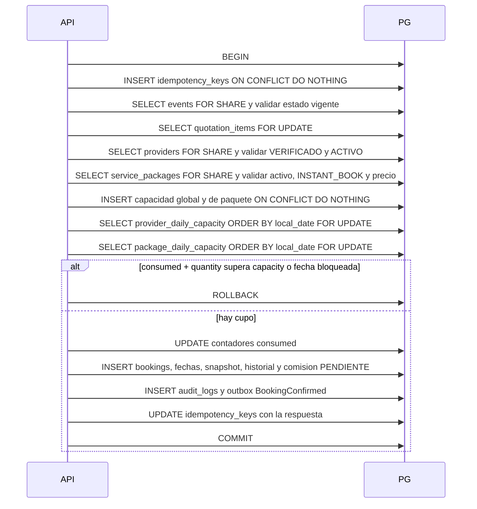

Las filas de capacidad se aseguran antes de bloquear porque `FOR UPDATE` sobre una fila inexistente no bloquea nada (SAD §7.1). Con inventario independiente no se toca el cupo global y `consumes_global_capacity` queda en falso.

### F2. Adjudicación e-RFQ

| Aspecto | Definición |
|---|---|
| Aislamiento | `READ COMMITTED` |
| Orden de bloqueo | N1 → N3 `events` (`FOR SHARE`) → N5 `rfq_items` (`FOR UPDATE`) → N6 `providers` del ganador (`FOR SHARE`) y su paquete si lo hay → N7 `rfq_requests` del ítem por `id`, `FOR UPDATE`, y sus `rfq_offers` y `magic_link_grants` → N10 → N11 |
| Escrituras | `bookings` y satélites, `awards`, estados de solicitudes y ofertas, `rfq_cycles.closed_at`, revocación de enlaces, auditoría, outbox |
| Conflicto o deadlock | Segundo adjudicador: espera `rfq_items`, ve la contratación vigente y responde `409 AWARD_ALREADY_EXISTS`; los índices `uq_awards__organization_id_cycle_id` y `uq_bookings__active_item` son la última barrera. Oferta no `RECIBIDA`: `409 OFFER_NOT_AWARDABLE`; vencida: `409 OFFER_EXPIRED`; sin cupo: `409 CAPACITY_EXHAUSTED` sin ganador |
| Resultado observable | Un ganador, su contratación y su comisión `PENDIENTE`; todas las demás solicitudes abiertas del ítem en `NO_ADJUDICADO`; o ningún cambio |

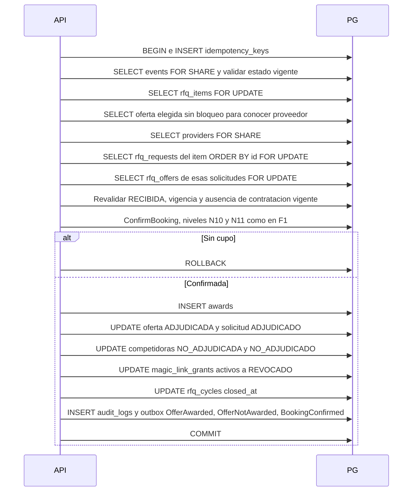

La lectura sin bloqueo de la oferta solo identifica al proveedor que se debe bloquear; su estado se comprueba de nuevo con la fila ya bloqueada. La adjudicación no bloquea a los proveedores perdedores: una suspensión concurrente de uno de ellos espera sus filas de solicitud y las encuentra terminales.

### F3. Creación de una ronda e-RFQ

| Aspecto | Definición |
|---|---|
| Aislamiento | `READ COMMITTED` |
| Orden de bloqueo | N1 → N2 `plan_usage_counters` → N3 `events` (`FOR SHARE`) → N4 `quotations` (`FOR UPDATE`) → N5 `rfq_items` (inserción si falta y `FOR UPDATE`) → N6 `providers` invitados por `id` (`FOR SHARE`) |
| Escrituras | `quotation_versions` (si la cotización cambió desde la última versión), `rfq_cycles`, `rfq_requests` (con snapshot), `magic_link_grants`, auditoría, outbox |
| Conflicto o deadlock | Cupo agotado: la actualización condicional no devuelve fila y responde `409 PLAN_LIMIT_REACHED`. Proveedor repetido o sexto invitado: violan `uq_rfq_requests__cycle_id_provider_id` o `uq_rfq_requests__cycle_id_slot`. Proveedor no elegible: `400 VALIDATION_FAILED` |
| Resultado observable | Una ronda con 1 a 5 solicitudes `PENDIENTE_ENVIO`, cupo consumido y evento de despacho; o nada |

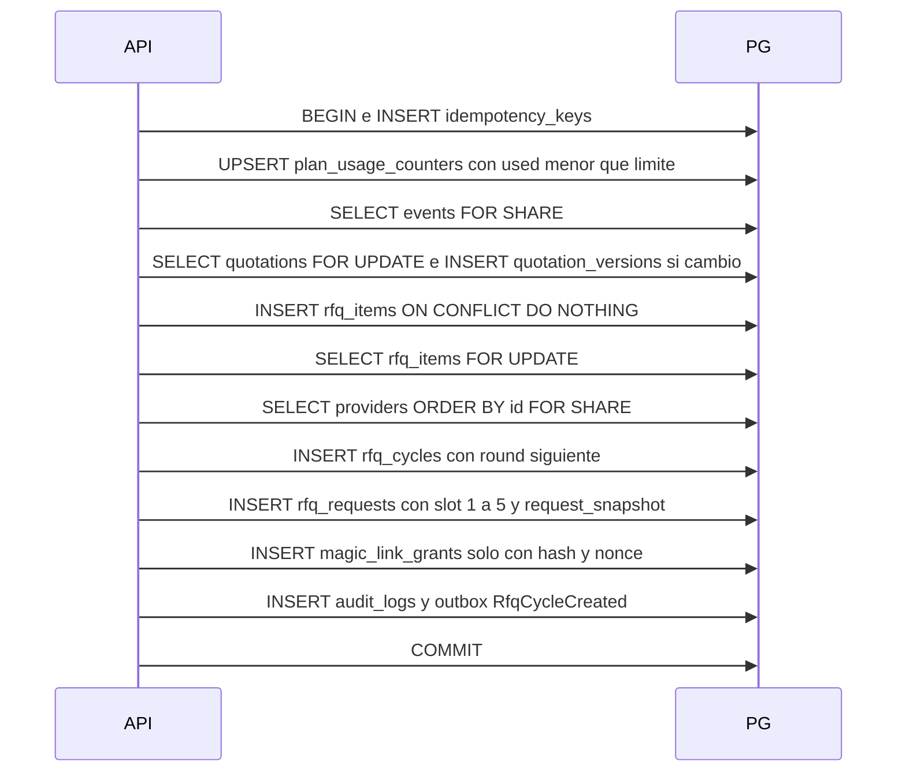

El token no se escribe en ninguna tabla ni en el payload: el proceso que envía el correo lo deriva de nuevo a partir del identificador y el valor aleatorio de la credencial (ADR-DATA-06).

### F4. Respuesta de un proveedor (Magic Link, portal o revisión)

| Aspecto | Definición |
|---|---|
| Aislamiento | `READ COMMITTED` |
| Orden de bloqueo | N1 → N6 `providers` (`FOR SHARE`) → N7 `rfq_requests` (`FOR UPDATE`) → `magic_link_grants` (`FOR UPDATE`, solo por enlace) → `rfq_offers` vigente (`FOR UPDATE`) |
| Escrituras | Consumo del enlace, `rfq_offers`, estado de la solicitud, auditoría, outbox |
| Conflicto o deadlock | Enlace inexistente, usado, vencido o revocado: `404 MAGIC_LINK_INVALID` sin distinguir. Fuera de plazo: `409 SLA_EXPIRED`. Solicitud no abierta: `409 RFQ_NOT_OPEN`. Dos envíos del mismo enlace: el segundo espera el bloqueo y ve `CONSUMIDO`. La revisión compite por `uq_rfq_offers__current` |
| Resultado observable | Una sola oferta `RECIBIDA` vigente por solicitud; la anterior queda `REEMPLAZADA` |

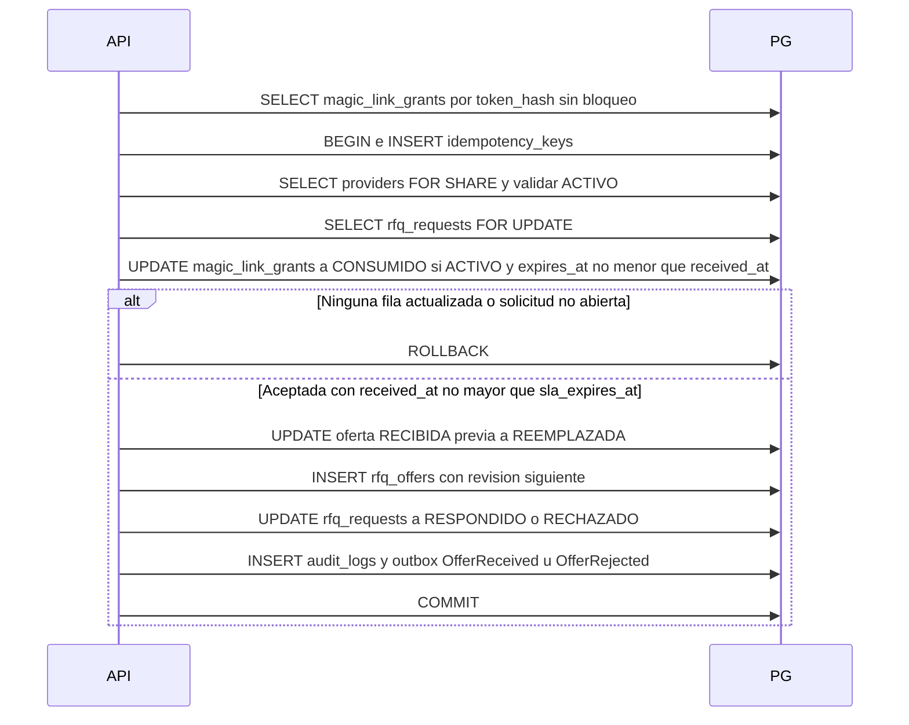

El instante `received_at` se toma al recibir la petición, antes de esperar bloqueos: una respuesta que llegó a tiempo no caduca por contención. Un rechazo no puede enviarse como revisión de una solicitud ya respondida.

### F5. Expiración de SLA, vencimiento de ofertas y cierre de ronda (DEC-035)

| Aspecto | Definición |
|---|---|
| Aislamiento | `READ COMMITTED`, una transacción por ítem |
| Orden de bloqueo | Candidatos sin bloqueo y entre tenants; después, con el contexto del tenant fijado, N5 `rfq_items` (`FOR UPDATE SKIP LOCKED`) → N7 `rfq_requests` del ítem por `id` → `rfq_offers`, `magic_link_grants` |
| Margen del vencimiento | El job solo cierra solicitudes y enlaces con `sla_expires_at <= now() - 30 s` (S-20), margen mayor que la duración máxima de una transacción de la API |
| Escrituras | Estados de solicitud y oferta, enlaces `EXPIRADO`, `rfq_cycles.closed_at`, auditoría, outbox |
| Conflicto o deadlock | Un ítem bloqueado por una adjudicación se omite y se toma en el siguiente ciclo. Un job tardío no encuentra filas que cumplan la condición: no hace nada |
| Resultado observable | `ENVIADO` vencida pasa a `EXPIRADO`; oferta `RECIBIDA` vencida pasa a `VENCIDA`; `RESPONDIDO` sin oferta vigente y con SLA vencido pasa a `NO_ADJUDICADO`; una respondida con oferta vigente no cambia |

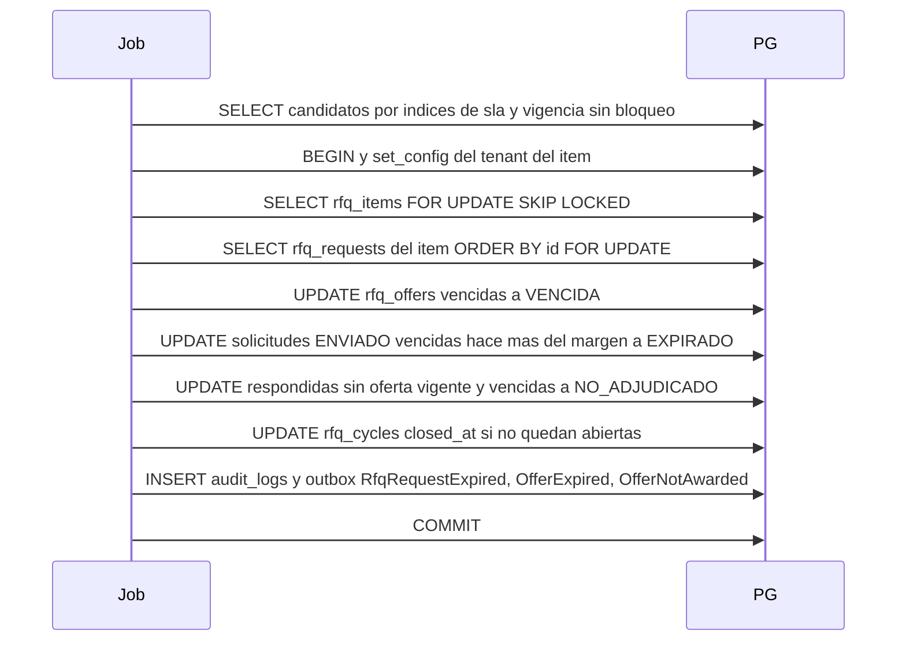

La aceptación de una respuesta sigue decidiéndose con `received_at <= sla_expires_at` (SRS-RFQ-005). El margen evita que el job cierre una solicitud mientras una respuesta recibida a tiempo todavía espera sus bloqueos; el retraso resultante queda muy por debajo del objetivo de 2 minutos (SAD §12.2).

El estado del ítem lo deriva `quotation` al consumir esos eventos: bloquea `quotation_items`, consulta el resumen de la ronda a `rfq-offers` y aplica la precedencia de SRS §9.3.

### F6. Transiciones que liberan capacidad

Incluye aceptar una cancelación, la elección `CANCELAR` de una revisión de plataforma y las resoluciones administrativas `CANCELAR` y `NO_PRESTADO`.

| Aspecto | Definición |
|---|---|
| Aislamiento | `READ COMMITTED` |
| Orden de bloqueo | N1 → N6 `providers` (`FOR SHARE`) → N8 `bookings` (`FOR UPDATE`) → N10 → N11 |
| Escrituras | Contadores, `booking_consumed_dates.released_at`, `bookings` (después de los contadores), historial, `commission_records`, `dispute_resolutions` si es administrativa, auditoría, outbox |
| Conflicto o deadlock | Estado incompatible tras bloquear: `409 INVALID_STATE_TRANSITION`. Dos aceptaciones simultáneas: la segunda ve `CANCELADO` |
| Resultado observable | Contratación terminal, cupo devuelto exactamente una vez y comisión `NO_APLICA` |

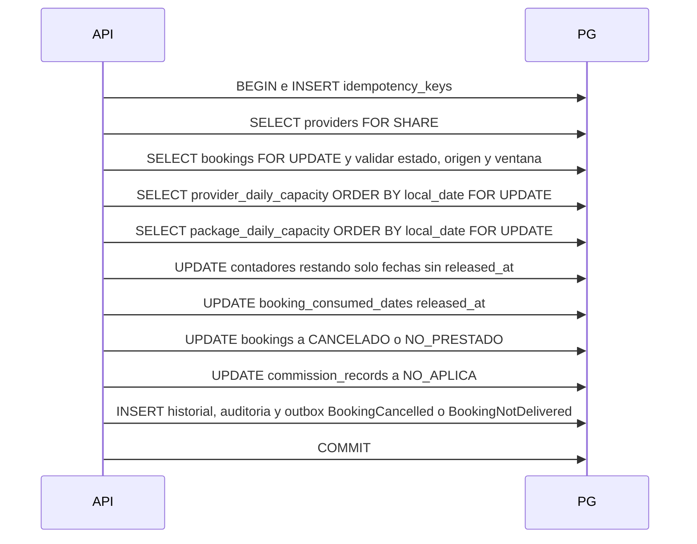

La fila de la contratación se modifica **después** de bloquear los cupos. Así, una confirmación simultánea del mismo ítem encuentra la contratación aún vigente y falla de inmediato por unicidad, en lugar de esperar la fila mientras retiene los cupos que esta transacción necesita. `MANTENER` solo bloquea hasta N8 y no toca la capacidad.

### F7. Suspensión de proveedor (DEC-034, DEC-036)

| Aspecto | Definición |
|---|---|
| Aislamiento | `READ COMMITTED`, una sola transacción orquestada por `administration-audit` |
| Orden de bloqueo | N6 `providers` (`FOR UPDATE`) → N7 `rfq_requests` abiertas por `id`, sus ofertas y enlaces → N8 `bookings` futuras por `id` |
| Escrituras | Cuenta del proveedor, proyección `provider_search`, solicitudes, ofertas, enlaces, contrataciones, historial, auditoría con las contrataciones afectadas, outbox |
| Conflicto o deadlock | Una confirmación en curso sostiene el bloqueo compartido: la suspensión espera y luego la incluye. Una confirmación posterior espera, revalida y se rechaza. Repetir la suspensión no cambia nada |
| Resultado observable | Ninguna contratación futura queda en `CONFIRMADO`; la capacidad no cambia; sin solicitudes abiertas ni enlaces activos |

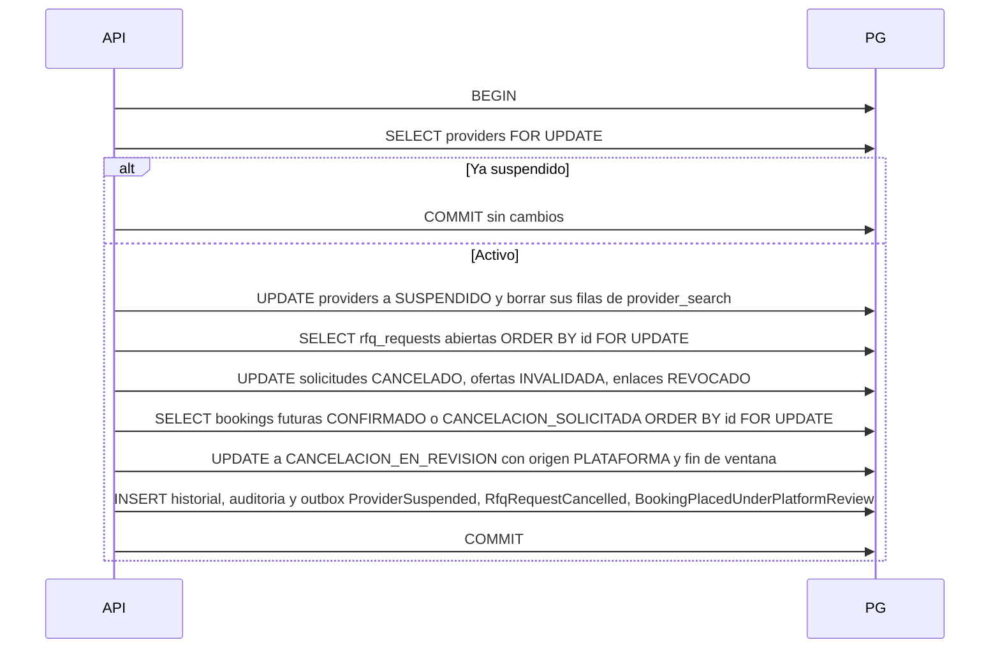

«Inicio futuro» se evalúa con las filas bloqueadas. La duración de la transacción crece con la agenda del proveedor: con el volumen de referencia son decenas de filas; el umbral de alerta está en §7 y el riesgo en §9.

### F8. Cierre del servicio y devengo de comisión

| Aspecto | Definición |
|---|---|
| Aislamiento | `READ COMMITTED`; el job procesa en lotes |
| Orden de bloqueo | N1 → N8 `bookings` (`FOR UPDATE`; el job elige candidatos sin bloqueo y bloquea cada uno con `SKIP LOCKED` ya con su contexto de tenant) → `commission_records` |
| Escrituras | Estado de la contratación, historial, comisión, auditoría, outbox |
| Conflicto o deadlock | Si el organizador reporta incidencia a la vez que corre el cierre automático, gana quien bloquea primero; el otro ve un estado distinto de `SERVICIO_REALIZADO` y se rechaza o se omite |
| Resultado observable | `COMPLETADO` con comisión `DEVENGADA` una sola vez, o `INCIDENCIA` con comisión `RETENIDA`; no libera capacidad |

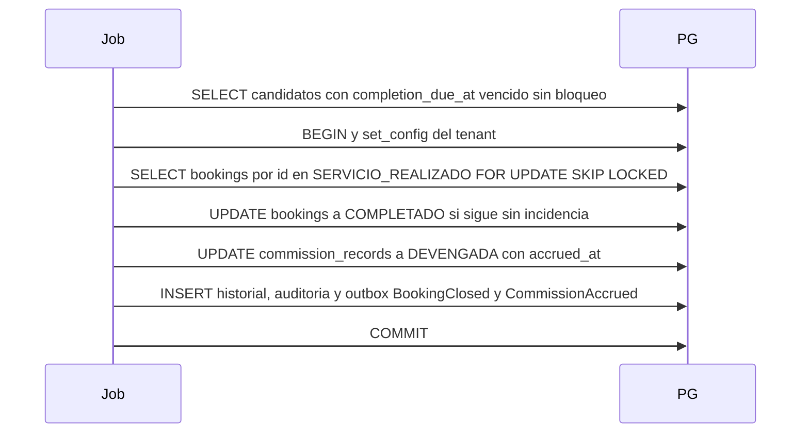

El importe no se recalcula al devengar: se tomó del snapshot al confirmar (ADR-019). La reversión (`reverseCommission`) cambia el estado a `REVERTIDA` y conserva los importes originales.

### F9. Congelación de una versión de cotización

| Aspecto | Definición |
|---|---|
| Aislamiento | `READ COMMITTED` con la cotización bloqueada: toda mutación de sus ítems y selecciones bloquea antes la misma fila |
| Orden de bloqueo | N1 → N3 `events` (`FOR UPDATE`) → N4 `quotations` (`FOR UPDATE`) |
| Escrituras | `quotation_versions`, `quotations` (`snapshot_version`, estado), `quotation_documents`, `events` (de `BORRADOR` a `COTIZADO`), auditoría, outbox |
| Conflicto o deadlock | Dos peticiones simultáneas se serializan; cada una crea su versión. Si la cotización cambió, `updateQuotationSelections` con `ETag` antiguo responde `412` |
| Resultado observable | Una versión inmutable coherente con sus totales y un documento `PENDIENTE` |

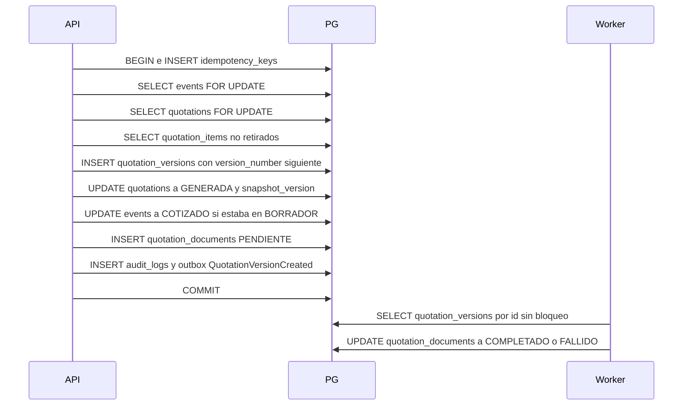

El PDF se genera fuera de la transacción y solo lee el snapshot (SAD §9.7). Si falla, el documento queda `FALLIDO` y se reintenta sin crear otra versión. Al enviar la primera ronda se congela una versión con el mismo procedimiento y `trigger = ENVIO_RFQ`.

### F10. Cambio de disponibilidad

| Aspecto | Definición |
|---|---|
| Aislamiento | `READ COMMITTED` |
| Orden de bloqueo | N6 `providers` (`FOR SHARE`) → N9 `provider_availability` (`FOR UPDATE`) → N10 → N11 |
| Escrituras | `provider_availability.version`, filas de capacidad, auditoría |
| Conflicto o deadlock | `If-Match` distinto: `412 PRECONDITION_FAILED`. Reducir por debajo de lo consumido: `409 INVALID_STATE_TRANSITION` (el `CHECK` lo impide) |
| Resultado observable | Cupos actualizados sin invalidar contrataciones confirmadas |

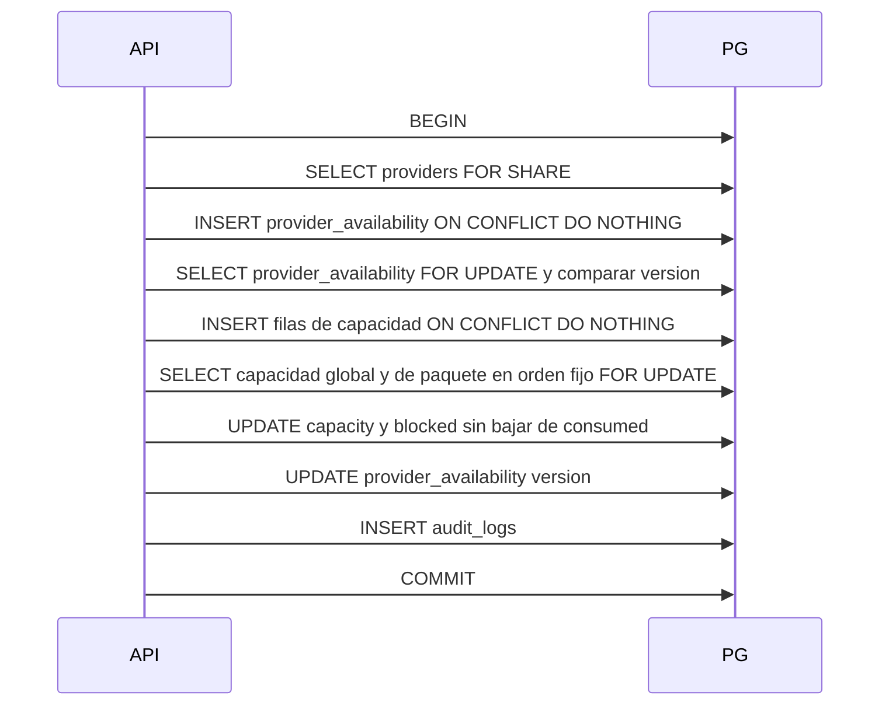

### F11. Edición y cancelación de un evento (DEC-024)

| Aspecto | Definición |
|---|---|
| Aislamiento | `READ COMMITTED`, orquestada por `quotation` (ADR-DATA-17) |
| Orden de bloqueo | Cancelar: N2 `plan_usage_counters` (devuelve el cupo de evento activo) → N3 `events` (`FOR UPDATE`). Editar: N3 → N5 `rfq_items` → N7 solicitudes abiertas → N8 contrataciones afectadas |
| Escrituras | Cancelar: `events`, contador, auditoría, outbox `EventCancelled`. Editar fecha, lugar o invitados: además revoca en la misma transacción las solicitudes abiertas (`CANCELADO`, ofertas `INVALIDADA`) y registra las modificaciones propuestas (`booking_change_proposals`) |
| Conflicto o deadlock | Las confirmaciones toman la fila del evento en modo compartido: o terminan antes, y la comprobación las ve, o esperan y encuentran el evento cancelado. Contratación `EN_PROGRESO` o posterior: `409 INVALID_STATE_TRANSITION`. Cambio de fecha con contrataciones no terminales: `409` |
| Resultado observable | Evento `CANCELADO` de inmediato. Consumidores idempotentes revocan solicitudes, piden la cancelación de cada contratación y cierran cotizaciones |

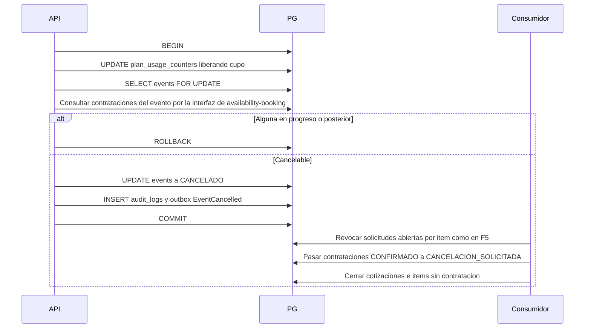

**Compensaciones.** No hay transacciones distribuidas. Lo que ocurre fuera de PostgreSQL se corrige hacia delante: un correo fallido reintenta y termina en `ERROR_ENVIO` sin revertir la ronda; un PDF fallido queda `FALLIDO`; si un consumidor de `EventCancelled` halla una contratación que pasó a `EN_PROGRESO` entre la comprobación y su ejecución, no la cancela y abre una alerta para la administración. Una respuesta recibida en la ventana anterior a la revocación se invalida por ese mismo consumidor (`INVALIDADA`).


## 4. Modelo de datos lógico y físico

El catálogo cerrado es de **72 tablas físicas** (incluidas 2 proyecciones), **55 enums** y **2 proyecciones** (0 vistas). Todo vive en el esquema `public` de una sola base de datos: la propiedad por módulo se protege con las pruebas de arquitectura del SAD §4.4, no con esquemas de PostgreSQL (separarlos obligaría a calificar cada objeto y no aísla nada mientras la aplicación use un solo rol).

### 4.0 Convenciones transversales

#### Claves primarias (ADR-DATA-01)

| Regla | Detalle |
|---|---|
| Tipo | `UUID` versión 7, generado por Prisma (`@default(uuid(7))`), sin valor por defecto en la base de datos |
| Motivo | La API exige UUID opacos (SRS §4.3). El prefijo temporal de v7 mantiene la localidad del B-tree en tablas de inserción continua |
| Generación en BD | Descartada: `uuidv7()` nativo existe desde PostgreSQL 18 y el mínimo es 15 (S-01). Todo `INSERT` en SQL directo o de semilla envía el `id` |
| Exposición | El `id` revela el instante de creación del registro. Se acepta porque la autorización no depende de que el identificador sea impredecible (SRS-NFR-SEC-005); los tokens de capacidad no son UUID (ADR-DATA-06) |
| Claves naturales o compuestas | `provider_daily_capacity`, `package_daily_capacity`, `booking_consumed_dates`, `provider_categories`, `provider_subtypes`, `notification_preferences`, `processed_events`, `plan_usage_counters`, `quotation_item_subtypes` (compuestas); `provider_availability`, `provider_reputation`, `provider_search`, `booking_terms_snapshots`, `rfq_items` (la del recurso padre); `email_webhook_events` (`sg_event_id`) y `holidays` (fecha) |

#### Columnas estándar

| Columna | Tipo | Regla |
|---|---|---|
| `created_at` | `TIMESTAMPTZ(6) NOT NULL DEFAULT now()` | En todas las tablas |
| `updated_at` | `TIMESTAMPTZ(6) NOT NULL DEFAULT now()` | En tablas de ciclo `M` (mutables) y `P` (proyección); la escribe Prisma (`@updatedAt`) y las sentencias SQL directas la incluyen. No hay trigger: duplicaría la autoridad |
| Ciclo `A` (solo inserción) | sin `updated_at` | Las filas no cambian; un `updated_at` sería siempre igual a `created_at` y sugeriría que se puede editar |
| `organization_id` | `UUID NOT NULL` | En toda tabla de clase `T` salvo `organizations` (su `id` es el tenant). Admite nulo solo en plantillas globales (`event_templates`, `event_template_selections`, `whatsapp_templates`, con `CHECK` de coherencia con `scope`), `notifications` y `audit_logs` |
| `provider_id` | `UUID` | Se copia en las tablas hijas que el proveedor consulta, para que sus consultas y la RLS no necesiten uniones |
| `version` | `INTEGER NOT NULL DEFAULT 1` | Solo en los seis recursos con `If-Match`: `events`, `quotations`, `service_packages`, `event_templates`, `providers`, `provider_availability` (TEC-011) |
| Actor | `<acción>_by_user_id UUID` | Solo donde una fuente exige saber quién actuó. No hay `created_by`/`updated_by` genéricos: la autoría de los cambios sensibles está en `audit_logs` |

Instantes de negocio (`received_at`, `confirmed_at`, `responded_at`) los fija el reloj compartido de la aplicación (SAD §4.2, `shared`) y se guardan explícitamente; `created_at` usa el reloj de la base de datos. La regla de límite de SRS-RFQ-005 compara el instante de recepción en el servidor con `sla_expires_at`.

Cada tabla de la §4.2 declara su ciclo: `M` mutable, `A` solo inserción (se admite únicamente la excepción que indique la propia tabla), `P` proyección reconstruible.

#### Borrado, archivado y retención

| Categoría | Tablas | Mecanismo | Efecto en unicidad |
|---|---|---|---|
| Historial transaccional | contrataciones, snapshots, historiales, comisiones, rondas, solicitudes, ofertas, adjudicaciones, versiones de cotización, reseñas, auditoría | Nunca se borran en la operación; solo el job de retención, respetando `legal_hold` (DEC-003; plazos en Q-01) | Los únicos parciales se filtran por estado, no por borrado |
| Archivado lógico | `events` (`archived_at`; sus cotizaciones lo heredan por el evento) | Marca reversible; no es un estado (SRS-EVT-007) | Ninguno |
| Borrado lógico | `memberships` (`removed_at`), `portfolio_assets` (`deleted_at`), `quotation_items` (`removed_at`), `users` (`anonymized_at`) | La fila queda para referencias históricas | Índices únicos parciales `WHERE <marca> IS NULL` |
| Desactivación | categorías, subtipos, plantillas, paquetes, planes (`active`) | Deja de ofrecerse; conserva referencias (SRS-CAT-004) | Los códigos no se reutilizan (DEC-020) |
| Borrado físico | filas reemplazables: categorías, subtipos y cobertura del proveedor, selecciones de plantilla, `event_categories`, `quotation_item_subtypes`, `quotation_item_options`, preferencias | `DELETE` e inserción (no se actualizan, salvo las preferencias); el cambio queda en auditoría cuando es sensible | Unicidad total |
| Técnicas | idempotencia, outbox, eventos procesados, webhooks | Purga por antigüedad (§4.5) | Unicidad total dentro de la ventana |

#### Dinero (SRS §4.3; SRS-QUO-013; DEC-032)

- Importes en `NUMERIC(14,2)`; porcentajes en `NUMERIC(5,4)` (3 % = `0.0300`). Nunca `float`.
- Cada fila con importes tiene una columna `currency CHAR(3) NOT NULL DEFAULT 'COP'` con `CHECK (currency = 'COP')`. Un catálogo de monedas no aporta nada con una sola moneda; ampliar es relajar el `CHECK`.
- El redondeo *half-up* al peso por línea lo aplica el único servicio de cálculo del dominio antes de escribir. La base de datos no redondea ni recalcula: solo exige importes no negativos.

#### Fechas y zonas horarias (DEC-007; DEC-025)

| Dato | Tipo |
|---|---|
| Instante | `TIMESTAMPTZ(6)`, en UTC |
| Fecha de calendario (capacidad, vigencias, plazos legales) | `DATE` |
| Hora local introducida por el usuario | `TIMESTAMP(0)` sin zona, solo en `events.local_starts_at` y `local_ends_at` |
| Zona | `VARCHAR(64)` con el identificador IANA; la aplicación lo valida. No hay valor por defecto en BD (DDD §6.2) |

Las fechas de capacidad las calcula `CapacityDatesPolicy` en la aplicación y se persisten; la base de datos no convierte zonas.

#### Enums nativos o tablas catálogo (ADR-DATA-11)

| Criterio | Enum nativo | Tabla catálogo |
|---|---|---|
| Quién cambia el valor | Un cambio de código (máquinas de estado, contrato) | Un administrador en operación |
| Metadatos | Ninguno | Nombre, vigencia, orden, precio o pesos |
| Costo de cambio | `ALTER TYPE ... ADD VALUE` en línea; quitar o renombrar exige tipo nuevo y *expand-and-contract* | Una fila |
| Aplicación | Estados, roles, orígenes, canales | `categories`, `subtypes`, `plans`, `commission_rates`, `ranking_configurations`, `message_templates`, `holidays` |

Nombre del tipo en inglés y `snake_case`; valores según DEC-022 (H-03).

#### Uso de `JSONB`

Permitido solo en: snapshots inmutables con versión de esquema (contratación, versión de cotización, solicitud e-RFQ); payloads (outbox, respuesta idempotente, importación asistida, cambios de auditoría); listas de valores que solo se leen junto a su fila inmutable (extras de una oferta, componentes de ranking, evidencia enviada). Cada columna `JSONB` tiene `CHECK (jsonb_typeof(...) = 'object' o 'array')`. Ninguna relación ni filtro de negocio depende de un campo dentro de `JSONB`. Las listas cortas de texto sin identidad (inclusiones, exclusiones) usan `TEXT[]`.

#### Tipos de texto

`VARCHAR(n)` cuando SRS u OpenAPI fijan longitud máxima, con el mismo `n`; `TEXT` en los demás casos; `CITEXT` para correos.

#### Nomenclatura (máximo 63 caracteres)

Cuando un nombre compuesto supera el límite se abrevia, en este orden, `organization_id` como `org` y `provider_id` como `prov`, o se usa un nombre corto explícito que describe el job o la regla.

| Objeto | Patrón |
|---|---|
| Clave primaria | `pk_<tabla>` |
| Clave foránea | `fk_<tabla>__<referencia>` |
| Única (total o parcial) | `uq_<tabla>__<columnas>` |
| Índice B-tree | `ix_<tabla>__<columnas>` |
| `CHECK` | `ck_<tabla>__<regla>` |
| GIN | `gin_<tabla>__<columna>` |
| Exclusión | `ex_<tabla>__<regla>` |
| Trigger y función | `trg_<tabla>__<regla>`, `fn_<regla>` |
| Política RLS | `pol_<tabla>__<alcance>` |

#### Acciones referenciales

- `ON UPDATE RESTRICT` en todas: las claves son inmutables.
- `ON DELETE RESTRICT` por defecto: protege el historial (SAD §6.5).
- `ON DELETE CASCADE` solo en filas que son parte de su padre y nunca se referencian desde el historial.
- `ON DELETE SET NULL` solo en referencias opcionales cuyo destino puede desaparecer sin alterar el significado de la fila.

#### FK físicas y referencias lógicas (ADR-DATA-03)

- **FK física** cuando la referencia va en el sentido de una dependencia permitida por SAD §4.4 (del consumidor al proveedor) o dentro del mismo módulo.
- **Referencia lógica** (columna `UUID` sin FK) cuando va contra esa matriz, cuando apunta a un actor (`*_by_user_id`, que además se seudonimiza) o cuando es polimórfica (auditoría, outbox, retención legal). La integridad la garantizan el caso de uso que la escribe y el job de verificación de huérfanos (§5.3).

#### Integridad entre tenants

Las jerarquías de un tenant usan FK compuestas `(organization_id, <padre>_id)` contra un único `(organization_id, id)` del padre, de modo que una fila no pueda colgar de un padre de otra empresa. La FK directa a `organizations` solo la llevan las tablas raíz de cada jerarquía; las hijas la heredan por la compuesta.

Los enums compartidos entre módulos sin dependencia entre sí (`dispatch_status`) pertenecen al módulo `platform`.

#### Extensiones

| Extensión | Uso | Alternativa descartada |
|---|---|---|
| `citext` | Unicidad y búsqueda de correo sin distinguir mayúsculas | Índice sobre `lower(email)`: Prisma no lo declara y cada consulta debe recordar la función |
| `pg_trgm` | Búsqueda de texto del catálogo (SAD §6.6) | Motor externo, descartado por el SAD |
| `unaccent` | Normalizar sin tildes el texto de búsqueda al escribir la proyección (SAD §6.6) | Función inmutable envolvente para indexar `unaccent`: innecesaria si se normaliza al escribir |
| `btree_gist` | Exclusión de periodos de plan solapados por empresa | Validación solo en aplicación, con carrera posible |

`pgcrypto` no se requiere: los UUID los genera la aplicación y el HMAC de los tokens se calcula fuera de la base de datos.


### 4.1 ERD lógico y físico

Los diagramas lógicos usan los nombres de dominio (DDD §3.6). Los físicos muestran claves y columnas de estado de cada tabla; el detalle completo está en §4.2. Los importes `NUMERIC(14,2)` se escriben como `NUMERIC_14_2`. Una línea física es una FK real; las referencias lógicas (ADR-DATA-03) no se dibujan.

#### 4.1.1 ERD lógico

**Actores, tenant y catálogo**

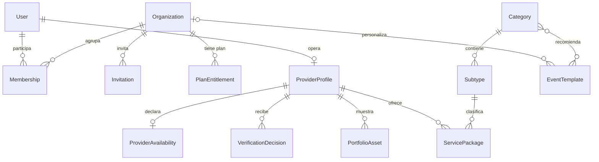

**Contratación**

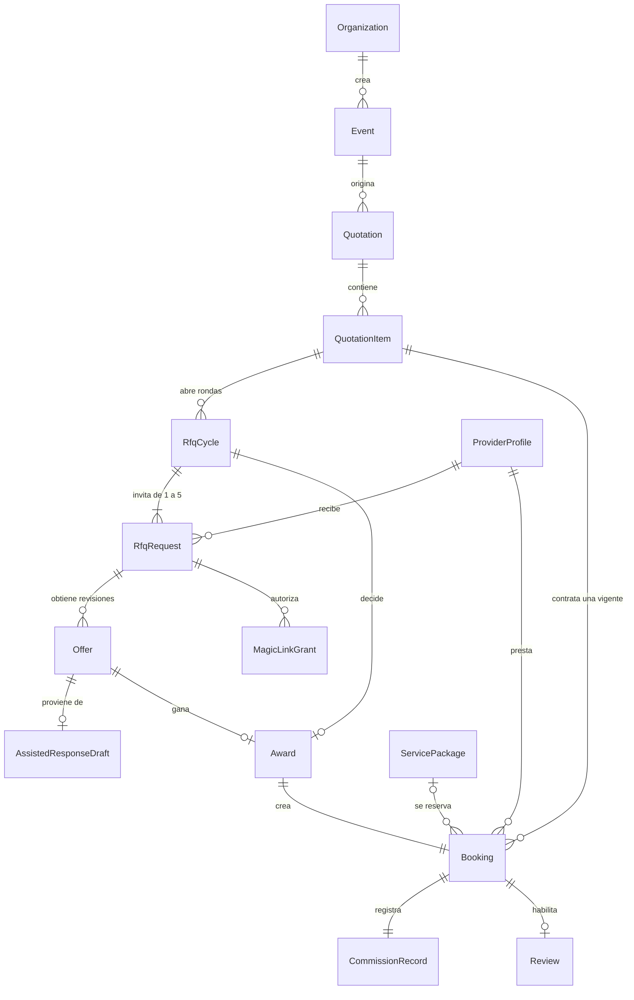

**Comunicaciones, cumplimiento y auditoría**

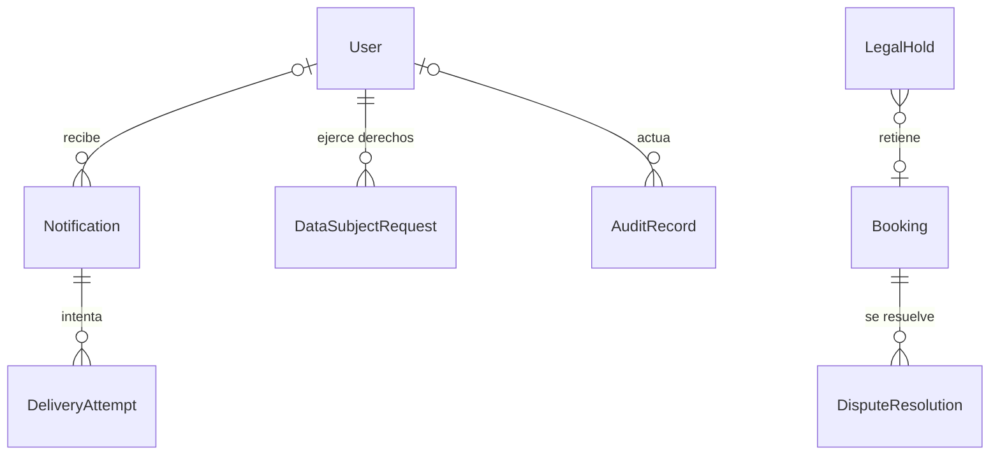

#### 4.1.2 ERD físico por módulo

**`identity-access`** (3 tablas)

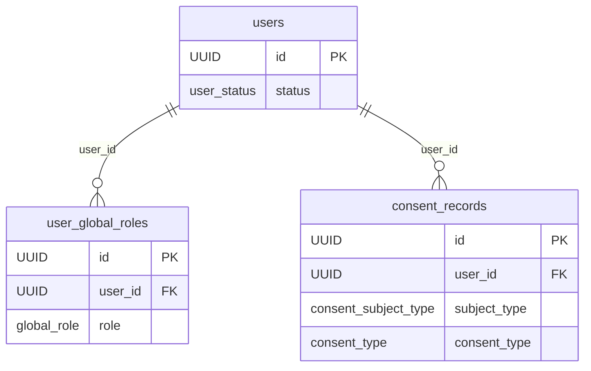

**`organizations`** (7 tablas)

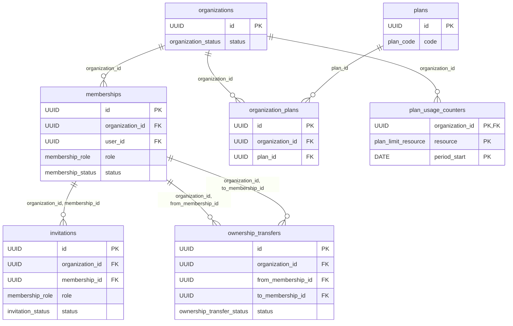

**`taxonomy-templates`** (5 tablas)

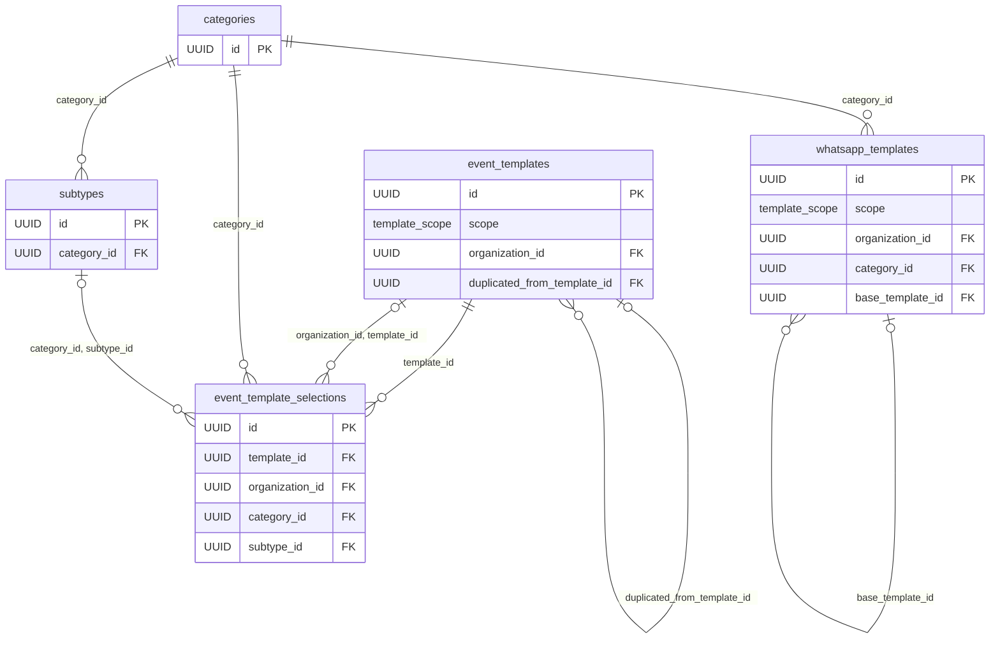

**`provider-catalog`** (12 tablas)

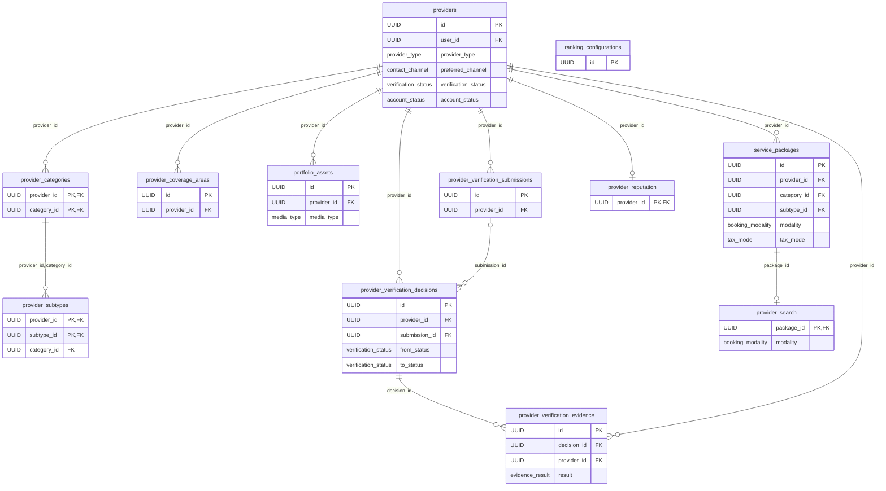

**`event-management`** (3 tablas)

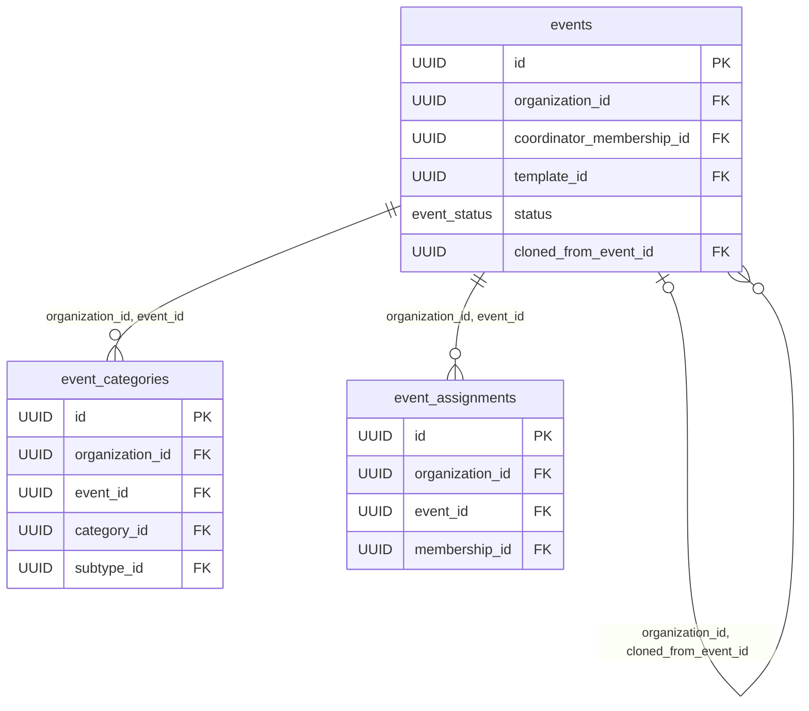

**`availability-booking`** (10 tablas)

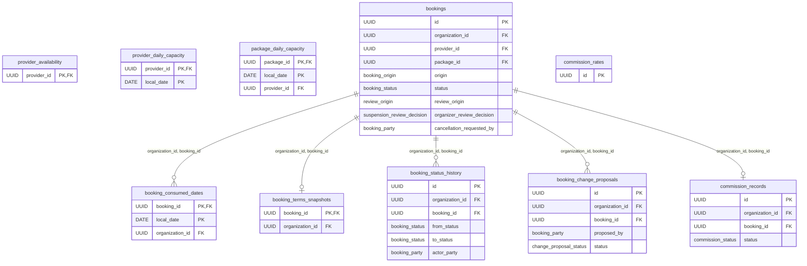

**`rfq-offers`** (6 tablas)

```mermaid
erDiagram
    rfq_items {
        UUID quotation_item_id PK
        UUID organization_id FK
    }
    rfq_cycles {
        UUID id PK
        UUID organization_id FK
        UUID quotation_item_id FK
        contact_channel channel
    }
    rfq_requests {
        UUID id PK
        UUID organization_id FK
        UUID cycle_id FK
        UUID provider_id FK
        rfq_status status
        contact_channel channel
        dispatch_status dispatch_status
    }
    magic_link_grants {
        UUID id PK
        UUID organization_id FK
        UUID request_id FK
        magic_link_status status
    }
    rfq_offers {
        UUID id PK
        UUID organization_id FK
        UUID request_id FK
        offer_decision decision
        offer_status status
        offer_availability availability
        offer_origin origin
        UUID supersedes_offer_id FK
    }
    awards {
        UUID id PK
        UUID organization_id FK
        UUID cycle_id FK
        UUID request_id FK
        UUID offer_id FK
        UUID booking_id FK
    }
    rfq_items ||--o{ rfq_cycles : "organization_id, quotation_item_id"
    rfq_cycles ||--o{ rfq_requests : "organization_id, cycle_id"
    rfq_requests ||--o{ magic_link_grants : "organization_id, request_id"
    rfq_requests ||--o{ rfq_offers : "organization_id, request_id"
    rfq_offers |o--o{ rfq_offers : "supersedes_offer_id"
    rfq_cycles ||--o| awards : "organization_id, cycle_id"
    rfq_requests ||--o| awards : "organization_id, request_id"
    rfq_offers ||--o| awards : "organization_id, offer_id"
```

**`quotation`** (9 tablas)

```mermaid
erDiagram
    quotations {
        UUID id PK
        UUID organization_id FK
        UUID event_id FK
        UUID template_id FK
        quotation_status status
    }
    quotation_items {
        UUID id PK
        UUID organization_id FK
        UUID quotation_id FK
        UUID category_id FK
        UUID subtype_id FK
        UUID selected_provider_id FK
        UUID selected_package_id FK
        booking_modality modality
        price_kind price_kind
        item_tracking_status tracking_status
    }
    quotation_item_subtypes {
        UUID item_id PK, FK
        UUID subtype_id PK, FK
        UUID organization_id FK
        UUID category_id FK
    }
    quotation_item_options {
        UUID id PK
        UUID organization_id FK
        UUID item_id FK
        UUID provider_id FK
        UUID package_id FK
        booking_modality modality
        availability_hint availability_hint
    }
    quotation_item_tracking_history {
        UUID id PK
        UUID organization_id FK
        UUID item_id FK
        item_tracking_status from_status
        item_tracking_status to_status
    }
    quotation_versions {
        UUID id PK
        UUID organization_id FK
        UUID quotation_id FK
        snapshot_trigger trigger
    }
    quotation_documents {
        UUID id PK
        UUID organization_id FK
        UUID quotation_id FK
        UUID quotation_version_id FK
        document_job_status status
    }
    quick_quotations {
        UUID id PK
        UUID organization_id FK
        UUID category_id FK
        UUID subtype_id FK
    }
    quick_quotation_options {
        UUID id PK
        UUID organization_id FK
        UUID quick_quotation_id FK
        UUID provider_id FK
        UUID package_id FK
        booking_modality modality
    }
    quotations ||--o{ quotation_items : "organization_id, quotation_id"
    quotation_items ||--o{ quotation_item_subtypes : "organization_id, item_id"
    quotation_items ||--o{ quotation_item_options : "organization_id, item_id"
    quotation_items ||--o{ quotation_item_tracking_history : "organization_id, item_id"
    quotations ||--o{ quotation_versions : "organization_id, quotation_id"
    quotations ||--o{ quotation_documents : "organization_id, quotation_id"
    quotation_versions ||--o{ quotation_documents : "organization_id, quotation_version_id"
    quick_quotations ||--o{ quick_quotation_options : "organization_id, quick_quotation_id"
```

**`assisted-response`** (1 tablas)

```mermaid
erDiagram
    assisted_response_drafts {
        UUID id PK
        UUID organization_id FK
        UUID request_id FK
        UUID offer_id FK
    }
```

**`reviews`** (2 tablas)

```mermaid
erDiagram
    reviews {
        UUID id PK
        UUID organization_id FK
        UUID booking_id FK
        review_status status
    }
    review_reports {
        UUID id PK
        UUID organization_id FK
        UUID review_id FK
        review_report_reason reason
        review_report_status status
        moderation_decision decision
    }
    reviews ||--o{ review_reports : "organization_id, review_id"
```

**`messaging-notifications`** (5 tablas)

```mermaid
erDiagram
    message_templates {
        UUID id PK
        notification_channel channel
        notification_category category
    }
    notifications {
        UUID id PK
        UUID organization_id FK
        UUID user_id FK
        notification_channel channel
        notification_category category
        UUID template_id FK
        dispatch_status dispatch_status
    }
    notification_preferences {
        UUID user_id PK, FK
        notification_category category PK
    }
    delivery_attempts {
        UUID id PK
        UUID notification_id FK
        dispatch_status status
    }
    email_webhook_events {
        TEXT sg_event_id PK
    }
    message_templates |o--o{ notifications : "template_id"
    notifications ||--o{ delivery_attempts : "notification_id"
```

**`administration-audit`** (6 tablas)

```mermaid
erDiagram
    audit_logs {
        UUID id PK
        audit_result result
    }
    dispute_resolutions {
        UUID id PK
        UUID organization_id FK
        UUID booking_id FK
        dispute_decision decision
        booking_status resulting_booking_status
        commission_status resulting_commission_status
    }
    data_subject_requests {
        UUID id PK
        UUID requester_user_id FK
        data_request_type type
        data_request_status status
    }
    legal_holds {
        UUID id PK
        legal_hold_resource_type resource_type
    }
    holidays {
        DATE holiday_date PK
    }
    retention_executions {
        UUID id PK
        retention_action action
        UUID data_subject_request_id FK
        audit_result result
    }
    data_subject_requests |o--o{ retention_executions : "data_subject_request_id"
```

**`platform`** (3 tablas)

```mermaid
erDiagram
    outbox_events {
        UUID id PK
        outbox_status status
    }
    processed_events {
        VARCHAR_100 consumer PK
        UUID event_id PK
    }
    idempotency_keys {
        UUID id PK
        idempotency_status status
    }
```

#### 4.1.3 Relaciones entre módulos (solo FK físicas cruzadas)

Hay 42 FK físicas que cruzan módulos. Todas van en el sentido de la matriz del SAD §4.4. En el resumen, cada flecha va del módulo con la FK al módulo referenciado e indica cuántas hay. `platform` no tiene ninguna FK física.

```mermaid
flowchart LR
    m01["identity-access"]
    m02["organizations"]
    m03["taxonomy-templates"]
    m04["provider-catalog"]
    m05["event-management"]
    m06["availability-booking"]
    m07["rfq-offers"]
    m08["quotation"]
    m09["assisted-response"]
    m10["reviews"]
    m11["messaging-notifications"]
    m12["administration-audit"]
    m02 -->|1| m01
    m03 -->|2| m02
    m04 -->|1| m01
    m04 -->|4| m03
    m05 -->|3| m02
    m05 -->|3| m03
    m06 -->|1| m02
    m06 -->|5| m04
    m07 -->|1| m02
    m07 -->|1| m04
    m07 -->|1| m06
    m08 -->|1| m02
    m08 -->|6| m03
    m08 -->|3| m04
    m08 -->|1| m05
    m09 -->|2| m07
    m10 -->|1| m06
    m11 -->|2| m01
    m11 -->|1| m02
    m12 -->|1| m01
    m12 -->|1| m06
```

**FK cruzadas, parte 1 de 4** (15 tablas)

```mermaid
erDiagram
    users |o--o{ memberships : "user_id"
    organizations |o--o{ event_templates : "organization_id"
    organizations |o--o{ whatsapp_templates : "organization_id"
    users ||--o| providers : "user_id"
    categories ||--o{ provider_categories : "category_id"
    subtypes ||--o{ provider_subtypes : "category_id, subtype_id"
    categories ||--o{ service_packages : "category_id"
    subtypes ||--o{ service_packages : "category_id, subtype_id"
    organizations ||--o{ events : "organization_id"
    memberships |o--o{ events : "organization_id, coordinator_membership_id"
    event_templates |o--o{ events : "template_id"
    categories ||--o{ event_categories : "category_id"
    subtypes |o--o{ event_categories : "category_id, subtype_id"
    memberships ||--o{ event_assignments : "organization_id, membership_id"
    providers ||--o| provider_availability : "provider_id"
```

**FK cruzadas, parte 2 de 4** (15 tablas)

```mermaid
erDiagram
    providers ||--o{ provider_daily_capacity : "provider_id"
    service_packages ||--o{ package_daily_capacity : "provider_id, package_id"
    organizations ||--o{ bookings : "organization_id"
    providers ||--o{ bookings : "provider_id"
    service_packages |o--o{ bookings : "provider_id, package_id"
    organizations ||--o{ rfq_items : "organization_id"
    providers ||--o{ rfq_requests : "provider_id"
    bookings ||--o| awards : "organization_id, booking_id"
    events ||--o{ quotations : "organization_id, event_id"
    event_templates |o--o{ quotations : "template_id"
    categories ||--o{ quotation_items : "category_id"
    subtypes |o--o{ quotation_items : "category_id, subtype_id"
    service_packages |o--o{ quotation_items : "selected_provider_id, selected_package_id"
```

**FK cruzadas, parte 3 de 4** (15 tablas)

```mermaid
erDiagram
    subtypes ||--o{ quotation_item_subtypes : "category_id, subtype_id"
    service_packages ||--o{ quotation_item_options : "provider_id, package_id"
    organizations ||--o{ quick_quotations : "organization_id"
    categories ||--o{ quick_quotations : "category_id"
    subtypes |o--o{ quick_quotations : "category_id, subtype_id"
    service_packages ||--o{ quick_quotation_options : "provider_id, package_id"
    rfq_requests ||--o{ assisted_response_drafts : "organization_id, request_id"
    rfq_offers ||--o| assisted_response_drafts : "organization_id, offer_id"
    bookings ||--o| reviews : "organization_id, booking_id"
    organizations |o--o{ notifications : "organization_id"
    users |o--o{ notifications : "user_id"
```

**FK cruzadas, parte 4 de 4** (5 tablas)

```mermaid
erDiagram
    users ||--o{ notification_preferences : "user_id"
    bookings ||--o{ dispute_resolutions : "organization_id, booking_id"
    users ||--o{ data_subject_requests : "requester_user_id"
```


### 4.2 Tablas, columnas, tipos, relaciones y cardinalidades

Cada tabla declara módulo escritor, clase de aislamiento (§5.2) y ciclo (§4.0: `M` mutable, `A` solo inserción, `P` proyección). Las claves primarias se marcan con **PK**. Todas las FK llevan `ON UPDATE RESTRICT`. La cardinalidad se lee de la tabla descrita hacia la referenciada.

#### 4.2.1 `identity-access`

##### `users`

Identidad interna de cada persona, vinculada a Auth0. Es global: puede tener membresías en varias empresas o un perfil de proveedor.

**Módulo escritor:** `identity-access` · **Clase:** G (global o catálogo) · **Ciclo:** `M` · **Fuente:** DDD §4.2; SRS-AUTH-003; OpenAPI CurrentUser

| Columna | Tipo | Nulo | Defecto | Fuente u observación |
|---|---|---|---|---|
| `id` **PK** | `UUID` | no | Prisma `uuid(7)` | ADR-DATA-01 |
| `auth_subject` | `TEXT` | no | — | `sub` validado del token (CurrentUser.authSubject) |
| `email` | `CITEXT` | no | — | Tomado del token (TEC-007); único |
| `display_name` | `VARCHAR(160)` | sí | — | CurrentUser.displayName |
| `phone` | `VARCHAR(40)` | sí | — | `updateMyPreferences` |
| `status` | `user_status` | no | `PENDIENTE_VERIFICACION_EMAIL` | SRS-AUTH-001; SRS-AUTH-007 |
| `email_verified_at` | `TIMESTAMPTZ(6)` | sí | — | TEC-007 |
| `suspended_at` | `TIMESTAMPTZ(6)` | sí | — | `setUserSuspension` |
| `suspension_reason` | `VARCHAR(1000)` | sí | — | SuspensionInput.reason |
| `anonymized_at` | `TIMESTAMPTZ(6)` | sí | — | DEC-003; el correo se sustituye por un seudónimo único |
| `created_at` | `TIMESTAMPTZ(6)` | no | `now()` | §4.0 |
| `updated_at` | `TIMESTAMPTZ(6)` | no | `now()` | §4.0; la escribe la aplicación |

Sin relaciones.

##### `user_global_roles`

Roles globales de un usuario, con su revocación.

**Módulo escritor:** `identity-access` · **Clase:** G (global o catálogo) · **Ciclo:** `M` · **Fuente:** DDD §4.2; DEC-022

| Columna | Tipo | Nulo | Defecto | Fuente u observación |
|---|---|---|---|---|
| `id` **PK** | `UUID` | no | Prisma `uuid(7)` | ADR-DATA-01 |
| `user_id` | `UUID` | no | — | Usuario con el rol |
| `role` | `global_role` | no | — | `PROVEEDOR` o `ADMIN_PLATAFORMA` |
| `granted_by_user_id` | `UUID` | sí | — | Nulo si lo concede el registro del propio proveedor |
| `revoked_at` | `TIMESTAMPTZ(6)` | sí | — | Revocación sin borrar |
| `revoked_by_user_id` | `UUID` | sí | — | Actor de la revocación |
| `created_at` | `TIMESTAMPTZ(6)` | no | `now()` | §4.0 |
| `updated_at` | `TIMESTAMPTZ(6)` | no | `now()` | §4.0; la escribe la aplicación |

| Columnas | Referencia | Cardinalidad | `ON DELETE` | Integridad | Justificación |
|---|---|---|---|---|---|
| `(user_id)` | `users(id)` | N:1 | RESTRICT | FK física | El historial de privilegios no se borra con el usuario |

##### `consent_records`

Evidencia de cada aceptación de términos y de la política de datos.

**Módulo escritor:** `identity-access` · **Clase:** G (global o catálogo) · **Ciclo:** `A` · **Fuente:** SRS-NFR-PRIV-001; SRS-NFR-PRIV-006; DEC-003

| Columna | Tipo | Nulo | Defecto | Fuente u observación |
|---|---|---|---|---|
| `id` **PK** | `UUID` | no | Prisma `uuid(7)` | ADR-DATA-01 |
| `user_id` | `UUID` | no | — | Persona que acepta |
| `subject_type` | `consent_subject_type` | no | — | En calidad de qué acepta |
| `subject_id` | `UUID` | sí | — | Empresa o proveedor registrado |
| `consent_type` | `consent_type` | no | — | Términos o privacidad |
| `notice_version` | `TEXT` | no | — | `privacyNoticeVersion` y versión de términos |
| `accepted_at` | `TIMESTAMPTZ(6)` | no | — | Instante de aceptación |
| `created_at` | `TIMESTAMPTZ(6)` | no | `now()` | §4.0 |

| Columnas | Referencia | Cardinalidad | `ON DELETE` | Integridad | Justificación |
|---|---|---|---|---|---|
| `(user_id)` | `users(id)` | N:1 | RESTRICT | FK física | La evidencia de consentimiento se conserva |
| `(subject_id)` | `organizations(id)` | N:0..1 | — | Referencia lógica a `organizations` | Polimórfica (empresa o proveedor) y contra la matriz: `identity-access` no depende de nadie |


#### 4.2.2 `organizations`

##### `organizations`

Empresa organizadora. Es el tenant: su `id` es el valor de `organization_id` en el resto del modelo.

**Módulo escritor:** `organizations` · **Clase:** T (tenant, RLS) · **Ciclo:** `M` · **Fuente:** DDD §5.2; SRS-AUTH-001; SRS-TEN-005

| Columna | Tipo | Nulo | Defecto | Fuente u observación |
|---|---|---|---|---|
| `id` **PK** | `UUID` | no | Prisma `uuid(7)` | Identificador del tenant |
| `legal_name` | `VARCHAR(200)` | no | — | OrganizationRegistration.legalName |
| `trade_name` | `VARCHAR(200)` | sí | — | OrganizationRegistration.tradeName |
| `tax_id` | `VARCHAR(40)` | no | — | NIT normalizado por la aplicación; único |
| `contact_name` | `VARCHAR(160)` | no | — | OrganizationRegistration.contactName |
| `contact_email` | `CITEXT` | no | — | Correo del token de quien registra |
| `phone` | `VARCHAR(40)` | no | — | OrganizationRegistration.phone |
| `city` | `VARCHAR(120)` | no | — | OrganizationRegistration.city |
| `status` | `organization_status` | no | `PENDIENTE_VERIFICACION_EMAIL` | SRS-AUTH-001; SRS-AUTH-007 |
| `suspended_at` | `TIMESTAMPTZ(6)` | sí | — | `setOrganizationSuspension` |
| `suspension_reason` | `VARCHAR(1000)` | sí | — | SuspensionInput.reason |
| `registered_by_user_id` | `UUID` | no | — | Quien queda como `PROPIETARIO` |
| `created_at` | `TIMESTAMPTZ(6)` | no | `now()` | §4.0 |
| `updated_at` | `TIMESTAMPTZ(6)` | no | `now()` | §4.0; la escribe la aplicación |

| Columnas | Referencia | Cardinalidad | `ON DELETE` | Integridad | Justificación |
|---|---|---|---|---|---|
| `(registered_by_user_id)` | `users(id)` | N:1 | — | Referencia lógica a `identity-access` | Actor (ADR-DATA-03) |

##### `memberships`

Vínculo de una persona con una empresa y su rol. Existe desde la invitación, antes de que haya usuario (H-11).

**Módulo escritor:** `organizations` · **Clase:** T (tenant, RLS) · **Ciclo:** `M` · **Fuente:** DDD §5.3; SRS-AUTH-006; SRS-AUTH-009

| Columna | Tipo | Nulo | Defecto | Fuente u observación |
|---|---|---|---|---|
| `id` **PK** | `UUID` | no | Prisma `uuid(7)` | Coordinator.id |
| `organization_id` | `UUID` | no | — | Tenant |
| `user_id` | `UUID` | sí | — | Nulo solo mientras está `INVITADO` |
| `email` | `CITEXT` | no | — | Correo invitado o del registrante |
| `display_name` | `VARCHAR(160)` | sí | — | `inviteCoordinator.displayName` |
| `role` | `membership_role` | no | — | DEC-008; DEC-011 |
| `status` | `membership_status` | no | `INVITADO` | DDD §5.3 |
| `invited_at` | `TIMESTAMPTZ(6)` | sí | — | Nulo para el propietario fundador |
| `accepted_at` | `TIMESTAMPTZ(6)` | sí | — | `acceptInvitation` |
| `suspended_at` | `TIMESTAMPTZ(6)` | sí | — | SRS-AUTH-007 |
| `removed_at` | `TIMESTAMPTZ(6)` | sí | — | Borrado lógico: invitación revocada o expirada |
| `created_at` | `TIMESTAMPTZ(6)` | no | `now()` | §4.0 |
| `updated_at` | `TIMESTAMPTZ(6)` | no | `now()` | §4.0; la escribe la aplicación |

| Columnas | Referencia | Cardinalidad | `ON DELETE` | Integridad | Justificación |
|---|---|---|---|---|---|
| `(organization_id)` | `organizations(id)` | N:1 | RESTRICT | FK física | El tenant conserva su historial |
| `(user_id)` | `users(id)` | N:0..1 | RESTRICT | FK física a `identity-access` | La membresía es evidencia de autorización pasada |

##### `invitations`

Invitación de un solo uso; solo guarda el hash del token.

**Módulo escritor:** `organizations` · **Clase:** T (tenant, RLS) · **Ciclo:** `M` · **Fuente:** DDD §4.3; SRS-AUTH-006

| Columna | Tipo | Nulo | Defecto | Fuente u observación |
|---|---|---|---|---|
| `id` **PK** | `UUID` | no | Prisma `uuid(7)` | Invitation.id; entra en la derivación del token (ADR-DATA-06) |
| `organization_id` | `UUID` | no | — | Tenant |
| `membership_id` | `UUID` | no | — | Membresía que activará |
| `role` | `membership_role` | no | — | Rol ofrecido |
| `email` | `CITEXT` | no | — | Destinatario |
| `token_nonce` | `BYTEA` | no | — | 32 bytes aleatorios |
| `token_hash` | `BYTEA` | no | — | SHA-256 del token |
| `secret_key_version` | `SMALLINT` | no | — | Versión del secreto de derivación |
| `status` | `invitation_status` | no | `PENDIENTE` | Invitation.status |
| `expires_at` | `TIMESTAMPTZ(6)` | no | — | Expiración configurable |
| `accepted_at` | `TIMESTAMPTZ(6)` | sí | — | Consumo |
| `revoked_at` | `TIMESTAMPTZ(6)` | sí | — | `revokeInvitation` |
| `invited_by_user_id` | `UUID` | no | — | Actor |
| `created_at` | `TIMESTAMPTZ(6)` | no | `now()` | §4.0 |
| `updated_at` | `TIMESTAMPTZ(6)` | no | `now()` | §4.0; la escribe la aplicación |

| Columnas | Referencia | Cardinalidad | `ON DELETE` | Integridad | Justificación |
|---|---|---|---|---|---|
| `(organization_id, membership_id)` | `memberships(organization_id, id)` | N:1 | RESTRICT | FK física | Impide invitaciones cruzadas entre empresas |
| `(invited_by_user_id)` | `users(id)` | N:1 | — | Referencia lógica a `identity-access` | Actor |

##### `ownership_transfers`

Transferencia de propiedad pendiente de aceptación (E2).

**Módulo escritor:** `organizations` · **Clase:** T (tenant, RLS) · **Ciclo:** `M` · **Fuente:** DDD §4.3; SRS-AUTH-009

| Columna | Tipo | Nulo | Defecto | Fuente u observación |
|---|---|---|---|---|
| `id` **PK** | `UUID` | no | Prisma `uuid(7)` | OwnershipTransfer.id |
| `organization_id` | `UUID` | no | — | Tenant |
| `from_membership_id` | `UUID` | no | — | Propietario actual |
| `to_membership_id` | `UUID` | no | — | Propietario propuesto |
| `status` | `ownership_transfer_status` | no | `PENDIENTE` | OwnershipTransfer.status |
| `expires_at` | `TIMESTAMPTZ(6)` | no | — | OwnershipTransfer.expiresAt |
| `requested_by_user_id` | `UUID` | no | — | Actor |
| `responded_at` | `TIMESTAMPTZ(6)` | sí | — | Aceptación o rechazo |
| `created_at` | `TIMESTAMPTZ(6)` | no | `now()` | §4.0 |
| `updated_at` | `TIMESTAMPTZ(6)` | no | `now()` | §4.0; la escribe la aplicación |

| Columnas | Referencia | Cardinalidad | `ON DELETE` | Integridad | Justificación |
|---|---|---|---|---|---|
| `(organization_id, from_membership_id)` | `memberships(organization_id, id)` | N:1 | RESTRICT | FK física | Ambas partes pertenecen a la empresa |
| `(organization_id, to_membership_id)` | `memberships(organization_id, id)` | N:1 | RESTRICT | FK física | Ambas partes pertenecen a la empresa |
| `(requested_by_user_id)` | `users(id)` | N:1 | — | Referencia lógica a `identity-access` | Actor |

##### `plans`

Definición versionada de cada plan, con precio y límites. Un límite nulo es ilimitado.

**Módulo escritor:** `organizations` · **Clase:** G (global o catálogo) · **Ciclo:** `M` · **Fuente:** SRS-TEN-004; DEC-029; PRD §14.1

| Columna | Tipo | Nulo | Defecto | Fuente u observación |
|---|---|---|---|---|
| `id` **PK** | `UUID` | no | Prisma `uuid(7)` | ADR-DATA-01 |
| `code` | `plan_code` | no | — | `PRUEBA`, `BASICO`, `PRO`, `ENTERPRISE` |
| `revision` | `INTEGER` | no | — | Versión del plan |
| `name` | `TEXT` | no | — | Nombre comercial |
| `monthly_price` | `NUMERIC(14,2)` | no | — | PRD §14.1 |
| `currency` | `CHAR(3)` | no | `COP` | §4.0 |
| `max_active_events` | `INTEGER` | sí | — | Eventos activos simultáneos |
| `max_monthly_quotations` | `INTEGER` | sí | — | Cotizaciones y e-RFQ por mes |
| `max_coordinators` | `INTEGER` | sí | — | Coordinadores por cuenta |
| `max_custom_templates` | `INTEGER` | sí | — | Plantillas personalizadas |
| `trial_days` | `INTEGER` | sí | — | 90 en `PRUEBA` |
| `valid_from` | `DATE` | no | — | Vigencia |
| `valid_until` | `DATE` | sí | — | Fin de vigencia |
| `active` | `BOOLEAN` | no | `true` | Asignable |
| `created_at` | `TIMESTAMPTZ(6)` | no | `now()` | §4.0 |
| `updated_at` | `TIMESTAMPTZ(6)` | no | `now()` | §4.0; la escribe la aplicación |

Sin relaciones.

##### `organization_plans`

Plan asignado a una empresa en un periodo; los periodos no se solapan.

**Módulo escritor:** `organizations` · **Clase:** T (tenant, RLS) · **Ciclo:** `M` · **Fuente:** SRS-ADM-009; OpenAPI PlanAssignment

| Columna | Tipo | Nulo | Defecto | Fuente u observación |
|---|---|---|---|---|
| `id` **PK** | `UUID` | no | Prisma `uuid(7)` | ADR-DATA-01 |
| `organization_id` | `UUID` | no | — | Tenant |
| `plan_id` | `UUID` | no | — | Versión del plan asignada |
| `valid_from` | `TIMESTAMPTZ(6)` | no | — | `setOrganizationPlan.validFrom` |
| `valid_until` | `TIMESTAMPTZ(6)` | sí | — | `setOrganizationPlan.validUntil` |
| `assigned_by_user_id` | `UUID` | sí | — | Nulo en la prueba creada al registrar |
| `created_at` | `TIMESTAMPTZ(6)` | no | `now()` | §4.0 |
| `updated_at` | `TIMESTAMPTZ(6)` | no | `now()` | §4.0; la escribe la aplicación |

| Columnas | Referencia | Cardinalidad | `ON DELETE` | Integridad | Justificación |
|---|---|---|---|---|---|
| `(organization_id)` | `organizations(id)` | N:1 | RESTRICT | FK física | Historial de planes |
| `(plan_id)` | `plans(id)` | N:1 | RESTRICT | FK física | Un plan asignado no se borra |
| `(assigned_by_user_id)` | `users(id)` | N:0..1 | — | Referencia lógica a `identity-access` | Actor |

##### `plan_usage_counters`

Consumo acumulado por recurso limitado. La fila se bloquea al incrementar, lo que serializa los límites sin leer tablas de otros módulos (ADR-DATA-07).

**Módulo escritor:** `organizations` · **Clase:** T (tenant, RLS) · **Ciclo:** `M` · **Fuente:** SRS-TEN-003; SAD §4.4; H-22

| Columna | Tipo | Nulo | Defecto | Fuente u observación |
|---|---|---|---|---|
| `organization_id` **PK** | `UUID` | no | — | Tenant |
| `resource` **PK** | `plan_limit_resource` | no | — | Recurso limitado |
| `period_start` **PK** | `DATE` | no | — | Primer día del mes para el cupo mensual (S-11); `1970-01-01` para cupos no periódicos |
| `used` | `INTEGER` | no | `0` | Unidades consumidas |
| `created_at` | `TIMESTAMPTZ(6)` | no | `now()` | §4.0 |
| `updated_at` | `TIMESTAMPTZ(6)` | no | `now()` | §4.0; la escribe la aplicación |

| Columnas | Referencia | Cardinalidad | `ON DELETE` | Integridad | Justificación |
|---|---|---|---|---|---|
| `(organization_id)` | `organizations(id)` | N:1 | RESTRICT | FK física | Pertenece al tenant |


#### 4.2.3 `taxonomy-templates`

##### `categories`

Categorías principales de la taxonomía global.

**Módulo escritor:** `taxonomy-templates` · **Clase:** G (global o catálogo) · **Ciclo:** `M` · **Fuente:** SRS-CAT-003; DEC-020; PRD Anexo B

| Columna | Tipo | Nulo | Defecto | Fuente u observación |
|---|---|---|---|---|
| `id` **PK** | `UUID` | no | Prisma `uuid(7)` | Category.id |
| `code` | `VARCHAR(30)` | no | — | `CAT-01`..; nunca se reutiliza |
| `name` | `VARCHAR(120)` | no | — | Category.name |
| `active` | `BOOLEAN` | no | `true` | SRS-ADM-002 |
| `sort_order` | `SMALLINT` | sí | — | Orden de presentación |
| `created_at` | `TIMESTAMPTZ(6)` | no | `now()` | §4.0 |
| `updated_at` | `TIMESTAMPTZ(6)` | no | `now()` | §4.0; la escribe la aplicación |

Sin relaciones.

##### `subtypes`

Especialización de una categoría.

**Módulo escritor:** `taxonomy-templates` · **Clase:** G (global o catálogo) · **Ciclo:** `M` · **Fuente:** SRS-CAT-004; DEC-020; H-12

| Columna | Tipo | Nulo | Defecto | Fuente u observación |
|---|---|---|---|---|
| `id` **PK** | `UUID` | no | Prisma `uuid(7)` | Subtype.id |
| `category_id` | `UUID` | no | — | Una sola categoría |
| `code` | `VARCHAR(30)` | no | — | `CAT-xx-NN`, generado por el backend |
| `name` | `VARCHAR(120)` | no | — | Subtype.name |
| `description` | `TEXT` | sí | — | PRD Anexo B |
| `active` | `BOOLEAN` | no | `true` | Desactivar no altera el historial |
| `created_at` | `TIMESTAMPTZ(6)` | no | `now()` | §4.0 |
| `updated_at` | `TIMESTAMPTZ(6)` | no | `now()` | §4.0; la escribe la aplicación |

| Columnas | Referencia | Cardinalidad | `ON DELETE` | Integridad | Justificación |
|---|---|---|---|---|---|
| `(category_id)` | `categories(id)` | N:1 | RESTRICT | FK física | Una categoría con subtipos no se borra |

##### `event_templates`

Plantilla de evento global o privada de una empresa.

**Módulo escritor:** `taxonomy-templates` · **Clase:** T (tenant, RLS) · **Ciclo:** `M` · **Fuente:** SRS-EVT-002; SRS-EVT-004; DDD §4.5

| Columna | Tipo | Nulo | Defecto | Fuente u observación |
|---|---|---|---|---|
| `id` **PK** | `UUID` | no | Prisma `uuid(7)` | EventTemplate.id |
| `scope` | `template_scope` | no | — | EventTemplate.scope |
| `organization_id` | `UUID` | sí | — | Nulo en las globales |
| `name` | `VARCHAR(160)` | no | — | EventTemplateInput.name |
| `active` | `BOOLEAN` | no | `true` | `deactivateEventTemplate` |
| `version` | `INTEGER` | no | `1` | ETag (TEC-011) |
| `duplicated_from_template_id` | `UUID` | sí | — | SRS-EVT-004 (duplicar) |
| `created_at` | `TIMESTAMPTZ(6)` | no | `now()` | §4.0 |
| `updated_at` | `TIMESTAMPTZ(6)` | no | `now()` | §4.0; la escribe la aplicación |

| Columnas | Referencia | Cardinalidad | `ON DELETE` | Integridad | Justificación |
|---|---|---|---|---|---|
| `(organization_id)` | `organizations(id)` | N:0..1 | RESTRICT | FK física a `organizations` | Plantillas privadas del tenant |
| `(duplicated_from_template_id)` | `event_templates(id)` | N:0..1 | SET NULL | FK física | El origen es informativo |

##### `event_template_selections`

Categorías y subtipos recomendados por una plantilla; se reemplazan en bloque.

**Módulo escritor:** `taxonomy-templates` · **Clase:** T (tenant, RLS) · **Ciclo:** `A` · **Fuente:** DDD §4.5; OpenAPI EventTemplateInput

| Columna | Tipo | Nulo | Defecto | Fuente u observación |
|---|---|---|---|---|
| `id` **PK** | `UUID` | no | Prisma `uuid(7)` | ADR-DATA-01 |
| `template_id` | `UUID` | no | — | Plantilla |
| `organization_id` | `UUID` | sí | — | Copia del tenant de la plantilla para RLS |
| `category_id` | `UUID` | no | — | Categoría incluida |
| `subtype_id` | `UUID` | sí | — | Nulo si la plantilla no fija subtipo |
| `created_at` | `TIMESTAMPTZ(6)` | no | `now()` | §4.0 |

| Columnas | Referencia | Cardinalidad | `ON DELETE` | Integridad | Justificación |
|---|---|---|---|---|---|
| `(template_id)` | `event_templates(id)` | N:1 | CASCADE | FK física | Parte de la plantilla |
| `(organization_id, template_id)` | `event_templates(organization_id, id)` | N:0..1 | CASCADE | FK física | Impide colgar una selección de la plantilla de otra empresa |
| `(category_id)` | `categories(id)` | N:1 | RESTRICT | FK física | Taxonomía con historial |
| `(category_id, subtype_id)` | `subtypes(category_id, id)` | N:0..1 | RESTRICT | FK física | El subtipo debe ser de la categoría (SRS-CAT-004) |

##### `whatsapp_templates`

Plantilla de mensaje WhatsApp global o personalizada.

**Módulo escritor:** `taxonomy-templates` · **Clase:** T (tenant, RLS) · **Ciclo:** `M` · **Fuente:** SRS-WA-001; SRS-ADM-004; PRD Anexo D

| Columna | Tipo | Nulo | Defecto | Fuente u observación |
|---|---|---|---|---|
| `id` **PK** | `UUID` | no | Prisma `uuid(7)` | WhatsappTemplate.id |
| `scope` | `template_scope` | no | — | Global o de empresa |
| `organization_id` | `UUID` | sí | — | Nulo en las globales |
| `category_id` | `UUID` | no | — | Organización por categoría |
| `code` | `VARCHAR(30)` | sí | — | `WA-CAT-xx` en las semillas |
| `name` | `TEXT` | no | — | WhatsappTemplateInput.name |
| `body` | `VARCHAR(4000)` | no | — | WhatsappTemplateInput.body |
| `active` | `BOOLEAN` | no | `true` | Vigencia |
| `base_template_id` | `UUID` | sí | — | `OrganizationWhatsappTemplateCreate.baseTemplateId` |
| `created_at` | `TIMESTAMPTZ(6)` | no | `now()` | §4.0 |
| `updated_at` | `TIMESTAMPTZ(6)` | no | `now()` | §4.0; la escribe la aplicación |

| Columnas | Referencia | Cardinalidad | `ON DELETE` | Integridad | Justificación |
|---|---|---|---|---|---|
| `(organization_id)` | `organizations(id)` | N:0..1 | RESTRICT | FK física a `organizations` | Personalizaciones del tenant |
| `(category_id)` | `categories(id)` | N:1 | RESTRICT | FK física | Taxonomía con historial |
| `(base_template_id)` | `whatsapp_templates(id)` | N:0..1 | SET NULL | FK física | El origen es informativo |


#### 4.2.4 `provider-catalog`

##### `providers`

Perfil comercial global de un proveedor, con verificación y estado de cuenta independientes.

**Módulo escritor:** `provider-catalog` · **Clase:** G (global o catálogo) · **Ciclo:** `M` · **Fuente:** DDD §5.4; SRS-CAT-001; DEC-031

| Columna | Tipo | Nulo | Defecto | Fuente u observación |
|---|---|---|---|---|
| `id` **PK** | `UUID` | no | Prisma `uuid(7)` | Provider.id |
| `user_id` | `UUID` | no | — | Usuario operador (S-04) |
| `business_name` | `VARCHAR(200)` | no | — | ProviderRegistration.businessName |
| `provider_type` | `provider_type` | no | — | ProviderRegistration.providerType |
| `tax_id` | `VARCHAR(40)` | sí | — | Obligatorio para el nivel 2 (SRS-AUTH-002) |
| `description` | `VARCHAR(5000)` | sí | — | ProviderUpdate.description |
| `city` | `VARCHAR(120)` | no | — | Ciudad |
| `phone` | `VARCHAR(40)` | no | — | E.164 (SRS §4.3) |
| `whatsapp` | `VARCHAR(40)` | sí | — | Contacto no público (DEC-028) |
| `contact_email` | `CITEXT` | no | — | Correo del token; destino de e-RFQ |
| `preferred_channel` | `contact_channel` | no | `EMAIL_FORM` | SRS-CAT-008 |
| `max_guest_capacity` | `INTEGER` | sí | — | ProviderUpdate.maxCapacity (S-03) |
| `verification_status` | `verification_status` | no | `PENDIENTE` | DEC-031 |
| `verification_level` | `SMALLINT` | sí | — | 1 a 3 (DEC-009) |
| `account_status` | `account_status` | no | `ACTIVO` | DEC-031 |
| `suspended_at` | `TIMESTAMPTZ(6)` | sí | — | SRS-ADM-013 |
| `suspension_reason` | `VARCHAR(1000)` | sí | — | `setProviderSuspension.reason` |
| `submitted_for_review_at` | `TIMESTAMPTZ(6)` | sí | — | `submitProviderForReview` |
| `version` | `INTEGER` | no | `1` | ETag (TEC-011) |
| `created_at` | `TIMESTAMPTZ(6)` | no | `now()` | §4.0 |
| `updated_at` | `TIMESTAMPTZ(6)` | no | `now()` | §4.0; la escribe la aplicación |

| Columnas | Referencia | Cardinalidad | `ON DELETE` | Integridad | Justificación |
|---|---|---|---|---|---|
| `(user_id)` | `users(id)` | 1:1 | RESTRICT | FK física a `identity-access` | El perfil conserva historial transaccional |

##### `provider_categories`

Categorías principales del proveedor; la posición limita a cinco (ADR-DATA-08).

**Módulo escritor:** `provider-catalog` · **Clase:** G (global o catálogo) · **Ciclo:** `A` · **Fuente:** SRS-CAT-005

| Columna | Tipo | Nulo | Defecto | Fuente u observación |
|---|---|---|---|---|
| `provider_id` **PK** | `UUID` | no | — | Proveedor |
| `category_id` **PK** | `UUID` | no | — | Categoría |
| `position` | `SMALLINT` | no | — | 1 a 5 |
| `created_at` | `TIMESTAMPTZ(6)` | no | `now()` | §4.0 |

| Columnas | Referencia | Cardinalidad | `ON DELETE` | Integridad | Justificación |
|---|---|---|---|---|---|
| `(provider_id)` | `providers(id)` | N:1 | CASCADE | FK física | Parte del perfil |
| `(category_id)` | `categories(id)` | N:1 | RESTRICT | FK física a `taxonomy-templates` | Taxonomía con historial |

##### `provider_subtypes`

Subtipos que ofrece el proveedor dentro de sus categorías.

**Módulo escritor:** `provider-catalog` · **Clase:** G (global o catálogo) · **Ciclo:** `A` · **Fuente:** SRS-CAT-005; OpenAPI ProviderUpdate.subtypeIds

| Columna | Tipo | Nulo | Defecto | Fuente u observación |
|---|---|---|---|---|
| `provider_id` **PK** | `UUID` | no | — | Proveedor |
| `subtype_id` **PK** | `UUID` | no | — | Subtipo |
| `category_id` | `UUID` | no | — | Categoría del subtipo |
| `created_at` | `TIMESTAMPTZ(6)` | no | `now()` | §4.0 |

| Columnas | Referencia | Cardinalidad | `ON DELETE` | Integridad | Justificación |
|---|---|---|---|---|---|
| `(provider_id, category_id)` | `provider_categories(provider_id, category_id)` | N:1 | CASCADE | FK física | Solo subtipos de categorías propias |
| `(category_id, subtype_id)` | `subtypes(category_id, id)` | N:1 | RESTRICT | FK física a `taxonomy-templates` | Coherencia categoría–subtipo |

##### `provider_coverage_areas`

Zonas que cubre el proveedor.

**Módulo escritor:** `provider-catalog` · **Clase:** G (global o catálogo) · **Ciclo:** `A` · **Fuente:** DDD §4.4; OpenAPI ProviderUpdate.coverageAreas; DEC-015

| Columna | Tipo | Nulo | Defecto | Fuente u observación |
|---|---|---|---|---|
| `id` **PK** | `UUID` | no | Prisma `uuid(7)` | ADR-DATA-01 |
| `provider_id` | `UUID` | no | — | Proveedor |
| `area_name` | `TEXT` | no | — | Texto introducido |
| `area_key` | `TEXT` | no | — | Texto normalizado para filtrar |
| `latitude` | `NUMERIC(9,6)` | sí | — | Geocodificación opcional |
| `longitude` | `NUMERIC(9,6)` | sí | — | Geocodificación opcional |
| `created_at` | `TIMESTAMPTZ(6)` | no | `now()` | §4.0 |

| Columnas | Referencia | Cardinalidad | `ON DELETE` | Integridad | Justificación |
|---|---|---|---|---|---|
| `(provider_id)` | `providers(id)` | N:1 | CASCADE | FK física | Parte del perfil |

##### `portfolio_assets`

Referencia a un medio alojado en Cloudinary (máximo 20 imágenes y 5 videos).

**Módulo escritor:** `provider-catalog` · **Clase:** G (global o catálogo) · **Ciclo:** `M` · **Fuente:** SRS-CAT-002; SAD §9.3; OpenAPI PortfolioMedia

| Columna | Tipo | Nulo | Defecto | Fuente u observación |
|---|---|---|---|---|
| `id` **PK** | `UUID` | no | Prisma `uuid(7)` | PortfolioMedia.id |
| `provider_id` | `UUID` | no | — | Propietario |
| `public_id` | `VARCHAR(200)` | no | — | Identificador en Cloudinary |
| `media_type` | `media_type` | no | — | `IMAGEN` o `VIDEO` |
| `url` | `TEXT` | no | — | Entrega |
| `description` | `VARCHAR(300)` | sí | — | PortfolioMedia.description |
| `sort_order` | `INTEGER` | no | — | PortfolioMedia.order |
| `mime_type` | `VARCHAR(100)` | no | — | Verificado en servidor |
| `size_bytes` | `BIGINT` | no | — | Verificado en servidor |
| `deleted_at` | `TIMESTAMPTZ(6)` | sí | — | Borrado lógico hasta purga en el proveedor externo |
| `created_at` | `TIMESTAMPTZ(6)` | no | `now()` | §4.0 |
| `updated_at` | `TIMESTAMPTZ(6)` | no | `now()` | §4.0; la escribe la aplicación |

| Columnas | Referencia | Cardinalidad | `ON DELETE` | Integridad | Justificación |
|---|---|---|---|---|---|
| `(provider_id)` | `providers(id)` | N:1 | RESTRICT | FK física | La purga externa precede al borrado |

##### `service_packages`

Paquete de servicio con precio, condiciones, modalidad y tratamiento de impuestos.

**Módulo escritor:** `provider-catalog` · **Clase:** G (global o catálogo) · **Ciclo:** `M` · **Fuente:** DDD §5.4; SRS-CAT-006; DEC-010

| Columna | Tipo | Nulo | Defecto | Fuente u observación |
|---|---|---|---|---|
| `id` **PK** | `UUID` | no | Prisma `uuid(7)` | ServicePackage.id |
| `provider_id` | `UUID` | no | — | Propietario |
| `category_id` | `UUID` | no | — | PackageInput.categoryId |
| `subtype_id` | `UUID` | no | — | PackageInput.subtypeId |
| `name` | `VARCHAR(160)` | no | — | PackageInput.name |
| `description` | `VARCHAR(4000)` | sí | — | PackageInput.description |
| `base_price` | `NUMERIC(14,2)` | no | — | PackageInput.basePrice |
| `price_per_person` | `NUMERIC(14,2)` | sí | — | PackageInput.pricePerPerson |
| `currency` | `CHAR(3)` | no | `COP` | §4.0 |
| `modality` | `booking_modality` | no | — | Exactamente una (SRS-CAT-007) |
| `tax_mode` | `tax_mode` | no | — | Obligatorio (SRS-QUO-008) |
| `tax_rate` | `NUMERIC(5,4)` | sí | — | TaxTreatment.taxRate |
| `tax_valid_from` | `DATE` | no | — | TaxTreatment.validFrom |
| `tax_valid_until` | `DATE` | sí | — | TaxTreatment.validUntil |
| `inclusions` | `TEXT[]` | no | `{}` | Lista de valores |
| `exclusions` | `TEXT[]` | no | `{}` | Lista de valores |
| `package_capacity` | `INTEGER` | sí | — | Capacidad propia (DEC-006) |
| `independent_inventory` | `BOOLEAN` | no | `false` | No consume el cupo global |
| `active` | `BOOLEAN` | no | `true` | `deactivatePackage` |
| `published_at` | `TIMESTAMPTZ(6)` | sí | — | Desempate de ranking (SRS-QUO-004) |
| `version` | `INTEGER` | no | `1` | ETag (TEC-011) |
| `created_at` | `TIMESTAMPTZ(6)` | no | `now()` | §4.0 |
| `updated_at` | `TIMESTAMPTZ(6)` | no | `now()` | §4.0; la escribe la aplicación |

| Columnas | Referencia | Cardinalidad | `ON DELETE` | Integridad | Justificación |
|---|---|---|---|---|---|
| `(provider_id)` | `providers(id)` | N:1 | RESTRICT | FK física | Referenciado por contrataciones |
| `(category_id)` | `categories(id)` | N:1 | RESTRICT | FK física a `taxonomy-templates` | Taxonomía con historial |
| `(category_id, subtype_id)` | `subtypes(category_id, id)` | N:1 | RESTRICT | FK física a `taxonomy-templates` | Coherencia categoría–subtipo |

##### `provider_verification_submissions`

Envío del perfil a revisión con la evidencia aportada.

**Módulo escritor:** `provider-catalog` · **Clase:** G (global o catálogo) · **Ciclo:** `A` · **Fuente:** SRS-ADM-001; OpenAPI submitProviderForReview

| Columna | Tipo | Nulo | Defecto | Fuente u observación |
|---|---|---|---|---|
| `id` **PK** | `UUID` | no | Prisma `uuid(7)` | ADR-DATA-01 |
| `provider_id` | `UUID` | no | — | Proveedor |
| `evidence` | `JSONB` | no | — | Lista `type`/`reference`; sin copias de documentos de identidad (SRS-ADM-001) |
| `submitted_by_user_id` | `UUID` | no | — | Actor |
| `submitted_at` | `TIMESTAMPTZ(6)` | no | — | Instante |
| `created_at` | `TIMESTAMPTZ(6)` | no | `now()` | §4.0 |

| Columnas | Referencia | Cardinalidad | `ON DELETE` | Integridad | Justificación |
|---|---|---|---|---|---|
| `(provider_id)` | `providers(id)` | N:1 | RESTRICT | FK física | Evidencia de la verificación |
| `(submitted_by_user_id)` | `users(id)` | N:1 | — | Referencia lógica a `identity-access` | Actor |

##### `provider_verification_decisions`

Decisión administrativa de verificación (H-07).

**Módulo escritor:** `provider-catalog` · **Clase:** G (global o catálogo) · **Ciclo:** `A` · **Fuente:** DDD §4.13; SRS-ADM-001; DEC-009

| Columna | Tipo | Nulo | Defecto | Fuente u observación |
|---|---|---|---|---|
| `id` **PK** | `UUID` | no | Prisma `uuid(7)` | ADR-DATA-01 |
| `provider_id` | `UUID` | no | — | Proveedor |
| `submission_id` | `UUID` | sí | — | Envío evaluado |
| `from_status` | `verification_status` | no | — | Estado anterior |
| `to_status` | `verification_status` | no | — | Estado resultante |
| `verification_level` | `SMALLINT` | sí | — | Nivel concedido |
| `reason` | `VARCHAR(1000)` | sí | — | Obligatorio al rechazar |
| `decided_by_user_id` | `UUID` | no | — | `ADMIN_PLATAFORMA` |
| `decided_at` | `TIMESTAMPTZ(6)` | no | — | Instante |
| `created_at` | `TIMESTAMPTZ(6)` | no | `now()` | §4.0 |

| Columnas | Referencia | Cardinalidad | `ON DELETE` | Integridad | Justificación |
|---|---|---|---|---|---|
| `(provider_id)` | `providers(id)` | N:1 | RESTRICT | FK física | Historial de decisiones |
| `(submission_id)` | `provider_verification_submissions(id)` | N:0..1 | RESTRICT | FK física | Evidencia evaluada |
| `(decided_by_user_id)` | `users(id)` | N:1 | — | Referencia lógica a `identity-access` | Actor |

##### `provider_verification_evidence`

Resultado y vencimiento de cada evidencia revisada.

**Módulo escritor:** `provider-catalog` · **Clase:** G (global o catálogo) · **Ciclo:** `A` · **Fuente:** SRS-ADM-001; OpenAPI updateProviderVerification.evidenceReviewed

| Columna | Tipo | Nulo | Defecto | Fuente u observación |
|---|---|---|---|---|
| `id` **PK** | `UUID` | no | Prisma `uuid(7)` | ADR-DATA-01 |
| `decision_id` | `UUID` | no | — | Decisión |
| `provider_id` | `UUID` | no | — | Copia para consultar vencimientos |
| `evidence_type` | `VARCHAR(60)` | no | — | Tipo |
| `result` | `evidence_result` | no | — | Aprobada o rechazada |
| `expires_at` | `DATE` | sí | — | Vencimiento si aplica |
| `created_at` | `TIMESTAMPTZ(6)` | no | `now()` | §4.0 |

| Columnas | Referencia | Cardinalidad | `ON DELETE` | Integridad | Justificación |
|---|---|---|---|---|---|
| `(decision_id)` | `provider_verification_decisions(id)` | N:1 | RESTRICT | FK física | Parte inmutable de la decisión |
| `(provider_id)` | `providers(id)` | N:1 | RESTRICT | FK física | Consulta de documentos vencidos |

##### `ranking_configurations`

Pesos del ranking, versionados.

**Módulo escritor:** `provider-catalog` · **Clase:** G (global o catálogo) · **Ciclo:** `M` · **Fuente:** SRS-QUO-004; DEC-004

| Columna | Tipo | Nulo | Defecto | Fuente u observación |
|---|---|---|---|---|
| `id` **PK** | `UUID` | no | Prisma `uuid(7)` | ADR-DATA-01 |
| `ranking_version` | `INTEGER` | no | — | Número de versión |
| `weights` | `JSONB` | no | — | 40/30/20/10 inicial |
| `active_from` | `TIMESTAMPTZ(6)` | no | — | Vigencia |
| `created_by_user_id` | `UUID` | sí | — | Nulo en la semilla |
| `created_at` | `TIMESTAMPTZ(6)` | no | `now()` | §4.0 |
| `updated_at` | `TIMESTAMPTZ(6)` | no | `now()` | §4.0; la escribe la aplicación |

| Columnas | Referencia | Cardinalidad | `ON DELETE` | Integridad | Justificación |
|---|---|---|---|---|---|
| `(created_by_user_id)` | `users(id)` | N:0..1 | — | Referencia lógica a `identity-access` | Actor |

##### `provider_search`

Proyección de búsqueda: una fila por paquete publicable. Se reconstruye desde las tablas autoritativas y nunca autoriza escrituras.

**Módulo escritor:** `provider-catalog` · **Clase:** G (global o catálogo) · **Ciclo:** `P` · **Fuente:** SAD §6.6; ADR-020; SRS-CAT-011..013; DEC-004

| Columna | Tipo | Nulo | Defecto | Fuente u observación |
|---|---|---|---|---|
| `package_id` **PK** | `UUID` | no | — | Una fila por paquete |
| `provider_id` | `UUID` | no | — | Agrupa resultados por proveedor |
| `business_name` | `VARCHAR(200)` | no | — | PublicProvider.businessName |
| `category_id` | `UUID` | no | — | Filtro |
| `subtype_id` | `UUID` | no | — | Filtro |
| `city_key` | `TEXT` | no | — | Ciudad normalizada |
| `coverage_keys` | `TEXT[]` | no | `{}` | Zonas normalizadas |
| `latitude` | `NUMERIC(9,6)` | sí | — | Proximidad en consulta |
| `longitude` | `NUMERIC(9,6)` | sí | — | Proximidad en consulta |
| `modality` | `booking_modality` | no | — | Filtro |
| `price_from` | `NUMERIC(14,2)` | no | — | Precio desde |
| `price_per_person` | `NUMERIC(14,2)` | sí | — | Estimación por invitados |
| `currency` | `CHAR(3)` | no | `COP` | §4.0 |
| `max_guest_capacity` | `INTEGER` | sí | — | Filtro de capacidad |
| `primary_photo_url` | `TEXT` | sí | — | Resultado |
| `verification_level` | `SMALLINT` | no | — | Insignia pública (DEC-009) |
| `rating_average` | `NUMERIC(3,2)` | sí | — | Filtro y orden |
| `review_count` | `INTEGER` | no | `0` | Resultado |
| `quality_score` | `NUMERIC(5,4)` | no | — | Promedio bayesiano precalculado |
| `price_position_score` | `NUMERIC(5,4)` | no | — | Precio relativo en el subtipo |
| `completeness_score` | `NUMERIC(5,4)` | no | — | Relevancia operativa |
| `value_score` | `NUMERIC(5,4)` | no | — | Componentes sin proximidad, para ordenar por calidad-precio |
| `ranking_version` | `INTEGER` | no | — | Versión de pesos usada |
| `search_text` | `TEXT` | no | — | `unaccent(lower(...))` de nombre, categoría, subtipo y descripción |
| `published_at` | `TIMESTAMPTZ(6)` | no | — | Orden por recientes y desempate |
| `created_at` | `TIMESTAMPTZ(6)` | no | `now()` | §4.0 |
| `updated_at` | `TIMESTAMPTZ(6)` | no | `now()` | §4.0; la escribe la aplicación |

| Columnas | Referencia | Cardinalidad | `ON DELETE` | Integridad | Justificación |
|---|---|---|---|---|---|
| `(package_id)` | `service_packages(id)` | 1:1 | CASCADE | FK física | La proyección desaparece con su origen |
| `(provider_id)` | `providers(id)` | N:1 | — | Referencia lógica | Copia desnormalizada reconstruible |
| `(category_id)` | `categories(id)` | N:1 | — | Referencia lógica a `taxonomy-templates` | Copia desnormalizada reconstruible |
| `(subtype_id)` | `subtypes(id)` | N:1 | — | Referencia lógica a `taxonomy-templates` | Copia desnormalizada reconstruible |

##### `provider_reputation`

Reputación agregada por proveedor a partir de reseñas visibles.

**Módulo escritor:** `provider-catalog` · **Clase:** G (global o catálogo) · **Ciclo:** `P` · **Fuente:** DDD §12; ADR-020; SRS-REV-003

| Columna | Tipo | Nulo | Defecto | Fuente u observación |
|---|---|---|---|---|
| `provider_id` **PK** | `UUID` | no | — | Proveedor |
| `review_count` | `INTEGER` | no | `0` | Reseñas visibles |
| `punctuality_sum` | `INTEGER` | no | `0` | Suma por dimensión |
| `service_quality_sum` | `INTEGER` | no | `0` | Suma por dimensión |
| `communication_sum` | `INTEGER` | no | `0` | Suma por dimensión |
| `value_for_money_sum` | `INTEGER` | no | `0` | Suma por dimensión |
| `rating_average` | `NUMERIC(3,2)` | sí | — | Nulo sin reseñas |
| `last_review_at` | `TIMESTAMPTZ(6)` | sí | — | Última reseña considerada |
| `created_at` | `TIMESTAMPTZ(6)` | no | `now()` | §4.0 |
| `updated_at` | `TIMESTAMPTZ(6)` | no | `now()` | §4.0; la escribe la aplicación |

| Columnas | Referencia | Cardinalidad | `ON DELETE` | Integridad | Justificación |
|---|---|---|---|---|---|
| `(provider_id)` | `providers(id)` | 1:1 | CASCADE | FK física | Proyección del perfil |


#### 4.2.5 `event-management`

##### `events`

Evento de una empresa, raíz del flujo de cotización.

**Módulo escritor:** `event-management` · **Clase:** T (tenant, RLS) · **Ciclo:** `M` · **Fuente:** DDD §5.5; SRS-EVT-001; DEC-007

| Columna | Tipo | Nulo | Defecto | Fuente u observación |
|---|---|---|---|---|
| `id` **PK** | `UUID` | no | Prisma `uuid(7)` | Event.id |
| `organization_id` | `UUID` | no | — | Tenant |
| `coordinator_membership_id` | `UUID` | sí | — | EventInput.coordinatorId |
| `template_id` | `UUID` | sí | — | EventInput.templateId |
| `name` | `VARCHAR(160)` | no | — | EventInput.name |
| `local_starts_at` | `TIMESTAMP(0)` | no | — | Hora local introducida |
| `local_ends_at` | `TIMESTAMP(0)` | no | — | Hora local introducida |
| `time_zone` | `VARCHAR(64)` | no | — | Zona IANA confirmada |
| `starts_at_utc` | `TIMESTAMPTZ(6)` | no | — | Derivado de la zona |
| `ends_at_utc` | `TIMESTAMPTZ(6)` | no | — | Derivado de la zona |
| `event_date` | `DATE` | no | — | Fecha local de inicio (Event.eventDate) |
| `guests` | `INTEGER` | no | — | EventInput.guests |
| `location_address` | `VARCHAR(300)` | sí | — | EventLocation.address |
| `location_city` | `VARCHAR(120)` | no | — | EventLocation.city |
| `latitude` | `NUMERIC(9,6)` | sí | — | EventLocation.latitude |
| `longitude` | `NUMERIC(9,6)` | sí | — | EventLocation.longitude |
| `estimated_budget` | `NUMERIC(14,2)` | sí | — | Presupuesto referencial |
| `currency` | `CHAR(3)` | no | `COP` | §4.0 |
| `notes` | `VARCHAR(5000)` | sí | — | EventInput.notes |
| `status` | `event_status` | no | `BORRADOR` | SRS §9.4 |
| `archived_at` | `TIMESTAMPTZ(6)` | sí | — | Marca de archivo (SRS-EVT-007) |
| `archive_warning_sent_at` | `TIMESTAMPTZ(6)` | sí | — | Aviso a los 83 días |
| `last_activity_at` | `TIMESTAMPTZ(6)` | no | `now()` | Base de la inactividad |
| `cancelled_at` | `TIMESTAMPTZ(6)` | sí | — | SRS-EVT-009 |
| `cancellation_reason` | `VARCHAR(1000)` | sí | — | `transitionEventStatus.reason` |
| `cloned_from_event_id` | `UUID` | sí | — | SRS-EVT-005 |
| `created_by_user_id` | `UUID` | no | — | Actor |
| `version` | `INTEGER` | no | `1` | ETag (TEC-011) |
| `created_at` | `TIMESTAMPTZ(6)` | no | `now()` | §4.0 |
| `updated_at` | `TIMESTAMPTZ(6)` | no | `now()` | §4.0; la escribe la aplicación |

| Columnas | Referencia | Cardinalidad | `ON DELETE` | Integridad | Justificación |
|---|---|---|---|---|---|
| `(organization_id)` | `organizations(id)` | N:1 | RESTRICT | FK física a `organizations` | Raíz del tenant |
| `(organization_id, coordinator_membership_id)` | `memberships(organization_id, id)` | N:0..1 | RESTRICT | FK física a `organizations` | El coordinador pertenece a la misma empresa (SRS-TEN-002) |
| `(template_id)` | `event_templates(id)` | N:0..1 | RESTRICT | FK física a `taxonomy-templates` | La plantilla se desactiva, no se borra; puede ser global |
| `(organization_id, cloned_from_event_id)` | `events(organization_id, id)` | N:0..1 | RESTRICT | FK física | Origen del clon dentro del tenant |
| `(created_by_user_id)` | `users(id)` | N:1 | — | Referencia lógica a `identity-access` | Actor |

##### `event_categories`

Servicios requeridos del evento, copiados de la plantilla o de un clon y editables antes de cotizar; se reemplazan en bloque.

**Módulo escritor:** `event-management` · **Clase:** T (tenant, RLS) · **Ciclo:** `A` · **Fuente:** SRS-EVT-003; SRS-EVT-005; DDD §4.5

| Columna | Tipo | Nulo | Defecto | Fuente u observación |
|---|---|---|---|---|
| `id` **PK** | `UUID` | no | Prisma `uuid(7)` | ADR-DATA-01 |
| `organization_id` | `UUID` | no | — | Tenant |
| `event_id` | `UUID` | no | — | Evento |
| `category_id` | `UUID` | no | — | Categoría requerida |
| `subtype_id` | `UUID` | sí | — | Subtipo opcional |
| `suggested_provider_id` | `UUID` | sí | — | Sugerencia heredada al clonar |
| `suggested_package_id` | `UUID` | sí | — | Sugerencia heredada al clonar |
| `created_at` | `TIMESTAMPTZ(6)` | no | `now()` | §4.0 |

| Columnas | Referencia | Cardinalidad | `ON DELETE` | Integridad | Justificación |
|---|---|---|---|---|---|
| `(organization_id, event_id)` | `events(organization_id, id)` | N:1 | CASCADE | FK física | Parte del evento |
| `(category_id)` | `categories(id)` | N:1 | RESTRICT | FK física a `taxonomy-templates` | Taxonomía con historial |
| `(category_id, subtype_id)` | `subtypes(category_id, id)` | N:0..1 | RESTRICT | FK física a `taxonomy-templates` | Coherencia categoría–subtipo |
| `(suggested_provider_id)` | `providers(id)` | N:0..1 | — | Referencia lógica a `provider-catalog` | `event-management` no depende de `provider-catalog` |
| `(suggested_package_id)` | `service_packages(id)` | N:0..1 | — | Referencia lógica a `provider-catalog` | `event-management` no depende de `provider-catalog` |

##### `event_assignments`

Eventos que puede operar un coordinador restringido (H-06).

**Módulo escritor:** `event-management` · **Clase:** T (tenant, RLS) · **Ciclo:** `M` · **Fuente:** SRS-AUTH-011; SAD §4.1

| Columna | Tipo | Nulo | Defecto | Fuente u observación |
|---|---|---|---|---|
| `id` **PK** | `UUID` | no | Prisma `uuid(7)` | ADR-DATA-01 |
| `organization_id` | `UUID` | no | — | Tenant |
| `event_id` | `UUID` | no | — | Evento asignado |
| `membership_id` | `UUID` | no | — | Coordinador restringido |
| `assigned_by_user_id` | `UUID` | no | — | Actor |
| `revoked_at` | `TIMESTAMPTZ(6)` | sí | — | Retiro sin borrar |
| `revoked_by_user_id` | `UUID` | sí | — | Actor del retiro |
| `created_at` | `TIMESTAMPTZ(6)` | no | `now()` | §4.0 |
| `updated_at` | `TIMESTAMPTZ(6)` | no | `now()` | §4.0; la escribe la aplicación |

| Columnas | Referencia | Cardinalidad | `ON DELETE` | Integridad | Justificación |
|---|---|---|---|---|---|
| `(organization_id, event_id)` | `events(organization_id, id)` | N:1 | RESTRICT | FK física | Historial de asignaciones del tenant |
| `(organization_id, membership_id)` | `memberships(organization_id, id)` | N:1 | RESTRICT | FK física a `organizations` | Miembro de la misma empresa |
| `(assigned_by_user_id)` | `users(id)` | N:1 | — | Referencia lógica a `identity-access` | Actor |


#### 4.2.6 `availability-booking`

##### `provider_availability`

Raíz de la disponibilidad de un proveedor; sostiene el ETag de `setProviderAvailability`. Se crea la primera vez que se escribe.

**Módulo escritor:** `availability-booking` · **Clase:** G (global o catálogo) · **Ciclo:** `M` · **Fuente:** DDD §5.7; TEC-011

| Columna | Tipo | Nulo | Defecto | Fuente u observación |
|---|---|---|---|---|
| `provider_id` **PK** | `UUID` | no | — | Proveedor |
| `version` | `INTEGER` | no | `1` | ETag |
| `created_at` | `TIMESTAMPTZ(6)` | no | `now()` | §4.0 |
| `updated_at` | `TIMESTAMPTZ(6)` | no | `now()` | §4.0; la escribe la aplicación |

| Columnas | Referencia | Cardinalidad | `ON DELETE` | Integridad | Justificación |
|---|---|---|---|---|---|
| `(provider_id)` | `providers(id)` | 1:1 | RESTRICT | FK física a `provider-catalog` | Disponibilidad del perfil |

##### `provider_daily_capacity`

Cupo global del proveedor por fecha local. Autoridad contra la sobreventa.

**Módulo escritor:** `availability-booking` · **Clase:** G (global o catálogo) · **Ciclo:** `M` · **Fuente:** ADR-016; DEC-006

| Columna | Tipo | Nulo | Defecto | Fuente u observación |
|---|---|---|---|---|
| `provider_id` **PK** | `UUID` | no | — | Proveedor |
| `local_date` **PK** | `DATE` | no | — | Fecha local del servicio |
| `capacity` | `INTEGER` | no | `2` | Cupo disponible; el valor inicial sale de la configuración (S-08) |
| `consumed` | `INTEGER` | no | `0` | Solo lo cambian `ConfirmBooking` y `ReleaseBookingCapacity` |
| `blocked` | `BOOLEAN` | no | `false` | Bloqueo manual |
| `created_at` | `TIMESTAMPTZ(6)` | no | `now()` | §4.0 |
| `updated_at` | `TIMESTAMPTZ(6)` | no | `now()` | §4.0; la escribe la aplicación |

| Columnas | Referencia | Cardinalidad | `ON DELETE` | Integridad | Justificación |
|---|---|---|---|---|---|
| `(provider_id)` | `providers(id)` | N:1 | RESTRICT | FK física a `provider-catalog` | La capacidad respalda contrataciones |

##### `package_daily_capacity`

Cupo propio de un paquete por fecha.

**Módulo escritor:** `availability-booking` · **Clase:** G (global o catálogo) · **Ciclo:** `M` · **Fuente:** ADR-016; DEC-006

| Columna | Tipo | Nulo | Defecto | Fuente u observación |
|---|---|---|---|---|
| `package_id` **PK** | `UUID` | no | — | Paquete |
| `local_date` **PK** | `DATE` | no | — | Fecha local |
| `provider_id` | `UUID` | no | — | Proveedor del paquete |
| `capacity` | `INTEGER` | no | — | Copia de `package_capacity` o del bloqueo |
| `consumed` | `INTEGER` | no | `0` | Igual que el cupo global |
| `independent_inventory` | `BOOLEAN` | no | `false` | No descuenta el cupo global |
| `blocked` | `BOOLEAN` | no | `false` | Bloqueo manual (AvailabilityInput.blocked) |
| `created_at` | `TIMESTAMPTZ(6)` | no | `now()` | §4.0 |
| `updated_at` | `TIMESTAMPTZ(6)` | no | `now()` | §4.0; la escribe la aplicación |

| Columnas | Referencia | Cardinalidad | `ON DELETE` | Integridad | Justificación |
|---|---|---|---|---|---|
| `(provider_id, package_id)` | `service_packages(provider_id, id)` | N:1 | RESTRICT | FK física a `provider-catalog` | El paquete es del proveedor |

##### `bookings`

Contratación confirmada, por adjudicación o por Instant Book.

**Módulo escritor:** `availability-booking` · **Clase:** T (tenant, RLS) · **Ciclo:** `M` · **Fuente:** DDD §5.7; SRS-BOOK-009; TEC-009

| Columna | Tipo | Nulo | Defecto | Fuente u observación |
|---|---|---|---|---|
| `id` **PK** | `UUID` | no | Prisma `uuid(7)` | Booking.id |
| `organization_id` | `UUID` | no | — | Tenant |
| `event_id` | `UUID` | no | — | Evento |
| `quotation_item_id` | `UUID` | no | — | Ítem contratado (H-21) |
| `provider_id` | `UUID` | no | — | Proveedor |
| `package_id` | `UUID` | sí | — | Nulo en adjudicaciones sin paquete (H-13) |
| `origin` | `booking_origin` | no | — | `INSTANT_BOOK` o `RFQ_AWARD` |
| `status` | `booking_status` | no | `CONFIRMADO` | SRS §9.5 |
| `quantity` | `INTEGER` | no | `1` | Unidades de capacidad |
| `service_starts_at` | `TIMESTAMPTZ(6)` | no | — | Intervalo del servicio |
| `service_ends_at` | `TIMESTAMPTZ(6)` | no | — | Intervalo del servicio |
| `time_zone` | `VARCHAR(64)` | no | — | Zona del evento al confirmar |
| `first_service_date` | `DATE` | no | — | Booking.eventDate |
| `accepted_price` | `NUMERIC(14,2)` | no | — | Booking.acceptedPrice |
| `currency` | `CHAR(3)` | no | `COP` | §4.0 |
| `consumes_global_capacity` | `BOOLEAN` | no | — | Fijado al confirmar; dirige la liberación |
| `consumes_package_capacity` | `BOOLEAN` | no | — | Fijado al confirmar; dirige la liberación |
| `confirmed_at` | `TIMESTAMPTZ(6)` | no | — | Instante de confirmación |
| `confirmed_by_user_id` | `UUID` | no | — | Actor |
| `review_origin` | `review_origin` | sí | — | SRS-BOOK-009 |
| `organizer_review_decision` | `suspension_review_decision` | sí | — | SRS-ADM-013 |
| `organizer_review_decided_at` | `TIMESTAMPTZ(6)` | sí | — | Instante de la elección |
| `review_decision_due_at` | `TIMESTAMPTZ(6)` | sí | — | Fin de la ventana (DEC-036) |
| `review_window_closed_at` | `TIMESTAMPTZ(6)` | sí | — | Marcado por el job al cerrar la ventana |
| `cancellation_requested_by` | `booking_party` | sí | — | Parte solicitante |
| `cancellation_requested_at` | `TIMESTAMPTZ(6)` | sí | — | SRS-BOOK-007 |
| `cancellation_response_due_at` | `TIMESTAMPTZ(6)` | sí | — | 72 h |
| `cancellation_reason` | `VARCHAR(1000)` | sí | — | Motivo vigente |
| `service_marked_done_at` | `TIMESTAMPTZ(6)` | sí | — | Proveedor |
| `completion_due_at` | `TIMESTAMPTZ(6)` | sí | — | 5 días (DEC-002) |
| `closure_reminder_sent_at` | `TIMESTAMPTZ(6)` | sí | — | Recordatorio idempotente |
| `completed_at` | `TIMESTAMPTZ(6)` | sí | — | Cierre |
| `cancelled_at` | `TIMESTAMPTZ(6)` | sí | — | Cancelación |
| `created_at` | `TIMESTAMPTZ(6)` | no | `now()` | §4.0 |
| `updated_at` | `TIMESTAMPTZ(6)` | no | `now()` | §4.0; la escribe la aplicación |

| Columnas | Referencia | Cardinalidad | `ON DELETE` | Integridad | Justificación |
|---|---|---|---|---|---|
| `(organization_id)` | `organizations(id)` | N:1 | RESTRICT | FK física a `organizations` | Historial contractual |
| `(provider_id)` | `providers(id)` | N:1 | RESTRICT | FK física a `provider-catalog` | Historial contractual |
| `(provider_id, package_id)` | `service_packages(provider_id, id)` | N:0..1 | RESTRICT | FK física a `provider-catalog` | El paquete es del proveedor |
| `(event_id)` | `events(id)` | N:1 | — | Referencia lógica a `event-management` | `availability-booking` no depende de `event-management` (SAD §4.4) |
| `(quotation_item_id)` | `quotation_items(id)` | N:1 | — | Referencia lógica a `quotation` | No depende de `quotation` |
| `(confirmed_by_user_id)` | `users(id)` | N:1 | — | Referencia lógica a `identity-access` | Actor |

##### `booking_consumed_dates`

Fechas locales que consume cada contratación; permite liberar y reconciliar los contadores.

**Módulo escritor:** `availability-booking` · **Clase:** T (tenant, RLS) · **Ciclo:** `M` · **Fuente:** SRS-EVT-010; DEC-025; ADR-016

| Columna | Tipo | Nulo | Defecto | Fuente u observación |
|---|---|---|---|---|
| `booking_id` **PK** | `UUID` | no | — | Contratación |
| `local_date` **PK** | `DATE` | no | — | Fecha consumida |
| `organization_id` | `UUID` | no | — | Tenant |
| `provider_id` | `UUID` | no | — | Reconciliación por proveedor |
| `package_id` | `UUID` | sí | — | Si consume cupo de paquete |
| `quantity` | `INTEGER` | no | — | Unidades |
| `released_at` | `TIMESTAMPTZ(6)` | sí | — | Liberación |
| `created_at` | `TIMESTAMPTZ(6)` | no | `now()` | §4.0 |
| `updated_at` | `TIMESTAMPTZ(6)` | no | `now()` | §4.0; la escribe la aplicación |

| Columnas | Referencia | Cardinalidad | `ON DELETE` | Integridad | Justificación |
|---|---|---|---|---|---|
| `(organization_id, booking_id)` | `bookings(organization_id, id)` | N:1 | RESTRICT | FK física | Evidencia del consumo |
| `(provider_id)` | `providers(id)` | N:1 | — | Referencia lógica a `provider-catalog` | Copia de la contratación |
| `(package_id)` | `service_packages(id)` | N:0..1 | — | Referencia lógica a `provider-catalog` | Copia de la contratación |

##### `booking_terms_snapshots`

Términos aceptados, congelados al confirmar (§5.3).

**Módulo escritor:** `availability-booking` · **Clase:** T (tenant, RLS) · **Ciclo:** `A` · **Fuente:** ADR-019; DEC-018; SRS-BOOK-004

| Columna | Tipo | Nulo | Defecto | Fuente u observación |
|---|---|---|---|---|
| `booking_id` **PK** | `UUID` | no | — | Contratación |
| `organization_id` | `UUID` | no | — | Tenant |
| `provider_id` | `UUID` | no | — | Lectura del proveedor |
| `schema_version` | `SMALLINT` | no | — | `schemaVersion` (ADR-019) |
| `terms` | `JSONB` | no | — | Lista cerrada de ADR-019 |
| `created_at` | `TIMESTAMPTZ(6)` | no | `now()` | §4.0 |

| Columnas | Referencia | Cardinalidad | `ON DELETE` | Integridad | Justificación |
|---|---|---|---|---|---|
| `(organization_id, booking_id)` | `bookings(organization_id, id)` | 1:1 | RESTRICT | FK física | El acuerdo no se borra |
| `(provider_id)` | `providers(id)` | N:1 | — | Referencia lógica a `provider-catalog` | Copia de la contratación |

##### `booking_status_history`

Cada transición de la contratación, con actor y motivo.

**Módulo escritor:** `availability-booking` · **Clase:** T (tenant, RLS) · **Ciclo:** `A` · **Fuente:** SRS-BOOK-009; SRS-BOOK-007

| Columna | Tipo | Nulo | Defecto | Fuente u observación |
|---|---|---|---|---|
| `id` **PK** | `UUID` | no | Prisma `uuid(7)` | ADR-DATA-01 |
| `organization_id` | `UUID` | no | — | Tenant |
| `provider_id` | `UUID` | no | — | Lectura del proveedor |
| `booking_id` | `UUID` | no | — | Contratación |
| `from_status` | `booking_status` | sí | — | Nulo en la creación |
| `to_status` | `booking_status` | no | — | Estado nuevo |
| `actor_party` | `booking_party` | no | — | Parte que actúa |
| `actor_user_id` | `UUID` | sí | — | Nulo si es un job |
| `reason` | `VARCHAR(2000)` | sí | — | Motivo |
| `evidence_url` | `TEXT` | sí | — | `recordBookingCancellation.evidenceUrl` |
| `occurred_at` | `TIMESTAMPTZ(6)` | no | — | Instante |
| `created_at` | `TIMESTAMPTZ(6)` | no | `now()` | §4.0 |

| Columnas | Referencia | Cardinalidad | `ON DELETE` | Integridad | Justificación |
|---|---|---|---|---|---|
| `(organization_id, booking_id)` | `bookings(organization_id, id)` | N:1 | RESTRICT | FK física | Historial inmutable |
| `(provider_id)` | `providers(id)` | N:1 | — | Referencia lógica a `provider-catalog` | Copia de la contratación |
| `(actor_user_id)` | `users(id)` | N:0..1 | — | Referencia lógica a `identity-access` | Actor |

##### `booking_change_proposals`

Modificación de alcance o precio propuesta, que la contraparte debe aceptar (H-19; sin operación de API, Q-03).

**Módulo escritor:** `availability-booking` · **Clase:** T (tenant, RLS) · **Ciclo:** `M` · **Fuente:** SRS-BOOK-005; SRS-EVT-008

| Columna | Tipo | Nulo | Defecto | Fuente u observación |
|---|---|---|---|---|
| `id` **PK** | `UUID` | no | Prisma `uuid(7)` | ADR-DATA-01 |
| `organization_id` | `UUID` | no | — | Tenant |
| `provider_id` | `UUID` | no | — | Contraparte |
| `booking_id` | `UUID` | no | — | Contratación |
| `proposed_by` | `booking_party` | no | — | Parte que propone |
| `proposed_by_user_id` | `UUID` | no | — | Actor |
| `description` | `TEXT` | no | — | Cambio propuesto |
| `proposed_price` | `NUMERIC(14,2)` | sí | — | Nuevo importe, si cambia |
| `currency` | `CHAR(3)` | no | `COP` | §4.0 |
| `status` | `change_proposal_status` | no | `PENDIENTE` | S-06 |
| `responded_at` | `TIMESTAMPTZ(6)` | sí | — | Respuesta |
| `responded_by_user_id` | `UUID` | sí | — | Actor |
| `created_at` | `TIMESTAMPTZ(6)` | no | `now()` | §4.0 |
| `updated_at` | `TIMESTAMPTZ(6)` | no | `now()` | §4.0; la escribe la aplicación |

| Columnas | Referencia | Cardinalidad | `ON DELETE` | Integridad | Justificación |
|---|---|---|---|---|---|
| `(organization_id, booking_id)` | `bookings(organization_id, id)` | N:1 | RESTRICT | FK física | Evidencia del acuerdo |
| `(provider_id)` | `providers(id)` | N:1 | — | Referencia lógica a `provider-catalog` | Copia de la contratación |
| `(proposed_by_user_id)` | `users(id)` | N:1 | — | Referencia lógica a `identity-access` | Actor |

##### `commission_rates`

Porcentaje de comisión versionado, con periodos que no se solapan.

**Módulo escritor:** `availability-booking` · **Clase:** G (global o catálogo) · **Ciclo:** `M` · **Fuente:** SAD §6.4; DEC-010; DEC-027

| Columna | Tipo | Nulo | Defecto | Fuente u observación |
|---|---|---|---|---|
| `id` **PK** | `UUID` | no | Prisma `uuid(7)` | ADR-DATA-01 |
| `rate` | `NUMERIC(5,4)` | no | — | 0.0300 inicial |
| `valid_from` | `TIMESTAMPTZ(6)` | no | — | Vigencia |
| `valid_until` | `TIMESTAMPTZ(6)` | sí | — | Fin |
| `created_by_user_id` | `UUID` | sí | — | Nulo en la semilla |
| `created_at` | `TIMESTAMPTZ(6)` | no | `now()` | §4.0 |
| `updated_at` | `TIMESTAMPTZ(6)` | no | `now()` | §4.0; la escribe la aplicación |

| Columnas | Referencia | Cardinalidad | `ON DELETE` | Integridad | Justificación |
|---|---|---|---|---|---|
| `(created_by_user_id)` | `users(id)` | N:0..1 | — | Referencia lógica a `identity-access` | Actor |

##### `commission_records`

Registro de comisión de una contratación; no implica cobro.

**Módulo escritor:** `availability-booking` · **Clase:** T (tenant, RLS) · **Ciclo:** `M` · **Fuente:** TEC-010; SRS-BOOK-010; DEC-033

| Columna | Tipo | Nulo | Defecto | Fuente u observación |
|---|---|---|---|---|
| `id` **PK** | `UUID` | no | Prisma `uuid(7)` | CommissionRecord.id |
| `organization_id` | `UUID` | no | — | Tenant pagador (DEC-027) |
| `provider_id` | `UUID` | no | — | Proveedor |
| `booking_id` | `UUID` | no | — | Contratación |
| `status` | `commission_status` | no | `PENDIENTE` | SRS-BOOK-010 |
| `rate` | `NUMERIC(5,4)` | no | — | Congelado en el snapshot |
| `base_amount` | `NUMERIC(14,2)` | no | — | Precio con extras, antes de impuestos |
| `amount` | `NUMERIC(14,2)` | no | — | Importe redondeado |
| `currency` | `CHAR(3)` | no | `COP` | §4.0 |
| `accrued_at` | `TIMESTAMPTZ(6)` | sí | — | Devengo |
| `closed_at` | `TIMESTAMPTZ(6)` | sí | — | CommissionRecord.closedAt |
| `reversed_at` | `TIMESTAMPTZ(6)` | sí | — | Reversión |
| `reversed_by_user_id` | `UUID` | sí | — | Actor |
| `reversal_reason` | `VARCHAR(1000)` | sí | — | `reverseCommission.reason` |
| `invoice_reference` | `VARCHAR(100)` | sí | — | Factura externa |
| `payment_reference` | `VARCHAR(100)` | sí | — | Conciliación |
| `created_at` | `TIMESTAMPTZ(6)` | no | `now()` | §4.0 |
| `updated_at` | `TIMESTAMPTZ(6)` | no | `now()` | §4.0; la escribe la aplicación |

| Columnas | Referencia | Cardinalidad | `ON DELETE` | Integridad | Justificación |
|---|---|---|---|---|---|
| `(organization_id, booking_id)` | `bookings(organization_id, id)` | 1:1 | RESTRICT | FK física | Registro contable del contrato |
| `(provider_id)` | `providers(id)` | N:1 | — | Referencia lógica a `provider-catalog` | Copia de la contratación |
| `(reversed_by_user_id)` | `users(id)` | N:0..1 | — | Referencia lógica a `identity-access` | Actor |


#### 4.2.7 `rfq-offers`

##### `rfq_items`

Fila propia de `rfq-offers` por ítem cotizado: punto de bloqueo de la adjudicación y de las rondas (ADR-DATA-04).

**Módulo escritor:** `rfq-offers` · **Clase:** T (tenant, RLS) · **Ciclo:** `A` · **Fuente:** SAD §7.2; SAD §4.4; H-08

| Columna | Tipo | Nulo | Defecto | Fuente u observación |
|---|---|---|---|---|
| `quotation_item_id` **PK** | `UUID` | no | — | Ítem de cotización |
| `organization_id` | `UUID` | no | — | Tenant |
| `event_id` | `UUID` | no | — | Evento, recibido en `CreateRfqCycleCommand` |
| `created_at` | `TIMESTAMPTZ(6)` | no | `now()` | §4.0 |

| Columnas | Referencia | Cardinalidad | `ON DELETE` | Integridad | Justificación |
|---|---|---|---|---|---|
| `(organization_id)` | `organizations(id)` | N:1 | RESTRICT | FK física a `organizations` | Raíz del tenant en este módulo |
| `(quotation_item_id)` | `quotation_items(id)` | 1:1 | — | Referencia lógica a `quotation` | `rfq-offers` no depende de `quotation` |
| `(event_id)` | `events(id)` | N:1 | — | Referencia lógica a `event-management` | No depende de `event-management` |

##### `rfq_cycles`

Ronda de solicitudes paralelas de un ítem, con SLA común.

**Módulo escritor:** `rfq-offers` · **Clase:** T (tenant, RLS) · **Ciclo:** `M` · **Fuente:** TEC-002; DDD §4.9; SRS-RFQ-010

| Columna | Tipo | Nulo | Defecto | Fuente u observación |
|---|---|---|---|---|
| `id` **PK** | `UUID` | no | Prisma `uuid(7)` | RfqBatch.cycleId |
| `organization_id` | `UUID` | no | — | Tenant |
| `quotation_item_id` | `UUID` | no | — | Ítem |
| `event_id` | `UUID` | no | — | Evento |
| `round` | `SMALLINT` | no | — | RfqBatch.round |
| `sla_hours` | `SMALLINT` | no | — | 6, 12, 24 o 48 |
| `channel` | `contact_channel` | no | — | `createRfqCycle.channel` |
| `scope` | `VARCHAR(6000)` | no | — | `createRfqCycle.scope` |
| `created_by_user_id` | `UUID` | no | — | Actor |
| `closed_at` | `TIMESTAMPTZ(6)` | sí | — | Todas sus solicitudes son terminales |
| `created_at` | `TIMESTAMPTZ(6)` | no | `now()` | §4.0 |
| `updated_at` | `TIMESTAMPTZ(6)` | no | `now()` | §4.0; la escribe la aplicación |

| Columnas | Referencia | Cardinalidad | `ON DELETE` | Integridad | Justificación |
|---|---|---|---|---|---|
| `(organization_id, quotation_item_id)` | `rfq_items(organization_id, quotation_item_id)` | N:1 | RESTRICT | FK física | Rondas del ítem dentro del tenant |
| `(event_id)` | `events(id)` | N:1 | — | Referencia lógica a `event-management` | Copia del ítem |
| `(created_by_user_id)` | `users(id)` | N:1 | — | Referencia lógica a `identity-access` | Actor |

##### `rfq_requests`

Solicitud individual a un proveedor, con su SLA y estado de envío.

**Módulo escritor:** `rfq-offers` · **Clase:** T (tenant, RLS) · **Ciclo:** `M` · **Fuente:** DDD §5.8; SRS-RFQ-002..005; SRS-RFQ-013

| Columna | Tipo | Nulo | Defecto | Fuente u observación |
|---|---|---|---|---|
| `id` **PK** | `UUID` | no | Prisma `uuid(7)` | RfqRequest.id |
| `organization_id` | `UUID` | no | — | Tenant |
| `cycle_id` | `UUID` | no | — | Ronda |
| `quotation_item_id` | `UUID` | no | — | Ítem |
| `event_id` | `UUID` | no | — | Evento |
| `provider_id` | `UUID` | no | — | Destinatario |
| `slot` | `SMALLINT` | no | — | 1 a 5 dentro de la ronda (ADR-DATA-08) |
| `status` | `rfq_status` | no | `PENDIENTE_ENVIO` | SRS §9.2 |
| `channel` | `contact_channel` | no | — | Canal previsto |
| `dispatch_status` | `dispatch_status` | no | `PENDIENTE` | Estado de entrega (ADR-DATA-14) |
| `snapshot_schema_version` | `SMALLINT` | no | — | Versión del snapshot |
| `request_snapshot` | `JSONB` | no | — | Campos de SRS-RFQ-002; inmutable |
| `sla_expires_at` | `TIMESTAMPTZ(6)` | no | — | Reloj autoritativo del SLA |
| `sent_at` | `TIMESTAMPTZ(6)` | sí | — | Paso a `ENVIADO` |
| `sla_reminder_sent_at` | `TIMESTAMPTZ(6)` | sí | — | Recordatorio idempotente |
| `responded_at` | `TIMESTAMPTZ(6)` | sí | — | RfqRequest.respondedAt |
| `rejected_at` | `TIMESTAMPTZ(6)` | sí | — | `rejectRfqRequest` o rechazo por enlace |
| `rejection_reason` | `VARCHAR(1000)` | sí | — | Motivo |
| `expired_at` | `TIMESTAMPTZ(6)` | sí | — | Job de SLA |
| `cancelled_at` | `TIMESTAMPTZ(6)` | sí | — | Revocación |
| `cancel_reason` | `VARCHAR(1000)` | sí | — | `cancelRfqRequest.reason` |
| `cancelled_by_user_id` | `UUID` | sí | — | Nulo si la causa es un job |
| `retry_count` | `SMALLINT` | no | `0` | Máximo 3 (SRS-RFQ-013) |
| `created_at` | `TIMESTAMPTZ(6)` | no | `now()` | §4.0 |
| `updated_at` | `TIMESTAMPTZ(6)` | no | `now()` | §4.0; la escribe la aplicación |

| Columnas | Referencia | Cardinalidad | `ON DELETE` | Integridad | Justificación |
|---|---|---|---|---|---|
| `(organization_id, cycle_id)` | `rfq_cycles(organization_id, id)` | N:1 | RESTRICT | FK física | Solicitud de una ronda del mismo tenant |
| `(provider_id)` | `providers(id)` | N:1 | RESTRICT | FK física a `provider-catalog` | Historial del proveedor |
| `(quotation_item_id)` | `quotation_items(id)` | N:1 | — | Referencia lógica a `quotation` | Copia de la ronda |
| `(event_id)` | `events(id)` | N:1 | — | Referencia lógica a `event-management` | Copia de la ronda |
| `(cancelled_by_user_id)` | `users(id)` | N:0..1 | — | Referencia lógica a `identity-access` | Actor |

##### `magic_link_grants`

Credencial de capacidad limitada de una solicitud. Solo guarda el hash y el material de derivación.

**Módulo escritor:** `rfq-offers` · **Clase:** T (tenant, RLS) · **Ciclo:** `M` · **Fuente:** SAD §7.3; TEC-008; SRS-MAGIC-001..004

| Columna | Tipo | Nulo | Defecto | Fuente u observación |
|---|---|---|---|---|
| `id` **PK** | `UUID` | no | Prisma `uuid(7)` | Entra en la derivación del token |
| `organization_id` | `UUID` | no | — | Tenant |
| `provider_id` | `UUID` | no | — | Destinatario |
| `request_id` | `UUID` | no | — | Solicitud |
| `token_nonce` | `BYTEA` | no | — | 32 bytes aleatorios |
| `token_hash` | `BYTEA` | no | — | SHA-256 del token |
| `secret_key_version` | `SMALLINT` | no | — | Rotación del secreto |
| `status` | `magic_link_status` | no | `ACTIVO` | SRS-MAGIC-002 |
| `expires_at` | `TIMESTAMPTZ(6)` | no | — | Igual a `sla_expires_at` |
| `first_opened_at` | `TIMESTAMPTZ(6)` | sí | — | Apertura medible |
| `consumed_at` | `TIMESTAMPTZ(6)` | sí | — | Uso único |
| `revoked_at` | `TIMESTAMPTZ(6)` | sí | — | Invalidación |
| `revocation_reason` | `TEXT` | sí | — | Causa |
| `created_at` | `TIMESTAMPTZ(6)` | no | `now()` | §4.0 |
| `updated_at` | `TIMESTAMPTZ(6)` | no | `now()` | §4.0; la escribe la aplicación |

| Columnas | Referencia | Cardinalidad | `ON DELETE` | Integridad | Justificación |
|---|---|---|---|---|---|
| `(organization_id, request_id)` | `rfq_requests(organization_id, id)` | N:1 | RESTRICT | FK física | Evidencia de emisión y consumo |
| `(provider_id)` | `providers(id)` | N:1 | — | Referencia lógica a `provider-catalog` | Copia de la solicitud |

##### `rfq_offers`

Respuesta de un proveedor: revisión inmutable de oferta o rechazo. Solo cambian `status` y `status_changed_at`.

**Módulo escritor:** `rfq-offers` · **Clase:** T (tenant, RLS) · **Ciclo:** `M` · **Fuente:** TEC-001; DEC-005; SRS-RFQ-006; SRS §9.7; H-10

| Columna | Tipo | Nulo | Defecto | Fuente u observación |
|---|---|---|---|---|
| `id` **PK** | `UUID` | no | Prisma `uuid(7)` | RfqOffer.id |
| `organization_id` | `UUID` | no | — | Tenant |
| `provider_id` | `UUID` | no | — | Autor |
| `request_id` | `UUID` | no | — | Solicitud |
| `revision` | `INTEGER` | no | — | Secuencia por solicitud |
| `decision` | `offer_decision` | no | — | `OFERTA` o `RECHAZO` |
| `status` | `offer_status` | sí | — | Nulo en un rechazo |
| `availability` | `offer_availability` | no | — | Disponibilidad declarada |
| `total_price` | `NUMERIC(14,2)` | sí | — | Precio firme |
| `currency` | `CHAR(3)` | no | `COP` | §4.0 |
| `extras` | `JSONB` | no | `[]` | Lista `description`/`price` |
| `conditions` | `VARCHAR(4000)` | sí | — | Condiciones |
| `notes` | `VARCHAR(3000)` | sí | — | Notas |
| `valid_until` | `TIMESTAMPTZ(6)` | sí | — | `offerValidityUntil` |
| `origin` | `offer_origin` | no | — | Canal de origen |
| `revision_reason` | `VARCHAR(1000)` | sí | — | Obligatorio desde la revisión 2 |
| `supersedes_offer_id` | `UUID` | sí | — | Revisión reemplazada |
| `replacement_confirmed` | `BOOLEAN` | no | `false` | `confirmsReplacement` |
| `received_at` | `TIMESTAMPTZ(6)` | no | — | Hora de recepción del servidor |
| `submitted_by_user_id` | `UUID` | sí | — | Nulo por Magic Link |
| `status_changed_at` | `TIMESTAMPTZ(6)` | sí | — | Último cambio de estado |
| `created_at` | `TIMESTAMPTZ(6)` | no | `now()` | §4.0 |
| `updated_at` | `TIMESTAMPTZ(6)` | no | `now()` | §4.0; la escribe la aplicación |

| Columnas | Referencia | Cardinalidad | `ON DELETE` | Integridad | Justificación |
|---|---|---|---|---|---|
| `(organization_id, request_id)` | `rfq_requests(organization_id, id)` | N:1 | RESTRICT | FK física | Ofertas de la solicitud |
| `(supersedes_offer_id)` | `rfq_offers(id)` | N:0..1 | RESTRICT | FK física | Cadena de revisiones |
| `(provider_id)` | `providers(id)` | N:1 | — | Referencia lógica a `provider-catalog` | Copia de la solicitud |
| `(submitted_by_user_id)` | `users(id)` | N:0..1 | — | Referencia lógica a `identity-access` | Actor |

##### `awards`

Decisión de adjudicación: una por ronda, ligada a la contratación creada en la misma transacción.

**Módulo escritor:** `rfq-offers` · **Clase:** T (tenant, RLS) · **Ciclo:** `A` · **Fuente:** DDD §5.9; SRS-RFQ-009; ADR-DATA-05

| Columna | Tipo | Nulo | Defecto | Fuente u observación |
|---|---|---|---|---|
| `id` **PK** | `UUID` | no | Prisma `uuid(7)` | ADR-DATA-01 |
| `organization_id` | `UUID` | no | — | Tenant |
| `quotation_item_id` | `UUID` | no | — | Ítem |
| `cycle_id` | `UUID` | no | — | Ronda ganada |
| `request_id` | `UUID` | no | — | Solicitud ganadora |
| `offer_id` | `UUID` | no | — | Oferta adjudicada |
| `booking_id` | `UUID` | no | — | Contratación creada |
| `provider_id` | `UUID` | no | — | Ganador |
| `awarded_by_user_id` | `UUID` | no | — | Actor |
| `awarded_at` | `TIMESTAMPTZ(6)` | no | — | Instante |
| `created_at` | `TIMESTAMPTZ(6)` | no | `now()` | §4.0 |

| Columnas | Referencia | Cardinalidad | `ON DELETE` | Integridad | Justificación |
|---|---|---|---|---|---|
| `(organization_id, cycle_id)` | `rfq_cycles(organization_id, id)` | 1:1 | RESTRICT | FK física | Un ganador por ronda |
| `(organization_id, request_id)` | `rfq_requests(organization_id, id)` | 1:1 | RESTRICT | FK física | Solicitud del tenant |
| `(organization_id, offer_id)` | `rfq_offers(organization_id, id)` | 1:1 | RESTRICT | FK física | Oferta del tenant |
| `(organization_id, booking_id)` | `bookings(organization_id, id)` | 1:1 | RESTRICT | FK física a `availability-booking` | Atomicidad con la contratación |
| `(quotation_item_id)` | `quotation_items(id)` | N:1 | — | Referencia lógica a `quotation` | Copia de la ronda |
| `(provider_id)` | `providers(id)` | N:1 | — | Referencia lógica a `provider-catalog` | Copia de la oferta |
| `(awarded_by_user_id)` | `users(id)` | N:1 | — | Referencia lógica a `identity-access` | Actor |


#### 4.2.8 `quotation`

##### `quotations`

Cotización integral de un evento.

**Módulo escritor:** `quotation` · **Clase:** T (tenant, RLS) · **Ciclo:** `M` · **Fuente:** DDD §5.6; SRS-QUO-006..012; SRS §9.6

| Columna | Tipo | Nulo | Defecto | Fuente u observación |
|---|---|---|---|---|
| `id` **PK** | `UUID` | no | Prisma `uuid(7)` | Quotation.id |
| `organization_id` | `UUID` | no | — | Tenant |
| `event_id` | `UUID` | no | — | Evento |
| `template_id` | `UUID` | sí | — | `createQuotation.templateId` |
| `status` | `quotation_status` | no | `BORRADOR` | SRS §9.6 |
| `snapshot_version` | `INTEGER` | no | `0` | Última versión congelada (Quotation.snapshotVersion) |
| `subtotal` | `NUMERIC(14,2)` | no | `0` | Suma de líneas redondeadas |
| `commission_rate` | `NUMERIC(5,4)` | sí | — | Porcentaje usado en el cálculo vigente |
| `commission_amount` | `NUMERIC(14,2)` | sí | — | Quotation.platformCommission |
| `total_estimated` | `NUMERIC(14,2)` | no | `0` | Quotation.totalEstimated |
| `currency` | `CHAR(3)` | no | `COP` | §4.0 |
| `last_activity_at` | `TIMESTAMPTZ(6)` | no | `now()` | Inactividad de borradores |
| `sent_at` | `TIMESTAMPTZ(6)` | sí | — | Primer envío o contratación |
| `closed_at` | `TIMESTAMPTZ(6)` | sí | — | Evento terminal |
| `created_by_user_id` | `UUID` | no | — | Actor |
| `version` | `INTEGER` | no | `1` | ETag (TEC-011); distinta de `snapshot_version` |
| `created_at` | `TIMESTAMPTZ(6)` | no | `now()` | §4.0 |
| `updated_at` | `TIMESTAMPTZ(6)` | no | `now()` | §4.0; la escribe la aplicación |

| Columnas | Referencia | Cardinalidad | `ON DELETE` | Integridad | Justificación |
|---|---|---|---|---|---|
| `(organization_id, event_id)` | `events(organization_id, id)` | N:1 | RESTRICT | FK física a `event-management` | Cotización de un evento del tenant |
| `(template_id)` | `event_templates(id)` | N:0..1 | RESTRICT | FK física a `taxonomy-templates` | La plantilla se desactiva, no se borra |
| `(created_by_user_id)` | `users(id)` | N:1 | — | Referencia lógica a `identity-access` | Actor |

##### `quotation_items`

Servicio requerido, su selección y su estado de seguimiento.

**Módulo escritor:** `quotation` · **Clase:** T (tenant, RLS) · **Ciclo:** `M` · **Fuente:** DDD §5.6; SRS-QUO-007; SRS-TRK-001; TEC-010

| Columna | Tipo | Nulo | Defecto | Fuente u observación |
|---|---|---|---|---|
| `id` **PK** | `UUID` | no | Prisma `uuid(7)` | QuotationItem.id |
| `organization_id` | `UUID` | no | — | Tenant |
| `quotation_id` | `UUID` | no | — | Cotización |
| `position` | `SMALLINT` | no | — | Orden |
| `category_id` | `UUID` | no | — | QuotationItem.categoryId |
| `subtype_id` | `UUID` | sí | — | Subtipo de la opción elegida (H-23) |
| `selected_provider_id` | `UUID` | sí | — | Proveedor elegido |
| `selected_package_id` | `UUID` | sí | — | QuotationItem.selectedPackageId |
| `modality` | `booking_modality` | sí | — | Modalidad de la selección |
| `price_kind` | `price_kind` | no | `ESTIMADO` | Estimado o vinculante |
| `unit_price` | `NUMERIC(14,2)` | sí | — | Precio de la selección |
| `estimated_total` | `NUMERIC(14,2)` | sí | — | Línea redondeada |
| `currency` | `CHAR(3)` | no | `COP` | §4.0 |
| `tracking_status` | `item_tracking_status` | no | `COTIZADO` | SRS §9.3; se deriva de hechos |
| `tracking_changed_at` | `TIMESTAMPTZ(6)` | no | `now()` | Filtro del panel |
| `removed_at` | `TIMESTAMPTZ(6)` | sí | — | `removeQuotationItem` (solo sin solicitudes ni contratación) |
| `created_at` | `TIMESTAMPTZ(6)` | no | `now()` | §4.0 |
| `updated_at` | `TIMESTAMPTZ(6)` | no | `now()` | §4.0; la escribe la aplicación |

| Columnas | Referencia | Cardinalidad | `ON DELETE` | Integridad | Justificación |
|---|---|---|---|---|---|
| `(organization_id, quotation_id)` | `quotations(organization_id, id)` | N:1 | RESTRICT | FK física | Ítem de una cotización del tenant |
| `(category_id)` | `categories(id)` | N:1 | RESTRICT | FK física a `taxonomy-templates` | Taxonomía con historial |
| `(category_id, subtype_id)` | `subtypes(category_id, id)` | N:0..1 | RESTRICT | FK física a `taxonomy-templates` | Coherencia categoría–subtipo |
| `(selected_provider_id, selected_package_id)` | `service_packages(provider_id, id)` | N:0..1 | RESTRICT | FK física a `provider-catalog` | El paquete es del proveedor elegido |

##### `quotation_item_subtypes`

Subtipos solicitados para generar candidatos de un ítem.

**Módulo escritor:** `quotation` · **Clase:** T (tenant, RLS) · **Ciclo:** `A` · **Fuente:** OpenAPI QuotationItemInput.subtypeIds; H-23

| Columna | Tipo | Nulo | Defecto | Fuente u observación |
|---|---|---|---|---|
| `item_id` **PK** | `UUID` | no | — | Ítem |
| `subtype_id` **PK** | `UUID` | no | — | Subtipo solicitado |
| `organization_id` | `UUID` | no | — | Tenant |
| `category_id` | `UUID` | no | — | Categoría del ítem |
| `created_at` | `TIMESTAMPTZ(6)` | no | `now()` | §4.0 |

| Columnas | Referencia | Cardinalidad | `ON DELETE` | Integridad | Justificación |
|---|---|---|---|---|---|
| `(organization_id, item_id)` | `quotation_items(organization_id, id)` | N:1 | CASCADE | FK física | Parte del ítem |
| `(category_id, subtype_id)` | `subtypes(category_id, id)` | N:1 | RESTRICT | FK física a `taxonomy-templates` | Coherencia categoría–subtipo |

##### `quotation_item_options`

Candidatos de un ítem en orden de ranking, con los datos usados para reproducirlo; se regeneran en bloque.

**Módulo escritor:** `quotation` · **Clase:** T (tenant, RLS) · **Ciclo:** `A` · **Fuente:** SRS-QUO-004; SRS-QUO-006; OpenAPI QuotationOption

| Columna | Tipo | Nulo | Defecto | Fuente u observación |
|---|---|---|---|---|
| `id` **PK** | `UUID` | no | Prisma `uuid(7)` | ADR-DATA-01 |
| `organization_id` | `UUID` | no | — | Tenant |
| `item_id` | `UUID` | no | — | Ítem |
| `rank` | `SMALLINT` | no | — | 1 a 20 |
| `provider_id` | `UUID` | no | — | Proveedor |
| `provider_name` | `TEXT` | no | — | Nombre al generar |
| `package_id` | `UUID` | no | — | Paquete |
| `package_name` | `TEXT` | no | — | Nombre al generar |
| `subtype_id` | `UUID` | sí | — | Subtipo |
| `modality` | `booking_modality` | no | — | Modalidad |
| `unit_price` | `NUMERIC(14,2)` | no | — | Precio unitario |
| `total_estimated` | `NUMERIC(14,2)` | no | — | Total estimado |
| `currency` | `CHAR(3)` | no | `COP` | §4.0 |
| `rating_average` | `NUMERIC(3,2)` | sí | — | Calificación al generar |
| `over_budget` | `BOOLEAN` | no | `false` | SRS-QUO-005 |
| `availability_hint` | `availability_hint` | no | `DESCONOCIDA` | Indicativa |
| `ranking_explanation` | `TEXT` | sí | — | Explicación visible |
| `ranking_version` | `INTEGER` | no | — | Versión de pesos |
| `ranking_components` | `JSONB` | no | — | Componentes calculados |
| `inclusions` | `TEXT[]` | no | `{}` | Copia |
| `exclusions` | `TEXT[]` | no | `{}` | Copia |
| `created_at` | `TIMESTAMPTZ(6)` | no | `now()` | §4.0 |

| Columnas | Referencia | Cardinalidad | `ON DELETE` | Integridad | Justificación |
|---|---|---|---|---|---|
| `(organization_id, item_id)` | `quotation_items(organization_id, id)` | N:1 | CASCADE | FK física | Parte regenerable del ítem |
| `(provider_id, package_id)` | `service_packages(provider_id, id)` | N:1 | RESTRICT | FK física a `provider-catalog` | Coherencia proveedor–paquete |

##### `quotation_item_tracking_history`

Cada cambio de estado de seguimiento.

**Módulo escritor:** `quotation` · **Clase:** T (tenant, RLS) · **Ciclo:** `A` · **Fuente:** SRS-TRK-001; SRS-TRK-003; OpenAPI ItemTracking

| Columna | Tipo | Nulo | Defecto | Fuente u observación |
|---|---|---|---|---|
| `id` **PK** | `UUID` | no | Prisma `uuid(7)` | ADR-DATA-01 |
| `organization_id` | `UUID` | no | — | Tenant |
| `item_id` | `UUID` | no | — | Ítem |
| `from_status` | `item_tracking_status` | sí | — | Nulo en la creación |
| `to_status` | `item_tracking_status` | no | — | Estado nuevo |
| `actor_user_id` | `UUID` | sí | — | Nulo si deriva de un evento |
| `reason` | `VARCHAR(1000)` | sí | — | ItemTrackingTransition.reason |
| `source_event_id` | `UUID` | sí | — | Evento de outbox que lo causó |
| `occurred_at` | `TIMESTAMPTZ(6)` | no | — | Instante |
| `created_at` | `TIMESTAMPTZ(6)` | no | `now()` | §4.0 |

| Columnas | Referencia | Cardinalidad | `ON DELETE` | Integridad | Justificación |
|---|---|---|---|---|---|
| `(organization_id, item_id)` | `quotation_items(organization_id, id)` | N:1 | RESTRICT | FK física | Historial inmutable |
| `(actor_user_id)` | `users(id)` | N:0..1 | — | Referencia lógica a `identity-access` | Actor |
| `(source_event_id)` | `outbox_events(id)` | N:0..1 | — | Referencia lógica a `platform` | El outbox se purga a los 30 días |

##### `quotation_versions`

Snapshot inmutable de una cotización (§5.3).

**Módulo escritor:** `quotation` · **Clase:** T (tenant, RLS) · **Ciclo:** `A` · **Fuente:** SRS-QUO-012; DEC-018; ADR-012

| Columna | Tipo | Nulo | Defecto | Fuente u observación |
|---|---|---|---|---|
| `id` **PK** | `UUID` | no | Prisma `uuid(7)` | ADR-DATA-01 |
| `organization_id` | `UUID` | no | — | Tenant |
| `quotation_id` | `UUID` | no | — | Cotización |
| `version_number` | `INTEGER` | no | — | Secuencia por cotización |
| `trigger` | `snapshot_trigger` | no | — | Qué lo congeló |
| `schema_version` | `SMALLINT` | no | — | Versión del snapshot |
| `snapshot` | `JSONB` | no | — | Contenido congelado |
| `subtotal` | `NUMERIC(14,2)` | no | — | Copia consultable |
| `commission_amount` | `NUMERIC(14,2)` | sí | — | Copia consultable |
| `total_estimated` | `NUMERIC(14,2)` | no | — | Copia consultable |
| `currency` | `CHAR(3)` | no | `COP` | §4.0 |
| `created_by_user_id` | `UUID` | sí | — | Actor |
| `created_at` | `TIMESTAMPTZ(6)` | no | `now()` | §4.0 |

| Columnas | Referencia | Cardinalidad | `ON DELETE` | Integridad | Justificación |
|---|---|---|---|---|---|
| `(organization_id, quotation_id)` | `quotations(organization_id, id)` | N:1 | RESTRICT | FK física | El snapshot no se borra |
| `(created_by_user_id)` | `users(id)` | N:0..1 | — | Referencia lógica a `identity-access` | Actor |

##### `quotation_documents`

Trabajo de generación y archivo PDF de una versión.

**Módulo escritor:** `quotation` · **Clase:** T (tenant, RLS) · **Ciclo:** `M` · **Fuente:** SRS-QUO-011; DEC-016; OpenAPI DocumentJob

| Columna | Tipo | Nulo | Defecto | Fuente u observación |
|---|---|---|---|---|
| `id` **PK** | `UUID` | no | Prisma `uuid(7)` | DocumentJob.id |
| `organization_id` | `UUID` | no | — | Tenant |
| `quotation_id` | `UUID` | no | — | Cotización |
| `quotation_version_id` | `UUID` | no | — | Versión renderizada |
| `status` | `document_job_status` | no | `PENDIENTE` | DocumentJob.status |
| `storage_key` | `TEXT` | sí | — | Referencia privada; la URL firmada no se guarda |
| `attempts` | `SMALLINT` | no | `0` | Reintentos |
| `error_code` | `TEXT` | sí | — | Error saneado |
| `requested_by_user_id` | `UUID` | no | — | Actor |
| `completed_at` | `TIMESTAMPTZ(6)` | sí | — | Disponibilidad |
| `purged_at` | `TIMESTAMPTZ(6)` | sí | — | Archivo eliminado |
| `created_at` | `TIMESTAMPTZ(6)` | no | `now()` | §4.0 |
| `updated_at` | `TIMESTAMPTZ(6)` | no | `now()` | §4.0; la escribe la aplicación |

| Columnas | Referencia | Cardinalidad | `ON DELETE` | Integridad | Justificación |
|---|---|---|---|---|---|
| `(organization_id, quotation_id)` | `quotations(organization_id, id)` | N:1 | RESTRICT | FK física | Documento de una cotización del tenant |
| `(organization_id, quotation_version_id)` | `quotation_versions(organization_id, id)` | N:1 | RESTRICT | FK física | Se genera desde el snapshot |
| `(requested_by_user_id)` | `users(id)` | N:1 | — | Referencia lógica a `identity-access` | Actor |

##### `quick_quotations`

Comparativa rápida guardada, sin evento.

**Módulo escritor:** `quotation` · **Clase:** T (tenant, RLS) · **Ciclo:** `M` · **Fuente:** SRS-QUO-001; SRS-QUO-010

| Columna | Tipo | Nulo | Defecto | Fuente u observación |
|---|---|---|---|---|
| `id` **PK** | `UUID` | no | Prisma `uuid(7)` | QuickQuotation.id |
| `organization_id` | `UUID` | no | — | Tenant |
| `created_by_user_id` | `UUID` | no | — | Autor |
| `category_id` | `UUID` | no | — | Categoría |
| `subtype_id` | `UUID` | sí | — | Subtipo |
| `event_date` | `DATE` | no | — | Fecha buscada |
| `guests` | `INTEGER` | no | — | Invitados |
| `location_address` | `VARCHAR(300)` | sí | — | EventLocation.address |
| `location_city` | `VARCHAR(120)` | no | — | EventLocation.city |
| `latitude` | `NUMERIC(9,6)` | sí | — | EventLocation.latitude |
| `longitude` | `NUMERIC(9,6)` | sí | — | EventLocation.longitude |
| `max_budget` | `NUMERIC(14,2)` | sí | — | Presupuesto máximo |
| `currency` | `CHAR(3)` | no | `COP` | §4.0 |
| `favorite` | `BOOLEAN` | no | `false` | SRS-QUO-010 |
| `favorited_at` | `TIMESTAMPTZ(6)` | sí | — | Orden de favoritos |
| `created_at` | `TIMESTAMPTZ(6)` | no | `now()` | §4.0 |
| `updated_at` | `TIMESTAMPTZ(6)` | no | `now()` | §4.0; la escribe la aplicación |

| Columnas | Referencia | Cardinalidad | `ON DELETE` | Integridad | Justificación |
|---|---|---|---|---|---|
| `(organization_id)` | `organizations(id)` | N:1 | RESTRICT | FK física a `organizations` | Raíz del tenant |
| `(category_id)` | `categories(id)` | N:1 | RESTRICT | FK física a `taxonomy-templates` | Taxonomía con historial |
| `(category_id, subtype_id)` | `subtypes(category_id, id)` | N:0..1 | RESTRICT | FK física a `taxonomy-templates` | Coherencia categoría–subtipo |
| `(created_by_user_id)` | `users(id)` | N:1 | — | Referencia lógica a `identity-access` | Actor |

##### `quick_quotation_options`

Opciones devueltas por una cotización rápida.

**Módulo escritor:** `quotation` · **Clase:** T (tenant, RLS) · **Ciclo:** `A` · **Fuente:** SRS-QUO-001; OpenAPI QuickQuotationOption

| Columna | Tipo | Nulo | Defecto | Fuente u observación |
|---|---|---|---|---|
| `id` **PK** | `UUID` | no | Prisma `uuid(7)` | ADR-DATA-01 |
| `organization_id` | `UUID` | no | — | Tenant |
| `quick_quotation_id` | `UUID` | no | — | Cotización rápida |
| `rank` | `SMALLINT` | no | — | 1 a 20 |
| `provider_id` | `UUID` | no | — | Proveedor |
| `provider_name` | `TEXT` | no | — | Nombre al generar |
| `package_id` | `UUID` | no | — | Paquete |
| `subtype_id` | `UUID` | sí | — | Subtipo |
| `modality` | `booking_modality` | no | — | `bookingModality` |
| `total_price` | `NUMERIC(14,2)` | no | — | `totalPrice` |
| `currency` | `CHAR(3)` | no | `COP` | §4.0 |
| `ranking_version` | `INTEGER` | no | — | Versión de pesos |
| `ranking_components` | `JSONB` | no | — | Componentes |
| `created_at` | `TIMESTAMPTZ(6)` | no | `now()` | §4.0 |

| Columnas | Referencia | Cardinalidad | `ON DELETE` | Integridad | Justificación |
|---|---|---|---|---|---|
| `(organization_id, quick_quotation_id)` | `quick_quotations(organization_id, id)` | N:1 | CASCADE | FK física | Parte de la comparativa |
| `(provider_id, package_id)` | `service_packages(provider_id, id)` | N:1 | RESTRICT | FK física a `provider-catalog` | Coherencia proveedor–paquete |


#### 4.2.9 `assisted-response`

##### `assisted_response_drafts`

Respuesta externa importada y confirmada por una persona. Se crea al confirmar (S-07); el texto importado se minimiza a los 90 días.

**Módulo escritor:** `assisted-response` · **Clase:** T (tenant, RLS) · **Ciclo:** `M` · **Fuente:** DDD §4.10; SRS-WA-006..008; DEC-003

| Columna | Tipo | Nulo | Defecto | Fuente u observación |
|---|---|---|---|---|
| `id` **PK** | `UUID` | no | Prisma `uuid(7)` | ADR-DATA-01 |
| `organization_id` | `UUID` | no | — | Tenant |
| `request_id` | `UUID` | no | — | Solicitud asociada |
| `offer_id` | `UUID` | no | — | Oferta creada |
| `schema_version` | `TEXT` | no | — | AssistedResponseInput.schemaVersion |
| `imported_response` | `JSONB` | sí | — | Datos originales aportados; se anula al purgar |
| `validation_result` | `JSONB` | no | — | Errores y normalización |
| `imported_by_user_id` | `UUID` | no | — | Quien importó |
| `imported_at` | `TIMESTAMPTZ(6)` | no | — | Instante de importación |
| `confirmed_at` | `TIMESTAMPTZ(6)` | no | — | Confirmación humana |
| `purged_at` | `TIMESTAMPTZ(6)` | sí | — | Minimización |
| `created_at` | `TIMESTAMPTZ(6)` | no | `now()` | §4.0 |
| `updated_at` | `TIMESTAMPTZ(6)` | no | `now()` | §4.0; la escribe la aplicación |

| Columnas | Referencia | Cardinalidad | `ON DELETE` | Integridad | Justificación |
|---|---|---|---|---|---|
| `(organization_id, request_id)` | `rfq_requests(organization_id, id)` | N:1 | RESTRICT | FK física a `rfq-offers` | La respuesta no puede cambiar de solicitud |
| `(organization_id, offer_id)` | `rfq_offers(organization_id, id)` | 1:1 | RESTRICT | FK física a `rfq-offers` | Procedencia de la oferta |
| `(imported_by_user_id)` | `users(id)` | N:1 | — | Referencia lógica a `identity-access` | Actor |


#### 4.2.10 `reviews`

##### `reviews`

Reseña única de una contratación completada. La puntuación y el texto no se editan; cambian la respuesta y la visibilidad.

**Módulo escritor:** `reviews` · **Clase:** T (tenant, RLS) · **Ciclo:** `M` · **Fuente:** DDD §5.10; SRS-REV-001..008; DEC-030

| Columna | Tipo | Nulo | Defecto | Fuente u observación |
|---|---|---|---|---|
| `id` **PK** | `UUID` | no | Prisma `uuid(7)` | Review.id |
| `organization_id` | `UUID` | no | — | Empresa autora |
| `booking_id` | `UUID` | no | — | Contratación |
| `provider_id` | `UUID` | no | — | Proveedor calificado |
| `event_id` | `UUID` | no | — | Evento |
| `organization_display_name` | `VARCHAR(200)` | no | — | Nombre comercial al publicar |
| `punctuality` | `SMALLINT` | no | — | 1 a 5 |
| `service_quality` | `SMALLINT` | no | — | 1 a 5 |
| `communication` | `SMALLINT` | no | — | 1 a 5 |
| `value_for_money` | `SMALLINT` | no | — | 1 a 5 |
| `average` | `NUMERIC(3,2)` | no | — | Media exacta de las cuatro |
| `comment` | `VARCHAR(500)` | sí | — | Texto |
| `author_user_id` | `UUID` | no | — | Autor, nunca público |
| `status` | `review_status` | no | `VISIBLE` | Moderación |
| `hidden_at` | `TIMESTAMPTZ(6)` | sí | — | Ocultación |
| `provider_response` | `VARCHAR(300)` | sí | — | Respuesta |
| `responded_at` | `TIMESTAMPTZ(6)` | sí | — | `respondToReview` |
| `responded_by_user_id` | `UUID` | sí | — | Actor |
| `created_at` | `TIMESTAMPTZ(6)` | no | `now()` | §4.0 |
| `updated_at` | `TIMESTAMPTZ(6)` | no | `now()` | §4.0; la escribe la aplicación |

| Columnas | Referencia | Cardinalidad | `ON DELETE` | Integridad | Justificación |
|---|---|---|---|---|---|
| `(organization_id, booking_id)` | `bookings(organization_id, id)` | 1:1 | RESTRICT | FK física a `availability-booking` | Solo sobre una contratación del tenant |
| `(provider_id)` | `providers(id)` | N:1 | — | Referencia lógica a `provider-catalog` | `reviews` no depende de `provider-catalog` |
| `(event_id)` | `events(id)` | N:1 | — | Referencia lógica a `event-management` | No depende de `event-management` |
| `(author_user_id)` | `users(id)` | N:1 | — | Referencia lógica a `identity-access` | Actor |
| `(responded_by_user_id)` | `users(id)` | N:0..1 | — | Referencia lógica a `identity-access` | Actor |

##### `review_reports`

Reporte de una reseña y su resolución.

**Módulo escritor:** `reviews` · **Clase:** T (tenant, RLS) · **Ciclo:** `M` · **Fuente:** SRS-REV-007; SRS-REV-008; OpenAPI ReviewReport

| Columna | Tipo | Nulo | Defecto | Fuente u observación |
|---|---|---|---|---|
| `id` **PK** | `UUID` | no | Prisma `uuid(7)` | ReviewReport.id |
| `organization_id` | `UUID` | no | — | Tenant de la reseña |
| `review_id` | `UUID` | no | — | Reseña |
| `reporter_user_id` | `UUID` | no | — | Un reporte por actor |
| `reason` | `review_report_reason` | no | — | Motivo |
| `details` | `VARCHAR(1000)` | sí | — | Detalle |
| `status` | `review_report_status` | no | `PENDIENTE` | Cola de moderación |
| `decision` | `moderation_decision` | sí | — | Resolución |
| `resolution_reason` | `VARCHAR(1000)` | sí | — | Motivo |
| `resolved_by_user_id` | `UUID` | sí | — | `ADMIN_PLATAFORMA` |
| `resolved_at` | `TIMESTAMPTZ(6)` | sí | — | Instante |
| `created_at` | `TIMESTAMPTZ(6)` | no | `now()` | §4.0 |
| `updated_at` | `TIMESTAMPTZ(6)` | no | `now()` | §4.0; la escribe la aplicación |

| Columnas | Referencia | Cardinalidad | `ON DELETE` | Integridad | Justificación |
|---|---|---|---|---|---|
| `(organization_id, review_id)` | `reviews(organization_id, id)` | N:1 | RESTRICT | FK física | La moderación conserva el registro |
| `(reporter_user_id)` | `users(id)` | N:1 | — | Referencia lógica a `identity-access` | Actor |
| `(resolved_by_user_id)` | `users(id)` | N:0..1 | — | Referencia lógica a `identity-access` | Actor |


#### 4.2.11 `messaging-notifications`

##### `message_templates`

Plantilla versionada de email o aviso in-app.

**Módulo escritor:** `messaging-notifications` · **Clase:** G (global o catálogo) · **Ciclo:** `M` · **Fuente:** DDD §4.11; SAD §9.2; SRS-NOT-003

| Columna | Tipo | Nulo | Defecto | Fuente u observación |
|---|---|---|---|---|
| `id` **PK** | `UUID` | no | Prisma `uuid(7)` | ADR-DATA-01 |
| `code` | `VARCHAR(80)` | no | — | Código estable |
| `template_version` | `INTEGER` | no | — | Versión |
| `channel` | `notification_channel` | no | — | Canal |
| `category` | `notification_category` | no | — | Categoría de preferencia |
| `locale` | `VARCHAR(10)` | no | `es-CO` | Idioma |
| `subject` | `TEXT` | sí | — | Solo email |
| `body` | `TEXT` | no | — | Cuerpo con variables |
| `mandatory` | `BOOLEAN` | no | `false` | No desactivable |
| `active` | `BOOLEAN` | no | `true` | Versión en uso |
| `created_at` | `TIMESTAMPTZ(6)` | no | `now()` | §4.0 |
| `updated_at` | `TIMESTAMPTZ(6)` | no | `now()` | §4.0; la escribe la aplicación |

Sin relaciones.

##### `notifications`

Un aviso por canal y destinatario. Nunca contiene tokens: el enlace se inserta al enviar.

**Módulo escritor:** `messaging-notifications` · **Clase:** T (tenant, RLS) · **Ciclo:** `M` · **Fuente:** DDD §5.11; SRS-NOT-001; SRS-NOT-002

| Columna | Tipo | Nulo | Defecto | Fuente u observación |
|---|---|---|---|---|
| `id` **PK** | `UUID` | no | Prisma `uuid(7)` | Notification.id |
| `organization_id` | `UUID` | sí | — | Tenant, si el aviso es de una empresa |
| `user_id` | `UUID` | sí | — | Destinatario registrado |
| `recipient_email` | `CITEXT` | sí | — | Destinatario de un email |
| `channel` | `notification_channel` | no | — | `EMAIL` o `IN_APP` |
| `category` | `notification_category` | no | — | Preferencia aplicable |
| `type` | `VARCHAR(80)` | no | — | Notification.type |
| `template_id` | `UUID` | sí | — | Plantilla usada |
| `title` | `TEXT` | no | — | Notification.title |
| `body` | `TEXT` | no | — | Notification.body |
| `action_resource_type` | `TEXT` | sí | — | Destino de la acción |
| `action_resource_id` | `UUID` | sí | — | Destino de la acción |
| `read_at` | `TIMESTAMPTZ(6)` | sí | — | Lectura |
| `dispatch_status` | `dispatch_status` | no | `PENDIENTE` | Estado de envío |
| `source_event_id` | `UUID` | sí | — | Evento de origen |
| `dedupe_key` | `VARCHAR(200)` | no | — | Idempotencia de consumidores y jobs |
| `anonymized_at` | `TIMESTAMPTZ(6)` | sí | — | Retención |
| `created_at` | `TIMESTAMPTZ(6)` | no | `now()` | §4.0 |
| `updated_at` | `TIMESTAMPTZ(6)` | no | `now()` | §4.0; la escribe la aplicación |

| Columnas | Referencia | Cardinalidad | `ON DELETE` | Integridad | Justificación |
|---|---|---|---|---|---|
| `(organization_id)` | `organizations(id)` | N:0..1 | RESTRICT | FK física a `organizations` | Aviso del tenant |
| `(user_id)` | `users(id)` | N:0..1 | RESTRICT | FK física a `identity-access` | Los avisos se anonimizan, no se borran con el usuario |
| `(template_id)` | `message_templates(id)` | N:0..1 | RESTRICT | FK física | Plantillas versionadas |
| `(source_event_id)` | `outbox_events(id)` | N:0..1 | — | Referencia lógica a `platform` | El outbox se purga |
| `(action_resource_id)` | `bookings(id)` | N:0..1 | — | Referencia lógica a `availability-booking` | Polimórfica según `action_resource_type` |

##### `notification_preferences`

Preferencia por categoría; las obligatorias se imponen en la aplicación.

**Módulo escritor:** `messaging-notifications` · **Clase:** G (global o catálogo) · **Ciclo:** `M` · **Fuente:** SRS-NOT-003; OpenAPI NotificationPreferences

| Columna | Tipo | Nulo | Defecto | Fuente u observación |
|---|---|---|---|---|
| `user_id` **PK** | `UUID` | no | — | Usuario |
| `category` **PK** | `notification_category` | no | — | Categoría |
| `email_enabled` | `BOOLEAN` | no | `true` | Email |
| `in_app_enabled` | `BOOLEAN` | no | `true` | In-app |
| `created_at` | `TIMESTAMPTZ(6)` | no | `now()` | §4.0 |
| `updated_at` | `TIMESTAMPTZ(6)` | no | `now()` | §4.0; la escribe la aplicación |

| Columnas | Referencia | Cardinalidad | `ON DELETE` | Integridad | Justificación |
|---|---|---|---|---|---|
| `(user_id)` | `users(id)` | N:1 | CASCADE | FK física a `identity-access` | Dato propio del usuario sin valor histórico |

##### `delivery_attempts`

Intento de transporte de un email y su estado final.

**Módulo escritor:** `messaging-notifications` · **Clase:** S (sistema) · **Ciclo:** `M` · **Fuente:** DDD §5.11; SRS-NOT-005; SRS-NOT-006

| Columna | Tipo | Nulo | Defecto | Fuente u observación |
|---|---|---|---|---|
| `id` **PK** | `UUID` | no | Prisma `uuid(7)` | ADR-DATA-01 |
| `notification_id` | `UUID` | no | — | Aviso |
| `attempt_number` | `SMALLINT` | no | — | Secuencia |
| `status` | `dispatch_status` | no | — | Estado |
| `provider_message_id` | `TEXT` | sí | — | Identificador de SendGrid |
| `error_code` | `TEXT` | sí | — | Error saneado |
| `attempted_at` | `TIMESTAMPTZ(6)` | no | — | Envío |
| `status_updated_at` | `TIMESTAMPTZ(6)` | sí | — | Último evento de entrega |
| `created_at` | `TIMESTAMPTZ(6)` | no | `now()` | §4.0 |
| `updated_at` | `TIMESTAMPTZ(6)` | no | `now()` | §4.0; la escribe la aplicación |

| Columnas | Referencia | Cardinalidad | `ON DELETE` | Integridad | Justificación |
|---|---|---|---|---|---|
| `(notification_id)` | `notifications(id)` | N:1 | CASCADE | FK física | Parte del aviso |

##### `email_webhook_events`

Eventos del webhook ya recibidos; evita reprocesarlos.

**Módulo escritor:** `messaging-notifications` · **Clase:** S (sistema) · **Ciclo:** `M` · **Fuente:** SRS-NOT-006; TEC-011

| Columna | Tipo | Nulo | Defecto | Fuente u observación |
|---|---|---|---|---|
| `sg_event_id` **PK** | `TEXT` | no | — | Identificador del emisor |
| `event_type` | `TEXT` | no | — | `delivered`, `bounce`, `dropped`, `spamreport` u otro |
| `provider_message_id` | `TEXT` | sí | — | Correlación con el intento |
| `occurred_at` | `TIMESTAMPTZ(6)` | no | — | Instante informado |
| `processed_at` | `TIMESTAMPTZ(6)` | sí | — | Procesado |
| `created_at` | `TIMESTAMPTZ(6)` | no | `now()` | §4.0 |
| `updated_at` | `TIMESTAMPTZ(6)` | no | `now()` | §4.0; la escribe la aplicación |

Sin relaciones.


#### 4.2.12 `administration-audit`

##### `audit_logs`

Bitácora inmutable de acciones sensibles y transaccionales (§5.3).

**Módulo escritor:** `administration-audit` · **Clase:** T (tenant, RLS) · **Ciclo:** `A` · **Fuente:** SRS §4.5; SAD §11.5; SRS-ADM-011; OpenAPI AuditLog

| Columna | Tipo | Nulo | Defecto | Fuente u observación |
|---|---|---|---|---|
| `id` **PK** | `UUID` | no | Prisma `uuid(7)` | AuditLog.id |
| `occurred_at` | `TIMESTAMPTZ(6)` | no | — | Instante |
| `actor_user_id` | `UUID` | sí | — | Nulo si es un job o un enlace público |
| `actor_role` | `TEXT` | no | — | Rol efectivo, `SISTEMA` o `MAGIC_LINK` |
| `organization_id` | `UUID` | sí | — | Tenant, si aplica |
| `action` | `TEXT` | no | — | Acción |
| `resource_type` | `TEXT` | no | — | Tipo de recurso |
| `resource_id` | `TEXT` | no | — | Identificador |
| `result` | `audit_result` | no | — | Éxito o fallo |
| `reason` | `TEXT` | sí | — | Motivo |
| `correlation_id` | `TEXT` | no | — | Correlación |
| `changes` | `JSONB` | sí | — | Valores anteriores y nuevos, sin datos personales en claro |
| `created_at` | `TIMESTAMPTZ(6)` | no | `now()` | §4.0 |

| Columnas | Referencia | Cardinalidad | `ON DELETE` | Integridad | Justificación |
|---|---|---|---|---|---|
| `(actor_user_id)` | `users(id)` | N:0..1 | — | Referencia lógica a `identity-access` | Actor |
| `(organization_id)` | `organizations(id)` | N:0..1 | — | Referencia lógica a `organizations` | La bitácora no depende de la vida del recurso |
| `(resource_id)` | `bookings(id)` | N:0..1 | — | Referencia lógica a `availability-booking` | Polimórfica según `resource_type` |

##### `dispute_resolutions`

Resolución administrativa de una contratación en revisión o en incidencia.

**Módulo escritor:** `administration-audit` · **Clase:** T (tenant, RLS) · **Ciclo:** `A` · **Fuente:** SRS-ADM-010; OpenAPI DisputeResolution; DDD §4.13

| Columna | Tipo | Nulo | Defecto | Fuente u observación |
|---|---|---|---|---|
| `id` **PK** | `UUID` | no | Prisma `uuid(7)` | ADR-DATA-01 |
| `organization_id` | `UUID` | no | — | Tenant |
| `booking_id` | `UUID` | no | — | Contratación |
| `decision` | `dispute_decision` | no | — | Decisión |
| `resulting_booking_status` | `booking_status` | no | — | Estado resultante |
| `resulting_commission_status` | `commission_status` | no | — | Comisión resultante |
| `reason` | `VARCHAR(1000)` | no | — | Motivo |
| `resolved_by_user_id` | `UUID` | no | — | `ADMIN_PLATAFORMA` |
| `resolved_at` | `TIMESTAMPTZ(6)` | no | — | Instante |
| `created_at` | `TIMESTAMPTZ(6)` | no | `now()` | §4.0 |

| Columnas | Referencia | Cardinalidad | `ON DELETE` | Integridad | Justificación |
|---|---|---|---|---|---|
| `(organization_id, booking_id)` | `bookings(organization_id, id)` | N:1 | RESTRICT | FK física a `availability-booking` | Evidencia de la resolución |
| `(resolved_by_user_id)` | `users(id)` | N:1 | — | Referencia lógica a `identity-access` | Actor |

##### `data_subject_requests`

Solicitud de consulta, corrección o supresión de datos personales, con plazo en días hábiles.

**Módulo escritor:** `administration-audit` · **Clase:** G (global o catálogo) · **Ciclo:** `M` · **Fuente:** SRS-ADM-012; SRS-NFR-PRIV-002; DEC-037

| Columna | Tipo | Nulo | Defecto | Fuente u observación |
|---|---|---|---|---|
| `id` **PK** | `UUID` | no | Prisma `uuid(7)` | DataSubjectRequest.id |
| `requester_user_id` | `UUID` | no | — | Titular |
| `type` | `data_request_type` | no | — | Tipo |
| `status` | `data_request_status` | no | `RECIBIDA` | Estado |
| `details` | `VARCHAR(2000)` | no | — | Descripción |
| `responsible_user_id` | `UUID` | sí | — | Responsable |
| `due_date` | `DATE` | no | — | Fecha límite |
| `extended_due_date` | `DATE` | sí | — | Prórroga única |
| `extension_reason` | `TEXT` | sí | — | Motivo de la prórroga |
| `extension_notified_at` | `TIMESTAMPTZ(6)` | sí | — | Aviso al titular |
| `resolution` | `VARCHAR(2000)` | sí | — | Resultado |
| `resolved_at` | `TIMESTAMPTZ(6)` | sí | — | Cierre |
| `created_at` | `TIMESTAMPTZ(6)` | no | `now()` | §4.0 |
| `updated_at` | `TIMESTAMPTZ(6)` | no | `now()` | §4.0; la escribe la aplicación |

| Columnas | Referencia | Cardinalidad | `ON DELETE` | Integridad | Justificación |
|---|---|---|---|---|---|
| `(requester_user_id)` | `users(id)` | N:1 | RESTRICT | FK física a `identity-access` | La evidencia del ejercicio de derechos se conserva |
| `(responsible_user_id)` | `users(id)` | N:0..1 | — | Referencia lógica a `identity-access` | Actor |

##### `legal_holds`

Retención legal activa o liberada sobre un recurso.

**Módulo escritor:** `administration-audit` · **Clase:** G (global o catálogo) · **Ciclo:** `M` · **Fuente:** SRS-ADM-012; DEC-003; H-17

| Columna | Tipo | Nulo | Defecto | Fuente u observación |
|---|---|---|---|---|
| `id` **PK** | `UUID` | no | Prisma `uuid(7)` | ADR-DATA-01 |
| `resource_type` | `legal_hold_resource_type` | no | — | Seis tipos |
| `resource_id` | `UUID` | no | — | Recurso |
| `reason` | `VARCHAR(1000)` | no | — | Motivo |
| `set_by_user_id` | `UUID` | no | — | Actor |
| `set_at` | `TIMESTAMPTZ(6)` | no | — | Activación |
| `released_at` | `TIMESTAMPTZ(6)` | sí | — | Liberación |
| `released_by_user_id` | `UUID` | sí | — | Actor |
| `release_reason` | `VARCHAR(1000)` | sí | — | Motivo |
| `created_at` | `TIMESTAMPTZ(6)` | no | `now()` | §4.0 |
| `updated_at` | `TIMESTAMPTZ(6)` | no | `now()` | §4.0; la escribe la aplicación |

| Columnas | Referencia | Cardinalidad | `ON DELETE` | Integridad | Justificación |
|---|---|---|---|---|---|
| `(resource_id)` | `bookings(id)` | N:0..1 | — | Referencia lógica a `availability-booking` | Polimórfica según `resource_type` |
| `(set_by_user_id)` | `users(id)` | N:1 | — | Referencia lógica a `identity-access` | Actor |

##### `holidays`

Festivos de Colombia para el cálculo de días hábiles.

**Módulo escritor:** `administration-audit` · **Clase:** G (global o catálogo) · **Ciclo:** `M` · **Fuente:** DEC-037; SRS-ADM-012

| Columna | Tipo | Nulo | Defecto | Fuente u observación |
|---|---|---|---|---|
| `holiday_date` **PK** | `DATE` | no | — | Fecha |
| `name` | `TEXT` | no | — | Nombre |
| `country_code` | `CHAR(2)` | no | `CO` | País |
| `created_at` | `TIMESTAMPTZ(6)` | no | `now()` | §4.0 |
| `updated_at` | `TIMESTAMPTZ(6)` | no | `now()` | §4.0; la escribe la aplicación |

Sin relaciones.

##### `retention_executions`

Registro de cada archivado, anonimización o eliminación.

**Módulo escritor:** `administration-audit` · **Clase:** G (global o catálogo) · **Ciclo:** `A` · **Fuente:** DEC-003; SRS-EVT-007

| Columna | Tipo | Nulo | Defecto | Fuente u observación |
|---|---|---|---|---|
| `id` **PK** | `UUID` | no | Prisma `uuid(7)` | ADR-DATA-01 |
| `job_name` | `TEXT` | no | — | Job |
| `action` | `retention_action` | no | — | Acción |
| `resource_type` | `TEXT` | no | — | Categoría o tabla |
| `resource_id` | `UUID` | sí | — | Recurso individual |
| `affected_rows` | `INTEGER` | no | — | Filas afectadas |
| `data_subject_request_id` | `UUID` | sí | — | Solicitud que la origina |
| `result` | `audit_result` | no | — | Resultado |
| `detail` | `TEXT` | sí | — | Detalle saneado |
| `executed_at` | `TIMESTAMPTZ(6)` | no | — | Instante |
| `created_at` | `TIMESTAMPTZ(6)` | no | `now()` | §4.0 |

| Columnas | Referencia | Cardinalidad | `ON DELETE` | Integridad | Justificación |
|---|---|---|---|---|---|
| `(data_subject_request_id)` | `data_subject_requests(id)` | N:0..1 | RESTRICT | FK física | Evidencia de la supresión |
| `(resource_id)` | `users(id)` | N:0..1 | — | Referencia lógica a `identity-access` | Polimórfica según `resource_type` |


#### 4.2.13 `platform`

##### `outbox_events`

Transactional Outbox: efectos pendientes escritos en la transacción de negocio (§5.3).

**Módulo escritor:** `platform` · **Clase:** S (sistema) · **Ciclo:** `M` · **Fuente:** SAD §7.4; ADR-008; DDD §8.2

| Columna | Tipo | Nulo | Defecto | Fuente u observación |
|---|---|---|---|---|
| `id` **PK** | `UUID` | no | Prisma `uuid(7)` | `eventId`; clave de deduplicación |
| `position` | `BIGSERIAL` | no | — | Orden de inserción para publicar |
| `organization_id` | `UUID` | sí | — | `tenantId` |
| `event_type` | `VARCHAR(100)` | no | — | Nombre del evento |
| `event_version` | `SMALLINT` | no | `1` | Versión del esquema |
| `aggregate_type` | `VARCHAR(60)` | no | — | Agregado |
| `aggregate_id` | `UUID` | no | — | Instancia |
| `payload` | `JSONB` | no | — | Datos mínimos, sin tokens |
| `correlation_id` | `VARCHAR(100)` | no | — | Correlación |
| `occurred_at` | `TIMESTAMPTZ(6)` | no | — | Instante del hecho |
| `status` | `outbox_status` | no | `PENDIENTE` | SAD §7.4 |
| `attempts` | `SMALLINT` | no | `0` | Intentos |
| `available_at` | `TIMESTAMPTZ(6)` | no | `now()` | Próximo intento |
| `last_error` | `VARCHAR(2000)` | sí | — | Error saneado |
| `published_at` | `TIMESTAMPTZ(6)` | sí | — | Publicación |
| `created_at` | `TIMESTAMPTZ(6)` | no | `now()` | §4.0 |
| `updated_at` | `TIMESTAMPTZ(6)` | no | `now()` | §4.0; la escribe la aplicación |

| Columnas | Referencia | Cardinalidad | `ON DELETE` | Integridad | Justificación |
|---|---|---|---|---|---|
| `(organization_id)` | `organizations(id)` | N:0..1 | — | Referencia lógica a `organizations` | Tabla de sistema sin dependencias |
| `(aggregate_id)` | `bookings(id)` | N:0..1 | — | Referencia lógica a `availability-booking` | Polimórfica según `aggregate_type` |

##### `processed_events`

Eventos ya procesados por cada consumidor.

**Módulo escritor:** `platform` · **Clase:** S (sistema) · **Ciclo:** `A` · **Fuente:** SAD §7.4; DDD §8.2

| Columna | Tipo | Nulo | Defecto | Fuente u observación |
|---|---|---|---|---|
| `consumer` **PK** | `VARCHAR(100)` | no | — | Nombre del consumidor |
| `event_id` **PK** | `UUID` | no | — | Evento |
| `processed_at` | `TIMESTAMPTZ(6)` | no | `now()` | Instante |
| `created_at` | `TIMESTAMPTZ(6)` | no | `now()` | §4.0 |

| Columnas | Referencia | Cardinalidad | `ON DELETE` | Integridad | Justificación |
|---|---|---|---|---|---|
| `(event_id)` | `outbox_events(id)` | N:1 | — | Referencia lógica | El outbox se purga antes o después |

##### `idempotency_keys`

Resultado guardado de un comando idempotente durante 24 horas.

**Módulo escritor:** `platform` · **Clase:** S (sistema) · **Ciclo:** `M` · **Fuente:** TEC-003; SAD §10.6

| Columna | Tipo | Nulo | Defecto | Fuente u observación |
|---|---|---|---|---|
| `id` **PK** | `UUID` | no | Prisma `uuid(7)` | ADR-DATA-01 |
| `organization_id` | `UUID` | sí | — | Organización activa |
| `principal_type` | `VARCHAR(20)` | no | — | `USER`, `MAGIC_LINK` o `ANONYMOUS_AUTH` |
| `principal_id` | `TEXT` | no | — | Usuario, credencial o `sub` aún sin usuario |
| `operation` | `VARCHAR(80)` | no | — | `operationId` |
| `idempotency_key` | `VARCHAR(128)` | no | — | Cabecera `Idempotency-Key` |
| `request_hash` | `BYTEA` | no | — | SHA-256 del cuerpo canónico |
| `status` | `idempotency_status` | no | `EN_PROCESO` | Estado |
| `response_status` | `SMALLINT` | sí | — | Código HTTP |
| `response_body` | `JSONB` | sí | — | Cuerpo devuelto |
| `resource_id` | `UUID` | sí | — | Recurso creado |
| `expires_at` | `TIMESTAMPTZ(6)` | no | — | 24 horas |
| `created_at` | `TIMESTAMPTZ(6)` | no | `now()` | §4.0 |
| `updated_at` | `TIMESTAMPTZ(6)` | no | `now()` | §4.0; la escribe la aplicación |

| Columnas | Referencia | Cardinalidad | `ON DELETE` | Integridad | Justificación |
|---|---|---|---|---|---|
| `(organization_id)` | `organizations(id)` | N:0..1 | — | Referencia lógica a `organizations` | Tabla de sistema sin dependencias |


#### 4.2.14 Modelos Prisma y enums

**Modelo Prisma de cada tabla** (§4.4).

| Tabla | Modelo Prisma | Módulo |
|---|---|---|
| `users` | `User` | `identity-access` |
| `user_global_roles` | `UserGlobalRole` | `identity-access` |
| `consent_records` | `ConsentRecord` | `identity-access` |
| `organizations` | `Organization` | `organizations` |
| `memberships` | `Membership` | `organizations` |
| `invitations` | `Invitation` | `organizations` |
| `ownership_transfers` | `OwnershipTransfer` | `organizations` |
| `plans` | `Plan` | `organizations` |
| `organization_plans` | `OrganizationPlan` | `organizations` |
| `plan_usage_counters` | `PlanUsageCounter` | `organizations` |
| `categories` | `Category` | `taxonomy-templates` |
| `subtypes` | `Subtype` | `taxonomy-templates` |
| `event_templates` | `EventTemplate` | `taxonomy-templates` |
| `event_template_selections` | `EventTemplateSelection` | `taxonomy-templates` |
| `whatsapp_templates` | `WhatsappTemplate` | `taxonomy-templates` |
| `providers` | `Provider` | `provider-catalog` |
| `provider_categories` | `ProviderCategory` | `provider-catalog` |
| `provider_subtypes` | `ProviderSubtype` | `provider-catalog` |
| `provider_coverage_areas` | `ProviderCoverageArea` | `provider-catalog` |
| `portfolio_assets` | `PortfolioAsset` | `provider-catalog` |
| `service_packages` | `ServicePackage` | `provider-catalog` |
| `provider_verification_submissions` | `ProviderVerificationSubmission` | `provider-catalog` |
| `provider_verification_decisions` | `ProviderVerificationDecision` | `provider-catalog` |
| `provider_verification_evidence` | `ProviderVerificationEvidence` | `provider-catalog` |
| `ranking_configurations` | `RankingConfiguration` | `provider-catalog` |
| `provider_search` | `ProviderSearch` | `provider-catalog` |
| `provider_reputation` | `ProviderReputation` | `provider-catalog` |
| `events` | `Event` | `event-management` |
| `event_categories` | `EventCategory` | `event-management` |
| `event_assignments` | `EventAssignment` | `event-management` |
| `provider_availability` | `ProviderAvailability` | `availability-booking` |
| `provider_daily_capacity` | `ProviderDailyCapacity` | `availability-booking` |
| `package_daily_capacity` | `PackageDailyCapacity` | `availability-booking` |
| `bookings` | `Booking` | `availability-booking` |
| `booking_consumed_dates` | `BookingConsumedDate` | `availability-booking` |
| `booking_terms_snapshots` | `BookingTermsSnapshot` | `availability-booking` |
| `booking_status_history` | `BookingStatusHistory` | `availability-booking` |
| `booking_change_proposals` | `BookingChangeProposal` | `availability-booking` |
| `commission_rates` | `CommissionRate` | `availability-booking` |
| `commission_records` | `CommissionRecord` | `availability-booking` |
| `rfq_items` | `RfqItem` | `rfq-offers` |
| `rfq_cycles` | `RfqCycle` | `rfq-offers` |
| `rfq_requests` | `RfqRequest` | `rfq-offers` |
| `magic_link_grants` | `MagicLinkGrant` | `rfq-offers` |
| `rfq_offers` | `RfqOffer` | `rfq-offers` |
| `awards` | `Award` | `rfq-offers` |
| `quotations` | `Quotation` | `quotation` |
| `quotation_items` | `QuotationItem` | `quotation` |
| `quotation_item_subtypes` | `QuotationItemSubtype` | `quotation` |
| `quotation_item_options` | `QuotationItemOption` | `quotation` |
| `quotation_item_tracking_history` | `QuotationItemTrackingHistory` | `quotation` |
| `quotation_versions` | `QuotationVersion` | `quotation` |
| `quotation_documents` | `QuotationDocument` | `quotation` |
| `quick_quotations` | `QuickQuotation` | `quotation` |
| `quick_quotation_options` | `QuickQuotationOption` | `quotation` |
| `assisted_response_drafts` | `AssistedResponseDraft` | `assisted-response` |
| `reviews` | `Review` | `reviews` |
| `review_reports` | `ReviewReport` | `reviews` |
| `message_templates` | `MessageTemplate` | `messaging-notifications` |
| `notifications` | `Notification` | `messaging-notifications` |
| `notification_preferences` | `NotificationPreference` | `messaging-notifications` |
| `delivery_attempts` | `DeliveryAttempt` | `messaging-notifications` |
| `email_webhook_events` | `EmailWebhookEvent` | `messaging-notifications` |
| `audit_logs` | `AuditLog` | `administration-audit` |
| `dispute_resolutions` | `DisputeResolution` | `administration-audit` |
| `data_subject_requests` | `DataSubjectRequest` | `administration-audit` |
| `legal_holds` | `LegalHold` | `administration-audit` |
| `holidays` | `Holiday` | `administration-audit` |
| `retention_executions` | `RetentionExecution` | `administration-audit` |
| `outbox_events` | `OutboxEvent` | `platform` |
| `processed_events` | `ProcessedEvent` | `platform` |
| `idempotency_keys` | `IdempotencyKey` | `platform` |

**Enums** (55). Tipo nativo de PostgreSQL con los valores en este orden; nombres según §4.0 y valores según DEC-022. El módulo indica quién gobierna el valor.

| Enum Prisma | Tipo en BD | Valores | Módulo | Fuente |
|---|---|---|---|---|
| `UserStatus` | `user_status` | `ACTIVO`, `SUSPENDIDO`, `PENDIENTE_VERIFICACION_EMAIL` | `identity-access` | OpenAPI CurrentUser |
| `GlobalRole` | `global_role` | `PROVEEDOR`, `ADMIN_PLATAFORMA` | `identity-access` | DEC-022 |
| `ConsentType` | `consent_type` | `TERMINOS`, `PRIVACIDAD` | `identity-access` | SRS-NFR-PRIV-006 |
| `ConsentSubjectType` | `consent_subject_type` | `EMPRESA`, `PROVEEDOR`, `USUARIO` | `identity-access` | SRS-NFR-PRIV-006 |
| `OrganizationStatus` | `organization_status` | `PENDIENTE_VERIFICACION_EMAIL`, `ACTIVO`, `SUSPENDIDO` | `organizations` | OpenAPI Organization |
| `MembershipRole` | `membership_role` | `PROPIETARIO`, `ADMIN_EMPRESA`, `COORDINADOR`, `COORDINADOR_RESTRINGIDO` | `organizations` | DEC-022 |
| `MembershipStatus` | `membership_status` | `INVITADO`, `ACTIVO`, `SUSPENDIDO` | `organizations` | DDD §5.3 |
| `InvitationStatus` | `invitation_status` | `PENDIENTE`, `ACEPTADA`, `EXPIRADA`, `REVOCADA` | `organizations` | OpenAPI Invitation |
| `OwnershipTransferStatus` | `ownership_transfer_status` | `PENDIENTE`, `ACEPTADA`, `RECHAZADA`, `EXPIRADA` | `organizations` | OpenAPI OwnershipTransfer |
| `PlanCode` | `plan_code` | `PRUEBA`, `BASICO`, `PRO`, `ENTERPRISE` | `organizations` | DEC-029 |
| `PlanLimitResource` | `plan_limit_resource` | `EVENTOS_ACTIVOS`, `COTIZACIONES_MENSUALES`, `COORDINADORES`, `PLANTILLAS_PERSONALIZADAS` | `organizations` | SRS-TEN-003 |
| `TemplateScope` | `template_scope` | `GLOBAL`, `EMPRESA` | `taxonomy-templates` | OpenAPI EventTemplate |
| `ProviderType` | `provider_type` | `PERSONA_NATURAL`, `EMPRESA` | `provider-catalog` | OpenAPI ProviderRegistration |
| `ContactChannel` | `contact_channel` | `EMAIL_FORM`, `WHATSAPP`, `AMBOS` | `provider-catalog` | SRS-CAT-008 |
| `VerificationStatus` | `verification_status` | `PENDIENTE`, `VERIFICADO`, `RECHAZADO` | `provider-catalog` | DEC-031 |
| `AccountStatus` | `account_status` | `ACTIVO`, `SUSPENDIDO` | `provider-catalog` | DEC-031 |
| `EvidenceResult` | `evidence_result` | `APROBADA`, `RECHAZADA` | `provider-catalog` | OpenAPI updateProviderVerification |
| `MediaType` | `media_type` | `IMAGEN`, `VIDEO` | `provider-catalog` | PRD §9.2 |
| `BookingModality` | `booking_modality` | `INSTANT_BOOK`, `E_RFQ` | `provider-catalog` | SRS-CAT-007 |
| `TaxMode` | `tax_mode` | `INCLUIDO`, `NO_APLICA`, `POR_CONFIRMAR` | `provider-catalog` | DEC-010 |
| `EventStatus` | `event_status` | `BORRADOR`, `COTIZADO`, `ENVIADO`, `EN_PROGRESO`, `COMPLETADO`, `CANCELADO` | `event-management` | SRS §9.4 |
| `BookingStatus` | `booking_status` | `CONFIRMADO`, `CANCELACION_SOLICITADA`, `CANCELACION_EN_REVISION`, `CANCELADO`, `EN_PROGRESO`, `SERVICIO_REALIZADO`, `INCIDENCIA`, `COMPLETADO`, `NO_PRESTADO` | `availability-booking` | SRS §9.5 |
| `BookingOrigin` | `booking_origin` | `INSTANT_BOOK`, `RFQ_AWARD` | `availability-booking` | DDD §5.7 |
| `CommissionStatus` | `commission_status` | `PENDIENTE`, `RETENIDA`, `DEVENGADA`, `NO_APLICA`, `REVERTIDA` | `availability-booking` | SRS-BOOK-010 |
| `ReviewOrigin` | `review_origin` | `CONTRAPARTE`, `PLATAFORMA` | `availability-booking` | SRS-BOOK-009 |
| `SuspensionReviewDecision` | `suspension_review_decision` | `MANTENER`, `CANCELAR` | `availability-booking` | SRS-ADM-013 |
| `BookingParty` | `booking_party` | `ORGANIZADORA`, `PROVEEDOR`, `PLATAFORMA`, `SISTEMA` | `availability-booking` | SRS-BOOK-007 |
| `ChangeProposalStatus` | `change_proposal_status` | `PENDIENTE`, `ACEPTADA`, `RECHAZADA`, `RETIRADA` | `availability-booking` | SRS-BOOK-005; S-06 |
| `RfqStatus` | `rfq_status` | `PENDIENTE_ENVIO`, `ENVIADO`, `RESPONDIDO`, `RECHAZADO`, `EXPIRADO`, `ADJUDICADO`, `NO_ADJUDICADO`, `ERROR_ENVIO`, `CANCELADO` | `rfq-offers` | SRS §9.2 |
| `DispatchStatus` | `dispatch_status` | `PENDIENTE`, `ACEPTADO`, `ENTREGADO`, `REBOTADO`, `FALLIDO`, `NO_APLICA` | `platform` | OpenAPI RfqRequest |
| `MagicLinkStatus` | `magic_link_status` | `ACTIVO`, `CONSUMIDO`, `REVOCADO`, `EXPIRADO` | `rfq-offers` | SRS-MAGIC-002 |
| `OfferDecision` | `offer_decision` | `OFERTA`, `RECHAZO` | `rfq-offers` | OpenAPI RfqResponseInput |
| `OfferAvailability` | `offer_availability` | `DISPONIBLE`, `NO_DISPONIBLE`, `CONDICIONAL` | `rfq-offers` | OpenAPI RfqResponseInput |
| `OfferOrigin` | `offer_origin` | `EMAIL_MAGIC_LINK`, `PORTAL_PROVEEDOR`, `WHATSAPP_IA_ASISTIDO` | `rfq-offers` | DEC-022 |
| `OfferStatus` | `offer_status` | `RECIBIDA`, `REEMPLAZADA`, `ADJUDICADA`, `NO_ADJUDICADA`, `INVALIDADA`, `VENCIDA` | `rfq-offers` | SRS §9.7 |
| `QuotationStatus` | `quotation_status` | `BORRADOR`, `GENERADA`, `ENVIADA`, `CERRADA` | `quotation` | SRS §9.6 |
| `ItemTrackingStatus` | `item_tracking_status` | `COTIZADO`, `ENVIADO`, `CONFIRMADO`, `RECHAZADO`, `EN_PROGRESO`, `COMPLETADO`, `CALIFICADO`, `CANCELADO`, `EXPIRADO`, `NO_ADJUDICADO` | `quotation` | SRS §9.3 |
| `PriceKind` | `price_kind` | `ESTIMADO`, `VINCULANTE` | `quotation` | OpenAPI QuotationItem |
| `AvailabilityHint` | `availability_hint` | `DISPONIBLE`, `SIN_CAPACIDAD`, `DESCONOCIDA` | `quotation` | OpenAPI QuotationOption |
| `SnapshotTrigger` | `snapshot_trigger` | `GENERACION_PDF`, `ENVIO_RFQ` | `quotation` | SRS-QUO-012 |
| `DocumentJobStatus` | `document_job_status` | `PENDIENTE`, `PROCESANDO`, `COMPLETADO`, `FALLIDO` | `quotation` | OpenAPI DocumentJob |
| `ReviewStatus` | `review_status` | `VISIBLE`, `OCULTA` | `reviews` | OpenAPI Review |
| `ReviewReportReason` | `review_report_reason` | `OFENSIVO`, `FALSO`, `DATOS_PERSONALES`, `OTRO` | `reviews` | SRS-REV-008 |
| `ReviewReportStatus` | `review_report_status` | `PENDIENTE`, `RESUELTO` | `reviews` | OpenAPI ReviewReport |
| `ModerationDecision` | `moderation_decision` | `OCULTAR`, `MANTENER` | `reviews` | OpenAPI resolveReviewReport |
| `NotificationChannel` | `notification_channel` | `EMAIL`, `IN_APP` | `messaging-notifications` | DDD §5.1 |
| `NotificationCategory` | `notification_category` | `CUENTA_Y_SEGURIDAD`, `SOLICITUDES_RFQ`, `RESPUESTAS_Y_OFERTAS`, `RESERVAS_Y_CANCELACIONES`, `CIERRE_DE_SERVICIO`, `RECORDATORIOS_DE_EVENTO`, `CALIFICACIONES`, `NOVEDADES_DE_PLATAFORMA` | `messaging-notifications` | OpenAPI NotificationPreferences |
| `DisputeDecision` | `dispute_decision` | `CANCELAR`, `MANTENER`, `COMPLETAR`, `NO_PRESTADO` | `administration-audit` | OpenAPI DisputeDecision |
| `DataRequestType` | `data_request_type` | `CONSULTA`, `CORRECCION`, `SUPRESION` | `administration-audit` | OpenAPI DataRequestType |
| `DataRequestStatus` | `data_request_status` | `RECIBIDA`, `EN_TRAMITE`, `RESUELTA`, `RECHAZADA` | `administration-audit` | SRS-ADM-012 |
| `LegalHoldResourceType` | `legal_hold_resource_type` | `EVENTO`, `CONTRATACION`, `OFERTA`, `RESENA`, `USUARIO`, `EMPRESA` | `administration-audit` | SRS-ADM-012; H-17 |
| `AuditResult` | `audit_result` | `EXITO`, `FALLO` | `administration-audit` | OpenAPI AuditLog |
| `RetentionAction` | `retention_action` | `ARCHIVO`, `ANONIMIZACION`, `ELIMINACION` | `administration-audit` | DEC-003 |
| `OutboxStatus` | `outbox_status` | `PENDIENTE`, `PUBLICADO`, `FALLIDO` | `platform` | SAD §7.4 |
| `IdempotencyStatus` | `idempotency_status` | `EN_PROCESO`, `COMPLETADA` | `platform` | SAD §10.6 |


### 4.3 Índices, restricciones y claves únicas

#### Soporte verificado en Prisma 7.10.1

Comprobado con la CLI (`prisma validate` y `prisma migrate diff`) sobre un schema de prueba; la salida literal está en `Plans/Plan0005_work/verif/T17.txt`.

| Elemento | Resultado | Dónde se define |
|---|---|---|
| Claves primarias, únicas e índices B-tree, con nombre (`map`) y orden (`sort`, `nulls`) | Admitido | `PRISMA` |
| FK compuestas, dos relaciones que comparten `organization_id` y FK compuestas con una columna opcional | Admitido | `PRISMA` |
| Índices y únicos parciales con `where: raw(...)` | Admitido con `previewFeatures = ["partialIndexes"]`; genera `CREATE INDEX ... WHERE` | `PRISMA` |
| Índice GIN con `type: Gin` y `ops: raw("gin_trgm_ops")` | Admitido | `PRISMA` |
| `CREATE EXTENSION` desde `datasource` (`postgresqlExtensions`) | Admitido, pero no se usa: las extensiones van en el anexo y se aplican antes del SQL base | `SQL` |
| `CHECK` | Rechazado: no existe `@@check` | `SQL` |
| Índice sobre expresión | Rechazado | No se usa |
| `NULLS NOT DISTINCT` | Rechazado: argumento desconocido | No se usa; se sustituye por dos únicos parciales |
| Restricción de exclusión | Rechazado: no existe `@@exclude` | `SQL` |
| Triggers, funciones, roles, privilegios y políticas RLS | Fuera del lenguaje de Prisma | `SQL` |

Consecuencia: **ningún índice del modelo se define en SQL**. Solo quedan en el anexo `CHECK`, exclusiones, triggers, funciones, roles, privilegios, RLS y extensiones, objetos que Prisma Migrate no administra. La Fase 2 comprueba tras aplicar el anexo que `migrate diff` desde la base hacia el schema no propone borrarlos.

**Forma de los predicados parciales.** PostgreSQL reescribe `IN (...)` como `= ANY (ARRAY[...])` y `NOT IN (...)` como `<> ALL (ARRAY[...])`. Prisma compara el texto, así que un predicado escrito con `IN` aparece como deriva permanente y propone recrear el índice (comprobado en la Fase 2). Los predicados con varios valores se escriben en la forma almacenada, con el tipo explícito (`'ENVIADO'::event_status`); las igualdades simples y `IS NULL` no necesitan cambio.

#### Regla de índices para claves foráneas

PostgreSQL no indexa las FK. Todo FK usado en uniones o filtros frecuentes tiene un índice **cuyo primer campo es `organization_id`** cuando la tabla es de tenant. Excepciones admitidas, siempre documentadas en la fila del catálogo:

1. consultas de la parte proveedora (portal, capacidad, reseñas), que no tienen tenant: el índice empieza por `provider_id`;
2. jobs del sistema que recorren todos los tenants por estado y fecha límite: el índice empieza por la columna de estado o de fecha;
3. FK cuyo destino es un catálogo pequeño que nunca se borra y por el que no se filtra: sin índice.

Cada módulo incluye una tabla «FK e índice que la cubre».

#### Numeración de elementos SQL

| Rango | Contenido |
|---|---|
| `SQL-001`–`SQL-019` | Extensiones, roles y funciones comunes |
| `SQL-020`–`SQL-029` | `identity-access` |
| `SQL-030`–`SQL-059` | `organizations` |
| `SQL-060`–`SQL-079` | `taxonomy-templates` |
| `SQL-080`–`SQL-129` | `provider-catalog` |
| `SQL-130`–`SQL-149` | `event-management` |
| `SQL-150`–`SQL-209` | `availability-booking` |
| `SQL-210`–`SQL-249` | `rfq-offers` |
| `SQL-250`–`SQL-299` | `quotation` |
| `SQL-300`–`SQL-309` | `assisted-response` |
| `SQL-310`–`SQL-329` | `reviews` |
| `SQL-330`–`SQL-359` | `messaging-notifications` |
| `SQL-360`–`SQL-389` | `administration-audit` |
| `SQL-390`–`SQL-419` | `platform` |
| `SQL-420`–`SQL-499` | Inmutabilidad y privilegios transversales |
| `SQL-500`–`SQL-599` | Row-Level Security |

#### Criterios del catálogo

- Cada índice cita la consulta que lo justifica: un `operationId`, un job del SAD §8.2 o una regla de integridad. No se crean índices «por si acaso».
- Una restricción única que sirve de destino a una FK compuesta se declara aunque ninguna consulta la use.
- Los `CHECK` repiten en la base solo invariantes locales a la fila; las reglas que cruzan filas se garantizan con índices únicos, exclusiones o bloqueos (§5.1).
- `operationId` entre paréntesis nombra la operación que ejecuta la consulta.


#### 4.3.1 `identity-access`

| Nombre | Tabla | Columnas o expresión | Tipo | Consulta o regla que lo justifica | Definición |
|---|---|---|---|---|---|
| `pk_users` | `users` | `id` | Clave primaria | Identidad de la fila | `PRISMA` |
| `uq_users__email` | `users` | `email` | Único | Un correo por cuenta (SRS §4.2); alta desde el token | `PRISMA` |
| `uq_users__auth_subject` | `users` | `auth_subject` | Único | Resolución del usuario en toda petición autenticada (`getCurrentUser`) | `PRISMA` |
| `ck_users__suspension` | `users` | `status <> 'SUSPENDIDO' OR suspended_at IS NOT NULL` | `CHECK` | Una suspensión siempre fechada | `SQL` `SQL-020` |
| `pk_user_global_roles` | `user_global_roles` | `id` | Clave primaria | Identidad de la fila | `PRISMA` |
| `uq_user_global_roles__user_id_role` | `user_global_roles` | `user_id, role` `WHERE revoked_at IS NULL` | Único parcial | Un rol vigente por usuario; autorización de cada operación | `PRISMA` |
| `trg_user_global_roles__sin_borrado` | `user_global_roles` | `rechaza DELETE salvo el rol de retención` | Trigger | Historial de privilegios | `SQL` `SQL-420` |
| `pk_consent_records` | `consent_records` | `id` | Clave primaria | Identidad de la fila | `PRISMA` |
| `ix_consent_records__user_id_accepted_at` | `consent_records` | `user_id, accepted_at` | B-tree | Evidencia por titular al atender solicitudes (`createDataSubjectRequest`) | `PRISMA` |
| `ck_consent_records__sujeto` | `consent_records` | `subject_type = 'USUARIO' OR subject_id IS NOT NULL` | `CHECK` | El consentimiento de empresa o proveedor identifica al sujeto | `SQL` `SQL-021` |
| `trg_consent_records__inmutable` | `consent_records` | `rechaza UPDATE y DELETE salvo el rol de retención` | Trigger | Evidencia legal | `SQL` `SQL-421` |

**FK y referencias lógicas, con el índice que las cubre**

| Tabla | Columnas | Índice o justificación |
|---|---|---|
| `user_global_roles` | `user_id` | Sin índice propio: las lecturas usan el índice parcial de roles vigentes; `users` no se borra |
| `consent_records` | `user_id` | `ix_consent_records__user_id_accepted_at` |
| `consent_records` | `subject_id` | Sin índice propio: se lee siempre por usuario |


#### 4.3.2 `organizations`

| Nombre | Tabla | Columnas o expresión | Tipo | Consulta o regla que lo justifica | Definición |
|---|---|---|---|---|---|
| `pk_organizations` | `organizations` | `id` | Clave primaria | Identidad de la fila | `PRISMA` |
| `uq_organizations__tax_id` | `organizations` | `tax_id` | Único | NIT único (`registerOrganization`) | `PRISMA` |
| `ck_organizations__suspension` | `organizations` | `status <> 'SUSPENDIDO' OR suspended_at IS NOT NULL` | `CHECK` | Una suspensión siempre fechada | `SQL` `SQL-030` |
| `pk_memberships` | `memberships` | `id` | Clave primaria | Identidad de la fila | `PRISMA` |
| `uq_memberships__organization_id_id` | `memberships` | `organization_id, id` | Único | Destino de FK compuestas | `PRISMA` |
| `uq_memberships__active_user` | `memberships` | `organization_id, user_id` `WHERE removed_at IS NULL AND user_id IS NOT NULL` | Único parcial | Membresía única (DDD §14.2) | `PRISMA` |
| `uq_memberships__active_email` | `memberships` | `organization_id, email` `WHERE removed_at IS NULL` | Único parcial | Una invitación o membresía por correo (`inviteCoordinator`) | `PRISMA` |
| `uq_memberships__single_owner` | `memberships` | `organization_id` `WHERE role = 'PROPIETARIO' AND removed_at IS NULL` | Único parcial | Un solo propietario (DEC-008) | `PRISMA` |
| `ix_memberships__organization_id_created_at_id` | `memberships` | `organization_id, created_at, id` | B-tree | `listCoordinators` | `PRISMA` |
| `ix_memberships__user_id_status` | `memberships` | `user_id, status` | B-tree | Resolución del tenant en cada petición (`getCurrentUser`) | `PRISMA` |
| `ck_memberships__usuario` | `memberships` | `status = 'INVITADO' OR user_id IS NOT NULL` | `CHECK` | H-11 | `SQL` `SQL-031` |
| `pk_invitations` | `invitations` | `id` | Clave primaria | Identidad de la fila | `PRISMA` |
| `uq_invitations__token_hash` | `invitations` | `token_hash` | Único | `acceptInvitation` | `PRISMA` |
| `uq_invitations__pending` | `invitations` | `membership_id` `WHERE status = 'PENDIENTE'` | Único parcial | Una invitación vigente por membresía (`resendInvitation`) | `PRISMA` |
| `ix_invitations__organization_id_membership_id` | `invitations` | `organization_id, membership_id` | B-tree | `resendInvitation`, `revokeInvitation` | `PRISMA` |
| `ix_invitations__expiry` | `invitations` | `expires_at` `WHERE status = 'PENDIENTE'` | B-tree parcial | Job «Expiración de invitaciones y transferencias» | `PRISMA` |
| `ck_invitations__token` | `invitations` | `octet_length(token_hash) = 32 AND octet_length(token_nonce) = 32` | `CHECK` | Solo hash y material de derivación | `SQL` `SQL-032` |
| `pk_ownership_transfers` | `ownership_transfers` | `id` | Clave primaria | Identidad de la fila | `PRISMA` |
| `uq_ownership_transfers__pending` | `ownership_transfers` | `organization_id` `WHERE status = 'PENDIENTE'` | Único parcial | Una transferencia en curso (`transferOrganizationOwnership`) | `PRISMA` |
| `ix_ownership_transfers__organization_id_from_membership_id` | `ownership_transfers` | `organization_id, from_membership_id` | B-tree | Historial por propietario | `PRISMA` |
| `ix_ownership_transfers__organization_id_to_membership_id` | `ownership_transfers` | `organization_id, to_membership_id` | B-tree | Aceptación por el destinatario (`acceptOwnershipTransfer`) | `PRISMA` |
| `ix_ownership_transfers__expiry` | `ownership_transfers` | `expires_at` `WHERE status = 'PENDIENTE'` | B-tree parcial | Job «Expiración de invitaciones y transferencias» | `PRISMA` |
| `ck_ownership_transfers__partes` | `ownership_transfers` | `from_membership_id <> to_membership_id` | `CHECK` | Transferencia a otra persona | `SQL` `SQL-033` |
| `pk_plans` | `plans` | `id` | Clave primaria | Identidad de la fila | `PRISMA` |
| `uq_plans__code_revision` | `plans` | `code, revision` | Único | Una versión por número | `PRISMA` |
| `ix_plans__code_valid_from` | `plans` | `code, valid_from` | B-tree | Versión vigente al asignar (`setOrganizationPlan`) | `PRISMA` |
| `ck_plans__limites` | `plans` | `(max_active_events IS NULL OR max_active_events >= 0) AND (max_monthly_quotations IS NULL OR max_monthly_quotations >= 0) AND (max_coordinators IS NULL OR max_coordinators >= 0) AND (max_custom_templates IS NULL OR max_custom_templates >= 0)` | `CHECK` | Límites no negativos | `SQL` `SQL-034` |
| `ck_plans__precio` | `plans` | `monthly_price >= 0 AND currency = 'COP'` | `CHECK` | §4.0 | `SQL` `SQL-035` |
| `ck_plans__vigencia` | `plans` | `valid_until IS NULL OR valid_until >= valid_from` | `CHECK` | Periodo válido | `SQL` `SQL-036` |
| `pk_organization_plans` | `organization_plans` | `id` | Clave primaria | Identidad de la fila | `PRISMA` |
| `ix_organization_plans__organization_id_valid_from` | `organization_plans` | `organization_id, valid_from DESC` | B-tree | Plan vigente en cada creación limitada y en `getPlanUsage` | `PRISMA` |
| `ck_organization_plans__periodo` | `organization_plans` | `valid_until IS NULL OR valid_until > valid_from` | `CHECK` | Periodo válido | `SQL` `SQL-037` |
| `ex_organization_plans__sin_solape` | `organization_plans` | `EXCLUDE USING gist (organization_id WITH =, tstzrange(valid_from, valid_until, '[)') WITH &&)` | Exclusión GiST | Un plan por instante | `SQL` `SQL-038` |
| `pk_plan_usage_counters` | `plan_usage_counters` | `organization_id, resource, period_start` | Clave primaria | Identidad de la fila | `PRISMA` |
| `ck_plan_usage_counters__consumo` | `plan_usage_counters` | `used >= 0` | `CHECK` | Contador no negativo | `SQL` `SQL-039` |

**FK y referencias lógicas, con el índice que las cubre**

| Tabla | Columnas | Índice o justificación |
|---|---|---|
| `organizations` | `registered_by_user_id` | Sin índice propio: actor; no se filtra ni se une en consultas frecuentes |
| `memberships` | `organization_id` | `uq_memberships__organization_id_id` |
| `memberships` | `user_id` | `ix_memberships__user_id_status` |
| `invitations` | `organization_id, membership_id` | `ix_invitations__organization_id_membership_id` |
| `invitations` | `invited_by_user_id` | Sin índice propio: actor; no se filtra ni se une en consultas frecuentes |
| `ownership_transfers` | `organization_id, from_membership_id` | `ix_ownership_transfers__organization_id_from_membership_id` |
| `ownership_transfers` | `organization_id, to_membership_id` | `ix_ownership_transfers__organization_id_to_membership_id` |
| `ownership_transfers` | `requested_by_user_id` | Sin índice propio: actor; no se filtra ni se une en consultas frecuentes |
| `organization_plans` | `organization_id` | `ix_organization_plans__organization_id_valid_from` |
| `organization_plans` | `plan_id` | Sin índice propio: catálogo pequeño que no se borra y sin filtro por plan frecuente |
| `organization_plans` | `assigned_by_user_id` | Sin índice propio: actor; no se filtra ni se une en consultas frecuentes |
| `plan_usage_counters` | `organization_id` | `pk_plan_usage_counters` |


#### 4.3.3 `taxonomy-templates`

| Nombre | Tabla | Columnas o expresión | Tipo | Consulta o regla que lo justifica | Definición |
|---|---|---|---|---|---|
| `pk_categories` | `categories` | `id` | Clave primaria | Identidad de la fila | `PRISMA` |
| `uq_categories__code` | `categories` | `code` | Único | Códigos estables (DEC-020) | `PRISMA` |
| `pk_subtypes` | `subtypes` | `id` | Clave primaria | Identidad de la fila | `PRISMA` |
| `uq_subtypes__code` | `subtypes` | `code` | Único | Códigos estables (DEC-020) | `PRISMA` |
| `uq_subtypes__category_id_id` | `subtypes` | `category_id, id` | Único | Destino de FK compuestas categoría–subtipo; `listCategories` | `PRISMA` |
| `pk_event_templates` | `event_templates` | `id` | Clave primaria | Identidad de la fila | `PRISMA` |
| `uq_event_templates__organization_id_id` | `event_templates` | `organization_id, id` | Único | Destino de FK compuestas | `PRISMA` |
| `ix_event_templates__organization_id_active_name` | `event_templates` | `organization_id, active, name` | B-tree | `listEventTemplates` (propias y, con `organization_id` nulo, globales) | `PRISMA` |
| `ck_event_templates__alcance` | `event_templates` | `(scope = 'GLOBAL') = (organization_id IS NULL)` | `CHECK` | Coherencia global o de empresa | `SQL` `SQL-060` |
| `pk_event_template_selections` | `event_template_selections` | `id` | Clave primaria | Identidad de la fila | `PRISMA` |
| `uq_event_template_selections__category` | `event_template_selections` | `template_id, category_id` `WHERE subtype_id IS NULL` | Único parcial | Categoría sin subtipo una sola vez | `PRISMA` |
| `uq_event_template_selections__subtype` | `event_template_selections` | `template_id, category_id, subtype_id` `WHERE subtype_id IS NOT NULL` | Único parcial | Subtipo una sola vez | `PRISMA` |
| `ix_event_template_selections__template_id` | `event_template_selections` | `template_id` | B-tree | `getEventTemplate` | `PRISMA` |
| `ix_event_template_selections__organization_id_template_id` | `event_template_selections` | `organization_id, template_id` | B-tree | FK compuesta de aislamiento | `PRISMA` |
| `pk_whatsapp_templates` | `whatsapp_templates` | `id` | Clave primaria | Identidad de la fila | `PRISMA` |
| `uq_whatsapp_templates__code` | `whatsapp_templates` | `code` `WHERE code IS NOT NULL` | Único parcial | Semillas del Anexo D | `PRISMA` |
| `ix_whatsapp_templates__organization_id_category_id_active` | `whatsapp_templates` | `organization_id, category_id, active` | B-tree | `listOrganizationWhatsappTemplates`, `buildWhatsappClickToChat` | `PRISMA` |
| `ck_whatsapp_templates__alcance` | `whatsapp_templates` | `(scope = 'GLOBAL') = (organization_id IS NULL)` | `CHECK` | Coherencia global o de empresa | `SQL` `SQL-061` |

**FK y referencias lógicas, con el índice que las cubre**

| Tabla | Columnas | Índice o justificación |
|---|---|---|
| `subtypes` | `category_id` | `uq_subtypes__category_id_id` |
| `event_templates` | `organization_id` | `uq_event_templates__organization_id_id` |
| `event_templates` | `duplicated_from_template_id` | Sin índice propio: origen informativo |
| `event_template_selections` | `template_id` | `ix_event_template_selections__template_id` |
| `event_template_selections` | `organization_id, template_id` | `ix_event_template_selections__organization_id_template_id` |
| `event_template_selections` | `category_id` | Sin índice propio: catálogo que no se borra |
| `event_template_selections` | `category_id, subtype_id` | Sin índice propio: catálogo que no se borra |
| `whatsapp_templates` | `organization_id` | `ix_whatsapp_templates__organization_id_category_id_active` |
| `whatsapp_templates` | `category_id` | Sin índice propio: catálogo que no se borra |
| `whatsapp_templates` | `base_template_id` | Sin índice propio: origen informativo |


#### 4.3.4 `provider-catalog`

| Nombre | Tabla | Columnas o expresión | Tipo | Consulta o regla que lo justifica | Definición |
|---|---|---|---|---|---|
| `pk_providers` | `providers` | `id` | Clave primaria | Identidad de la fila | `PRISMA` |
| `uq_providers__user_id` | `providers` | `user_id` | Único | Un perfil por usuario (`getMyProvider`) | `PRISMA` |
| `ix_providers__verification_status_account_status_created_at` | `providers` | `verification_status, account_status, created_at` | B-tree | `listProvidersForAdmin` | `PRISMA` |
| `ck_providers__nivel` | `providers` | `verification_level IS NULL OR verification_level BETWEEN 1 AND 3` | `CHECK` | DEC-009 | `SQL` `SQL-080` |
| `ck_providers__capacidad` | `providers` | `max_guest_capacity IS NULL OR max_guest_capacity > 0` | `CHECK` | SRS §4.3 | `SQL` `SQL-081` |
| `ck_providers__suspension` | `providers` | `account_status <> 'SUSPENDIDO' OR suspended_at IS NOT NULL` | `CHECK` | Una suspensión siempre fechada | `SQL` `SQL-082` |
| `pk_provider_categories` | `provider_categories` | `provider_id, category_id` | Clave primaria | Identidad de la fila | `PRISMA` |
| `uq_provider_categories__provider_id_position` | `provider_categories` | `provider_id, position` | Único | Máximo cinco categorías (ADR-DATA-08) | `PRISMA` |
| `ck_provider_categories__posicion` | `provider_categories` | `position BETWEEN 1 AND 5` | `CHECK` | SRS-CAT-005 | `SQL` `SQL-083` |
| `pk_provider_subtypes` | `provider_subtypes` | `provider_id, subtype_id` | Clave primaria | Identidad de la fila | `PRISMA` |
| `ix_provider_subtypes__provider_id_category_id` | `provider_subtypes` | `provider_id, category_id` | B-tree | FK a las categorías del proveedor | `PRISMA` |
| `pk_provider_coverage_areas` | `provider_coverage_areas` | `id` | Clave primaria | Identidad de la fila | `PRISMA` |
| `uq_provider_coverage_areas__provider_id_area_key` | `provider_coverage_areas` | `provider_id, area_key` | Único | Sin zonas repetidas | `PRISMA` |
| `ck_provider_coverage_areas__coordenadas` | `provider_coverage_areas` | `(latitude IS NULL) = (longitude IS NULL)` | `CHECK` | Coordenadas completas | `SQL` `SQL-084` |
| `pk_portfolio_assets` | `portfolio_assets` | `id` | Clave primaria | Identidad de la fila | `PRISMA` |
| `uq_portfolio_assets__public_id` | `portfolio_assets` | `public_id` | Único | Un registro por archivo (`registerMedia`) | `PRISMA` |
| `ix_portfolio_assets__provider_id_sort_order` | `portfolio_assets` | `provider_id, sort_order` | B-tree | Galería del perfil y conteo de límites (`reorderMedia`) | `PRISMA` |
| `ck_portfolio_assets__tamano` | `portfolio_assets` | `size_bytes > 0` | `CHECK` | Archivo verificado | `SQL` `SQL-085` |
| `pk_service_packages` | `service_packages` | `id` | Clave primaria | Identidad de la fila | `PRISMA` |
| `uq_service_packages__provider_id_id` | `service_packages` | `provider_id, id` | Único | Destino de FK compuestas | `PRISMA` |
| `ix_service_packages__provider_id_active_created_at` | `service_packages` | `provider_id, active, created_at` | B-tree | `listMyPackages` | `PRISMA` |
| `ix_service_packages__category_id_subtype_id_active` | `service_packages` | `category_id, subtype_id, active` | B-tree | Candidatos de cotización (SRS-QUO-002; SAD §6.5) | `PRISMA` |
| `ck_service_packages__precios` | `service_packages` | `base_price >= 0 AND (price_per_person IS NULL OR price_per_person >= 0) AND currency = 'COP'` | `CHECK` | SRS-CAT-006; §4.0 | `SQL` `SQL-086` |
| `ck_service_packages__impuestos` | `service_packages` | `(tax_rate IS NULL OR tax_rate BETWEEN 0 AND 1) AND (tax_valid_until IS NULL OR tax_valid_until >= tax_valid_from)` | `CHECK` | DEC-010 | `SQL` `SQL-087` |
| `ck_service_packages__capacidad` | `service_packages` | `(package_capacity IS NULL OR package_capacity > 0) AND (NOT independent_inventory OR package_capacity IS NOT NULL)` | `CHECK` | DEC-006 | `SQL` `SQL-088` |
| `ck_service_packages__listas` | `service_packages` | `inclusions IS NOT NULL AND exclusions IS NOT NULL` | `CHECK` | Listas obligatorias (§4.2): Prisma crea las columnas de lista sin `NOT NULL` | `SQL` `SQL-095` |
| `pk_provider_verification_submissions` | `provider_verification_submissions` | `id` | Clave primaria | Identidad de la fila | `PRISMA` |
| `ix_provider_verification_submissions__provider_id_submitted_at` | `provider_verification_submissions` | `provider_id, submitted_at DESC` | B-tree | Último envío en la revisión | `PRISMA` |
| `ck_provider_verification_submissions__evidencia` | `provider_verification_submissions` | `jsonb_typeof(evidence) = 'array'` | `CHECK` | §4.0 | `SQL` `SQL-089` |
| `trg_provider_verification_submissions__inmutable` | `provider_verification_submissions` | `rechaza UPDATE y DELETE salvo el rol de retención` | Trigger | Evidencia de verificación | `SQL` `SQL-422` |
| `pk_provider_verification_decisions` | `provider_verification_decisions` | `id` | Clave primaria | Identidad de la fila | `PRISMA` |
| `ix_provider_verification_decisions__provider_id_decided_at` | `provider_verification_decisions` | `provider_id, decided_at DESC` | B-tree | Historial del proveedor | `PRISMA` |
| `ix_provider_verification_decisions__submission_id` | `provider_verification_decisions` | `submission_id` | B-tree | Decisión de un envío | `PRISMA` |
| `ck_provider_verification_decisions__motivo` | `provider_verification_decisions` | `to_status <> 'RECHAZADO' OR reason IS NOT NULL` | `CHECK` | SRS-ADM-001 | `SQL` `SQL-090` |
| `trg_provider_verification_decisions__inmutable` | `provider_verification_decisions` | `rechaza UPDATE y DELETE salvo el rol de retención` | Trigger | Evidencia de verificación | `SQL` `SQL-423` |
| `pk_provider_verification_evidence` | `provider_verification_evidence` | `id` | Clave primaria | Identidad de la fila | `PRISMA` |
| `ix_provider_verification_evidence__decision_id` | `provider_verification_evidence` | `decision_id` | B-tree | Evidencia de una decisión | `PRISMA` |
| `ix_provider_verification_evidence__provider_id` | `provider_verification_evidence` | `provider_id` | B-tree | Documentos de un proveedor | `PRISMA` |
| `ix_provider_verification_evidence__expiry` | `provider_verification_evidence` | `expires_at` `WHERE expires_at IS NOT NULL` | B-tree parcial | Documentos vencidos (SRS-ADM-001) | `PRISMA` |
| `trg_provider_verification_evidence__inmutable` | `provider_verification_evidence` | `rechaza UPDATE y DELETE salvo el rol de retención` | Trigger | Evidencia de verificación | `SQL` `SQL-424` |
| `pk_ranking_configurations` | `ranking_configurations` | `id` | Clave primaria | Identidad de la fila | `PRISMA` |
| `uq_ranking_configurations__ranking_version` | `ranking_configurations` | `ranking_version` | Único | Versión única | `PRISMA` |
| `ix_ranking_configurations__active_from` | `ranking_configurations` | `active_from DESC` | B-tree | Configuración vigente | `PRISMA` |
| `ck_ranking_configurations__pesos` | `ranking_configurations` | `jsonb_typeof(weights) = 'object'` | `CHECK` | DEC-004 | `SQL` `SQL-091` |
| `pk_provider_search` | `provider_search` | `package_id` | Clave primaria | Identidad de la fila | `PRISMA` |
| `ix_provider_search__category_id_subtype_id_modality_price_from` | `provider_search` | `category_id, subtype_id, modality, price_from` | B-tree | `searchProviders` filtrado | `PRISMA` |
| `ix_provider_search__value` | `provider_search` | `category_id, value_score DESC, quality_score DESC, price_from, published_at, package_id` | B-tree | `searchProviders` orden calidad-precio con el desempate de SRS-QUO-004 | `PRISMA` |
| `ix_provider_search__price_from_package_id` | `provider_search` | `price_from, package_id` | B-tree | `searchProviders` orden por precio con cursor | `PRISMA` |
| `ix_provider_search__rating_average_package_id` | `provider_search` | `rating_average DESC, package_id` | B-tree | `searchProviders` orden por calificación | `PRISMA` |
| `ix_provider_search__published_at_package_id` | `provider_search` | `published_at DESC, package_id` | B-tree | `searchProviders` más recientes | `PRISMA` |
| `ix_provider_search__city_key` | `provider_search` | `city_key` | B-tree | `searchProviders` por ciudad | `PRISMA` |
| `gin_provider_search__coverage_keys` | `provider_search` | `coverage_keys` | GIN | `searchProviders` por cobertura | `PRISMA` |
| `gin_provider_search__search_text` | `provider_search` | `search_text` (`gin_trgm_ops`) | GIN | `searchProviders` texto `q` | `PRISMA` |
| `ix_provider_search__provider_id` | `provider_search` | `provider_id` | B-tree | Reconstrucción por proveedor y `getPublicProvider` | `PRISMA` |
| `ck_provider_search__puntajes` | `provider_search` | `quality_score BETWEEN 0 AND 1 AND price_position_score BETWEEN 0 AND 1 AND completeness_score BETWEEN 0 AND 1` | `CHECK` | Componentes normalizados | `SQL` `SQL-092` |
| `ck_provider_search__importes` | `provider_search` | `price_from >= 0 AND (price_per_person IS NULL OR price_per_person >= 0) AND currency = 'COP'` | `CHECK` | §4.0 | `SQL` `SQL-094` |
| `ck_provider_search__cobertura` | `provider_search` | `coverage_keys IS NOT NULL` | `CHECK` | Lista obligatoria (§4.2) | `SQL` `SQL-096` |
| `pk_provider_reputation` | `provider_reputation` | `provider_id` | Clave primaria | Identidad de la fila | `PRISMA` |
| `ck_provider_reputation__conteos` | `provider_reputation` | `review_count >= 0 AND (review_count = 0) = (rating_average IS NULL)` | `CHECK` | Coherencia de la proyección | `SQL` `SQL-093` |

**FK y referencias lógicas, con el índice que las cubre**

| Tabla | Columnas | Índice o justificación |
|---|---|---|
| `providers` | `user_id` | `uq_providers__user_id` |
| `provider_categories` | `provider_id` | `pk_provider_categories` |
| `provider_categories` | `category_id` | Sin índice propio: catálogo que no se borra; la búsqueda usa la proyección |
| `provider_subtypes` | `provider_id, category_id` | `ix_provider_subtypes__provider_id_category_id` |
| `provider_subtypes` | `category_id, subtype_id` | Sin índice propio: catálogo que no se borra; la búsqueda usa la proyección |
| `provider_coverage_areas` | `provider_id` | `uq_provider_coverage_areas__provider_id_area_key` |
| `portfolio_assets` | `provider_id` | `ix_portfolio_assets__provider_id_sort_order` |
| `service_packages` | `provider_id` | `uq_service_packages__provider_id_id` |
| `service_packages` | `category_id` | `ix_service_packages__category_id_subtype_id_active` |
| `service_packages` | `category_id, subtype_id` | `ix_service_packages__category_id_subtype_id_active` |
| `provider_verification_submissions` | `provider_id` | `ix_provider_verification_submissions__provider_id_submitted_at` |
| `provider_verification_submissions` | `submitted_by_user_id` | Sin índice propio: actor; no se filtra ni se une en consultas frecuentes |
| `provider_verification_decisions` | `provider_id` | `ix_provider_verification_decisions__provider_id_decided_at` |
| `provider_verification_decisions` | `submission_id` | `ix_provider_verification_decisions__submission_id` |
| `provider_verification_decisions` | `decided_by_user_id` | Sin índice propio: actor; no se filtra ni se une en consultas frecuentes |
| `provider_verification_evidence` | `decision_id` | `ix_provider_verification_evidence__decision_id` |
| `provider_verification_evidence` | `provider_id` | `ix_provider_verification_evidence__provider_id` |
| `ranking_configurations` | `created_by_user_id` | Sin índice propio: actor; no se filtra ni se une en consultas frecuentes |
| `provider_search` | `package_id` | `pk_provider_search` |
| `provider_search` | `provider_id` | `ix_provider_search__provider_id` |
| `provider_search` | `category_id` | `ix_provider_search__category_id_subtype_id_modality_price_from` |
| `provider_search` | `subtype_id` | Sin índice propio: se filtra junto con la categoría |
| `provider_reputation` | `provider_id` | `pk_provider_reputation` |


#### 4.3.5 `event-management`

| Nombre | Tabla | Columnas o expresión | Tipo | Consulta o regla que lo justifica | Definición |
|---|---|---|---|---|---|
| `pk_events` | `events` | `id` | Clave primaria | Identidad de la fila | `PRISMA` |
| `uq_events__organization_id_id` | `events` | `organization_id, id` | Único | Destino de FK compuestas | `PRISMA` |
| `ix_events__organization_id_event_date_status` | `events` | `organization_id, event_date, status` | B-tree | `listEvents` (SAD §6.5) | `PRISMA` |
| `ix_events__organization_id_coordinator_membership_id_event_date` | `events` | `organization_id, coordinator_membership_id, event_date` | B-tree | `listEvents` por coordinador | `PRISMA` |
| `ix_events__start_job` | `events` | `starts_at_utc` `WHERE status = ANY (ARRAY['COTIZADO'::event_status, 'ENVIADO'::event_status])` | B-tree parcial | Job «Inicio de servicio» | `PRISMA` |
| `ix_events__inactive_drafts` | `events` | `last_activity_at` `WHERE status = 'BORRADOR' AND archived_at IS NULL` | B-tree parcial | Job «Borradores inactivos» | `PRISMA` |
| `ck_events__intervalo` | `events` | `ends_at_utc > starts_at_utc AND local_ends_at > local_starts_at` | `CHECK` | DEC-007 | `SQL` `SQL-130` |
| `ck_events__invitados` | `events` | `guests > 0` | `CHECK` | SRS §4.3 | `SQL` `SQL-131` |
| `ck_events__presupuesto` | `events` | `(estimated_budget IS NULL OR estimated_budget >= 0) AND currency = 'COP'` | `CHECK` | §4.0 | `SQL` `SQL-132` |
| `ck_events__coordenadas` | `events` | `(latitude IS NULL) = (longitude IS NULL)` | `CHECK` | Coordenadas completas | `SQL` `SQL-133` |
| `pk_event_categories` | `event_categories` | `id` | Clave primaria | Identidad de la fila | `PRISMA` |
| `uq_event_categories__category` | `event_categories` | `event_id, category_id` `WHERE subtype_id IS NULL` | Único parcial | Categoría sin subtipo una sola vez | `PRISMA` |
| `uq_event_categories__subtype` | `event_categories` | `event_id, category_id, subtype_id` `WHERE subtype_id IS NOT NULL` | Único parcial | Subtipo una sola vez | `PRISMA` |
| `ix_event_categories__organization_id_event_id` | `event_categories` | `organization_id, event_id` | B-tree | `getEvent` | `PRISMA` |
| `pk_event_assignments` | `event_assignments` | `id` | Clave primaria | Identidad de la fila | `PRISMA` |
| `uq_event_assignments__active` | `event_assignments` | `event_id, membership_id` `WHERE revoked_at IS NULL` | Único parcial | Una asignación vigente | `PRISMA` |
| `ix_event_assignments__organization_id_membership_id` | `event_assignments` | `organization_id, membership_id` | B-tree | Eventos visibles del coordinador restringido (`listEvents`) | `PRISMA` |
| `ix_event_assignments__organization_id_event_id` | `event_assignments` | `organization_id, event_id` | B-tree | `setEventAssignees` | `PRISMA` |

**FK y referencias lógicas, con el índice que las cubre**

| Tabla | Columnas | Índice o justificación |
|---|---|---|
| `events` | `organization_id` | `uq_events__organization_id_id` |
| `events` | `organization_id, coordinator_membership_id` | `ix_events__organization_id_coordinator_membership_id_event_date` |
| `events` | `template_id` | Sin índice propio: no se filtra por plantilla |
| `events` | `organization_id, cloned_from_event_id` | Sin índice propio: origen informativo del clon |
| `events` | `created_by_user_id` | Sin índice propio: actor; no se filtra ni se une en consultas frecuentes |
| `event_categories` | `organization_id, event_id` | `ix_event_categories__organization_id_event_id` |
| `event_categories` | `category_id` | Sin índice propio: catálogo que no se borra |
| `event_categories` | `category_id, subtype_id` | Sin índice propio: catálogo que no se borra |
| `event_categories` | `suggested_provider_id` | Sin índice propio: sugerencia que se lee con el evento |
| `event_categories` | `suggested_package_id` | Sin índice propio: sugerencia que se lee con el evento |
| `event_assignments` | `organization_id, event_id` | `ix_event_assignments__organization_id_event_id` |
| `event_assignments` | `organization_id, membership_id` | `ix_event_assignments__organization_id_membership_id` |
| `event_assignments` | `assigned_by_user_id` | Sin índice propio: actor; no se filtra ni se une en consultas frecuentes |


#### 4.3.6 `availability-booking`

| Nombre | Tabla | Columnas o expresión | Tipo | Consulta o regla que lo justifica | Definición |
|---|---|---|---|---|---|
| `pk_provider_availability` | `provider_availability` | `provider_id` | Clave primaria | Identidad de la fila | `PRISMA` |
| `pk_provider_daily_capacity` | `provider_daily_capacity` | `provider_id, local_date` | Clave primaria | Identidad de la fila | `PRISMA` |
| `ck_provider_daily_capacity__cupo` | `provider_daily_capacity` | `capacity >= 0 AND consumed >= 0 AND consumed <= capacity` | `CHECK` | ADR-016: sin sobreventa | `SQL` `SQL-150` |
| `pk_package_daily_capacity` | `package_daily_capacity` | `package_id, local_date` | Clave primaria | Identidad de la fila | `PRISMA` |
| `ck_package_daily_capacity__cupo` | `package_daily_capacity` | `capacity >= 0 AND consumed >= 0 AND consumed <= capacity` | `CHECK` | ADR-016: sin sobreventa | `SQL` `SQL-151` |
| `ix_package_daily_capacity__provider_id_local_date` | `package_daily_capacity` | `provider_id, local_date` | B-tree | `getProviderAvailability` | `PRISMA` |
| `ix_package_daily_capacity__provider_id_package_id` | `package_daily_capacity` | `provider_id, package_id` | B-tree | FK al paquete del proveedor | `PRISMA` |
| `pk_bookings` | `bookings` | `id` | Clave primaria | Identidad de la fila | `PRISMA` |
| `uq_bookings__organization_id_id` | `bookings` | `organization_id, id` | Único | Destino de FK compuestas | `PRISMA` |
| `uq_bookings__active_item` | `bookings` | `quotation_item_id` `WHERE status <> ALL (ARRAY['CANCELADO'::booking_status, 'NO_PRESTADO'::booking_status])` | Único parcial | Una contratación vigente por ítem (ADR-DATA-05) | `PRISMA` |
| `ix_bookings__organization_id_created_at` | `bookings` | `organization_id, created_at DESC` | B-tree | `listBookings` | `PRISMA` |
| `ix_bookings__organization_id_event_id_status` | `bookings` | `organization_id, event_id, status` | B-tree | `listBookings` por evento; cancelación y cierre del evento | `PRISMA` |
| `ix_bookings__organization_id_quotation_item_id` | `bookings` | `organization_id, quotation_item_id` | B-tree | Seguimiento del ítem | `PRISMA` |
| `ix_bookings__provider_id_status_first_service_date` | `bookings` | `provider_id, status, first_service_date` | B-tree | `listBookings` del proveedor; suspensión (SRS-ADM-013) | `PRISMA` |
| `ix_bookings__provider_id_package_id` | `bookings` | `provider_id, package_id` | B-tree | FK al paquete del proveedor | `PRISMA` |
| `ix_bookings__start_job` | `bookings` | `service_starts_at` `WHERE status = 'CONFIRMADO'` | B-tree parcial | Job «Inicio de servicio» | `PRISMA` |
| `ix_bookings__cancel_timeout` | `bookings` | `cancellation_response_due_at` `WHERE status = 'CANCELACION_SOLICITADA'` | B-tree parcial | Job «Cancelación sin respuesta» | `PRISMA` |
| `ix_bookings__auto_close` | `bookings` | `completion_due_at` `WHERE status = 'SERVICIO_REALIZADO'` | B-tree parcial | Job «Cierre automático» | `PRISMA` |
| `ix_bookings__review_window` | `bookings` | `review_decision_due_at` `WHERE status = 'CANCELACION_EN_REVISION' AND review_window_closed_at IS NULL` | B-tree parcial | Job «Plazo de revisión por suspensión» | `PRISMA` |
| `ix_bookings__disputes` | `bookings` | `status, created_at` `WHERE status = ANY (ARRAY['CANCELACION_EN_REVISION'::booking_status, 'INCIDENCIA'::booking_status])` | B-tree parcial | `listDisputes` | `PRISMA` |
| `ck_bookings__cantidad` | `bookings` | `quantity >= 1` | `CHECK` | Unidades de capacidad | `SQL` `SQL-152` |
| `ck_bookings__intervalo` | `bookings` | `service_ends_at > service_starts_at` | `CHECK` | Intervalo válido | `SQL` `SQL-153` |
| `ck_bookings__precio` | `bookings` | `accepted_price >= 0 AND currency = 'COP'` | `CHECK` | §4.0 | `SQL` `SQL-154` |
| `ck_bookings__revision` | `bookings` | `status <> 'CANCELACION_EN_REVISION' OR review_origin IS NOT NULL` | `CHECK` | SRS-BOOK-009 | `SQL` `SQL-155` |
| `ck_bookings__decision` | `bookings` | `organizer_review_decision IS NULL OR review_origin = 'PLATAFORMA'` | `CHECK` | SRS-ADM-013 | `SQL` `SQL-156` |
| `ck_bookings__paquete` | `bookings` | `(origin <> 'INSTANT_BOOK' OR package_id IS NOT NULL) AND (NOT consumes_package_capacity OR package_id IS NOT NULL)` | `CHECK` | SRS-BOOK-001 | `SQL` `SQL-157` |
| `ck_bookings__consumo` | `bookings` | `consumes_global_capacity OR consumes_package_capacity` | `CHECK` | Toda contratación consume algún cupo | `SQL` `SQL-158` |
| `pk_booking_consumed_dates` | `booking_consumed_dates` | `booking_id, local_date` | Clave primaria | Identidad de la fila | `PRISMA` |
| `ix_booking_consumed_dates__organization_id_booking_id` | `booking_consumed_dates` | `organization_id, booking_id` | B-tree | Fechas de una contratación (`getBooking`) | `PRISMA` |
| `ix_booking_consumed_dates__provider` | `booking_consumed_dates` | `provider_id, local_date` `WHERE released_at IS NULL` | B-tree parcial | Verificación de contadores (ADR-016) | `PRISMA` |
| `ix_booking_consumed_dates__package` | `booking_consumed_dates` | `package_id, local_date` `WHERE released_at IS NULL AND package_id IS NOT NULL` | B-tree parcial | Verificación de contadores (ADR-016) | `PRISMA` |
| `ck_booking_consumed_dates__cantidad` | `booking_consumed_dates` | `quantity >= 1` | `CHECK` | Unidades | `SQL` `SQL-159` |
| `pk_booking_terms_snapshots` | `booking_terms_snapshots` | `booking_id` | Clave primaria | Identidad de la fila | `PRISMA` |
| `uq_booking_terms_snapshots__organization_id_booking_id` | `booking_terms_snapshots` | `organization_id, booking_id` | Único | Relación 1:1 con la contratación | `PRISMA` |
| `ck_booking_terms_snapshots__formato` | `booking_terms_snapshots` | `schema_version >= 1 AND jsonb_typeof(terms) = 'object'` | `CHECK` | ADR-019 | `SQL` `SQL-160` |
| `trg_booking_terms_snapshots__inmutable` | `booking_terms_snapshots` | `rechaza UPDATE y DELETE salvo el rol de retención` | Trigger | DEC-018 | `SQL` `SQL-425` |
| `pk_booking_status_history` | `booking_status_history` | `id` | Clave primaria | Identidad de la fila | `PRISMA` |
| `ix_booking_status_history__org_booking_id_occurred_at` | `booking_status_history` | `organization_id, booking_id, occurred_at` | B-tree | Historial de una contratación | `PRISMA` |
| `trg_booking_status_history__inmutable` | `booking_status_history` | `rechaza UPDATE y DELETE salvo el rol de retención` | Trigger | SRS-BOOK-009 | `SQL` `SQL-426` |
| `pk_booking_change_proposals` | `booking_change_proposals` | `id` | Clave primaria | Identidad de la fila | `PRISMA` |
| `uq_booking_change_proposals__pending` | `booking_change_proposals` | `booking_id` `WHERE status = 'PENDIENTE'` | Único parcial | Una propuesta abierta | `PRISMA` |
| `ix_booking_change_proposals__organization_id_booking_id` | `booking_change_proposals` | `organization_id, booking_id` | B-tree | Propuestas de una contratación | `PRISMA` |
| `ck_booking_change_proposals__importes` | `booking_change_proposals` | `(proposed_price IS NULL OR proposed_price >= 0) AND currency = 'COP'` | `CHECK` | §4.0 | `SQL` `SQL-167` |
| `pk_commission_rates` | `commission_rates` | `id` | Clave primaria | Identidad de la fila | `PRISMA` |
| `ck_commission_rates__porcentaje` | `commission_rates` | `rate BETWEEN 0 AND 1` | `CHECK` | DEC-027 | `SQL` `SQL-161` |
| `ck_commission_rates__periodo` | `commission_rates` | `valid_until IS NULL OR valid_until > valid_from` | `CHECK` | Periodo válido | `SQL` `SQL-162` |
| `ex_commission_rates__sin_solape` | `commission_rates` | `EXCLUDE USING gist (tstzrange(valid_from, valid_until, '[)') WITH &&)` | Exclusión GiST | Un porcentaje por instante | `SQL` `SQL-163` |
| `pk_commission_records` | `commission_records` | `id` | Clave primaria | Identidad de la fila | `PRISMA` |
| `uq_commission_records__organization_id_booking_id` | `commission_records` | `organization_id, booking_id` | Único | Un registro por contratación (relación 1:1) | `PRISMA` |
| `ix_commission_records__accrued` | `commission_records` | `accrued_at` `WHERE status = 'DEVENGADA'` | B-tree parcial | `exportCommissions` | `PRISMA` |
| `ix_commission_records__reversed` | `commission_records` | `reversed_at` `WHERE status = 'REVERTIDA'` | B-tree parcial | `exportCommissions` | `PRISMA` |
| `ck_commission_records__importes` | `commission_records` | `base_amount >= 0 AND amount >= 0 AND rate BETWEEN 0 AND 1 AND currency = 'COP'` | `CHECK` | §4.0 | `SQL` `SQL-164` |
| `ck_commission_records__devengo` | `commission_records` | `status <> 'DEVENGADA' OR accrued_at IS NOT NULL` | `CHECK` | SRS-BOOK-010 | `SQL` `SQL-165` |
| `ck_commission_records__reversion` | `commission_records` | `status <> 'REVERTIDA' OR (reversed_at IS NOT NULL AND reversal_reason IS NOT NULL)` | `CHECK` | SRS-BOOK-010 | `SQL` `SQL-166` |
| `trg_commission_records__sin_borrado` | `commission_records` | `rechaza DELETE salvo el rol de retención` | Trigger | El registro original nunca se borra | `SQL` `SQL-427` |

**FK y referencias lógicas, con el índice que las cubre**

| Tabla | Columnas | Índice o justificación |
|---|---|---|
| `provider_availability` | `provider_id` | `pk_provider_availability` |
| `provider_daily_capacity` | `provider_id` | `pk_provider_daily_capacity` |
| `package_daily_capacity` | `provider_id, package_id` | `ix_package_daily_capacity__provider_id_package_id` |
| `bookings` | `organization_id` | `uq_bookings__organization_id_id` |
| `bookings` | `provider_id` | `ix_bookings__provider_id_status_first_service_date` |
| `bookings` | `provider_id, package_id` | `ix_bookings__provider_id_package_id` |
| `bookings` | `event_id` | Sin índice propio: cubierta por `(organization_id, event_id, status)` |
| `bookings` | `quotation_item_id` | Sin índice propio: cubierta por `(organization_id, quotation_item_id)` |
| `bookings` | `confirmed_by_user_id` | Sin índice propio: actor; no se filtra ni se une en consultas frecuentes |
| `booking_consumed_dates` | `organization_id, booking_id` | `ix_booking_consumed_dates__organization_id_booking_id` |
| `booking_consumed_dates` | `provider_id` | Sin índice propio: se consulta solo sobre filas vigentes, con el índice parcial |
| `booking_consumed_dates` | `package_id` | Sin índice propio: se consulta solo sobre filas vigentes, con el índice parcial |
| `booking_terms_snapshots` | `organization_id, booking_id` | `uq_booking_terms_snapshots__organization_id_booking_id` |
| `booking_terms_snapshots` | `provider_id` | Sin índice propio: se lee por contratación |
| `booking_status_history` | `organization_id, booking_id` | `ix_booking_status_history__org_booking_id_occurred_at` |
| `booking_status_history` | `provider_id` | Sin índice propio: se lee por contratación |
| `booking_status_history` | `actor_user_id` | Sin índice propio: actor; no se filtra ni se une en consultas frecuentes |
| `booking_change_proposals` | `organization_id, booking_id` | `ix_booking_change_proposals__organization_id_booking_id` |
| `booking_change_proposals` | `provider_id` | Sin índice propio: se lee por contratación |
| `booking_change_proposals` | `proposed_by_user_id` | Sin índice propio: actor; no se filtra ni se une en consultas frecuentes |
| `commission_rates` | `created_by_user_id` | Sin índice propio: actor; no se filtra ni se une en consultas frecuentes |
| `commission_records` | `organization_id, booking_id` | `uq_commission_records__organization_id_booking_id` |
| `commission_records` | `provider_id` | Sin índice propio: la exportación filtra por estado y periodo |
| `commission_records` | `reversed_by_user_id` | Sin índice propio: actor; no se filtra ni se une en consultas frecuentes |


#### 4.3.7 `rfq-offers`

| Nombre | Tabla | Columnas o expresión | Tipo | Consulta o regla que lo justifica | Definición |
|---|---|---|---|---|---|
| `pk_rfq_items` | `rfq_items` | `quotation_item_id` | Clave primaria | Identidad de la fila | `PRISMA` |
| `uq_rfq_items__organization_id_quotation_item_id` | `rfq_items` | `organization_id, quotation_item_id` | Único | Destino de FK compuestas | `PRISMA` |
| `ix_rfq_items__organization_id_event_id` | `rfq_items` | `organization_id, event_id` | B-tree | Revocación por edición o cancelación del evento | `PRISMA` |
| `pk_rfq_cycles` | `rfq_cycles` | `id` | Clave primaria | Identidad de la fila | `PRISMA` |
| `uq_rfq_cycles__quotation_item_id_round` | `rfq_cycles` | `quotation_item_id, round` | Único | Numeración de rondas | `PRISMA` |
| `uq_rfq_cycles__organization_id_id` | `rfq_cycles` | `organization_id, id` | Único | Destino de FK compuestas | `PRISMA` |
| `ix_rfq_cycles__organization_id_quotation_item_id` | `rfq_cycles` | `organization_id, quotation_item_id` | B-tree | Rondas del ítem | `PRISMA` |
| `ck_rfq_cycles__sla` | `rfq_cycles` | `sla_hours IN (6, 12, 24, 48)` | `CHECK` | SRS-RFQ-004 | `SQL` `SQL-210` |
| `ck_rfq_cycles__ronda` | `rfq_cycles` | `round >= 1` | `CHECK` | TEC-002 | `SQL` `SQL-211` |
| `pk_rfq_requests` | `rfq_requests` | `id` | Clave primaria | Identidad de la fila | `PRISMA` |
| `uq_rfq_requests__cycle_id_slot` | `rfq_requests` | `cycle_id, slot` | Único | Máximo cinco invitados (ADR-DATA-08) | `PRISMA` |
| `uq_rfq_requests__cycle_id_provider_id` | `rfq_requests` | `cycle_id, provider_id` | Único | Una solicitud por proveedor y ronda | `PRISMA` |
| `uq_rfq_requests__organization_id_id` | `rfq_requests` | `organization_id, id` | Único | Destino de FK compuestas | `PRISMA` |
| `ix_rfq_requests__organization_id_cycle_id` | `rfq_requests` | `organization_id, cycle_id` | B-tree | Solicitudes de una ronda | `PRISMA` |
| `ix_rfq_requests__organization_id_event_id_status` | `rfq_requests` | `organization_id, event_id, status` | B-tree | `listRfqRequests` por evento; revocación | `PRISMA` |
| `ix_rfq_requests__organization_id_quotation_item_id_status` | `rfq_requests` | `organization_id, quotation_item_id, status` | B-tree | `getBidTabulation`, `listRfqRequests` por ítem | `PRISMA` |
| `ix_rfq_requests__organization_id_created_at` | `rfq_requests` | `organization_id, created_at DESC` | B-tree | `listRfqRequests` | `PRISMA` |
| `ix_rfq_requests__provider_id_status_sla_expires_at` | `rfq_requests` | `provider_id, status, sla_expires_at` | B-tree | Portal del proveedor y suspensión (SAD §6.5) | `PRISMA` |
| `ix_rfq_requests__sla` | `rfq_requests` | `sla_expires_at` `WHERE status = ANY (ARRAY['PENDIENTE_ENVIO'::rfq_status, 'ENVIADO'::rfq_status, 'RESPONDIDO'::rfq_status, 'ERROR_ENVIO'::rfq_status])` | B-tree parcial | Job «Expiración de SLA» y cierre de rondas | `PRISMA` |
| `ck_rfq_requests__cupo` | `rfq_requests` | `slot BETWEEN 1 AND 5` | `CHECK` | SRS-RFQ-001 | `SQL` `SQL-212` |
| `ck_rfq_requests__reintentos` | `rfq_requests` | `retry_count BETWEEN 0 AND 3` | `CHECK` | SRS-RFQ-013 | `SQL` `SQL-213` |
| `ck_rfq_requests__snapshot` | `rfq_requests` | `jsonb_typeof(request_snapshot) = 'object' AND snapshot_schema_version >= 1` | `CHECK` | §4.0 | `SQL` `SQL-214` |
| `trg_rfq_requests__snapshot_inmutable` | `rfq_requests` | `rechaza UPDATE de request_snapshot, sla_expires_at, provider_id y cycle_id; rechaza DELETE salvo el rol de retención` | Trigger | SRS-RFQ-002 | `SQL` `SQL-428` |
| `pk_magic_link_grants` | `magic_link_grants` | `id` | Clave primaria | Identidad de la fila | `PRISMA` |
| `uq_magic_link_grants__token_hash` | `magic_link_grants` | `token_hash` | Único | `getMagicLinkForm`, `submitMagicLinkResponse` | `PRISMA` |
| `uq_magic_link_grants__active` | `magic_link_grants` | `request_id` `WHERE status = 'ACTIVO'` | Único parcial | Un enlace vigente por solicitud | `PRISMA` |
| `ix_magic_link_grants__organization_id_request_id` | `magic_link_grants` | `organization_id, request_id` | B-tree | Revocación por solicitud | `PRISMA` |
| `ix_magic_link_grants__expiry` | `magic_link_grants` | `expires_at` `WHERE status = 'ACTIVO'` | B-tree parcial | Expiración (SRS-MAGIC-002) | `PRISMA` |
| `ck_magic_link_grants__token` | `magic_link_grants` | `octet_length(token_hash) = 32 AND octet_length(token_nonce) = 32` | `CHECK` | Solo hash y material de derivación | `SQL` `SQL-215` |
| `pk_rfq_offers` | `rfq_offers` | `id` | Clave primaria | Identidad de la fila | `PRISMA` |
| `uq_rfq_offers__request_id_revision` | `rfq_offers` | `request_id, revision` | Único | Secuencia de revisiones | `PRISMA` |
| `uq_rfq_offers__current` | `rfq_offers` | `request_id` `WHERE status = 'RECIBIDA'` | Único parcial | Una oferta vigente por solicitud | `PRISMA` |
| `uq_rfq_offers__organization_id_id` | `rfq_offers` | `organization_id, id` | Único | Destino de FK compuestas | `PRISMA` |
| `ix_rfq_offers__organization_id_request_id` | `rfq_offers` | `organization_id, request_id` | B-tree | `getBidTabulation` | `PRISMA` |
| `ix_rfq_offers__validity` | `rfq_offers` | `valid_until` `WHERE status = 'RECIBIDA'` | B-tree parcial | Job «Vencimiento de ofertas» | `PRISMA` |
| `ix_rfq_offers__provider_id_received_at` | `rfq_offers` | `provider_id, received_at DESC` | B-tree | Portal del proveedor | `PRISMA` |
| `ix_rfq_offers__supersedes_offer_id` | `rfq_offers` | `supersedes_offer_id` | B-tree | Cadena de revisiones | `PRISMA` |
| `ck_rfq_offers__decision` | `rfq_offers` | `(decision = 'OFERTA') = (status IS NOT NULL)` | `CHECK` | H-10 | `SQL` `SQL-216` |
| `ck_rfq_offers__precio` | `rfq_offers` | `(decision = 'RECHAZO' OR total_price IS NOT NULL) AND (total_price IS NULL OR total_price >= 0) AND currency = 'COP'` | `CHECK` | SRS-RFQ-006 | `SQL` `SQL-217` |
| `ck_rfq_offers__revision` | `rfq_offers` | `revision >= 1 AND (revision = 1 OR revision_reason IS NOT NULL)` | `CHECK` | DEC-005 | `SQL` `SQL-218` |
| `ck_rfq_offers__extras` | `rfq_offers` | `jsonb_typeof(extras) = 'array'` | `CHECK` | §4.0 | `SQL` `SQL-219` |
| `trg_rfq_offers__inmutable` | `rfq_offers` | `solo permite cambiar status, status_changed_at y updated_at; rechaza DELETE salvo el rol de retención` | Trigger | DEC-005 | `SQL` `SQL-429` |
| `pk_awards` | `awards` | `id` | Clave primaria | Identidad de la fila | `PRISMA` |
| `uq_awards__organization_id_cycle_id` | `awards` | `organization_id, cycle_id` | Único | Un ganador por ronda (ADR-DATA-05) | `PRISMA` |
| `uq_awards__organization_id_request_id` | `awards` | `organization_id, request_id` | Único | Relación 1:1 con la solicitud | `PRISMA` |
| `uq_awards__organization_id_offer_id` | `awards` | `organization_id, offer_id` | Único | Una oferta se adjudica una vez | `PRISMA` |
| `uq_awards__organization_id_booking_id` | `awards` | `organization_id, booking_id` | Único | Relación 1:1 con la contratación | `PRISMA` |
| `ix_awards__organization_id_quotation_item_id` | `awards` | `organization_id, quotation_item_id` | B-tree | Historial de adjudicaciones del ítem | `PRISMA` |
| `trg_awards__inmutable` | `awards` | `rechaza UPDATE y DELETE salvo el rol de retención` | Trigger | DEC-018 | `SQL` `SQL-430` |

**FK y referencias lógicas, con el índice que las cubre**

| Tabla | Columnas | Índice o justificación |
|---|---|---|
| `rfq_items` | `organization_id` | `uq_rfq_items__organization_id_quotation_item_id` |
| `rfq_items` | `quotation_item_id` | `pk_rfq_items` |
| `rfq_items` | `event_id` | Sin índice propio: cubierta por `(organization_id, event_id)` |
| `rfq_cycles` | `organization_id, quotation_item_id` | `ix_rfq_cycles__organization_id_quotation_item_id` |
| `rfq_cycles` | `event_id` | Sin índice propio: las consultas por evento usan las solicitudes |
| `rfq_cycles` | `created_by_user_id` | Sin índice propio: actor; no se filtra ni se une en consultas frecuentes |
| `rfq_requests` | `organization_id, cycle_id` | `ix_rfq_requests__organization_id_cycle_id` |
| `rfq_requests` | `provider_id` | `ix_rfq_requests__provider_id_status_sla_expires_at` |
| `rfq_requests` | `quotation_item_id` | Sin índice propio: cubierta por `(organization_id, quotation_item_id, status)` |
| `rfq_requests` | `event_id` | Sin índice propio: cubierta por `(organization_id, event_id, status)` |
| `rfq_requests` | `cancelled_by_user_id` | Sin índice propio: actor; no se filtra ni se une en consultas frecuentes |
| `magic_link_grants` | `organization_id, request_id` | `ix_magic_link_grants__organization_id_request_id` |
| `magic_link_grants` | `provider_id` | Sin índice propio: se accede por hash o por solicitud |
| `rfq_offers` | `organization_id, request_id` | `ix_rfq_offers__organization_id_request_id` |
| `rfq_offers` | `supersedes_offer_id` | `ix_rfq_offers__supersedes_offer_id` |
| `rfq_offers` | `provider_id` | `ix_rfq_offers__provider_id_received_at` |
| `rfq_offers` | `submitted_by_user_id` | Sin índice propio: actor |
| `awards` | `organization_id, cycle_id` | `uq_awards__organization_id_cycle_id` |
| `awards` | `organization_id, request_id` | `uq_awards__organization_id_request_id` |
| `awards` | `organization_id, offer_id` | `uq_awards__organization_id_offer_id` |
| `awards` | `organization_id, booking_id` | `uq_awards__organization_id_booking_id` |
| `awards` | `quotation_item_id` | Sin índice propio: cubierta por `(organization_id, quotation_item_id)` |
| `awards` | `provider_id` | Sin índice propio: se consulta por la contratación |
| `awards` | `awarded_by_user_id` | Sin índice propio: actor; no se filtra ni se une en consultas frecuentes |


#### 4.3.8 `quotation`

| Nombre | Tabla | Columnas o expresión | Tipo | Consulta o regla que lo justifica | Definición |
|---|---|---|---|---|---|
| `pk_quotations` | `quotations` | `id` | Clave primaria | Identidad de la fila | `PRISMA` |
| `uq_quotations__organization_id_id` | `quotations` | `organization_id, id` | Único | Destino de FK compuestas | `PRISMA` |
| `ix_quotations__organization_id_event_id_created_at` | `quotations` | `organization_id, event_id, created_at` | B-tree | `listQuotations` por evento (SAD §6.5) | `PRISMA` |
| `ix_quotations__organization_id_status_created_at` | `quotations` | `organization_id, status, created_at` | B-tree | `listQuotations` por estado | `PRISMA` |
| `ck_quotations__importes` | `quotations` | `subtotal >= 0 AND total_estimated >= 0 AND (commission_amount IS NULL OR commission_amount >= 0) AND currency = 'COP'` | `CHECK` | §4.0 | `SQL` `SQL-250` |
| `ck_quotations__version_snapshot` | `quotations` | `snapshot_version >= 0` | `CHECK` | SRS-QUO-012 | `SQL` `SQL-251` |
| `pk_quotation_items` | `quotation_items` | `id` | Clave primaria | Identidad de la fila | `PRISMA` |
| `uq_quotation_items__organization_id_id` | `quotation_items` | `organization_id, id` | Único | Destino de FK compuestas | `PRISMA` |
| `ix_quotation_items__organization_id_quotation_id_position` | `quotation_items` | `organization_id, quotation_id, position` | B-tree | `getQuotation` | `PRISMA` |
| `ix_quotation_items__org_tracking_status_tracking_changed_at` | `quotation_items` | `organization_id, tracking_status, tracking_changed_at` | B-tree | Panel de seguimiento (SRS-TRK-004) | `PRISMA` |
| `ck_quotation_items__seleccion` | `quotation_items` | `(selected_package_id IS NULL) = (selected_provider_id IS NULL)` | `CHECK` | Evita saltar la FK compuesta con un nulo | `SQL` `SQL-252` |
| `ck_quotation_items__importes` | `quotation_items` | `(unit_price IS NULL OR unit_price >= 0) AND (estimated_total IS NULL OR estimated_total >= 0) AND currency = 'COP'` | `CHECK` | §4.0 | `SQL` `SQL-253` |
| `pk_quotation_item_subtypes` | `quotation_item_subtypes` | `item_id, subtype_id` | Clave primaria | Identidad de la fila | `PRISMA` |
| `ix_quotation_item_subtypes__organization_id_item_id` | `quotation_item_subtypes` | `organization_id, item_id` | B-tree | Subtipos de un ítem | `PRISMA` |
| `pk_quotation_item_options` | `quotation_item_options` | `id` | Clave primaria | Identidad de la fila | `PRISMA` |
| `uq_quotation_item_options__item_id_rank` | `quotation_item_options` | `item_id, rank` | Único | Orden reproducible | `PRISMA` |
| `ix_quotation_item_options__organization_id_item_id` | `quotation_item_options` | `organization_id, item_id` | B-tree | `getQuotation` | `PRISMA` |
| `ck_quotation_item_options__posicion` | `quotation_item_options` | `rank BETWEEN 1 AND 20` | `CHECK` | OpenAPI QuotationItem.options | `SQL` `SQL-254` |
| `ck_quotation_item_options__importes` | `quotation_item_options` | `unit_price >= 0 AND total_estimated >= 0 AND currency = 'COP'` | `CHECK` | §4.0 | `SQL` `SQL-255` |
| `ck_quotation_item_options__componentes` | `quotation_item_options` | `jsonb_typeof(ranking_components) = 'object'` | `CHECK` | §4.0 | `SQL` `SQL-256` |
| `ck_quotation_item_options__listas` | `quotation_item_options` | `inclusions IS NOT NULL AND exclusions IS NOT NULL` | `CHECK` | Listas obligatorias (§4.2) | `SQL` `SQL-262` |
| `pk_quotation_item_tracking_history` | `quotation_item_tracking_history` | `id` | Clave primaria | Identidad de la fila | `PRISMA` |
| `ix_quotation_item_tracking_history__org_item_id_occurred_at` | `quotation_item_tracking_history` | `organization_id, item_id, occurred_at` | B-tree | `getItemTracking` | `PRISMA` |
| `uq_quotation_item_tracking_history__event` | `quotation_item_tracking_history` | `item_id, source_event_id, to_status` `WHERE source_event_id IS NOT NULL` | Único parcial | Consumidor idempotente | `PRISMA` |
| `trg_quotation_item_tracking_history__inmutable` | `quotation_item_tracking_history` | `rechaza UPDATE y DELETE salvo el rol de retención` | Trigger | SRS-TRK-003 | `SQL` `SQL-431` |
| `pk_quotation_versions` | `quotation_versions` | `id` | Clave primaria | Identidad de la fila | `PRISMA` |
| `uq_quotation_versions__quotation_id_version_number` | `quotation_versions` | `quotation_id, version_number` | Único | Secuencia de versiones | `PRISMA` |
| `uq_quotation_versions__organization_id_id` | `quotation_versions` | `organization_id, id` | Único | Destino de FK compuestas | `PRISMA` |
| `ix_quotation_versions__organization_id_quotation_id` | `quotation_versions` | `organization_id, quotation_id` | B-tree | Versiones de una cotización | `PRISMA` |
| `ck_quotation_versions__formato` | `quotation_versions` | `version_number >= 1 AND schema_version >= 1 AND jsonb_typeof(snapshot) = 'object'` | `CHECK` | §5.3 | `SQL` `SQL-257` |
| `trg_quotation_versions__inmutable` | `quotation_versions` | `rechaza UPDATE y DELETE salvo el rol de retención` | Trigger | DEC-018 | `SQL` `SQL-432` |
| `ck_quotation_versions__importes` | `quotation_versions` | `subtotal >= 0 AND total_estimated >= 0 AND (commission_amount IS NULL OR commission_amount >= 0) AND currency = 'COP'` | `CHECK` | §4.0 | `SQL` `SQL-260` |
| `pk_quotation_documents` | `quotation_documents` | `id` | Clave primaria | Identidad de la fila | `PRISMA` |
| `ix_quotation_documents__organization_id_quotation_id_created_at` | `quotation_documents` | `organization_id, quotation_id, created_at` | B-tree | Documentos de una cotización (`getDocument`) | `PRISMA` |
| `ix_quotation_documents__organization_id_quotation_version_id` | `quotation_documents` | `organization_id, quotation_version_id` | B-tree | Documento de una versión | `PRISMA` |
| `ix_quotation_documents__pending` | `quotation_documents` | `created_at` `WHERE status = ANY (ARRAY['PENDIENTE'::document_job_status, 'PROCESANDO'::document_job_status])` | B-tree parcial | Recuperación de la cola `documents` | `PRISMA` |
| `pk_quick_quotations` | `quick_quotations` | `id` | Clave primaria | Identidad de la fila | `PRISMA` |
| `uq_quick_quotations__organization_id_id` | `quick_quotations` | `organization_id, id` | Único | Destino de FK compuestas | `PRISMA` |
| `ix_quick_quotations__organization_id_created_at` | `quick_quotations` | `organization_id, created_at DESC` | B-tree | `listQuickQuotations` | `PRISMA` |
| `ix_quick_quotations__organization_id_favorite_created_at` | `quick_quotations` | `organization_id, favorite, created_at DESC` | B-tree | `listQuickQuotations` favoritas | `PRISMA` |
| `ck_quick_quotations__datos` | `quick_quotations` | `guests > 0 AND (max_budget IS NULL OR max_budget >= 0) AND currency = 'COP'` | `CHECK` | §4.0 | `SQL` `SQL-258` |
| `pk_quick_quotation_options` | `quick_quotation_options` | `id` | Clave primaria | Identidad de la fila | `PRISMA` |
| `uq_quick_quotation_options__quick_quotation_id_rank` | `quick_quotation_options` | `quick_quotation_id, rank` | Único | Orden reproducible | `PRISMA` |
| `ix_quick_quotation_options__organization_id_quick_quotation_id` | `quick_quotation_options` | `organization_id, quick_quotation_id` | B-tree | Detalle de la comparativa | `PRISMA` |
| `ck_quick_quotation_options__datos` | `quick_quotation_options` | `rank BETWEEN 1 AND 20 AND total_price >= 0 AND currency = 'COP'` | `CHECK` | SRS-QUO-001 | `SQL` `SQL-259` |
| `ck_quick_quotation_options__componentes` | `quick_quotation_options` | `jsonb_typeof(ranking_components) = 'object'` | `CHECK` | §4.0 | `SQL` `SQL-261` |

**FK y referencias lógicas, con el índice que las cubre**

| Tabla | Columnas | Índice o justificación |
|---|---|---|
| `quotations` | `organization_id, event_id` | `ix_quotations__organization_id_event_id_created_at` |
| `quotations` | `template_id` | Sin índice propio: no se filtra por plantilla |
| `quotations` | `created_by_user_id` | Sin índice propio: actor; no se filtra ni se une en consultas frecuentes |
| `quotation_items` | `organization_id, quotation_id` | `ix_quotation_items__organization_id_quotation_id_position` |
| `quotation_items` | `category_id` | Sin índice propio: catálogo que no se borra |
| `quotation_items` | `category_id, subtype_id` | Sin índice propio: catálogo que no se borra |
| `quotation_items` | `selected_provider_id, selected_package_id` | Sin índice propio: catálogo global sin filtro por selección |
| `quotation_item_subtypes` | `organization_id, item_id` | `ix_quotation_item_subtypes__organization_id_item_id` |
| `quotation_item_subtypes` | `category_id, subtype_id` | Sin índice propio: catálogo que no se borra |
| `quotation_item_options` | `organization_id, item_id` | `ix_quotation_item_options__organization_id_item_id` |
| `quotation_item_options` | `provider_id, package_id` | Sin índice propio: catálogo global sin filtro por opción |
| `quotation_item_tracking_history` | `organization_id, item_id` | `ix_quotation_item_tracking_history__org_item_id_occurred_at` |
| `quotation_item_tracking_history` | `actor_user_id` | Sin índice propio: actor; no se filtra ni se une en consultas frecuentes |
| `quotation_item_tracking_history` | `source_event_id` | Sin índice propio: solo se usa para deduplicar |
| `quotation_versions` | `organization_id, quotation_id` | `ix_quotation_versions__organization_id_quotation_id` |
| `quotation_versions` | `created_by_user_id` | Sin índice propio: actor; no se filtra ni se une en consultas frecuentes |
| `quotation_documents` | `organization_id, quotation_id` | `ix_quotation_documents__organization_id_quotation_id_created_at` |
| `quotation_documents` | `organization_id, quotation_version_id` | `ix_quotation_documents__organization_id_quotation_version_id` |
| `quotation_documents` | `requested_by_user_id` | Sin índice propio: actor; no se filtra ni se une en consultas frecuentes |
| `quick_quotations` | `organization_id` | `uq_quick_quotations__organization_id_id` |
| `quick_quotations` | `category_id` | Sin índice propio: catálogo que no se borra |
| `quick_quotations` | `category_id, subtype_id` | Sin índice propio: catálogo que no se borra |
| `quick_quotations` | `created_by_user_id` | Sin índice propio: actor; no se filtra ni se une en consultas frecuentes |
| `quick_quotation_options` | `organization_id, quick_quotation_id` | `ix_quick_quotation_options__organization_id_quick_quotation_id` |
| `quick_quotation_options` | `provider_id, package_id` | Sin índice propio: catálogo global sin filtro por opción |


#### 4.3.9 `assisted-response`

| Nombre | Tabla | Columnas o expresión | Tipo | Consulta o regla que lo justifica | Definición |
|---|---|---|---|---|---|
| `pk_assisted_response_drafts` | `assisted_response_drafts` | `id` | Clave primaria | Identidad de la fila | `PRISMA` |
| `uq_assisted_response_drafts__organization_id_offer_id` | `assisted_response_drafts` | `organization_id, offer_id` | Único | Procedencia única de una oferta | `PRISMA` |
| `ix_assisted_response_drafts__organization_id_request_id` | `assisted_response_drafts` | `organization_id, request_id` | B-tree | Importaciones de una solicitud | `PRISMA` |
| `ix_assisted_response_drafts__purge` | `assisted_response_drafts` | `confirmed_at` `WHERE purged_at IS NULL` | B-tree parcial | Job «Purga por retención» | `PRISMA` |
| `ck_assisted_response_drafts__purga` | `assisted_response_drafts` | `(purged_at IS NULL) = (imported_response IS NOT NULL)` | `CHECK` | Minimización (DEC-003) | `SQL` `SQL-300` |
| `ck_assisted_response_drafts__formato` | `assisted_response_drafts` | `jsonb_typeof(imported_response) = 'object' AND jsonb_typeof(validation_result) = 'object'` | `CHECK` | §4.0 | `SQL` `SQL-301` |

**FK y referencias lógicas, con el índice que las cubre**

| Tabla | Columnas | Índice o justificación |
|---|---|---|
| `assisted_response_drafts` | `organization_id, request_id` | `ix_assisted_response_drafts__organization_id_request_id` |
| `assisted_response_drafts` | `organization_id, offer_id` | `uq_assisted_response_drafts__organization_id_offer_id` |
| `assisted_response_drafts` | `imported_by_user_id` | Sin índice propio: actor; no se filtra ni se une en consultas frecuentes |


#### 4.3.10 `reviews`

| Nombre | Tabla | Columnas o expresión | Tipo | Consulta o regla que lo justifica | Definición |
|---|---|---|---|---|---|
| `pk_reviews` | `reviews` | `id` | Clave primaria | Identidad de la fila | `PRISMA` |
| `uq_reviews__organization_id_id` | `reviews` | `organization_id, id` | Único | Destino de FK compuestas | `PRISMA` |
| `uq_reviews__organization_id_booking_id` | `reviews` | `organization_id, booking_id` | Único | Una reseña por contratación (SRS-REV-004) | `PRISMA` |
| `ix_reviews__provider_id_status_created_at_id` | `reviews` | `provider_id, status, created_at DESC, id` | B-tree | `listProviderReviews` con cursor y reconstrucción de reputación | `PRISMA` |
| `ix_reviews__organization_id_created_at` | `reviews` | `organization_id, created_at DESC` | B-tree | Reseñas de la empresa | `PRISMA` |
| `ck_reviews__puntajes` | `reviews` | `punctuality BETWEEN 1 AND 5 AND service_quality BETWEEN 1 AND 5 AND communication BETWEEN 1 AND 5 AND value_for_money BETWEEN 1 AND 5` | `CHECK` | SRS-REV-002 | `SQL` `SQL-310` |
| `ck_reviews__promedio` | `reviews` | `average = (punctuality + service_quality + communication + value_for_money)::numeric / 4` | `CHECK` | SRS-REV-003 | `SQL` `SQL-311` |
| `ck_reviews__ocultacion` | `reviews` | `status <> 'OCULTA' OR hidden_at IS NOT NULL` | `CHECK` | SRS-REV-007 | `SQL` `SQL-312` |
| `trg_reviews__inmutable` | `reviews` | `rechaza UPDATE de puntajes, comment, booking_id y author_user_id; rechaza DELETE salvo el rol de retención` | Trigger | SRS-REV-004 | `SQL` `SQL-433` |
| `pk_review_reports` | `review_reports` | `id` | Clave primaria | Identidad de la fila | `PRISMA` |
| `uq_review_reports__review_id_reporter_user_id` | `review_reports` | `review_id, reporter_user_id` | Único | Un reporte por actor (`reportReview`) | `PRISMA` |
| `ix_review_reports__organization_id_review_id` | `review_reports` | `organization_id, review_id` | B-tree | Reportes de una reseña | `PRISMA` |
| `ix_review_reports__status_created_at` | `review_reports` | `status, created_at` | B-tree | `listReviewReports` | `PRISMA` |
| `ck_review_reports__resolucion` | `review_reports` | `status <> 'RESUELTO' OR (decision IS NOT NULL AND resolved_at IS NOT NULL AND resolution_reason IS NOT NULL)` | `CHECK` | SRS-ADM-006 | `SQL` `SQL-313` |

**FK y referencias lógicas, con el índice que las cubre**

| Tabla | Columnas | Índice o justificación |
|---|---|---|
| `reviews` | `organization_id, booking_id` | `uq_reviews__organization_id_booking_id` |
| `reviews` | `provider_id` | `ix_reviews__provider_id_status_created_at_id` |
| `reviews` | `event_id` | Sin índice propio: no se filtra por evento |
| `reviews` | `author_user_id` | Sin índice propio: actor; no se filtra ni se une en consultas frecuentes |
| `reviews` | `responded_by_user_id` | Sin índice propio: actor; no se filtra ni se une en consultas frecuentes |
| `review_reports` | `organization_id, review_id` | `ix_review_reports__organization_id_review_id` |
| `review_reports` | `reporter_user_id` | Sin índice propio: actor; no se filtra ni se une en consultas frecuentes |
| `review_reports` | `resolved_by_user_id` | Sin índice propio: actor; no se filtra ni se une en consultas frecuentes |


#### 4.3.11 `messaging-notifications`

| Nombre | Tabla | Columnas o expresión | Tipo | Consulta o regla que lo justifica | Definición |
|---|---|---|---|---|---|
| `pk_message_templates` | `message_templates` | `id` | Clave primaria | Identidad de la fila | `PRISMA` |
| `uq_message_templates__code_channel_template_version` | `message_templates` | `code, channel, template_version` | Único | Versionado | `PRISMA` |
| `uq_message_templates__active` | `message_templates` | `code, channel` `WHERE active = true` | Único parcial | Una versión en uso | `PRISMA` |
| `ck_message_templates__asunto` | `message_templates` | `channel <> 'EMAIL' OR subject IS NOT NULL` | `CHECK` | Un email lleva asunto | `SQL` `SQL-330` |
| `pk_notifications` | `notifications` | `id` | Clave primaria | Identidad de la fila | `PRISMA` |
| `uq_notifications__dedupe_key` | `notifications` | `dedupe_key` | Único | Consumidores y jobs idempotentes | `PRISMA` |
| `ix_notifications__user_id_created_at_id` | `notifications` | `user_id, created_at DESC, id` | B-tree | `listNotifications` con cursor (SAD §6.5) | `PRISMA` |
| `ix_notifications__unread` | `notifications` | `user_id, created_at DESC` `WHERE read_at IS NULL AND channel = 'IN_APP'` | B-tree parcial | `listNotifications` solo no leídas | `PRISMA` |
| `ix_notifications__pending_email` | `notifications` | `created_at` `WHERE channel = 'EMAIL' AND dispatch_status = 'PENDIENTE'` | B-tree parcial | Recuperación de la cola `email` y SRS-NOT-004 | `PRISMA` |
| `ix_notifications__organization_id_created_at` | `notifications` | `organization_id, created_at` | B-tree | Retención por tenant | `PRISMA` |
| `ck_notifications__destinatario` | `notifications` | `(channel = 'IN_APP' AND user_id IS NOT NULL) OR (channel = 'EMAIL' AND (recipient_email IS NOT NULL OR anonymized_at IS NOT NULL))` | `CHECK` | Destinatario según canal | `SQL` `SQL-331` |
| `pk_notification_preferences` | `notification_preferences` | `user_id, category` | Clave primaria | Identidad de la fila | `PRISMA` |
| `pk_delivery_attempts` | `delivery_attempts` | `id` | Clave primaria | Identidad de la fila | `PRISMA` |
| `uq_delivery_attempts__notification_id_attempt_number` | `delivery_attempts` | `notification_id, attempt_number` | Único | Secuencia de intentos | `PRISMA` |
| `ix_delivery_attempts__provider_message_id` | `delivery_attempts` | `provider_message_id` | B-tree | `receiveSendgridEvents` | `PRISMA` |
| `ck_delivery_attempts__intento` | `delivery_attempts` | `attempt_number >= 1` | `CHECK` | Secuencia | `SQL` `SQL-332` |
| `pk_email_webhook_events` | `email_webhook_events` | `sg_event_id` | Clave primaria | Identidad de la fila | `PRISMA` |
| `ix_email_webhook_events__occurred_at` | `email_webhook_events` | `occurred_at` | B-tree | Purga | `PRISMA` |

**FK y referencias lógicas, con el índice que las cubre**

| Tabla | Columnas | Índice o justificación |
|---|---|---|
| `notifications` | `organization_id` | `ix_notifications__organization_id_created_at` |
| `notifications` | `user_id` | `ix_notifications__user_id_created_at_id` |
| `notifications` | `template_id` | Sin índice propio: no se filtra por plantilla |
| `notifications` | `source_event_id` | Sin índice propio: la deduplicación usa `dedupe_key` |
| `notifications` | `action_resource_id` | Sin índice propio: destino de navegación, sin filtro |
| `notification_preferences` | `user_id` | `pk_notification_preferences` |
| `delivery_attempts` | `notification_id` | `uq_delivery_attempts__notification_id_attempt_number` |


#### 4.3.12 `administration-audit`

| Nombre | Tabla | Columnas o expresión | Tipo | Consulta o regla que lo justifica | Definición |
|---|---|---|---|---|---|
| `pk_audit_logs` | `audit_logs` | `id` | Clave primaria | Identidad de la fila | `PRISMA` |
| `ix_audit_logs__occurred_at_id` | `audit_logs` | `occurred_at DESC, id` | B-tree | `searchAuditLogs` por rango con cursor | `PRISMA` |
| `ix_audit_logs__actor_user_id_occurred_at_id` | `audit_logs` | `actor_user_id, occurred_at DESC, id` | B-tree | `searchAuditLogs` por actor | `PRISMA` |
| `ix_audit_logs__organization_id_occurred_at_id` | `audit_logs` | `organization_id, occurred_at DESC, id` | B-tree | `searchAuditLogs` por tenant (SRS-ADM-011) | `PRISMA` |
| `ix_audit_logs__resource_type_occurred_at_id` | `audit_logs` | `resource_type, occurred_at DESC, id` | B-tree | `searchAuditLogs` por tipo de recurso | `PRISMA` |
| `ix_audit_logs__resource_type_resource_id` | `audit_logs` | `resource_type, resource_id` | B-tree | Historial de un recurso al resolver casos | `PRISMA` |
| `ck_audit_logs__cambios` | `audit_logs` | `changes IS NULL OR jsonb_typeof(changes) = 'object'` | `CHECK` | §4.0 | `SQL` `SQL-360` |
| `trg_audit_logs__inmutable` | `audit_logs` | `rechaza UPDATE y DELETE salvo el rol de retención` | Trigger | SRS §4.5 | `SQL` `SQL-434` |
| `pk_dispute_resolutions` | `dispute_resolutions` | `id` | Clave primaria | Identidad de la fila | `PRISMA` |
| `ix_dispute_resolutions__organization_id_booking_id_resolved_at` | `dispute_resolutions` | `organization_id, booking_id, resolved_at` | B-tree | Resoluciones de una contratación | `PRISMA` |
| `trg_dispute_resolutions__inmutable` | `dispute_resolutions` | `rechaza UPDATE y DELETE salvo el rol de retención` | Trigger | SRS-ADM-010 | `SQL` `SQL-435` |
| `pk_data_subject_requests` | `data_subject_requests` | `id` | Clave primaria | Identidad de la fila | `PRISMA` |
| `ix_data_subject_requests__requester_user_id_created_at` | `data_subject_requests` | `requester_user_id, created_at DESC` | B-tree | `listMyDataRequests` | `PRISMA` |
| `ix_data_subject_requests__status_due_date` | `data_subject_requests` | `status, due_date` | B-tree | `listDataSubjectRequests` ordenada por fecha límite | `PRISMA` |
| `ck_data_subject_requests__prorroga` | `data_subject_requests` | `extended_due_date IS NULL OR (extended_due_date > due_date AND extension_reason IS NOT NULL)` | `CHECK` | DEC-037 | `SQL` `SQL-361` |
| `pk_legal_holds` | `legal_holds` | `id` | Clave primaria | Identidad de la fila | `PRISMA` |
| `uq_legal_holds__active` | `legal_holds` | `resource_type, resource_id` `WHERE released_at IS NULL` | Único parcial | Una retención activa por recurso (`setLegalHold`; jobs de purga) | `PRISMA` |
| `ck_legal_holds__liberacion` | `legal_holds` | `(released_at IS NULL) = (released_by_user_id IS NULL)` | `CHECK` | Liberación con actor | `SQL` `SQL-362` |
| `trg_legal_holds__sin_borrado` | `legal_holds` | `rechaza DELETE salvo el rol de retención` | Trigger | Evidencia de la retención | `SQL` `SQL-436` |
| `pk_holidays` | `holidays` | `holiday_date` | Clave primaria | Identidad de la fila | `PRISMA` |
| `pk_retention_executions` | `retention_executions` | `id` | Clave primaria | Identidad de la fila | `PRISMA` |
| `ix_retention_executions__executed_at` | `retention_executions` | `executed_at DESC` | B-tree | Informe de ejecuciones | `PRISMA` |
| `ix_retention_executions__data_subject_request_id` | `retention_executions` | `data_subject_request_id` | B-tree | Eliminaciones de una solicitud | `PRISMA` |
| `ck_retention_executions__filas` | `retention_executions` | `affected_rows >= 0` | `CHECK` | Conteo | `SQL` `SQL-363` |
| `trg_retention_executions__inmutable` | `retention_executions` | `rechaza UPDATE y DELETE` | Trigger | Evidencia de la purga | `SQL` `SQL-437` |

**FK y referencias lógicas, con el índice que las cubre**

| Tabla | Columnas | Índice o justificación |
|---|---|---|
| `audit_logs` | `actor_user_id` | `ix_audit_logs__actor_user_id_occurred_at_id` |
| `audit_logs` | `organization_id` | `ix_audit_logs__organization_id_occurred_at_id` |
| `audit_logs` | `resource_id` | Sin índice propio: se filtra junto con el tipo |
| `dispute_resolutions` | `organization_id, booking_id` | `ix_dispute_resolutions__organization_id_booking_id_resolved_at` |
| `dispute_resolutions` | `resolved_by_user_id` | Sin índice propio: actor; no se filtra ni se une en consultas frecuentes |
| `data_subject_requests` | `requester_user_id` | `ix_data_subject_requests__requester_user_id_created_at` |
| `data_subject_requests` | `responsible_user_id` | Sin índice propio: actor; no se filtra ni se une en consultas frecuentes |
| `legal_holds` | `resource_id` | Sin índice propio: se consulta con el tipo y solo activas |
| `legal_holds` | `set_by_user_id` | Sin índice propio: actor; no se filtra ni se une en consultas frecuentes |
| `retention_executions` | `data_subject_request_id` | `ix_retention_executions__data_subject_request_id` |
| `retention_executions` | `resource_id` | Sin índice propio: se consulta por fecha o solicitud |


#### 4.3.13 `platform`

| Nombre | Tabla | Columnas o expresión | Tipo | Consulta o regla que lo justifica | Definición |
|---|---|---|---|---|---|
| `pk_outbox_events` | `outbox_events` | `id` | Clave primaria | Identidad de la fila | `PRISMA` |
| `uq_outbox_events__position` | `outbox_events` | `position` | Único | Orden de publicación | `PRISMA` |
| `ix_outbox_events__pending` | `outbox_events` | `available_at, position` `WHERE status = 'PENDIENTE'` | B-tree parcial | Publicador con `FOR UPDATE SKIP LOCKED` (job de reconciliación) | `PRISMA` |
| `ix_outbox_events__stuck` | `outbox_events` | `occurred_at` `WHERE status <> 'PUBLICADO'` | B-tree parcial | Alerta de eventos atascados (SRS-NFR-OBS-004) | `PRISMA` |
| `ix_outbox_events__purge` | `outbox_events` | `published_at` `WHERE status = 'PUBLICADO'` | B-tree parcial | Purga a los 30 días | `PRISMA` |
| `ix_outbox_events__aggregate_type_aggregate_id_position` | `outbox_events` | `aggregate_type, aggregate_id, position` | B-tree | Diagnóstico y orden por agregado | `PRISMA` |
| `ck_outbox_events__payload` | `outbox_events` | `jsonb_typeof(payload) = 'object' AND octet_length(payload::text) <= 32768` | `CHECK` | §5.3 | `SQL` `SQL-390` |
| `ck_outbox_events__intentos` | `outbox_events` | `attempts >= 0 AND event_version >= 1` | `CHECK` | SAD §7.4 | `SQL` `SQL-391` |
| `pk_processed_events` | `processed_events` | `consumer, event_id` | Clave primaria | Identidad de la fila | `PRISMA` |
| `ix_processed_events__processed_at` | `processed_events` | `processed_at` | B-tree | Purga | `PRISMA` |
| `pk_idempotency_keys` | `idempotency_keys` | `id` | Clave primaria | Identidad de la fila | `PRISMA` |
| `uq_idempotency_keys__tenant` | `idempotency_keys` | `organization_id, principal_type, principal_id, operation, idempotency_key` `WHERE organization_id IS NOT NULL` | Único parcial | Una ejecución por clave en el tenant (TEC-003) | `PRISMA` |
| `uq_idempotency_keys__global` | `idempotency_keys` | `principal_type, principal_id, operation, idempotency_key` `WHERE organization_id IS NULL` | Único parcial | Una ejecución por clave sin tenant | `PRISMA` |
| `ix_idempotency_keys__expires_at` | `idempotency_keys` | `expires_at` | B-tree | Purga a las 24 horas | `PRISMA` |
| `ck_idempotency_keys__principal` | `idempotency_keys` | `principal_type IN ('USER', 'MAGIC_LINK', 'ANONYMOUS_AUTH') AND octet_length(request_hash) = 32` | `CHECK` | SAD §10.6 | `SQL` `SQL-392` |
| `ck_idempotency_keys__respuesta` | `idempotency_keys` | `jsonb_typeof(response_body) = 'object' OR jsonb_typeof(response_body) = 'array' OR response_body IS NULL` | `CHECK` | §4.0 | `SQL` `SQL-393` |

**FK y referencias lógicas, con el índice que las cubre**

| Tabla | Columnas | Índice o justificación |
|---|---|---|
| `outbox_events` | `organization_id` | Sin índice propio: no se filtra por tenant |
| `outbox_events` | `aggregate_id` | Sin índice propio: se filtra con el tipo de agregado |
| `processed_events` | `event_id` | Sin índice propio: la deduplicación usa la clave primaria |
| `idempotency_keys` | `organization_id` | Sin índice propio: cubierta por el único parcial del tenant |


### 4.4 Convenciones de mapeo Prisma

Reglas que gobiernan `proveeeventos.prisma`. Versión: Prisma ORM 7.10.1 (S-02; ADR-DATA-16).

#### `generator` y `datasource`

| Elemento | Regla |
|---|---|
| `generator client` | `provider = "prisma-client"`, `output = "./generated/prisma"`, `previewFeatures = ["partialIndexes"]` y ninguna otra |
| `datasource db` | Solo `provider = "postgresql"`. Prisma 7 rechaza `url` y `directUrl` en el schema (H-01) |
| `relationMode` | No se declara: se usa `foreignKeys`, con integridad referencial en la base |
| Extensiones | No se declaran en el schema; las crea `SQL-001` a `SQL-004` **antes** del SQL base |
| Varios esquemas | No: todo en `public` |

La conexión se configura fuera del schema. Este es el contrato mínimo (el archivo pertenece al repositorio de código, no a los tres entregables):

```ts
// prisma.config.ts — lo usa la CLI (migraciones): conexión directa, rol pe_migrator
import "dotenv/config";
import { defineConfig, env } from "prisma/config";

export default defineConfig({
  schema: "proveeeventos.prisma",
  datasource: { url: env("DIRECT_URL") },
});
```

```ts
// Ejecución (API y worker): driver adapter con la conexión del pooler, rol pe_api o pe_worker
const adapter = new PrismaPg({ connectionString: process.env.DATABASE_URL });
const prisma = new PrismaClient({ adapter });
```

| Variable | Apunta a | La usa |
|---|---|---|
| `DATABASE_URL` | Pooler en modo transacción | API y worker |
| `DIRECT_URL` | PostgreSQL sin pooler | Prisma Migrate y el anexo SQL |

Las dos son secretos del entorno; ningún valor se escribe en el repositorio (SAD §11.1). `validate` y `format` no necesitan conexión; `migrate diff` necesita un archivo de configuración con `datasource` y, para comparar contra una base (`--from-config-datasource`), también con `schema`.

#### Nombres

| Elemento | Prisma | Base de datos |
|---|---|---|
| Modelo | `PascalCase` singular (§4.2.14) | `@@map("tabla")` |
| Campo | `camelCase` de la columna | `@map("columna")` cuando difieren |
| Enum | `PascalCase` | `@@map("tipo")` |
| Valor de enum | Igual que en BD (`CONFIRMADO`) | Sin `@map` |
| Clave primaria | `@id(map: "pk_<tabla>")` o `@@id([...], map: "pk_<tabla>")` | `pk_<tabla>` |
| Únicos e índices | `@@unique(..., map:)`, `@@index(..., map:)` con el nombre exacto de §4.3 | igual |
| FK y relación | `@relation("<nombre>", ..., map: "<nombre>")` | `fk_<tabla>__<referencia>`. Si la tabla tiene más de una FK al mismo destino se añade `__<columnas>` sin `organization_id`; si aun así coinciden, con todas las columnas y `organization_id` abreviado `org`. Si supera 63 caracteres, tras `__` se abrevia en este orden: `organization_id`→`org`, `provider_verification_`→`verif_`, `quotation_item`→`item`, `event_template`→`tpl`, `provider_id`→`prov`, `membership_id`→`mem`, `quotation_`→`quo_` |
| Campo de relación | Rol de la referencia, derivado de las columnas (`organization`, `template`, `selectedPackage`) | — |
| Campo inverso | Plural en `camelCase` del modelo hijo; con sufijo cuando hay más de una relación; singular opcional en relaciones 1:1 | — |

Todas las relaciones llevan nombre explícito, también las no ambiguas: así el nombre de la restricción no depende de reglas implícitas de Prisma.

#### Tipos

| Tipo en §4.2 | Prisma |
|---|---|
| `UUID` | `String @db.Uuid` |
| `TEXT` / `CITEXT` | `String` / `String @db.Citext` |
| `VARCHAR(n)` / `CHAR(n)` | `String @db.VarChar(n)` / `String @db.Char(n)` |
| `INTEGER` / `SMALLINT` | `Int` / `Int @db.SmallInt` |
| `BIGSERIAL` | `BigInt @default(autoincrement())` |
| `BOOLEAN` | `Boolean` |
| `NUMERIC(p,s)` | `Decimal @db.Decimal(p, s)` |
| `TIMESTAMPTZ(6)` / `TIMESTAMP(0)` / `DATE` | `DateTime @db.Timestamptz(6)` / `DateTime @db.Timestamp(0)` / `DateTime @db.Date` |
| `JSONB` | `Json` (tipo por defecto en PostgreSQL) |
| `BYTEA` | `Bytes` |
| `TEXT[]` | `String[]` |
| Enum | El enum |

#### Valores generados: base de datos o Prisma

| Valor | Dónde | Declaración |
|---|---|---|
| `id` de clave simple | Cliente Prisma | `@default(uuid(7))`; ausente en claves naturales o heredadas del padre y en claves compuestas |
| `created_at` | Base de datos | `@default(now())` |
| `updated_at` | Base al insertar; cliente al actualizar | `@default(now()) @updatedAt`. Toda sentencia `$queryRaw` o `$executeRaw` que actualice incluye `updated_at = now()` |
| Instantes con defecto (`last_activity_at`, `tracking_changed_at`, `available_at`, `processed_at`) | Base | `@default(now())` |
| `position` del outbox | Base | `@default(autoincrement())` |
| Constantes (`currency`, estados iniciales, contadores, listas vacías) | Base | `@default("COP")`, `@default(PENDIENTE)`, `@default(0)`, `@default([])`, `@default("[]")` |

No se usa `dbgenerated`.

Prisma crea las columnas de lista (`String[]`) sin `NOT NULL`. Donde §4.2 las declara obligatorias, la restricción la impone un `CHECK (... IS NOT NULL)` del anexo (hallado en la verificación 1:1).

#### Índices

- Todo índice y único de §4.3 se declara con su nombre; los parciales con `where: raw("<predicado>")`, copiado literalmente del catálogo, en la forma almacenada por PostgreSQL (§4.3).
- Orden descendente: `columna(sort: Desc)`.
- GIN: `type: Gin`; para trigramas, `columna(ops: raw("gin_trgm_ops"))`.
- Los elementos marcados `SQL` no se simulan en Prisma: se anota `// SQL-nnn` sobre el modelo.

#### Relaciones

- `onDelete` y `onUpdate` siempre explícitos; `onUpdate: Restrict` en todas.
- `SetNull` solo en relaciones cuyas columnas admiten nulo.
- Relaciones opcionales: basta con que una de las columnas de la FK compuesta admita nulo; Prisma lo admite y PostgreSQL (`MATCH SIMPLE`) no verifica la fila cuando alguna es nula. Por eso `quotation_items` exige por `CHECK` que proveedor y paquete sean ambos nulos o ambos no nulos.
- Referencias lógicas (ADR-DATA-03): solo el campo escalar, con un comentario `///` que nombra el destino. Prisma no ofrece navegación y eso es intencional.
- Referencias polimórficas (`audit_logs`, `legal_holds`, `retention_executions`, `outbox_events`, destino de un aviso): pareja tipo e identificador **sin FK**. Una tabla puente por tipo o columnas nulas con `CHECK` obligarían a que la bitácora y la retención dependieran de la vida del recurso, justo lo que deben sobrevivir.
- Cada modelo lleva comentarios `///` con su sección del TDD y su fuente.

#### Uso del cliente

- Un cliente por proceso; transacciones interactivas con `isolationLevel`, `timeout` y `maxWait` de §5.1.
- Bloqueos de fila y reclamo del outbox por `$queryRaw` parametrizado; prohibido `$queryRawUnsafe` con datos de entrada.
- `Decimal` se usa de extremo a extremo; nunca se convierte a `number`.

#### Compatibilidad con Prisma Migrate

Prisma no administra `CHECK`, exclusiones, triggers, funciones, privilegios ni políticas, y no debe proponer borrarlos. La migración inicial se compone del SQL base generado y de los bloques del anexo en el orden de la §10. Cada migración generada se revisa antes de aplicarse; un `DROP` de un objeto del anexo o la recreación repetida de un índice parcial son defectos que detienen el *pipeline* (R-11).


### 4.5 Estrategia de migraciones, volumetría y retención

#### Volumetría y retención por tabla (S-09)

Las cifras del primer año extrapolan el dataset de referencia de SRS §7.1 (2.000 proveedores, 6.000 paquetes, 500 empresas, 5.000 eventos, 15 ítems por evento, 20.000 reseñas, 12 meses de capacidad). No son un compromiso de negocio. Para planificar se supone un crecimiento de hasta tres veces en tres años. «Purga por retención» es el job del SAD §8.2 en la cola `maintenance`; toda ejecución se registra en `retention_executions` y excluye los recursos con retención legal activa y sus dependientes.

| Tabla | Filas estimadas, año 1 | Base de la estimación | Retención, mecanismo y job |
|---|---|---|---|
| `users` | 5.000 | 2.000 proveedores y unas 3.000 personas de 500 empresas | Seudonimización por supresión aprobada o cierre de cuenta; la fila permanece |
| `user_global_roles` | 2.100 | Un rol por proveedor y los administradores | Historial: se conserva hasta fijar el plazo legal (Q-01); después elimina o seudonimiza «Purga por retención», respetando `legal_holds` |
| `consent_records` | 10.000 | Dos por registro, más versiones del aviso | Mientras haga falta demostrar el consentimiento (DEC-003; Q-01) |
| `organizations` | 500 | Dataset de referencia | Mientras exista historial; baja con seudonimización de contacto (Q-01) |
| `memberships` | 2.500 | Cinco por empresa | Historial: se conserva hasta fijar el plazo legal (Q-01); después elimina o seudonimiza «Purga por retención», respetando `legal_holds` |
| `invitations` | 2.500 | Una por miembro invitado | Seudonimiza el correo 12 meses después de un estado terminal (S-15) |
| `ownership_transfers` | 50 | Excepcional | Historial: se conserva hasta fijar el plazo legal (Q-01); después elimina o seudonimiza «Purga por retención», respetando `legal_holds` |
| `plans` | 20 | Cuatro códigos y sus revisiones | Indefinida; se desactiva, no se borra |
| `organization_plans` | 1.500 | Tres periodos por empresa | Historial de planes; plazo en Q-01 |
| `plan_usage_counters` | 14.000 | 500 empresas, dos cupos por mes y dos acumulados | Los periodos mensuales se borran a los 24 meses (S-17) |
| `categories` | 21 | SRS-CAT-003 | Indefinida; se desactiva, no se borra |
| `subtypes` | 150 | Anexo B del PRD | Indefinida; se desactiva, no se borra |
| `event_templates` | 2.500 | 6 globales y hasta 5 por empresa | Se desactivan; borrado con la empresa (Q-01) |
| `event_template_selections` | 25.000 | Diez por plantilla | Vive lo que su padre; se reemplaza al editar |
| `whatsapp_templates` | 600 | Anexo D y personalizaciones | Se desactivan |
| `providers` | 2.500 | 2.000 publicados y los no publicados | Seudonimiza contacto al cierre si no hay obligación (Q-01) |
| `provider_categories` | 5.000 | Dos por proveedor | Vive lo que su padre; se reemplaza al editar |
| `provider_subtypes` | 12.000 | Seis por proveedor | Vive lo que su padre; se reemplaza al editar |
| `provider_coverage_areas` | 7.500 | Tres por proveedor | Vive lo que su padre; se reemplaza al editar |
| `portfolio_assets` | 20.000 | Ocho por proveedor | Los borrados lógicos se purgan en Cloudinary y en la base a los 30 días (S-15) |
| `service_packages` | 7.000 | 6.000 publicados | Se desactivan; referenciados por historial |
| `provider_verification_submissions` | 3.000 | Un envío y reenvíos | Historial: se conserva hasta fijar el plazo legal (Q-01); después elimina o seudonimiza «Purga por retención», respetando `legal_holds` |
| `provider_verification_decisions` | 3.000 | Una por envío | Historial: se conserva hasta fijar el plazo legal (Q-01); después elimina o seudonimiza «Purga por retención», respetando `legal_holds` |
| `provider_verification_evidence` | 9.000 | Tres por decisión | Historial: se conserva hasta fijar el plazo legal (Q-01); después elimina o seudonimiza «Purga por retención», respetando `legal_holds` |
| `ranking_configurations` | 10 | Calibraciones | Indefinida; se desactiva, no se borra |
| `provider_search` | 6.000 | Una por paquete publicable | Derivada: se borra con su origen |
| `provider_reputation` | 2.000 | Una por proveedor | Derivada |
| `events` | 5.000 | Dataset de referencia | Borradores: archivo a los 90 días (aviso a los 83); borrado físico en Q-01; con contratación: historial |
| `event_categories` | 50.000 | Diez por evento | Sigue a su padre; mismo job y misma retención legal |
| `event_assignments` | 3.000 | Coordinadores restringidos | Historial: se conserva hasta fijar el plazo legal (Q-01); después elimina o seudonimiza «Purga por retención», respetando `legal_holds` |
| `provider_availability` | 2.500 | Una por proveedor | Con el proveedor |
| `provider_daily_capacity` | 150.000 | Filas bajo demanda; techo 2.000 por 365 | Fechas con más de 24 meses se borran (S-17); la evidencia queda en las contrataciones |
| `package_daily_capacity` | 60.000 | Paquetes con cupo propio | Igual que el cupo global (S-17) |
| `bookings` | 30.000 | Dos de cada cinco ítems terminan contratados | Historial: se conserva hasta fijar el plazo legal (Q-01); después elimina o seudonimiza «Purga por retención», respetando `legal_holds` |
| `booking_consumed_dates` | 36.000 | 1,2 fechas por contratación | Sigue a su padre; mismo job y misma retención legal |
| `booking_terms_snapshots` | 30.000 | Uno por contratación | Historial: se conserva hasta fijar el plazo legal (Q-01); después elimina o seudonimiza «Purga por retención», respetando `legal_holds`; incluye datos del proveedor persona natural |
| `booking_status_history` | 150.000 | Cinco transiciones por contratación | Sigue a su padre; mismo job y misma retención legal |
| `booking_change_proposals` | 3.000 | Una de cada diez | Sigue a su padre; mismo job y misma retención legal |
| `commission_rates` | 5 | Cambios de tarifa | Indefinida; se desactiva, no se borra |
| `commission_records` | 30.000 | Uno por contratación | Plazo contable y tributario (Q-01; DEC-033) |
| `rfq_items` | 45.000 | 60 % de 75.000 ítems | Historial: se conserva hasta fijar el plazo legal (Q-01); después elimina o seudonimiza «Purga por retención», respetando `legal_holds` |
| `rfq_cycles` | 50.000 | 1,1 rondas por ítem | Historial: se conserva hasta fijar el plazo legal (Q-01); después elimina o seudonimiza «Purga por retención», respetando `legal_holds` |
| `rfq_requests` | 150.000 | Tres proveedores por ronda | Asociada a la contratación (DEC-003); plazo en Q-01 |
| `magic_link_grants` | 165.000 | Una por solicitud y reintentos | Evidencia de emisión y consumo; plazo en Q-01 |
| `rfq_offers` | 120.000 | 70 % responde, con revisiones | Asociada a la contratación (DEC-003); plazo en Q-01 |
| `awards` | 28.000 | Contrataciones por adjudicación | Historial: se conserva hasta fijar el plazo legal (Q-01); después elimina o seudonimiza «Purga por retención», respetando `legal_holds` |
| `quotations` | 7.500 | 1,5 por evento | Con su evento |
| `quotation_items` | 75.000 | 15 por evento | Con su evento |
| `quotation_item_subtypes` | 110.000 | 1,5 por ítem | Sigue a su padre; mismo job y misma retención legal |
| `quotation_item_options` | 225.000 | Tres por ítem | Se regeneran; las de eventos archivados se borran con la purga del borrador |
| `quotation_item_tracking_history` | 375.000 | Cinco por ítem | Sigue a su padre; mismo job y misma retención legal |
| `quotation_versions` | 15.000 | Dos por cotización | Historial: se conserva hasta fijar el plazo legal (Q-01); después elimina o seudonimiza «Purga por retención», respetando `legal_holds` |
| `quotation_documents` | 15.000 | Uno por versión | El archivo PDF sigue a su versión; los fallidos se borran a los 90 días (S-15) |
| `quick_quotations` | 10.000 | Veinte por empresa | Las no favoritas se borran a los 12 meses (S-16) |
| `quick_quotation_options` | 150.000 | Quince por comparativa | Sigue a su padre; mismo job y misma retención legal |
| `assisted_response_drafts` | 10.000 | E2; fracción de las ofertas | El texto importado se anula 90 días después de cerrar el caso salvo disputa (DEC-003) |
| `reviews` | 20.000 | Dataset de referencia | Historial: se conserva hasta fijar el plazo legal (Q-01); después elimina o seudonimiza «Purga por retención», respetando `legal_holds` |
| `review_reports` | 500 | Pocos reportes | Sigue a su padre; mismo job y misma retención legal |
| `message_templates` | 100 | Plantillas y versiones | Indefinida; se desactiva, no se borra |
| `notifications` | 1.200.000 | Unas ocho por solicitud o contratación | Se seudonimizan o borran a los 12 meses (S-15) |
| `notification_preferences` | 40.000 | Ocho categorías por usuario | Con el usuario |
| `delivery_attempts` | 700.000 | 1,1 por email | 180 días (S-15) |
| `email_webhook_events` | 1.500.000 | Dos eventos por email | 30 días (S-15) |
| `audit_logs` | 3.000.000 | Todas las escrituras sensibles | Sin purga hasta fijar plazo (Q-01) |
| `dispute_resolutions` | 600 | 2 % de contrataciones | Historial: se conserva hasta fijar el plazo legal (Q-01); después elimina o seudonimiza «Purga por retención», respetando `legal_holds` |
| `data_subject_requests` | 100 | Excepcional | Evidencia del ejercicio de derechos (Q-01) |
| `legal_holds` | 50 | Excepcional | Se conservan como evidencia |
| `holidays` | 200 | 18 por año | Indefinida |
| `retention_executions` | 20.000 | Ejecuciones diarias | Evidencia de purga (Q-01) |
| `outbox_events` | 1.200.000 al año; 100.000 vivas | Uno o dos por escritura | `PUBLICADO` 30 días (ADR-020); `FALLIDO` hasta resolverlo |
| `processed_events` | 3.600.000 al año; 450.000 vivas | Tres consumidores por evento | 45 días |
| `idempotency_keys` | 600.000 al año; 3.000 vivas | Comandos de creación | 24 horas; purga cada hora |

La seudonimización sustituye los valores personales conservando claves y relaciones; el borrado físico lo ejecuta solo `pe_retention`, de las hijas a las padres. Ningún plazo marcado `S-nn` o `Q-01` es una obligación legal: se validan con asesoría antes de operar con datos reales.

#### Particionado (ADR-DATA-13)

Ninguna tabla se particiona al inicio: con las cifras anteriores las mayores quedan en pocos millones de filas tras tres años, que un B-tree y la purga por lotes manejan sin dificultad. Particionar desde el principio obligaría a incluir la fecha en las claves primarias y a mantener particiones con SQL fuera de Prisma.

| Candidata | Clave | Umbral que activa el cambio (cualquiera) |
|---|---|---|
| `audit_logs` | Rango mensual por `occurred_at` | 50 millones de filas, 50 GB o p95 de `searchAuditLogs` por encima de 1 s |
| `notifications` | Rango mensual por `created_at` | 20 millones de filas o *autovacuum* sin ponerse al día durante 24 h |
| `outbox_events` | Rango semanal por `occurred_at` | 5 millones de filas vivas o *bloat* superior al 30 % pese a la purga |
| `quotation_item_tracking_history` | Rango anual por `occurred_at` | 50 millones de filas |

Se revisa cada trimestre. La conversión sigue *expand-and-contract*: tabla particionada nueva, escritura doble, copia por lotes, cambio de lectura y retiro de la antigua.

#### Migraciones sin interrupción

- Prisma Migrate con migraciones versionadas; las aplica un único paso del *pipeline* con `pe_migrator` y `DIRECT_URL`, nunca cada réplica al arrancar (SAD §13.3, §13.4).
- Cada versión del código funciona con el esquema anterior y con el nuevo (*expand*, migrar, *contract* en despliegues distintos).
- Toda migración fija `lock_timeout = 2s`: si no obtiene el bloqueo, falla y se repite, en lugar de encolar las consultas detrás.
- El orden inicial por dependencias está en §10.
- Una migración aplicada en un ambiente compartido no se edita (SRS-NFR-SCAL-004).
- **Índices sobre tablas con datos:** `CREATE INDEX CONCURRENTLY`, **un archivo de migración por índice y sin ninguna otra sentencia** (no puede ejecutarse dentro de una transacción). Si falla queda un índice `INVALID`: se borra con `DROP INDEX CONCURRENTLY` antes de reintentar. En la migración inicial las tablas están vacías y se usa `CREATE INDEX`.
- **Backfills:** fuera de la migración, en un job reanudable por rangos de clave de 1.000 a 5.000 filas por transacción, con pausa entre lotes, métrica de avance y verificación final antes de activar la restricción que depende de ellos.

| Cambio | Fases |
|---|---|
| Columna nueva nula o con defecto constante | Una migración |
| Columna obligatoria calculada | Agregar nula → escribir desde el código → backfill → `CHECK ... NOT VALID` → `VALIDATE` → `SET NOT NULL` |
| Renombrar columna o tabla | Agregar la nueva → escritura doble → backfill → leer la nueva → retirar la antigua. No se usa `RENAME` en caliente |
| Cambiar tipo | Columna nueva y las fases del renombrado |
| `CHECK` o FK sobre datos existentes | `NOT VALID` y después `VALIDATE CONSTRAINT` en otra migración |
| Unicidad sobre datos existentes | Depurar duplicados → índice único `CONCURRENTLY` |
| Valor de enum nuevo | `ALTER TYPE ... ADD VALUE` en una migración propia, desplegada antes del código que lo usa |
| Quitar o renombrar un valor de enum | Tipo nuevo, columna nueva y fases del renombrado |
| Eliminar columna | Dejar de leerla y escribirla → desplegar → eliminarla en la versión siguiente |
| Activar RLS | Migración propia por grupos de tablas, con las pruebas de §10 en verde y plan de desactivación |

#### Datos iniciales (*seeding*)

Idempotentes, identificados por su código natural, versionados con el repositorio y **sin datos reales de personas ni empresas**.

| Datos | Contenido | Fuente |
|---|---|---|
| `categories`, `subtypes` | 21 categorías y subtipos `CAT-xx-NN` | PRD Anexo B; DEC-020 |
| `event_templates`, `event_template_selections` | Seis plantillas globales | PRD Anexo C; SRS-EVT-002 |
| `whatsapp_templates` | Plantillas globales `WA-CAT-xx` | PRD Anexo D |
| `plans` | Cuatro planes con sus límites y precios | PRD §14.1; DEC-029 |
| `commission_rates` | `0.0300` | DEC-027 |
| `ranking_configurations` | Versión 1 con pesos 40/30/20/10 | DEC-004 |
| `message_templates` | Plantillas de email e in-app | SRS-NOT-001 |
| `holidays` | Festivos de Colombia del año en curso y el siguiente, de la fuente oficial; carga anual | DEC-037 |

El primer `ADMIN_PLATAFORMA` se crea con un procedimiento operativo auditado, no con la semilla. Los ambientes no productivos usan datos sintéticos generados (§7).


### 4.6 Trazabilidad de dominio y API a tablas

#### Dominio → tablas

Cubre cada modelo principal de DDD §4, los agregados y entidades de §5.1 y los modelos de lectura de §12. Las tablas citadas incluyen las 72 del catálogo.

| Agregado, entidad o modelo (DDD) | Contexto | Tablas o justificación |
|---|---|---|
| `User` | BC-01 | `users` |
| `RoleAssignment` | BC-01 | `user_global_roles` |
| `Invitation` | BC-02 | `invitations` |
| `Organization` | BC-02 | `organizations` |
| `Membership` | BC-02 | `memberships` |
| `PlanEntitlement` | BC-02 | `plans`, `organization_plans`, `plan_usage_counters` |
| `OwnershipTransfer` | BC-02 | `ownership_transfers` |
| `EventAssignment` | BC-02 | `event_assignments` (escribe `event-management`, H-06) |
| `TenantContext` | BC-02 | No persistente: se resuelve en cada petición desde `memberships` |
| `ProviderProfile` | BC-03 | `providers` |
| `ProviderCategoryAssignment` | BC-03 | `provider_categories`, `provider_subtypes` |
| `PortfolioAsset` | BC-03 | `portfolio_assets` |
| `ServicePackage` | BC-03 | `service_packages` |
| `PackagePrice` | BC-03 | Columnas de precio de `service_packages` (valor sin identidad) |
| `CoverageArea` | BC-03 | `provider_coverage_areas` |
| `Category` | BC-04 | `categories` |
| `Subtype` | BC-04 | `subtypes` |
| `EventTemplate` | BC-04 | `event_templates` |
| `TemplateCategory` | BC-04 | `event_template_selections` |
| `WhatsAppMessageTemplate` | BC-04 | `whatsapp_templates` |
| `Event` | BC-05 | `events`, `event_categories` |
| `Quotation` | BC-06 | `quotations`, `quick_quotations`, `quick_quotation_options` |
| `QuotationItem` | BC-06 | `quotation_items`, `quotation_item_subtypes`, `quotation_item_options`, `quotation_item_tracking_history` |
| `QuotationSnapshot` | BC-06 | `quotation_versions`, `quotation_documents` |
| `Money` | BC-06 | Columnas NUMERIC(14,2) y currency (valor) |
| `Quantity` | BC-06 | Columnas quantity y guests (valor) |
| `QuotationVersion` | BC-06 | `quotation_versions.version_number` |
| `ProviderAvailability` | BC-07 | `provider_availability` |
| `DailyCapacity` | BC-07 | `provider_daily_capacity`, `package_daily_capacity` |
| `Booking` | BC-07 | `bookings`, `booking_consumed_dates`, `booking_status_history`, `booking_change_proposals` |
| `BookingTermsSnapshot` | BC-07 | `booking_terms_snapshots` |
| `BookingOrigin` | BC-07 | `bookings.origin` |
| `CommissionRecord` | BC-07 | `commission_records`, `commission_rates` |
| `RfqCycle` | BC-08 | `rfq_cycles`, `rfq_items` |
| `RfqRequest` | BC-08 | `rfq_requests` |
| `Offer` | BC-08 | `rfq_offers` (una fila por revisión) |
| `OfferRevision` | BC-08 | `rfq_offers` |
| `MagicLinkGrant` | BC-08 | `magic_link_grants` |
| `Award` | BC-08 | `awards` |
| `BidTabulation` | BC-08 | No persistente: consulta sobre `rfq_requests` y `rfq_offers` (ADR-DATA-12) |
| `AssistedResponseDraft` | BC-09 | `assisted_response_drafts` |
| `Notification` | BC-10 | `notifications`, `email_webhook_events` |
| `DeliveryAttempt` | BC-10 | `delivery_attempts` |
| `MessageTemplate` | BC-10 | `message_templates` |
| `NotificationPreference` | BC-10 | `notification_preferences` |
| `Review` | BC-11 | `reviews`, `review_reports` |
| `AuditRecord` | BC-12 | `audit_logs` |
| `ModerationCase` | BC-12 | `review_reports` y `dispute_resolutions`; los casos abiertos son consultas sobre `bookings` y `review_reports` |
| `VerificationDecision` | BC-12 | `provider_verification_submissions`, `provider_verification_decisions`, `provider_verification_evidence` (escribe `provider-catalog`, H-07) |
| `DataSubjectRequest` | BC-12 | `data_subject_requests`, `holidays` |
| `LegalHold` | BC-12 | `legal_holds`, `retention_executions` |
| `ProviderSearchResult` | §12 | `provider_search`, con los pesos de `ranking_configurations` |
| `QuotationComparisonView` | §12 | No persistente: `quotation_item_options` y `quick_quotation_options` |
| `BidTabulationView` | §12 | No persistente |
| `OrganizationDashboardView` | §12 | No persistente: consultas compuestas |
| `ProviderDashboardView` | §12 | No persistente: consultas compuestas |
| `ProviderReputationSummary` | §12 | `provider_reputation` |
| `NotificationInboxView` | §12 | No persistente: consulta sobre `notifications` |
| `AdminAuditSearchView` | §12 | No persistente: consulta sobre `audit_logs` |
| Eventos de dominio y su deduplicación | §8 | `outbox_events`, `processed_events` |
| `Idempotencia` | §6 (IdempotencyKey) | `idempotency_keys` |
| `Consentimiento` | SRS-NFR-PRIV-006 | `consent_records` |

#### Schemas del OpenAPI → columnas

`P` persistente (columna), `D` derivado o compuesto al leer, `T` solo transporte. Los campos `Money` se componen de la columna de importe indicada y `currency` de la misma fila.

| Schema | Campo | Clase | Columna o derivación |
|---|---|---|---|
| `CurrentUser` | `id` | P | `users.id` |
| `CurrentUser` | `authSubject` | P | `users.auth_subject` |
| `CurrentUser` | `email` | P | `users.email` |
| `CurrentUser` | `displayName` | P | `users.display_name` |
| `CurrentUser` | `roles` | D | filas vigentes de user_global_roles |
| `CurrentUser` | `memberships` | D | memberships activas del usuario |
| `CurrentUser` | `status` | P | `users.status` |
| `CurrentUser` | `notificationPreferences` | D | notification_preferences y obligatoriedad configurada |
| `Organization` | `id` | P | `organizations.id` |
| `Organization` | `legalName` | P | `organizations.legal_name` |
| `Organization` | `taxId` | P | `organizations.tax_id` |
| `Organization` | `city` | P | `organizations.city` |
| `Organization` | `status` | P | `organizations.status` |
| `Organization` | `plan` | D | organization_plans vigente y plans |
| `OrganizationRegistration` | `legalName` | P | `organizations.legal_name` |
| `OrganizationRegistration` | `tradeName` | P | `organizations.trade_name` |
| `OrganizationRegistration` | `taxId` | P | `organizations.tax_id` |
| `OrganizationRegistration` | `contactName` | P | `organizations.contact_name` |
| `OrganizationRegistration` | `phone` | P | `organizations.phone` |
| `OrganizationRegistration` | `city` | P | `organizations.city` |
| `OrganizationRegistration` | `termsAccepted` | D | fila TERMINOS en consent_records |
| `OrganizationRegistration` | `privacyAccepted` | D | fila PRIVACIDAD en consent_records |
| `OrganizationRegistration` | `privacyNoticeVersion` | P | `consent_records.notice_version` |
| `PlanAssignment` | `code` | P | `plans.code` |
| `PlanAssignment` | `validFrom` | P | `organization_plans.valid_from` |
| `PlanAssignment` | `validUntil` | P | `organization_plans.valid_until` |
| `PlanAssignment` | `readOnly` | D | sin periodo vigente |
| `PlanUsage` | `planCode` | P | `plans.code` |
| `PlanUsage` | `validFrom` | P | `organization_plans.valid_from` |
| `PlanUsage` | `validUntil` | P | `organization_plans.valid_until` |
| `PlanUsage` | `limits` | D | columnas max_* de plans y plan_usage_counters.used |
| `Coordinator` | `id` | P | `memberships.id` |
| `Coordinator` | `email` | P | `memberships.email` |
| `Coordinator` | `displayName` | P | `memberships.display_name` |
| `Coordinator` | `status` | P | `memberships.status` |
| `Coordinator` | `role` | P | `memberships.role` |
| `Invitation` | `id` | P | `invitations.id` |
| `Invitation` | `email` | P | `invitations.email` |
| `Invitation` | `status` | P | `invitations.status` |
| `Invitation` | `expiresAt` | P | `invitations.expires_at` |
| `OwnershipTransfer` | `id` | P | `ownership_transfers.id` |
| `OwnershipTransfer` | `newOwnerMembershipId` | P | `ownership_transfers.to_membership_id` |
| `OwnershipTransfer` | `status` | P | `ownership_transfers.status` |
| `OwnershipTransfer` | `expiresAt` | P | `ownership_transfers.expires_at` |
| `ProviderRegistration` | `businessName` | P | `providers.business_name` |
| `ProviderRegistration` | `providerType` | P | `providers.provider_type` |
| `ProviderRegistration` | `taxId` | P | `providers.tax_id` |
| `ProviderRegistration` | `phone` | P | `providers.phone` |
| `ProviderRegistration` | `city` | P | `providers.city` |
| `ProviderRegistration` | `whatsapp` | P | `providers.whatsapp` |
| `ProviderRegistration` | `primaryCategoryId` | P | `provider_categories.category_id` |
| `ProviderRegistration` | `termsAccepted` | D | consent_records |
| `ProviderRegistration` | `privacyAccepted` | D | consent_records |
| `ProviderRegistration` | `privacyNoticeVersion` | P | `consent_records.notice_version` |
| `ProviderUpdate` | `businessName` | P | `providers.business_name` |
| `ProviderUpdate` | `description` | P | `providers.description` |
| `ProviderUpdate` | `city` | P | `providers.city` |
| `ProviderUpdate` | `coverageAreas` | P | `provider_coverage_areas.area_name` |
| `ProviderUpdate` | `phone` | P | `providers.phone` |
| `ProviderUpdate` | `whatsapp` | P | `providers.whatsapp` |
| `ProviderUpdate` | `preferredChannel` | P | `providers.preferred_channel` |
| `ProviderUpdate` | `maxCapacity` | P | `providers.max_guest_capacity` |
| `ProviderUpdate` | `categoryIds` | P | `provider_categories.category_id` |
| `ProviderUpdate` | `subtypeIds` | P | `provider_subtypes.subtype_id` |
| `Provider` | `id` | P | `providers.id` |
| `Provider` | `businessName` | P | `providers.business_name` |
| `Provider` | `description` | P | `providers.description` |
| `Provider` | `city` | P | `providers.city` |
| `Provider` | `accountStatus` | P | `providers.account_status` |
| `Provider` | `verificationStatus` | P | `providers.verification_status` |
| `Provider` | `verificationLevel` | P | `providers.verification_level` |
| `Provider` | `preferredChannel` | P | `providers.preferred_channel` |
| `Provider` | `categoryIds` | P | `provider_categories.category_id` |
| `Provider` | `subtypeIds` | P | `provider_subtypes.subtype_id` |
| `PublicProvider` | `id` | P | `providers.id` |
| `PublicProvider` | `businessName` | P | `provider_search.business_name` |
| `PublicProvider` | `description` | P | `providers.description` |
| `PublicProvider` | `city` | P | `providers.city` |
| `PublicProvider` | `primaryPhotoUrl` | P | `provider_search.primary_photo_url` |
| `PublicProvider` | `priceFrom` | D | mínimo de provider_search.price_from |
| `PublicProvider` | `modalities` | D | provider_search.modality agrupada |
| `PublicProvider` | `categories` | D | provider_categories, categories y subtypes |
| `PublicProvider` | `verificationBadge` | D | provider_search.verification_level |
| `PublicProvider` | `ratingAverage` | P | `provider_reputation.rating_average` |
| `PublicProvider` | `reviewCount` | P | `provider_reputation.review_count` |
| `PublicProvider` | `rankingExplanation` | D | componentes de provider_search |
| `PublicProvider` | `packages` | D | service_packages activos |
| `PackageInput` | `name` | P | `service_packages.name` |
| `PackageInput` | `categoryId` | P | `service_packages.category_id` |
| `PackageInput` | `subtypeId` | P | `service_packages.subtype_id` |
| `PackageInput` | `description` | P | `service_packages.description` |
| `PackageInput` | `basePrice` | P | `service_packages.base_price` |
| `PackageInput` | `pricePerPerson` | P | `service_packages.price_per_person` |
| `PackageInput` | `inclusions` | P | `service_packages.inclusions` |
| `PackageInput` | `exclusions` | P | `service_packages.exclusions` |
| `PackageInput` | `modality` | P | `service_packages.modality` |
| `PackageInput` | `taxTreatment` | D | columnas tax_* |
| `PackageInput` | `packageCapacity` | P | `service_packages.package_capacity` |
| `PackageInput` | `independentInventory` | P | `service_packages.independent_inventory` |
| `PackageInput` | `active` | P | `service_packages.active` |
| `TaxTreatment` | `mode` | P | `service_packages.tax_mode` |
| `TaxTreatment` | `taxRate` | P | `service_packages.tax_rate` |
| `TaxTreatment` | `validFrom` | P | `service_packages.tax_valid_from` |
| `TaxTreatment` | `validUntil` | P | `service_packages.tax_valid_until` |
| `AvailabilityDay` | `date` | P | `provider_daily_capacity.local_date` |
| `AvailabilityDay` | `blocked` | P | `provider_daily_capacity.blocked` |
| `AvailabilityDay` | `globalCapacity` | P | `provider_daily_capacity.capacity` |
| `AvailabilityDay` | `consumed` | P | `provider_daily_capacity.consumed` |
| `AvailabilityDay` | `packages` | D | package_daily_capacity |
| `Category` | `id` | P | `categories.id` |
| `Category` | `code` | P | `categories.code` |
| `Category` | `name` | P | `categories.name` |
| `Category` | `active` | P | `categories.active` |
| `Category` | `subtypes` | D | subtypes de la categoría |
| `Subtype` | `id` | P | `subtypes.id` |
| `Subtype` | `categoryId` | P | `subtypes.category_id` |
| `Subtype` | `name` | P | `subtypes.name` |
| `Subtype` | `active` | P | `subtypes.active` |
| `PortfolioMedia` | `id` | P | `portfolio_assets.id` |
| `PortfolioMedia` | `publicId` | P | `portfolio_assets.public_id` |
| `PortfolioMedia` | `mediaType` | P | `portfolio_assets.media_type` |
| `PortfolioMedia` | `url` | P | `portfolio_assets.url` |
| `PortfolioMedia` | `description` | P | `portfolio_assets.description` |
| `PortfolioMedia` | `order` | P | `portfolio_assets.sort_order` |
| `PortfolioMedia` | `createdAt` | P | `portfolio_assets.created_at` |
| `EventTemplateInput` | `name` | P | `event_templates.name` |
| `EventTemplateInput` | `categorySubtypeSelections` | D | event_template_selections |
| `EventTemplateInput` | `active` | P | `event_templates.active` |
| `Event` | `id` | P | `events.id` |
| `Event` | `organizationId` | P | `events.organization_id` |
| `Event` | `status` | P | `events.status` |
| `Event` | `eventDate` | P | `events.event_date` |
| `Event` | `startsAtUtc` | P | `events.starts_at_utc` |
| `Event` | `endsAtUtc` | P | `events.ends_at_utc` |
| `Event` | `archivedAt` | P | `events.archived_at` |
| `Event` | `createdAt` | P | `events.created_at` |
| `Event` | `updatedAt` | P | `events.updated_at` |
| `EventInput` | `name` | P | `events.name` |
| `EventInput` | `templateId` | P | `events.template_id` |
| `EventInput` | `localStartsAt` | P | `events.local_starts_at` |
| `EventInput` | `localEndsAt` | P | `events.local_ends_at` |
| `EventInput` | `timeZone` | P | `events.time_zone` |
| `EventInput` | `guests` | P | `events.guests` |
| `EventInput` | `location` | D | columnas location_*, latitude y longitude |
| `EventInput` | `estimatedBudget` | P | `events.estimated_budget` |
| `EventInput` | `coordinatorId` | P | `events.coordinator_membership_id` |
| `EventInput` | `notes` | P | `events.notes` |
| `EventLocation` | `address` | P | `events.location_address` |
| `EventLocation` | `city` | P | `events.location_city` |
| `EventLocation` | `latitude` | P | `events.latitude` |
| `EventLocation` | `longitude` | P | `events.longitude` |
| `Quotation` | `id` | P | `quotations.id` |
| `Quotation` | `eventId` | P | `quotations.event_id` |
| `Quotation` | `status` | P | `quotations.status` |
| `Quotation` | `subtotal` | P | `quotations.subtotal` |
| `Quotation` | `platformCommission` | P | `quotations.commission_amount` |
| `Quotation` | `totalEstimated` | P | `quotations.total_estimated` |
| `Quotation` | `currency` | P | `quotations.currency` |
| `Quotation` | `snapshotVersion` | P | `quotations.snapshot_version` |
| `Quotation` | `pricing` | D | impuestos de las selecciones y quotations.commission_rate |
| `Quotation` | `items` | D | quotation_items |
| `QuotationItem` | `id` | P | `quotation_items.id` |
| `QuotationItem` | `categoryId` | P | `quotation_items.category_id` |
| `QuotationItem` | `subtypeId` | P | `quotation_items.subtype_id` |
| `QuotationItem` | `selectedPackageId` | P | `quotation_items.selected_package_id` |
| `QuotationItem` | `options` | D | quotation_item_options |
| `QuotationItem` | `modality` | P | `quotation_items.modality` |
| `QuotationItem` | `priceKind` | P | `quotation_items.price_kind` |
| `QuotationItem` | `trackingStatus` | P | `quotation_items.tracking_status` |
| `QuotationOption` | `rank` | P | `quotation_item_options.rank` |
| `QuotationOption` | `providerId` | P | `quotation_item_options.provider_id` |
| `QuotationOption` | `providerName` | P | `quotation_item_options.provider_name` |
| `QuotationOption` | `packageId` | P | `quotation_item_options.package_id` |
| `QuotationOption` | `packageName` | P | `quotation_item_options.package_name` |
| `QuotationOption` | `subtypeId` | P | `quotation_item_options.subtype_id` |
| `QuotationOption` | `modality` | P | `quotation_item_options.modality` |
| `QuotationOption` | `unitPrice` | P | `quotation_item_options.unit_price` |
| `QuotationOption` | `totalEstimated` | P | `quotation_item_options.total_estimated` |
| `QuotationOption` | `ratingAverage` | P | `quotation_item_options.rating_average` |
| `QuotationOption` | `overBudget` | P | `quotation_item_options.over_budget` |
| `QuotationOption` | `availabilityHint` | P | `quotation_item_options.availability_hint` |
| `QuotationOption` | `rankingExplanation` | P | `quotation_item_options.ranking_explanation` |
| `QuotationOption` | `inclusions` | P | `quotation_item_options.inclusions` |
| `QuotationOption` | `exclusions` | P | `quotation_item_options.exclusions` |
| `QuickQuotation` | `id` | P | `quick_quotations.id` |
| `QuickQuotation` | `categoryId` | P | `quick_quotations.category_id` |
| `QuickQuotation` | `subtypeId` | P | `quick_quotations.subtype_id` |
| `QuickQuotation` | `eventDate` | P | `quick_quotations.event_date` |
| `QuickQuotation` | `guests` | P | `quick_quotations.guests` |
| `QuickQuotation` | `location` | D | columnas location_*, latitude y longitude |
| `QuickQuotation` | `maxBudget` | P | `quick_quotations.max_budget` |
| `QuickQuotation` | `favorite` | P | `quick_quotations.favorite` |
| `QuickQuotation` | `options` | D | quick_quotation_options |
| `QuickQuotation` | `createdAt` | P | `quick_quotations.created_at` |
| `QuickQuotationOption` | `rank` | P | `quick_quotation_options.rank` |
| `QuickQuotationOption` | `providerId` | P | `quick_quotation_options.provider_id` |
| `QuickQuotationOption` | `providerName` | P | `quick_quotation_options.provider_name` |
| `QuickQuotationOption` | `packageId` | P | `quick_quotation_options.package_id` |
| `QuickQuotationOption` | `subtypeId` | P | `quick_quotation_options.subtype_id` |
| `QuickQuotationOption` | `bookingModality` | P | `quick_quotation_options.modality` |
| `QuickQuotationOption` | `totalPrice` | P | `quick_quotation_options.total_price` |
| `DocumentJob` | `id` | P | `quotation_documents.id` |
| `DocumentJob` | `status` | P | `quotation_documents.status` |
| `DocumentJob` | `downloadUrl` | T | URL firmada generada al leer desde storage_key |
| `DocumentJob` | `urlExpiresAt` | T | vigencia de la URL firmada |
| `Booking` | `reviewOrigin` | P | `bookings.review_origin` |
| `Booking` | `organizerReviewDecision` | P | `bookings.organizer_review_decision` |
| `Booking` | `reviewDecisionDueAt` | P | `bookings.review_decision_due_at` |
| `Booking` | `id` | P | `bookings.id` |
| `Booking` | `eventId` | P | `bookings.event_id` |
| `Booking` | `providerId` | P | `bookings.provider_id` |
| `Booking` | `packageId` | P | `bookings.package_id` |
| `Booking` | `quotationItemId` | P | `bookings.quotation_item_id` |
| `Booking` | `eventDate` | P | `bookings.first_service_date` |
| `Booking` | `status` | P | `bookings.status` |
| `Booking` | `acceptedPrice` | P | `bookings.accepted_price` |
| `Booking` | `pricing` | D | booking_terms_snapshots.terms |
| `Booking` | `quantity` | P | `bookings.quantity` |
| `Booking` | `consumedLocalDates` | D | booking_consumed_dates |
| `Booking` | `commissionStatus` | P | `commission_records.status` |
| `Booking` | `snapshot` | P | `booking_terms_snapshots.terms` |
| `Dispute` | `reviewOrigin` | P | `bookings.review_origin` |
| `Dispute` | `organizerReviewDecision` | P | `bookings.organizer_review_decision` |
| `Dispute` | `reviewDecisionDueAt` | P | `bookings.review_decision_due_at` |
| `Dispute` | `bookingId` | P | `bookings.id` |
| `Dispute` | `eventId` | P | `bookings.event_id` |
| `Dispute` | `providerId` | P | `bookings.provider_id` |
| `Dispute` | `status` | P | `bookings.status` |
| `Dispute` | `openedAt` | D | booking_status_history de entrada al estado actual |
| `Dispute` | `reason` | D | booking_status_history.reason |
| `DisputeResolution` | `bookingId` | P | `dispute_resolutions.booking_id` |
| `DisputeResolution` | `decision` | P | `dispute_resolutions.decision` |
| `DisputeResolution` | `status` | P | `dispute_resolutions.resulting_booking_status` |
| `DisputeResolution` | `commissionStatus` | P | `dispute_resolutions.resulting_commission_status` |
| `DisputeResolution` | `reason` | P | `dispute_resolutions.reason` |
| `DisputeResolution` | `resolvedBy` | P | `dispute_resolutions.resolved_by_user_id` |
| `DisputeResolution` | `resolvedAt` | P | `dispute_resolutions.resolved_at` |
| `CommissionRecord` | `id` | P | `commission_records.id` |
| `CommissionRecord` | `bookingId` | P | `commission_records.booking_id` |
| `CommissionRecord` | `organizationId` | P | `commission_records.organization_id` |
| `CommissionRecord` | `providerId` | P | `commission_records.provider_id` |
| `CommissionRecord` | `base` | P | `commission_records.base_amount` |
| `CommissionRecord` | `percentage` | P | `commission_records.rate` |
| `CommissionRecord` | `amount` | P | `commission_records.amount` |
| `CommissionRecord` | `status` | P | `commission_records.status` |
| `CommissionRecord` | `closedAt` | P | `commission_records.closed_at` |
| `CommissionRecord` | `invoiceReference` | P | `commission_records.invoice_reference` |
| `CommissionRecord` | `paymentReference` | P | `commission_records.payment_reference` |
| `RfqBatch` | `cycleId` | P | `rfq_cycles.id` |
| `RfqBatch` | `round` | P | `rfq_cycles.round` |
| `RfqBatch` | `requests` | D | rfq_requests de la ronda |
| `RfqRequest` | `id` | P | `rfq_requests.id` |
| `RfqRequest` | `cycleId` | P | `rfq_requests.cycle_id` |
| `RfqRequest` | `eventId` | P | `rfq_requests.event_id` |
| `RfqRequest` | `quotationItemId` | P | `rfq_requests.quotation_item_id` |
| `RfqRequest` | `providerId` | P | `rfq_requests.provider_id` |
| `RfqRequest` | `status` | P | `rfq_requests.status` |
| `RfqRequest` | `channel` | P | `rfq_requests.channel` |
| `RfqRequest` | `slaExpiresAt` | P | `rfq_requests.sla_expires_at` |
| `RfqRequest` | `dispatchStatus` | P | `rfq_requests.dispatch_status` |
| `RfqRequest` | `respondedAt` | P | `rfq_requests.responded_at` |
| `RfqResponseInput` | `decision` | P | `rfq_offers.decision` |
| `RfqResponseInput` | `availability` | P | `rfq_offers.availability` |
| `RfqResponseInput` | `totalPrice` | P | `rfq_offers.total_price` |
| `RfqResponseInput` | `extras` | P | `rfq_offers.extras` |
| `RfqResponseInput` | `conditions` | P | `rfq_offers.conditions` |
| `RfqResponseInput` | `notes` | P | `rfq_offers.notes` |
| `RfqResponseInput` | `offerValidityUntil` | P | `rfq_offers.valid_until` |
| `RfqOffer` | `id` | P | `rfq_offers.id` |
| `RfqOffer` | `requestId` | P | `rfq_offers.request_id` |
| `RfqOffer` | `providerId` | P | `rfq_offers.provider_id` |
| `RfqOffer` | `origin` | P | `rfq_offers.origin` |
| `RfqOffer` | `status` | P | `rfq_offers.status` |
| `RfqOffer` | `revision` | P | `rfq_offers.revision` |
| `RfqOffer` | `revisionReason` | P | `rfq_offers.revision_reason` |
| `RfqOffer` | `supersedesOfferId` | P | `rfq_offers.supersedes_offer_id` |
| `RfqOffer` | `receivedAt` | P | `rfq_offers.received_at` |
| `BidTabulationRow` | `providerId` | P | `rfq_requests.provider_id` |
| `BidTabulationRow` | `providerName` | D | consulta a provider-catalog |
| `BidTabulationRow` | `requestStatus` | P | `rfq_requests.status` |
| `BidTabulationRow` | `availability` | P | `rfq_offers.availability` |
| `BidTabulationRow` | `totalPrice` | P | `rfq_offers.total_price` |
| `BidTabulationRow` | `extras` | P | `rfq_offers.extras` |
| `BidTabulationRow` | `conditions` | P | `rfq_offers.conditions` |
| `BidTabulationRow` | `notes` | P | `rfq_offers.notes` |
| `BidTabulationRow` | `respondedAt` | P | `rfq_requests.responded_at` |
| `BidTabulationRow` | `origin` | P | `rfq_offers.origin` |
| `BidTabulationRow` | `subtypeId` | D | request_snapshot |
| `BidTabulationRow` | `expired` | D | valid_until anterior a ahora o estado VENCIDA |
| `BidTabulationRow` | `latestRevision` | D | máximo de rfq_offers.revision |
| `BidTabulationRow` | `revisions` | D | rfq_offers de la solicitud |
| `MagicLinkForm` | `requestId` | P | `rfq_requests.id` |
| `MagicLinkForm` | `providerDisplayName` | D | consulta a provider-catalog |
| `MagicLinkForm` | `eventDate` | D | request_snapshot |
| `MagicLinkForm` | `categoryName` | D | request_snapshot |
| `MagicLinkForm` | `subtypeName` | D | request_snapshot |
| `MagicLinkForm` | `guests` | D | request_snapshot |
| `MagicLinkForm` | `locationSummary` | D | request_snapshot |
| `MagicLinkForm` | `scope` | D | request_snapshot |
| `MagicLinkForm` | `slaExpiresAt` | P | `rfq_requests.sla_expires_at` |
| `ItemTracking` | `quotationItemId` | P | `quotation_items.id` |
| `ItemTracking` | `status` | P | `quotation_items.tracking_status` |
| `ItemTracking` | `history` | D | quotation_item_tracking_history |
| `Review` | `id` | P | `reviews.id` |
| `Review` | `bookingId` | P | `reviews.booking_id` |
| `Review` | `providerId` | P | `reviews.provider_id` |
| `Review` | `organizationDisplayName` | P | `reviews.organization_display_name` |
| `Review` | `punctuality` | P | `reviews.punctuality` |
| `Review` | `serviceQuality` | P | `reviews.service_quality` |
| `Review` | `communication` | P | `reviews.communication` |
| `Review` | `valueForMoney` | P | `reviews.value_for_money` |
| `Review` | `average` | P | `reviews.average` |
| `Review` | `comment` | P | `reviews.comment` |
| `Review` | `providerResponse` | P | `reviews.provider_response` |
| `Review` | `status` | P | `reviews.status` |
| `Review` | `createdAt` | P | `reviews.created_at` |
| `ReviewReport` | `id` | P | `review_reports.id` |
| `ReviewReport` | `reviewId` | P | `review_reports.review_id` |
| `ReviewReport` | `reason` | P | `review_reports.reason` |
| `ReviewReport` | `details` | P | `review_reports.details` |
| `ReviewReport` | `status` | P | `review_reports.status` |
| `ReviewReport` | `decision` | P | `review_reports.decision` |
| `ReviewReport` | `resolutionReason` | P | `review_reports.resolution_reason` |
| `ReviewReport` | `createdAt` | P | `review_reports.created_at` |
| `ReviewReport` | `resolvedAt` | P | `review_reports.resolved_at` |
| `Notification` | `id` | P | `notifications.id` |
| `Notification` | `type` | P | `notifications.type` |
| `Notification` | `title` | P | `notifications.title` |
| `Notification` | `body` | P | `notifications.body` |
| `Notification` | `readAt` | P | `notifications.read_at` |
| `Notification` | `createdAt` | P | `notifications.created_at` |
| `WhatsappTemplateInput` | `name` | P | `whatsapp_templates.name` |
| `WhatsappTemplateInput` | `categoryId` | P | `whatsapp_templates.category_id` |
| `WhatsappTemplateInput` | `body` | P | `whatsapp_templates.body` |
| `WhatsappTemplateInput` | `active` | P | `whatsapp_templates.active` |
| `AuditLog` | `id` | P | `audit_logs.id` |
| `AuditLog` | `actorId` | P | `audit_logs.actor_user_id` |
| `AuditLog` | `actorRole` | P | `audit_logs.actor_role` |
| `AuditLog` | `organizationId` | P | `audit_logs.organization_id` |
| `AuditLog` | `action` | P | `audit_logs.action` |
| `AuditLog` | `resourceType` | P | `audit_logs.resource_type` |
| `AuditLog` | `resourceId` | P | `audit_logs.resource_id` |
| `AuditLog` | `occurredAt` | P | `audit_logs.occurred_at` |
| `AuditLog` | `correlationId` | P | `audit_logs.correlation_id` |
| `AuditLog` | `result` | P | `audit_logs.result` |
| `DataSubjectRequestInput` | `type` | P | `data_subject_requests.type` |
| `DataSubjectRequestInput` | `details` | P | `data_subject_requests.details` |
| `DataSubjectRequest` | `id` | P | `data_subject_requests.id` |
| `DataSubjectRequest` | `type` | P | `data_subject_requests.type` |
| `DataSubjectRequest` | `status` | P | `data_subject_requests.status` |
| `DataSubjectRequest` | `details` | P | `data_subject_requests.details` |
| `DataSubjectRequest` | `createdAt` | P | `data_subject_requests.created_at` |
| `DataSubjectRequest` | `dueDate` | P | `data_subject_requests.due_date` |
| `DataSubjectRequest` | `extendedDueDate` | P | `data_subject_requests.extended_due_date` |
| `DataSubjectRequest` | `resolvedAt` | P | `data_subject_requests.resolved_at` |
| `DataSubjectRequest` | `resolution` | P | `data_subject_requests.resolution` |
| `LegalHold` | `resourceType` | P | `legal_holds.resource_type` |
| `LegalHold` | `resourceId` | P | `legal_holds.resource_id` |
| `LegalHold` | `reason` | P | `legal_holds.reason` |
| `LegalHold` | `setBy` | P | `legal_holds.set_by_user_id` |
| `LegalHold` | `setAt` | P | `legal_holds.set_at` |
| `LegalHold` | `releasedAt` | P | `legal_holds.released_at` |

Los demás schemas (`AccountStatus`, `AdminDashboard`, `AssistedResponseInput`, `AuditLogPage`, `AvailabilityInput`, `BidTabulation`, `BookingModality`, `BookingPage`, `BookingStatus`, `CategoryUpdate`, `CommissionStatus`, `CoordinatorPage`, `CursorPageMeta`, `DataRequestStatus`, `DataRequestType`, `DataSubjectRequestPage`, `DisputeDecision`, `DisputePage`, `Error`, `ErrorCode`, `EventAssignees`, `EventPage`, `EventStatus`, `EventTemplate`, `EventTemplatePage`, `EventUpdate`, `ItemTrackingStatus`, `ItemTrackingTransition`, `LocalDateTime`, `MediaType`, `MediaUploadSignature`, `MembershipRole`, `Money`, `NotificationPage`, `NotificationPreferences`, `OrganizationUpdate`, `OrganizationWhatsappTemplate`, `OrganizationWhatsappTemplateCreate`, `PackagePage`, `PageMeta`, `PlanCode`, `PlanLimit`, `PricingSummary`, `ProviderAdminPage`, `ProviderSearchPage`, `QuickQuotationInput`, `QuickQuotationPage`, `QuotationItemInput`, `QuotationPage`, `QuotationStatus`, `RatingScore`, `ReviewOrigin`, `ReviewPage`, `ReviewReportPage`, `ReviewReportReason`, `RfqAlternative`, `RfqRequestPage`, `RfqStatus`, `ServicePackage`, `SubtypeUpdate`, `SuspensionInput`, `SuspensionReviewDecision`, `UUID`, `ValidationError`, `VerificationStatus`, `WhatsappTemplate`) son identificadores, enums (§4.2), errores, envoltorios de paginación, entradas que reutilizan los campos anteriores, vistas compuestas o respuestas sin persistencia.

#### Discrepancias entre OpenAPI y base de datos

| Elemento | OpenAPI | Base de datos | Prevalece y motivo |
|---|---|---|---|
| `Booking.packageId` | Sin nulo | `bookings.package_id` admite nulo | La base (DDD §5.7 prevalece sobre el contrato; H-13). El contrato debe declararlo anulable |
| `Booking.quotationItemId` | Admite nulo | `bookings.quotation_item_id` obligatorio | La base (SAD §7.5; H-21) |
| `PackageInput.taxTreatment` | Opcional | `tax_mode` y `tax_valid_from` obligatorios | La base (SRS-QUO-008); la API valida y rechaza su ausencia al crear |
| `Subtype` y `createSubtype` | Sin `code` | `subtypes.code` obligatorio | La base (DEC-020; H-12) |
| `LegalHold.resourceType` | Texto libre | Enum de seis valores | La base (SRS-ADM-012; H-17) |
| `QuotationItemInput.subtypeIds` | Varios | `quotation_item_subtypes` y un `subtype_id` elegido | Ambos (H-23) |
| `Money.amount` | Cadena decimal | `NUMERIC(14,2)` | La base fija la escala; la API valida hasta 12 enteros y 2 decimales |
| `taxRate` y `percentage` | Cadena | `NUMERIC(5,4)` | La base fija escala; la API valida |
| `Review.average` | `number` | `NUMERIC(3,2)` exacto | La base; se serializa como número |
| `RfqOffer` de un rechazo | `status` presente en el schema | Nulo | La base (H-10); la API omite el campo |
| `NotificationPreferences.mandatory` | Campo de solo lectura | No se persiste en las preferencias | Se deriva de `message_templates.mandatory` |
| `Organization.legalName` | sin maxLength | `varchar(200)` | La base conserva el límite del SRS u otra operación del contrato |
| `Organization.taxId` | sin maxLength | `varchar(40)` | La base conserva el límite del SRS u otra operación del contrato |
| `Organization.city` | sin maxLength | `varchar(120)` | La base conserva el límite del SRS u otra operación del contrato |
| `ProviderUpdate.phone` | sin maxLength | `varchar(40)` | La base conserva el límite del SRS u otra operación del contrato |
| `Provider.businessName` | sin maxLength | `varchar(200)` | La base conserva el límite del SRS u otra operación del contrato |
| `Provider.city` | sin maxLength | `varchar(120)` | La base conserva el límite del SRS u otra operación del contrato |
| `PublicProvider.businessName` | sin maxLength | `varchar(200)` | La base conserva el límite del SRS u otra operación del contrato |
| `PublicProvider.city` | sin maxLength | `varchar(120)` | La base conserva el límite del SRS u otra operación del contrato |
| `Category.code` | sin maxLength | `varchar(30)` | La base conserva el límite del SRS u otra operación del contrato |
| `Category.name` | sin maxLength | `varchar(120)` | La base conserva el límite del SRS u otra operación del contrato |
| `Subtype.name` | sin maxLength | `varchar(120)` | La base conserva el límite del SRS u otra operación del contrato |
| `PortfolioMedia.publicId` | sin maxLength | `varchar(200)` | La base conserva el límite del SRS u otra operación del contrato |
| `EventInput.timeZone` | sin maxLength | `varchar(64)` | La base conserva el límite del SRS u otra operación del contrato |
| `DisputeResolution.reason` | sin maxLength | `varchar(1000)` | La base conserva el límite del SRS u otra operación del contrato |
| `Review.organizationDisplayName` | sin maxLength | `varchar(200)` | La base conserva el límite del SRS u otra operación del contrato |
| `Notification.type` | sin maxLength | `varchar(80)` | La base conserva el límite del SRS u otra operación del contrato |
| `DataSubjectRequest.details` | sin maxLength | `varchar(2000)` | La base conserva el límite del SRS u otra operación del contrato |
| `LegalHold.reason` | sin maxLength | `varchar(1000)` | La base conserva el límite del SRS u otra operación del contrato |


## 5. Transacciones, concurrencia, multi-tenancy y patrones de persistencia

### 5.1 Estrategia de transacciones y concurrencia

#### Aislamiento por caso de uso

El nivel por defecto es `READ COMMITTED` (ADR-017). `SERIALIZABLE` no se usa: los invariantes que cruzan filas se protegen con bloqueos explícitos, contadores con `CHECK` e índices únicos, que fallan de forma predecible y sin reintentos masivos bajo contención.

| Caso de uso | Nivel | Protección | Justificación |
|---|---|---|---|
| `ConfirmBooking`, adjudicación, liberación de capacidad, disponibilidad | `READ COMMITTED` | Bloqueo de fila, `CHECK` y únicos parciales | Transacciones cortas sobre filas conocidas |
| Suspensión de proveedor | `READ COMMITTED` | `FOR UPDATE` del proveedor | La fila del proveedor serializa con toda confirmación |
| Rondas, respuestas, expiraciones | `READ COMMITTED` | Fila de ítem y de solicitud | Un solo escritor por ítem a la vez |
| Límites del plan | `READ COMMITTED` | Inserción o actualización condicional del contador | La condición y el incremento son una sola sentencia |
| Cierre de contratación y comisión | `READ COMMITTED` | Fila de la contratación | Transición de una raíz |
| Snapshot de cotización | `READ COMMITTED` | `FOR UPDATE` de la cotización | Toda mutación de ítems toma antes ese bloqueo |
| Transferencia de propiedad | `READ COMMITTED` | Filas de ambas membresías por `id` y `uq_memberships__single_owner` | Se degrada al propietario antes de promover al nuevo |
| CRUD de un solo agregado | `READ COMMITTED` | Control optimista o única fila | Sin dependencias entre filas |
| `searchProviders` y lecturas de pantalla | `READ COMMITTED` | Sentencia única | Disponibilidad indicativa (SRS-CAT-009) |
| `exportCommissions` | `REPEATABLE READ`, solo lectura | Instantánea estable | Varias consultas deben cuadrar entre sí |
| Verificación de contadores de capacidad y huérfanos | `REPEATABLE READ`, solo lectura | Instantánea estable | Evita falsos positivos por escrituras intermedias |
| Reconstrucción de proyecciones | `REPEATABLE READ` por proveedor | Reintento ante `40001` | Lee varias tablas de un mismo instante |
| Purga y retención | `READ COMMITTED` por lotes | `FOR UPDATE SKIP LOCKED` | No bloquea la operación |

#### Orden global de bloqueo (ADR-DATA-18)

Toda transacción adquiere sus bloqueos de menor a mayor nivel y, dentro de un nivel, por la clave indicada en orden ascendente. Puede saltarse niveles, nunca retroceder. La secuencia ítem, proveedor, capacidad global y capacidad de paquete es la de ADR-017 y DEC-036.

| Nivel | Filas | Orden dentro del nivel | Modo habitual |
|---|---|---|---|
| N1 | `idempotency_keys` (inserción) | una | Índice único |
| N2 | `plan_usage_counters` | `organization_id`, `resource`, `period_start` | Actualización condicional |
| N3 | `events` | `id` | `FOR SHARE` al confirmar; `FOR UPDATE` al editar o cancelar |
| N4 | Otras raíces: `organizations`, `memberships`, `invitations`, `ownership_transfers`, `quotations` | tabla en ese orden y `id` | `FOR UPDATE` |
| N5 | Ítem: `quotation_items` o `rfq_items` | `id` del ítem | `FOR UPDATE` |
| N6 | `providers` y después `service_packages` | `id` | `FOR SHARE`; `FOR UPDATE` solo en suspensión y verificación |
| N7 | `rfq_requests` y después sus `magic_link_grants` y `rfq_offers` | `id` de solicitud | `FOR UPDATE`; nadie bloquea un hijo sin su solicitud |
| N8 | `bookings` y después su `commission_records` y `booking_change_proposals` | `id` | `FOR UPDATE` |
| N9 | `provider_availability` | `provider_id` | `FOR UPDATE` |
| N10 | `provider_daily_capacity` | `provider_id`, `local_date` | `FOR UPDATE` |
| N11 | `package_daily_capacity` | `package_id`, `local_date` | `FOR UPDATE` |

**Aseguramiento de filas de capacidad.** Una transacción inserta (`ON CONFLICT DO NOTHING`) todas las filas de capacidad que necesita antes de tomar su primer bloqueo N10, en el mismo orden (global por fecha y después paquete), y no inserta ninguna después de haber bloqueado. Una inserción que choca con otra sin confirmar espera como un bloqueo, así que respetar este orden es parte de la prevención de interbloqueos.

Las inserciones en `audit_logs`, historiales y `outbox_events` van al final y no compiten por filas. Una inserción con FK toma `FOR KEY SHARE` sobre la fila referenciada: por eso ninguna transacción inserta filas que apunten a `providers` mientras retiene un nivel superior a N6 sin haber tomado antes ese nivel, y ninguna modifica una columna de clave.

#### `FOR UPDATE`, `NOWAIT` y `SKIP LOCKED`

| Técnica | Uso |
|---|---|
| `FOR UPDATE` / `FOR SHARE` con espera | Comandos de negocio: es preferible esperar milisegundos a devolver un error |
| `FOR UPDATE SKIP LOCKED` | Publicador del outbox y jobs de SLA, vencimientos, cierres y purgas: si otra instancia o un comando ya tiene la fila, se omite. En tablas de tenant el job elige candidatos sin bloqueo y bloquea cada uno después de fijar su contexto (§5.2), porque un bloqueo entre tenants no vería filas con RLS activa |
| `NOWAIT` | No se usa: convertiría la contención normal en errores visibles |

Prisma no expresa bloqueos de fila: se ejecutan con `$queryRaw` parametrizado dentro de la transacción interactiva, encapsulados en los repositorios de infraestructura. Toda sentencia directa incluye `organization_id` en su condición cuando la tabla es de tenant.

#### Control optimista y `ETag` (TEC-011)

| Recurso | Columna | Operación con `If-Match` |
|---|---|---|
| Evento | `events.version` | `updateEvent` |
| Cotización | `quotations.version` | `updateQuotationSelections` |
| Paquete | `service_packages.version` | `updatePackage` |
| Plantilla de evento | `event_templates.version` | `updateEventTemplate` |
| Perfil de proveedor | `providers.version` | `updateMyProvider` |
| Disponibilidad | `provider_availability.version` | `setProviderAvailability` |

El `ETag` es la versión entre comillas. La escritura es `UPDATE ... SET ..., version = version + 1 WHERE id = ? AND version = ?` (más el tenant); si no afecta filas y el recurso existe, se responde `412 PRECONDITION_FAILED`. Cualquier otra escritura del mismo recurso (por ejemplo, un job que cambia el estado del evento o la suspensión de un proveedor) también incrementa `version`, para que un cliente no sobrescriba un cambio que no vio. `quotations.version` es independiente de `snapshot_version`.

#### Idempotencia (`idempotency_keys`; TEC-003; SAD §10.6)

| Regla | Definición |
|---|---|
| Alcance de la unicidad | `(organization_id, principal_type, principal_id, operation, idempotency_key)`; sin tenant, los mismos campos sin `organization_id` (dos únicos parciales) |
| Principal | `USER` (usuario interno), `ANONYMOUS_AUTH` (`sub` sin usuario todavía, en los registros) o `MAGIC_LINK` (id de la credencial) |
| Contenido | SHA-256 del cuerpo canónico y de los parámetros de ruta, código y cuerpo de la respuesta, recurso creado |
| Momento | Se inserta como `EN_PROCESO` en la primera sentencia y pasa a `COMPLETADA` antes del `COMMIT` (ADR-DATA-19). Fuera de la transacción nunca se observa `EN_PROCESO` |
| Reintento igual | Devuelve la respuesta guardada sin ejecutar de nuevo |
| Reintento con otro contenido | `409 IDEMPOTENCY_KEY_REUSED` |
| Error | Un fallo hace `ROLLBACK` de la clave: el reintento vuelve a evaluarse. No se guardan respuestas de error |
| Duplicado simultáneo | Espera en el índice único; si vence `lock_timeout`, se aplica la regla de esa señal |
| TTL | `expires_at` a las 24 horas; una clave vencida y no purgada se trata como inexistente y se reemplaza |
| Datos sensibles | La respuesta guardada nunca contiene tokens |

La alternativa (confirmar la clave en una transacción previa) permitiría informar «en curso», pero deja claves huérfanas si el proceso cae y exige un mecanismo de rescate; se descarta porque ninguna operación idempotente del MVP es larga.

#### Reintentos y tiempos límite

| Señal (`SQLSTATE`) | Reintento automático | Respuesta final |
|---|---|---|
| `40P01` interbloqueo, `40001` serialización | Hasta 3, con espera de 50, 100 y 200 ms con variación aleatoria de ±50 %, repitiendo la transacción completa y la misma clave de idempotencia | `500 INTERNAL_ERROR` si se agotan, con alerta |
| `23505` unicidad | No | El conflicto de negocio que protege el índice (`409` correspondiente) |
| `23514` `CHECK`, `23503` FK, `23P01` exclusión | No | `409` o `400` si el caso de uso lo prevé; si no, error con alerta: es un defecto |
| `55P03` (`lock_timeout`), `57014` (`statement_timeout`) | No | `503 DEPENDENCY_UNAVAILABLE` con `Retry-After`; el cliente puede repetir con la misma clave (S-12) |
| Errores de negocio (`CAPACITY_EXHAUSTED`, `SLA_EXPIRED` y similares) | Nunca | Su código |
| Pérdida de conexión durante `COMMIT` | No a ciegas | El resultado se comprueba con la clave de idempotencia al repetir |

| Parámetro | Rol de API | Rol de worker | Rol de migración | Rol de lectura analítica |
|---|---|---|---|---|
| `statement_timeout` | 5 s | 30 s | sin límite | 30 s |
| `lock_timeout` | 2 s | 5 s | 2 s | 2 s |
| `idle_in_transaction_session_timeout` | 10 s | 30 s | 60 s | 30 s |
| Transacción interactiva de Prisma (`timeout` / `maxWait`) | 5 s / 2 s | 30 s / 5 s | no aplica | no aplica |

El rol `pe_retention` usa los valores del worker. Se fijan en el rol (`ALTER ROLE ... SET`), no en la sesión, para que funcionen con un pool en modo transacción. Los valores son iniciales y se calibran con las pruebas de la §10.

#### Alcance de las transacciones

Dentro de una transacción de base de datos está prohibido:

- llamar a Auth0, SendGrid, Cloudinary, Google Maps o cualquier red externa;
- encolar en BullMQ o escribir en Redis (el efecto sale por el outbox);
- generar PDF o procesar archivos;
- esperar una respuesta del usuario o paginar resultados al cliente;
- recorrer lotes sin límite: los jobs procesan como máximo 100 raíces por transacción, y una por ítem en F5.


### 5.2 Multi-tenancy y aislamiento de datos

#### Modelo

Aislamiento por columna: `organization_id` en toda entidad propiedad de una empresa, una sola base y un solo esquema (SAD §6.2; TEC-005; ADR-004). La empresa es el tenant; el proveedor es global y participa en filas de varios tenants. La autorización se decide en los casos de uso; la base añade una segunda barrera.

**Defensa por etapas (ADR-DATA-02; H-04, decidido por el usuario).**

| Etapa | Barrera activa |
|---|---|
| Desde la primera migración | `organizationId` obligatorio en repositorios y casos de uso; FK compuestas y unicidad por tenant; extensión de Prisma que rechaza consultas sobre tablas de tenant sin filtro de tenant o de proveedor; roles de base separados; pruebas negativas (§10) |
| Etapa J, *hardening* (ADR-018) | Además, las políticas RLS del anexo (`SQL-500` en adelante) con `FORCE ROW LEVEL SECURITY`, en una migración propia |

Mientras RLS no esté activa, la defensa residual es la de la primera fila: un fallo de filtro en una consulta directa no lo detiene la base (R-06). Las políticas se prueban desde el primer día en CI aunque producción no las tenga activas, para que la activación no sea un cambio sin ensayar. Los criterios de activación son los de ADR-018 (Q-05).

Descartadas: esquema por tenant y base por tenant (multiplican migraciones y conexiones, y el proveedor global quedaría partido).

#### Clasificación de las 72 tablas

Resumen: 39 multi-tenant con RLS, 28 globales o catálogos exentas y 5 de sistema. La tabla de migraciones de Prisma (`_prisma_migrations`) es de sistema, no forma parte del catálogo y el rol de ejecución no tiene privilegios sobre ella.

| Tabla | Clase | Perfil RLS | Justificación |
|---|---|---|---|
| `users` | (b) global o catálogo exenta | — | Identidad global: una persona puede pertenecer a varias empresas |
| `user_global_roles` | (b) global o catálogo exenta | — | Roles de plataforma, no de empresa |
| `consent_records` | (b) global o catálogo exenta | — | Evidencia por persona |
| `organizations` | (a) multi-tenant con RLS | `RLS-D` | Tenant raíz: se filtra por `id` |
| `memberships` | (a) multi-tenant con RLS | `RLS-D` | `organization_id` obligatorio |
| `invitations` | (a) multi-tenant con RLS | `RLS-D` | `organization_id` obligatorio |
| `ownership_transfers` | (a) multi-tenant con RLS | `RLS-A` | `organization_id` obligatorio |
| `plans` | (b) global o catálogo exenta | — | Catálogo de plataforma |
| `organization_plans` | (a) multi-tenant con RLS | `RLS-A` | `organization_id` obligatorio |
| `plan_usage_counters` | (a) multi-tenant con RLS | `RLS-A` | `organization_id` obligatorio |
| `categories` | (b) global o catálogo exenta | — | Taxonomía global |
| `subtypes` | (b) global o catálogo exenta | — | Taxonomía global |
| `event_templates` | (a) multi-tenant con RLS | `RLS-C` | `organization_id` nulo admitido |
| `event_template_selections` | (a) multi-tenant con RLS | `RLS-C` | `organization_id` nulo admitido |
| `whatsapp_templates` | (a) multi-tenant con RLS | `RLS-C` | `organization_id` nulo admitido |
| `providers` | (b) global o catálogo exenta | — | El proveedor es global (DDD-002) |
| `provider_categories` | (b) global o catálogo exenta | — | Perfil del proveedor global |
| `provider_subtypes` | (b) global o catálogo exenta | — | Perfil del proveedor global |
| `provider_coverage_areas` | (b) global o catálogo exenta | — | Perfil del proveedor global |
| `portfolio_assets` | (b) global o catálogo exenta | — | Perfil público del proveedor |
| `service_packages` | (b) global o catálogo exenta | — | Catálogo público del proveedor |
| `provider_verification_submissions` | (b) global o catálogo exenta | — | Relación proveedor–plataforma |
| `provider_verification_decisions` | (b) global o catálogo exenta | — | Relación proveedor–plataforma |
| `provider_verification_evidence` | (b) global o catálogo exenta | — | Relación proveedor–plataforma |
| `ranking_configurations` | (b) global o catálogo exenta | — | Catálogo de plataforma |
| `provider_search` | (b) global o catálogo exenta | — | Proyección del catálogo público |
| `provider_reputation` | (b) global o catálogo exenta | — | Proyección pública |
| `events` | (a) multi-tenant con RLS | `RLS-A` | `organization_id` obligatorio |
| `event_categories` | (a) multi-tenant con RLS | `RLS-A` | `organization_id` obligatorio |
| `event_assignments` | (a) multi-tenant con RLS | `RLS-A` | `organization_id` obligatorio |
| `provider_availability` | (b) global o catálogo exenta | — | Disponibilidad del proveedor global |
| `provider_daily_capacity` | (b) global o catálogo exenta | — | Contadores sin dato de empresa |
| `package_daily_capacity` | (b) global o catálogo exenta | — | Contadores sin dato de empresa |
| `bookings` | (a) multi-tenant con RLS | `RLS-B` | `organization_id` obligatorio |
| `booking_consumed_dates` | (a) multi-tenant con RLS | `RLS-B` | `organization_id` obligatorio |
| `booking_terms_snapshots` | (a) multi-tenant con RLS | `RLS-B` | `organization_id` obligatorio |
| `booking_status_history` | (a) multi-tenant con RLS | `RLS-B` | `organization_id` obligatorio |
| `booking_change_proposals` | (a) multi-tenant con RLS | `RLS-B` | `organization_id` obligatorio |
| `commission_rates` | (b) global o catálogo exenta | — | Catálogo de plataforma |
| `commission_records` | (a) multi-tenant con RLS | `RLS-B` | `organization_id` obligatorio |
| `rfq_items` | (a) multi-tenant con RLS | `RLS-A` | `organization_id` obligatorio |
| `rfq_cycles` | (a) multi-tenant con RLS | `RLS-A` | `organization_id` obligatorio |
| `rfq_requests` | (a) multi-tenant con RLS | `RLS-B` | `organization_id` obligatorio |
| `magic_link_grants` | (a) multi-tenant con RLS | `RLS-B` | `organization_id` obligatorio |
| `rfq_offers` | (a) multi-tenant con RLS | `RLS-B` | `organization_id` obligatorio |
| `awards` | (a) multi-tenant con RLS | `RLS-A` | `organization_id` obligatorio |
| `quotations` | (a) multi-tenant con RLS | `RLS-A` | `organization_id` obligatorio |
| `quotation_items` | (a) multi-tenant con RLS | `RLS-A` | `organization_id` obligatorio |
| `quotation_item_subtypes` | (a) multi-tenant con RLS | `RLS-A` | `organization_id` obligatorio |
| `quotation_item_options` | (a) multi-tenant con RLS | `RLS-A` | `organization_id` obligatorio |
| `quotation_item_tracking_history` | (a) multi-tenant con RLS | `RLS-A` | `organization_id` obligatorio |
| `quotation_versions` | (a) multi-tenant con RLS | `RLS-A` | `organization_id` obligatorio |
| `quotation_documents` | (a) multi-tenant con RLS | `RLS-A` | `organization_id` obligatorio |
| `quick_quotations` | (a) multi-tenant con RLS | `RLS-A` | `organization_id` obligatorio |
| `quick_quotation_options` | (a) multi-tenant con RLS | `RLS-A` | `organization_id` obligatorio |
| `assisted_response_drafts` | (a) multi-tenant con RLS | `RLS-A` | `organization_id` obligatorio |
| `reviews` | (a) multi-tenant con RLS | `RLS-E` | `organization_id` obligatorio |
| `review_reports` | (a) multi-tenant con RLS | `RLS-F` | `organization_id` obligatorio |
| `message_templates` | (b) global o catálogo exenta | — | Catálogo de plataforma |
| `notifications` | (a) multi-tenant con RLS | `RLS-G` | `organization_id` nulo admitido |
| `notification_preferences` | (b) global o catálogo exenta | — | Preferencias por persona |
| `delivery_attempts` | (c) sistema | — | Registro técnico del transporte; se accede a través del aviso |
| `email_webhook_events` | (c) sistema | — | Eventos del proveedor de correo, sin tenant |
| `audit_logs` | (a) multi-tenant con RLS | `RLS-H` | `organization_id` nulo admitido |
| `dispute_resolutions` | (a) multi-tenant con RLS | `RLS-A` | `organization_id` obligatorio |
| `data_subject_requests` | (b) global o catálogo exenta | — | Relación titular–plataforma |
| `legal_holds` | (b) global o catálogo exenta | — | Operación de plataforma |
| `holidays` | (b) global o catálogo exenta | — | Catálogo de plataforma |
| `retention_executions` | (b) global o catálogo exenta | — | Operación de plataforma |
| `outbox_events` | (c) sistema | — | La lee el publicador para todos los tenants; ninguna ruta de API la consulta |
| `processed_events` | (c) sistema | — | Deduplicación interna sin datos de negocio |
| `idempotency_keys` | (c) sistema | — | Se consulta antes y durante cualquier contexto, siempre por la clave completa que incluye tenant y principal |

Las tablas globales con datos personales o privados (`users`, `providers`, `data_subject_requests`, `provider_verification_*`) se protegen solo con autorización de aplicación y privilegios de rol. Es el riesgo residual R-07.

#### Contrato de propagación del contexto

Toda transacción que toca datos de negocio empieza fijando el contexto con `set_config(..., true)`, que dura solo esa transacción y por tanto es seguro con un pool en modo transacción:

```sql
SELECT set_config('app.organization_id', $1, true),
       set_config('app.provider_id',     $2, true),
       set_config('app.user_id',         $3, true),
       set_config('app.platform_admin',  $4, true);
```

| Variable | La fija | Valor |
|---|---|---|
| `app.organization_id` | La membresía resuelta en servidor (TEC-006), nunca la cabecera sin validar | UUID o vacío |
| `app.provider_id` | El perfil del usuario `PROVEEDOR` o la credencial de Magic Link | UUID o vacío |
| `app.user_id` | El usuario del token validado | UUID o vacío |
| `app.platform_admin` | Solo tras comprobar el rol `ADMIN_PLATAFORMA` | `on` o vacío |
| `app.magic_token_hash` | Ruta pública de Magic Link, antes de conocer el tenant | SHA-256 en hexadecimal |
| `app.invitation_token_hash` | `acceptInvitation`, antes de que exista membresía | SHA-256 en hexadecimal |

Las políticas leen estas variables con funciones `STABLE` (`fn_current_organization_id()` y análogas) que convierten el vacío en nulo: **sin contexto, ninguna fila es visible ni escribible** (fallo cerrado).

**Con Prisma.** Un único envoltorio de infraestructura abre una transacción interactiva, ejecuta la sentencia anterior y entrega el cliente transaccional al repositorio; no hay otro camino para usar el cliente sobre modelos de tenant. La extensión `$extends` de consulta comprueba que la operación se ejecuta dentro de ese envoltorio y que lleva filtro de tenant o de proveedor. Una consulta fuera de transacción no tiene contexto: antes de la etapa J la rechaza la extensión; después, además, devuelve cero filas. Una variable de sesión (`SET` sin `LOCAL`) está prohibida porque se filtraría a la siguiente petición que reutilice la conexión. `create` de Prisma usa `RETURNING`, que exige permiso de lectura: `audit_logs` se inserta con `createMany`, que no lo usa.

#### Roles y trabajos que cruzan tenants

| Rol | Inicia sesión | Propietario | `BYPASSRLS` | Alcance con RLS activa |
|---|---|---|---|---|
| `pe_owner` | No | Sí, de todos los objetos | No (sujeto a `FORCE`) | Ninguno en ejecución |
| `pe_migrator` | Sí | Miembro de `pe_owner`; cada sesión actúa como `pe_owner` (`ALTER ROLE ... SET role`) | No | Cambios de esquema; datos solo mediante la política del propietario durante *backfills* |
| `pe_api` | Sí | No | No | Solo filas permitidas por el contexto |
| `pe_worker` | Sí | No | No | Lee todos los tenants para elegir trabajo; escribe solo con el contexto del recurso |
| `pe_retention` | Sí | No | No | Todas las filas; único rol que borra o anonimiza historial |
| `pe_readonly` | Sí | No | No | Lectura de todos los tenants sin columnas personales (§7) |

Los jobs entre tenants seleccionan candidatos sin bloquear (política de lectura del worker) y procesan cada uno fijando antes su contexto. No existe ningún rol de ejecución con `BYPASSRLS`. `pe_migrator` necesita una política explícita porque `FORCE` también alcanza al propietario.

#### Perfiles de política

`O`, `P`, `U` son el tenant, el proveedor y el usuario del contexto; `Adm` es `app.platform_admin = on`. Todos los perfiles añaden: lectura para `pe_worker` y `pe_readonly`; todo para `pe_retention`, `pe_owner` y `pe_migrator`.

| Perfil | Lectura (`USING`) | Escritura (`USING` y `WITH CHECK`) |
|---|---|---|
| `RLS-A` tenant | `organization_id = O` o `Adm` | Igual |
| `RLS-B` dos partes | `organization_id = O` o `provider_id = P` o `Adm`; en `magic_link_grants`, además `token_hash` igual al del contexto | `organization_id = O` o `provider_id = P` o `Adm` |
| `RLS-C` plantillas | `organization_id` nulo o `= O`, o `Adm` | `organization_id = O`, o nulo con `Adm` |
| `RLS-D` acceso | `organizations`: `id = O`, o empresa donde `U` tiene membresía, o `Adm`. `memberships`: `organization_id = O` o `user_id = U` o `Adm`. `invitations`: `organization_id = O` o `token_hash` del contexto o `Adm` | `organization_id` (o `id`) `= O`, o `Adm` |
| `RLS-E` reseñas | `status = VISIBLE`, o `organization_id = O`, o `provider_id = P`, o `Adm` | `organization_id = O` o `provider_id = P` o `Adm` |
| `RLS-F` reportes | `reporter_user_id = U` o `Adm` | Inserción con `reporter_user_id = U`; cambios solo `Adm` |
| `RLS-G` avisos | `user_id = U` o `organization_id = O` o `Adm` | Igual; `pe_worker` también inserta y actualiza |
| `RLS-H` bitácora | Solo `Adm` | Inserción libre para los roles de ejecución; nadie actualiza ni borra |

`RLS-H` deja insertar en la bitácora filas atribuidas a cualquier tenant desde cualquier contexto (comprobado en la Fase 2): es intencional para auditar rechazos y operaciones de sistema, y su riesgo es R-14.

La RLS no distingue operaciones de negocio: que un proveedor no pueda cambiar el precio de su contratación lo garantizan el caso de uso y los triggers de inmutabilidad, no la política.

#### Controles contra fugas entre tenants

- FK compuestas `(organization_id, ...)` en toda jerarquía de tenant (§4.2): una hija no puede apuntar a un padre de otra empresa aunque el código lo intente.
- Unicidad local siempre con `organization_id` cuando la clave no es ya global (`uq_memberships__active_email`).
- Las FK y los índices únicos se verifican sin RLS: un error de unicidad no debe revelar a la API datos de otro tenant; se traduce a un mensaje sin detalle.
- `404 NOT_FOUND` para recursos de otro tenant (SAD §10.6).
- Claves de caché y URL firmadas incluyen el tenant.
- Pruebas obligatorias por cada tabla de clase (a) (§10).


### 5.3 Snapshots, auditoría y Outbox

#### Snapshots inmutables (ADR-DATA-09; DEC-018; ADR-012)

| Snapshot | Tabla y columna | Versión | Se congela cuando | Inmutabilidad |
|---|---|---|---|---|
| Términos de contratación | `booking_terms_snapshots.terms` | `schema_version` | `ConfirmBooking` confirma (F1, F2) | Fila de solo inserción |
| Versión de cotización | `quotation_versions.snapshot` | `schema_version` | Se genera el PDF o se envía la primera ronda (F9) | Fila de solo inserción |
| Solicitud e-RFQ | `rfq_requests.request_snapshot` | `snapshot_schema_version` | Se crea la ronda (F3) | Columna protegida por trigger |
| Oferta | filas de `rfq_offers` | la revisión | El proveedor responde (F4) | Solo cambian estado y su instante |
| Nombre de la empresa en la reseña | `reviews.organization_display_name` | no aplica | Se publica la reseña | Reseña no editable (SRS-REV-004) |

**`JSONB` frente a tablas copia.** Se usa `JSONB` porque el snapshot se escribe una vez, se lee completo, cambia de forma entre versiones y no participa en uniones ni filtros. Tablas copia exigirían migrar datos históricos en cada cambio de esquema, justo lo que un acuerdo no debe sufrir. Se sacrifica validar el contenido en la base: la aplicación valida cada versión contra su esquema antes de insertar, la base exige objeto y versión, y los valores que sí se consultan (importes, estado) se repiten en columnas. Los importes dentro del `JSONB` se escriben como **cadenas decimales**, nunca como números de coma flotante.

**Campos congelados de la contratación, versión 1** (lista cerrada de ADR-019):

| Clave | Contenido |
|---|---|
| `schemaVersion`, `origin` | 1; `INSTANT_BOOK` o `RFQ_AWARD` |
| `provider` | `id`, `businessName`, `providerType`, `taxId` si existe |
| `package` | `id`, `name`, `description`, `category` y `subtype` con `code` y `name`; nulo si la adjudicación no referencia paquete |
| `offer` | `id` y `revision`; nulo en Instant Book |
| `pricing` | `basePrice`, `pricePerPerson`, `quantity`, `guests`, `extras`, `lines` redondeadas, `total`, `currency` |
| `tax` | `mode`, `rate`, `validFrom`, `validUntil` |
| `commission` | `rate`, `base`, `amount` |
| `terms` | `scope`, `inclusions`, `exclusions`, `conditions` |
| `service` | `startsAtUtc`, `endsAtUtc`, `timeZone`, `localDates` |
| `confirmation` | `actorUserId`, `confirmedAt` |

**Versión de cotización, versión 1:** `event` (`id`, `name`, horas locales, `timeZone`, `guests`, `location`), `organization` (`displayName`, `taxId`), `items` (categoría, subtipo, proveedor, paquete, modalidad, `priceKind`, importes, impuestos, inclusiones, exclusiones), `totals`, `isEstimate`, `rankingVersion`, `generatedAt`, `actorUserId`.

**Solicitud e-RFQ, versión 1** (SRS-RFQ-002): evento y fechas, ubicación, invitados, categoría y subtipo, paquete de referencia, alcance, datos necesarios para cotizar, vencimiento del SLA y canal.

Ningún snapshot incluye teléfonos, correos ni datos de contacto (ADR-019). Los snapshots **nunca se refrescan**: editar un paquete, un proveedor o un evento no los toca, y los lectores admiten todas las versiones publicadas. Una modificación aceptada (SRS-BOOK-005) no reescribe el snapshot: la fila de `booking_change_proposals` es el documento rectificativo, y `bookings.accepted_price` y la comisión se actualizan con el porcentaje congelado (Q-08).

**Cómo se impone.** Los privilegios `UPDATE` y `DELETE` se revocan a `pe_api` y `pe_worker` en las tablas de solo inserción, y un trigger rechaza la operación aunque el privilegio se conceda por error. Solo `pe_retention` puede eliminar o seudonimizar al vencer la retención (triggers `SQL-420` en adelante).

#### Auditoría (ADR-DATA-15)

| Elemento | Definición |
|---|---|
| Registro | `audit_logs`: instante, actor y rol efectivo, tenant, acción, tipo e identificador de recurso, resultado, motivo, `correlation_id` y `changes` (SRS §4.5; SAD §11.5) |
| Acciones mínimas | Las de SRS §4.5 y SAD §11.5: acceso y seguridad, suspensiones, taxonomía, precios de paquetes y ofertas, reservas, envío y respuesta de e-RFQ, enlaces consumidos o rechazados, adjudicaciones, documentos, planes, permisos, moderación, consultas de auditoría y revelación de contacto (DEC-028) |
| Atomicidad | Se inserta en la transacción del cambio, por el puerto `AuditRecorder`. Un rechazo sin cambio de negocio (enlace inválido, acceso denegado) se registra en su propia transacción |
| Contenido de `changes` | Solo campos modificados (`before`/`after`). Los datos personales se sustituyen por la referencia al registro y una marca de cambio; nunca tokens, hashes completos ni textos pegados |
| Inmutabilidad | Sin `UPDATE`/`DELETE` para roles de ejecución, más trigger de rechazo |
| Cadena de hash | **Evaluada y descartada**: encadenar filas serializa todas las inserciones y no protege frente a quien administra la base, que puede recalcular la cadena. Si se exige evidencia a prueba de manipulación, la opción es exportar periódicamente a almacenamiento inmutable externo (Q-09) |
| Particionado | No inicial; umbral en §4.5 |
| Retención | Sin plazo en las fuentes (Q-01). No se purga hasta fijarlo |

**Supresión frente a auditoría.** La bitácora identifica personas por `user_id`. Una supresión seudonimiza la fila de `users` (correo, nombre y teléfono) y deja intactos los registros, que pasan a referirse a una identidad anónima. Lo que deba conservarse por obligación o retención legal se informa al titular (SRS-ADM-012). El campo `reason` es texto libre y puede contener datos personales: la aplicación lo limita a motivos operativos, y su revisión forma parte de la atención de la solicitud (R-08).

#### Transactional Outbox (ADR-DATA-10; SAD §7.4; ADR-008)

| Aspecto | Definición |
|---|---|
| Esquema | `outbox_events` (§4.2.13): `id` = `eventId`, tenant, tipo y versión, agregado e identificador, `payload`, `correlation_id`, `occurred_at`, `status`, `attempts`, `available_at` (próximo intento), `last_error`, `published_at` |
| Escritura | En la misma transacción que el cambio de negocio. No existe otra vía para producir efectos externos |
| Tamaño | `payload` de objeto, máximo 32 KiB (`CHECK`). Los consumidores consultan el resto al módulo dueño |
| Contenido prohibido | Tokens, secretos, texto libre de respuestas y datos de contacto (DDD §8.2) |
| Orden | **No se garantiza**, ni global ni por agregado: varios publicadores usan `SKIP LOCKED`, `position` refleja la inserción y no la confirmación, y BullMQ reintenta. Los consumidores son tolerantes al orden: usan el evento como aviso y leen el estado actual del dueño |
| Publicación | Sondeo cada 5 s (S-13) más el job de reconciliación cada minuto (SAD §7.4) |
| Reclamo | Transacción corta: seleccionar hasta 100 `PENDIENTE` vencidos con `FOR UPDATE SKIP LOCKED`, aumentar `attempts` y posponer `available_at` 60 s. Se encola **fuera** de la transacción y después se marca `PUBLICADO` |
| Reintentos | Espera exponencial desde 5 s hasta 15 min con variación aleatoria; 10 intentos |
| DLQ y mensajes venenosos | Al agotar los intentos, o de inmediato ante tipo desconocido o `payload` inválido, la fila pasa a `FALLIDO`. Esas filas son la cola de muertos: generan alerta y se reprocesan devolviéndolas a `PENDIENTE` tras corregir la causa |
| Idempotencia del consumidor | `processed_events (consumer, event_id)` se inserta en la transacción del efecto; si ya existe, se descarta. Los efectos externos se deduplican además con `notifications.dedupe_key` |
| Fallos del consumidor | Reintentos y conjunto de fallidos de BullMQ; el evento ya publicado no se reescribe |
| Limpieza | Job en la cola `maintenance`: borra `PUBLICADO` con más de 30 días (ADR-020) y `processed_events` con más de 45, en lotes de 1.000. `FALLIDO` no se purga automáticamente |
| Atascados | Alerta si hay `PENDIENTE` con `occurred_at` anterior a 10 minutos (SRS-NFR-OBS-004) o cualquier `FALLIDO` |
| Tras una restauración | Se reprocesan los `PENDIENTE` y se devuelven a `PENDIENTE` los publicados en las últimas 24 horas, porque Redis puede haber perdido esas tareas; la deduplicación absorbe las repeticiones (SAD §14.4) |

**Reclamo de eventos (contrato):**

```sql
UPDATE outbox_events SET attempts = attempts + 1, available_at = now() + interval '60 seconds', updated_at = now()
WHERE id IN (SELECT id FROM outbox_events WHERE status = 'PENDIENTE' AND available_at <= now()
             ORDER BY available_at, position LIMIT 100 FOR UPDATE SKIP LOCKED)
RETURNING id, event_type, event_version, aggregate_type, aggregate_id, organization_id, payload, correlation_id, occurred_at;
```

#### Verificaciones de integridad programadas

Cola `maintenance`, solo lectura en `REPEATABLE READ`; informan y alertan, no corrigen.

| Verificación | Compara |
|---|---|
| Contadores de capacidad (ADR-016) | `consumed` de cada fila frente a la suma de `booking_consumed_dates` vigentes |
| Contadores de plan | `plan_usage_counters.used` frente al recuento que cada módulo expone |
| Referencias lógicas | Contrataciones, ítems de ronda y reseñas cuyo destino lógico no existe |
| Coherencia ítem–contratación | `tracking_status` frente al estado de la contratación y de las rondas (SRS §9.3) |
| Rondas | Rondas sin solicitudes abiertas y sin `closed_at` |
| Despacho | Solicitudes `PENDIENTE_ENVIO` sin intento de envío tras 10 minutos |


## 6. Contratos de Outbox, proyecciones y trazabilidad a la API

### 6.1 Operaciones que escriben y su transacción

Las tablas se listan en orden de bloqueo y escritura; los niveles son los de §5.1. Todas usan `READ COMMITTED`. «Auditoría» indica una fila en `audit_logs` dentro de la misma transacción; los eventos van a `outbox_events` en esa misma transacción. En los comandos con `Idempotency-Key`, `idempotency_keys` es la primera tabla escrita (no se repite en cada fila). Los eventos de una celda son los posibles según el resultado.

| `operationId` | Tablas en orden | Eventos | Auditoría | Snapshot | Idempotencia y concurrencia | Notas |
|---|---|---|---|---|---|---|
| `updateMyPreferences` | `users` → `notification_preferences` | — | Sí | — | reemplazo por clave | — |
| `createDataSubjectRequest` | `data_subject_requests` | — | Sí | — | `Idempotency-Key` | plazo con holidays |
| `registerOrganization` | `users` → `consent_records` → `organizations` → `memberships` → `organization_plans` | `OrganizationCreated` | Sí | — | `Idempotency-Key` | plan PRUEBA |
| `updateCurrentOrganization` | `organizations` | — | Sí | — | actualización del mismo estado | — |
| `inviteCoordinator` | `plan_usage_counters` → `memberships` → `invitations` | `MembershipInvited` | Sí | — | `Idempotency-Key` | — |
| `transferOrganizationOwnership` | `memberships` → `ownership_transfers` | — | Sí | — | `Idempotency-Key` | — |
| `acceptOwnershipTransfer` | `memberships` → `ownership_transfers` | `OwnershipTransferred` | Sí | — | `Idempotency-Key` | se degrada antes de promover |
| `rejectOwnershipTransfer` | `ownership_transfers` | — | Sí | — | `Idempotency-Key` | — |
| `updateCoordinator` | `plan_usage_counters` → `memberships` | — | Sí | — | transición validada con la fila bloqueada | — |
| `resendInvitation` | `memberships` → `invitations` | `MembershipInvited` | Sí | — | `Idempotency-Key` | revoca la anterior |
| `revokeInvitation` | `plan_usage_counters` → `memberships` → `invitations` | — | Sí | — | estado terminal | — |
| `createOrganizationWhatsappTemplate` | `whatsapp_templates` | — | Sí | — | `Idempotency-Key` | — |
| `updateOrganizationWhatsappTemplate` | `whatsapp_templates` | — | Sí | — | actualización del mismo estado | — |
| `acceptInvitation` | `memberships` → `invitations` | `MembershipActivated` | Sí | — | `Idempotency-Key` | — |
| `registerProvider` | `users` → `user_global_roles` → `consent_records` → `providers` → `provider_categories` | — | Sí | — | `Idempotency-Key` | — |
| `updateMyProvider` | `providers` → `provider_categories` → `provider_subtypes` → `provider_coverage_areas` → `provider_search` | — | Sí | — | `If-Match` | snapshot no afectado |
| `createPackage` | `service_packages` → `provider_search` | `ServicePackagePublished` | Sí | — | `Idempotency-Key` | — |
| `updatePackage` | `service_packages` → `provider_search` | `ServicePackageChanged` | Sí | — | `If-Match` | — |
| `deactivatePackage` | `service_packages` → `provider_search` | `ServicePackageChanged` | Sí | — | desactivar dos veces no cambia nada | — |
| `setProviderAvailability` | `provider_availability` → `provider_daily_capacity` → `package_daily_capacity` | — | Sí | — | `If-Match` | F10 |
| `createMediaUploadSignature` | ninguna | — | No | — | sin efecto persistente (TEC-011) | no escribe |
| `registerMedia` | `providers` → `portfolio_assets` → `provider_search` | — | Sí | — | `Idempotency-Key` | límite 20 imágenes y 5 videos con la fila del proveedor bloqueada |
| `reorderMedia` | `portfolio_assets` → `provider_search` | — | Sí | — | mismo orden resultante | — |
| `deleteMedia` | `portfolio_assets` → `provider_search` | — | Sí | — | borrado lógico | purga externa asíncrona |
| `submitProviderForReview` | `providers` → `provider_verification_submissions` | `ProviderProfileSubmitted` | Sí | — | `Idempotency-Key` | — |
| `createQuickQuotation` | `plan_usage_counters` → `quick_quotations` → `quick_quotation_options` | — | Sí | — | `Idempotency-Key` | cupo mensual |
| `markQuickQuotationFavorite` | `quick_quotations` | — | No | — | `Idempotency-Key`; idempotente por naturaleza | — |
| `unmarkQuickQuotationFavorite` | `quick_quotations` | — | No | — | idempotente por naturaleza | — |
| `createEventTemplate` | `plan_usage_counters` → `event_templates` → `event_template_selections` | — | Sí | — | `Idempotency-Key` | — |
| `updateEventTemplate` | `event_templates` → `event_template_selections` | — | Sí | — | `If-Match` | — |
| `deactivateEventTemplate` | `plan_usage_counters` → `event_templates` | — | Sí | — | desactivar dos veces no cambia nada | — |
| `createEvent` | `plan_usage_counters` → `events` → `event_categories` | `EventCreated` | Sí | — | `Idempotency-Key` | copia la plantilla |
| `updateEvent` | `events` → `event_categories` → `rfq_items` → `rfq_requests` → `magic_link_grants` → `rfq_offers` → `rfq_cycles` → `booking_change_proposals` | `RfqRequestCancelled` | Sí | — | `If-Match` | F11; revoca rondas si cambian fecha, lugar o invitados |
| `cloneEvent` | `plan_usage_counters` → `events` → `event_categories` | `EventCloned` | Sí | — | `Idempotency-Key` | sin compromisos |
| `transitionEventStatus` | `plan_usage_counters` → `events` | `EventCancelled` | Sí | — | transición validada con la fila bloqueada | F11 |
| `setEventAssignees` | `events` → `event_assignments` | — | Sí | — | reemplazo del conjunto | — |
| `createQuotation` | `plan_usage_counters` → `events` → `quotations` → `quotation_items` → `quotation_item_subtypes` → `quotation_item_options` → `quotation_item_tracking_history` | `QuotationCreated` | Sí | — | `Idempotency-Key` | cupo mensual |
| `updateQuotationSelections` | `quotations` → `quotation_items` | `QuotationItemSelected` | Sí | — | `If-Match` | — |
| `requestQuotationPdf` | `events` → `quotations` → `quotation_versions` → `quotation_documents` | `QuotationVersionCreated` | Sí | Versión de cotización | `Idempotency-Key` | F9; el evento pasa a COTIZADO |
| `addQuotationItem` | `quotations` → `quotation_items` → `quotation_item_subtypes` → `quotation_item_options` → `quotation_item_tracking_history` | — | Sí | — | `Idempotency-Key` | — |
| `removeQuotationItem` | `quotations` → `quotation_items` | — | Sí | — | borrado lógico | solo sin rondas ni contratación |
| `createInstantBooking` | `events` → `quotation_items` → `providers` → `service_packages` → `provider_daily_capacity` → `package_daily_capacity` → `bookings` → `booking_consumed_dates` → `booking_terms_snapshots` → `booking_status_history` → `commission_records` | `BookingConfirmed` | Sí | Contratación | `Idempotency-Key` | F1 |
| `recordBookingCancellation` | `providers` → `bookings` → `booking_status_history` | `BookingCancellationRequested` | Sí | — | `Idempotency-Key` | — |
| `respondBookingCancellation` | `providers` → `bookings` → `provider_daily_capacity` → `package_daily_capacity` → `booking_consumed_dates` → `booking_status_history` → `commission_records` | `BookingCancelled`, `BookingCancellationDisputed` | Sí | — | `Idempotency-Key` | F6 |
| `decideSuspensionReview` | `providers` → `bookings` → `provider_daily_capacity` → `package_daily_capacity` → `booking_consumed_dates` → `booking_status_history` → `commission_records` | `BookingCancelled`, `BookingReviewDecisionRecorded` | Sí | — | `Idempotency-Key` | F6 |
| `recordBookingCompletion` | `bookings` → `booking_status_history` → `commission_records` | `ServiceMarkedDone`, `ServiceIncidentReported`, `BookingClosed`, `CommissionAccrued`, `CommissionWithheld` | Sí | — | `Idempotency-Key` | F8 |
| `createRfqCycle` | `plan_usage_counters` → `events` → `quotations` → `quotation_versions` → `rfq_items` → `providers` → `rfq_cycles` → `rfq_requests` → `magic_link_grants` | `RfqCycleCreated`, `QuotationVersionCreated` | Sí | Solicitud y versión de cotización | `Idempotency-Key` | F3; snapshots |
| `buildWhatsappClickToChat` | solo auditoría | — | Sí | — | sin efecto de negocio (TEC-011) | registra la revelación de contacto (DEC-028) |
| `createAssistedResponsePrompt` | ninguna | — | No | — | sin efecto persistente (TEC-011) | no escribe |
| `validateAssistedResponse` | ninguna | — | No | — | sin efecto persistente (TEC-011) | no escribe |
| `confirmAssistedResponse` | `providers` → `rfq_requests` → `magic_link_grants` → `rfq_offers` → `assisted_response_drafts` | `AssistedResponseImported`, `AssistedResponseConfirmed`, `OfferReceived`, `OfferRejected` | Sí | — | `Idempotency-Key` | F4 |
| `reviseRfqOffer` | `providers` → `rfq_requests` → `rfq_offers` | `OfferRevised` | Sí | — | `Idempotency-Key` | F4 |
| `submitProviderPortalOffer` | `providers` → `rfq_requests` → `magic_link_grants` → `rfq_offers` | `OfferReceived`, `OfferRejected` | Sí | — | `Idempotency-Key` | F4 |
| `getMagicLinkForm` | `magic_link_grants` | — | Sí | — | primera apertura idempotente | no consume el enlace |
| `submitMagicLinkResponse` | `providers` → `rfq_requests` → `magic_link_grants` → `rfq_offers` | `MagicLinkConsumed`, `OfferReceived`, `OfferRejected` | Sí | — | `Idempotency-Key` | F4 |
| `rejectRfqRequest` | `providers` → `rfq_requests` → `magic_link_grants` → `rfq_offers` | `OfferRejected` | Sí | — | `Idempotency-Key` | — |
| `cancelRfqRequest` | `rfq_items` → `rfq_requests` → `magic_link_grants` → `rfq_offers` → `rfq_cycles` | `RfqRequestCancelled` | Sí | — | `Idempotency-Key` | — |
| `retryRfqDispatch` | `rfq_requests` → `magic_link_grants` | `RfqCycleCreated` | Sí | — | `Idempotency-Key` | máximo 3; el evento lista solo las reintentadas |
| `awardRfqOffer` | `events` → `rfq_items` → `providers` → `rfq_requests` → `magic_link_grants` → `rfq_offers` → `provider_daily_capacity` → `package_daily_capacity` → `bookings` → `booking_consumed_dates` → `booking_terms_snapshots` → `booking_status_history` → `commission_records` → `awards` → `rfq_cycles` | `OfferAwarded`, `OfferNotAwarded`, `BookingConfirmed` | Sí | Contratación | `Idempotency-Key` | F2; snapshot |
| `transitionItemTracking` | `quotation_items` → `quotation_item_tracking_history` | — | Sí | — | transición validada con la fila bloqueada | solo transiciones de SRS §9.3 |
| `createReview` | `reviews` | `ReviewSubmitted` | Sí | — | `Idempotency-Key` | contratación COMPLETADO |
| `respondToReview` | `reviews` | `ReviewResponded` | Sí | — | reemplazo de la respuesta | — |
| `reportReview` | `review_reports` | — | Sí | — | `Idempotency-Key` | único por actor |
| `markNotificationRead` | `notifications` | — | No | — | idempotente por naturaleza | — |
| `receiveSendgridEvents` | `email_webhook_events` → `delivery_attempts` → `notifications` | `NotificationDeliveryFailed`, `EmailDeliveryStatusChanged` | No | — | deduplicado por sg_event_id | — |
| `updateProviderVerification` | `providers` → `provider_verification_decisions` → `provider_verification_evidence` → `provider_search` | `ProviderVerified`, `ProviderRejected` | Sí | — | transición validada con la fila bloqueada | H-07 |
| `setProviderSuspension` | `providers` → `provider_search` → `rfq_requests` → `magic_link_grants` → `rfq_offers` → `bookings` → `booking_status_history` | `ProviderSuspended`, `RfqRequestCancelled`, `BookingPlacedUnderPlatformReview` | Sí | — | repetir no cambia nada | F7 |
| `setOrganizationPlan` | `organizations` → `organization_plans` | — | Sí | — | periodo único por exclusión | — |
| `setOrganizationSuspension` | `organizations` | — | Sí | — | mismo estado resultante | — |
| `setUserSuspension` | `users` | — | Sí | — | mismo estado resultante | — |
| `createCategory` | `categories` | — | Sí | — | `Idempotency-Key` | — |
| `updateCategory` | `categories` → `provider_search` | — | Sí | — | mismo estado resultante | — |
| `createSubtype` | `categories` → `subtypes` | — | Sí | — | `Idempotency-Key` | código generado |
| `updateSubtype` | `subtypes` → `provider_search` | — | Sí | — | mismo estado resultante | — |
| `createGlobalEventTemplate` | `event_templates` → `event_template_selections` | — | Sí | — | `Idempotency-Key` | — |
| `updateGlobalEventTemplate` | `event_templates` → `event_template_selections` | — | Sí | — | mismo estado resultante | — |
| `createWhatsappTemplate` | `whatsapp_templates` | — | Sí | — | `Idempotency-Key` | — |
| `updateWhatsappTemplate` | `whatsapp_templates` | — | Sí | — | mismo estado resultante | — |
| `resolveReviewReport` | `reviews` → `review_reports` | `ReviewModerated` | Sí | — | transición validada con la fila bloqueada | — |
| `resolveBookingDispute` | `providers` → `bookings` → `provider_daily_capacity` → `package_daily_capacity` → `booking_consumed_dates` → `booking_status_history` → `commission_records` → `dispute_resolutions` | `BookingCancelled`, `BookingClosed`, `BookingNotDelivered`, `CommissionAccrued` | Sí | — | `Idempotency-Key` | F6 |
| `reverseCommission` | `bookings` → `commission_records` | `CommissionReversed` | Sí | — | `Idempotency-Key` | — |
| `resolveDataSubjectRequest` | `data_subject_requests` → `notifications` | — | Sí | — | transición validada con la fila bloqueada | prórroga única |
| `setLegalHold` | `legal_holds` | — | Sí | — | único parcial por recurso | — |
| `releaseLegalHold` | `legal_holds` | — | Sí | — | liberar dos veces no cambia nada | — |

**Consultas `GET` que escriben auditoría:** `searchAuditLogs` (quién consultó y con qué filtros, SRS-ADM-011), `getDocument` (descarga de documentos, SAD §11.5) y `exportCommissions` (acción administrativa; se audita después de la lectura `REPEATABLE READ`, en otra transacción). Las demás consultas no escriben.

### 6.2 Transacciones sin `operationId`

| Origen | Tablas en orden | Eventos |
|---|---|---|
| Job «Expiración de SLA» y «Vencimiento de ofertas» (F5) | `rfq_items` → `rfq_requests` → `magic_link_grants` → `rfq_offers` → `rfq_cycles` → `audit_logs` | `RfqRequestExpired`, `OfferExpired`, `OfferNotAwarded` |
| Job «Inicio de servicio» | `bookings` → `booking_status_history`; `events` en su propia transacción | — |
| Job «Cancelación sin respuesta» | `bookings` → `booking_status_history` | `BookingCancellationDisputed` |
| Job «Cierre automático» (F8) | `bookings` → `commission_records` → `booking_status_history` | `BookingClosed`, `CommissionAccrued` |
| Job «Plazo de revisión por suspensión» | `bookings` (marca `review_window_closed_at`) → `notifications` | — |
| Job de estado de evento (SRS §9.4) | `plan_usage_counters` → `events` | `EventCompleted` |
| Jobs de avisos y recordatorios | `notifications` (con `dedupe_key`) y la marca de recordatorio del recurso | — |
| Job «Borradores inactivos» | `plan_usage_counters` → `events` → `retention_executions` | — |
| Jobs de expiración de invitaciones, transferencias y plan | `invitations`, `ownership_transfers`, `memberships`, `organization_plans` | — |
| Job «Purga por retención» | tablas de la categoría → `retention_executions`, respetando `legal_holds` | — |
| Publicador del outbox (§5.3) | `outbox_events` | — |
| Envío de correo | `notifications` → `delivery_attempts` | `NotificationDeliveryFailed`, `EmailDeliveryStatusChanged` |
| Consumidor de estado de entrega | `processed_events` → `rfq_requests` | `RfqRequestSent` |
| Consumidor de seguimiento del ítem | `processed_events` → `quotation_items` → `quotation_item_tracking_history` | — |
| Consumidor de `RfqRequestSent` y `BookingConfirmed` | `processed_events` → `events` (a `ENVIADO`) en `event-management`; `processed_events` → `quotations` (a `ENVIADA`) en `quotation`, en transacciones separadas | — |
| Consumidor de `EventCancelled` y `EventCompleted` | como F5 en `rfq-offers`; `bookings` en `availability-booking`; `quotations` y sus ítems en `quotation` | `RfqRequestCancelled`, `BookingCancellationRequested` |
| Consumidores de proyección | `processed_events` → `provider_search`, `provider_reputation` | — |

### 6.3 Catálogo de eventos

48 eventos, versión 1: los 47 del DDD §8.1 y `EmailDeliveryStatusChanged`, propuesto por ADR-DATA-14 y pendiente de alta en el DDD (Q-04). Sobre común (columnas del outbox): `eventId`, `occurredAt`, `aggregateType`, `aggregateId`, `tenantId` (nulo en eventos sin empresa), `correlationId`, `eventVersion`. Tipos: `uuid`, `int`, `bool`, `decimal` (cadena), `fecha` (`YYYY-MM-DD`), `instante` (ISO 8601 UTC), `enum` (valores de §4.2), `texto`, `base64`; `?` opcional y `[]` lista.

| Evento | Agregado | Productor | Campos del `payload` | Consumidores |
|---|---|---|---|---|
| `OrganizationCreated` | `Organization` | `organizations` | `organizationId:uuid`, `planCode:enum` | `messaging-notifications`, `administration-audit` |
| `MembershipInvited` | `Membership` | `organizations` | `invitationId:uuid`, `membershipId:uuid`, `role:enum`, `tokenNonce:base64`, `secretKeyVersion:int`, `expiresAt:instante` | `messaging-notifications` |
| `MembershipActivated` | `Membership` | `organizations` | `membershipId:uuid`, `userId:uuid`, `invitedByUserId:uuid` | `messaging-notifications`, `administration-audit` |
| `OwnershipTransferred` | `OwnershipTransfer` | `organizations` | `transferId:uuid`, `fromMembershipId:uuid`, `toMembershipId:uuid` | `messaging-notifications`, `administration-audit` |
| `ProviderProfileSubmitted` | `ProviderProfile` | `provider-catalog` | `providerId:uuid`, `providerUserId:uuid`, `submissionId:uuid` | `messaging-notifications`, `administration-audit` |
| `ProviderVerified` | `ProviderProfile` | `provider-catalog` | `providerId:uuid`, `providerUserId:uuid`, `verificationLevel:int` | `provider-catalog`, `messaging-notifications`, `administration-audit` |
| `ProviderRejected` | `ProviderProfile` | `provider-catalog` | `providerId:uuid`, `providerUserId:uuid`, `reason:texto` | `messaging-notifications`, `administration-audit` |
| `ProviderSuspended` | `ProviderProfile` | `provider-catalog` | `providerId:uuid`, `providerUserId:uuid`, `affectedBookingIds:uuid[]` | `provider-catalog`, `messaging-notifications`, `administration-audit` |
| `ServicePackagePublished` | `ServicePackage` | `provider-catalog` | `packageId:uuid`, `providerId:uuid` | `provider-catalog` |
| `ServicePackageChanged` | `ServicePackage` | `provider-catalog` | `packageId:uuid`, `providerId:uuid`, `active:bool` | `provider-catalog` |
| `EventCreated` | `Event` | `event-management` | `eventId:uuid` | `administration-audit` |
| `EventCloned` | `Event` | `event-management` | `eventId:uuid`, `sourceEventId:uuid` | `administration-audit` |
| `EventCancelled` | `Event` | `event-management` | `eventId:uuid`, `reason:texto` | `quotation`, `rfq-offers`, `availability-booking`, `messaging-notifications`, `administration-audit` |
| `EventCompleted` | `Event` | `event-management` | `eventId:uuid` | `quotation`, `administration-audit` |
| `QuotationCreated` | `Quotation` | `quotation` | `quotationId:uuid`, `eventId:uuid` | `administration-audit` |
| `QuotationVersionCreated` | `Quotation` | `quotation` | `quotationId:uuid`, `versionId:uuid`, `versionNumber:int`, `documentId:uuid?` | `quotation`, `messaging-notifications` |
| `QuotationItemSelected` | `Quotation` | `quotation` | `quotationId:uuid`, `quotationItemId:uuid`, `packageId:uuid`, `modality:enum` | `availability-booking`, `rfq-offers` |
| `BookingConfirmed` | `Booking` | `availability-booking` | `bookingId:uuid`, `eventId:uuid`, `quotationItemId:uuid`, `providerId:uuid`, `providerUserId:uuid`, `serviceDates:fecha[]`, `origin:enum` | `quotation`, `messaging-notifications`, `administration-audit` |
| `BookingCancellationRequested` | `Booking` | `availability-booking` | `bookingId:uuid`, `requestedBy:enum`, `responseDueAt:instante` | `messaging-notifications`, `administration-audit` |
| `BookingCancellationDisputed` | `Booking` | `availability-booking` | `bookingId:uuid`, `reviewOrigin:enum` | `administration-audit`, `messaging-notifications` |
| `BookingCancelled` | `Booking` | `availability-booking` | `bookingId:uuid`, `quotationItemId:uuid`, `providerId:uuid` | `quotation`, `messaging-notifications`, `administration-audit` |
| `BookingPlacedUnderPlatformReview` | `Booking` | `availability-booking` | `bookingId:uuid`, `quotationItemId:uuid`, `reviewDecisionDueAt:instante` | `administration-audit`, `messaging-notifications` |
| `BookingReviewDecisionRecorded` | `Booking` | `availability-booking` | `bookingId:uuid`, `decision:enum` | `administration-audit`, `messaging-notifications` |
| `ServiceMarkedDone` | `Booking` | `availability-booking` | `bookingId:uuid`, `quotationItemId:uuid`, `completionDueAt:instante` | `messaging-notifications`, `availability-booking`, `quotation` |
| `ServiceIncidentReported` | `Booking` | `availability-booking` | `bookingId:uuid`, `quotationItemId:uuid` | `administration-audit`, `availability-booking`, `messaging-notifications` |
| `BookingClosed` | `Booking` | `availability-booking` | `bookingId:uuid`, `quotationItemId:uuid`, `providerId:uuid`, `closedAt:instante` | `availability-booking`, `reviews`, `quotation`, `messaging-notifications`, `administration-audit` |
| `BookingNotDelivered` | `Booking` | `availability-booking` | `bookingId:uuid`, `quotationItemId:uuid` | `availability-booking`, `quotation`, `administration-audit` |
| `CommissionAccrued` | `CommissionRecord` | `availability-booking` | `commissionId:uuid`, `bookingId:uuid`, `amount:decimal`, `currency:texto` | `administration-audit` |
| `CommissionWithheld` | `CommissionRecord` | `availability-booking` | `commissionId:uuid`, `bookingId:uuid` | `administration-audit` |
| `CommissionReversed` | `CommissionRecord` | `availability-booking` | `commissionId:uuid`, `bookingId:uuid` | `administration-audit` |
| `OfferRevised` | `Offer` | `rfq-offers` | `offerId:uuid`, `requestId:uuid`, `quotationItemId:uuid`, `revision:int` | `messaging-notifications`, `administration-audit` |
| `RfqCycleCreated` | `RfqCycle` | `rfq-offers` | `cycleId:uuid, quotationItemId:uuid, eventDate:fecha, city:texto, categoryCode:texto, guests:int, requests:objeto[] (requestId, grantId, providerId, providerUserId, tokenNonce, secretKeyVersion, slaExpiresAt)` | `messaging-notifications`, `administration-audit` |
| `RfqRequestSent` | `RfqRequest` | `rfq-offers` | `requestId:uuid`, `quotationItemId:uuid`, `slaExpiresAt:instante` | `quotation`, `messaging-notifications` |
| `RfqRequestExpired` | `RfqRequest` | `rfq-offers` | `requestId:uuid`, `quotationItemId:uuid` | `rfq-offers`, `messaging-notifications`, `quotation` |
| `RfqRequestCancelled` | `RfqRequest` | `rfq-offers` | `requestIds:uuid[]`, `quotationItemId:uuid`, `providerUserId:uuid` | `messaging-notifications`, `quotation`, `administration-audit` |
| `OfferExpired` | `Offer` | `rfq-offers` | `offerId:uuid`, `requestId:uuid`, `quotationItemId:uuid` | `quotation`, `messaging-notifications` |
| `OfferReceived` | `Offer` | `rfq-offers` | `offerId:uuid`, `requestId:uuid`, `quotationItemId:uuid`, `origin:enum` | `messaging-notifications`, `quotation` |
| `OfferRejected` | `Offer` | `rfq-offers` | `offerId:uuid`, `requestId:uuid`, `quotationItemId:uuid` | `quotation`, `messaging-notifications` |
| `OfferAwarded` | `Offer` | `rfq-offers` | `offerId:uuid`, `requestId:uuid`, `quotationItemId:uuid`, `bookingId:uuid`, `providerUserId:uuid` | `quotation`, `messaging-notifications`, `administration-audit` |
| `OfferNotAwarded` | `Offer` | `rfq-offers` | `requestId:uuid`, `quotationItemId:uuid`, `providerUserId:uuid` | `quotation`, `messaging-notifications` |
| `AssistedResponseImported` | `AssistedResponseDraft` | `assisted-response` | `draftId:uuid`, `requestId:uuid` | `assisted-response` |
| `AssistedResponseConfirmed` | `AssistedResponseDraft` | `assisted-response` | `draftId:uuid`, `requestId:uuid`, `offerId:uuid` | `rfq-offers` |
| `MagicLinkConsumed` | `RfqRequest` | `rfq-offers` | `grantId:uuid`, `requestId:uuid` | `administration-audit` |
| `ReviewSubmitted` | `Review` | `reviews` | `reviewId:uuid`, `bookingId:uuid`, `providerId:uuid`, `quotationItemId:uuid`, `punctuality:int`, `serviceQuality:int`, `communication:int`, `valueForMoney:int` | `provider-catalog`, `quotation`, `messaging-notifications`, `administration-audit` |
| `ReviewResponded` | `Review` | `reviews` | `reviewId:uuid`, `providerId:uuid` | `messaging-notifications` |
| `ReviewModerated` | `Review` | `reviews` | `reviewId:uuid`, `providerId:uuid`, `status:enum`, `punctuality:int`, `serviceQuality:int`, `communication:int`, `valueForMoney:int` | `provider-catalog`, `administration-audit` |
| `NotificationDeliveryFailed` | `Notification` | `messaging-notifications` | `notificationId:uuid`, `attempt:int`, `permanent:bool` | `messaging-notifications`, `administration-audit` |
| `EmailDeliveryStatusChanged` | `Notification` | `messaging-notifications` | `notificationId:uuid`, `resourceType:texto`, `resourceId:uuid`, `dispatchStatus:enum`, `permanentBounce:bool` | `rfq-offers` |

`MagicLinkConsumed` lo agrega la solicitud; el material de derivación (`tokenNonce`, `secretKeyVersion`) no es el token: sin el secreto no permite construirlo (ADR-DATA-06). Los destinatarios viajan como `userId`; ningún payload lleva correo ni teléfono.

**Evolución.** Dentro de una versión solo se agregan campos opcionales y los consumidores ignoran los desconocidos. Quitar, renombrar, cambiar el tipo o el significado de un campo exige `eventVersion` nueva; el consumidor admite la anterior y la nueva hasta que el outbox y las colas no contengan la anterior (como mínimo, los 30 días de retención). Estos eventos son internos, no un contrato público (DDD §8.2).

### 6.4 Proyecciones y modelos de lectura (ADR-DATA-12)

No hay vistas ni vistas materializadas: las dos proyecciones son tablas mantenidas por la aplicación, de modo que se actualizan por fila y admiten índices parciales y GIN sin `REFRESH`. Por eso no aplica el índice único de `REFRESH ... CONCURRENTLY`; su clave primaria cumple el mismo papel en la actualización por `ON CONFLICT`.

| Aspecto | `provider_search` | `provider_reputation` |
|---|---|---|
| Propietario | `provider-catalog` | `provider-catalog` |
| Fuente | `providers`, `service_packages`, categorías, subtipos, cobertura, primer medio, `provider_reputation`, `ranking_configurations` | Reseñas, recibidas en `ReviewSubmitted` y `ReviewModerated` |
| Columnas e índices | §4.2.4 y §4.3.4; única por `package_id` | §4.2.4; única por `provider_id` |
| Actualización | En la transacción del cambio de perfil, paquete, medio o verificación; por evento tras cambios de reputación | Incremental por evento, deduplicada con `processed_events` |
| Refresco completo | Job nocturno por proveedor en `REPEATABLE READ`: inserta o actualiza y borra las filas sin origen publicable | Lo orquesta `administration-audit`, que consulta a `reviews` y entrega los agregados al catálogo (`provider-catalog` no depende de `reviews`) |
| Antigüedad tolerada | Perfil y paquete: ninguna; reputación y componentes de ranking: 1 min p99 por evento y 24 h como máximo ante eventos perdidos | 1 min p99 |
| Seguridad | Suspender borra las filas en la misma transacción (F7). Nunca autoriza una escritura: la confirmación revalida | Solo lectura pública agregada |

**Consulta de `searchProviders`.** Filtra por fila de paquete y agrupa por proveedor para paginar por cursor con la clave de orden y el identificador. Con `eventDate`, la capa de composición pide antes a `availability-booking` los proveedores sin cupo y los excluye (H-26). La proximidad se calcula en la consulta sobre el conjunto filtrado; `value_score` guarda los demás componentes con los pesos de `ranking_version`. Con 6.000 paquetes, la agrupación cabe en el objetivo de 1 s; si el volumen se multiplica por diez, la alternativa es una fila por proveedor y categoría.

Bid Tabulation, la comparación de cotizaciones y los paneles se componen en lectura desde las tablas de su módulo y las interfaces de consulta permitidas (SAD §4.4); no tienen tabla propia.


## 7. Seguridad, observabilidad y operación en capa de datos

### 7.1 Datos personales y sensibles

| Tabla | Columnas | Categoría | Tratamiento |
|---|---|---|---|
| `users` | `auth_subject` | Seudónimo | Sin cifrado; no se expone en la API pública ni en logs |
| `users` | `email`, `display_name`, `phone` | Contacto | Acceso por rol; se seudonimiza en una supresión |
| `organizations` | `contact_name`, `contact_email`, `phone` | Contacto | Solo miembros y administración; seudonimizable |
| `organizations` | `tax_id`, `legal_name` | Identificación fiscal | Dato de empresa; puede ser de persona natural; no se muestra fuera del tenant salvo el nombre comercial |
| `memberships` | `email`, `display_name` | Contacto | Visible a administradores del tenant |
| `invitations` | `email` | Contacto | Se seudonimiza tras el estado terminal |
| `invitations` | `token_hash`, `token_nonce` | Credencial derivada | Nunca en logs ni respuestas |
| `providers` | `business_name` | Identificador directo | Público; si es persona natural, se atiende en supresión |
| `providers` | `tax_id` | Identificación fiscal | Solo proveedor y administración |
| `providers` | `phone`, `whatsapp`, `contact_email` | Contacto | Nunca en el catálogo público (DEC-028); revelación auditada |
| `provider_verification_submissions` | `evidence` | Puede contener datos personales | Referencias, sin copias de documentos de identidad |
| `events` | `location_address`, `latitude`, `longitude` | Ubicación | Solo el tenant; al proveedor llega por el snapshot de la solicitud |
| `events` | `notes` | Texto libre | Solo el tenant |
| `quick_quotations` | `location_address`, `latitude`, `longitude` | Ubicación | Solo el tenant |
| `rfq_requests` | `request_snapshot` | Puede contener datos personales | Mínimo necesario (SRS-RFQ-002) |
| `rfq_requests` | `rejection_reason`, `cancel_reason` | Texto libre | Partes de la solicitud |
| `magic_link_grants` | `token_hash`, `token_nonce` | Credencial derivada | Solo hash; el token nunca se guarda ni se registra |
| `rfq_offers` | `conditions`, `notes`, `extras` | Texto libre | Partes de la solicitud |
| `assisted_response_drafts` | `imported_response`, `validation_result` | Puede contener datos personales | Texto con teléfonos y correos sustituidos antes del prompt (SRS-NFR-PRIV-008); se anula a los 90 días |
| `bookings` | `cancellation_reason` | Texto libre | Partes y administración |
| `booking_terms_snapshots` | `terms` | Identificación fiscal | Sin datos de contacto (ADR-019); incluye identificación fiscal si existe |
| `quotation_versions` | `snapshot` | Puede contener datos personales | Sin contacto; ubicación del evento |
| `booking_status_history` | `reason`, `evidence_url` | Texto libre | Partes y administración |
| `reviews` | `comment`, `provider_response` | Texto libre | Públicos tras moderación |
| `reviews` | `author_user_id`, `responded_by_user_id` | Seudónimo | Nunca se muestran (SRS-REV-008) |
| `review_reports` | `details`, `resolution_reason` | Texto libre | Administración |
| `notifications` | `recipient_email` | Contacto | Se seudonimiza por retención |
| `notifications` | `title`, `body` | Puede contener datos personales | Sin tokens |
| `idempotency_keys` | `response_body` | Puede contener datos personales | Se purga a las 24 horas |
| `audit_logs` | `actor_user_id` | Seudónimo | Referencia seudónima; solo administración |
| `audit_logs` | `reason`, `changes` | Puede contener datos personales | Sin datos personales en claro (§5.3) |
| `consent_records` | `user_id`, `subject_id` | Seudónimo | Evidencia legal |
| `data_subject_requests` | `details`, `resolution` | Puede contener datos personales | Titular y administración |
| `legal_holds` | `reason`, `release_reason` | Texto libre | Administración |
| `delivery_attempts` | `provider_message_id` | Seudónimo | Correlación técnica |
| `dispute_resolutions` | `reason` | Texto libre | Partes y administración |

**Protección en reposo y en tránsito.** Cifrado de PostgreSQL, backups y réplicas provisto por el servicio gestionado, como criterio eliminatorio del hosting (SAD §11.1, §13.1); TLS 1.2 o superior en toda conexión, con verificación de certificado (`sslmode=verify-full`).

**Cifrado por columna: ninguno en el MVP** (SAD §11.1). Cifrar correo o NIT rompería sus índices únicos y la búsqueda sin distinguir mayúsculas, y la clave estaría en el mismo proceso que consulta. El modelo no guarda secretos de integración. El secreto de derivación de tokens vive en el gestor de secretos, fuera de la base; su rotación usa `secret_key_version`: la versión nueva firma lo nuevo y la anterior se conserva hasta que venzan los enlaces e invitaciones emitidos con ella.

La autorización del titular y la versión del aviso quedan en `consent_records` (SRS-NFR-PRIV-006). Los logs nunca incluyen parámetros de consulta: `log_min_duration_statement` con `log_parameter_max_length = 0`.

### 7.2 Roles y privilegios mínimos

| Rol | Privilegios | Prohibido |
|---|---|---|
| `pe_owner` | Dueño de esquema y objetos; `CREATE` sobre la base, que el SQL base de Prisma exige (`CREATE SCHEMA IF NOT EXISTS`) | Iniciar sesión |
| `pe_migrator` | Miembro de `pe_owner`; DDL y datos de semilla | Usarse desde la aplicación |
| `pe_api` | `SELECT` e `INSERT` en las tablas de negocio; `UPDATE` salvo en las de ciclo `A`; `DELETE` solo en las filas reemplazables de §4.0; `SELECT` e `INSERT` en `audit_logs` | DDL, `TRUNCATE`, borrar historial o claves técnicas, `_prisma_migrations` |
| `pe_worker` | Igual que `pe_api`, más `DELETE` en las tablas técnicas (`idempotency_keys`, `outbox_events`, `processed_events`, `email_webhook_events`) | Lo demás prohibido a `pe_api` |
| `pe_retention` | `SELECT`, `UPDATE`, `DELETE` sobre las tablas con retención e `INSERT` en `retention_executions` y `audit_logs`; no puede alterar `retention_executions` | Conexión desde la API |
| `pe_readonly` | `SELECT` sobre tablas sin datos personales y, en las demás, solo sobre las columnas no listadas en §7.1 | Escribir; columnas personales |
| Administración humana | Sin acceso permanente; acceso temporal, nominal y auditado para incidentes | Compartir credenciales |

`PUBLIC` pierde `CREATE` sobre el esquema y `CONNECT` implícito. Los privilegios se conceden en el anexo (`SQL-005` a `SQL-006` y rangos `SQL-440` y `SQL-460`) y las tablas nuevas heredan con `ALTER DEFAULT PRIVILEGES`. Las contraseñas se definen fuera del anexo, desde el gestor de secretos; se rotan cada 90 días y ante sospecha (S-18), con el patrón de dos usuarios por rol para no interrumpir el servicio. La gestión de secretos sigue SAD §11.1.

### 7.3 Pool de conexiones

| Elemento | Valor inicial (S-19) | Regla |
|---|---|---|
| API | 2 réplicas, 10 conexiones por proceso | `max` del driver `pg` del adaptador |
| Worker | 2 réplicas, 10 conexiones por proceso | Concurrencia de jobs menor o igual al pool |
| Pooler | PgBouncer en modo transacción, 40 conexiones de servidor | Límite por rol: `pe_api` 20, `pe_worker` 15, resto 5 |
| PostgreSQL | `max_connections` 100 | Reserva para migraciones, administración y réplica |

Se cumple `réplicas × pool` por debajo del límite de clientes del pooler, y las conexiones de servidor por debajo del 60 % de `max_connections`. Antes de añadir réplicas se comprueba esa suma.

Restricciones que impone el modo transacción: nada de estado de sesión (`SET` sin `LOCAL`, `LISTEN/NOTIFY`, bloqueos consultivos de sesión, tablas temporales entre transacciones); el contexto de tenant usa `set_config(..., true)` (§5.2); sentencias preparadas sin nombre, o un pooler que admita las preparadas por protocolo (PgBouncer 1.21 o superior); los tiempos límite se fijan por rol (§5.1). Las migraciones usan la conexión directa.

### 7.4 Métricas, alertas y primera respuesta

| Métrica (origen) | Umbral de alerta | Primer paso |
|---|---|---|
| Latencia de consultas (`pg_stat_statements`) | p95 de una consulta crítica > 500 ms durante 10 min | Revisar su plan con `EXPLAIN (ANALYZE, BUFFERS)` y estadísticas recientes |
| Interbloqueos (`pg_stat_database.deadlocks`) | Más de 1 en 5 min | Leer el log del interbloqueo y comparar con el orden global de §5.1 |
| Reintentos agotados por `40P01`/`40001` | Cualquiera | Identificar el caso de uso por `correlation_id` |
| Esperas de bloqueo (`55P03`, `pg_locks`) | Más de 5 en 1 min o una espera > 2 s | Localizar la transacción que bloquea y su antigüedad |
| Transacción abierta | > 30 s, o inactiva en transacción > 10 s | Cancelarla y revisar llamadas externas dentro de la transacción |
| Saturación del pool | > 80 % ocupado 5 min, o clientes en espera 1 min | Buscar transacciones largas antes de ampliar el pool |
| Conexiones de PostgreSQL | > 80 % de `max_connections` | Revisar réplicas y límites por rol |
| Retraso del outbox | `PENDIENTE` > 10 min (SRS-NFR-OBS-004); SLO p99 < 1 min | Verificar publicador y Redis |
| Cola de muertos | Cualquier fila `FALLIDO` | Leer `last_error`, corregir y devolver a `PENDIENTE` |
| Retraso de expiración de SLA | p99 > 2 min | Verificar el worker y `ix_rfq_requests__sla` |
| Contadores de capacidad incoherentes | Cualquier diferencia | Detener el ajuste manual, identificar la transición sin `ReleaseBookingCapacity` y corregir con procedimiento auditado |
| Duración de suspensión de proveedor | > 2 s | Revisar el volumen de agenda y planes de las consultas de F7 |
| *Bloat* y *autovacuum* | *Bloat* > 30 % o tabla crítica sin *autovacuum* 24 h | Ajustar parámetros por tabla (`outbox_events`, `notifications`, contadores) |
| Antigüedad de transacciones (`age(datfrozenxid)`) | > 500 millones | Forzar `VACUUM (FREEZE)` y buscar lo que lo impide |
| Crecimiento de candidatas a particionado | 80 % de un umbral de §4.5 | Planificar la conversión |
| Disco | > 75 % | Revisar WAL, purgas y crecimiento |
| Réplica o alta disponibilidad, si existe | Retraso > 30 s | Verificar red y carga; no dirigir lecturas críticas a la réplica |
| Archivado de WAL | Sin archivo durante 15 min | Restablecer el archivado: el RPO de 1 h está en riesgo |
| Backups | Cualquier fallo; 3 consecutivos escala a incidente | Relanzar y verificar el último válido |
| Error rate | 5xx > 2 % durante 5 min (SRS-NFR-OBS-004) | Correlacionar con métricas de base |

Los umbrales sin fuente son iniciales y se calibran en el piloto. Métricas sin identificadores de persona ni de tenant como etiquetas (SAD §12.2). Los procedimientos detallados corresponden al entregable de operación del plan general (`Plans/Plan0002.md`, D6).

### 7.5 Backups, recuperación y reversión de migraciones

| Elemento | Definición | Fuente |
|---|---|---|
| RPO y RTO | ≤ 1 h y ≤ 4 h, medidos en simulacros | DEC-012; ADR-009; SAD §14 |
| Mecanismo | Backup base diario y archivado continuo de WAL con recuperación a un punto en el tiempo | SAD §14.3 |
| Retención | 35 días como mínimo, cifrados, en una cuenta o región separada de la instancia | SAD §14.3 |
| Prueba | Restauración trimestral en ambiente aislado, midiendo tiempo y punto recuperado | DEC-012 |
| Tras restaurar | Aplicar de nuevo las supresiones registradas en `retention_executions` posteriores al punto restaurado, reconciliar outbox (§5.3) y ejecutar las verificaciones de integridad | DEC-003; SAD §14.4 |

La repetición de supresiones necesita el registro fuera de la base restaurada: `retention_executions` se exporta a diario (Q-10).

**Reversión de migraciones.** Prisma Migrate no genera migraciones inversas. Cada migración se entrega con su bloque de reversión (el anexo lo trae por bloque `SQL-nnn`; para el SQL base se genera con `migrate diff` entre ambos estados) y se ensaya antes de producción (§10).

| Tipo de cambio | Reversible | Mitigación |
|---|---|---|
| Crear tabla, columna nula, índice, `CHECK`, trigger, política | Sí, eliminando el objeto | Bloque de reversión |
| Índice `CONCURRENTLY` fallido | Sí | Borrar el índice `INVALID` y repetir |
| Activar RLS | Sí (`DISABLE`) | Se activa por grupos con monitorización |
| `ALTER TYPE ... ADD VALUE` | No | Desplegar el valor sin usarlo hasta validar la versión; si se revierte el código, el valor queda sin uso |
| Eliminar columna o tabla, cambiar tipo con pérdida | No | Solo en la fase *contract*, tras backup verificado y una versión sin leerla |
| Backfill destructivo o seudonimización | No | Copia previa en tabla temporal cifrada con fecha de borrado, salvo en supresiones, que no se copian |
| Migración fallida a medias | Según el cambio | `prisma migrate resolve` tras reparar; preferir corregir hacia delante |

Antes de un cambio de alto riesgo se toma un backup y se anota el punto de recuperación (SAD §13.4). Volver a un punto en el tiempo pierde las escrituras posteriores y es el último recurso.

### 7.6 Datos en ambientes no productivos

Local, CI y *staging* usan datos sintéticos generados con el volumen de referencia (SAD §13.2). Copiar producción exige autorización y anonimización previa **dentro** del entorno productivo, antes de que los datos salgan:

| Categoría de §7.1 | Transformación |
|---|---|
| Identificadores, contacto y fiscales | Valores sintéticos únicos y deterministas por fila; correos en un dominio de pruebas que no entrega |
| Ubicación | Ciudad conservada; dirección y coordenadas sustituidas |
| Texto libre y `JSONB` con posibles datos personales | Sustitución por texto sintético de longitud similar |
| Credenciales derivadas | Se invalidan y se usa otro secreto de derivación |
| Idempotencia, outbox, avisos pendientes | Se vacían para que nada se envíe |

Además, el adaptador de correo de ambientes inferiores no entrega a destinatarios reales.


## 8. Alternativas de modelado evaluadas y trade-offs

Cada decisión de datos que no está en el SAD se registra como `ADR-DATA-nn`. Estado «Decidida por el usuario»: respondida antes de diseñar; «Aprobada»: aprobada con la Fase 1. Ambas el 2026-11-24. Las cinco comparativas mínimas son las ADR-DATA-01 (clave primaria), 02 (aislamiento), 09 (snapshots), 10 (outbox) y 11 (enums).

### 8.1 Índice de decisiones

| ID | Decisión | Fuente | Estado |
|---|---|---|---|
| ADR-DATA-01 | Clave primaria `uuid` v7 generada por Prisma; claves compuestas naturales en tablas de capacidad, proyección y puente | SRS §4.3; DDD §14.1 | Aprobada (2026-11-24) |
| ADR-DATA-02 | Aislamiento por `organization_id` y guardrails de aplicación desde la primera migración; RLS completa preparada y activada en la etapa J | TEC-005; ADR-018; H-04 | Decidida por el usuario |
| ADR-DATA-03 | FK física solo en el sentido de la matriz de dependencias; referencia lógica en sentido contrario, en actores y en referencias polimórficas | SAD §4.4 | Aprobada (2026-11-24) |
| ADR-DATA-04 | `rfq_items` es la fila de bloqueo por ítem de `rfq-offers` | H-08; ADR-017 | Aprobada (2026-11-24) |
| ADR-DATA-05 | Ganador único: índice único parcial de contratación vigente por ítem y una adjudicación por ronda | H-05; DDD §14.2 | Decidida por el usuario |
| ADR-DATA-06 | Token de Magic Link e invitación derivado por HMAC de secreto y valor aleatorio; solo se guarda el hash | SRS-NFR-SEC-006; H-09 | Aprobada (2026-11-24) |
| ADR-DATA-07 | Contadores de uso del plan en `organizations`, incrementados en la transacción del consumidor | SRS-TEN-003; H-22 | Aprobada (2026-11-24) |
| ADR-DATA-08 | Límites de cardinalidad (5 invitados, 5 categorías) con posición única y `CHECK` | SAD §6.4; SRS-CAT-005 | Aprobada (2026-11-24) |
| ADR-DATA-09 | Snapshots en `JSONB` con versión de esquema, en tablas propias inmutables | ADR-012; ADR-019 | Aprobada (2026-11-24) |
| ADR-DATA-10 | Outbox publicado por sondeo con `FOR UPDATE SKIP LOCKED`; sin CDC | SAD §7.4; TEC-004 | Aprobada (2026-11-24) |
| ADR-DATA-11 | Enums nativos para estados cerrados; tablas catálogo para valores con metadatos | DEC-022 | Aprobada (2026-11-24) |
| ADR-DATA-12 | Solo dos proyecciones materializadas en tabla; Bid Tabulation y paneles se componen en lectura | SAD §4.4; ADR-020 | Aprobada (2026-11-24) |
| ADR-DATA-13 | Sin particionado inicial; umbrales de activación | SRS §7.1 | Aprobada (2026-11-24) |
| ADR-DATA-14 | El estado de entrega de email viaja por evento de `messaging-notifications` a `rfq-offers` | H-14; SAD §4.4 | Aprobada (2026-11-24) |
| ADR-DATA-15 | Auditoría append-only por privilegios y trigger, sin cadena de hash | SRS §4.5; SAD §11.5 | Aprobada (2026-11-24) |
| ADR-DATA-16 | Prisma 7.10.1: URL en `prisma.config.ts`, índices parciales con `partialIndexes` | H-01 | Decidida por el usuario |
| ADR-DATA-17 | Las operaciones que dependen del estado del evento las orquesta `quotation` y toman primero la fila del evento (`FOR SHARE` al confirmar, `FOR UPDATE` al editar o cancelar) | H-25; SAD §4.4 | Aprobada (2026-11-24) |
| ADR-DATA-18 | Orden global de bloqueo de once niveles, que extiende ADR-017 sin alterar su secuencia ítem, proveedor, capacidad | ADR-017; DEC-036 | Aprobada (2026-11-24) |
| ADR-DATA-19 | La clave de idempotencia se inserta en la misma transacción que el efecto; solo se guardan respuestas exitosas | TEC-003; SAD §10.6 | Aprobada (2026-11-24) |
| ADR-DATA-20 | La configuración de ranking pertenece a `provider-catalog`; `quotation` la consulta | DEC-004; SAD §4.4 | Aprobada (2026-11-24) |

### 8.2 Comparativas

#### ADR-DATA-01 — Estrategia de clave primaria

| Opción | Ventajas | Costos | Riesgo |
|---|---|---|---|
| UUID v7 generado por Prisma | Opaco, ordenado en el tiempo, localidad de índice, conocido antes de insertar | 16 bytes frente a 8 | Revela el instante de creación |
| UUID v4 | Sin información temporal, soporte universal | Inserciones dispersas, más páginas y WAL | Degradación en tablas grandes de inserción continua |
| `BIGINT` identidad | Compacto y rápido | Exige un segundo identificador público | Enumeración si se expone |

**Elección:** UUID v7 en el cliente. **Se sacrifica:** se gasta el doble de espacio que con enteros y se revela la hora de creación; las inserciones SQL directas deben aportar el `id`.

#### ADR-DATA-02 — Aislamiento entre tenants

| Opción | Ventajas | Costos | Riesgo |
|---|---|---|---|
| Columna de tenant, guardrails de aplicación y RLS activada en hardening | Respeta ADR-018, dos barreras al final, sin bloquear la construcción | Dos mecanismos que probar | Ventana sin barrera en la base |
| RLS desde la primera migración | Barrera en la base desde el inicio | Contradice ADR-018 y arriesga integración con ORM y pool | Errores de contexto que bloquean el desarrollo |
| Solo guardrails de aplicación | Lo más simple | Un filtro olvidado filtra datos | Fuga entre empresas |
| Esquema por tenant | Aislamiento fuerte | Migraciones por esquema, proveedor global partido | No escala en operación |

**Elección:** Columna `organization_id`, guardrails desde el día uno y RLS lista para la etapa J (decisión del usuario). **Se sacrifica:** hasta la activación, la base no detiene una consulta sin filtro.

#### ADR-DATA-03 — FK físicas o referencias lógicas

| Opción | Ventajas | Costos | Riesgo |
|---|---|---|---|
| FK física solo en el sentido de las dependencias | Integridad donde no crea acoplamiento inverso, módulos extraíbles | Verificación de huérfanos para el resto | Referencia colgante por un defecto |
| FK en todas las referencias | Integridad total | Acopla módulos en ambos sentidos, ciclos entre tablas | Migraciones y borrados enredados |
| Sin FK entre módulos | Máxima independencia | Se pierde integridad barata | Datos incoherentes |

**Elección:** FK según la matriz SAD §4.4. **Se sacrifica:** 68 referencias quedan sin garantía en la base.

#### ADR-DATA-04 — Qué se bloquea al adjudicar

| Opción | Ventajas | Costos | Riesgo |
|---|---|---|---|
| Fila propia `rfq_items` | Respeta la propiedad de datos, un punto de serialización por ítem | Una tabla más | Quedar sin fila si no se crea con la primera ronda |
| Bloquear `quotation_items` desde `rfq-offers` | Una sola fila por ítem | Viola SAD §4.4 | Acoplamiento circular |
| Bloqueo consultivo por ítem | Sin tabla | Invisible en el modelo, colisiones de clave | Difícil de depurar |

**Elección:** `rfq_items`. **Se sacrifica:** el ítem tiene dos filas de bloqueo, una por módulo; la exclusión entre ellas la da la unicidad de la contratación.

#### ADR-DATA-05 — Unicidad del ganador

| Opción | Ventajas | Costos | Riesgo |
|---|---|---|---|
| Único parcial sobre contrataciones vigentes más una adjudicación por ronda | Cubre adjudicación e Instant Book en la misma transacción, conserva historial | Predicado que mantener | Nuevo estado terminal olvidado en el predicado |
| Único absoluto por ítem en `awards` | Trivial | Impide volver a contratar un ítem cancelado | Contradice SRS §9.3 |
| Marca de vigencia en `awards` actualizada por eventos | Historial explícito | Ventana asíncrona entre cancelar y liberar | Doble ganador o ítem bloqueado |

**Elección:** Único parcial en `bookings` y `uq` por ronda (decisión del usuario). **Se sacrifica:** la regla depende de la lista de estados terminales.

#### ADR-DATA-06 — Token de Magic Link e invitación

| Opción | Ventajas | Costos | Riesgo |
|---|---|---|---|
| Derivado por HMAC de secreto y valor aleatorio | Nada en claro en base, outbox ni colas, y reenvío idéntico | Gestionar y rotar un secreto | Secreto y base filtrados juntos permiten reconstruir tokens |
| Aleatorio generado al despachar | Sin secreto | El módulo que envía no puede escribir el hash sin romper dependencias | Enlaces distintos en cada reintento |
| Token cifrado en la base | Simple de reenviar | Guarda material reversible, contra SRS-MAGIC-001 | Exposición del token |

**Elección:** Derivación HMAC. **Se sacrifica:** la seguridad descansa en custodiar el secreto fuera de la base.

#### ADR-DATA-07 — Límites del plan

| Opción | Ventajas | Costos | Riesgo |
|---|---|---|---|
| Contadores propios actualizados en la transacción del consumidor | Sin carreras, sin leer otros módulos | Mantener y verificar contadores | Desviación por un defecto |
| Contar en vivo | Siempre exacto | Prohibido por dependencias y con carrera | Superar el límite |
| Contar por eventos | Desacoplado | Retraso: el límite se supera | Cupos incorrectos |

**Elección:** Contadores. **Se sacrifica:** un dato derivado que hay que reconciliar y una fila caliente por empresa.

#### ADR-DATA-08 — Límites de cinco invitados y cinco categorías

| Opción | Ventajas | Costos | Riesgo |
|---|---|---|---|
| Posición única con `CHECK` | Garantía declarativa | La aplicación asigna la posición | Huecos al borrar |
| Trigger de conteo | Sin columna extra | Requiere bloquear el padre, lógica oculta | Carrera si se omite el bloqueo |
| Solo aplicación | Simple | SAD §6.4 pide garantía en base | Superar el límite |

**Elección:** Posición única. **Se sacrifica:** una columna sin significado de negocio.

#### ADR-DATA-09 — Forma de los snapshots

| Opción | Ventajas | Costos | Riesgo |
|---|---|---|---|
| `JSONB` versionado en tabla propia | Una escritura, lectura completa, sin migrar historia | Sin validación en base | Contenido inválido |
| Tablas copia relacionales | Tipado y consultable | Muchas tablas, migraciones sobre acuerdos | Alterar historia |
| Versionar las entidades vivas | Sin duplicar | Complejidad temporal en todas las consultas | Reconstrucción errónea |

**Elección:** `JSONB` con columnas consultables repetidas. **Se sacrifica:** la base no valida el contenido.

#### ADR-DATA-10 — Publicación del outbox

| Opción | Ventajas | Costos | Riesgo |
|---|---|---|---|
| Sondeo con `SKIP LOCKED` y arrendamiento | Solo PostgreSQL y el worker, fácil de operar | Latencia de segundos y consultas periódicas | Acumulación |
| CDC con replicación lógica | Baja latencia y orden del WAL | Infraestructura adicional, ranuras que retienen WAL | Disco lleno si el consumidor cae |
| `LISTEN/NOTIFY` | Aviso inmediato | Incompatible con pool en modo transacción, sin persistencia | Eventos perdidos |

**Elección:** Sondeo. **Se sacrifica:** hasta 5 s de latencia y sin orden garantizado.

#### ADR-DATA-11 — Enums nativos o catálogos

| Opción | Ventajas | Costos | Riesgo |
|---|---|---|---|
| Enum para estados cerrados y catálogo para datos con metadatos | Tipado en Prisma y base, sin uniones | Cambiar valores cuesta una migración | Quitar valores es caro |
| Todo en catálogos | Flexible | Uniones y estados sin tipo | Estados inválidos si el código no valida |
| Texto con `CHECK` | Cambios simples | Sin tipo compartido | Listas divergentes |

**Elección:** Criterio mixto. **Se sacrifica:** quitar o renombrar un valor exige tipo nuevo.

#### ADR-DATA-12 — Modelos de lectura

| Opción | Ventajas | Costos | Riesgo |
|---|---|---|---|
| Dos proyecciones en tabla y el resto compuesto al leer | Poca duplicación, actualización por fila | Código de actualización y reconstrucción | Proyección desactualizada |
| Vistas materializadas | SQL declarativo | `REFRESH` completo, privilegios y RLS aparte, fuera de Prisma | Datos antiguos y bloqueos |
| Todo proyectado | Lecturas rápidas | Muchas copias y consumidores | Incoherencias |

**Elección:** Dos tablas de proyección. **Se sacrifica:** bid Tabulation y paneles pagan la unión en cada lectura.

#### ADR-DATA-13 — Particionado

| Opción | Ventajas | Costos | Riesgo |
|---|---|---|---|
| Sin particionar, con umbrales | Esquema simple y compatible con Prisma | Convertir después cuesta | Llegar tarde |
| Particionar desde el inicio | Purga barata | Claves compuestas, SQL propio, mantenimiento | Complejidad sin volumen que la justifique |

**Elección:** Sin particionar. **Se sacrifica:** una conversión futura con copia de datos.

#### ADR-DATA-14 — Estado de entrega del correo

| Opción | Ventajas | Costos | Riesgo |
|---|---|---|---|
| Evento hacia `rfq-offers` | Un solo escritor por tabla, sin dependencia nueva | Un evento que no está en el DDD | Retraso de segundos |
| El webhook escribe en `rfq_requests` | Inmediato | Dos escritores | Rompe límites de módulo |
| `rfq-offers` consulta a mensajería | Sin evento | Dependencia no permitida y sondeo | Ciclo |

**Elección:** Evento `EmailDeliveryStatusChanged`. **Se sacrifica:** el estado de la solicitud es eventualmente coherente.

#### ADR-DATA-15 — Inmutabilidad de la auditoría

| Opción | Ventajas | Costos | Riesgo |
|---|---|---|---|
| Privilegios y trigger | Barato y suficiente frente a la aplicación | No protege del administrador de la base | Manipulación privilegiada |
| Cadena de hash | Detecta alteraciones | Serializa inserciones y se puede recalcular | Cuello de botella |
| Exportación a almacenamiento inmutable | Evidencia externa | Infraestructura adicional | Retraso de exportación |

**Elección:** Privilegios y trigger; exportación pendiente de Q-09. **Se sacrifica:** no hay prueba criptográfica.

#### ADR-DATA-16 — Versión y configuración del ORM

| Opción | Ventajas | Costos | Riesgo |
|---|---|---|---|
| Prisma 7.10.1 con `partialIndexes` | Versión estable, índices parciales en el schema | Función preliminar y conexión fuera del schema | Cambio de comportamiento |
| Prisma 6 | `url` en el schema | Rama anterior | Migración posterior obligada |
| Índices parciales en SQL | Sin funciones preliminares | Prisma podría proponer borrarlos | Pérdida de índices |

**Elección:** Prisma 7.10.1 (decisión del usuario). **Se sacrifica:** `env` sale del schema a `prisma.config.ts`.

#### ADR-DATA-17 — Operaciones condicionadas por el evento

| Opción | Ventajas | Costos | Riesgo |
|---|---|---|---|
| Orquestar en `quotation` con la fila del evento bloqueada | Sin carrera entre cancelar y confirmar, sin dependencias nuevas | `quotation` coordina operaciones de otros | Un punto de contención por evento |
| Solo eventos asíncronos | Desacoplado | Se confirma sobre un evento ya cancelado | Compromisos inválidos |
| Dependencias nuevas hacia `event-management` | Directo | Cambia la matriz aprobada | Ciclos |

**Elección:** Orquestación. **Se sacrifica:** la cancelación de un evento espera a las confirmaciones en curso.

#### ADR-DATA-18 — Orden de bloqueo

| Opción | Ventajas | Costos | Riesgo |
|---|---|---|---|
| Orden global de once niveles | Previene interbloqueos por diseño | Disciplina y pruebas | Una ruta que lo incumpla |
| Reintentar ante interbloqueos sin orden | Sin reglas | Latencia y fallos bajo carga | Reintentos agotados |
| `SERIALIZABLE` | Sin ordenar bloqueos | Muchos reintentos en filas calientes | Contra ADR-017 |

**Elección:** Orden global. **Se sacrifica:** algunas transacciones bloquean antes de lo estrictamente necesario.

#### ADR-DATA-19 — Registro de idempotencia

| Opción | Ventajas | Costos | Riesgo |
|---|---|---|---|
| En la misma transacción | Atómico, sin claves huérfanas | No informa «en curso» | Esperas en duplicados |
| Transacción previa | Informa estado | Necesita rescate de claves colgadas | Claves bloqueadas |
| Redis | Rápido | No es autoridad ni atómico con el efecto | Doble ejecución |

**Elección:** Misma transacción y solo éxitos. **Se sacrifica:** un reintento tras error vuelve a evaluar.

#### ADR-DATA-20 — Propiedad de los pesos de ranking

| Opción | Ventajas | Costos | Riesgo |
|---|---|---|---|
| `provider-catalog` | La proyección que los usa está en el mismo módulo y `quotation` puede consultarlos | La política de ranking del DDD vive en `quotation` | Duplicar la política |
| `quotation` | Junto a la política | `provider-catalog` no puede leerlos | Puntajes sin pesos |
| Configuración de la aplicación | Sin tabla | No cumple versionado consultable (DEC-004) | Órdenes no reproducibles |

**Elección:** `provider-catalog`. **Se sacrifica:** la configuración y la política quedan en módulos distintos.


## 9. Riesgos, supuestos y preguntas abiertas

### 9.1 Riesgos

| ID | Riesgo | Probabilidad | Impacto | Mitigación | Indicador de detección |
|---|---|---|---|---|---|
| R-01 | Interbloqueo por una ruta de código que no respeta el orden global | Media | Alto: errores en reserva y adjudicación | Orden global (§5.1), repositorios que lo encapsulan, prueba de mezcla de flujos | `deadlocks` > 1 en 5 min |
| R-02 | Contención en la fila de capacidad de un proveedor muy demandado | Baja | Medio: latencia en confirmación | Transacciones cortas, sin llamadas externas | Esperas de bloqueo y p95 de confirmación > 2 s |
| R-03 | Transacción de suspensión larga con una agenda grande | Baja | Medio: confirmaciones del proveedor en espera | Medir con agenda grande; si no basta, rediseñar el paso 3 de F7 con decisión nueva | Duración de la suspensión > 2 s |
| R-04 | Contención en el contador de plan de una empresa con envíos masivos | Baja | Bajo: espera entre envíos de una empresa | La fila se bloquea al inicio y la transacción es corta | Esperas sobre `plan_usage_counters` |
| R-05 | Escritura directa (`$queryRaw`) que omite el filtro de tenant | Media | Crítico: exposición entre empresas | Sentencias solo en repositorios, revisión obligatoria, pruebas negativas, RLS en etapa J | Prueba negativa fallida; auditoría de accesos |
| R-06 | Fuga entre tenants antes de activar RLS | Media | Crítico | Guardrails desde el día uno, políticas probadas en CI, fijar fecha de activación (Q-05) | Prueba negativa fallida |
| R-07 | Tablas globales con datos privados protegidas solo por la aplicación | Media | Alto | Autorización en casos de uso, privilegios por rol; evaluar políticas por usuario o proveedor | Pruebas BOLA; consultas de auditoría |
| R-08 | Datos personales en campos de texto libre que sobreviven a una supresión | Media | Alto: incumplimiento de supresión | Límites de longitud, guía de redacción, revisión al atender la solicitud | Muestreo periódico de campos de texto |
| R-09 | Consumidor que asume orden de eventos | Media | Medio: estados derivados erróneos | Consumidores basados en estado y prueba de desorden | Discrepancias en la verificación ítem–contratación |
| R-10 | Acumulación del outbox sin publicar | Media | Alto: correos y SLA tardíos | Publicador redundante, reconciliación por minuto, alertas | `PENDIENTE` > 10 min o cualquier `FALLIDO` |
| R-11 | La función preliminar `partialIndexes` de Prisma cambia o Migrate propone recrear o borrar objetos | Media | Medio: índices o restricciones perdidos | Versión fijada, predicados en la forma almacenada (confirmado en la Fase 2 con `IN`), revisión de cada migración y verificación de deriva en CI | `migrate diff` propone cambios no esperados |
| R-12 | Una restauración devuelve datos ya suprimidos | Baja | Alto: datos suprimidos reaparecen | Exportar `retention_executions` y reaplicar tras restaurar (Q-10) | Paso del runbook de restauración sin evidencia |
| R-13 | El hosting no admite pooler en modo transacción, roles propios o extensiones | Baja | Alto: cambia el diseño de conexión o de búsqueda | Prueba técnica de hosting antes de la primera migración (Q-11) | Resultado de la prueba de aceptación de SAD §13.1 |
| R-14 | Cualquier contexto de ejecución puede insertar registros de auditoría atribuidos a otro tenant | Baja | Medio: bitácora contaminada por un defecto | Escritura solo por el puerto `AuditRecorder`, que toma tenant y actor del contexto; revisar restringir la política | Registros cuyo tenant no coincide con el del recurso |

### 9.2 Supuestos

| ID | Supuesto | Por qué se asumió | Qué se rompe si es falso | Estado |
|---|---|---|---|---|
| S-01 | Versión objetivo PostgreSQL 16, con SQL compatible desde 15 | PRD §8.2 dice 15 o superior | Cambian características usadas (`uuidv7` no disponible antes de 18) y la matriz de pruebas | Abierto |
| S-02 | Prisma ORM 7.10.1 | H-01 | Se revisan §4.4 y todo el schema | Confirmado por el usuario |
| S-03 | `maxCapacity` del proveedor es la capacidad máxima de invitados | H-15 | El filtro de capacidad usa otro dato y falta una columna | Abierto |
| S-04 | Un usuario opera como máximo un perfil de proveedor | PRD §9.1; OpenAPI `/providers/me` | Cambia la unicidad de `providers.user_id` y el contexto de proveedor | Abierto |
| S-05 | Un ítem puede tener más de una ronda abierta | H-18 | Haría falta un único parcial por ronda abierta | Abierto |
| S-06 | Las modificaciones propuestas tienen los estados `PENDIENTE`, `ACEPTADA`, `RECHAZADA`, `RETIRADA` | SRS-BOOK-005 no define estados; H-19 | Cambia el enum `change_proposal_status` | Abierto |
| S-07 | El borrador asistido se persiste al confirmar; generar el prompt y validar no escriben | TEC-011; H-20 | Faltarían escritura y estados del borrador | Abierto |
| S-08 | Plazos configurables (72 h, 5 días) y capacidad por defecto viven en configuración de la aplicación, no en tablas | ADR-016; SRS-BOOK-009 | Harían falta tablas de configuración versionada | Abierto |
| S-09 | Volumetría de la §4.5 extrapolada del dataset de referencia | SRS §7.1 no fija crecimiento | Cambian índices, particionado y tamaño de la instancia | Abierto |
| S-10 | La identidad visual de la empresa en el PDF se limita a su nombre; no se guarda logotipo | SRS-QUO-011; el contrato no lo recibe | Falta una columna de logotipo y su carga | Abierto |
| S-11 | El cupo mensual se cuenta por mes calendario en `America/Bogota` | SRS-TEN-003 no fija el periodo | El cupo mensual se reinicia en otro momento | Abierto |
| S-12 | Los tiempos límite de la base de datos se informan como `503 DEPENDENCY_UNAVAILABLE` | El catálogo de errores no tiene un código de contención | Haría falta un código de error nuevo en el contrato | Abierto |
| S-13 | El publicador del outbox sondea cada 5 segundos | El SLO p99 menor de 1 minuto (SAD §12.2) no se sostiene solo con el job por minuto | No se cumple el SLO de retraso del outbox o se cargan consultas de más | Abierto |
| S-14 | El crecimiento puede llegar a tres veces en tres años | Planificación de particionado; sin dato en las fuentes | Los umbrales de particionado llegan antes | Abierto |
| S-15 | Retención operativa: invitaciones y avisos 12 meses, intentos de entrega 180 días, webhooks 30, medios borrados 30, PDF fallidos 90 | DEC-003 no fija plazos para estas tablas | Cambian los jobs de purga; posible incumplimiento | Abierto |
| S-16 | Las cotizaciones rápidas no favoritas se borran a los 12 meses | Sin plazo en las fuentes | Se borra información que el usuario esperaba conservar | Abierto |
| S-17 | Contadores de capacidad y de plan se borran a los 24 meses | Son derivables del historial | Se pierde evidencia que alguien necesite | Abierto |
| S-18 | Las contraseñas de base de datos se rotan cada 90 días | SAD §9.1 solo fija rotación de secretos de Auth0 | Cambia el procedimiento de rotación | Abierto |
| S-19 | Dos réplicas de API y dos de worker, pooler PgBouncer en modo transacción y `max_connections` 100 | SRS-NFR-SCAL-001 prueba dos réplicas; el hosting no está cerrado (DEC-013) | Cambian pool, límites por rol y capacidad | Abierto |
| S-20 | El job de expiración aplica un margen de 30 segundos sobre `sla_expira_at` | Evita cerrar solicitudes con una respuesta recibida a tiempo aún en espera | Una respuesta a tiempo podría rechazarse o las expiraciones se retrasan más de lo previsto | Abierto |

### 9.3 Preguntas abiertas

Los responsables son roles propuestos; las fechas son sugeridas. «Bloquea migrar» indica que impide aplicar la primera migración.

| ID | Pregunta | Impacto en el modelo | Responsable propuesto | Fecha sugerida | Bloquea migrar |
|---|---|---|---|---|---|
| Q-01 | Plazos legales de retención de contrataciones, ofertas, snapshots y auditoría | Columnas y plazos de purga; no cambia las tablas | Legal y Privacidad | 2027-01-15, antes de operar con datos reales | No |
| Q-02 | Validación legal de los plazos de solicitudes de titulares (DEC-037) | Cálculo de `due_date` | Legal y Privacidad | 2027-01-15, antes de operar con datos reales | No |
| Q-03 | Operaciones de API para modificaciones propuestas (SRS-BOOK-005) | `booking_change_proposals` sin quien la escriba | Producto y Arquitectura | 2026-12-15 | No |
| Q-04 | Alta en DDD §8.1 del evento de estado de entrega de email (H-14) | Catálogo de eventos | Arquitectura | 2026-12-15 | No |
| Q-05 | Fecha y criterios medibles para activar RLS (ADR-018) | Fecha de la migración `20` | Arquitectura y Seguridad | Antes del hito HITO-E | No |
| Q-06 | Confirmar que no se conserva borrador antes de la confirmación (S-07) y cuándo se emite `AssistedResponseImported` | Estados y momento de escritura del borrador | Producto | Antes de E2 | No |
| Q-07 | Confirmar el significado de `maxCapacity` (S-03) | Semántica de `max_guest_capacity` | Producto | 2026-12-15 | No |
| Q-08 | Confirmar que una modificación de precio aceptada recalcula la comisión con el porcentaje congelado | Escrituras sobre `commission_records` | Producto y Finanzas | 2026-12-15 | No |
| Q-09 | Si la auditoría exige evidencia a prueba de manipulación mediante exportación a almacenamiento inmutable | Exportación y posible columna de control | Seguridad y Legal | Antes del hito HITO-E | No |
| Q-10 | Dónde se exporta `retention_executions` para repetir supresiones tras una restauración | Destino de la exportación | DevOps y Privacidad | Antes del hito HITO-D | No |
| Q-11 | Confirmar que el hosting elegido permite PgBouncer o equivalente en modo transacción, roles propios y las extensiones requeridas | Extensiones, roles y pool: sin esto no se puede aplicar la migración `00` | DevOps | 2026-12-08, antes de la primera migración | **Sí** |
| Q-12 | Actualizar OpenAPI y DDD con las discrepancias de §4.6 y las composiciones H-24 a H-26 | Coherencia documental; el modelo ya está decidido | Arquitectura | 2026-12-15 | No |

Q-01 y Q-02 no impiden migrar, pero sí **operar con datos reales**, igual que las validaciones legales, contables y tributarias que el paquete ya exige (DEC-027, DEC-033, DEC-037).


## 10. Plan de implementación y pruebas de persistencia

### 10.1 Orden de migraciones

Cada migración de módulo reúne el SQL base que Prisma genera para sus tablas y, a continuación, los bloques del anexo con el mismo número (`sql/<nn>_*.sql`): restricciones, triggers y privilegios. `00` se aplica una vez, con el usuario administrador de la base, antes de cualquier tabla; las demás, con `pe_migrator`. `20` es independiente y corresponde a la etapa J (ADR-018). Dentro de cada migración las tablas se listan en orden de creación (padres antes que hijas). Las etapas son las de SAD §20.

```mermaid
flowchart LR
    M00["00 extensiones_roles"]
    M01["01 fundaciones"]
    M02["02 organizaciones"]
    M03["03 taxonomia"]
    M04["04 comunicaciones"]
    M05["05 catalogo"]
    M06["06 eventos"]
    M07["07 cotizacion"]
    M08["08 contratacion"]
    M09["09 rfq"]
    M10["10 respuesta_asistida"]
    M11["11 resenas"]
    M20["20 rls"]
    M00 --> M01
    M01 --> M02
    M02 --> M03
    M02 --> M04
    M01 --> M05
    M03 --> M05
    M03 --> M06
    M05 --> M07
    M06 --> M07
    M02 --> M08
    M05 --> M08
    M08 --> M09
    M09 --> M10
    M08 --> M11
    M11 --> M20
```

| Migración | Etapa | Depende de | Tablas en orden de creación | Hito verificable |
|---|---|---|---|---|
| `00_extensiones_roles` | A | — | Ninguna | Las cuatro extensiones existen; los roles se crean sin `BYPASSRLS`; los tiempos límite quedan fijados por rol |
| `01_fundaciones` | A–B | `00` | `outbox_events`, `processed_events`, `idempotency_keys`, `users`, `user_global_roles`, `consent_records`, `audit_logs`, `data_subject_requests`, `legal_holds`, `holidays`, `retention_executions` | Un mismo evento no se procesa dos veces; `audit_logs` rechaza `UPDATE` y `DELETE`; correo duplicado con otra capitalización falla |
| `02_organizaciones` | B | `01` | `organizations`, `memberships`, `invitations`, `ownership_transfers`, `plans`, `organization_plans`, `plan_usage_counters` | Segundo propietario, NIT repetido y planes solapados fallan; el cupo condicional no supera el límite |
| `03_taxonomia` | C | `02` | `categories`, `subtypes`, `event_templates`, `event_template_selections`, `whatsapp_templates` | Un subtipo de otra categoría es rechazado; semilla de 21 categorías cargada |
| `04_comunicaciones` | B, G | `01`, `02` | `message_templates`, `notifications`, `notification_preferences`, `delivery_attempts`, `email_webhook_events` | Aviso con la misma `dedupe_key` falla; intento duplicado por aviso falla |
| `05_catalogo` | C | `01`, `03` | `providers`, `provider_categories`, `provider_subtypes`, `provider_coverage_areas`, `portfolio_assets`, `service_packages`, `provider_verification_submissions`, `provider_verification_decisions`, `provider_verification_evidence`, `ranking_configurations`, `provider_search`, `provider_reputation` | Sexta categoría y paquete incoherente fallan; búsqueda por texto usa el índice GIN |
| `06_eventos` | D | `02`, `03` | `events`, `event_categories`, `event_assignments` | Evento con coordinador de otra empresa falla |
| `07_cotizacion` | D | `02`, `03`, `05`, `06` | `quotations`, `quotation_items`, `quotation_item_subtypes`, `quotation_item_options`, `quotation_item_tracking_history`, `quotation_versions`, `quotation_documents`, `quick_quotations`, `quick_quotation_options` | Selección con paquete de otro proveedor falla; la versión congelada no admite cambios |
| `08_contratacion` | E | `02`, `05` | `provider_availability`, `provider_daily_capacity`, `package_daily_capacity`, `bookings`, `booking_consumed_dates`, `booking_terms_snapshots`, `booking_status_history`, `booking_change_proposals`, `commission_rates`, `commission_records`, `dispute_resolutions` | Prueba de último cupo y de contratación vigente única por ítem en verde |
| `09_rfq` | F | `02`, `05`, `08` | `rfq_items`, `rfq_cycles`, `rfq_requests`, `magic_link_grants`, `rfq_offers`, `awards` | Sexta invitación, segundo ganador y segundo enlace activo fallan |
| `10_respuesta_asistida` | H | `09` | `assisted_response_drafts` | Un borrador purgado no conserva contenido |
| `11_resenas` | I | `08` | `reviews`, `review_reports` | Segunda reseña y promedio incoherente fallan |
| `20_rls` | J | todas las anteriores | Ninguna | La suite de aislamiento pasa con las políticas activas para las 39 tablas de tenant |

En el proyecto greenfield puede generarse una sola migración inicial con las migraciones `01`–`11`, en este orden, precedida de `00`: el resultado es el mismo y el SQL base completo se obtiene con `migrate diff --from-empty`.

### 10.2 Bloques del anexo y su migración

181 bloques. Cada uno lleva en `proveeeventos.sql` su identificador, la sección del TDD, la migración y su reversión.

| Bloque | Objeto | Tabla | Migración | Sección |
|---|---|---|---|---|
| `SQL-001` | extensión citext | — | `00` | §4.0 |
| `SQL-002` | extensión pg_trgm | — | `00` | §4.0 |
| `SQL-003` | extensión unaccent | — | `00` | §4.0 |
| `SQL-004` | extensión btree_gist | — | `00` | §4.0 |
| `SQL-005` | roles de base de datos | — | `00` | §7.2 |
| `SQL-006` | privilegios del esquema y privilegios por defecto | — | `00` | §7.2 |
| `SQL-007` | tiempos límite por rol | — | `00` | §5.1 |
| `SQL-008` | función fn_reject_mutation | — | `00` | §5.3 |
| `SQL-020` | `ck_users__suspension` | `users` | `01` | §4.3 |
| `SQL-021` | `ck_consent_records__sujeto` | `consent_records` | `01` | §4.3 |
| `SQL-360` | `ck_audit_logs__cambios` | `audit_logs` | `01` | §4.3 |
| `SQL-361` | `ck_data_subject_requests__prorroga` | `data_subject_requests` | `01` | §4.3 |
| `SQL-362` | `ck_legal_holds__liberacion` | `legal_holds` | `01` | §4.3 |
| `SQL-363` | `ck_retention_executions__filas` | `retention_executions` | `01` | §4.3 |
| `SQL-390` | `ck_outbox_events__payload` | `outbox_events` | `01` | §4.3 |
| `SQL-391` | `ck_outbox_events__intentos` | `outbox_events` | `01` | §4.3 |
| `SQL-392` | `ck_idempotency_keys__principal` | `idempotency_keys` | `01` | §4.3 |
| `SQL-393` | `ck_idempotency_keys__respuesta` | `idempotency_keys` | `01` | §4.3 |
| `SQL-420` | `trg_user_global_roles__sin_borrado` | `user_global_roles` | `01` | §4.3, §5.3 |
| `SQL-421` | `trg_consent_records__inmutable` | `consent_records` | `01` | §4.3, §5.3 |
| `SQL-434` | `trg_audit_logs__inmutable` | `audit_logs` | `01` | §4.3, §5.3 |
| `SQL-436` | `trg_legal_holds__sin_borrado` | `legal_holds` | `01` | §4.3, §5.3 |
| `SQL-437` | `trg_retention_executions__inmutable` | `retention_executions` | `01` | §4.3, §5.3 |
| `SQL-441` | privilegios de las tablas de la migración 01 | — | `01` | §7.2 |
| `SQL-461` | lectura analítica sin columnas personales, migración 01 | — | `01` | §7.1, §7.2 |
| `SQL-030` | `ck_organizations__suspension` | `organizations` | `02` | §4.3 |
| `SQL-031` | `ck_memberships__usuario` | `memberships` | `02` | §4.3 |
| `SQL-032` | `ck_invitations__token` | `invitations` | `02` | §4.3 |
| `SQL-033` | `ck_ownership_transfers__partes` | `ownership_transfers` | `02` | §4.3 |
| `SQL-034` | `ck_plans__limites` | `plans` | `02` | §4.3 |
| `SQL-035` | `ck_plans__precio` | `plans` | `02` | §4.3 |
| `SQL-036` | `ck_plans__vigencia` | `plans` | `02` | §4.3 |
| `SQL-037` | `ck_organization_plans__periodo` | `organization_plans` | `02` | §4.3 |
| `SQL-038` | `ex_organization_plans__sin_solape` | `organization_plans` | `02` | §4.3 |
| `SQL-039` | `ck_plan_usage_counters__consumo` | `plan_usage_counters` | `02` | §4.3 |
| `SQL-442` | privilegios de las tablas de la migración 02 | — | `02` | §7.2 |
| `SQL-462` | lectura analítica sin columnas personales, migración 02 | — | `02` | §7.1, §7.2 |
| `SQL-060` | `ck_event_templates__alcance` | `event_templates` | `03` | §4.3 |
| `SQL-061` | `ck_whatsapp_templates__alcance` | `whatsapp_templates` | `03` | §4.3 |
| `SQL-443` | privilegios de las tablas de la migración 03 | — | `03` | §7.2 |
| `SQL-463` | lectura analítica sin columnas personales, migración 03 | — | `03` | §7.1, §7.2 |
| `SQL-330` | `ck_message_templates__asunto` | `message_templates` | `04` | §4.3 |
| `SQL-331` | `ck_notifications__destinatario` | `notifications` | `04` | §4.3 |
| `SQL-332` | `ck_delivery_attempts__intento` | `delivery_attempts` | `04` | §4.3 |
| `SQL-444` | privilegios de las tablas de la migración 04 | — | `04` | §7.2 |
| `SQL-464` | lectura analítica sin columnas personales, migración 04 | — | `04` | §7.1, §7.2 |
| `SQL-080` | `ck_providers__nivel` | `providers` | `05` | §4.3 |
| `SQL-081` | `ck_providers__capacidad` | `providers` | `05` | §4.3 |
| `SQL-082` | `ck_providers__suspension` | `providers` | `05` | §4.3 |
| `SQL-083` | `ck_provider_categories__posicion` | `provider_categories` | `05` | §4.3 |
| `SQL-084` | `ck_provider_coverage_areas__coordenadas` | `provider_coverage_areas` | `05` | §4.3 |
| `SQL-085` | `ck_portfolio_assets__tamano` | `portfolio_assets` | `05` | §4.3 |
| `SQL-086` | `ck_service_packages__precios` | `service_packages` | `05` | §4.3 |
| `SQL-087` | `ck_service_packages__impuestos` | `service_packages` | `05` | §4.3 |
| `SQL-088` | `ck_service_packages__capacidad` | `service_packages` | `05` | §4.3 |
| `SQL-089` | `ck_provider_verification_submissions__evidencia` | `provider_verification_submissions` | `05` | §4.3 |
| `SQL-090` | `ck_provider_verification_decisions__motivo` | `provider_verification_decisions` | `05` | §4.3 |
| `SQL-091` | `ck_ranking_configurations__pesos` | `ranking_configurations` | `05` | §4.3 |
| `SQL-092` | `ck_provider_search__puntajes` | `provider_search` | `05` | §4.3 |
| `SQL-093` | `ck_provider_reputation__conteos` | `provider_reputation` | `05` | §4.3 |
| `SQL-094` | `ck_provider_search__importes` | `provider_search` | `05` | §4.3 |
| `SQL-095` | `ck_service_packages__listas` | `service_packages` | `05` | §4.3 |
| `SQL-096` | `ck_provider_search__cobertura` | `provider_search` | `05` | §4.3 |
| `SQL-422` | `trg_provider_verification_submissions__inmutable` | `provider_verification_submissions` | `05` | §4.3, §5.3 |
| `SQL-423` | `trg_provider_verification_decisions__inmutable` | `provider_verification_decisions` | `05` | §4.3, §5.3 |
| `SQL-424` | `trg_provider_verification_evidence__inmutable` | `provider_verification_evidence` | `05` | §4.3, §5.3 |
| `SQL-445` | privilegios de las tablas de la migración 05 | — | `05` | §7.2 |
| `SQL-465` | lectura analítica sin columnas personales, migración 05 | — | `05` | §7.1, §7.2 |
| `SQL-130` | `ck_events__intervalo` | `events` | `06` | §4.3 |
| `SQL-131` | `ck_events__invitados` | `events` | `06` | §4.3 |
| `SQL-132` | `ck_events__presupuesto` | `events` | `06` | §4.3 |
| `SQL-133` | `ck_events__coordenadas` | `events` | `06` | §4.3 |
| `SQL-446` | privilegios de las tablas de la migración 06 | — | `06` | §7.2 |
| `SQL-466` | lectura analítica sin columnas personales, migración 06 | — | `06` | §7.1, §7.2 |
| `SQL-250` | `ck_quotations__importes` | `quotations` | `07` | §4.3 |
| `SQL-251` | `ck_quotations__version_snapshot` | `quotations` | `07` | §4.3 |
| `SQL-252` | `ck_quotation_items__seleccion` | `quotation_items` | `07` | §4.3 |
| `SQL-253` | `ck_quotation_items__importes` | `quotation_items` | `07` | §4.3 |
| `SQL-254` | `ck_quotation_item_options__posicion` | `quotation_item_options` | `07` | §4.3 |
| `SQL-255` | `ck_quotation_item_options__importes` | `quotation_item_options` | `07` | §4.3 |
| `SQL-256` | `ck_quotation_item_options__componentes` | `quotation_item_options` | `07` | §4.3 |
| `SQL-257` | `ck_quotation_versions__formato` | `quotation_versions` | `07` | §4.3 |
| `SQL-258` | `ck_quick_quotations__datos` | `quick_quotations` | `07` | §4.3 |
| `SQL-259` | `ck_quick_quotation_options__datos` | `quick_quotation_options` | `07` | §4.3 |
| `SQL-260` | `ck_quotation_versions__importes` | `quotation_versions` | `07` | §4.3 |
| `SQL-261` | `ck_quick_quotation_options__componentes` | `quick_quotation_options` | `07` | §4.3 |
| `SQL-262` | `ck_quotation_item_options__listas` | `quotation_item_options` | `07` | §4.3 |
| `SQL-431` | `trg_quotation_item_tracking_history__inmutable` | `quotation_item_tracking_history` | `07` | §4.3, §5.3 |
| `SQL-432` | `trg_quotation_versions__inmutable` | `quotation_versions` | `07` | §4.3, §5.3 |
| `SQL-447` | privilegios de las tablas de la migración 07 | — | `07` | §7.2 |
| `SQL-467` | lectura analítica sin columnas personales, migración 07 | — | `07` | §7.1, §7.2 |
| `SQL-150` | `ck_provider_daily_capacity__cupo` | `provider_daily_capacity` | `08` | §4.3 |
| `SQL-151` | `ck_package_daily_capacity__cupo` | `package_daily_capacity` | `08` | §4.3 |
| `SQL-152` | `ck_bookings__cantidad` | `bookings` | `08` | §4.3 |
| `SQL-153` | `ck_bookings__intervalo` | `bookings` | `08` | §4.3 |
| `SQL-154` | `ck_bookings__precio` | `bookings` | `08` | §4.3 |
| `SQL-155` | `ck_bookings__revision` | `bookings` | `08` | §4.3 |
| `SQL-156` | `ck_bookings__decision` | `bookings` | `08` | §4.3 |
| `SQL-157` | `ck_bookings__paquete` | `bookings` | `08` | §4.3 |
| `SQL-158` | `ck_bookings__consumo` | `bookings` | `08` | §4.3 |
| `SQL-159` | `ck_booking_consumed_dates__cantidad` | `booking_consumed_dates` | `08` | §4.3 |
| `SQL-160` | `ck_booking_terms_snapshots__formato` | `booking_terms_snapshots` | `08` | §4.3 |
| `SQL-161` | `ck_commission_rates__porcentaje` | `commission_rates` | `08` | §4.3 |
| `SQL-162` | `ck_commission_rates__periodo` | `commission_rates` | `08` | §4.3 |
| `SQL-163` | `ex_commission_rates__sin_solape` | `commission_rates` | `08` | §4.3 |
| `SQL-164` | `ck_commission_records__importes` | `commission_records` | `08` | §4.3 |
| `SQL-165` | `ck_commission_records__devengo` | `commission_records` | `08` | §4.3 |
| `SQL-166` | `ck_commission_records__reversion` | `commission_records` | `08` | §4.3 |
| `SQL-167` | `ck_booking_change_proposals__importes` | `booking_change_proposals` | `08` | §4.3 |
| `SQL-425` | `trg_booking_terms_snapshots__inmutable` | `booking_terms_snapshots` | `08` | §4.3, §5.3 |
| `SQL-426` | `trg_booking_status_history__inmutable` | `booking_status_history` | `08` | §4.3, §5.3 |
| `SQL-427` | `trg_commission_records__sin_borrado` | `commission_records` | `08` | §4.3, §5.3 |
| `SQL-435` | `trg_dispute_resolutions__inmutable` | `dispute_resolutions` | `08` | §4.3, §5.3 |
| `SQL-448` | privilegios de las tablas de la migración 08 | — | `08` | §7.2 |
| `SQL-468` | lectura analítica sin columnas personales, migración 08 | — | `08` | §7.1, §7.2 |
| `SQL-210` | `ck_rfq_cycles__sla` | `rfq_cycles` | `09` | §4.3 |
| `SQL-211` | `ck_rfq_cycles__ronda` | `rfq_cycles` | `09` | §4.3 |
| `SQL-212` | `ck_rfq_requests__cupo` | `rfq_requests` | `09` | §4.3 |
| `SQL-213` | `ck_rfq_requests__reintentos` | `rfq_requests` | `09` | §4.3 |
| `SQL-214` | `ck_rfq_requests__snapshot` | `rfq_requests` | `09` | §4.3 |
| `SQL-215` | `ck_magic_link_grants__token` | `magic_link_grants` | `09` | §4.3 |
| `SQL-216` | `ck_rfq_offers__decision` | `rfq_offers` | `09` | §4.3 |
| `SQL-217` | `ck_rfq_offers__precio` | `rfq_offers` | `09` | §4.3 |
| `SQL-218` | `ck_rfq_offers__revision` | `rfq_offers` | `09` | §4.3 |
| `SQL-219` | `ck_rfq_offers__extras` | `rfq_offers` | `09` | §4.3 |
| `SQL-428` | `trg_rfq_requests__snapshot_inmutable` | `rfq_requests` | `09` | §4.3, §5.3 |
| `SQL-429` | `trg_rfq_offers__inmutable` | `rfq_offers` | `09` | §4.3, §5.3 |
| `SQL-430` | `trg_awards__inmutable` | `awards` | `09` | §4.3, §5.3 |
| `SQL-449` | privilegios de las tablas de la migración 09 | — | `09` | §7.2 |
| `SQL-469` | lectura analítica sin columnas personales, migración 09 | — | `09` | §7.1, §7.2 |
| `SQL-300` | `ck_assisted_response_drafts__purga` | `assisted_response_drafts` | `10` | §4.3 |
| `SQL-301` | `ck_assisted_response_drafts__formato` | `assisted_response_drafts` | `10` | §4.3 |
| `SQL-450` | privilegios de las tablas de la migración 10 | — | `10` | §7.2 |
| `SQL-470` | lectura analítica sin columnas personales, migración 10 | — | `10` | §7.1, §7.2 |
| `SQL-310` | `ck_reviews__puntajes` | `reviews` | `11` | §4.3 |
| `SQL-311` | `ck_reviews__promedio` | `reviews` | `11` | §4.3 |
| `SQL-312` | `ck_reviews__ocultacion` | `reviews` | `11` | §4.3 |
| `SQL-313` | `ck_review_reports__resolucion` | `review_reports` | `11` | §4.3 |
| `SQL-433` | `trg_reviews__inmutable` | `reviews` | `11` | §4.3, §5.3 |
| `SQL-451` | privilegios de las tablas de la migración 11 | — | `11` | §7.2 |
| `SQL-471` | lectura analítica sin columnas personales, migración 11 | — | `11` | §7.1, §7.2 |
| `SQL-500` | funciones de contexto de tenant | — | `20` | §5.2 |
| `SQL-510` | RLS de organizations | `organizations` | `20` | §5.2 |
| `SQL-511` | RLS de memberships | `memberships` | `20` | §5.2 |
| `SQL-512` | RLS de invitations | `invitations` | `20` | §5.2 |
| `SQL-513` | RLS de ownership_transfers | `ownership_transfers` | `20` | §5.2 |
| `SQL-514` | RLS de organization_plans | `organization_plans` | `20` | §5.2 |
| `SQL-515` | RLS de plan_usage_counters | `plan_usage_counters` | `20` | §5.2 |
| `SQL-516` | RLS de event_templates | `event_templates` | `20` | §5.2 |
| `SQL-517` | RLS de event_template_selections | `event_template_selections` | `20` | §5.2 |
| `SQL-518` | RLS de whatsapp_templates | `whatsapp_templates` | `20` | §5.2 |
| `SQL-519` | RLS de events | `events` | `20` | §5.2 |
| `SQL-520` | RLS de event_categories | `event_categories` | `20` | §5.2 |
| `SQL-521` | RLS de event_assignments | `event_assignments` | `20` | §5.2 |
| `SQL-522` | RLS de bookings | `bookings` | `20` | §5.2 |
| `SQL-523` | RLS de booking_consumed_dates | `booking_consumed_dates` | `20` | §5.2 |
| `SQL-524` | RLS de booking_terms_snapshots | `booking_terms_snapshots` | `20` | §5.2 |
| `SQL-525` | RLS de booking_status_history | `booking_status_history` | `20` | §5.2 |
| `SQL-526` | RLS de booking_change_proposals | `booking_change_proposals` | `20` | §5.2 |
| `SQL-527` | RLS de commission_records | `commission_records` | `20` | §5.2 |
| `SQL-528` | RLS de rfq_items | `rfq_items` | `20` | §5.2 |
| `SQL-529` | RLS de rfq_cycles | `rfq_cycles` | `20` | §5.2 |
| `SQL-530` | RLS de rfq_requests | `rfq_requests` | `20` | §5.2 |
| `SQL-531` | RLS de magic_link_grants | `magic_link_grants` | `20` | §5.2 |
| `SQL-532` | RLS de rfq_offers | `rfq_offers` | `20` | §5.2 |
| `SQL-533` | RLS de awards | `awards` | `20` | §5.2 |
| `SQL-534` | RLS de quotations | `quotations` | `20` | §5.2 |
| `SQL-535` | RLS de quotation_items | `quotation_items` | `20` | §5.2 |
| `SQL-536` | RLS de quotation_item_subtypes | `quotation_item_subtypes` | `20` | §5.2 |
| `SQL-537` | RLS de quotation_item_options | `quotation_item_options` | `20` | §5.2 |
| `SQL-538` | RLS de quotation_item_tracking_history | `quotation_item_tracking_history` | `20` | §5.2 |
| `SQL-539` | RLS de quotation_versions | `quotation_versions` | `20` | §5.2 |
| `SQL-540` | RLS de quotation_documents | `quotation_documents` | `20` | §5.2 |
| `SQL-541` | RLS de quick_quotations | `quick_quotations` | `20` | §5.2 |
| `SQL-542` | RLS de quick_quotation_options | `quick_quotation_options` | `20` | §5.2 |
| `SQL-543` | RLS de assisted_response_drafts | `assisted_response_drafts` | `20` | §5.2 |
| `SQL-544` | RLS de reviews | `reviews` | `20` | §5.2 |
| `SQL-545` | RLS de review_reports | `review_reports` | `20` | §5.2 |
| `SQL-546` | RLS de notifications | `notifications` | `20` | §5.2 |
| `SQL-547` | RLS de audit_logs | `audit_logs` | `20` | §5.2 |
| `SQL-548` | RLS de dispute_resolutions | `dispute_resolutions` | `20` | §5.2 |

### 10.3 Estrategia de pruebas

Todas contra PostgreSQL real en contenedor desechable, con la versión mínima (15) y la objetivo (S-01), aplicando las migraciones desde cero (SRS-NFR-SCAL-004). Nunca contra simulaciones. Se ejecutan con el rol que usa cada proceso, no con el superusuario. La suite de concurrencia y la de aislamiento bloquean la integración (SAD §16.5).

#### Integridad referencial y restricciones

| Caso | Aceptación |
|---|---|
| Para cada `CHECK` de §4.3, una fila válida en el límite y una inválida | La inválida falla con el nombre del constraint |
| Para cada único y único parcial, duplicado dentro y fuera del predicado | Falla dentro; se admite fuera (por ejemplo, nueva contratación tras `CANCELADO`) |
| Exclusiones de `organization_plans` y `commission_rates` | Periodos solapados fallan; contiguos se admiten |
| Cada FK compuesta con `organization_id` de otra empresa | `23503` |
| `ON DELETE`: borrar padres referenciados | `RESTRICT` impide; `CASCADE` elimina solo las hijas previstas |
| `UPDATE` y `DELETE` sobre tablas inmutables con `pe_api` y `pe_worker` | Rechazados; `pe_retention` puede |
| FK compuesta con columna nula (`quotation_items`) | El `CHECK` de selección impide la mitad nula |

#### Concurrencia y condiciones de carrera

Cada caso lanza N transacciones sincronizadas con barrera (N = 20, repetido 100 veces) y comprueba el invariante en la base.

| Flujo | Escenario | Invariante |
|---|---|---|
| F1 | N reservas por el último cupo, global y de paquete | Exactamente una; `consumed <= capacity` |
| F1 con F2 | Instant Book y adjudicación del mismo ítem, y del mismo último cupo | Una contratación vigente; sin interbloqueo persistente |
| F2 | N adjudicaciones del mismo ítem, con ofertas distintas | Un ganador; el resto `409` |
| F3 | N rondas con el cupo del plan en límite menos uno; seis invitados | Un éxito; nunca seis solicitudes |
| F4 | N envíos del mismo enlace; revisión simultánea a adjudicación | Una oferta; ninguna revisión posterior a la adjudicación |
| F4 con F5 | Respuesta en el instante de vencimiento mientras corre el job | Gana la hora de recepción; sin doble estado |
| F6 | Aceptación y resolución administrativa simultáneas; dos aceptaciones | Cupo liberado una vez |
| F6 con F1 | Liberar y volver a reservar el mismo ítem y fecha | Sin interbloqueo; contadores exactos |
| F7 | Suspensión concurrente con N adjudicaciones y reservas | Ninguna contratación `CONFIRMADO` con inicio futuro (SAD §16.5) |
| F8 | Incidencia frente a cierre automático | Un solo estado final y una sola comisión |
| F9 | Dos PDF y una edición simultáneos | Versiones consecutivas coherentes; la edición antigua recibe `412` |
| F10 | Reducir cupo mientras se confirma | Nunca `consumed > capacity` |
| F11 | Cancelar el evento mientras se adjudica | O no hay contratación nueva, o la cancelación la tiene en cuenta |
| Orden de bloqueo | Mezcla aleatoria de F1–F11 durante 10 minutos sobre pocas filas calientes | Cero `40P01`; si aparece uno, falla la prueba aunque el reintento lo resuelva |
| Propiedad | Tras cada ejecución, las verificaciones de §5.3 | Sin discrepancias |

#### Aislamiento multi-tenant

Se generan casos desde la clasificación de §5.2, de modo que una tabla de tenant nueva sin caso hace fallar la suite. Con las políticas activas y `pe_api` (comprobando antes `rolbypassrls = false` y que no es dueño):

| Caso, repetido en **cada una** de las 39 tablas de clase (a) | Aceptación |
|---|---|
| `SELECT` sin contexto | Cero filas |
| `SELECT`, `UPDATE`, `DELETE` de filas de la empresa B con contexto de A | Cero filas afectadas |
| `INSERT` con `organization_id` de B y contexto de A | Rechazado por `WITH CHECK` |
| Cambiar el `organization_id` de una fila propia hacia B | Rechazado |
| Contexto del proveedor P sobre filas del proveedor Q (perfiles `RLS-B`, `RLS-E`) | Cero filas |
| Reutilizar una conexión del pooler tras una transacción con contexto | La siguiente no hereda contexto |
| `FORCE ROW LEVEL SECURITY` presente (`pg_class.relforcerowsecurity`) | Verdadero en las 39 |

Mientras RLS no esté activa en producción, además corren las pruebas negativas por API entre dos empresas y entre coordinadores (SRS-AUTH-011) y la prueba de que la extensión de Prisma rechaza consultas sin filtro.

#### Idempotencia

| Caso | Aceptación |
|---|---|
| Misma clave y cuerpo, secuencial y simultáneo | Un efecto y la misma respuesta |
| Misma clave, cuerpo distinto | `409 IDEMPOTENCY_KEY_REUSED` sin efecto |
| Misma clave en otro tenant o por otro principal | Se tratan como distintas |
| Fallo de negocio y reintento | La clave no quedó guardada; se vuelve a evaluar |
| Caída del proceso antes y después del `COMMIT` | Antes: sin efecto ni clave. Después: el reintento reproduce la respuesta |
| Clave vencida | Se acepta como nueva |

#### Outbox

| Caso | Aceptación |
|---|---|
| Fallo tras escribir el negocio y antes del `COMMIT` | No queda ni cambio ni evento |
| Dos publicadores en paralelo | Ningún evento reclamado dos veces dentro del arrendamiento |
| Publicador cae tras encolar y antes de marcar | Se reenvía y el consumidor lo descarta |
| Redis caído | Reintentos con espera creciente; al volver se publica todo |
| Tipo desconocido o `payload` inválido | `FALLIDO` inmediato con alerta |
| Entrega repetida y desordenada de eventos de un agregado | El estado final es el mismo (consumidores basados en estado) |
| Purga | Borra solo lo permitido; `FALLIDO` permanece |
| Ningún `payload`, log ni cola contiene un token | Búsqueda automática en las salidas |

#### Planes de consulta y carga

Con el volumen de referencia multiplicado por tres (S-14), generado de forma determinista, y `ANALYZE` previo. Se ejecuta `EXPLAIN (ANALYZE, BUFFERS)` y se guarda el plan como evidencia.

| Consulta | Índice esperado | Aceptación |
|---|---|---|
| `searchProviders` por categoría y orden calidad-precio, texto y cobertura | `ix_provider_search__value`, GIN | Sin lectura secuencial de más de 10.000 filas; p95 < 1 s (SRS-NFR-PERF-003) |
| Generación de cotización de 15 ítems | `ix_service_packages__category_id_subtype_id_active` | p95 < 3 s (PERF-002) |
| `listEvents`, `listBookings`, `listRfqRequests` | Índices que empiezan por `organization_id` | Sin ordenar en disco; p95 < 200 ms en base |
| Bloqueos de F1 y F2 | Claves primarias de capacidad | Solo las filas del proveedor y fechas |
| Selección de candidatos de cada job | Índices parciales de §4.3 | Usa el parcial; < 100 ms |
| Publicador del outbox | `ix_outbox_events__pending` | < 20 ms con 100.000 filas vivas |
| `listNotifications`, `searchAuditLogs` con cursor | Índices de cursor | Costo constante al avanzar páginas |
| Cada FK de la tabla de §4.3 | El indicado | El plan usa el índice en la unión |
| Con RLS activa | Los mismos | Sobrecosto menor del 10 % sin cambios de plan |

**Carga:** 500 usuarios simultáneos con la mezcla de SRS §7.1 durante 30 minutos: error < 1 %, objetivos PERF-002 a PERF-004 cumplidos, reserva y adjudicación p95 < 2 s, cero sobreventas y adjudicaciones dobles, cero interbloqueos y pool por debajo del 80 %.

#### Migración y reversión

| Caso | Aceptación |
|---|---|
| Desde cero, `00`–`11` y `20` | Sin errores; `migrate diff` desde la base hacia el schema no propone cambios ni borrados |
| Reversión de cada bloque y reaplicación | El catálogo (`pg_catalog`) vuelve al estado esperado |
| Ensayo sobre copia anonimizada con volumen real antes de cada versión | Duración y bloqueos medidos; ninguna sentencia retiene un bloqueo exclusivo más de 2 s |
| Versión anterior de la aplicación contra el esquema nuevo | Su suite pasa (*expand-and-contract*) |
| Restauración a un punto en el tiempo | Dentro de RPO y RTO, con supresiones reaplicadas y outbox reconciliado |

### 10.4 Hitos

| Hito | Condición de salida | Entrega |
|---|---|---|
| HITO-A | Migraciones `00`–`02` en CI, roles y guardrails de tenant con pruebas negativas | E1, semanas 1–4 |
| HITO-B | `03`–`07`: catálogo y cotización con plan de consultas verificado | E1, semanas 5–8 |
| HITO-C | `08`–`09`: suite de concurrencia F1–F7 en verde | E1, semanas 9–11 |
| HITO-D | `10`–`11`, retención y verificaciones programadas | E1, semana 12 |
| HITO-E | `20` ensayada, carga y restauración; criterios de ADR-018 evaluados | E1, semana 14 |
| HITO-F | Instant Book y respuesta asistida activados sin cambios de esquema salvo los que se registren | E2 |


## 11. Definition of Done de la Fase 1 y autochequeo

Ejecutado el 2026-11-24 sobre las partes de `Plans/Plan0005_work/tdd/`. La salida literal de los comandos está en `Plans/Plan0005_work/verif/` (`T47.txt` y `T48.txt`; apoyo en `T16.txt`, `T31.txt`, `T38.txt` y `T41.txt`).

| Ítem | Resultado | Evidencia |
|---|---|---|
| Toda tabla tiene propietario único de escritura (§2), PK, `created_at`/`updated_at` según §4.0 y fuente trazable | **Cumple** | 72 de 72 con propietario, PK, `created_at` y fuente; `updated_at` en las 50 de ciclo `M` o `P` y ausente a propósito en las 22 de ciclo `A` |
| Toda tabla está clasificada como multi-tenant con RLS, global exenta o de sistema (§5.2) | **Cumple** | 72 de 72, una sola vez: 39, 28 y 5 |
| Todo FK tiene acción referencial justificada y, si se usa en uniones o filtros frecuentes, índice (§4.3) | **Cumple** | 99 FK físicas con acción y justificación; 0 referencias (físicas o lógicas) sin índice o justificación escrita |
| Todo índice, `UNIQUE` y `CHECK` indica si es `PRISMA` o `SQL` | **Cumple** | 367 elementos catalogados, 0 sin marca |
| Toda entidad persistente del DDD está en la matriz de trazabilidad (§4.6) | **Cumple** | 59 nombres extraídos del DDD, 0 sin fila; las 72 tablas citadas |
| Todo `operationId` que escribe datos está mapeado a su transacción (§6) | **Cumple** | 84 de 84 operaciones no `GET`; las consultas que auditan se listan aparte |
| No quedan `TBD` ni marcadores de posición fuera de la sección 9 | **Cumple** | Sin coincidencias; los `...` restantes son sintaxis SQL o Prisma |
| Todos los diagramas Mermaid renderizan | **Cumple** | 33 de 33 renderizados con `mermaid-cli` y Chrome, repetido tras las correcciones; ninguno supera 15 entidades |
| Conteo final | **72 tablas, 55 enums, 2 vistas o proyecciones** | `notes/catalogo.md`: las 2 proyecciones son tablas y están incluidas en las 72; 0 vistas y 0 vistas materializadas |

**Números que la Fase 2 debe igualar:** 72 modelos Prisma, 55 enums, 2 proyecciones (modelos `ProviderSearch` y `ProviderReputation`), 118 índices y 69 únicos `PRISMA` además de 72 claves primarias, 99 FK y 178 bloques `SQL-nnn` (§10.2). La versión 1.2 añadió tres bloques `CHECK` y quedan en 181.

**Límites de esta verificación.** Es estática y documental: el schema Prisma y el anexo SQL no existen todavía y nada se ha aplicado a una base de datos. Solo se probó con la CLI de Prisma 7.10.1 el soporte de cada construcción (§4.3). La validación sintáctica, la aplicación en PostgreSQL, la comprobación de deriva y la verificación 1:1 son de la Fase 2. Q-11 impide aplicar la primera migración en el ambiente elegido; Q-01 y Q-02 impiden operar con datos reales.

### Resultado de la Fase 2 (2026-11-24)

El párrafo anterior describe el cierre de la Fase 1. En la Fase 2 se generaron `proveeeventos.prisma` y `proveeeventos.sql` y se verificaron así (evidencia en `Plans/Plan0005_work/verif/`):

| Verificación | Resultado | Evidencia |
|---|---|---|
| `prisma format` y `prisma validate` (7.10.1) | Sin cambios de formato y schema válido | `T88.txt` |
| Aplicación desde cero y reaplicación del anexo en PostgreSQL 15 y 16 | Sin errores | `T89.txt` |
| Inventario en la base | 72 tablas, 55 enums, 99 FK, 91 `CHECK`, 2 exclusiones, 18 triggers, 39 tablas con RLS forzada | `T89.txt` |
| Restricciones, inmutabilidad, privilegios y aislamiento | Todas las comprobaciones en verde | `T89.txt` |
| Deriva entre la base y el schema | Ninguna | `T89.txt` |
| Reversión de todos los bloques y reaplicación | Sin errores ni objetos residuales | `T89.txt` |
| Correspondencia 1:1 con este documento | Comprobada tras el reensamblado | `T69.txt` |

No se ejecutaron las pruebas de concurrencia, de planes de consulta ni de carga de §10.3, que necesitan la aplicación.

