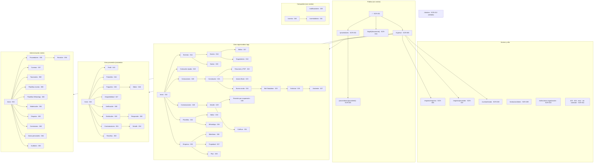
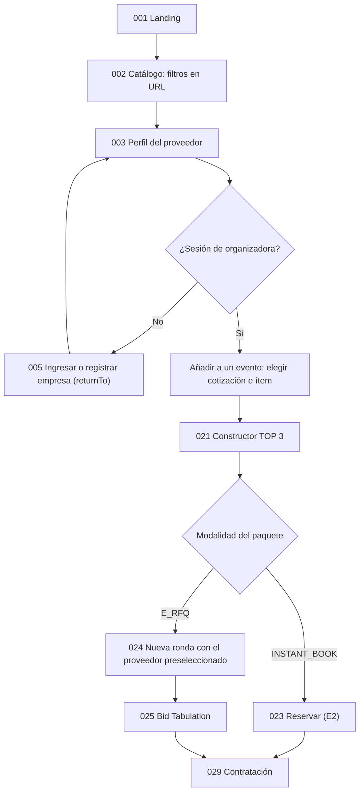
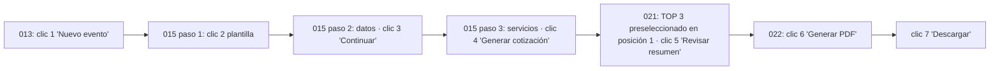
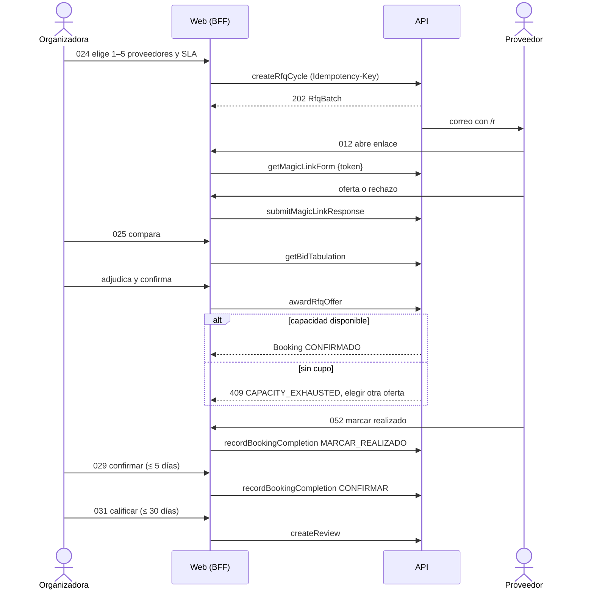
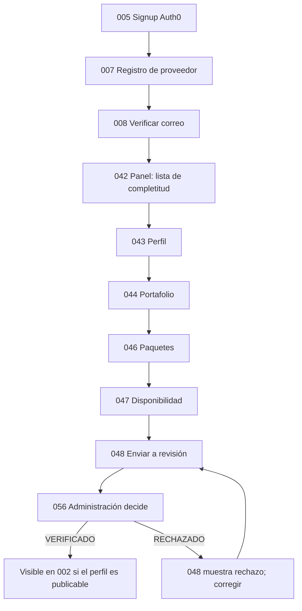
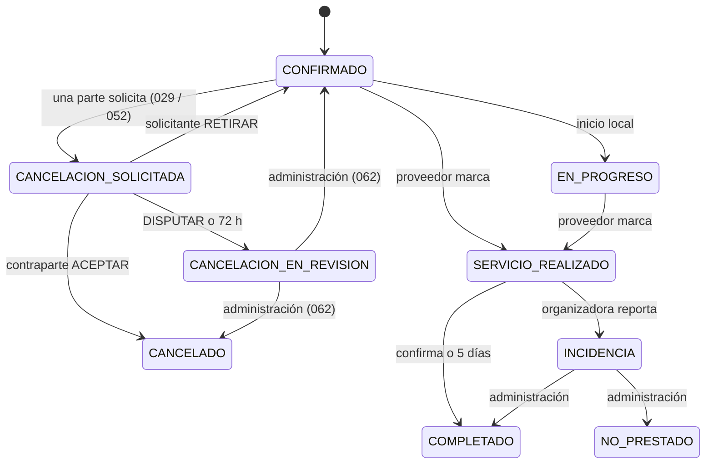
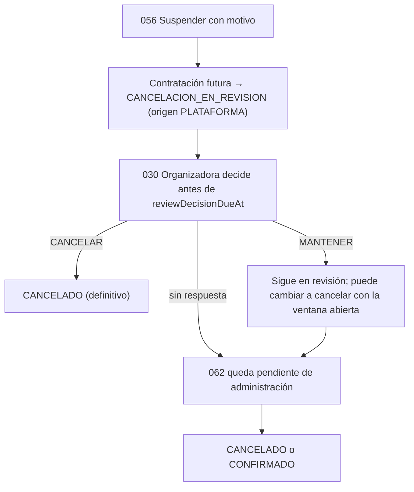
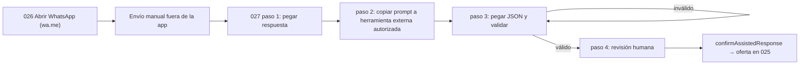
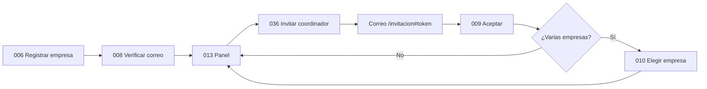

# ProveeEventos — Especificación Funcional UX/UI y Design System

| Campo | Valor |
|---|---|
| Documento | `ProveeEventos_UXUI.md` |
| Versión | 1.1 |
| Fecha | 2026-11-25 |
| Estado | Especificación de diseño para implementación. Las decisiones `D-nn` son de interfaz y no modifican PRD, SRS, SAD, DDD, contrato ni `Decisiones.md` |
| Referencia estética | `https://jrmarketing.co/` (inspeccionada el 2026-11-25: HTML, `style.css` y render en navegador) |
| Nivel de accesibilidad objetivo | WCAG 2.1 AA (SRS-NFR-USA-008) |
| Idioma y localización | Español de Colombia (`es-CO`), moneda COP |
| Total de pantallas | 65 (`SCR-001` a `SCR-065`) |
| Total de componentes del Design System | 57 (`CMP-01` a `CMP-57`) |
| Lector principal | Agente de IA que implementa `frontend/src` |

### Historial de versiones

| Versión | Fecha | Cambios |
|---|---|---|
| 1.0 | 2026-11-25 | Primera versión: Design System, tokens, navegación, 65 pantallas, patrones transversales, accesibilidad, microcopy, decisiones de interfaz y handoff. Generada según `Plans/Plan0001_UXUI.md` |
| 1.1 | 2026-11-25 | Se adapta al contrato API 1.4.0 (propuesta, pendiente de aprobación — TEC-013): 31 de las 34 brechas quedan resueltas y se retiran sus repliegues; quedan abiertas G-24, G-30 y G-33. Pendientes en `Reviews/ReviewsUXUI_V1.md` (`Plans/Plan0002_UXUI.md`) |

---

## 1. Propósito, Alcance e Inventario de Documentos Fuente

### 1.1 Propósito y alcance

Define de forma ejecutable la interfaz web de ProveeEventos: dirección de arte, tokens, componentes, navegación, permisos visibles, pantallas, validaciones, estados, integración con la API `/api/v1` (contrato 1.4.0, pendiente de aprobación — TEC-013), responsive y accesibilidad.

- **Incluye:** entregas E1 y E2 del MVP (columna Prioridad de §4).
- **Excluye (no se diseña ni se deja entrada de menú):** pagos, anticipos y facturación en la plataforma; WhatsApp Business API; asistente de IA automatizado; comparador lado a lado del catálogo (RF-COT-04, Fase 3); versiones Económica/Estándar/Premium (RF-INT-04, Fase 3); tablero Kanban (Fase 2); editor granular de permisos; formularios de contraseña propios (Auth0 Universal Login).
- **Regla de autoridad:** la interfaz no decide capacidad, adjudicación, SLA, tenant, rol ni elegibilidad (SAD §5.3; ADR-ARCH-008 R3). Ocultar un control mejora la experiencia; la autorización es del backend.

### 1.2 Cómo leer este documento

| Prefijo | Significado | Definido en |
|---|---|---|
| `SCR-NNN` | Pantalla | §4 (inventario) y §5 (especificación) |
| `CMP-NN` | Componente reutilizable | §2.7 |
| `D-nn` | Decisión autónoma de diseño | §10 |
| `G-nn` | Brecha del contrato o de las fuentes que condiciona la interfaz | §1.4 |
| `SRS-*`, `RF-*`, `DEC-*`, `TEC-*`, `ADR-*` | Identificadores de las fuentes | Documentos de §1.3 |
| `operationId` en `código` | Operación del contrato OpenAPI | `ProveeEventos_API_Spec.yaml` |

Jerarquía ante contradicciones: PRD > SRS > SAD > DDD > API Spec > `Decisiones.md`; el TDD manda en persistencia dentro de SAD, DDD y API (ADR-GOV-004 R1). Este documento está **por debajo** de todos ellos: si contradice una fuente, prevalece la fuente.

Convención de las especificaciones: "BFF" es el servidor Next.js; toda llamada a la API nombrada en este documento se hace desde código de servidor (`lib/api`, `server-only`).

### 1.3 Inventario de documentos fuente

| # | Documento | Versión | Cómo alimenta esta especificación | Lectura |
|---|---|---|---|---|
| 1 | `ProveeEventos_PRD.md` | 2.4 | Personas, módulos, requisitos RF, flujos, mapa de navegación, planes, comisión, taxonomía, plantillas | Dirigida: §4, §6, §10–§14, anexos |
| 2 | `ProveeEventos_SRS.md` | 1.3 | Roles, permisos, requisitos, estados, validaciones, escenarios, NFR de UI | Completa: §2–§10 (§1 y §11–§16 por referencia) |
| 3 | `ProveeEventos_SAD.md` | 1.4 | Frontend, BFF, errores, idempotencia, concurrencia, paginación, seguridad | Dirigida: §5, §10, §11 |
| 4 | `ProveeEventos_DDD.md` | 1.4 | Eventos de dominio (notificaciones), invariantes, zona horaria | Dirigida: §6.2, §8.1, §9 |
| 5 | `ProveeEventos_TDD.md` | vigente | Longitudes, discrepancias contrato↔base, huecos y preguntas abiertas | Dirigida: §0.5, §0.6, §4.6, §9.3 |
| 6 | `ProveeEventos_API_Spec.yaml` | 1.4.0 | Operaciones, esquemas, enums, cabeceras, códigos de error | Completa, por análisis estructurado |
| 7 | `ProveeEventos_ADRs.md` | vigente | Reglas verificables del frontend, sesión, Magic Link, datos personales, gobernanza | Dirigida: ARCH, STACK, API, SEC, DATA-012/013, GOV, §2.4, §4 |
| 8 | `Decisiones.md` | 1.6 | Decisiones DEC/TEC integradas en las fuentes anteriores | Por referencia desde SRS, SAD y Anexo A del PRD |
| 9 | `proveeeventos.prisma` | vigente | Longitudes `VarChar`, enums de categorías de notificación | Dirigida (extracción automática) |
| 10 | `proveeeventos.sql` | vigente | Restricciones `CHECK` (posiciones, reintentos, puntajes) | Dirigida (extracción automática) |
| 11 | `Glosario.md` | vigente | Términos ES↔EN para etiquetas | Por referencia desde DDD §3 |
| 12 | `Trazabilidad.md` | vigente | Relación requisito → operación → entrega | Dirigida |
| 13 | `CLAUDE.md` | — | Convenciones del repositorio | Completa |
| 14 | `Plans/Plan0002.md` (D2 prevista) | — | Flujos que la especificación UX debe cubrir | Dirigida |

No existe contrato AsyncAPI. Las notificaciones asíncronas se consumen por `listNotifications` (no hay canal en tiempo real documentado).

### 1.4 Brechas del contrato y de las fuentes que condicionan la interfaz

La interfaz **no inventa operaciones ni campos** (ADR-ARCH-010 R3, ADR-GOV-004 R3). La versión 1.0 detectó brechas sobre el contrato 1.3.0; el contrato 1.4.0 (propuesta, pendiente de aprobación — TEC-013) resuelve la mayoría. Si TEC-013 se rechaza, vuelven a aplicar los repliegues de la versión 1.0 de este documento.

#### 1.4.1 Brechas abiertas

Cada una usa el repliegue indicado, aislado tras la bandera `contractGaps.gNN` (D-11).

| ID | Brecha | Requisito afectado | Repliegue obligatorio | Pantallas |
|---|---|---|---|---|
| G-24 | SRS-AUTH-009 niega a `COORDINADOR` "consultar plan" y SRS-TEN-005 permite a cualquier miembro consultar plan y consumo; `getPlanUsage` se declara solo para `PROPIETARIO` y `ADMIN_EMPRESA` | SRS-AUTH-009 ↔ SRS-TEN-005 ↔ contrato | `COORDINADOR` y `COORDINADOR_RESTRINGIDO` ven el nombre y vigencia del plan (`getCurrentOrganization.plan`); el consumo solo `PROPIETARIO`/`ADMIN_EMPRESA`. Debe corregirse la contradicción en el SRS | 035, 038 |
| G-30 | La bandeja de disputas no incluye apelaciones de verificación; no hay modelo de datos ni política que defina una apelación | SRS-ADM-010; SRS-ADM-001 | Se atienden desde la revisión del proveedor por política operativa | 056, 062 |
| G-33 | No hay operación para corregir el NIT de una empresa | SRS-TEN-005 | La pantalla remite a soporte; administración no ofrece la acción | 035, 057 |

#### 1.4.2 Brechas resueltas en el contrato 1.4.0

Los identificadores se conservan y no se reutilizan.

| ID | Brecha en 1.3.0 | Requisito | Resolución en 1.4.0 | Pantallas |
|---|---|---|---|---|
| G-01 | No hay listado de portafolio; `PublicProvider` solo trae `primaryPhotoUrl` | SRS-CAT-001/002; PRD §11.2 | `listMyMedia`; `PublicProvider.portfolio` | 003, 044 |
| G-02 | `getMyProvider` no devuelve `phone`, `whatsapp`, `coverageAreas`, `maxCapacity` | SRS-CAT-001 | `ProviderOwnProfile` en `getMyProvider`/`updateMyProvider` | 043 |
| G-03 | `RfqRequest` no trae evento, fecha, invitados, ubicación ni alcance; el proveedor no puede leer sus ofertas | SRS-RFQ-002/006/007 | `RfqRequest.details`, `providerName`, `quotationId`; `listRfqOffers` | 049, 050 |
| G-04 | `Notification` no trae destino de acción | SRS-NOT-002 | `Notification.actionTarget` | 039 |
| G-05 | `listEvents` no filtra por coordinador, texto ni archivados; no hay reactivación | SRS-EVT-011, EVT-007 | `listEvents` con `q`, `coordinatorId`, `includeArchived`; `reactivateEvent` | 014 |
| G-06 | No se pueden leer los coordinadores asignados a un evento | SRS-AUTH-011 | `getEventAssignees` | 016 |
| G-07 | No hay listado de invitaciones y `Coordinator` no expone `invitationId` | SRS-AUTH-006 | `listInvitations`; `Coordinator.invitationId` | 036 |
| G-08 | No se puede leer la transferencia de propiedad pendiente | SRS-AUTH-009 | `getPendingOwnershipTransfer` | 037 |
| G-09 | `CurrentUser.memberships` no trae nombre de empresa | SRS-AUTH-010 | `CurrentUser.memberships[].organizationName` | 010, todas las de organizador |
| G-10 | `Organization` no devuelve nombre comercial ni contacto | SRS-TEN-005 | `Organization.tradeName`, `contactName`, `contactEmail`, `phone` | 035 |
| G-11 | `Booking` no expone quién pidió cancelar, motivo, plazos, historial ni nombres de proveedor/evento | SRS-BOOK-007..009 | `Booking` con nombres, `cancellation` y plazos; `getBookingHistory` | 028–030, 051, 052 |
| G-12 | No hay operaciones de modificación propuesta de alcance | SRS-BOOK-005, EVT-008 | `listBookingChangeProposals`, `proposeBookingChange`, `respondBookingChangeProposal` (E2) | 017, 029 |
| G-13 | `buildWhatsappClickToChat` no permite elegir plantilla ni devuelve variables faltantes | SRS-WA-001/002 | `listAvailableWhatsappTemplates`; `templateId` y `400` en `buildWhatsappClickToChat` | 026 |
| G-14 | No hay historial de documentos ni de versiones de cotización | SRS-QUO-012 | `listQuotationDocuments` | 022 |
| G-15 | No hay lectura pública de planes | DEC-029 | `listPublicPlans` | 001 |
| G-16 | Administración sin listado de usuarios/empresas, consumo por empresa ni CRUD de planes | SRS-ADM-009 | `listUsersForAdmin`, `listOrganizationsForAdmin`, `getOrganizationForAdmin`, `listPlans`, `createPlanVersion`, `updatePlan` | 057 |
| G-17 | Administración no puede leer detalle ni evidencia del proveedor | SRS-ADM-001 | `getProviderForAdmin` | 056 |
| G-18 | `ReviewReport` no incluye el contenido de la reseña | SRS-ADM-006 | `ReviewReportPage` devuelve la reseña | 061 |
| G-19 | Sin listado de categorías/subtipos inactivos; el listado de plantillas exige organización | SRS-ADM-002/003 | `listCategoriesForAdmin`, `listGlobalEventTemplates` | 058, 059 |
| G-20 | Auditoría sin filtros por tenant ni acción; sin valores anterior/nuevo | SRS-ADM-011 | filtros `organizationId` y `action`; `AuditLog.changes` y `reason` | 065 |
| G-21 | Sin listado de comisiones, export de suscripciones ni registro de factura/pago | SRS-ADM-008 | `listCommissions`, `updateCommissionReferences`, `exportSubscriptions` | 063 |
| G-22 | Sin listado de retenciones legales | SRS-ADM-012 | `listLegalHolds` | 064 |
| G-23 | `createSubtype` no recibe `code` (lo genera el backend) | DEC-020 | `Subtype.code` de solo lectura | 058 |
| G-25 | No hay lectura pública de disponibilidad del proveedor | PRD §11.2 (calendario en el perfil) | `getPublicProviderAvailability` | 003 |
| G-26 | `createEvent`, `createEventTemplate`, `createQuickQuotation` y `createQuotation` no declaran `409` para `PLAN_LIMIT_REACHED` | SRS-TEN-004; ADR-API-003 | `409` declarado en las operaciones afectadas | 015, 019, 021, 033 |
| G-27 | `QuickQuotationOption` no trae nombre de paquete, precio unitario, calificación ni inclusiones/exclusiones | SRS-QUO-003 | `QuickQuotationOption` completa | 019 |
| G-28 | `Quotation` no expone la fecha de la última generación | SRS-QUO-014 | `Quotation.lastGeneratedAt` | 020 |
| G-29 | `Provider` no expone el motivo del rechazo de verificación | SRS-ADM-001 | `verificationRejectionReason` | 048 |
| G-31 | `DataSubjectRequest` no expone solicitante ni responsable | SRS-ADM-012 | `AdminDataSubjectRequest` con solicitante y responsable | 064 |
| G-32 | Ninguna operación revela el contacto del proveedor tras una contratación confirmada; el snapshot no lo contiene | SRS-CAT-015 (regla 2); DEC-028 | `getBookingProviderContact` | 029 |
| G-34 | `CurrentUser` no devolvía el teléfono que `updateMyPreferences` escribe | SRS-AUTH-008 | `CurrentUser.phone` | 040 |

Otras observaciones sin repliegue visual: Next.js y Tailwind en sus versiones más recientes exigen navegadores superiores a los de SRS-NFR-COMP-001 (ver D-07).

---
## 2. Dirección de Arte y Design System

### 2.1 Análisis de Referencia Visual (`https://jrmarketing.co/`) y Evolución Moderna

**Valores observados en la referencia** (variables de `style.css` y render):

| Aspecto | Referencia |
|---|---|
| Color | blanco `#FFFFFF`; papel rosado `#FFF6FB`; papel cálido `#FFFBF0`; tinta `#1B1424`; tinta suave `#726C80`; rosa `#FF3E9D`; rosa profundo `#E0208A`; amarillo `#FFD23D`; morado `#8B2FE0`; naranja `#FF7A3D`; lima `#D8FF2B`; fondos nocturnos `#0E0817`, `#06020A`, `#1A0E30`; línea `rgba(27,20,36,.1)` |
| Firma | degradado `linear-gradient(90deg,#8B2FE0 0%,#FF3E9D 55%,#FF7A3D 100%)` en una o dos palabras del titular, CTA y botón de reproducción |
| Tipografía | Outfit 300–900; titulares 600–800, interlineado 1.02, tracking −0.02em; `eyebrow` 12.5px/700/0.12em en mayúsculas precedido por un triángulo "play" rosa |
| Forma | botones píldora (radio 100px, borde 1.5px tinta); tarjetas 26–28px; sombra larga `0 24px 46px -18px rgba(27,20,36,.25)` |
| Superficies | header fijo de 78px, blanco 86 % con `blur(10px)`; secciones alternas blanco / rosa claro / casi negro violáceo con halos radiales |
| Movimiento | elevación en hover (−2px botones, −8px tarjetas), curva elástica `cubic-bezier(.34,1.56,.64,1)`, revelado al hacer scroll, pulsos infinitos, marquesina, volteo 3D de tarjetas |
| Ritmo | mucho aire, fotografía inmersiva de eventos, etiquetas de color rotadas, cifras grandes separadas por filetes |

**Evolución aplicada a ProveeEventos** (concepto: **"Escenario y mesa de producción"**):

| Zona | Tratamiento | Qué se conserva | Qué cambia y por qué |
|---|---|---|---|
| **Escenario** (landing, hero del catálogo, perfil público, acceso, cierre de landing) | Alta energía: fondos nocturnos o papel, titulares Outfit, degradado de firma, fotografía | Paleta, triángulo "play", píldoras, tarjetas grandes | Sin pulsos infinitos (D-05) ni volteo 3D (D-06) |
| **Mesa de producción** (tablas, formularios, comparador, paneles) | Superficies blancas y `neutral-50`, densidad media-alta, radios 8–16px | Tinta, acentos puntuales rosa/morado, `eyebrow` en encabezados de sección | Degradado solo en progreso, indicador de ruta activa y foco de marca (D-04) |

Elementos de identidad reutilizables:
1. **`PlayMark`**: triángulo `clip-path: polygon(0 0,0 100%,100% 50%)`, 8×9px, color `brand-pink`; precede a `eyebrow` y marca el ítem activo del sidebar. Decorativo (`aria-hidden="true"`).
2. **Texto con degradado**: clase `.text-brand-gradient`, solo en texto ≥ 32px/600 sobre `stage-900` o ≥ 32px sobre blanco usando `--gradient-text`; máximo una por vista.
3. **Halo**: `radial-gradient(circle, rgba(139,47,224,.35) 0%, rgba(139,47,224,0) 70%)` de 480px, solo en superficies de escenario, `pointer-events:none`.
4. El logotipo de la referencia **no** se reutiliza: ProveeEventos usa su propio logotipo tipográfico `Provee` (tinta) + `Eventos` (degradado) con `PlayMark` (D-33).

### 2.2 Paleta de Colores y Matriz de Contraste WCAG

#### 2.2.1 Escalas

| Paso | `purple` | `pink` | `orange` | `neutral` |
|---|---|---|---|---|
| 50 | `#F5EEFD` | `#FFF0F7` | `#FFF3EC` | `#F8F6FA` |
| 100 | `#EADBFB` | `#FFDCEC` | `#FFE3D3` | `#F1EEF5` |
| 200 | `#D8BBF7` | `#FFB9DA` | `#FFC7A8` | `#E4E0EA` |
| 300 | `#C98EFF` | `#FF8CC3` | `#FFA676` | `#CFC9D9` |
| 400 | `#A862F0` | `#FF3E9D` (rosa de referencia) | `#FF7A3D` (referencia) | `#8A8398` |
| 500 | `#8B2FE0` (referencia) | `#E0208A` (referencia) | `#E65F1F` | `#726C80` (referencia) |
| 600 | `#7A22CC` | `#D6187F` | `#B03F00` | `#5C546A` |
| 700 | `#651AAD` | `#B8106A` | `#8F3300` | `#453C52` |
| 800 | `#4B1380` | `#900C53` | `#6E2700` | `#2E2639` |
| 900 | `#32095A` | `#630838` | `#4A1A00` | `#1B1424` (tinta de referencia) |

Acentos planos: `yellow-400 #FFD23D`, `lime-300 #D8FF2B`, `paper #FFF6FB`, `paper-warm #FFFBF0`.
Superficie de escenario: `stage-950 #06020A`, `stage-900 #0E0817`, `stage-800 #1A0E30`, `stage-muted #C9C2D6`.

| Semántico | 50 (fondo) | 600 (icono/borde) | 700/800 (texto) |
|---|---|---|---|
| `success` | `#E9F8F0` | `#16834F` | `#11693F` |
| `warning` | `#FFF6E0` | `#A66300` | `#7A4A00` |
| `error` | `#FDECEF` | `#CF2039` | `#B3182F` |
| `info` | `#EBF2FE` | `#2468D6` | `#1B55B8` |

`error-800 #8F1226`: solo fondo de hover del botón destructivo (texto blanco 9:1 aprox.).

Degradados:

| Token | Valor | Uso |
|---|---|---|
| `--gradient-brand` | `linear-gradient(90deg,#8B2FE0 0%,#FF3E9D 55%,#FF7A3D 100%)` | decoración, bordes, barras de progreso, halos; **nunca** detrás de texto pequeño |
| `--gradient-action` | `linear-gradient(90deg,#6F1FC0 0%,#B8106A 55%,#B03F00 100%)` | fondo de botón con texto blanco (hover primario, CTA de escenario) |
| `--gradient-text` | igual a `--gradient-action` sobre claro; `--gradient-brand` sobre `stage` | palabra destacada de titulares |
| `--gradient-stage` | `linear-gradient(155deg,#1A0E30 0%,#0E0817 100%)` | hero y bandas nocturnas |

#### 2.2.2 Roles y contraste verificado

Ratios calculados con la fórmula de luminancia relativa de WCAG 2.1.

| Token de rol | Hex | Uso | Sobre | Ratio |
|---|---|---|---|---|
| `text-primary` | `#1B1424` | texto principal y titulares | `#FFFFFF` / `#F8F6FA` / `#FFF6FB` | 17.92 / 16.68 / 16.92 |
| `text-secondary` | `#5C546A` | texto secundario, ayudas | `#FFFFFF` / `#F8F6FA` / `#F1EEF5` | 7.16 / 6.67 / 6.24 |
| `text-tertiary` | `#726C80` | metadatos ≥ 14px | `#FFFFFF` / `#FFF6FB` | 5.03 / 4.75 |
| `text-disabled` | `#9A94A8` | solo controles deshabilitados (exentos, WCAG 1.4.3) | `#FFFFFF` | 2.93 |
| `text-inverse` | `#FFFFFF` | texto sobre tinta o escenario | `#1B1424` / `#0E0817` | 17.92 / 19.70 |
| `text-stage-muted` | `#C9C2D6` | secundario en escenario | `#0E0817` / `#1A0E30` | 11.42 / 10.59 |
| `text-link` | `#651AAD` | enlaces (subrayados en texto corrido) | `#FFFFFF` / `#F5EEFD` | 9.11 / 8.04 |
| `accent-pink-text` | `#B8106A` | texto de acento, selección | `#FFFFFF` / `#FFF0F7` | 6.32 / 5.74 |
| `action-primary-bg` | `#1B1424` | botón primario (texto blanco) | texto `#FFFFFF` | 17.92 |
| `action-destructive-bg` | `#B3182F` | botón destructivo (texto blanco) | texto `#FFFFFF` | 6.80 |
| `gradient-action` (peor punto) | `#B03F00` | texto blanco sobre degradado de acción | extremos `#6F1FC0`/`#B8106A`/`#B03F00` | 7.98 / 6.32 / 5.90 |
| `brand-pink` | `#FF3E9D` | decoración; texto solo con tinta encima | tinta sobre rosa; rosa sobre `#0E0817` | 5.48; 6.03 |
| `brand-orange` | `#FF7A3D` | decoración; en escenario como texto | `#0E0817`; tinta sobre naranja | 7.60; 6.91 |
| `brand-yellow` | `#FFD23D` | etiquetas, foco en escenario | tinta sobre amarillo | 12.40 |
| `brand-lime` | `#D8FF2B` | CTA secundario sobre escenario (texto tinta) | `#1B1424` / sobre `#0E0817` | 15.58 / 17.13 |
| `lilac` | `#C98EFF` | rótulos en escenario | `#0E0817` | 8.25 |
| `border-input` | `#8A8398` | borde de control de formulario (UI ≥ 3:1) | `#FFFFFF` / `#F1EEF5` | 3.63 / 3.16 |
| `border-subtle` | `#E4E0EA` | divisores decorativos (sin requisito) | `#FFFFFF` | decorativo |
| `focus-ring` | `#7A22CC` | anillo de foco en claro | `#FFFFFF` / `#FFF6FB` | 7.17 / 6.77 |
| `focus-ring-stage` | `#FFD23D` | anillo de foco en escenario | `#0E0817` | 13.64 |
| `success-text` | `#11693F` | texto de éxito | `#E9F8F0` / `#FFFFFF` | 6.15 / 6.74 |
| `warning-text` | `#7A4A00` | texto de advertencia | `#FFF6E0` / `#FFFFFF` | 6.95 / 7.48 |
| `error-text` | `#B3182F` | texto de error | `#FDECEF` / `#FFFFFF` | 5.96 / 6.80 |
| `info-text` | `#1B55B8` | texto informativo | `#EBF2FE` / `#FFFFFF` | 6.14 / 6.91 |

**Prohibido:** texto blanco sobre `#FF3E9D` (3.27) o `#FF7A3D` (2.59); texto blanco sobre `--gradient-brand` (D-01).

#### 2.2.3 Estrategia de tema

- Tema único claro (D-03). Superficies semánticas: `surface-page #F8F6FA` (mesa), `surface-card #FFFFFF`, `surface-raised #FFFFFF` + sombra, `surface-sunken #F1EEF5`, `surface-brand-soft #FFF6FB`.
- Escenario: atributo `data-surface="stage"` en la sección; redefine `--text-primary:#FFFFFF`, `--text-secondary:#C9C2D6`, `--focus-ring:#FFD23D`, `--surface-card:#1A0E30`, `--border-subtle:rgba(255,255,255,.08)`. Nunca se aplica a tablas ni formularios largos.
- `color-scheme: light` en `:root`. No hay conmutador de modo oscuro.

### 2.3 Sistema Tipográfico

| Familia | Token | Pila | Uso |
|---|---|---|---|
| Display | `--font-display` | `"Outfit", "Segoe UI", system-ui, sans-serif` | `display-*`, `h1`–`h4`, botones, cifras KPI |
| UI / cuerpo | `--font-sans` | `"Inter", "Segoe UI", system-ui, sans-serif` | texto, formularios, tablas, menús (D-02) |
| Monoespaciada | `--font-mono` | `"JetBrains Mono", ui-monospace, SFMono-Regular, Menlo, monospace` | IDs, `correlationId`, prompt y JSON |

Carga: `next/font` autoalojada (sin peticiones a terceros, exigido en `/r` por SRS-MAGIC-004), `display: swap`, subconjunto `latin` (incluye tildes y `ñ`). Pesos: Outfit 500, 600, 700; Inter 400, 500, 600; JetBrains Mono 400.
Importes y columnas numéricas: clase `.tabular` = `font-variant-numeric: tabular-nums lining-nums;` en `--font-sans`, alineados a la derecha.

| Estilo | Familia | Desktop (≥1024) size / lh | Mobile size / lh | Peso | Tracking | Uso |
|---|---|---|---|---|---|---|
| `display-xl` | display | 72 / 76px (4.5rem) | 40 / 44px | 600 | −0.02em | hero de landing |
| `display-lg` | display | 56 / 60px | 34 / 38px | 600 | −0.02em | hero de catálogo y cierre |
| `display-md` | display | 40 / 44px | 30 / 36px | 600 | −0.02em | título de sección pública |
| `h1` | display | 30 / 36px | 24 / 30px | 700 | −0.015em | título de pantalla (uno por vista) |
| `h2` | display | 22 / 28px | 20 / 26px | 600 | −0.01em | sección |
| `h3` | display | 18 / 24px | 17 / 24px | 600 | −0.005em | tarjeta, diálogo |
| `h4` | display | 16 / 22px | 16 / 22px | 600 | 0 | subgrupo |
| `body-lg` | sans | 18 / 28px | 17 / 26px | 400 | 0 | entradillas públicas |
| `body` | sans | 15 / 22px | 16 / 24px | 400 | 0 | texto por defecto |
| `body-sm` | sans | 14 / 20px | 14 / 20px | 400 | 0 | tablas, ayudas |
| `label` | sans | 14 / 20px | 14 / 20px | 500 | 0 | etiquetas de campo |
| `button` | display | 15 / 20px | 16 / 20px | 600 | 0.005em | botones |
| `caption` | sans | 12.5 / 16px | 12.5 / 16px | 400 | 0.01em | metadatos (mínimo absoluto) |
| `overline` | display | 12.5 / 16px | 12.5 / 16px | 700 | 0.12em, mayúsculas | `eyebrow` |
| `kpi` | display | 36 / 40px | 28 / 32px | 700 | −0.02em, tabular | cifra de KPI |
| `code` | mono | 13 / 20px | 13 / 20px | 400 | 0 | IDs, JSON |

Reglas: en móvil los `input` usan 16px (evita zoom automático en iOS); texto corrido máximo 68 caracteres por línea (`max-width: 68ch`); nunca texto en mayúsculas fuera de `overline`.

### 2.4 Espaciados, Grid Responsive, Radios, Elevaciones y Escala `z-index`

#### Espaciado (base 4px)

| Token | px | Token | px | Token | px | Token | px |
|---|---|---|---|---|---|---|---|
| `space-0` | 0 | `space-4` | 16 | `space-10` | 40 | `space-18` | 72 |
| `space-0.5` | 2 | `space-5` | 20 | `space-12` | 48 | `space-20` | 80 |
| `space-1` | 4 | `space-6` | 24 | `space-14` | 56 | `space-24` | 96 |
| `space-2` | 8 | `space-8` | 32 | `space-16` | 64 | | |
| `space-3` | 12 | | | | | | |

Uso: dentro de un control `space-2`–`space-3`; entre campos `space-5`; padding de tarjeta `space-5` (móvil `space-4`); entre secciones de app `space-8`; entre secciones públicas `space-20` (móvil `space-12`).

#### Breakpoints y grid

| Nombre | Rango (px) | Columnas | Gutter | Margen lateral | Contenedor máx. |
|---|---|---|---|---|---|
| `xs` | 360–479 | 4 | 12 | 16 | 100 % |
| `sm` | 480–767 | 4 | 16 | 20 | 100 % |
| `md` | 768–1023 | 8 | 20 | 24 | 100 % |
| `lg` | 1024–1279 | 12 | 24 | 32 | 100 % |
| `xl` | 1280–1535 | 12 | 24 | 32 | público 1180px; app 1360px |
| `2xl` | ≥ 1536 | 12 | 32 | 40 | público 1180px; app 1440px |

Media queries `min-width`: `480, 768, 1024, 1280, 1536`. Ancho mínimo soportado 360px sin scroll horizontal de página (SRS-NFR-USA-001).
App shell: sidebar 264px (colapsada 72px), topbar 64px; header público 72px (la referencia usa 78px); bottom nav móvil 64px + `env(safe-area-inset-bottom)`.

#### Radios

| Token | px | Uso |
|---|---|---|
| `radius-xs` | 4 | checkbox, etiquetas de tabla |
| `radius-sm` | 8 | inputs, menús, celdas |
| `radius-md` | 12 | tarjetas operativas, banners, toasts |
| `radius-lg` | 16 | paneles, diálogos, tarjetas en móvil |
| `radius-xl` | 26 | tarjetas de escenario y de proveedor en desktop |
| `radius-full` | 9999 | botones, chips, badges, avatares |

#### Elevaciones

| Token | Valor | Uso |
|---|---|---|
| `shadow-xs` | `0 1px 2px rgba(27,20,36,.06)` | tarjeta en reposo |
| `shadow-sm` | `0 2px 6px rgba(27,20,36,.08)` | header al hacer scroll |
| `shadow-md` | `0 8px 20px -6px rgba(27,20,36,.14)` | menú, popover |
| `shadow-lg` | `0 14px 26px -10px rgba(27,20,36,.30)` | hover de tarjeta interactiva |
| `shadow-xl` | `0 24px 46px -18px rgba(27,20,36,.25)` | tarjeta de escenario |
| `shadow-2xl` | `0 32px 64px -12px rgba(27,20,36,.35)` | diálogo, drawer |
| `shadow-glow-pink` | `0 8px 20px rgba(255,62,157,.45)` | hover de botón primario |
| `shadow-glow-purple` | `0 18px 40px rgba(139,47,224,.25)` | tarjeta destacada |
| `shadow-glow-lime` | `0 6px 20px rgba(216,255,43,.35)` | hover del CTA lima |

#### `z-index`

| Token | Valor | Capa |
|---|---|---|
| `z-base` | 0 | contenido |
| `z-raised` | 10 | tarjeta en hover, cabecera sticky de tabla |
| `z-sticky` | 20 | columnas fijas, barra de acciones sticky, panel de totales |
| `z-nav` | 30 | topbar, sidebar, bottom nav |
| `z-dropdown` | 40 | menús, combobox, popover |
| `z-overlay` | 50 | velo de diálogo y drawer |
| `z-modal` | 60 | diálogo, drawer, bottom sheet |
| `z-toast` | 70 | toasts |
| `z-tooltip` | 80 | tooltips |

---
### 2.5 Sistema de Efectos y Animaciones Modernas

#### 2.5.1 Tokens de duración y curva

| Duración | ms | Uso |
|---|---|---|
| `--dur-instant` | 100 | color, opacidad de hover, `:active` |
| `--dur-fast` | 150 | foco, chips, tooltips, salida de menú |
| `--dur-normal` | 250 | entrada de menú, tabs, acordeón, hover de tarjeta |
| `--dur-moderate` | 350 | diálogo, drawer, toast, reordenamiento de listas |
| `--dur-slow` | 500 | revelado en escenario, cambio de paso de stepper público |
| `--dur-shimmer` | 1400 | ciclo del skeleton |

| Curva | `cubic-bezier` | Uso |
|---|---|---|
| `--ease-standard` | `cubic-bezier(0.2, 0.8, 0.2, 1)` (curva de la referencia) | transiciones generales |
| `--ease-out-expo` | `cubic-bezier(0.16, 1, 0.3, 1)` | entradas de overlays y listas |
| `--ease-in` | `cubic-bezier(0.4, 0, 1, 1)` | salidas (duración = 70 % de la entrada) |
| `--ease-spring` | `cubic-bezier(0.34, 1.56, 0.64, 1)` (curva de la referencia) | solo `transform` de elementos pequeños: botones, favorito, check de éxito |
| `--ease-linear` | `cubic-bezier(0, 0, 1, 1)` | shimmer y barras de progreso |

#### 2.5.2 Catálogo de efectos

| ID | Efecto | Especificación | Dónde | Prohibido en |
|---|---|---|---|---|
| FX-01 | Vidrio flotante | `background: rgba(255,255,255,.86); backdrop-filter: blur(10px) saturate(1.2); -webkit-backdrop-filter` igual; fallback `@supports not (backdrop-filter: blur(1px))` → `rgba(255,255,255,.97)` | header público, topbar al hacer scroll, barra sticky móvil, panel flotante de filtros | tablas, formularios, diálogos con texto largo |
| FX-02 | Velo de overlay | `rgba(14,8,23,.56)` + `blur(4px)`; entrada `opacity` 0→1, `--dur-normal` | diálogo, drawer | — |
| FX-03 | Micro-elevación | reposo `translateY(0)`; hover `translateY(-4px)` `--dur-normal --ease-standard`; la sombra `shadow-lg` vive en un `::after` cuya `opacity` pasa de 0 a 1 | tarjetas interactivas (en escenario `-6px`) | filas de tabla, tarjetas no clicables |
| FX-04 | Borde luminoso | `::before` con `--gradient-brand` recortado con `mask` a 1.5px; `opacity` 0→1 `--dur-normal` en hover y `focus-within` | tarjeta de proveedor, opción TOP 3 seleccionada, ChoiceCard | vistas densas |
| FX-05 | Halo reactivo | halo de §2.1 que sigue el puntero con `transform: translate3d()` y `--dur-slow`; solo `pointer: fine` | hero de landing | toda la app |
| FX-06 | Transición de layout | técnica FLIP: medir, aplicar `transform` inverso y animar a `none` en `--dur-moderate --ease-out-expo`; máximo 24 elementos animados; mejora progresiva con View Transitions si `document.startViewTransition` existe | filtrar/reordenar catálogo, reordenar columnas del comparador, galería | tablas de > 24 filas (cambio instantáneo + fade del `tbody` 150ms) |
| FX-07 | Shimmer direccional | base `#F1EEF5`; capa `linear-gradient(100deg, transparent 20%, rgba(255,255,255,.75) 50%, transparent 80%)` movida con `translateX(-100%→100%)`, `--dur-shimmer --ease-linear infinite` | skeletons | — |
| FX-08 | Stagger de entrada | `opacity 0→1`, `translateY(8px→0)`, `--dur-moderate --ease-out-expo`, retraso 40ms por elemento, tope 8 (después aparecen juntos); solo en la primera carga, nunca al paginar o refrescar | listas de tarjetas, KPIs | tablas |
| FX-09 | Respuesta táctil | `:active { transform: scale(.98) }` `--dur-instant` | botones, chips, tarjetas clicables | enlaces de texto |
| FX-10 | Elevación de botón | hover `translateY(-2px)` `--dur-normal --ease-spring`; primario además cambia a `--gradient-action` por `opacity` de una capa y `shadow-glow-pink` | botones `primary` y `stage` | botones en filas de tabla (solo color) |
| FX-11 | Diálogo | entrada `opacity 0→1`, `scale(.96→1)`, `translateY(8px→0)` `--dur-moderate --ease-out-expo`; salida `--dur-fast --ease-in` | `CMP-20`, `CMP-21` | — |
| FX-12 | Drawer / bottom sheet | `translateX(100%→0)` o `translateY(100%→0)` + `opacity .6→1`, `--dur-moderate --ease-out-expo` | `CMP-22` | — |
| FX-13 | Toast | entrada `translateY(12px)`+`opacity`, `--dur-moderate --ease-spring`; salida `translateX(16px)`+`opacity` `--dur-fast` | `CMP-43` | — |
| FX-14 | Confirmación de éxito | check SVG que aparece con `clip-path: inset(0 100% 0 0)→inset(0)` `--dur-slow` y círculo `scale(.6→1)` `--ease-spring` | reserva, adjudicación, respuesta de Magic Link | acciones rutinarias |
| FX-15 | Resalte de cambio | capa de fondo `#FFF0F7` con `opacity 1→0` en 1200ms sobre la celda o fila actualizada | totales recalculados, oferta nueva en Bid Tabulation | carga inicial |
| FX-16 | Revelado en scroll | `IntersectionObserver` (umbral .2), una sola vez: `opacity`+`translateY(24px→0)` `--dur-slow --ease-out-expo` | secciones de landing | app autenticada |
| FX-17 | Latido de marca | `PlayMark` `scale(1→1.25→1)` 1800ms, máximo 2 iteraciones (< 5 s, WCAG 2.2.2) | hero al montar | resto |
| FX-18 | Indicador de tab | barra de 2px `--gradient-brand` que se desplaza con `transform: translateX() scaleX()` `--dur-normal` | tabs, segmented control, sidebar | — |

#### 2.5.3 Reglas de rendimiento

1. Animar **solo** `transform`, `opacity` y `clip-path`. Prohibido `transition: all` (la referencia lo usa; no se copia) y animar `width`, `height`, `top`, `left`, `box-shadow`, `filter` o `background-position`.
2. Acordeones: animar `grid-template-rows` no está permitido; usar `clip-path` + `opacity` del contenido y cambio de altura instantáneo.
3. `will-change` solo durante la animación.
4. Máximo un efecto continuo por vista (el shimmer cuenta).
5. Presupuesto: 60 fps en el perfil móvil de SRS-NFR-PERF-001; LCP p75 < 2 s, por lo que el hero no depende de JavaScript para pintarse (la animación parte del estado visible si no hay JS).

#### 2.5.4 Movimiento reducido (obligatorio)

```css
@media (prefers-reduced-motion: reduce) {
  :root {
    --dur-instant: 0ms; --dur-fast: 0ms; --dur-normal: 0ms;
    --dur-moderate: 0ms; --dur-slow: 0ms;
  }
  *, *::before, *::after {
    animation-duration: 0.001ms !important;
    animation-iteration-count: 1 !important;
    transition-duration: 0.001ms !important;
    scroll-behavior: auto !important;
  }
  .pe-skeleton::after { display: none; }            /* skeleton estático */
  [data-motion="reveal"] { opacity: 1; transform: none; }
}
```

En JavaScript, el hook `useReducedMotion()` desactiva FX-05, FX-06, FX-08 y FX-16. El estado nunca depende de una animación: todo cambio tiene además texto, icono o anuncio.

### 2.6 Matriz de Estados Visuales Globales

Aplica a todo control; cada componente de §2.7 solo documenta sus diferencias.

| Estado | Fondo | Borde | Texto/icono | Otros | Semántica |
|---|---|---|---|---|---|
| `default` | según variante | `1px #8A8398` (campos) | `#1B1424` | `shadow-none` | — |
| `hover` | botón: según variante; campo: igual | campo `#5C546A` | igual | `cursor:pointer`; solo `@media (hover:hover)` | — |
| `focus-visible` | igual | igual | igual | `outline: 3px solid var(--focus-ring); outline-offset: 2px` (en tablas `outline-offset:-3px`). Fallback Safari < 15.4: `:focus` + clase `.focus-by-keyboard` en `<html>` | nunca `outline:none` sin reemplazo |
| `active` | 6 % más oscuro (capa tinta `.06`) | igual | igual | `scale(.98)` | `aria-pressed` si es conmutable |
| `disabled` | `#F1EEF5` | `#E4E0EA` | `#9A94A8` | `cursor:not-allowed`; sin sombra. Debe explicarse el motivo en texto visible o tooltip | `disabled`; si necesita foco para explicar, `aria-disabled="true"` |
| `loading` | igual | igual | texto conservado (opacidad 0 en botón y spinner centrado) | ancho fijo; no repetible | `aria-busy="true"` |
| `selected` | `#FFF0F7` | `2px #B8106A` | `#900C53` | check visible (no solo color) | `aria-selected`/`aria-checked` |
| `error` | `#FFFFFF` | `2px #CF2039` | mensaje `#B3182F` con icono `circle-alert` | mensaje bajo el campo | `aria-invalid="true"` + `aria-describedby` |
| `success` | `#E9F8F0` | `1px #16834F` | `#11693F` con icono `circle-check` | — | `role="status"` |
| `warning` | `#FFF6E0` | `1px #A66300` | `#7A4A00` con icono `triangle-alert` | — | `role="status"` |
| `read-only` | `#F8F6FA` | `1px dashed #CFC9D9` | `#1B1424` | seleccionable y copiable; icono `lock` si es un snapshot | `readonly` / `aria-readonly` |

Estados de vista (SRS §10.4), resueltos en §6.3: `carga`, `error recuperable`, `ausencia de resultados`, `ausencia de permisos`, `recurso no encontrado`, `recurso archivado`, `expiración`, `operación en curso`, `confirmación exitosa`.

---
### 2.7 Catálogo de Componentes Reutilizables

Base: shadcn/ui (Radix) restilizado con los tokens. Ubicación: `components/ui` (primitivos), `components/layout`, `components/feedback`; composiciones de dominio en `features/<área>`. Iconos: `lucide-react`, trazo 1.75px, 16/20/24px (D-19). Todo componente acepta `className`, reenvía `ref` y expone `data-testid`.

Plantilla de cada componente: anatomía · variantes y tamaños · props · estados (solo diferencias con §2.6) · teclado/ARIA · microinteracción.

#### Acciones

##### CMP-01 Button
- **Anatomía:** `[icono 18px]? · etiqueta · [icono | PlayMark]?`; `gap` 10px; radio `full`.
- **Variantes:** `primary` (fondo `#1B1424`, texto blanco, borde 1.5px degradado mediante doble `background-clip`); `secondary` (fondo blanco, borde 1.5px `#1B1424`; hover invierte a tinta); `ghost` (transparente; hover `#F1EEF5`); `destructive` (`#B3182F`, texto blanco; hover `#8F1226`, contraste mayor); `stage` (blanco sobre escenario, texto tinta); `lime` (`#D8FF2B`, texto tinta, solo escenario); `link` (texto `--text-link` `#651AAD` subrayado).
- **Tamaños:** `sm` 36px alto, padding 0 14px, 14px; `md` 44px, 0 20px, 15px; `lg` 52px, 0 28px, 16px. En `pointer:coarse`, `sm` amplía área táctil a 44px con pseudo-elemento.
- **Props:** `variant`, `size`, `loading`, `loadingLabel`, `leftIcon`, `rightIcon`, `fullWidth`, `type` (por defecto `button`), `disabledReason`.
- **Estados:** `loading` muestra `CMP-50` 18px, conserva ancho, anuncia `loadingLabel` ("Guardando…"). `disabledReason` genera tooltip y `aria-describedby`.
- **Teclado/ARIA:** `<button>` nativo; `Enter`/`Space`. Navegación usa `<a>` con estilo de botón.
- **Micro:** FX-09, FX-10. Una sola acción `primary` por vista o diálogo.

##### CMP-02 IconButton
- Cuadrado 36/44px, radio `full`, icono 20px. Variantes `ghost`, `outline`, `destructive-ghost`, `favorite`.
- Props: `label` (obligatorio → `aria-label` y tooltip), `pressed`.
- `favorite`: icono `heart`; presionado relleno `#D6187F`, `scale(1→1.25→1)` `--ease-spring`; `aria-pressed`.

##### CMP-03 Link
- `<a>`/`next/link`; `--text-link` (`#651AAD`), subrayado 1px con `text-underline-offset: 3px`; hover grosor 2px. Variante `nav` sin subrayado (indicador FX-18). Externos: icono `external-link`, `rel="noopener noreferrer"`, texto oculto "(abre en una pestaña nueva)".

#### Formularios

##### CMP-04 FormField y ErrorSummary
- **Anatomía:** etiqueta (`label`) · marca "(opcional)" en los opcionales (los obligatorios no llevan asterisco, D-34) · ayuda `caption` · control · mensaje de error · contador `n/max`.
- **Props:** `name`, `label`, `help`, `optional`, `error`, `maxLength`.
- **ARIA:** `id` generado; `aria-describedby="<id>-help <id>-error"`; error con icono y texto, nunca solo color (SRS-NFR-USA-006). El valor escrito se conserva siempre.
- **ErrorSummary:** al enviar con errores, banner `role="alert"` arriba del formulario: "Revisa 2 campos" + enlaces a cada campo; recibe el foco (`tabIndex=-1`).
- Contador visible al 80 % del máximo; anuncia `polite` al quedar 20 caracteres.

##### CMP-05 TextInput
- Alto 44px, radio `sm`, borde `border-input`, padding 0 12px, 16px móvil / 15px desktop. Adornos `prefix`, `suffix`, botón limpiar.
- Props nativas más `inputMode`, `autoComplete`, `mask`. `autocomplete` obligatorio en datos personales (WCAG 1.3.5): `organization`, `name`, `email`, `tel`, `address-level2`, `street-address`.
- `maxLength` no corta pegados en silencio: permite escribir y marca error al superar (D-35).

##### CMP-06 Textarea
- Mínimo 3 filas (96px), crece hasta 10 y luego scroll; contador siempre visible si `maxLength ≥ 300`. `Ctrl/⌘+Enter` envía solo en respuestas cortas (reseña).

##### CMP-07 Select
- Radix Select; para ≤ 12 opciones. En `pointer:coarse` usa `<select>` nativo.
- Teclado: `Enter`/`Space`/flechas abren; escritura salta; `Escape` cierra.

##### CMP-08 Combobox (buscable)
- Input + listbox (Command); filtra sin tildes ni mayúsculas; resalta coincidencia; estado "Sin coincidencias"; carga remota con spinner y debounce 300ms.
- Props: `options`, `onSearch`, `value`, `renderOption`, `clearable`.
- ARIA 1.2 combobox: `role="combobox"`, `aria-expanded`, `aria-activedescendant`; anuncia "N resultados" `polite`.
- Móvil: abre `CMP-22` bottom sheet a 90 % de alto con el buscador fijo.

##### CMP-09 MultiSelect
- Combobox con selección múltiple y chips removibles; props `max`, `grouped` (categoría → subtipos). Al llegar a `max`, opciones restantes deshabilitadas con texto "Máximo {max}".
- `Backspace` con input vacío quita el último chip; cada chip tiene botón "Quitar {nombre}".

##### CMP-10 DateTimeRangePicker
- Variantes: `date`, `date-range` (filtros y disponibilidad), `event-interval` (inicio y fin locales + zona IANA).
- `event-interval`: dos grupos "Inicio" y "Fin" (fecha `dd/mm/aaaa` + hora 24 h `HH:mm` en pasos de 15 min) y selector de zona (CMP-08) precargado `America/Bogota` según ciudad, con casilla de confirmación "Confirmo que el evento ocurre en la zona horaria {zona}". Emite `localStartsAt`, `localEndsAt` sin offset (`YYYY-MM-DDTHH:mm`) y `timeZone`.
- Resumen calculado solo informativo: "Dura 7 h · toca 2 fechas: vie 14 y sáb 15 mar". No decide capacidad.
- Validación: fin > inicio; fecha ≥ hoy en la zona elegida; hora inexistente por cambio horario → error.
- Calendario: `role="grid"`; flechas mueven día, `PageUp/Down` mes, `Home/End` semana, `Enter` elige; escritura manual siempre disponible. Celdas 44×44px en táctil.

##### CMP-11 MoneyInput
- `inputMode="numeric"`, prefijo `$`, sufijo `COP`; formatea miles con punto mientras se escribe conservando el cursor; solo enteros no negativos, máximo 12 dígitos (SRS-QUO-013, TDD §4.6).
- Emite `{amount: "1250000", currency: "COP"}` como **cadena**; prohibido `Number`/`parseFloat` (ADR-DATA-013 R1, D-13).
- Pegar "$ 1.250.000" o "1,250,000" normaliza quitando todo lo que no sea dígito; si hay decimales (`,50`) muestra "Escribe el valor en pesos, sin centavos".

##### CMP-12 NumberStepper
- Input numérico con botones − / + de 44px; props `min`, `max`, `step`. `↑/↓` ±1, `Shift` ±10. Para invitados, cantidad, capacidad. No usa `type="number"`.

##### CMP-13 PhoneInput
- Prefijo país `+57` seleccionable, número agrupado `300 123 4567`; emite E.164 (SRS §4.3). Longitud total ≤ 40.

##### CMP-14 FileUploader
- Zona de arrastre (borde `2px dashed #8A8398`, radio `md`) + botón "Elegir archivos"; en móvil admite cámara.
- Cola: miniatura 72px (`URL.createObjectURL`), nombre, tamaño, barra `CMP-50`, estados `en cola → firmando → subiendo n% → registrando → listo | error` con "Reintentar" y "Cancelar".
- Flujo: `createMediaUploadSignature` (BFF) → subida directa a Cloudinary → `registerMedia`. El secreto nunca llega al navegador.
- Props: `accept`, `maxFiles`, `maxBytes`, `onRegistered`. Límites de tipo, tamaño y duración desde configuración; prevalidación en cliente solo orientativa.
- ARIA: input nativo visible para teclado; progreso `role="progressbar"`; anuncia fin o error.

##### CMP-15 Checkbox
- 20px, radio `xs`, borde `border-input`; marcado fondo `#B8106A` con check blanco; estado `indeterminate`. Área táctil 44px incluyendo etiqueta. `Space` conmuta.

##### CMP-16 RadioGroup y ChoiceCard
- Radio 20px. `ChoiceCard`: tarjeta clicable (radio `lg`, borde 1.5px) con título, descripción, icono y radio visible; seleccionado = estado `selected` + FX-04. Flechas cambian selección; `fieldset` + `legend`.

##### CMP-17 Switch
- 44×24px; apagado `#8A8398`, encendido `#B8106A`; texto "Sí/No" adyacente. `role="switch"`. Solo para efectos inmediatos o preferencias; en formularios con envío usar checkbox. Obligatorio por política: deshabilitado con candado y "Siempre activo".

##### CMP-18 CodeInput (OTP)
- 6 celdas de 44×52px sobre un único `input` (`autocomplete="one-time-code"`, `inputMode="numeric"`); pegado distribuye dígitos. Estados `error` y `success` aplican al grupo.
- Reservado: en el MVP el segundo factor lo gestiona Auth0 Universal Login; ninguna pantalla de §5 lo instancia.

##### CMP-19 RatingInput y RatingDisplay
- Input: `radiogroup` de 5 estrellas de 32px (área 44px) por dimensión, con texto "1 Muy mal · 2 Mal · 3 Aceptable · 4 Bien · 5 Excelente". Flechas cambian valor. Hover previsualiza sin fijar.
- Display: estrella `#A66300` + `4,6` (1 decimal, coma) + `(23 reseñas)`; nombre accesible "4,6 de 5, 23 reseñas". Sin reseñas: "Sin reseñas aún".

#### Overlays

##### CMP-20 Dialog
- **Anatomía:** velo FX-02 · panel (radio `lg`, `shadow-2xl`, padding 24px) · cabecera (h3 + cerrar) · cuerpo con scroll · pie (secundario izquierda, primario derecha; en móvil apilados, primario arriba).
- Tamaños `sm` 400px, `md` 560px, `lg` 800px; `<md` se convierte en `CMP-22` bottom sheet.
- Teclado: foco inicial en el primer campo (o en "Cancelar" si es destructivo); *focus trap*; `Escape` y clic en velo cierran salvo que haya cambios sin guardar (pide confirmación) o mutación en curso (bloqueado); al cerrar restaura foco al disparador. `role="dialog" aria-modal="true" aria-labelledby aria-describedby`. FX-11.

##### CMP-21 ConfirmDialog (destructivo o irreversible)
- `role="alertdialog"`. Cuerpo obligatorio: qué pasará (lista de consecuencias), qué no se puede deshacer y el objeto afectado por nombre.
- Props: `severity` (`standard` | `reason` | `typed`), `reasonMaxLength`, `confirmPhrase`, `confirmLabel` (verbo + objeto: "Cancelar evento"; nunca "Aceptar"), `cancelLabel` ("Volver").
- `reason`: Textarea de motivo obligatorio. `typed`: además escribir la frase exacta para habilitar (D-18).
- Errores de la mutación se muestran dentro del diálogo sin cerrarlo.

##### CMP-22 Drawer / BottomSheet
- Drawer derecho 440px (`lg` 640px); bottom sheet móvil con asa de 36×4px, alto máximo 92vh (fallback sin `dvh`), arrastre para cerrar (con botón "Cerrar" equivalente). Misma semántica que Dialog. FX-12. Pie sticky con acciones.

---
#### Datos

##### CMP-23 DataTable
- **Anatomía:** barra de herramientas (título, conteo, filtros, acciones) · `<table>` · pie con `CMP-24`.
- Cabecera sticky (`top: 64px`, fondo `#F8F6FA`, `overline` sin mayúsculas: 13px/600) y primera columna sticky opcional. Fila 52px (densidad `compact` 44px), hover `#F8F6FA`, divisor `border-subtle`.
- Props: `columns[{id, header, align, sortable, priority(1|2|3), cell}]`, `rows`, `sort`, `onSort`, `selectable`, `rowActions`, `expandable`, `emptyState`, `caption`.
- Orden: botón en `th` con `aria-sort`; solo en operaciones cuyo contrato permite ordenar (`searchProviders.sort`); en el resto el orden del servidor se muestra como texto "Ordenado por fecha de inicio" y no se reordena en cliente una página parcial (D-36).
- Selección múltiple: columna checkbox + barra "n seleccionados" sticky inferior. Solo se usa donde existe efecto real por lote (invitar proveedores a ronda, marcar fechas).
- Acciones por fila: hasta 1 botón visible + menú `CMP-42` "Más acciones de {nombre}".
- Expansión: botón `chevron` con `aria-expanded`; contenido en fila siguiente.
- Teclado: tabla semántica (no `grid`) salvo calendario; `Tab` recorre controles. Contenedor con scroll horizontal es focusable (`tabindex=0`, `role="region"`, `aria-label`) y muestra sombra de borde cuando hay contenido oculto.
- `<md`: transformación a lista de tarjetas (§7.2); columnas `priority 1` en la cabecera de la tarjeta, `2` como pares etiqueta-valor, `3` tras "Ver más".

##### CMP-24 Pagination y LoadMore
- Por página (`page`, `pageSize`): "‹ Anterior · Página 2 de 7 · Siguiente ›" + selector 10/20/50 (máx. 100) + "Mostrando 21–40 de 134". `<nav aria-label="Paginación">`; `aria-current="page"`.
- Por cursor (`cursor`, `limit`): botón "Cargar más" (nunca scroll infinito automático, D-37); al cargar, foco al primer elemento nuevo y anuncio "12 resultados más". Sin total.

##### CMP-25 FilterPanel
- `lg+`: columna izquierda 280px sticky, grupos colapsables; `<lg`: botón "Filtros (n)" → bottom sheet con pie "Limpiar" / "Ver resultados".
- Desktop aplica al cambiar (debounce 300ms en texto y rango); móvil aplica al confirmar. Estado en query params (§3.1.3).

##### CMP-26 FilterChips
- Fila de chips "Categoría: Catering ✕" sobre los resultados + "Limpiar todo". Chip 32px (táctil 44px). Quitar mueve el foco al chip siguiente. FX-06.

##### CMP-27 SearchField
- `role="search"`, icono lupa, limpiar; `Enter` aplica inmediato; atajo `/` enfoca en catálogo.

##### CMP-28 Comparator (comparación de ofertas, D-09)
- **Uso único en MVP:** Bid Tabulation (`SCR-025`). No existe comparador de catálogo.
- **Anatomía:** tabla con columna de atributos sticky izquierda (200px) y una columna por proveedor (mín. 240px, máx. 5, RN-11); cabecera sticky con nombre, badge de solicitud, badge de oferta y precio; pie sticky con la acción por columna.
- Filas (orden fijo, SRS-RFQ-008): Estado de respuesta · Disponibilidad · Precio firme · Extras · Condiciones · Notas · Vigencia · Respondida · Canal · Revisión.
- Controles: conmutador "Resaltar diferencias" (filas con valores distintos reciben fondo `#FFF6FB` y etiqueta oculta "Difiere"); conmutador "Ocultar filas iguales" (colapsa y deja "3 filas iguales ocultas · Mostrar"); "Fijar proveedor" (columna pasa a sticky junto a atributos).
- Marca objetiva "Menor precio adjudicable" solo sobre ofertas `RECIBIDA` vigentes; empates marcan todas. No hay puntuación ni recomendación.
- Texto largo: recorte a 4 líneas con "Ver completo" (expande toda la fila). El contenido del proveedor no se reescribe ni se resume.
- Ausente: "—" con texto accesible "Sin dato".
- Teclado/ARIA: `<table>` con `<th scope="col">` y `<th scope="row">`; flechas ←/→ desplazan columnas cuando el contenedor tiene foco. FX-06 al fijar; FX-15 en columna actualizada.
- Móvil: ver §7.3.

#### Tarjetas

##### CMP-29 ProviderCard
- Foto 4:3 (`next/image`, `sizes`, placeholder D-21) · favorito no aplica (no existe para proveedores) · nombre (h3, 2 líneas) · ciudad · chips de categoría/subtipo (máx. 3 + "+n") · `CMP-19` display · badge de modalidad · badge de verificación · "Desde **$ 850.000**" · explicación de ranking en `caption` ("Mejor valor").
- Toda la tarjeta es un enlace (un solo `<a>` que cubre; sin controles anidados). Radio `xl` (móvil `lg`), FX-03, FX-04, FX-08 en carga inicial. Variante `row` para vista lista.
- Nunca muestra teléfono, WhatsApp ni correo (SRS-CAT-015).

##### CMP-30 PackageCard
- Nombre · categoría › subtipo · badge de modalidad · precio base y "+ $ n por persona" · etiqueta fiscal · listas "Incluye" (icono check) y "No incluye" (icono minus), colapsadas tras 4 · capacidad propia si existe · acción contextual.
- Variantes `public`, `owner` (estado activo, editar, desactivar), `reference` (en rondas).

##### CMP-31 EventCard
- Fecha grande (día/mes en Outfit) · nombre · ciudad · invitados · badge `EventStatus` · presupuesto estimado · enlace. Marca "Archivado" si `archivedAt`.

##### CMP-32 KpiCard
- `overline` · valor `kpi` tabular · apoyo `caption` · enlace "Ver detalle". Estado "No disponible" muestra "—" y motivo, nunca 0 inventado (SRS-ADM-007). FX-08.

##### CMP-33 QuoteOptionCard
- Radio visible (selección única por ítem) · posición 1–3 · proveedor · paquete · modalidad · unitario y **total estimado** · calificación · badges `overBudget` ("Supera el presupuesto", `warning`) y `availabilityHint` · inclusiones/exclusiones colapsadas · "Ver perfil".
- `role="radio"` dentro de `radiogroup` rotulado por la categoría. Seleccionada: estado `selected` + FX-04.

##### CMP-34 SummaryPanel
- Panel sticky (derecha 360px en `lg+`; barra inferior expandible en `<lg`): líneas por ítem, subtotal, comisión de plataforma (si `platformCommission` ≠ null; texto "3 % a cargo de tu empresa, sobre el precio antes de impuestos" solo si `commissionRate` lo confirma), total estimado, etiqueta fiscal, acciones. Los importes vienen del backend (D-17); mientras recalcula: valores previos con opacidad .5 y `aria-busy`. FX-15.

#### Navegación

##### CMP-35 Topbar
- Público (72px, FX-01 al desplazar): logo, "Explorar proveedores", "Cómo funciona", "Planes", "Ingresar" (`secondary`), "Crear cuenta" (`primary` + PlayMark). `<md`: menú a pantalla completa.
- App (64px): botón menú (`<lg`), breadcrumbs, `CMP-41`, campana con contador (máx. "99+"), menú de cuenta.
- Primer elemento focusable: "Saltar al contenido".

##### CMP-36 Sidebar
- 264px; colapsable a 72px (solo iconos con tooltip), preferencia en cookie. Grupos con `overline`; ítem 44px, activo: fondo `#FFF0F7`, texto `#900C53`, `PlayMark` y `aria-current="page"`. `<lg`: drawer izquierdo.

##### CMP-37 BottomNav
- `<md`, 64px, 4 destinos + "Más" (abre drawer). Icono 24px + etiqueta 12.5px; activo con color y barra superior FX-18. Se oculta cuando el teclado virtual está abierto o hay barra de acción sticky de flujo.

##### CMP-38 Breadcrumbs
- `<nav aria-label="Ruta">`; máximo 4 niveles, elipsis central; `<md` solo "‹ {padre}".

##### CMP-39 Tabs
- Radix Tabs; la pestaña activa se refleja en `?vista=`. Flechas, `Home`, `End`; activación automática solo si el contenido ya está cargado, si no manual. FX-18. `<md`: scroll horizontal con desvanecido.

##### CMP-40 Stepper
- Horizontal (`md+`) o "Paso 2 de 3 · Datos del evento" (móvil). Pasos completados clicables; `aria-current="step"`. Cambiar de paso conserva datos y enfoca el h2 del paso.

##### CMP-41 OrgSwitcher
- Botón con nombre de la empresa activa y rol; menú con membresías. Cambiar: server action actualiza la sesión, vacía caché de cliente, redirige a `/app` y anuncia "Ahora trabajas en {empresa}". Con una membresía: texto sin menú.

##### CMP-42 Menu
- Radix DropdownMenu; flechas, `Home/End`, escritura, `Escape`; ítems destructivos al final separados, en `#B3182F`. Entrada `opacity`+`scale(.97→1)` `--dur-normal`.

#### Feedback

##### CMP-43 Toast
- Inferior derecha (móvil: superior); máx. 3 apilados; variantes `success`, `info`, `warning`, `error`. Duración 5 s (con acción 8 s); `error` persiste hasta cerrarlo (D-32). Pausa en hover/foco. `role="status"` (`error`: `role="alert"`). `F6` mueve el foco a la región. Nunca es el único lugar de una información necesaria. FX-13.

##### CMP-44 Banner
- Inline, ancho completo, icono, título, texto, acción. Variantes semánticas + `brand`. `error` con `role="alert"`; resto sin rol vivo si está al cargar. Muestra `correlationId` copiable en errores 5xx.

##### CMP-45 StatusBadge
- Píldora 24px, `caption` 600, icono 14px + texto (nunca solo color). Tonos: `neutral` (`#453C52`/`#F1EEF5`), `info`, `success`, `warning`, `error`, `brand` (`#651AAD`/`#EADBFB`). Props `domain`, `value`. Valor desconocido → tono `neutral` con el valor crudo.

**Mapa normativo enum → etiqueta · tono · icono (lucide):**

| Dominio (`domain`) | Valores |
|---|---|
| `event` (`EventStatus`) | `BORRADOR` Borrador·neutral·`file`; `COTIZADO` Cotizado·info·`calculator`; `ENVIADO` Solicitudes enviadas·brand·`send`; `EN_PROGRESO` En progreso·info·`play`; `COMPLETADO` Completado·success·`circle-check`; `CANCELADO` Cancelado·error·`circle-x` |
| `quotation` (`QuotationStatus`) | `BORRADOR` Borrador·neutral·`file`; `GENERADA` Generada·info·`file-check`; `ENVIADA` Enviada·brand·`send`; `CERRADA` Cerrada·neutral·`lock` |
| `item` (`ItemTrackingStatus`) | `COTIZADO` Cotizado·neutral·`calculator`; `ENVIADO` Esperando ofertas·brand·`send`; `CONFIRMADO` Confirmado·success·`handshake`; `RECHAZADO` Rechazado·error·`circle-x`; `EN_PROGRESO` En progreso·info·`play`; `COMPLETADO` Completado·success·`circle-check`; `CALIFICADO` Calificado·success·`star`; `CANCELADO` Cancelado·neutral·`ban`; `EXPIRADO` Plazo vencido·warning·`timer-off`; `NO_ADJUDICADO` Sin adjudicar·warning·`circle-minus` |
| `rfq` (`RfqStatus`) | `PENDIENTE_ENVIO` Por enviar·neutral·`clock`; `ENVIADO` Enviada·brand·`send`; `RESPONDIDO` Respondida·info·`message-square`; `RECHAZADO` Rechazada por el proveedor·error·`circle-x`; `EXPIRADO` Plazo vencido·warning·`timer-off`; `ADJUDICADO` Adjudicada·success·`trophy`; `NO_ADJUDICADO` No adjudicada·neutral·`circle-minus`; `ERROR_ENVIO` Error de envío·error·`mail-warning`; `CANCELADO` Cancelada·neutral·`ban` |
| `offer` (`RfqOffer.status`) | `RECIBIDA` Vigente·success·`inbox`; `REEMPLAZADA` Reemplazada·neutral·`history`; `ADJUDICADA` Adjudicada·success·`trophy`; `NO_ADJUDICADA` No adjudicada·neutral·`circle-minus`; `INVALIDADA` Invalidada·error·`ban`; `VENCIDA` Vencida·warning·`timer-off` |
| `booking` (`BookingStatus`) | `CONFIRMADO` Confirmada·success·`handshake`; `CANCELACION_SOLICITADA` Cancelación solicitada·warning·`hourglass`; `CANCELACION_EN_REVISION` Cancelación en revisión·warning·`scale`; `CANCELADO` Cancelada·neutral·`ban`; `EN_PROGRESO` En progreso·info·`play`; `SERVICIO_REALIZADO` Servicio realizado·info·`flag`; `INCIDENCIA` Con incidencia·error·`triangle-alert`; `COMPLETADO` Completada·success·`circle-check`; `NO_PRESTADO` No prestado·error·`circle-x` |
| `commission` (`CommissionStatus`) | `PENDIENTE` Por devengar·neutral·`clock`; `RETENIDA` Retenida·warning·`pause`; `DEVENGADA` Devengada·success·`receipt`; `NO_APLICA` No aplica·neutral·`minus`; `REVERTIDA` Revertida·error·`undo-2` |
| `verification` (`VerificationStatus`) | `PENDIENTE` En revisión pendiente·warning·`clock`; `VERIFICADO` Verificado·success·`badge-check`; `RECHAZADO` Rechazado·error·`circle-x` |
| `verificationBadge` (público) | `IDENTIDAD_CONTACTO_VERIFICADOS` Identidad y contacto verificados·info·`user-check`; `EXPERIENCIA_REVISADA` Experiencia revisada·brand·`badge-check` (tooltip: "No es garantía de calidad del servicio") |
| `account` (`AccountStatus`) | `ACTIVO` Activa·success·`circle-check`; `SUSPENDIDO` Suspendida·error·`ban` |
| `user` / `organization` | `ACTIVO` Activo·success; `SUSPENDIDO` Suspendido·error; `PENDIENTE_VERIFICACION_EMAIL` Falta verificar correo·warning·`mail` |
| `member` (`Coordinator.status`) | `ACTIVO` Activo·success; `INVITADO` Invitado·info·`mail`; `SUSPENDIDO` Suspendido·error |
| `invitation` | `PENDIENTE` Invitación enviada·info; `ACEPTADA` Aceptada·success; `EXPIRADA` Vencida·warning; `REVOCADA` Revocada·neutral |
| `role` (`MembershipRole`) | `PROPIETARIO` Propietario·brand·`crown`; `ADMIN_EMPRESA` Administrador·info·`shield`; `COORDINADOR` Coordinador·neutral·`user`; `COORDINADOR_RESTRINGIDO` Coordinador restringido·neutral·`user-lock` |
| `modality` (`BookingModality`) | `INSTANT_BOOK` Reserva inmediata·success·`zap`; `E_RFQ` Cotización a solicitud·info·`message-square` |
| `channel` | `EMAIL_FORM` Correo; `WHATSAPP` WhatsApp; `AMBOS` Correo y WhatsApp (neutral) |
| `origin` | `EMAIL_MAGIC_LINK` Enlace por correo; `PORTAL_PROVEEDOR` Portal del proveedor; `WHATSAPP_IA_ASISTIDO` WhatsApp asistido·warning·`user-pen` |
| `dispatch` | `PENDIENTE` En cola; `ACEPTADO` Aceptado por el correo (no es entrega); `ENTREGADO` Entregado·success; `REBOTADO` Rebotado·error; `FALLIDO` Falló·error; `NO_APLICA` No aplica |
| `availability` (oferta) | `DISPONIBLE` Disponible·success; `NO_DISPONIBLE` No disponible·error; `CONDICIONAL` Condicional·warning |
| `availabilityHint` | `DISPONIBLE` Disponible (indicativo)·success; `SIN_CAPACIDAD` Sin cupo en la fecha·error; `DESCONOCIDA` Disponibilidad por confirmar·neutral |
| `tax` (`priceDisplayLabel`) | `IMPUESTOS_INCLUIDOS` Impuestos incluidos; `IMPUESTOS_NO_APLICAN` No aplican impuestos; `IMPUESTOS_POR_CONFIRMAR` Impuestos por confirmar·warning; `MIXTO` Tratamiento mixto de impuestos·warning |
| `taxMode` (`TaxTreatment.mode`) | `INCLUIDO` Incluidos; `NO_APLICA` No aplican; `POR_CONFIRMAR` Por confirmar |
| `document` (`DocumentJob`) | `PENDIENTE` En cola·neutral; `PROCESANDO` Generando·info; `COMPLETADO` Listo·success; `FALLIDO` Falló·error |
| `reviewOrigin` | `CONTRAPARTE` Entre las partes; `PLATAFORMA` Por suspensión del proveedor·warning |
| `suspensionDecision` | `MANTENER` Pediste mantener·info; `CANCELAR` Pediste cancelar·neutral |
| `dataRequest` (`DataRequestStatus`) | `RECIBIDA` Recibida·neutral; `EN_TRAMITE` En trámite·info; `RESUELTA` Resuelta·success; `RECHAZADA` Rechazada·error |
| `ownership` | `PENDIENTE` Por aceptar·warning; `ACEPTADA` Aceptada·success; `RECHAZADA` Rechazada·error; `EXPIRADA` Vencida·neutral |
| `report` | `PENDIENTE` Por resolver·warning; `RESUELTO` Resuelto·success |
| `review` (`Review.status`) | `VISIBLE` Visible·success; `OCULTA` Oculta·neutral |
| `changeProposal` | `PENDIENTE` Por responder·warning; `ACEPTADA` Aceptada·success; `RECHAZADA` Rechazada·error; `RETIRADA` Retirada·neutral |
| `bookingParty` | `ORGANIZADORA` Empresa; `PROVEEDOR` Proveedor; `PLATAFORMA` ProveeEventos; `SISTEMA` Automático (neutral) |
| `publicAvailability` | `DISPONIBLE` Disponible (indicativo)·success; `SIN_CAPACIDAD` Sin cupo·error |
| `plan` (`PlanCode`) | `PRUEBA` Prueba; `BASICO` Básico; `PRO` Pro; `ENTERPRISE` Enterprise (brand) |

##### CMP-46 Tooltip y Popover
- Tooltip: texto ≤ 80 caracteres, retraso 400ms, también en foco, descartable con `Escape`, permanece al pasar el puntero (WCAG 1.4.13). En táctil la información se ofrece como texto visible o Popover con botón `info`.

##### CMP-47 Skeleton
- Formas `text` (alto 12px, radio 4), `title` (20px), `rect`, `circle`; clase `.pe-skeleton` con FX-07. Cada pantalla define su composición. Aparece tras 150ms y permanece al menos 300ms (D-31). Contenedor `aria-busy="true"` con texto oculto "Cargando {recurso}…"; los bloques son `aria-hidden`.

##### CMP-48 EmptyState
- Icono 48px en círculo `#FFF0F7` · título h3 · texto ≤ 2 líneas · CTA `primary` · acción secundaria. Variantes `first-use`, `no-results`, `no-permission`.

##### CMP-49 ErrorState
- Icono `cloud-alert` · título · explicación · "Reintentar" (`primary`) · "Volver" · "Código de referencia: {correlationId}" copiable. Variantes `retryable`, `fatal`, `not-found`, `forbidden`, `expired`, `archived`.

##### CMP-50 Progress y Spinner
- Barra 6px, relleno `--gradient-brand` animado con `scaleX`; indeterminada con desplazamiento. Spinner SVG 18/24px; con movimiento reducido se reemplaza por texto "Procesando…".

##### CMP-51 Timeline
- Lista ordenada vertical: punto con icono del estado, título "De {antes} a {después}", actor (si se conoce), motivo y fecha-hora. El más reciente arriba.

##### CMP-52 SlaCountdown
- "Quedan 5 h 12 min" + fecha límite absoluta. Calculado con `slaExpiresAt` y hora del servidor (D-24); refresco cada 60 s (cada 1 s bajo 10 min). Tonos: `info` > 6 h; `warning` ≤ 6 h; `error` ≤ 1 h; vencido "Plazo vencido". `role="timer"`; anuncia solo al cruzar 1 h, 10 min y al vencer. Llegar a cero **no** cambia estados: se vuelve a consultar el backend.

##### CMP-53 AvailabilityCalendar
- Mes en `role="grid"`; celda 56px (móvil 44px) con: número, "usados/capacidad" (p. ej. "1/2"), icono `lock` si bloqueado, patrón rayado si sin cupo (no solo color). Selección de rango con `Shift`; barra de acciones "Bloquear", "Desbloquear", "Capacidad". Leyenda textual. `<md`: lista de días con la misma información. Variante `public` (solo lectura): cada día muestra disponible o sin cupo, sin cifras ni selección.

##### CMP-54 MediaGallery
- Rejilla 2/3/4 columnas, proporción 4:3; video con póster y controles nativos, sin autoplay. Modo `edit`: descripción, mover (botones "Subir/Bajar" además de arrastre, WCAG 2.1.1), eliminar. Visor en diálogo con flechas y `Escape`. `alt` = descripción o "Foto {n} del portafolio de {proveedor}".

##### CMP-55 Avatar
- Círculo 32/40/56px; iniciales sobre degradado `purple-600→pink-700`, texto blanco.

##### CMP-56 DescriptionList (snapshot)
- `<dl>` en 2 columnas (`md+`); variante `snapshot` en estado `read-only` con candado y "Condiciones congeladas al confirmar".

##### CMP-57 CopyField y CodeBlock
- Valor en `--font-mono` + "Copiar" (anuncia "Copiado"). `CodeBlock`: área de solo lectura con scroll, máx. 320px, botón copiar fijo. Fallback si `navigator.clipboard` no está: seleccionar texto.

---
### 2.8 Tokens de Diseño Listos para Implementación

Destino: `frontend/src/app/tokens.css` y `frontend/src/lib/design/tokens.tokens.json`. El CSS es la fuente que consume Tailwind; el JSON (W3C Design Tokens) replica los mismos valores.

#### 2.8.1 CSS Custom Properties

```css
:root {
  color-scheme: light;

  /* Escalas de color (02 §2.2.1) */
  --color-purple-50: #F5EEFD;
  --color-purple-100: #EADBFB;
  --color-purple-200: #D8BBF7;
  --color-purple-300: #C98EFF;
  --color-purple-400: #A862F0;
  --color-purple-500: #8B2FE0;
  --color-purple-600: #7A22CC;
  --color-purple-700: #651AAD;
  --color-purple-800: #4B1380;
  --color-purple-900: #32095A;
  --color-pink-50: #FFF0F7;
  --color-pink-100: #FFDCEC;
  --color-pink-200: #FFB9DA;
  --color-pink-300: #FF8CC3;
  --color-pink-400: #FF3E9D;
  --color-pink-500: #E0208A;
  --color-pink-600: #D6187F;
  --color-pink-700: #B8106A;
  --color-pink-800: #900C53;
  --color-pink-900: #630838;
  --color-orange-50: #FFF3EC;
  --color-orange-100: #FFE3D3;
  --color-orange-200: #FFC7A8;
  --color-orange-300: #FFA676;
  --color-orange-400: #FF7A3D;
  --color-orange-500: #E65F1F;
  --color-orange-600: #B03F00;
  --color-orange-700: #8F3300;
  --color-orange-800: #6E2700;
  --color-orange-900: #4A1A00;
  --color-neutral-50: #F8F6FA;
  --color-neutral-100: #F1EEF5;
  --color-neutral-200: #E4E0EA;
  --color-neutral-300: #CFC9D9;
  --color-neutral-400: #8A8398;
  --color-neutral-500: #726C80;
  --color-neutral-600: #5C546A;
  --color-neutral-700: #453C52;
  --color-neutral-800: #2E2639;
  --color-neutral-900: #1B1424;

  /* Acentos planos */
  --color-yellow-400: #FFD23D;
  --color-lime-300: #D8FF2B;
  --color-paper: #FFF6FB;
  --color-paper-warm: #FFFBF0;

  /* Superficie de escenario */
  --color-stage-950: #06020A;
  --color-stage-900: #0E0817;
  --color-stage-800: #1A0E30;
  --color-stage-muted: #C9C2D6;

  /* Semánticos: 50 fondo, 600 icono/borde, 700/800 texto */
  --color-success-50: #E9F8F0;
  --color-success-600: #16834F;
  --color-success-700: #11693F;
  --color-warning-50: #FFF6E0;
  --color-warning-600: #A66300;
  --color-warning-800: #7A4A00;
  --color-error-50: #FDECEF;
  --color-error-600: #CF2039;
  --color-error-700: #B3182F;
  --color-error-800: #8F1226; /* hover destructivo */
  --color-info-50: #EBF2FE;
  --color-info-600: #2468D6;
  --color-info-700: #1B55B8;

  /* Degradados */
  --gradient-brand: linear-gradient(90deg,#8B2FE0 0%,#FF3E9D 55%,#FF7A3D 100%);
  --gradient-action: linear-gradient(90deg,#6F1FC0 0%,#B8106A 55%,#B03F00 100%);
  --gradient-text: linear-gradient(90deg,#6F1FC0 0%,#B8106A 55%,#B03F00 100%);
  --gradient-stage: linear-gradient(155deg,#1A0E30 0%,#0E0817 100%);

  /* Roles de color (02 §2.2.2); referencian escalas cuando coinciden */
  --text-primary: var(--color-neutral-900);
  --text-secondary: var(--color-neutral-600);
  --text-tertiary: var(--color-neutral-500);
  --text-disabled: #9A94A8;
  --text-inverse: #FFFFFF;
  --text-stage-muted: var(--color-stage-muted);
  --text-link: var(--color-purple-700);
  --accent-pink-text: var(--color-pink-700);
  --action-primary-bg: var(--color-neutral-900);
  --action-destructive-bg: var(--color-error-700);
  --gradient-action-worst: var(--color-orange-600);
  --brand-pink: var(--color-pink-400);
  --brand-orange: var(--color-orange-400);
  --brand-yellow: var(--color-yellow-400);
  --brand-lime: var(--color-lime-300);
  --lilac: var(--color-purple-300);
  --border-input: var(--color-neutral-400);
  --border-subtle: var(--color-neutral-200);
  --focus-ring: var(--color-purple-600);
  --focus-ring-stage: var(--color-yellow-400);
  --success-text: var(--color-success-700);
  --warning-text: var(--color-warning-800);
  --error-text: var(--color-error-700);
  --info-text: var(--color-info-700);

  /* Superficies semánticas (02 §2.2.3) */
  --surface-page: var(--color-neutral-50);
  --surface-card: #FFFFFF;
  --surface-raised: #FFFFFF;
  --surface-sunken: var(--color-neutral-100);
  --surface-brand-soft: var(--color-paper);

  /* Familias tipográficas (02 §2.3) */
  --font-display: "Outfit", "Segoe UI", system-ui, sans-serif;
  --font-sans: "Inter", "Segoe UI", system-ui, sans-serif;
  --font-mono: "JetBrains Mono", ui-monospace, SFMono-Regular, Menlo, monospace;

  /* Tipografía, valores móviles por defecto (02 §2.3) */
  --text-display-xl-size: 2.5rem;
  --text-display-xl-lh: 2.75rem;
  --text-display-xl-weight: 600;
  --text-display-xl-tracking: -0.02em;
  --text-display-lg-size: 2.125rem;
  --text-display-lg-lh: 2.375rem;
  --text-display-lg-weight: 600;
  --text-display-lg-tracking: -0.02em;
  --text-display-md-size: 1.875rem;
  --text-display-md-lh: 2.25rem;
  --text-display-md-weight: 600;
  --text-display-md-tracking: -0.02em;
  --text-h1-size: 1.5rem;
  --text-h1-lh: 1.875rem;
  --text-h1-weight: 700;
  --text-h1-tracking: -0.015em;
  --text-h2-size: 1.25rem;
  --text-h2-lh: 1.625rem;
  --text-h2-weight: 600;
  --text-h2-tracking: -0.01em;
  --text-h3-size: 1.0625rem;
  --text-h3-lh: 1.5rem;
  --text-h3-weight: 600;
  --text-h3-tracking: -0.005em;
  --text-h4-size: 1rem;
  --text-h4-lh: 1.375rem;
  --text-h4-weight: 600;
  --text-h4-tracking: 0em;
  --text-body-lg-size: 1.0625rem;
  --text-body-lg-lh: 1.625rem;
  --text-body-lg-weight: 400;
  --text-body-lg-tracking: 0em;
  --text-body-size: 1rem;
  --text-body-lh: 1.5rem;
  --text-body-weight: 400;
  --text-body-tracking: 0em;
  --text-body-sm-size: 0.875rem;
  --text-body-sm-lh: 1.25rem;
  --text-body-sm-weight: 400;
  --text-body-sm-tracking: 0em;
  --text-label-size: 0.875rem;
  --text-label-lh: 1.25rem;
  --text-label-weight: 500;
  --text-label-tracking: 0em;
  --text-button-size: 1rem;
  --text-button-lh: 1.25rem;
  --text-button-weight: 600;
  --text-button-tracking: 0.005em;
  --text-caption-size: 0.78125rem;
  --text-caption-lh: 1rem;
  --text-caption-weight: 400;
  --text-caption-tracking: 0.01em;
  --text-overline-size: 0.78125rem;
  --text-overline-lh: 1rem;
  --text-overline-weight: 700;
  --text-overline-tracking: 0.12em;
  --text-kpi-size: 1.75rem;
  --text-kpi-lh: 2rem;
  --text-kpi-weight: 700;
  --text-kpi-tracking: -0.02em;
  --text-code-size: 0.8125rem;
  --text-code-lh: 1.25rem;
  --text-code-weight: 400;
  --text-code-tracking: 0em;

  /* Espaciado, base 4px (02 §2.4) */
  --space-0: 0rem;
  --space-0-5: 0.125rem;
  --space-1: 0.25rem;
  --space-2: 0.5rem;
  --space-3: 0.75rem;
  --space-4: 1rem;
  --space-5: 1.25rem;
  --space-6: 1.5rem;
  --space-8: 2rem;
  --space-10: 2.5rem;
  --space-12: 3rem;
  --space-14: 3.5rem;
  --space-16: 4rem;
  --space-18: 4.5rem;
  --space-20: 5rem;
  --space-24: 6rem;

  /* Radios (02 §2.4) */
  --radius-xs: 4px;
  --radius-sm: 8px;
  --radius-md: 12px;
  --radius-lg: 16px;
  --radius-xl: 26px;
  --radius-full: 9999px;

  /* Elevaciones (02 §2.4) */
  --shadow-xs: 0 1px 2px rgba(27,20,36,.06);
  --shadow-sm: 0 2px 6px rgba(27,20,36,.08);
  --shadow-md: 0 8px 20px -6px rgba(27,20,36,.14);
  --shadow-lg: 0 14px 26px -10px rgba(27,20,36,.30);
  --shadow-xl: 0 24px 46px -18px rgba(27,20,36,.25);
  --shadow-2xl: 0 32px 64px -12px rgba(27,20,36,.35);
  --shadow-glow-pink: 0 8px 20px rgba(255,62,157,.45);
  --shadow-glow-purple: 0 18px 40px rgba(139,47,224,.25);
  --shadow-glow-lime: 0 6px 20px rgba(216,255,43,.35);

  /* z-index (02 §2.4) */
  --z-base: 0;
  --z-raised: 10;
  --z-sticky: 20;
  --z-nav: 30;
  --z-dropdown: 40;
  --z-overlay: 50;
  --z-modal: 60;
  --z-toast: 70;
  --z-tooltip: 80;

  /* Duraciones (02 §2.5.1) */
  --dur-instant: 100ms;
  --dur-fast: 150ms;
  --dur-normal: 250ms;
  --dur-moderate: 350ms;
  --dur-slow: 500ms;
  --dur-shimmer: 1400ms;

  /* Curvas (02 §2.5.1) */
  --ease-standard: cubic-bezier(0.2, 0.8, 0.2, 1);
  --ease-out-expo: cubic-bezier(0.16, 1, 0.3, 1);
  --ease-in: cubic-bezier(0.4, 0, 1, 1);
  --ease-spring: cubic-bezier(0.34, 1.56, 0.64, 1);
  --ease-linear: cubic-bezier(0, 0, 1, 1);

  /* Medidas de layout (02 §2.4) */
  --sidebar-w: 264px;
  --sidebar-w-collapsed: 72px;
  --topbar-h: 64px;
  --public-header-h: 72px;
  --bottomnav-h: 64px;
}

@media (min-width: 1024px) {
  :root {
    /* Tipografía, tamaños desktop (02 §2.3) */
    --text-display-xl-size: 4.5rem;
    --text-display-xl-lh: 4.75rem;
    --text-display-lg-size: 3.5rem;
    --text-display-lg-lh: 3.75rem;
    --text-display-md-size: 2.5rem;
    --text-display-md-lh: 2.75rem;
    --text-h1-size: 1.875rem;
    --text-h1-lh: 2.25rem;
    --text-h2-size: 1.375rem;
    --text-h2-lh: 1.75rem;
    --text-h3-size: 1.125rem;
    --text-h3-lh: 1.5rem;
    --text-h4-size: 1rem;
    --text-h4-lh: 1.375rem;
    --text-body-lg-size: 1.125rem;
    --text-body-lg-lh: 1.75rem;
    --text-body-size: 0.9375rem;
    --text-body-lh: 1.375rem;
    --text-body-sm-size: 0.875rem;
    --text-body-sm-lh: 1.25rem;
    --text-label-size: 0.875rem;
    --text-label-lh: 1.25rem;
    --text-button-size: 0.9375rem;
    --text-button-lh: 1.25rem;
    --text-caption-size: 0.78125rem;
    --text-caption-lh: 1rem;
    --text-overline-size: 0.78125rem;
    --text-overline-lh: 1rem;
    --text-kpi-size: 2.25rem;
    --text-kpi-lh: 2.5rem;
    --text-code-size: 0.8125rem;
    --text-code-lh: 1.25rem;
  }
}

[data-surface="stage"] {
  /* Escenario (02 §2.2.3) */
  --text-primary: #FFFFFF;
  --text-secondary: var(--color-stage-muted);
  --focus-ring: var(--color-yellow-400);
  --surface-card: var(--color-stage-800);
  --border-subtle: rgba(255,255,255,.08);
  --gradient-text: var(--gradient-brand);
}

/* Movimiento reducido (02 §2.5.4) */
@media (prefers-reduced-motion: reduce) {
  :root {
    --dur-instant: 0ms; --dur-fast: 0ms; --dur-normal: 0ms;
    --dur-moderate: 0ms; --dur-slow: 0ms;
  }
  *, *::before, *::after {
    animation-duration: 0.001ms !important;
    animation-iteration-count: 1 !important;
    transition-duration: 0.001ms !important;
    scroll-behavior: auto !important;
  }
  .pe-skeleton::after { display: none; }
  [data-motion="reveal"] { opacity: 1; transform: none; }
}
```

#### 2.8.2 JSON (formato W3C Design Tokens)

```json
{
  "color": {
    "purple": {
      "50": {
        "$value": "#F5EEFD",
        "$type": "color"
      },
      "100": {
        "$value": "#EADBFB",
        "$type": "color"
      },
      "200": {
        "$value": "#D8BBF7",
        "$type": "color"
      },
      "300": {
        "$value": "#C98EFF",
        "$type": "color"
      },
      "400": {
        "$value": "#A862F0",
        "$type": "color"
      },
      "500": {
        "$value": "#8B2FE0",
        "$type": "color"
      },
      "600": {
        "$value": "#7A22CC",
        "$type": "color"
      },
      "700": {
        "$value": "#651AAD",
        "$type": "color"
      },
      "800": {
        "$value": "#4B1380",
        "$type": "color"
      },
      "900": {
        "$value": "#32095A",
        "$type": "color"
      }
    },
    "pink": {
      "50": {
        "$value": "#FFF0F7",
        "$type": "color"
      },
      "100": {
        "$value": "#FFDCEC",
        "$type": "color"
      },
      "200": {
        "$value": "#FFB9DA",
        "$type": "color"
      },
      "300": {
        "$value": "#FF8CC3",
        "$type": "color"
      },
      "400": {
        "$value": "#FF3E9D",
        "$type": "color"
      },
      "500": {
        "$value": "#E0208A",
        "$type": "color"
      },
      "600": {
        "$value": "#D6187F",
        "$type": "color"
      },
      "700": {
        "$value": "#B8106A",
        "$type": "color"
      },
      "800": {
        "$value": "#900C53",
        "$type": "color"
      },
      "900": {
        "$value": "#630838",
        "$type": "color"
      }
    },
    "orange": {
      "50": {
        "$value": "#FFF3EC",
        "$type": "color"
      },
      "100": {
        "$value": "#FFE3D3",
        "$type": "color"
      },
      "200": {
        "$value": "#FFC7A8",
        "$type": "color"
      },
      "300": {
        "$value": "#FFA676",
        "$type": "color"
      },
      "400": {
        "$value": "#FF7A3D",
        "$type": "color"
      },
      "500": {
        "$value": "#E65F1F",
        "$type": "color"
      },
      "600": {
        "$value": "#B03F00",
        "$type": "color"
      },
      "700": {
        "$value": "#8F3300",
        "$type": "color"
      },
      "800": {
        "$value": "#6E2700",
        "$type": "color"
      },
      "900": {
        "$value": "#4A1A00",
        "$type": "color"
      }
    },
    "neutral": {
      "50": {
        "$value": "#F8F6FA",
        "$type": "color"
      },
      "100": {
        "$value": "#F1EEF5",
        "$type": "color"
      },
      "200": {
        "$value": "#E4E0EA",
        "$type": "color"
      },
      "300": {
        "$value": "#CFC9D9",
        "$type": "color"
      },
      "400": {
        "$value": "#8A8398",
        "$type": "color"
      },
      "500": {
        "$value": "#726C80",
        "$type": "color"
      },
      "600": {
        "$value": "#5C546A",
        "$type": "color"
      },
      "700": {
        "$value": "#453C52",
        "$type": "color"
      },
      "800": {
        "$value": "#2E2639",
        "$type": "color"
      },
      "900": {
        "$value": "#1B1424",
        "$type": "color"
      }
    },
    "yellow": {
      "400": {
        "$value": "#FFD23D",
        "$type": "color"
      }
    },
    "lime": {
      "300": {
        "$value": "#D8FF2B",
        "$type": "color"
      }
    },
    "paper": {
      "$value": "#FFF6FB",
      "$type": "color"
    },
    "paper-warm": {
      "$value": "#FFFBF0",
      "$type": "color"
    },
    "stage": {
      "950": {
        "$value": "#06020A",
        "$type": "color"
      },
      "900": {
        "$value": "#0E0817",
        "$type": "color"
      },
      "800": {
        "$value": "#1A0E30",
        "$type": "color"
      },
      "muted": {
        "$value": "#C9C2D6",
        "$type": "color"
      }
    },
    "success": {
      "50": {
        "$value": "#E9F8F0",
        "$type": "color"
      },
      "600": {
        "$value": "#16834F",
        "$type": "color"
      },
      "700": {
        "$value": "#11693F",
        "$type": "color"
      }
    },
    "warning": {
      "50": {
        "$value": "#FFF6E0",
        "$type": "color"
      },
      "600": {
        "$value": "#A66300",
        "$type": "color"
      },
      "800": {
        "$value": "#7A4A00",
        "$type": "color"
      }
    },
    "error": {
      "50": {
        "$value": "#FDECEF",
        "$type": "color"
      },
      "600": {
        "$value": "#CF2039",
        "$type": "color"
      },
      "700": {
        "$value": "#B3182F",
        "$type": "color"
      },
      "800": {
        "$value": "#8F1226",
        "$type": "color",
        "$description": "Hover destructivo. Valor indicado en la tarea; no figura en 02_ds_base.md."
      }
    },
    "info": {
      "50": {
        "$value": "#EBF2FE",
        "$type": "color"
      },
      "600": {
        "$value": "#2468D6",
        "$type": "color"
      },
      "700": {
        "$value": "#1B55B8",
        "$type": "color"
      }
    },
    "role": {
      "text-primary": {
        "$value": "{color.neutral.900}",
        "$type": "color"
      },
      "text-secondary": {
        "$value": "{color.neutral.600}",
        "$type": "color"
      },
      "text-tertiary": {
        "$value": "{color.neutral.500}",
        "$type": "color"
      },
      "text-disabled": {
        "$value": "#9A94A8",
        "$type": "color"
      },
      "text-inverse": {
        "$value": "#FFFFFF",
        "$type": "color"
      },
      "text-stage-muted": {
        "$value": "{color.stage.muted}",
        "$type": "color"
      },
      "text-link": {
        "$value": "{color.purple.700}",
        "$type": "color"
      },
      "accent-pink-text": {
        "$value": "{color.pink.700}",
        "$type": "color"
      },
      "action-primary-bg": {
        "$value": "{color.neutral.900}",
        "$type": "color"
      },
      "action-destructive-bg": {
        "$value": "{color.error.700}",
        "$type": "color"
      },
      "gradient-action-worst": {
        "$value": "{color.orange.600}",
        "$type": "color",
        "$description": "Rol 'gradient-action (peor punto)' de 02 §2.2.2; renombrado para no colisionar con gradient.action."
      },
      "brand-pink": {
        "$value": "{color.pink.400}",
        "$type": "color"
      },
      "brand-orange": {
        "$value": "{color.orange.400}",
        "$type": "color"
      },
      "brand-yellow": {
        "$value": "{color.yellow.400}",
        "$type": "color"
      },
      "brand-lime": {
        "$value": "{color.lime.300}",
        "$type": "color"
      },
      "lilac": {
        "$value": "{color.purple.300}",
        "$type": "color"
      },
      "border-input": {
        "$value": "{color.neutral.400}",
        "$type": "color"
      },
      "border-subtle": {
        "$value": "{color.neutral.200}",
        "$type": "color"
      },
      "focus-ring": {
        "$value": "{color.purple.600}",
        "$type": "color"
      },
      "focus-ring-stage": {
        "$value": "{color.yellow.400}",
        "$type": "color"
      },
      "success-text": {
        "$value": "{color.success.700}",
        "$type": "color"
      },
      "warning-text": {
        "$value": "{color.warning.800}",
        "$type": "color"
      },
      "error-text": {
        "$value": "{color.error.700}",
        "$type": "color"
      },
      "info-text": {
        "$value": "{color.info.700}",
        "$type": "color"
      }
    },
    "surface": {
      "page": {
        "$value": "{color.neutral.50}",
        "$type": "color"
      },
      "card": {
        "$value": "#FFFFFF",
        "$type": "color"
      },
      "raised": {
        "$value": "#FFFFFF",
        "$type": "color"
      },
      "sunken": {
        "$value": "{color.neutral.100}",
        "$type": "color"
      },
      "brand-soft": {
        "$value": "{color.paper}",
        "$type": "color"
      }
    }
  },
  "gradient": {
    "brand": {
      "$value": [
        {
          "color": "#8B2FE0",
          "position": 0
        },
        {
          "color": "#FF3E9D",
          "position": 0.55
        },
        {
          "color": "#FF7A3D",
          "position": 1
        }
      ],
      "$type": "gradient",
      "$description": "Ángulo 90deg. Decoración, bordes, barras de progreso y halos; nunca detrás de texto pequeño."
    },
    "action": {
      "$value": [
        {
          "color": "#6F1FC0",
          "position": 0
        },
        {
          "color": "#B8106A",
          "position": 0.55
        },
        {
          "color": "#B03F00",
          "position": 1
        }
      ],
      "$type": "gradient",
      "$description": "Ángulo 90deg. Fondo de botón con texto blanco."
    },
    "text": {
      "$value": [
        {
          "color": "#6F1FC0",
          "position": 0
        },
        {
          "color": "#B8106A",
          "position": 0.55
        },
        {
          "color": "#B03F00",
          "position": 1
        }
      ],
      "$type": "gradient",
      "$description": "Ángulo 90deg. Sobre claro es igual a gradient.action; sobre escenario el CSS usa gradient.brand."
    },
    "stage": {
      "$value": [
        {
          "color": "#1A0E30",
          "position": 0
        },
        {
          "color": "#0E0817",
          "position": 1
        }
      ],
      "$type": "gradient",
      "$description": "Ángulo 155deg. Hero y bandas nocturnas."
    }
  },
  "font": {
    "display": {
      "$value": [
        "Outfit",
        "Segoe UI",
        "system-ui",
        "sans-serif"
      ],
      "$type": "fontFamily"
    },
    "sans": {
      "$value": [
        "Inter",
        "Segoe UI",
        "system-ui",
        "sans-serif"
      ],
      "$type": "fontFamily"
    },
    "mono": {
      "$value": [
        "JetBrains Mono",
        "ui-monospace",
        "SFMono-Regular",
        "Menlo",
        "monospace"
      ],
      "$type": "fontFamily"
    },
    "weight": {
      "400": {
        "$value": 400,
        "$type": "fontWeight"
      },
      "500": {
        "$value": 500,
        "$type": "fontWeight"
      },
      "600": {
        "$value": 600,
        "$type": "fontWeight"
      },
      "700": {
        "$value": 700,
        "$type": "fontWeight"
      }
    }
  },
  "typography": {
    "display-xl": {
      "$type": "typography",
      "$value": {
        "fontFamily": "{font.display}",
        "fontSize": "40px",
        "lineHeight": "44px",
        "fontWeight": "{font.weight.600}",
        "letterSpacing": "-0.02em"
      },
      "$extensions": {
        "desktop": {
          "fontSize": "72px",
          "lineHeight": "76px"
        }
      }
    },
    "display-lg": {
      "$type": "typography",
      "$value": {
        "fontFamily": "{font.display}",
        "fontSize": "34px",
        "lineHeight": "38px",
        "fontWeight": "{font.weight.600}",
        "letterSpacing": "-0.02em"
      },
      "$extensions": {
        "desktop": {
          "fontSize": "56px",
          "lineHeight": "60px"
        }
      }
    },
    "display-md": {
      "$type": "typography",
      "$value": {
        "fontFamily": "{font.display}",
        "fontSize": "30px",
        "lineHeight": "36px",
        "fontWeight": "{font.weight.600}",
        "letterSpacing": "-0.02em"
      },
      "$extensions": {
        "desktop": {
          "fontSize": "40px",
          "lineHeight": "44px"
        }
      }
    },
    "h1": {
      "$type": "typography",
      "$value": {
        "fontFamily": "{font.display}",
        "fontSize": "24px",
        "lineHeight": "30px",
        "fontWeight": "{font.weight.700}",
        "letterSpacing": "-0.015em"
      },
      "$extensions": {
        "desktop": {
          "fontSize": "30px",
          "lineHeight": "36px"
        }
      }
    },
    "h2": {
      "$type": "typography",
      "$value": {
        "fontFamily": "{font.display}",
        "fontSize": "20px",
        "lineHeight": "26px",
        "fontWeight": "{font.weight.600}",
        "letterSpacing": "-0.01em"
      },
      "$extensions": {
        "desktop": {
          "fontSize": "22px",
          "lineHeight": "28px"
        }
      }
    },
    "h3": {
      "$type": "typography",
      "$value": {
        "fontFamily": "{font.display}",
        "fontSize": "17px",
        "lineHeight": "24px",
        "fontWeight": "{font.weight.600}",
        "letterSpacing": "-0.005em"
      },
      "$extensions": {
        "desktop": {
          "fontSize": "18px",
          "lineHeight": "24px"
        }
      }
    },
    "h4": {
      "$type": "typography",
      "$value": {
        "fontFamily": "{font.display}",
        "fontSize": "16px",
        "lineHeight": "22px",
        "fontWeight": "{font.weight.600}",
        "letterSpacing": "0em"
      },
      "$extensions": {
        "desktop": {
          "fontSize": "16px",
          "lineHeight": "22px"
        }
      }
    },
    "body-lg": {
      "$type": "typography",
      "$value": {
        "fontFamily": "{font.sans}",
        "fontSize": "17px",
        "lineHeight": "26px",
        "fontWeight": "{font.weight.400}",
        "letterSpacing": "0em"
      },
      "$extensions": {
        "desktop": {
          "fontSize": "18px",
          "lineHeight": "28px"
        }
      }
    },
    "body": {
      "$type": "typography",
      "$value": {
        "fontFamily": "{font.sans}",
        "fontSize": "16px",
        "lineHeight": "24px",
        "fontWeight": "{font.weight.400}",
        "letterSpacing": "0em"
      },
      "$extensions": {
        "desktop": {
          "fontSize": "15px",
          "lineHeight": "22px"
        }
      }
    },
    "body-sm": {
      "$type": "typography",
      "$value": {
        "fontFamily": "{font.sans}",
        "fontSize": "14px",
        "lineHeight": "20px",
        "fontWeight": "{font.weight.400}",
        "letterSpacing": "0em"
      },
      "$extensions": {
        "desktop": {
          "fontSize": "14px",
          "lineHeight": "20px"
        }
      }
    },
    "label": {
      "$type": "typography",
      "$value": {
        "fontFamily": "{font.sans}",
        "fontSize": "14px",
        "lineHeight": "20px",
        "fontWeight": "{font.weight.500}",
        "letterSpacing": "0em"
      },
      "$extensions": {
        "desktop": {
          "fontSize": "14px",
          "lineHeight": "20px"
        }
      }
    },
    "button": {
      "$type": "typography",
      "$value": {
        "fontFamily": "{font.display}",
        "fontSize": "16px",
        "lineHeight": "20px",
        "fontWeight": "{font.weight.600}",
        "letterSpacing": "0.005em"
      },
      "$extensions": {
        "desktop": {
          "fontSize": "15px",
          "lineHeight": "20px"
        }
      }
    },
    "caption": {
      "$type": "typography",
      "$value": {
        "fontFamily": "{font.sans}",
        "fontSize": "12.5px",
        "lineHeight": "16px",
        "fontWeight": "{font.weight.400}",
        "letterSpacing": "0.01em"
      },
      "$extensions": {
        "desktop": {
          "fontSize": "12.5px",
          "lineHeight": "16px"
        }
      }
    },
    "overline": {
      "$type": "typography",
      "$value": {
        "fontFamily": "{font.display}",
        "fontSize": "12.5px",
        "lineHeight": "16px",
        "fontWeight": "{font.weight.700}",
        "letterSpacing": "0.12em"
      },
      "$extensions": {
        "desktop": {
          "fontSize": "12.5px",
          "lineHeight": "16px"
        }
      }
    },
    "kpi": {
      "$type": "typography",
      "$value": {
        "fontFamily": "{font.display}",
        "fontSize": "28px",
        "lineHeight": "32px",
        "fontWeight": "{font.weight.700}",
        "letterSpacing": "-0.02em"
      },
      "$extensions": {
        "desktop": {
          "fontSize": "36px",
          "lineHeight": "40px"
        }
      }
    },
    "code": {
      "$type": "typography",
      "$value": {
        "fontFamily": "{font.mono}",
        "fontSize": "13px",
        "lineHeight": "20px",
        "fontWeight": "{font.weight.400}",
        "letterSpacing": "0em"
      },
      "$extensions": {
        "desktop": {
          "fontSize": "13px",
          "lineHeight": "20px"
        }
      }
    }
  },
  "space": {
    "0": {
      "$value": "0px",
      "$type": "dimension"
    },
    "0-5": {
      "$value": "2px",
      "$type": "dimension"
    },
    "1": {
      "$value": "4px",
      "$type": "dimension"
    },
    "2": {
      "$value": "8px",
      "$type": "dimension"
    },
    "3": {
      "$value": "12px",
      "$type": "dimension"
    },
    "4": {
      "$value": "16px",
      "$type": "dimension"
    },
    "5": {
      "$value": "20px",
      "$type": "dimension"
    },
    "6": {
      "$value": "24px",
      "$type": "dimension"
    },
    "8": {
      "$value": "32px",
      "$type": "dimension"
    },
    "10": {
      "$value": "40px",
      "$type": "dimension"
    },
    "12": {
      "$value": "48px",
      "$type": "dimension"
    },
    "14": {
      "$value": "56px",
      "$type": "dimension"
    },
    "16": {
      "$value": "64px",
      "$type": "dimension"
    },
    "18": {
      "$value": "72px",
      "$type": "dimension"
    },
    "20": {
      "$value": "80px",
      "$type": "dimension"
    },
    "24": {
      "$value": "96px",
      "$type": "dimension"
    }
  },
  "radius": {
    "xs": {
      "$value": "4px",
      "$type": "dimension"
    },
    "sm": {
      "$value": "8px",
      "$type": "dimension"
    },
    "md": {
      "$value": "12px",
      "$type": "dimension"
    },
    "lg": {
      "$value": "16px",
      "$type": "dimension"
    },
    "xl": {
      "$value": "26px",
      "$type": "dimension"
    },
    "full": {
      "$value": "9999px",
      "$type": "dimension"
    }
  },
  "shadow": {
    "xs": {
      "$value": {
        "color": "rgba(27,20,36,0.06)",
        "offsetX": "0px",
        "offsetY": "1px",
        "blur": "2px",
        "spread": "0px"
      },
      "$type": "shadow",
      "$description": "tarjeta en reposo"
    },
    "sm": {
      "$value": {
        "color": "rgba(27,20,36,0.08)",
        "offsetX": "0px",
        "offsetY": "2px",
        "blur": "6px",
        "spread": "0px"
      },
      "$type": "shadow",
      "$description": "header al hacer scroll"
    },
    "md": {
      "$value": {
        "color": "rgba(27,20,36,0.14)",
        "offsetX": "0px",
        "offsetY": "8px",
        "blur": "20px",
        "spread": "-6px"
      },
      "$type": "shadow",
      "$description": "menú, popover"
    },
    "lg": {
      "$value": {
        "color": "rgba(27,20,36,0.30)",
        "offsetX": "0px",
        "offsetY": "14px",
        "blur": "26px",
        "spread": "-10px"
      },
      "$type": "shadow",
      "$description": "hover de tarjeta interactiva"
    },
    "xl": {
      "$value": {
        "color": "rgba(27,20,36,0.25)",
        "offsetX": "0px",
        "offsetY": "24px",
        "blur": "46px",
        "spread": "-18px"
      },
      "$type": "shadow",
      "$description": "tarjeta de escenario"
    },
    "2xl": {
      "$value": {
        "color": "rgba(27,20,36,0.35)",
        "offsetX": "0px",
        "offsetY": "32px",
        "blur": "64px",
        "spread": "-12px"
      },
      "$type": "shadow",
      "$description": "diálogo, drawer"
    },
    "glow-pink": {
      "$value": {
        "color": "rgba(255,62,157,0.45)",
        "offsetX": "0px",
        "offsetY": "8px",
        "blur": "20px",
        "spread": "0px"
      },
      "$type": "shadow",
      "$description": "hover de botón primario"
    },
    "glow-purple": {
      "$value": {
        "color": "rgba(139,47,224,0.25)",
        "offsetX": "0px",
        "offsetY": "18px",
        "blur": "40px",
        "spread": "0px"
      },
      "$type": "shadow",
      "$description": "tarjeta destacada"
    },
    "glow-lime": {
      "$value": {
        "color": "rgba(216,255,43,0.35)",
        "offsetX": "0px",
        "offsetY": "6px",
        "blur": "20px",
        "spread": "0px"
      },
      "$type": "shadow",
      "$description": "hover del CTA lima"
    }
  },
  "zIndex": {
    "base": {
      "$value": 0,
      "$type": "number"
    },
    "raised": {
      "$value": 10,
      "$type": "number"
    },
    "sticky": {
      "$value": 20,
      "$type": "number"
    },
    "nav": {
      "$value": 30,
      "$type": "number"
    },
    "dropdown": {
      "$value": 40,
      "$type": "number"
    },
    "overlay": {
      "$value": 50,
      "$type": "number"
    },
    "modal": {
      "$value": 60,
      "$type": "number"
    },
    "toast": {
      "$value": 70,
      "$type": "number"
    },
    "tooltip": {
      "$value": 80,
      "$type": "number"
    }
  },
  "duration": {
    "instant": {
      "$value": "100ms",
      "$type": "duration"
    },
    "fast": {
      "$value": "150ms",
      "$type": "duration"
    },
    "normal": {
      "$value": "250ms",
      "$type": "duration"
    },
    "moderate": {
      "$value": "350ms",
      "$type": "duration"
    },
    "slow": {
      "$value": "500ms",
      "$type": "duration"
    },
    "shimmer": {
      "$value": "1400ms",
      "$type": "duration"
    }
  },
  "easing": {
    "standard": {
      "$value": [
        0.2,
        0.8,
        0.2,
        1
      ],
      "$type": "cubicBezier"
    },
    "out-expo": {
      "$value": [
        0.16,
        1,
        0.3,
        1
      ],
      "$type": "cubicBezier"
    },
    "in": {
      "$value": [
        0.4,
        0,
        1,
        1
      ],
      "$type": "cubicBezier"
    },
    "spring": {
      "$value": [
        0.34,
        1.56,
        0.64,
        1
      ],
      "$type": "cubicBezier"
    },
    "linear": {
      "$value": [
        0,
        0,
        1,
        1
      ],
      "$type": "cubicBezier"
    }
  },
  "size": {
    "sidebar-w": {
      "$value": "264px",
      "$type": "dimension"
    },
    "sidebar-w-collapsed": {
      "$value": "72px",
      "$type": "dimension"
    },
    "topbar-h": {
      "$value": "64px",
      "$type": "dimension"
    },
    "public-header-h": {
      "$value": "72px",
      "$type": "dimension"
    },
    "bottomnav-h": {
      "$value": "64px",
      "$type": "dimension"
    }
  },
  "breakpoint": {
    "sm": {
      "$value": "480px",
      "$type": "dimension"
    },
    "md": {
      "$value": "768px",
      "$type": "dimension"
    },
    "lg": {
      "$value": "1024px",
      "$type": "dimension"
    },
    "xl": {
      "$value": "1280px",
      "$type": "dimension"
    },
    "2xl": {
      "$value": "1536px",
      "$type": "dimension"
    }
  }
}
```

---
## 3. Arquitectura de Información, Navegación y Control de Acceso UI

### 3.1 Mapa de Navegación Global y Estructura de Layouts



#### 3.1.1 Layouts

| Layout | Grupo de rutas (`frontend/src/app`) | Estructura |
|---|---|---|
| `PUB` | `(public)` | Header público `CMP-35` · contenido a sangre con contenedor 1180px · pie (legal, contacto, "Soy proveedor") |
| `AUTH` | `(auth)` | Dos columnas `lg+`: panel de escenario 40 % (halo, titular) + formulario 60 % (máx. 560px); `<lg` una columna sin panel |
| `ML` | `magic-link` | Header mínimo (logo sin enlace de navegación), contenido máx. 560px, sin sidebar, pie con política de datos. Sin scripts de terceros |
| `APP-ORG` | `(organizer)` | Sidebar `CMP-36` + topbar `CMP-35` (con `CMP-41`) + `main` (padding 32px; móvil 16px) + `CMP-37` |
| `APP-PROV` | `(provider)` | Igual, sin selector de organización; banner persistente de estado de verificación o suspensión |
| `APP-ADM` | `(admin)` | Sidebar denso (ítem 40px), topbar con etiqueta "Administración" en `brand`; sin bottom nav (menú drawer) |
| `FLOW` | dentro de `APP-*` | Pantalla enfocada: sidebar oculto, topbar con "Salir", `CMP-40`, barra de acciones sticky |
| `SYS` | raíz (`not-found`, `error`, `global-error`) | Centrado, sin dependencias de datos |

Las pantallas compartidas (`039`–`041`) usan el layout del área de la que proviene el usuario (D-39).

#### 3.1.2 Menús por área

| Área | Sidebar (en orden) | Bottom nav `<md` |
|---|---|---|
| Organizadora | Inicio · Mis eventos · Cotización rápida · Cotizaciones · Contrataciones · Explorar proveedores · Plantillas · Empresa | Inicio · Eventos · Cotizar · Contratos · Más |
| Proveedor | Inicio · Solicitudes · Contrataciones · Disponibilidad · Paquetes · Portafolio · Perfil · Verificación · Reseñas | Inicio · Solicitudes · Agenda · Contratos · Más |
| Administración | Inicio · Proveedores · Cuentas · Taxonomía · Plantillas de eventos · Plantillas WhatsApp · Moderación · Disputas · Comisiones · Datos personales · Auditoría | drawer |

Si el usuario tiene varias áreas (membresía, `PROVEEDOR`, `ADMIN_PLATAFORMA`), el menú de cuenta ofrece "Cambiar de área". Área inicial tras ingresar: `returnTo` válido → última usada (cookie) → administración → organizadora → proveedor (D-40).

#### 3.1.3 Deep links y estado en la URL

- Toda vista con filtros, orden, página o pestaña es reconstruible desde la URL: `?vista=`, `?page=`, `?pageSize=`, y los parámetros con **el mismo nombre que la operación** (`status`, `from`, `to`, `eventId`, `categoryId`, `subtypeIds` repetido, `modality`, `minPrice`, `maxPrice`, `minRating`, `q`, `city`, `radiusKm`, `latitude`, `longitude`, `eventDate`, `minCapacity`, `guests`, `sort`).
- El `cursor` **no** va en la URL; al volver atrás se restauran los elementos cargados desde caché del router y la posición de scroll.
- Cambiar un filtro usa `router.replace` (no llena el historial) y reinicia `page=1`. Abrir un detalle usa `push`.
- Parámetro inválido: se ignora, se retira de la URL y se muestra un banner `info` "Ignoramos un filtro no válido del enlace".
- Coordenadas redondeadas a 3 decimales. Nunca van en la URL: tokens (solo fragmento), correos, teléfonos, NIT.
- La organización activa **no** va en la URL (TEC-006). Un enlace a un recurso de otra de mis empresas responde "no encontrado"; la pantalla ofrece "Cambiar de empresa" si tengo más de una membresía (D-41).

#### 3.1.4 Reglas de redirección y acceso

| Situación | Detección | Comportamiento |
|---|---|---|
| Sin sesión en ruta protegida | middleware del BFF | `307` a `/ingresar?returnTo={ruta relativa}`; `returnTo` solo se acepta si empieza por `/` y no por `//` |
| Identidad sin membresía, perfil de proveedor ni rol global | `getCurrentUser` | `/ingresar` en vista "Completa tu registro" (elección empresa/proveedor) |
| `status = PENDIENTE_VERIFICACION_EMAIL` | `getCurrentUser` | `/cuenta/estado` |
| `status = SUSPENDIDO` (usuario o empresa) sin rol de proveedor | `getCurrentUser` / `Organization.status` | `/cuenta/estado` |
| Proveedor con cuenta suspendida | `getMyProvider.accountStatus` | Área proveedor restringida: solo `042` (resumen), `051`, `052`, `039`–`041`; resto muestra sin permiso (SRS-AUTH-007) |
| Varias membresías sin organización activa, o `400 ORGANIZATION_REQUIRED` | sesión BFF | `/seleccionar-organizacion?returnTo=` |
| Rol sin acceso a la ruta | permisos derivados de `getCurrentUser` | Se renderiza "Sin permiso" **dentro** del layout con la URL intacta (HTTP 403); no redirige |
| `403 FORBIDDEN` de la API | respuesta | Pantalla: estado sin permiso; acción: toast `error` y se vuelve a consultar el recurso |
| `404 NOT_FOUND` (incluye otro tenant y evento no asignado) | respuesta | `not-found` contextual sin revelar existencia |
| `401 UNAUTHENTICATED` en navegación | respuesta | Renovar sesión en BFF; si falla, `/ingresar?returnTo=` |
| `401` durante una mutación | respuesta | `CMP-20` "Tu sesión expiró": "Ingresar en otra pestaña" y luego "Reintentar" (misma `Idempotency-Key`), sin perder el formulario (D-42) |
| Operación que exige autenticación reciente (`max_age ≤ 5 min`) | cambio de rol, suspensión de miembro, transferencia | El BFF inicia re-autenticación Auth0 y regresa con la acción preseleccionada; el usuario confirma de nuevo |
| Ruta inexistente | Next.js | `SCR-011` variante 404 |

### 3.2 Matriz de Permisos y Visibilidad en UI por Rol (RBAC)

Leyenda: **V** ver · **E** ejecutar o editar · **A** solo eventos asignados · — oculto (y, por URL directa, "sin permiso" o "no encontrado"). Fuente: SRS §2.2, SRS-AUTH-009/011, SAD §11.2. `P` `PROPIETARIO`, `AE` `ADMIN_EMPRESA`, `CO` `COORDINADOR`, `CR` `COORDINADOR_RESTRINGIDO`, `PV` `PROVEEDOR` activo, `PS` proveedor suspendido, `AP` `ADMIN_PLATAFORMA`, `Anón` sin sesión.

| Función / elemento de UI | Anón | P | AE | CO | CR | PV | PS | AP |
|---|---|---|---|---|---|---|---|---|
| Landing, catálogo, perfil público | V | V | V | V | V | V | V | V |
| Panel organizador | — | V | V | V | V (datos asignados) | — | — | — |
| Listar y ver eventos | — | V | V | V | A | — | — | — |
| Crear evento, clonar evento | — | E | E | E | — (D-38) | — | — | — |
| Editar evento | — | E | E | E | A | — | — | — |
| Cancelar evento | — | E | E | E | A solo sin contrataciones (D-50) | — | — | — |
| Reactivar evento archivado | — | E | E | E | A | — | — | — |
| Proponer o responder una modificación (E2) | — | E | E | E | — | E | — | — |
| Ver contacto del proveedor contratado | — | V | V | V | V (asignados) | — | — | — |
| Asignar coordinadores restringidos | — | E | E | — | — | — | — | — |
| Cotización rápida | — | E | E | E | — (D-38) | — | — | — |
| Cotizaciones: editar, PDF | — | E | E | E | A | — | — | — |
| Enviar e-RFQ, revocar, reintentar, ver Bid Tabulation | — | E | E | E | A | — | — | — |
| Asistente de respuesta y enlace WhatsApp | — | E | E | E | A | — | — | — |
| Adjudicar · Instant Book | — | E | E | E | — | — | — | — |
| Cancelar contratación y responder cancelación (organizadora) | — | E | E | E | — | — | — | — |
| Decisión por suspensión (mantener/cancelar) | — | E | E | E | — | — | — | — |
| Confirmar cierre, reportar incidencia, calificar | — | E | E | E | A | — | — | — |
| Plantillas de evento privadas | — | E | E | E | — | — | — | — |
| Plantillas WhatsApp de empresa | — | E | E | E | — | — | — | — |
| Datos de empresa | — | E | E | V | V | — | — | — |
| Miembros e invitaciones | — | E | E (no `P`) | — | — | — | — | — |
| Nombrar o revocar `ADMIN_EMPRESA` | — | E | — | — | — | — | — | — |
| Iniciar transferencia de propiedad | — | E | — | — | — | — | — | — |
| Aceptar o rechazar transferencia (destinatario) | — | — | E | — | — | — | — | — |
| Nombre y vigencia del plan (G-24) | — | V | V | V | V | — | — | — |
| Consumo de límites del plan | — | V | V | — | — | — | — | — |
| Perfil, portafolio, paquetes, disponibilidad, verificación | — | — | — | — | — | E | — | — |
| Solicitudes e-RFQ del proveedor, ofertar, rechazar | — | — | — | — | — | E | — | — |
| Contrataciones del proveedor | — | — | — | — | — | V | V (solo vigentes) | — |
| Marcar servicio realizado · responder cancelación | — | — | — | — | — | E | E (en curso) | — |
| Solicitar cancelación (proveedor) | — | — | — | — | — | E | — | — |
| Responder y reportar reseñas propias | — | — | — | — | — | E | — | — |
| Panel, proveedores, cuentas, taxonomía, plantillas globales, moderación, disputas, comisiones, titulares, auditoría | — | — | — | — | — | — | — | E |
| Notificaciones, cuenta, solicitudes de datos propias | — | V/E | V/E | V/E | V/E | V/E | V/E | V/E |

Restricciones transversales que la interfaz refleja (el backend decide):
- **Plan vencido** (`plan.readOnly = true`): se deshabilitan con explicación crear evento, cotización, cotización rápida, ronda, plantilla e invitar; siguen activas las acciones sobre compromisos existentes (SRS-TEN-004).
- **Límite alcanzado:** la acción permanece visible; el `409 PLAN_LIMIT_REACHED` o el consumo al 100 % muestran banner con enlace a `038`.
- **Mapa de permisos en código:** función única `can(action, {role, resource})` en `lib/permissions`; ninguna pantalla compara roles directamente (D-43).

### 3.3 Flujos Críticos End-to-End

#### F-01 Descubrimiento → filtro → selección → cotización formal



#### F-02 Cotización integral con plantilla (escenario principal, ≤ 7 clics, SRS-NFR-USA-005)



Cuentan clics sobre controles de navegación y acción; escribir en campos no cuenta. La posición 1 viene preseleccionada y guardada (D-25); la ruta de envío e-RFQ sustituye los clics 6–7 por "Enviar solicitudes" y "Confirmar envío".

#### F-03 e-RFQ → respuesta → adjudicación → cierre → calificación



#### F-04 Onboarding y verificación del proveedor



#### F-05 Cancelación bilateral y disputa



#### F-06 Suspensión de proveedor con contrataciones futuras



#### F-07 Respuesta por WhatsApp con asistente (E2)



#### F-08 Alta de empresa, invitación y organización activa



---
## 4. Inventario Maestro de Pantallas

Prioridad: `MVP-E1` (piloto) o `MVP-E2` (SRS DEC-021). No hay pantallas de Fase 2 o posteriores. Roles abreviados como en §3.2; "CR(A)" significa solo eventos asignados. La última columna indica los casos de uso y las operaciones principales.

| ID | Nombre | Ruta URL | Módulo | Roles con acceso | Layout | Prioridad | Casos de uso / operaciones |
|---|---|---|---|---|---|---|---|
| SCR-001 | Landing | `/` | Público | Todos | PUB | MVP-E1 | PRD §11.2; `listCategories`, `listPublicPlans` |
| SCR-002 | Catálogo de proveedores | `/proveedores` | provider-catalog | Todos | PUB | MVP-E1 | SRS-CAT-011..014; `listCategories`, `searchProviders` |
| SCR-003 | Perfil público del proveedor | `/proveedores/{providerId}` | provider-catalog, reviews | Todos | PUB | MVP-E1 | SRS-CAT-012/015, REV-008; `getPublicProvider`, `listProviderReviews`, `reportReview`, `getPublicProviderAvailability` |
| SCR-004 | Términos y política de datos | `/legal/{documento}` | Público | Todos | PUB | MVP-E1 | SRS-NFR-PRIV-001 |
| SCR-005 | Acceso | `/ingresar` | identity-access | Anón, sin perfil | AUTH | MVP-E1 | SRS-AUTH-003/004; `getCurrentUser` |
| SCR-006 | Registro de empresa | `/registro/empresa` | organizations | Autenticado sin membresía | AUTH | MVP-E1 | SRS-AUTH-001; `registerOrganization` |
| SCR-007 | Registro de proveedor | `/registro/proveedor` | provider-catalog | Autenticado sin perfil | AUTH | MVP-E1 | SRS-AUTH-002; `listCategories`, `registerProvider` |
| SCR-008 | Estado de la cuenta | `/cuenta/estado` | identity-access | Con sesión | AUTH | MVP-E1 | SRS-AUTH-001/007; `getCurrentUser` |
| SCR-009 | Aceptar invitación | `/invitacion` | organizations | Invitado | AUTH | MVP-E1 | SRS-AUTH-006; `acceptInvitation` |
| SCR-010 | Selector de organización | `/seleccionar-organizacion` | organizations | Con 2+ membresías | AUTH | MVP-E1 | SRS-AUTH-010; `getCurrentUser` |
| SCR-011 | Páginas de sistema | `not-found`, `error`, `/sin-conexion` | Transversal | Todos | SYS | MVP-E1 | SRS §10.4 |
| SCR-012 | Respuesta por Magic Link | `/r#{token}` | rfq-offers | Portador del enlace | ML | MVP-E1 | SRS-MAGIC-001..006; `getMagicLinkForm`, `submitMagicLinkResponse` |
| SCR-013 | Inicio organizadora | `/app` | event-management | P, AE, CO, CR | APP-ORG | MVP-E1 | PRD §11.2; `listEvents`, `listBookings`, `listRfqRequests`, `getPlanUsage` |
| SCR-014 | Mis eventos | `/app/eventos` | event-management | P, AE, CO, CR | APP-ORG | MVP-E1 | SRS-EVT-011; `listEvents`, `listCoordinators`, `reactivateEvent` |
| SCR-015 | Nuevo evento | `/app/eventos/nuevo` | event-management, quotation | P, AE, CO | FLOW | MVP-E1 | SRS-EVT-001..003, QUO-006; `listEventTemplates`, `listCategories`, `createEvent`, `createQuotation` |
| SCR-016 | Detalle del evento | `/app/eventos/{eventId}` | event-management | P, AE, CO, CR(A) | APP-ORG | MVP-E1 | SRS-EVT-005/006/009, AUTH-011; `getEvent`, `cloneEvent`, `transitionEventStatus`, `setEventAssignees`, `listQuotations`, `listBookings`, `getEventAssignees`, `reactivateEvent` |
| SCR-017 | Editar evento | `/app/eventos/{eventId}/editar` | event-management | P, AE, CO, CR(A) | APP-ORG | MVP-E1 | SRS-EVT-008; `getEvent`, `updateEvent` |
| SCR-018 | Seguimiento del evento | `/app/eventos/{eventId}/seguimiento` | quotation | P, AE, CO, CR(A) | APP-ORG | MVP-E1 | SRS-TRK-001..004; `listQuotations`, `getQuotation`, `getItemTracking`, `listRfqRequests` |
| SCR-019 | Cotización rápida | `/app/cotizacion-rapida` | quotation | P, AE, CO | APP-ORG | MVP-E1 | SRS-QUO-001..005/010; `createQuickQuotation`, `listQuickQuotations`, `markQuickQuotationFavorite`, `unmarkQuickQuotationFavorite` |
| SCR-020 | Cotizaciones | `/app/cotizaciones` | quotation | P, AE, CO, CR(A) | APP-ORG | MVP-E1 | SRS-QUO-014; `listQuotations` |
| SCR-021 | Constructor de cotización | `/app/cotizaciones/{quotationId}` | quotation | P, AE, CO, CR(A) | APP-ORG | MVP-E1 | SRS-QUO-006..009; `getQuotation`, `updateQuotationSelections`, `addQuotationItem`, `removeQuotationItem` |
| SCR-022 | Resumen y PDF | `/app/cotizaciones/{quotationId}/resumen` | quotation | P, AE, CO, CR(A) | APP-ORG | MVP-E1 | SRS-QUO-008/011/012; `getQuotation`, `requestQuotationPdf`, `getDocument`, `listQuotationDocuments` |
| SCR-023 | Reservar al instante | `/app/cotizaciones/{quotationId}/items/{itemId}/reservar` | availability-booking | P, AE, CO | FLOW | MVP-E2 | SRS-BOOK-001..006; `createInstantBooking` |
| SCR-024 | Nueva ronda e-RFQ | `/app/cotizaciones/{quotationId}/items/{itemId}/ronda` | rfq-offers | P, AE, CO, CR(A) | FLOW | MVP-E1 | SRS-RFQ-001..004/010; `listRfqAlternatives`, `createRfqCycle` |
| SCR-025 | Bid Tabulation | `/app/cotizaciones/{quotationId}/items/{itemId}/ofertas` | rfq-offers | P, AE, CO, CR(A) | APP-ORG | MVP-E1 | SRS-RFQ-008/009/012; `getBidTabulation`, `awardRfqOffer`, `listRfqAlternatives` |
| SCR-026 | Solicitud e-RFQ | `/app/solicitudes/{requestId}` | rfq-offers, messaging | P, AE, CO, CR(A) | APP-ORG | MVP-E1 (WhatsApp E2) | SRS-RFQ-013, WA-003; `getRfqRequest`, `cancelRfqRequest`, `retryRfqDispatch`, `buildWhatsappClickToChat`, `listRfqOffers`, `listAvailableWhatsappTemplates` |
| SCR-027 | Asistente de respuesta | `/app/solicitudes/{requestId}/respuesta-asistida` | assisted-response | P, AE, CO, CR(A) | FLOW | MVP-E2 | SRS-WA-005..008; `createAssistedResponsePrompt`, `getAssistedResponseSchema`, `validateAssistedResponse`, `confirmAssistedResponse` |
| SCR-028 | Contrataciones | `/app/contrataciones` | availability-booking | P, AE, CO, CR(A) | APP-ORG | MVP-E1 | SRS-BOOK-009; `listBookings`, `listEvents` |
| SCR-029 | Detalle de contratación | `/app/contrataciones/{bookingId}` | availability-booking | P, AE, CO, CR(A) | APP-ORG | MVP-E1 | SRS-BOOK-007..010; `getBooking`, `recordBookingCancellation`, `respondBookingCancellation`, `recordBookingCompletion`, `getBookingHistory`, `getBookingProviderContact`, `listBookingChangeProposals`, `proposeBookingChange`, `respondBookingChangeProposal` |
| SCR-030 | Decisión por suspensión | `/app/contrataciones/{bookingId}/revision` | availability-booking | P, AE, CO | APP-ORG | MVP-E1 | SRS-ADM-013; `getBooking`, `decideSuspensionReview` |
| SCR-031 | Calificar proveedor | `/app/contrataciones/{bookingId}/calificar` | reviews | P, AE, CO, CR(A) | FLOW | MVP-E1 | SRS-REV-001..005/008; `getBooking`, `createReview` |
| SCR-032 | Plantillas de evento | `/app/plantillas` | taxonomy-templates | P, AE, CO | APP-ORG | MVP-E1 | SRS-EVT-002/004; `listEventTemplates`, `deactivateEventTemplate`, `createEventTemplate` |
| SCR-033 | Editor de plantilla | `/app/plantillas/{templateId}` | taxonomy-templates | P, AE, CO | APP-ORG | MVP-E1 | SRS-EVT-004; `getEventTemplate`, `createEventTemplate`, `updateEventTemplate` |
| SCR-034 | Plantillas WhatsApp de empresa | `/app/plantillas/whatsapp` | taxonomy-templates | P, AE, CO | APP-ORG | MVP-E2 | SRS-WA-001/002; `listOrganizationWhatsappTemplates`, `createOrganizationWhatsappTemplate`, `updateOrganizationWhatsappTemplate`, `listAvailableWhatsappTemplates` |
| SCR-035 | Datos de la empresa | `/app/empresa` | organizations | P, AE (edita); CO, CR (lee) | APP-ORG | MVP-E1 | SRS-TEN-005; `getCurrentOrganization`, `updateCurrentOrganization` |
| SCR-036 | Miembros e invitaciones | `/app/empresa/miembros` | organizations | P, AE | APP-ORG | MVP-E1 | SRS-AUTH-006/009; `listCoordinators`, `inviteCoordinator`, `updateCoordinator`, `resendInvitation`, `revokeInvitation`, `listInvitations` |
| SCR-037 | Transferencia de propiedad | `/app/empresa/propiedad` | organizations | P (inicia), AE destinatario | APP-ORG | MVP-E2 | SRS-AUTH-009; `transferOrganizationOwnership`, `acceptOwnershipTransfer`, `rejectOwnershipTransfer`, `getPendingOwnershipTransfer` |
| SCR-038 | Plan y consumo | `/app/empresa/plan` | organizations | P, AE (consumo); CO, CR (solo plan) | APP-ORG | MVP-E1 | SRS-TEN-003/004; `getPlanUsage`, `getCurrentOrganization` |
| SCR-039 | Notificaciones | `/notificaciones` | messaging-notifications | Con sesión | APP | MVP-E1 | SRS-NOT-002; `listNotifications`, `markNotificationRead` |
| SCR-040 | Cuenta y preferencias | `/cuenta` | identity-access | Con sesión | APP | MVP-E1 | SRS-AUTH-008, NOT-003; `getCurrentUser`, `updateMyPreferences` |
| SCR-041 | Mis datos personales | `/cuenta/datos` | administration-audit | Con sesión | APP | MVP-E1 | SRS-ADM-012; `listMyDataRequests`, `createDataSubjectRequest` |
| SCR-042 | Inicio proveedor | `/proveedor` | provider-catalog | PV, PS | APP-PROV | MVP-E1 | PRD §11.2; `getMyProvider`, `listRfqRequests`, `listBookings`, `listMyPackages`, `listMyMedia` |
| SCR-043 | Perfil y canal | `/proveedor/perfil` | provider-catalog | PV | APP-PROV | MVP-E1 | SRS-CAT-001/005/008; `getMyProvider`, `updateMyProvider`, `listCategories` |
| SCR-044 | Portafolio | `/proveedor/portafolio` | provider-catalog | PV | APP-PROV | MVP-E1 | SRS-CAT-002; `createMediaUploadSignature`, `registerMedia`, `reorderMedia`, `deleteMedia`, `listMyMedia` |
| SCR-045 | Paquetes | `/proveedor/paquetes` | provider-catalog | PV | APP-PROV | MVP-E1 | SRS-CAT-006; `listMyPackages`, `deactivatePackage` |
| SCR-046 | Editor de paquete | `/proveedor/paquetes/{packageId}` | provider-catalog | PV | APP-PROV | MVP-E1 | SRS-CAT-004/006/007, BOOK-003; `getMyPackage`, `createPackage`, `updatePackage` |
| SCR-047 | Disponibilidad | `/proveedor/disponibilidad` | availability-booking | PV | APP-PROV | MVP-E1 | SRS-CAT-009, BOOK-003; `getProviderAvailability`, `setProviderAvailability` |
| SCR-048 | Verificación | `/proveedor/verificacion` | provider-catalog | PV | APP-PROV | MVP-E1 (nivel 3 E2) | SRS-ADM-001; `getMyProvider`, `submitProviderForReview` |
| SCR-049 | Solicitudes e-RFQ | `/proveedor/solicitudes` | rfq-offers | PV | APP-PROV | MVP-E1 | SRS-RFQ-005; `listRfqRequests` |
| SCR-050 | Responder solicitud | `/proveedor/solicitudes/{requestId}` | rfq-offers | PV | APP-PROV | MVP-E1 | SRS-RFQ-006/007; `getRfqRequest`, `submitProviderPortalOffer`, `reviseRfqOffer`, `rejectRfqRequest`, `listRfqOffers` |
| SCR-051 | Contrataciones del proveedor | `/proveedor/contrataciones` | availability-booking | PV, PS | APP-PROV | MVP-E1 | SRS-AUTH-007; `listBookings` |
| SCR-052 | Detalle de contratación (proveedor) | `/proveedor/contrataciones/{bookingId}` | availability-booking | PV, PS | APP-PROV | MVP-E1 | SRS-BOOK-007/008; `getBooking`, `recordBookingCancellation`, `respondBookingCancellation`, `recordBookingCompletion`, `getBookingHistory`, `listBookingChangeProposals`, `proposeBookingChange`, `respondBookingChangeProposal` |
| SCR-053 | Reseñas del proveedor | `/proveedor/resenas` | reviews | PV | APP-PROV | MVP-E1 | SRS-REV-006/008; `getMyProvider`, `listProviderReviews`, `respondToReview`, `reportReview` |
| SCR-054 | Panel de administración | `/admin` | administration-audit | AP | APP-ADM | MVP-E1 | SRS-ADM-007; `getAdminDashboard` |
| SCR-055 | Proveedores | `/admin/proveedores` | provider-catalog | AP | APP-ADM | MVP-E1 | SRS-ADM-001; `listProvidersForAdmin` |
| SCR-056 | Revisión de proveedor | `/admin/proveedores/{providerId}` | provider-catalog | AP | APP-ADM | MVP-E1 | SRS-ADM-001/005/013; `updateProviderVerification`, `setProviderSuspension`, `getProviderForAdmin` |
| SCR-057 | Cuentas y planes | `/admin/cuentas` | organizations, identity-access | AP | APP-ADM | MVP-E1 | SRS-ADM-005/009; `setUserSuspension`, `setOrganizationSuspension`, `setOrganizationPlan`, `listUsersForAdmin`, `listOrganizationsForAdmin`, `getOrganizationForAdmin`, `listPlans`, `createPlanVersion`, `updatePlan` |
| SCR-058 | Categorías y subtipos | `/admin/taxonomia` | taxonomy-templates | AP | APP-ADM | MVP-E1 | SRS-ADM-002; `createCategory`, `updateCategory`, `createSubtype`, `updateSubtype`, `listCategoriesForAdmin` |
| SCR-059 | Plantillas de evento globales | `/admin/plantillas-eventos` | taxonomy-templates | AP | APP-ADM | MVP-E1 | SRS-ADM-003; `createGlobalEventTemplate`, `updateGlobalEventTemplate`, `listGlobalEventTemplates` |
| SCR-060 | Plantillas WhatsApp globales | `/admin/plantillas-whatsapp` | taxonomy-templates | AP | APP-ADM | MVP-E2 | SRS-ADM-004; `listWhatsappTemplates`, `createWhatsappTemplate`, `updateWhatsappTemplate` |
| SCR-061 | Moderación de reseñas | `/admin/moderacion` | reviews | AP | APP-ADM | MVP-E1 | SRS-ADM-006; `listReviewReports`, `resolveReviewReport` |
| SCR-062 | Disputas | `/admin/disputas` | administration-audit | AP | APP-ADM | MVP-E1 | SRS-ADM-010/013; `listDisputes`, `resolveBookingDispute` |
| SCR-063 | Comisiones | `/admin/comisiones` | availability-booking | AP | APP-ADM | MVP-E1 | SRS-ADM-008; `exportCommissions`, `reverseCommission`, `listCommissions`, `updateCommissionReferences`, `exportSubscriptions`, `listOrganizationsForAdmin` |
| SCR-064 | Datos personales y retención | `/admin/datos-personales` | administration-audit | AP | APP-ADM | MVP-E1 | SRS-ADM-012; `listDataSubjectRequests`, `resolveDataSubjectRequest`, `setLegalHold`, `releaseLegalHold`, `listLegalHolds` |
| SCR-065 | Auditoría | `/admin/auditoria` | administration-audit | AP | APP-ADM | MVP-E1 | SRS-ADM-011; `searchAuditLogs`, `listOrganizationsForAdmin` |

Rutas estáticas con prioridad sobre el parámetro: `/app/plantillas/whatsapp` y `/app/plantillas/nueva` antes que `/app/plantillas/{templateId}`; `/proveedor/paquetes/nuevo` abre `SCR-046` en modo creación.

Operaciones sin pantalla: `receiveSendgridEvents` (webhook de máquina a máquina). `listRfqAlternatives`, `transitionItemTracking`: la primera se usa en 024 y 025; la segunda no se expone en la interfaz porque el estado del ítem se deriva de hechos (SRS §9.3; D-29).

---
## 5. Especificación Funcional Detallada por Pantalla

Reglas comunes a todas las pantallas (no se repiten en cada una): errores por `code` según §6.1; carga, vacío, error y conectividad según §6.3; cada `POST` no exento envía `Idempotency-Key` generada por intención de usuario; tabla de formularios con columnas fijas; "—" significa "no aplica a esta fila". En los wireframes `[Botón]` = acción primaria, `(Botón)` = secundaria, `‹ ›` = navegación, `▓` = imagen, `○ ●` = radio, `☐ ☑` = checkbox.

### 5.1 Público y acceso

#### SCR-001: Landing

- **Objetivo y roles:** explicar la propuesta de valor y llevar a explorar o registrarse. Pública; con sesión, la acción primaria del header cambia a "Ir a mi panel".
- **Ruta y layout:** `/` · `PUB`. Render estático (ISR 1 h).

```text
DESKTOP ≥1024
┌ Logo      Explorar proveedores · Cómo funciona · Planes     (Ingresar) [▶ Crear cuenta] ┐
│                      ▶ PROVEEDORES VERIFICADOS EN COLOMBIA                              │
│                 Arma tu evento en una sola  cotización(degradado)                        │
│        Compara precios, servicios y calificaciones y pide ofertas con plazo definido     │
│                 [▶ Explorar proveedores]   (Soy proveedor)                               │
│        ▓ foto -4°   ▓ foto +2°   ▓ foto -1°   ▓ foto +3°     etiquetas de color          │
├ ▶ CATEGORÍAS  ¿Qué necesita tu evento?   rejilla 4×n de categorías (icono + nombre)      │
├ ▶ CÓMO FUNCIONA   1 Elige plantilla   2 Compara opciones   3 Envía y adjudica            │
├ ▓▓ ESCENARIO ▓▓  Lo que ganas: comparar sin llamar · plazos claros · historial y PDF     │
├ ▶ PLANES   [Prueba] [Básico] [Pro] [Enterprise]   (datos de la API)                      │
├ ▓▓ ESCENARIO ▓▓  ¿Ofreces servicios para eventos?  [Registrar mi servicio] (lima)        │
└ Pie: Términos · Tratamiento de datos · Ingresar                                          ┘
MOBILE 360
┌ Logo            ☰ ┐
│ ▶ PROVEEDORES…    │
│ Arma tu evento en │
│ una sola          │
│ cotización        │
│ [Explorar]        │
│ (Soy proveedor)   │
│ ▓▓ carrusel 1.2 ▓ │
│ Categorías 2×n    │
│ Pasos apilados    │
│ Planes: carrusel  │
│ con scroll-snap   │
└───────────────────┘
```

- **Componentes e interacción:** `CMP-35` público (FX-01), `CMP-01` (`primary`, `secondary`, `lime`), `PlayMark` (FX-17), fotos en abanico (FX-03; sin movimiento ligado al scroll), categorías como enlaces a `/proveedores?categoryId={id}` (FX-08), FX-05 en hero, FX-16 por sección. Planes en tarjetas con `Pro` destacado (`shadow-glow-purple`). Sin testimonios ni cifras de mercado (D-12).
- **Planes:** `listPublicPlans`. Cada tarjeta muestra nombre, precio mensual (`formatCOP`), días de prueba y los límites: eventos activos, cotizaciones al mes, coordinadores y plantillas (`null` → "Sin límite"). PDF en todos; no se listan funciones de fases posteriores. Rótulo: "Tu plan lo asigna ProveeEventos; no hay cobro en línea."
- **Formularios y validaciones:** no aplica.
- **Tablas, filtros y comparadores:** no aplica.
- **Estados:** *Loading:* rejilla de categorías con 8 rectángulos 96×96 y 4 tarjetas de plan fantasma; el resto es estático. *Empty:* sin categorías o sin planes se oculta la sección correspondiente. *Error:* categorías → "No pudimos cargar las categorías" + "(Explorar todo el catálogo)"; planes → "No pudimos cargar los planes" + "Reintentar"; el resto de la página funciona. *Sin resultados de filtro:* no aplica. *Sin permisos:* no aplica.
- **API y efectos:** `listCategories` (`GET /catalog/categories`) y `listPublicPlans` (`GET /plans`), caché de 1 h. Sin mutaciones. Foto del hero con `priority`; LCP < 2 s (SRS-NFR-PERF-001).

#### SCR-002: Catálogo de proveedores

- **Objetivo y roles:** descubrir proveedores elegibles con filtros combinables. Pública.
- **Ruta y layout:** `/proveedores?q&categoryId&subtypeIds&modality&minPrice&maxPrice&minRating&city&latitude&longitude&radiusKm&eventDate&minCapacity&guests&sort` · `PUB`.

```text
DESKTOP
┌ header ──────────────────────────────────────────────────────────────────────┐
│ ▓ banda stage: Encuentra proveedores para tu evento                          │
│ [🔎 Buscar por nombre o servicio        ] [Ciudad ▾] [Fecha 📅] [Buscar]     │
├──────────────┬───────────────────────────────────────────────────────────────┤
│ FILTROS      │ Chips: Catering ✕  Buffet ✕  ★ 4+ ✕        Limpiar todo       │
│ Categoría ▾  │ Resultados          Orden: [Mejor relación calidad-precio ▾]  │
│ Subtipos ☑☐  │ ┌▓────────┐ ┌▓────────┐ ┌▓────────┐                           │
│ Modalidad ○  │ │Nombre   │ │Nombre   │ │Nombre   │                           │
│ Precio min–max│ │★4,6 (23)│ │Sin reseñ│ │★4,1 (8) │                           │
│ Calificación │ │Desde $… │ │Desde $… │ │Desde $… │                           │
│ Invitados    │ │Mejor valor            …                                     │
│ Capacidad mín│ └─────────┘ └─────────┘ └─────────┘                           │
│ Radio (km)   │                  (Cargar más)                                 │
│ (Limpiar)    │ Disponibilidad indicativa: se confirma al reservar            │
└──────────────┴───────────────────────────────────────────────────────────────┘
MOBILE
┌ ‹ Logo            ┐
│ [🔎 Buscar      ] │
│ (Filtros 3) Orden▾│  ← barra sticky FX-01
│ Chips ⇆ scroll    │
│ ▓ tarjeta fila    │
│ ▓ tarjeta fila    │
│ (Cargar más)      │
└───────────────────┘
```

- **Componentes e interacción:** `CMP-27`, `CMP-08` (ciudad; autocompletado de Maps opcional, la escritura manual siempre funciona), `CMP-25`, `CMP-26`, `CMP-29` (3 columnas `lg`, 4 `2xl`, 2 `md`, lista `row` en `xs`/`sm`), `CMP-07` orden, `CMP-24` cursor, `CMP-47`. FX-06 al filtrar, FX-08 solo en primera carga. "Usar mi ubicación" pide geolocalización y habilita el radio; si se niega, el radio queda deshabilitado con explicación.
- **Formularios y validaciones:**

| Campo | Tipo Input | Obligatorio | Regla de validación (front/back) | Máscara/Formato | Mensaje de error exacto | Campo API |
|---|---|---|---|---|---|---|
| Texto | SearchField | No | ≤ 120 | — | "Usa máximo 120 caracteres." | `q` |
| Categoría | Combobox | No | UUID de la lista | — | — | `categoryId` |
| Subtipos | MultiSelect | No | de la categoría elegida; se vacía al cambiarla | chips | — | `subtypeIds` |
| Modalidad | RadioGroup: Todas / Reserva inmediata / A solicitud | No | enum `INSTANT_BOOK`/`E_RFQ` | — | — | `modality` |
| Precio mínimo / máximo | MoneyInput ×2 | No | entero ≥ 0; mín ≤ máx | `$ 1.250.000` → `"1250000"` | "El precio mínimo no puede superar el máximo." | `minPrice`, `maxPrice` |
| Calificación mínima | RadioGroup 3+, 4+, 4,5+ | No | 0–5 | — | — | `minRating` |
| Ciudad | Combobox libre | No | texto | — | — | `city` |
| Radio | Slider + número | No | entero 1–500 y requiere coordenadas | `km` | "Elige un radio entre 1 y 500 km." | `radiusKm`, `latitude`, `longitude` |
| Fecha del evento | date | No | ≥ hoy | `dd/mm/aaaa` → `YYYY-MM-DD` | "Elige una fecha de hoy en adelante." | `eventDate` |
| Invitados | NumberStepper | No | entero ≥ 1 | — | "Escribe al menos 1 invitado." | `guests` |
| Capacidad mínima | NumberStepper | No | entero ≥ 1 | — | "La capacidad mínima es 1." | `minCapacity` |

- **Tablas, filtros y comparadores:** lógica AND entre dimensiones y OR dentro de una (la ejecuta el backend). Orden `sort`: `VALUE_DESC` por defecto "Mejor relación calidad-precio", `PRICE_ASC` "Precio: menor a mayor", `PRICE_DESC` "Precio: mayor a menor", `RATING_DESC` "Mejor calificados", `RECENT` "Más recientes". `limit=20`. Sin comparador (D-09). Filtros persistidos en URL.
- **Estados:** *Loading:* 6 tarjetas fantasma (rect 4:3 + título 60 % + 2 líneas + píldora); el panel de filtros ya es interactivo. Al refiltrar, la rejilla anterior queda en opacidad .5 con barra indeterminada. *Empty:* sin filtros y sin proveedores: icono `store`, "Aún no hay proveedores publicados", CTA "Registrar mi servicio". *Sin resultados de filtro:* `search-x`, "Ningún proveedor cumple estos filtros", chips activos y CTA "Limpiar filtros" + secundaria "Quitar fecha" si hay `eventDate`. *Error:* 429 → "Has hecho muchas búsquedas seguidas. Intenta en {Retry-After} s" con cuenta atrás y reintento automático único; 5xx/red → `CMP-49` en el área de resultados conservando filtros. *Cargar más* fallido: botón cambia a "Reintentar carga". *Sin permisos:* no aplica; la vista es pública y no tiene acciones restringidas.
- **API y efectos:** `listCategories`; `searchProviders` (`GET /catalog/providers`, cursor). Peticiones obsoletas se cancelan (`AbortController`). Anuncio `polite`: "12 proveedores cargados". Sin optimistic UI.

#### SCR-003: Perfil público del proveedor

- **Objetivo y roles:** evaluar un proveedor y llevarlo a una cotización. Pública; "Añadir a un evento" solo organizadora (`P`, `AE`, `CO`, `CR(A)`); "Reportar" reseña solo el proveedor dueño o `AP`.
- **Ruta y layout:** `/proveedores/{providerId}` · `PUB`.

```text
DESKTOP
┌ header ──────────────────────────────────────────────────────────────┐
│ ‹ Catálogo                                                            │
│ ▓▓▓▓▓ foto principal 21:9 con velo ▓▓▓▓▓                              │
│ Nombre comercial (display-md)  ✔ Identidad y contacto verificados     │
│ Ciudad · ★ 4,6 (23 reseñas) · [⚡Reserva inmediata] [Cotización]      │
├──────────────────────────────────────────┬───────────────────────────┤
│ Tabs: Servicios · Portafolio ·           │ ┌ sticky ──────────────┐  │
│       Disponibilidad · Acerca · Reseñas  │ │ Desde $ 850.000       │  │
│ ┌ PackageCard ─ $ base + $/persona ────┐ │ │ [Añadir a un evento]  │  │
│ │ Incluye ✓…   No incluye –…  (Añadir) │ │ │ (Ver disponibilidad)  │  │
│ Portafolio: ▓ ▓ ▓ ▓  (visor)             │ │ Contacto: visible tras│  │
│ Disponibilidad: mes · ■ libre ▨ sin cupo │ │ solicitud o contrato  │  │
└──────────────────────────────────────────┴─└──────────────────────┘──┘
MOBILE
┌ ‹ Catálogo         ┐
│ ▓ foto 4:3         │
│ Nombre · badge     │
│ ★ · ciudad         │
│ Tabs ⇆             │
│ contenido          │
│ ▁ barra sticky:    │
│ Desde $… [Añadir]  │
└────────────────────┘
```

- **Componentes e interacción:** `CMP-55`, `CMP-45` (`verificationBadge`, `modality`), `CMP-39`, `CMP-30` `public`, `CMP-54` (portafolio de `PublicProvider.portfolio`), `CMP-53` de solo lectura (disponibilidad pública indicativa), `CMP-19`, `CMP-24` cursor, `CMP-20`. "Añadir a un evento" abre diálogo: 1) cotización (Combobox de `listQuotations` en `BORRADOR`/`GENERADA`/`ENVIADA`, etiqueta con nombre del evento) 2) ítem cuyo `categoryId` coincida (si no hay: "Añadir categoría a esta cotización" → `addQuotationItem`) → guarda selección y navega a `021`. Sin cotizaciones: CTA "Crear evento". Anónimo: "Ingresar para cotizar" con `returnTo`.
- **Formularios y validaciones:**

| Campo | Tipo Input | Obligatorio | Regla de validación (front/back) | Máscara/Formato | Mensaje de error exacto | Campo API |
|---|---|---|---|---|---|---|
| Cotización | Combobox | Sí | propia y no `CERRADA` | — | "Elige una cotización." | `quotationId` |
| Ítem | RadioGroup | Sí | categoría coincide | — | "Elige el servicio al que quieres añadir este paquete." | `selections[].quotationItemId`, `.packageId` |
| Motivo de reporte | RadioGroup | Sí | `OFENSIVO`/`FALSO`/`DATOS_PERSONALES`/`OTRO` | — | "Elige un motivo." | `reason` |
| Detalle del reporte | Textarea | No | ≤ 1000 | contador | "Usa máximo 1000 caracteres." | `details` |

- **Tablas, filtros y comparadores:** reseñas de la más reciente a la más antigua (orden del servidor), cursor `limit=10`. Cada reseña: empresa, fecha, promedio, 4 dimensiones en barras, comentario, respuesta del proveedor sangrada.
- **Estados:** *Loading:* hero rect 21:9, título, 3 chips, 2 PackageCard fantasma y panel lateral; pestaña de portafolio 8 cuadros y calendario 35 celdas. *Empty:* sin portafolio "Aún no hay fotos ni videos"; sin paquetes "Este proveedor no tiene servicios publicados"; sin reseñas "Aún no hay reseñas verificadas". *Error:* 404 → `not-found` "Este proveedor no está disponible" + "Volver al catálogo"; error solo en reseñas → error dentro de la pestaña con "Reintentar"; 429 como en 002. *Reporte repetido* (`409`): "Ya reportaste esta reseña." *Sin permisos:* sin sesión, "Añadir a un evento" se sustituye por "Ingresar para cotizar"; proveedor o administrador sin membresía no ven la acción; un `403` en el diálogo muestra "No tienes permiso para editar esta cotización".
- **API y efectos:** `getPublicProvider` (SSR con metadatos SEO), `getPublicProviderAvailability` (un mes visible por petición; rango máximo 62 días; leyenda "Indicativo: se confirma al reservar"), `listProviderReviews`, `listQuotations`, `getQuotation`, `addQuotationItem`, `updateQuotationSelections` (con `If-Match`), `reportReview`. Toast "Añadido a la cotización de {evento}" con acción "Ver cotización". Nunca muestra teléfono, WhatsApp ni correo (SRS-CAT-015).

#### SCR-004: Términos y política de datos

- **Objetivo y roles:** publicar términos y tratamiento de datos con su versión. Pública.
- **Ruta y layout:** `/legal/{documento}` con `documento ∈ {terminos, tratamiento-de-datos}` · `PUB`.

```text
DESKTOP                                         MOBILE
┌ header ───────────────────────────────┐       ┌ Logo          ┐
│ H1 Política de tratamiento de datos   │       │ H1            │
│ Versión {v} · vigente desde {fecha}   │       │ Versión       │
│ ┌ Índice sticky ┐ ┌ Texto 68ch ─────┐ │       │ (Índice ▾)    │
│ │ 1 …           │ │ ## secciones     │ │       │ Texto         │
│ └───────────────┘ └──────────────────┘ │       │ ↑ Arriba      │
└────────────────────────────────────────┘      └───────────────┘
```

- **Componentes e interacción:** índice con ancla y sección activa (`CMP-03`); enlace "Solicitar consulta, corrección o supresión de mis datos" → `041`. Contenido desde archivo versionado `content/legal/{documento}.{version}.mdx` entregado por el responsable legal; la interfaz no redacta texto legal.
- **Formularios y validaciones:** no aplica. **Tablas, filtros y comparadores:** no aplica.
- **Estados:** *Loading:* no hay (estático). *Empty/Error:* si falta el archivo, el build falla (criterio de §11); `documento` desconocido → 404. *Sin permisos:* no aplica.
- **API y efectos:** ninguna. La constante `privacyNoticeVersion` exportada por esta carpeta es la que envían `006` y `007`.

#### SCR-005: Acceso

- **Objetivo y roles:** iniciar sesión, crear identidad o recuperar acceso mediante Auth0; completar el alta si la identidad no tiene perfil.
- **Ruta y layout:** `/ingresar?returnTo&vista=completar` · `AUTH`.

```text
DESKTOP
┌▓ escenario 40% ▓┬──────────────────────────────────────┐
│ ▶ Provee        │ H1 Ingresa a ProveeEventos            │
│  Eventos        │ [Ingresar]                            │
│ halo            │ (Crear cuenta)                        │
│                 │ ¿Olvidaste tu contraseña?             │
│                 │ vista=completar:                      │
│                 │ ┌○ Organizo eventos ┐┌○ Ofrezco serv.┐│
│                 │ [Continuar]  Tengo una invitación     │
└─────────────────┴──────────────────────────────────────┘
MOBILE: una columna, mismo orden, botones a ancho completo.
```

- **Componentes e interacción:** `CMP-01`, `CMP-16` ChoiceCard, `CMP-44`. Los tres botones inician Universal Login (Authorization Code + PKCE) en el BFF; "Olvidaste" abre la recuperación de Auth0 (enlace de 24 h, un solo uso). No hay campos de contraseña en la aplicación.
- **Formularios y validaciones:** solo la elección de tipo en `vista=completar`: obligatorio; mensaje "Elige cómo vas a usar ProveeEventos."
- **Tablas, filtros y comparadores:** no aplica.
- **Estados:** *Loading:* botón en `loading` "Redirigiendo…". *Error de callback:* banner `error` "No pudimos completar el ingreso. Intenta de nuevo." (sin detalles técnicos); acceso cancelado: banner `info` "Cancelaste el ingreso."; `429` "Demasiados intentos. Espera unos minutos."; Auth0 caído: "El servicio de acceso no responde" + "Reintentar". *Con sesión y perfil:* redirige según D-40. *Empty:* identidad sin perfil = vista `completar`. *Sin permisos:* no aplica.
- **API y efectos:** tras el callback, `getCurrentUser`; decide redirección (§3.1.4). `returnTo` validado.

#### SCR-006: Registro de empresa

- **Objetivo y roles:** crear la empresa organizadora; quien registra queda `PROPIETARIO`. Identidad autenticada sin membresía.
- **Ruta y layout:** `/registro/empresa` · `AUTH`.

```text
DESKTOP                                          MOBILE
┌▓┬ H1 Registra tu empresa ─────────────────┐    ┌ H1            ┐
│▓│ Correo: ana@… (de tu cuenta) 🔒          │    │ Correo 🔒     │
│▓│ Razón social            Nombre comercial │    │ campos 1 col  │
│▓│ NIT                     Ciudad           │    │ ☐ Términos    │
│▓│ Nombre de contacto      Teléfono +57     │    │ ☐ Datos       │
│▓│ ☐ Acepto los términos  ☐ Autorizo datos  │    │ ▁[Crear empresa]
│▓│ (Volver)              [Crear empresa]    │    └───────────────┘
└─┴──────────────────────────────────────────┘
```

- **Componentes e interacción:** `CMP-04`, `CMP-05`, `CMP-08`, `CMP-13`, `CMP-15`, `CMP-01`. Autorizaciones sin premarcar, con enlaces a `004` en pestaña nueva.
- **Formularios y validaciones:**

| Campo | Tipo Input | Obligatorio | Regla de validación (front/back) | Máscara/Formato | Mensaje de error exacto | Campo API |
|---|---|---|---|---|---|---|
| Razón social | text | Sí | 1–200, no solo espacios | — | "Escribe la razón social (máximo 200 caracteres)." | `legalName` |
| Nombre comercial | text | No | ≤ 200 | — | "Usa máximo 200 caracteres." | `tradeName` |
| NIT | text | Sí | 5–40; solo dígitos, puntos y guion en front; backend normaliza y exige unicidad | `900.123.456-7` | "Escribe un NIT válido, por ejemplo 900.123.456-7." / 409: "Este NIT ya está registrado. Si es de tu empresa, escribe a soporte para verificar la titularidad." | `taxId` |
| Ciudad | combobox | Sí | 1–120 | — | "Elige o escribe la ciudad." | `city` |
| Nombre de contacto | text | Sí | 1–160 | `autocomplete=name` | "Escribe el nombre de la persona de contacto." | `contactName` |
| Teléfono | PhoneInput | Sí | E.164, ≤ 40 | `+57 300 123 4567` | "Escribe un teléfono válido con indicativo." | `phone` |
| Acepto términos | checkbox | Sí | debe ser verdadero | — | "Debes aceptar los términos para continuar." | `termsAccepted` |
| Autorizo tratamiento de datos | checkbox | Sí | debe ser verdadero | — | "Necesitamos tu autorización para crear la cuenta." | `privacyAccepted` |
| Versión del aviso | oculto | Sí | constante | — | — | `privacyNoticeVersion` |

- **Tablas, filtros y comparadores:** no aplica.
- **Estados:** *Loading:* botón "Creando empresa…", campos `read-only`. *Empty:* no aplica. *Error:* `400` errores por campo (`fieldErrors`) + ErrorSummary; `409` NIT en el campo; `403` "Tu cuenta ya pertenece a una empresa" + "Ir a mi panel"; `429` con `Retry-After`; 5xx banner con "Reintentar" (misma `Idempotency-Key`). *Éxito:* a `008`. *Sin permisos:* sin sesión redirige a `005`; con membresía, el `403` descrito.
- **API y efectos:** `registerOrganization` (`POST /organizations`, IK). Refresca la sesión. Sin optimistic UI.

#### SCR-007: Registro de proveedor

- **Objetivo y roles:** crear el perfil de proveedor en `PENDIENTE`. Identidad autenticada sin perfil.
- **Ruta y layout:** `/registro/proveedor` · `AUTH`.

```text
DESKTOP                                          MOBILE
┌▓┬ H1 Registra tu servicio ────────────────┐    ┌ H1             ┐
│▓│ ○ Persona natural   ○ Empresa            │    │ ○ ○ tipo       │
│▓│ Nombre comercial        Categoría ▾      │    │ campos 1 col   │
│▓│ NIT o identificación (opcional)          │    │ ☐ ☐            │
│▓│ Ciudad    Teléfono    WhatsApp (opc.)    │    │ ▁[Crear perfil]│
│▓│ ☐ Términos ☐ Datos       [Crear perfil]  │    └────────────────┘
└─┴──────────────────────────────────────────┘
```

- **Componentes e interacción:** `CMP-16`, `CMP-05`, `CMP-08`, `CMP-13`, `CMP-15`. Casilla "Mi WhatsApp es el mismo teléfono". Texto: "Verificar tu correo no publica tu perfil: ProveeEventos debe aprobarlo."
- **Formularios y validaciones:**

| Campo | Tipo Input | Obligatorio | Regla de validación (front/back) | Máscara/Formato | Mensaje de error exacto | Campo API |
|---|---|---|---|---|---|---|
| Tipo de proveedor | radio | Sí | `PERSONA_NATURAL`/`EMPRESA` | — | "Elige el tipo de proveedor." | `providerType` |
| Nombre comercial | text | Sí | 1–200 | — | "Escribe tu nombre o nombre comercial." | `businessName` |
| Categoría principal | combobox | Sí | categoría activa | `CAT-nn · nombre` | "Elige tu categoría principal." | `primaryCategoryId` |
| Identificación fiscal | text | No | ≤ 40 | — | "Usa máximo 40 caracteres." | `taxId` |
| Ciudad | combobox | Sí | 1–120 | — | "Elige o escribe la ciudad." | `city` |
| Teléfono | PhoneInput | Sí | ≤ 40 | E.164 | "Escribe un teléfono válido con indicativo." | `phone` |
| WhatsApp | PhoneInput | No | E.164 | E.164 | "Escribe un número de WhatsApp válido." | `whatsapp` |
| Términos / Datos | checkbox ×2 | Sí | verdaderos | — | como en 006 | `termsAccepted`, `privacyAccepted`, `privacyNoticeVersion` |

- **Tablas, filtros y comparadores:** no aplica.
- **Estados:** *Loading:* categorías: combobox con spinner; envío: "Creando perfil…". *Error:* categorías no cargan → banner con "Reintentar" y botón deshabilitado con motivo; `409` "Ya existe un perfil de proveedor para esta cuenta." + "Ir a mi panel"; resto como 006. *Éxito:* `008`, o `042` si el correo ya está verificado, con toast "Perfil creado. Completa tu información y envíalo a revisión." *Empty:* sin categorías activas, "El registro no está disponible por ahora" y envío deshabilitado. *Sin permisos:* sin sesión redirige a `005`.
- **API y efectos:** `listCategories`; `registerProvider` (IK).

#### SCR-008: Estado de la cuenta

- **Objetivo y roles:** explicar por qué la cuenta no puede operar y cómo resolverlo. Con sesión.
- **Ruta y layout:** `/cuenta/estado` · `AUTH`.

```text
DESKTOP / MOBILE (tarjeta centrada 480px)
┌──────────────────────────────────────┐
│ (icono mail | ban)                    │
│ H1 Verifica tu correo                 │
│ Enviamos un enlace a a•••@dominio.co  │
│ [Ya lo verifiqué]  (Cerrar sesión)    │
│ ¿No llegó? Revisa spam.               │
│ — variante suspendida —               │
│ H1 Tu cuenta está suspendida          │
│ Las operaciones están bloqueadas…     │
│ (Mis datos personales) (Cerrar sesión)│
└──────────────────────────────────────┘
```

- **Componentes e interacción:** `CMP-48`, `CMP-01`. "Ya lo verifiqué" renueva el token (el estado `email_verified` viene de Auth0) y vuelve a consultar. El reenvío del correo es de Auth0 (enlace a Universal Login). Variantes: `PENDIENTE_VERIFICACION_EMAIL`, usuario `SUSPENDIDO`, empresa `SUSPENDIDO` ("La cuenta de {empresa} está suspendida"), esta última con "Cambiar de empresa" si hay otras.
- **Formularios y validaciones:** no aplica. **Tablas, filtros y comparadores:** no aplica.
- **Estados:** *Loading:* botón "Comprobando…". *Sigue sin verificar:* banner `warning` "Aún no vemos la verificación. Puede tardar unos segundos." *Error:* "Reintentar". *Cuenta activa:* redirige al área. *Empty:* no aplica; sin un estado que explicar, redirige al área. *Sin permisos:* sin sesión redirige a `005`.
- **API y efectos:** `getCurrentUser`, `getCurrentOrganization`.

#### SCR-009: Aceptar invitación

- **Objetivo y roles:** activar una membresía invitada con token de un solo uso.
- **Ruta y layout:** `/invitacion#{token}` (D-20) · `AUTH`.

```text
DESKTOP / MOBILE
┌──────────────────────────────────────┐
│ ▶ Te invitaron a un equipo            │
│ Ingresa con el correo invitado.       │
│ Sin sesión: [Ingresar] (Crear cuenta) │
│ Con sesión: Cuenta: a•••@dominio.co   │
│ [Aceptar invitación] (Usar otra cuenta)│
└──────────────────────────────────────┘
```

- **Componentes e interacción:** al montar, lee el fragmento, lo guarda en cookie cifrada de corta duración (10 min) mediante server action y ejecuta `history.replaceState` para borrarlo; así sobrevive a la redirección de Auth0 sin viajar en URL. No muestra empresa ni rol antes de aceptar (no hay operación de consulta previa).
- **Formularios y validaciones:** token oculto (`token`, ≥ 1 carácter). Sin token: variante inválida.
- **Tablas, filtros y comparadores:** no aplica.
- **Estados:** *Loading:* "Aceptando invitación…". *Error:* `404`/`400` "Este enlace no es válido o venció. Pide a tu administrador que reenvíe la invitación."; `409` "Esta invitación ya se usó." + "Ir a mi panel"; `403` "Esta invitación es para otro correo." + "Cambiar de cuenta". *Éxito:* FX-14, "Ya haces parte del equipo", a `010` o `013`. *Empty:* sin token en el fragmento, "Abre el enlace completo del correo de invitación". *Sin permisos:* el `403` de correo distinto.
- **API y efectos:** `acceptInvitation` (`POST /invitations/accept`, IK, sin `X-Organization-Id`). La página aplica `Referrer-Policy: no-referrer` y `Cache-Control: no-store`.

#### SCR-010: Selector de organización

- **Objetivo y roles:** elegir la empresa activa (TEC-006). Usuarios con 2 o más membresías.
- **Ruta y layout:** `/seleccionar-organizacion?returnTo` · `AUTH`.

```text
DESKTOP / MOBILE
┌───────────────────────────────────────────┐
│ H1 ¿En qué empresa vas a trabajar?         │
│ ┌● Eventos Andinos · Administrador       ┐ │
│ ┌○ Producciones Norte · Coordinador      ┐ │
│ [Continuar]              (Cerrar sesión)   │
└───────────────────────────────────────────┘
```

- **Componentes e interacción:** `CMP-16` con `CMP-55` y badge `role`; preselecciona la última usada.
- **Formularios y validaciones:** selección obligatoria; "Elige una empresa para continuar."; campo `organizationId` guardado en sesión BFF (se envía como `X-Organization-Id`).
- **Tablas, filtros y comparadores:** no aplica.
- **Estados:** *Loading:* un ChoiceCard fantasma por membresía. *Empty:* sin membresías → `005?vista=completar`. *Error:* `CMP-49` si falla la lectura de la cuenta. *Empresa suspendida* (`organizationStatus`): tarjeta deshabilitada con badge. *Sin permisos:* `403` al elegir → banner "Ya no tienes acceso a esta empresa" y recarga la lista.
- **API y efectos:** `getCurrentUser` (nombre, estado y rol por membresía); al continuar actualiza la sesión y redirige a `returnTo` o `/app`.

#### SCR-011: Páginas de sistema

- **Objetivo y roles:** respuesta clara ante ruta inexistente, falta de permiso, fallo inesperado, mantenimiento o desconexión. Todos.
- **Ruta y layout:** `app/not-found`, `app/error`, `app/global-error`, `/sin-conexion` · `SYS` (o dentro de `APP-*` para 403 y 404 contextual).

```text
DESKTOP / MOBILE
┌──────────────────────────────────────┐
│ 404 (display, degradado)              │
│ H1 No encontramos esta página         │
│ [Ir al inicio]  (Volver)              │
│ Código de referencia: 7f3a… (Copiar)  │
└──────────────────────────────────────┘
```

- **Componentes e interacción:** `CMP-49`, `CMP-57`. Variantes y copy: **403** "No tienes permiso para ver esto" / "Pide acceso al administrador de tu empresa." · **404** "No encontramos esta página" (idéntico para recursos de otra empresa) · **500** "Algo falló de nuestro lado" con "Reintentar" (`reset()`) · **503** (`DEPENDENCY_UNAVAILABLE`) "Un servicio no está disponible" con cuenta atrás · **Sin conexión** "Sin conexión a internet", reintento automático al evento `online` · **Archivado** "Este elemento está archivado".
- **Formularios y validaciones:** no aplica. **Tablas, filtros y comparadores:** no aplica.
- **Estados:** son estados en sí; sin loading ni empty. `global-error` incluye estilos mínimos en línea (sin dependencias). *Loading:* ninguno; se pintan sin datos remotos (el reintento muestra el botón en `loading`). *Empty:* no aplica. *Error:* si el reintento falla, permanece la variante y actualiza el código de referencia. *Sin permisos:* es la variante 403.
- **API y efectos:** ninguna. 500 se reporta a Sentry sin datos personales (excepto en `/r`).

#### SCR-012: Respuesta por Magic Link

- **Objetivo y roles:** que el proveedor oferte o rechace desde el móvil sin cuenta. Portador del enlace; no concede sesión.
- **Ruta y layout:** `/r#{token}` · `ML`, mobile-first.

```text
MOBILE 360 (primario)                 DESKTOP: misma columna centrada 560px
┌ ProveeEventos ───────────────┐
│ Hola, {providerDisplayName}   │
│ ┌ Solicitud ───────────────┐  │
│ │ Catering › Buffet        │  │
│ │ 📅 sáb 14 mar 2027       │  │
│ │ 👥 150 · 📍 {ubicación}  │  │
│ │ Alcance: texto (ver más) │  │
│ └──────────────────────────┘  │
│ ⏱ Quedan 5 h 12 min (vence …) │
│ ● Voy a ofertar ○ No puedo    │
│ Disponibilidad ○Sí ○Condic.   │
│ Precio total $ [__________]   │
│ Vigencia de la oferta [📅 🕒] │
│ (+ Añadir extra)              │
│ Condiciones [_______]         │
│ Notas [_______]               │
│ ▁ [Revisar y enviar] ▁▁▁▁▁▁▁  │
└───────────────────────────────┘
```

- **Componentes e interacción:** `CMP-56`, `CMP-52`, `CMP-16`, `CMP-11`, `CMP-10`, `CMP-06`, `CMP-21` (revisión final), FX-14. Flujo: leer fragmento → `history.replaceState` → `getMagicLinkForm` → formulario → diálogo de revisión "Tu oferta no se puede editar desde este enlace" → enviar. Sin recursos de terceros, sin analítica ni Sentry de navegador, sin `localStorage`; el borrador vive solo en memoria y se avisa antes de salir (`beforeunload`) (D-23). Con "No puedo" se ocultan precio, vigencia y extras; `availability` = `NO_DISPONIBLE`.
- **Formularios y validaciones:**

| Campo | Tipo Input | Obligatorio | Regla de validación (front/back) | Máscara/Formato | Mensaje de error exacto | Campo API |
|---|---|---|---|---|---|---|
| Decisión | radio | Sí | `OFERTA`/`RECHAZO` | — | "Indica si vas a ofertar." | `response.decision` |
| Disponibilidad | radio | Sí | `DISPONIBLE`/`CONDICIONAL` si oferta; `NO_DISPONIBLE` si rechazo | — | "Confirma tu disponibilidad." | `response.availability` |
| Precio total | MoneyInput | Si oferta | > 0, ≤ 12 dígitos | COP | "Escribe el precio total en pesos." | `response.totalPrice` |
| Vigencia | fecha y hora | Si oferta | posterior a ahora; se envía en UTC | `dd/mm/aaaa HH:mm` (hora de tu dispositivo, mostrada) | "La vigencia debe ser posterior a este momento." | `response.offerValidityUntil` |
| Extra: descripción | text | Si se añade | no vacío | — | "Describe el extra o quítalo." | `response.extras[].description` |
| Extra: valor | MoneyInput | Si se añade | ≥ 0 | COP | "Escribe el valor del extra." | `response.extras[].price` |
| Condiciones | textarea | Sí si `CONDICIONAL` (D-44) | ≤ 4000 | contador | "Explica la condición de tu disponibilidad." / "Usa máximo 4000 caracteres." | `response.conditions` |
| Notas | textarea | No | ≤ 3000 | contador | "Usa máximo 3000 caracteres." | `response.notes` |
| Token | oculto | Sí | 32–512 | — | (variante inválida) | `token` |

- **Tablas, filtros y comparadores:** no aplica. No se calcula total con extras: se indica "El precio total y los extras se muestran por separado a quien solicita".
- **Estados:** *Loading:* skeleton de tarjeta de solicitud (4 líneas) + 3 campos; sin datos antes de validar. *Empty:* sin fragmento → variante inválida. *Inválido* (`404 MAGIC_LINK_INVALID`): icono `link-2-off`, "Este enlace ya no está disponible" / "Puede que ya se haya usado, haya vencido o se haya cancelado. Si tienes cuenta, revisa tus solicitudes." + "(Ingresar)"; no distingue motivo. *Expirado al enviar* (`409 SLA_EXPIRED` o `RFQ_NOT_OPEN`): "El plazo para responder terminó. No se registró tu respuesta." *429:* "Demasiados intentos. Espera {n} s." *400:* errores por campo. *Red/5xx:* banner "No sabemos si llegó tu respuesta. Reintenta: no se duplicará." (misma `Idempotency-Key`). *Éxito:* FX-14, "Respuesta enviada", resumen de lo enviado en `read-only`, "Puedes cerrar esta página." *Error fatal:* `500` → "Algo falló de nuestro lado" con código de referencia y "Reintentar", conservando lo escrito. *Sin permisos:* no existe sesión; todo acceso no válido es la variante inválida.
- **API y efectos:** `getMagicLinkForm` (`POST /magic-links/form`), `submitMagicLinkResponse` (`POST /magic-links/response`, IK), ambas a través de un route handler del propio origen que no registra el cuerpo. Respuestas con `no-store` y `no-referrer`. Sin optimistic UI.

---
### 5.2 Organizadora: panel y eventos

#### SCR-013: Inicio organizadora

- **Objetivo y roles:** mostrar lo que requiere acción hoy y los accesos de trabajo. `P`, `AE`, `CO`; `CR` ve solo datos de sus eventos y sin accesos de creación.
- **Ruta y layout:** `/app` · `APP-ORG`.

```text
DESKTOP
┌side┬ topbar: [Empresa ▾]                                  🔔3  (AV) ┐
│    │ H1 Hola, Laura                        [+ Nuevo evento] (Cotizar rápido)
│    │ ┌Eventos en curso┐┌Cotiz. borrador┐┌Ofertas por revisar┐┌Cierres por confirmar┐
│    │ ┌ Requiere tu atención ─────────────────┐ ┌ Plan {código} ───────────┐
│    │ │ ⚠ Decide sobre contratación (vence …) │ │ Eventos      ▓▓▓░ 7/10    │
│    │ │ 🏁 Confirma el servicio de …          │ │ Cotizaciones ▓░░░ 12/50   │
│    │ │ ✉ Error de envío en solicitud …       │ │ (Ver plan)                │
│    │ │ 💬 3 solicitudes respondidas          │ └───────────────────────────┘
│    │ ┌ Próximos eventos: EventCard ×4 ────────────────────── (Ver todos) ┐
MOBILE
┌ topbar ▾empresa 🔔┐
│ H1                │
│ KPIs 2×2          │
│ Atención (lista)  │
│ Próximos (stack)  │
│ Plan (colapsado)  │
▁ BottomNav ▁▁▁▁▁▁▁▁▁
```

- **Componentes e interacción:** `CMP-32`, lista de alertas (`CMP-44` compactos ordenados por urgencia: decisión por suspensión, cierre por confirmar, cancelación solicitada, error de envío, respuestas), `CMP-31`, `CMP-50` en consumo, `CMP-01`. FX-08 en KPIs. Cada alerta enlaza a su pantalla (030, 029, 026, 018).
- **Formularios y validaciones:** no aplica.
- **Tablas, filtros y comparadores:** sin filtros. Próximos eventos: `listEvents` con `from` = hoy, 4 elementos.
- **Estados:** *Loading:* 4 KpiCard fantasma, 3 filas de alerta, 4 EventCard fantasma; cada bloque carga por separado (Suspense). *Empty (primera vez):* ilustración `calendar-plus`, "Crea tu primer evento", "Elige una plantilla y obtén opciones por categoría.", CTA "Nuevo evento", secundaria "Explorar proveedores"; para `CR`: "Aún no tienes eventos asignados. Pide a tu administrador que te asigne uno." *Atención vacía:* "Todo al día" con `circle-check`. *Error:* por bloque, "Reintentar" local; KPI fallido muestra "—". *Sin resultados:* no aplica. *Plan de solo lectura:* banner `warning` "Tu plan venció. Puedes gestionar tus compromisos, pero no crear nuevos." y CTA deshabilitados. *Sin permisos:* sin membresía activa redirige según §3.1.4; `CR` no ve consumo ni accesos de creación.
- **API y efectos:** `listEvents` (totales con `pageSize=1` por estado `EN_PROGRESO`; próximos), `listQuotations?status=BORRADOR`, `listRfqRequests?status=RESPONDIDO` y `?status=ERROR_ENVIO`, `listBookings?status=` (`SERVICIO_REALIZADO`, `CANCELACION_SOLICITADA`, `CANCELACION_EN_REVISION`), `getPlanUsage` (solo `P`/`AE`). Revalidación al recuperar el foco de la ventana. Sin mutaciones.

#### SCR-014: Mis eventos

- **Objetivo y roles:** encontrar y abrir eventos de la empresa activa. `P`, `AE`, `CO`, `CR(A)`.
- **Ruta y layout:** `/app/eventos?q&status&from&to&coordinatorId&includeArchived&page&pageSize` · `APP-ORG`.

```text
DESKTOP
│ H1 Mis eventos                                          [+ Nuevo evento] │
│ [🔎 Buscar] Estado ▾ Desde 📅 Hasta 📅 Responsable ▾ ☐ Archivados        │
│ ┌ Evento ────────┬ Fecha ▲ ───┬ Ciudad ─┬ Invitados ┬ Estado ┬ Presup. ┬ ⋮┐│
│ │ Boda M&J       │ sáb 14 mar │ Medellín│       150 │ ●Cotiz.│ $ 25 M  │ ⋮││
│ Mostrando 1–20 de 34                                  ‹ 1 2 ›            │
MOBILE
│ H1            [+] │
│ [🔎]  (Filtros 1) │
│ ┌14 MAR│Boda M&J ┐│
│ │      │Medellín ·150 · ●Cotizado│
│ ‹ Página 1 de 2 › │
```

- **Componentes e interacción:** `CMP-23` (`<md` `CMP-31`), `CMP-07`, `CMP-10` date-range, `CMP-26`, `CMP-24`, `CMP-27`, `CMP-42` (Abrir, Editar, Seguimiento, Clonar; "Reactivar" en archivados).
- **Formularios y validaciones:**

| Campo | Tipo Input | Obligatorio | Regla de validación (front/back) | Máscara/Formato | Mensaje de error exacto | Campo API |
|---|---|---|---|---|---|---|
| Texto | SearchField | No | ≤ 120 | — | "Usa máximo 120 caracteres." | `q` |
| Rango | date-range | No | `from` ≤ `to` | `dd/mm/aaaa` | "La fecha inicial no puede ser posterior a la final." | `from`, `to` |
| Responsable | combobox (`P`/`AE`) | No | miembro | — | — | `coordinatorId` |
| Incluir archivados | checkbox | No (no) | — | — | — | `includeArchived` |
- **Tablas, filtros y comparadores:** columnas Evento, Fecha (local del evento), Ciudad, Invitados, Estado, Presupuesto, Responsable (solo `P`/`AE`, resuelto con `listCoordinators`). Orden del servidor por fecha de inicio, indicado y no modificable (D-36). Filtros `q`, `status` (6 valores de `EventStatus`), `from`, `to`, `coordinatorId`, `includeArchived`, en URL. Archivados con badge "Archivado". Sin acciones masivas.
- **Estados:** *Loading:* cabecera real + 8 filas fantasma de 52px. *Empty:* como 013 (primera vez). *Sin resultados:* "No hay eventos con estos filtros" + "Limpiar filtros". *Error:* `CMP-49` en el cuerpo de la tabla, filtros conservados. *Página fuera de rango:* redirige a la última. *Sin permisos:* `403` → variante `no-permission`. *Reactivar:* `409` "No se puede reactivar este evento" con `detail`; `PLAN_LIMIT_REACHED` con "Ver mi plan".
- **API y efectos:** `listEvents`, `listCoordinators`, `reactivateEvent` (IK; toast "Evento reactivado"). "Nuevo evento" oculto para `CR` y deshabilitado con motivo si el plan es de solo lectura.

#### SCR-015: Nuevo evento

- **Objetivo y roles:** crear el evento desde plantilla y generar la cotización integral en 3 pasos. `P`, `AE`, `CO`.
- **Ruta y layout:** `/app/eventos/nuevo?paso=1|2|3&templateId` · `FLOW`.

```text
DESKTOP
┌ ‹ Salir            ① Plantilla ─ ② Datos ─ ③ Servicios                     ┐
│ Paso 1: ¿Qué vas a organizar?                                               │
│ [Globales] [Mis plantillas]                                                 │
│ ○ Boda Clásica (11) ○ Quinceañera ○ Evento Empresarial ○ Baby Shower        │
│ ○ Grado ○ Fiesta Temática ○ Empezar sin plantilla                           │
│ Paso 2: Nombre · Inicio [fecha][hora] · Fin [fecha][hora] · Zona ▾ ☑        │
│         Invitados − 150 + · Ciudad ▾ · Dirección · Presupuesto $ · Resp. ▾  │
│         Notas                                                               │
│ Paso 3: ┌ Venue ✕ subtipos: [Salón social ✕][Finca ✕] ┐  (+ Añadir categoría)│
│ ▁ (Atrás)                          (Guardar sin cotizar) [Generar cotización]│
MOBILE
│ ✕  Paso 2 de 3    │
│ campos 1 columna  │
▁ (Atrás) [Continuar]
```

- **Componentes e interacción:** `CMP-40`, `CMP-16` (plantillas como ChoiceCard con icono y número de categorías), `CMP-04`, `CMP-05`, `CMP-10` `event-interval`, `CMP-12`, `CMP-08`, `CMP-11`, `CMP-06`, `CMP-09` agrupado, `CMP-44`. Elegir plantilla avanza al paso 2 (1 clic). Cambios de categorías no alteran la plantilla (SRS-EVT-003). Borrador conservado en memoria entre pasos; salir con datos pide confirmación.
- **Formularios y validaciones:**

| Campo | Tipo Input | Obligatorio | Regla de validación (front/back) | Máscara/Formato | Mensaje de error exacto | Campo API |
|---|---|---|---|---|---|---|
| Plantilla | ChoiceCard | No | UUID activa o ninguna | — | — | `templateId` |
| Nombre | text | Sí | 1–160 | — | "Ponle un nombre al evento (máximo 160 caracteres)." | `name` |
| Inicio | fecha+hora | Sí | ≥ hoy en la zona elegida; hora existente | `YYYY-MM-DDTHH:mm` sin offset | "El inicio no puede ser anterior a hoy en {zona}." / "Esa hora no existe en {zona}. Elige otra." | `localStartsAt` |
| Fin | fecha+hora | Sí | > inicio | igual | "El fin debe ser posterior al inicio." | `localEndsAt` |
| Zona horaria | combobox + confirmación | Sí | IANA ≤ 64, confirmada | `America/Bogota` | "Confirma la zona horaria del evento." | `timeZone` |
| Invitados | stepper | Sí | entero ≥ 1 | — | "Indica al menos 1 invitado." | `guests` |
| Ciudad | combobox | Sí | 1–120 | — | "Elige o escribe la ciudad." | `location.city` |
| Dirección | text | No | ≤ 300 | `street-address` | "Usa máximo 300 caracteres." | `location.address` |
| Coordenadas | autocompletado | No | lat −90..90, lon −180..180 | — | — | `location.latitude`, `.longitude` |
| Presupuesto estimado | MoneyInput | No | ≥ 0 | COP | "Escribe el presupuesto en pesos." | `estimatedBudget` |
| Responsable | combobox (solo `P`/`AE`) | No | miembro activo | — | — | `coordinatorId` |
| Notas | textarea | No | ≤ 5000 | contador | "Usa máximo 5000 caracteres." | `notes` |
| Servicios: categoría | MultiSelect | Sí para cotizar | ≥ 1 | — | "Añade al menos una categoría para cotizar." | `items[].categoryId` |
| Servicios: subtipos | MultiSelect | No | activos de la categoría | — | — | `items[].subtypeIds` |

- **Tablas, filtros y comparadores:** pestañas Globales/Mis plantillas filtran por `scope`; paginado `pageSize=100`.
- **Estados:** *Loading:* 6 ChoiceCard fantasma; al generar, pantalla de progreso "Buscando las mejores opciones por categoría…" con barra indeterminada (objetivo p95 < 3 s). *Empty:* sin plantillas privadas: "Aún no tienes plantillas propias" + enlace a `032`. *Error:* `createEvent` 400 → regresa al paso con el primer campo erróneo; `PLAN_LIMIT_REACHED` → banner con límite y "Ver mi plan"; si el evento se creó y `createQuotation` falla: "El evento quedó guardado. No pudimos generar la cotización." + "Reintentar" (no vuelve a crear el evento). *Sin permisos:* `CR` → sin permiso. *Sin resultados:* una pestaña de plantillas sin elementos ofrece "Empezar sin plantilla"; el buscador de categorías muestra "Sin coincidencias".
- **API y efectos:** `listEventTemplates`, `getEventTemplate`, `listCategories`, `createEvent` (IK), `createQuotation` (IK). Éxito: `replace` a `021`; toast "Cotización lista".

#### SCR-016: Detalle del evento

- **Objetivo y roles:** resumen del evento y punto de acceso a cotizaciones, seguimiento y contrataciones; clonar, cancelar y asignar. `P`, `AE`, `CO`, `CR(A)`.
- **Ruta y layout:** `/app/eventos/{eventId}?vista=resumen|cotizaciones|contrataciones&accion=clonar` · `APP-ORG`.

```text
DESKTOP
│ Eventos › Boda M&J                                                          │
│ H1 Boda M&J  ●Cotizado            (Seguimiento) (Editar) (⋮ Clonar·Cancelar)│
│ 📅 sáb 14 mar 2027 16:00 – dom 15 mar 02:00 (America/Bogota) · 📍 · 👥 150  │
│ ○Borrador ─ ●Cotizado ─ ○Enviado ─ ○En progreso ─ ○Completado               │
│ Tabs: Resumen · Cotizaciones · Contrataciones                               │
│ ┌ Datos (DescriptionList) ────────┐ ┌ Equipo ───────────────────────┐       │
│ │ Presupuesto · Notas · Plantilla │ │ Responsable · Restringidos    │       │
│ │                                 │ │ (Asignar coordinadores)       │       │
MOBILE
│ ‹ Eventos        ⋮│
│ H1 + badge        │
│ datos apilados    │
│ Tabs ⇆            │
▁ [Seguimiento]
```

- **Componentes e interacción:** `CMP-38`, `CMP-45`, `CMP-40` de solo lectura (estados), `CMP-56`, `CMP-39`, `CMP-23` por pestaña, `CMP-22` (clonar), `CMP-21` (cancelar, `typed`), `CMP-20` + `CMP-09` (asignar). El estado del evento no se cambia manualmente salvo cancelar (SRS-EVT-006). Para `CR`, "Cancelar" se deshabilita si hay contrataciones no terminales, con el motivo "Cancelar el evento cancelaría contrataciones; pídelo a un coordinador o administrador" (D-50).
- **Formularios y validaciones:**

| Campo | Tipo Input | Obligatorio | Regla de validación (front/back) | Máscara/Formato | Mensaje de error exacto | Campo API |
|---|---|---|---|---|---|---|
| Clonar: nombre | text | No | ≤ 160; precargado "Copia de {nombre}" | — | "Usa máximo 160 caracteres." | `name` |
| Clonar: inicio / fin | fecha+hora | Sí | nueva fecha ≥ hoy; fin > inicio | local sin offset | "Elige la nueva fecha del evento." | `localStartsAt`, `localEndsAt` |
| Clonar: zona, invitados, ubicación | igual que 015 | No | igual que 015 | — | igual | `timeZone`, `guests`, `location` |
| Cancelar: motivo | textarea | Sí si hay compromisos | 1–1000 | contador | "Escribe el motivo de la cancelación." | `reason` (con `status=CANCELADO`) |
| Cancelar: confirmación | text | Sí | igual al nombre del evento | — | "Escribe el nombre exacto del evento." | — |
| Asignar | MultiSelect | No | membresías `COORDINADOR_RESTRINGIDO` activas | — | "Solo puedes asignar coordinadores restringidos activos." | `membershipIds` |

- Diálogo de cancelación, texto exacto: "Cancelar «{nombre}»: se revocarán {n} solicitudes abiertas y sus enlaces; {m} contrataciones confirmadas pasarán a cancelación solicitada y cada proveedor deberá responder. No se puede deshacer." Botón "Cancelar evento".
- Diálogo de asignación: precargado con las asignaciones actuales (`getEventAssignees`); al guardar se reemplaza la lista; lista vacía exige confirmar "Nadie restringido tendrá acceso".
- **Tablas, filtros y comparadores:** Cotizaciones: estado, versión, total, enlace. Contrataciones: proveedor, fecha, valor, estado, enlace. Sin filtros.
- **Estados:** *Loading:* título, línea de datos, stepper y 2 tarjetas fantasma. *Empty:* pestaña sin cotizaciones: "Este evento aún no tiene cotización" + "Generar cotización" (`createQuotation`); sin contrataciones: "Aún no hay contrataciones" + "Ver seguimiento". *Error:* `404` `not-found` contextual; `409 INVALID_STATE_TRANSITION` al cancelar: "No puedes cancelar: hay servicios en curso o finalizados." *Archivado:* banner `info` "Evento archivado el {fecha}. Es de solo lectura." con "Reactivar" y "Clonar". *Cancelado:* banner `error`, sin editar. *Sin permisos:* acciones ocultas según §3.2. *Sin resultados:* no aplica; las pestañas no tienen filtros.
- **API y efectos:** `getEvent` (guarda `ETag`), `listQuotations?eventId`, `listBookings?eventId`, `listRfqRequests?eventId` (conteos del diálogo), `cloneEvent` (IK → navega al nuevo, toast "Evento clonado. Revisa precios y disponibilidad."), `createQuotation`, `transitionEventStatus`, `listCoordinators`, `getEventAssignees`, `setEventAssignees`, `reactivateEvent` (IK). Sin optimistic UI.

#### SCR-017: Editar evento

- **Objetivo y roles:** modificar datos respetando los compromisos (DEC-024). `P`, `AE`, `CO`, `CR(A)`.
- **Ruta y layout:** `/app/eventos/{eventId}/editar` · `APP-ORG`.

```text
DESKTOP (2 columnas)                                  MOBILE (1 columna)
│ H1 Editar evento                                   │ │ ‹  Editar        │
│ ⚠ Hay 2 contrataciones: fecha y horario bloqueados │ │ ⚠ banner         │
│ Nombre            Inicio 🔒      Fin 🔒            │ │ campos           │
│ Invitados         Ciudad         Dirección         │ │                  │
│ Presupuesto       Responsable    Notas             │ │                  │
▁ (Descartar)                          [Guardar cambios]▁ [Guardar]
```

- **Componentes e interacción:** los de 015 paso 2; campos bloqueados en estado `read-only` con candado y texto "No puedes cambiar la fecha mientras haya contrataciones activas. Cancélalas o clona el evento." (enlaces). `CMP-44`, `CMP-21`. Barra de acciones sticky solo con cambios.
- **Formularios y validaciones** (todos opcionales en `EventUpdate`; se envían solo los modificados):

| Campo | Tipo Input | Obligatorio | Regla de validación (front/back) | Máscara/Formato | Mensaje de error exacto | Campo API |
|---|---|---|---|---|---|---|
| Nombre | text | No | 1–160 si se envía | — | "Ponle un nombre al evento (máximo 160 caracteres)." | `name` |
| Inicio | fecha+hora | No | ≥ hoy en la zona; bloqueado con contrataciones | `YYYY-MM-DDTHH:mm` | "El inicio no puede ser anterior a hoy en {zona}." | `localStartsAt` |
| Fin | fecha+hora | No | > inicio; bloqueado con contrataciones | igual | "El fin debe ser posterior al inicio." | `localEndsAt` |
| Zona horaria | combobox | No | IANA ≤ 64; bloqueada con contrataciones | `America/Bogota` | "Confirma la zona horaria del evento." | `timeZone` |
| Invitados | stepper | No | entero ≥ 1 | — | "Indica al menos 1 invitado." | `guests` |
| Ubicación | ciudad, dirección, coordenadas | No | ciudad 1–120; dirección ≤ 300 | — | "Elige o escribe la ciudad." | `location` |
| Presupuesto | MoneyInput | No | ≥ 0; vacío envía `null` | COP | "Escribe el presupuesto en pesos." | `estimatedBudget` |
| Responsable | combobox (`P`/`AE`) | No | miembro activo o `null` | — | "Elige un miembro activo." | `coordinatorId` |
| Notas | textarea | No | ≤ 5000 | contador | "Usa máximo 5000 caracteres." | `notes` |

  - Si hay solicitudes abiertas y cambian fecha, ubicación o invitados, `CMP-21`: "Guardar revocará {n} solicitudes abiertas, invalidará sus enlaces y las ofertas no adjudicadas. Podrás enviar una nueva ronda." Botón "Guardar y revocar".
  - Si hay contrataciones y cambian invitados o ubicación, banner `warning`: "El precio acordado no cambia. Si el cambio afecta el alcance, propón una modificación en cada contratación para que el proveedor la acepte." con enlaces a `029` (propuestas: E2; en E1 el texto termina en "…el precio acordado no cambia.").
- **Tablas, filtros y comparadores:** no aplica.
- **Estados:** *Loading:* 8 campos fantasma. *Empty:* no aplica. *Error:* `412` → diálogo "Alguien cambió este evento" con comparación campo a campo (tu valor / valor actual), "Aplicar mis cambios sobre la versión actual" o "Descartar"; `409` → mensaje del `detail` y recarga; `400` por campo; `404` not-found. *Cancelado, completado o archivado:* redirige a 016 con aviso "Este evento ya no se puede editar". *Sin permisos:* evento no asignado a `CR` → no encontrado; rol sin edición → "Sin permiso".
- **API y efectos:** `getEvent`, `listBookings?eventId`, `listRfqRequests?eventId`, `updateEvent` (`If-Match`). Éxito: toast "Cambios guardados", invalida evento, cotizaciones y seguimiento.

#### SCR-018: Seguimiento del evento

- **Objetivo y roles:** ver de un vistazo el estado de cada servicio y la siguiente acción (tabla; sin Kanban). `P`, `AE`, `CO`, `CR(A)`.
- **Ruta y layout:** `/app/eventos/{eventId}/seguimiento?status&sla&quotationId` · `APP-ORG`.

```text
DESKTOP
│ Eventos › Boda M&J › Seguimiento                         Actualizado 10:42 ↻│
│ ┌Confirmados 4/11┐┌Esperando 3┐┌Sin cobertura 2┐┌SLA < 6 h: 1┐              │
│ Estado [▾]  Plazo [Todos|Vence ≤6 h|Vencido]                                │
│ ┌▸ Servicio ───────┬ Estado ────────┬ Solicitudes ┬ Plazo ──────┬ Acción ──┐│
│ │▸ Catering›Buffet │ Esperando ofert│ 2 de 3 resp.│ ⏱ 5 h 12 min│(Ver ofert)││
│ │▾ Fotografía      │ Confirmado     │ —           │ —           │(Contrato) ││
│ │   Timeline de transiciones                                              ││
MOBILE
│ KPIs ⇆            │
│ ┌ Catering        ┐
│ │ badge · ⏱ · [Ver ofertas] · Historial ▾
```

- **Componentes e interacción:** `CMP-32`, `CMP-23` expandible, `CMP-45` `item`, `CMP-52`, `CMP-51`, botón actualizar. Acción siguiente por estado: `COTIZADO` "Enviar solicitudes" (024) o "Reservar" (023, paquete `INSTANT_BOOK`, E2); `ENVIADO` "Ver ofertas" (025); `CONFIRMADO`, `EN_PROGRESO` "Ver contratación" (029); `RECHAZADO`, `EXPIRADO`, `NO_ADJUDICADO` "Nueva ronda" (024); `COMPLETADO` "Calificar" (031); `CALIFICADO` sin acción; `CANCELADO` "Volver a cotizar" si el evento sigue vigente. FX-15 en filas cambiadas.
- **Formularios y validaciones:** no aplica. No hay edición manual de estados (D-29).
- **Tablas, filtros y comparadores:** columnas Servicio, Estado, Proveedor, Solicitudes, Plazo, Acción. Orden fijo: plazo más próximo primero y luego el orden de la cotización. Filtros `status` (10 valores) y `sla`, aplicados sobre el conjunto completo de ítems del evento (se traen todas las páginas de solicitudes), en URL. Selector de cotización si hay varias. Sin acciones masivas.
- **Estados:** *Loading:* 4 KPI y 6 filas fantasma. *Empty:* "Aún no hay servicios en seguimiento" + "Generar cotización". *Sin resultados:* "Ningún servicio en ese estado" + "Limpiar filtros". *Error:* tabla completa con `CMP-49`; historial fallido: error dentro de la fila con "Reintentar". *Evento cancelado/archivado:* solo lectura con banner. *Sin permisos:* evento no asignado → no encontrado; `403` → "Sin permiso".
- **API y efectos:** `getEvent`, `listQuotations?eventId`, `getQuotation`, `listRfqRequests?eventId&pageSize=100`, `listBookings?eventId&pageSize=100`, `getItemTracking` (al expandir). Sondeo cada 60 s mientras haya ítems `ENVIADO` y la pestaña esté visible (D-16).

---
### 5.3 Organizadora: cotización y e-RFQ

#### SCR-019: Cotización rápida

- **Objetivo y roles:** comparar hasta 20 opciones de una categoría sin crear evento y guardarlas como favoritas. `P`, `AE`, `CO`.
- **Ruta y layout:** `/app/cotizacion-rapida?vista=nueva|guardadas&favorite&id&page` · `APP-ORG`.

```text
DESKTOP
│ H1 Cotización rápida            Tabs: Nueva · Guardadas                     │
│ ┌ Categoría▾ Subtipo▾ Fecha Invitados Ciudad▾ Presupuesto(opc) [Cotizar] ┐  │
│ 12 opciones · ordenadas por relación calidad-precio          (♡ Favorita)   │
│ ┌# ┬ Proveedor ────┬ Paquete ──┬ Modalidad ┬ Unitario ┬ Total ┬ ★ ┬ ───────┐│
│ │1 │ Sabores SAS   │ Buffet 3  │ A solic.  │ $ 45.000 │$ 6,7 M│4,6│(Añadir)││
│ │2 │ …             │           │ ⚠ Supera presupuesto                    ││
│ │▸ Incluye / No incluye                                                    ││
MOBILE
│ H1 · Tabs         │
│ formulario (stack)│ → al cotizar colapsa a resumen "Catering · 150 · 14 mar (Cambiar)"
│ ┌ #1 Sabores      ┐
│ │ total grande · badges · (Añadir) · Ver más ▾
```

- **Componentes e interacción:** `CMP-04`, `CMP-08`, `CMP-10`, `CMP-12`, `CMP-11`, `CMP-39`, `CMP-23` (`<md` tarjetas), `CMP-02` favorito, `CMP-45` (`modality`, `availabilityHint`), `CMP-20` "Añadir a un evento" (igual que 003). FX-08 primera vez, FX-02. Sin selección para comparar lado a lado (D-09).
- **Formularios y validaciones:**

| Campo | Tipo Input | Obligatorio | Regla de validación (front/back) | Máscara/Formato | Mensaje de error exacto | Campo API |
|---|---|---|---|---|---|---|
| Categoría | combobox | Sí | activa | — | "Elige una categoría." | `categoryId` |
| Subtipo | combobox | No | de la categoría | — | — | `subtypeId` |
| Fecha | date | Sí | ≥ hoy | `YYYY-MM-DD` | "Elige la fecha del evento (desde hoy)." | `eventDate` |
| Invitados | stepper | Sí | entero ≥ 1 | — | "Indica al menos 1 invitado." | `guests` |
| Ciudad | combobox | Sí | 1–120 | — | "Elige o escribe la ciudad." | `location.city` |
| Presupuesto máximo | MoneyInput | No | ≥ 0 | COP | "Escribe el presupuesto en pesos." | `maxBudget` |

- **Tablas, filtros y comparadores:** columnas SRS-QUO-003: posición, proveedor, subtipo, paquete, modalidad, unitario, total estimado, calificación, inclusiones/exclusiones (expandible). Todos los datos vienen en `options[]`. Orden del ranking, no reordenable. "Supera el presupuesto" usa `overBudget`; no se excluye (SRS-QUO-005). Subtipos distintos llevan encabezado de grupo "Subtipo: {nombre}". Guardadas: filtro "Solo favoritas" (`favorite=true`), paginación por página.
- **Estados:** *Loading:* formulario activo + 5 filas fantasma; texto "Buscando opciones…". *Empty (guardadas):* `bookmark`, "Aún no has guardado cotizaciones rápidas" + "Nueva cotización". *Sin resultados:* "No hay proveedores elegibles para estos datos" + "Cambiar fecha", "Quitar subtipo", "Ver catálogo". *Error:* `400` por campo; `PLAN_LIMIT_REACHED` banner con límite y "Ver plan"; 5xx `CMP-49` conservando formulario. *Sin permisos:* `CR`.
- **API y efectos:** `listCategories`, `createQuickQuotation` (IK; cada envío crea una cotización), `listQuickQuotations`, `markQuickQuotationFavorite` / `unmarkQuickQuotationFavorite` (optimistic; revierte con toast "No pudimos guardar el favorito"). Añadir a evento: `listQuotations`, `addQuotationItem`, `updateQuotationSelections`.

#### SCR-020: Cotizaciones

- **Objetivo y roles:** listar cotizaciones integrales por evento y estado. `P`, `AE`, `CO`, `CR(A)`.
- **Ruta y layout:** `/app/cotizaciones?eventId&status&page&pageSize` · `APP-ORG`.

```text
DESKTOP
│ H1 Cotizaciones                                                            │
│ Evento [Todos ▾]  Estado [Todos ▾]                                         │
│ ┌ Evento ─────┬ Estado ───┬ Versión ┬ Generada ┬ Servicios ┬ Total ─────────┬ ⋮ ┐│
│ │ Boda M&J    │ ●Generada │ v3      │ 20 nov   │ 11        │ $ 24.350.000   │ ⋮ ││
MOBILE
│ (Filtros)         │
│ ┌ Boda M&J        ┐
│ │ ●Generada · v3 · $ 24.350.000
```

- **Componentes e interacción:** `CMP-23`, `CMP-25`, `CMP-26`, `CMP-24`, `CMP-42` (Abrir, Resumen y PDF, Ver evento).
- **Formularios y validaciones:** no aplica.
- **Tablas, filtros y comparadores:** columnas Evento (nombre compuesto con `getEvent`), Estado, Versión (`snapshotVersion`), Última generación (`lastGeneratedAt`; "—" si nunca), Servicios (n.º de ítems), Total. Filtros `eventId`, `status` (4 valores), en URL. Orden del servidor.
- **Estados:** *Loading:* 6 filas fantasma. *Empty:* "Aún no hay cotizaciones" + "Nuevo evento" (oculto para `CR`: "No tienes cotizaciones asignadas"). *Sin resultados:* "Limpiar filtros". *Error:* `CMP-49`; nombre de evento fallido: "Evento (sin nombre disponible)". *Sin permisos:* variante estándar.
- **API y efectos:** `listQuotations`, `listEvents` (opciones del filtro), `getEvent`.

#### SCR-021: Constructor de cotización

- **Objetivo y roles:** elegir una opción por servicio entre el TOP 3 y ver el total. `P`, `AE`, `CO`, `CR(A)`.
- **Ruta y layout:** `/app/cotizaciones/{quotationId}?item={itemId}` · `APP-ORG`.

```text
DESKTOP
│ Eventos › Boda M&J › Cotización ●Borrador v2          (Seguimiento)        │
│ ┌ Índice ──────┐ ┌ Catering / Banquetes · A solicitud ──────┐ ┌ Resumen ───┐│
│ │✓ Venue       │ │ ● #1 Sabores   ○ #2 La Mesa  ○ #3 Delicia│ │ Venue  $ 8M ││
│ │✓ Catering    │ │   $ 6.750.000    ⚠ sin cupo    $ 7,9 M   │ │ Cater. $6,7M││
│ │! Foto        │ │ (Enviar solicitudes) (Ver más) (Quitar)  │ │ Subtotal    ││
│ │– Video       │ └───────────────────────────────────────────┘ │ Comisión 3 %││
│ │(+ Categoría) │ ┌ Video · Sin opciones elegibles ───────────┐ │ TOTAL       ││
│ │              │ │ Puedes quitar la categoría o ajustar datos│ │[Revisar resumen]
MOBILE
│ ‹ Cotización      │
│ Chips de servicios ⇆ (estado por icono)
│ Sección: ChoiceCards apiladas (QuoteOption)
▁ Total $ 24.350.000 ▴ [Resumen]
```

- **Componentes e interacción:** `CMP-33` (grupo radio por ítem), `CMP-34`, índice con estado por ítem (seleccionado, alerta, sin opciones), `CMP-09` (añadir categoría), `CMP-21` (quitar), `CMP-44`. Cambiar de opción guarda de inmediato y recalcula solo esa línea y el total (RF-INT-05); mientras tanto el panel muestra `aria-busy` (sin cálculo en cliente). FX-04, FX-15. Posición 1 preseleccionada: solo en `BORRADOR`, si el servidor no devuelve selección, al abrir se envía una sola mutación con la posición 1 elegible de cada ítem sin selección (D-25); en `GENERADA` o `ENVIADA` no se muta al abrir. Si la opción elegida tiene `SIN_CAPACIDAD`, banner en la sección "Sin cupo en la fecha. Prueba: {siguiente opción}" con botón de cambio (RF-INT-08). Acción por modalidad: `E_RFQ` "Enviar solicitudes" (024); `INSTANT_BOOK` "Reservar" (023, E2).
- **Formularios y validaciones:**

| Campo | Tipo Input | Obligatorio | Regla de validación (front/back) | Máscara/Formato | Mensaje de error exacto | Campo API |
|---|---|---|---|---|---|---|
| Opción del ítem | radio | No | paquete elegible | — | "Esta opción ya no está disponible. Elige otra." | `selections[].quotationItemId`, `.packageId` |
| Nueva categoría | combobox | Sí al añadir | activa | — | "Elige la categoría a añadir." | `categoryId` |
| Subtipos | MultiSelect | No | de la categoría | — | — | `subtypeIds` |

- **Tablas, filtros y comparadores:** TOP 3 visible por ítem; "Ver más opciones" despliega hasta 20 (`options`). Con menos de 3: "Solo hay {n} opciones elegibles" (SRS-QUO-006). Sin proveedores ficticios.
- **Estados:** *Loading:* índice 6 líneas, 2 secciones con 3 tarjetas fantasma, panel con 5 líneas. *Empty:* sin ítems: "Esta cotización no tiene servicios" + "Añadir categoría". *Error:* `412` → recarga la cotización, reaplica la selección una vez y avisa "La cotización había cambiado; actualizamos los datos"; si vuelve a fallar, el usuario decide; `409` (ítem con solicitudes o contratación, o cotización cerrada) toast con `detail`; `404` not-found. *Cerrada:* banner `info` "Cotización cerrada: solo lectura". *Plan solo lectura:* selección permitida, envío y añadir deshabilitados. *Sin permisos:* cotización de evento no asignado → no encontrado; `403` en una mutación revierte la selección y avisa.
- **API y efectos:** `getQuotation` (`ETag`), `getEvent`, `listCategories`, `updateQuotationSelections` (`If-Match`; cola serial, una en vuelo), `addQuotationItem` (IK), `removeQuotationItem`. Sin optimistic UI en importes; el radio cambia al instante y revierte si falla. Editar una cotización `GENERADA` la devuelve a `BORRADOR`: aviso "La próxima generación creará una versión nueva."

#### SCR-022: Resumen y PDF

- **Objetivo y roles:** revisar el consolidado, generar el PDF y enviar las solicitudes de todos los servicios. `P`, `AE`, `CO`, `CR(A)`.
- **Ruta y layout:** `/app/cotizaciones/{quotationId}/resumen` · `APP-ORG`.

```text
DESKTOP
│ H1 Resumen · Boda M&J   ●Generada v3         (Volver a opciones)            │
│ ⓘ Cotización estimativa: aún no hay ofertas firmes ni adjudicación          │
│ ┌ Servicio ┬ Proveedor ┬ Paquete ┬ Tipo de precio ┬ Estado ┬ Importe ─────┐ │
│ │ Catering │ Sabores   │ Buffet  │ Estimado       │Cotizado│  $ 6.750.000 │ │
│ │                                        Subtotal            $ 23.640.000 │ │
│ │                          Comisión plataforma (3 %)         $    709.200 │ │
│ │                          Total estimado                    $ 24.349.200 │ │
│ │ Impuestos: por confirmar en 2 servicios                                  │ │
│ Versiones: v3 · 20 nov · ●Listo (Descargar)   v2 · 12 nov (Descargar)       │
│ ▁ (Generar PDF)                                      [Enviar solicitudes]   │
MOBILE: líneas como tarjetas; totales fijos; botones apilados.
```

- **Componentes e interacción:** `CMP-23`, `CMP-56`, `CMP-45` (`tax`, `item`), `CMP-50`, `CMP-22` "Enviar solicitudes", FX-15. Estado del PDF en el mismo botón: "Generando…" → "Descargar PDF" (enlace firmado) → al vencer `urlExpiresAt`, "Obtener enlace nuevo" (`getDocument`).
- **Formularios y validaciones (drawer "Enviar solicitudes", RF-SEG-01):**

| Campo | Tipo Input | Obligatorio | Regla de validación (front/back) | Máscara/Formato | Mensaje de error exacto | Campo API |
|---|---|---|---|---|---|---|
| Servicios a enviar | checkbox por ítem `E_RFQ` en `COTIZADO`, `RECHAZADO`, `EXPIRADO`, `NO_ADJUDICADO` o `CANCELADO` | Sí (≥ 1) | marcado por defecto | — | "Elige al menos un servicio." | ruta `itemId` |
| Proveedores por ítem | MultiSelect | Sí | 1–5; precargado el seleccionado | chips | "Elige entre 1 y 5 proveedores." | `providerIds` |
| Plazo de respuesta | radio 6/12/24/48 h | Sí | por defecto 24 (D-45) | — | "Elige el plazo." | `slaHours` |
| Alcance | textarea por ítem | Sí | 1–6000 | contador | "Describe lo que necesitas (máximo 6000 caracteres)." | `scope` |

- **Tablas, filtros y comparadores:** una fila por ítem; ítems sin opción muestran "Sin oferta" y no suman. Sin filtros.
- **Estados:** *Loading:* 8 filas y bloque de totales fantasma. *Empty:* "Selecciona al menos una opción" + "Volver a opciones"; sin documentos "Aún no has generado el PDF". *Error PDF:* `FALLIDO` → "No pudimos generar el PDF" + "Reintentar" (nueva IK); si pasan 60 s: "Sigue en proceso" + "Comprobar ahora". *Envío múltiple:* progreso por ítem (`en cola`, `enviado`, `error: {motivo}` con "Reintentar"); un fallo no detiene los demás; `PLAN_LIMIT_REACHED` detiene los restantes y lo explica. *Sin permisos:* estándar. *Sin resultados:* no aplica; no hay filtros.
- **API y efectos:** `getQuotation`, `getEvent`, `listQuotationDocuments`, `requestQuotationPdf` (IK) → sondeo `getDocument` cada 2 s (máx. 60 s), `createRfqCycle` secuencial por ítem (una IK por ítem, `channel=EMAIL_FORM`), `listRfqAlternatives` para sugerencias. El historial por versión sale de `listQuotationDocuments` (paginado) y cada descarga pide la URL con `getDocument`. Éxito: toast "Solicitudes enviadas a {n} proveedores" y enlace a 018.

#### SCR-023: Reservar al instante

- **Objetivo y roles:** confirmar una reserva Instant Book con precio vinculante. `P`, `AE`, `CO` (no `CR`). E2.
- **Ruta y layout:** `/app/cotizaciones/{quotationId}/items/{itemId}/reservar?packageId` · `FLOW`.

```text
DESKTOP (columna 640px)                    MOBILE
│ ‹ Salir   Confirmar reserva           │  │ ✕ Reserva         │
│ ┌ Proveedor · paquete · ⚡           ┐ │  │ tarjetas apiladas │
│ │ Incluye / No incluye                │ │  │                   │
│ ┌ Fecha y horario del evento · zona  ┐ │  │                   │
│ Cantidad − 1 +                         │  │                   │
│ Alcance acordado [________]            │  │                   │
│ Tarifa vinculante   $ 8.000.000        │  │                   │
│ ☐ Acepto el precio y las condiciones   │  ▁ Total · [Reservar]
│                  [Confirmar reserva]   │
```

- **Componentes e interacción:** `CMP-30`, `CMP-56`, `CMP-12`, `CMP-06`, `CMP-15`, `CMP-21` (resumen final), FX-14. Aviso fijo: "No se hace ningún pago en la plataforma." Cambiar la cantidad no recalcula en cliente: se muestra el unitario y "El total definitivo aparece en la contratación".
- **Formularios y validaciones:**

| Campo | Tipo Input | Obligatorio | Regla de validación (front/back) | Máscara/Formato | Mensaje de error exacto | Campo API |
|---|---|---|---|---|---|---|
| Cantidad | stepper | No (1) | entero ≥ 1 | — | "La cantidad mínima es 1." | `quantity` |
| Alcance acordado | textarea | No | ≤ 4000 | contador | "Usa máximo 4000 caracteres." | `acceptedScope` |
| Aceptación | checkbox | Sí (interfaz) | marcado | — | "Confirma que aceptas el precio y las condiciones." | — |
| Identificadores | ocultos | Sí | UUID | — | — | `eventId`, `quotationItemId`, `packageId` |

- **Tablas, filtros y comparadores:** no aplica.
- **Estados:** *Loading:* 2 tarjetas y línea de precio fantasma; confirmando: botón "Confirmando…", navegación bloqueada. *Empty:* paquete no `INSTANT_BOOK` o inexistente → "Este paquete no se puede reservar al instante" + "Volver a opciones". *Error:* `409 CAPACITY_EXHAUSTED` → "Se agotó el cupo para esa fecha" + lista de alternativas del ítem con "Elegir"; `409 INVALID_STATE_TRANSITION` "Este servicio ya fue contratado" + "Ver contratación"; `409 IDEMPOTENCY_KEY_REUSED` → nueva clave tras confirmar datos; red/timeout → "No sabemos si se confirmó. Reintenta: no se duplicará." *Sin permisos:* `CR`.
- **API y efectos:** `getQuotation`, `getEvent`, `getPublicProvider`, `createInstantBooking` (IK estable hasta respuesta definitiva). Sin optimistic UI. Éxito: `replace` a 029 con toast "Reserva confirmada"; invalida cotización, evento, seguimiento y contrataciones.

#### SCR-024: Nueva ronda e-RFQ

- **Objetivo y roles:** invitar de 1 a 5 proveedores a ofertar un servicio con plazo. `P`, `AE`, `CO`, `CR(A)`.
- **Ruta y layout:** `/app/cotizaciones/{quotationId}/items/{itemId}/ronda?providerIds` · `FLOW`.

```text
DESKTOP
│ ‹ Salir   Pedir ofertas · Catering › Buffet                                 │
│ Proveedores (3 de 5)                              │ ┌ Tu envío ───────────┐ │
│ ☑ #1 Sabores ★4,6 $ 6,7 M                         │ │ 3 solicitudes        │ │
│ ☑ #2 La Mesa ★4,4                                 │ │ Plazo: 24 h          │ │
│ ☑ #3 Delicia   · ya invitado                      │ │ Vence: mar 10:42     │ │
│ ☐ Alternativas sugeridas…                         │ │[Enviar solicitudes]  │ │
│ Plazo ○6 h ○12 h ●24 h ○48 h                      │ └──────────────────────┘ │
│ Canal ●Correo ○WhatsApp ○Ambos (E2)               │                          │
│ Alcance [______________________________] 0/6000   │                          │
MOBILE: lista, plazo, alcance; barra sticky "3 de 5 · [Enviar]".
```

- **Componentes e interacción:** `CMP-23` seleccionable (filas como tarjetas en móvil), `CMP-16`, `CMP-06`, `CMP-45` "Ya invitado" (`previouslyInvited`, reinvitable), `CMP-21` de confirmación. TOP 3 preseleccionado; al llegar a 5, el resto se deshabilita "Máximo 5 por ronda". Alcance precargado con categoría, subtipo, fecha e invitados como plantilla editable. Canal visible solo con E2.
- **Formularios y validaciones:** misma tabla del drawer de 022 para un ítem, más:

| Campo | Tipo Input | Obligatorio | Regla de validación (front/back) | Máscara/Formato | Mensaje de error exacto | Campo API |
|---|---|---|---|---|---|---|
| Proveedores | checkbox | Sí | 1–5, sin repetidos | — | "Elige entre 1 y 5 proveedores." | `providerIds` |
| Plazo | radio | Sí | 6, 12, 24, 48 | — | "Elige el plazo de respuesta." | `slaHours` |
| Canal | radio | No | `EMAIL_FORM`/`WHATSAPP`/`AMBOS` | — | — | `channel` |
| Alcance | textarea | Sí | 1–6000 | contador | "Describe lo que necesitas." | `scope` |

- **Tablas, filtros y comparadores:** columnas proveedor, calificación, total estimado, invitado antes. Orden: TOP 3 y luego alternativas en orden del servidor.
- **Estados:** *Loading:* 5 filas fantasma. *Empty:* "No hay proveedores elegibles para este servicio" + "Cambiar subtipo en la cotización". *Error:* `409 PLAN_LIMIT_REACHED` (límite de solicitudes del mes, con "Ver plan"); `409 INVALID_STATE_TRANSITION` "Este servicio ya tiene una contratación vigente"; `400` por campo; `403`; red: reintento con la misma IK. *Sin permisos:* estándar.
- **API y efectos:** `getQuotation`, `listRfqAlternatives`, `getPublicProvider`, `createRfqCycle` (IK, `202`). Éxito: a 025 con toast "Ronda {n} enviada. El correo sale en unos minutos." Estado de despacho visible por solicitud; `202` no significa entregado.

#### SCR-025: Bid Tabulation

- **Objetivo y roles:** comparar ofertas de un ítem en estructura homogénea y adjudicar una. Ver: `P`, `AE`, `CO`, `CR(A)`; adjudicar: `P`, `AE`, `CO`.
- **Ruta y layout:** `/app/cotizaciones/{quotationId}/items/{itemId}/ofertas?vista=columnas|tabla` · `APP-ORG` (sidebar colapsado en `lg`).

```text
DESKTOP (vista columnas)
│ Catering › Buffet   ●Esperando ofertas  Ronda 1 · ⏱ 5 h 12 min   ↻ 10:42    │
│ ☑ Resaltar diferencias  ☐ Ocultar filas iguales      [Columnas|Tabla]       │
│ ┌ Atributo ──────┬ Sabores SAS ─────┬ La Mesa ──────────┬ Delicia ────────┐ │
│ │ Estado         │ ●Respondida      │ ●Respondida       │ ●Plazo vencido  │ │
│ │ Disponibilidad │ Disponible       │ Condicional       │ —               │ │
│ │ Precio firme   │ $ 6.500.000 MENOR│ $ 7.100.000       │ —               │ │
│ │ Extras         │ Meseros $300.000 │ —                 │ —               │ │
│ │ Condiciones    │ …(Ver completo)  │ …                 │ —               │ │
│ │ Vigencia       │ 20 mar 18:00     │ ⚠ Vencida         │ —               │ │
│ │ Canal·Revisión │ Correo · r2 (Historial)│ Portal · r1 │ (Ver solicitud) │ │
│ │                │ [Adjudicar]      │ Adjudicar 🔒      │ (Nueva ronda)   │ │
│ ┌ Alternativas sugeridas (rechazo o vencimiento) ───────────────────────┐   │
MOBILE: ver §7.3 — selector de 2 columnas con pestañas y swipe; atributo como encabezado de fila.
```

- **Componentes e interacción:** `CMP-28`, `CMP-23` (vista tabla), `CMP-52`, `CMP-45` (`rfq`, `offer`, `availability`, `origin`), `CMP-22` (historial de revisiones con motivo, orden descendente), `CMP-21` (adjudicar), FX-14, FX-15. Muestra por defecto la última revisión válida. Botón "Adjudicar" deshabilitado con motivo: sin oferta, `VENCIDA` ("Oferta vencida"), `INVALIDADA`, ítem ya contratado, rol `CR`. Rechazos muestran "Rechazó la solicitud".
- **Formularios y validaciones:** diálogo "Adjudicar a {proveedor}": resumen de precio, extras, condiciones y vigencia; texto "Se creará la contratación, se reservará su cupo en la fecha y avisaremos a los demás proveedores. Para cambiar después tendrás que cancelar la contratación." Botón "Adjudicar oferta". Campo `offerId` (id de la revisión mostrada).
- **Tablas, filtros y comparadores:** columnas mínimas SRS-RFQ-008. Orden de proveedores: orden del servidor; en vista tabla se permite ordenar en cliente por precio u hora (el conjunto está completo, máx. 5 por ronda). Si hay subtipos distintos, agrupación y banner "Estas ofertas son de subtipos distintos y no son equivalentes" (SRS-QUO-003).
- **Estados:** *Loading:* columna de atributos real y 3 columnas fantasma. *Empty:* sin ronda: "Aún no has pedido ofertas" + "Nueva ronda". *Sin respuestas:* columnas con estado y "Esperando respuesta". *Error:* adjudicación `409 CAPACITY_EXHAUSTED` "El proveedor ya no tiene cupo en las fechas. Elige otra oferta vigente."; `AWARD_ALREADY_EXISTS` "Otra persona ya adjudicó este servicio" (recarga); `OFFER_EXPIRED` "La oferta venció" (recarga); `OFFER_NOT_AWARDABLE` "Esta oferta cambió; revisa la versión actual"; `INVALID_STATE_TRANSITION` con `detail`. Siempre dentro del diálogo. *Nueva revisión mientras el diálogo está abierto:* se deshabilita y avisa. *Sin permisos:* `CR` compara pero ve "Adjudicar" deshabilitado con "Tu rol no adjudica"; ítem no asignado → no encontrado.
- **API y efectos:** `getBidTabulation`, `listRfqRequests?quotationItemId` (relaciona proveedor con `requestId` y ronda), `listRfqAlternatives`, `awardRfqOffer` (IK; sin optimistic UI). Sondeo 30 s con solicitudes abiertas y pestaña visible; anuncio "Nueva oferta de {proveedor}". Éxito: a 029, toast "Oferta adjudicada".

#### SCR-026: Solicitud e-RFQ

- **Objetivo y roles:** seguir el despacho y estado de una solicitud, revocarla, reintentarla o usar WhatsApp. `P`, `AE`, `CO`, `CR(A)`.
- **Ruta y layout:** `/app/solicitudes/{requestId}?panel=whatsapp` · `APP-ORG`.

```text
DESKTOP
│ … › Ofertas › Sabores SAS     ●Enviada            (WhatsApp) (⋮ Revocar)     │
│ ┌ Solicitud ───────────────────────┐ ┌ Entrega del correo ───────────────┐  │
│ │ Servicio · fecha · invitados     │ │ ●Aceptado por el correo           │  │
│ │ Lugar · alcance                  │ │ Reintentos 0 de 3                 │  │
│ │ Canal · Plazo ⏱ · Respondida —   │ └───────────────────────────────────┘  │
│ ┌ Ofertas recibidas: r2 vigente · r1 reemplazada ───────────────────────┐   │
│ Drawer WhatsApp: Plantilla ▾ · vista previa · (Copiar) [Abrir WhatsApp]     │
│ ⓘ Abrir WhatsApp no confirma envío ni entrega.  ¿Respondió? (Registrar)     │
MOBILE: tarjetas apiladas; acciones en barra inferior.
```

- **Componentes e interacción:** `CMP-45` (`rfq`, `dispatch`, `channel`), `CMP-52`, `CMP-56`, `CMP-21` (`reason`), `CMP-22`, `CMP-57`. "Abrir WhatsApp" es `<a target="_blank" rel="noopener">` con la `url` devuelta; la interfaz nunca cambia el estado por abrirlo (RN-17). "Registrar respuesta" lleva a 027. Datos de la solicitud desde `details`; ofertas desde `listRfqOffers`; en estados terminales se muestra `rejectionReason` o `cancelReason`. El selector de plantilla ofrece `listAvailableWhatsappTemplates` filtrado por categoría.
- **Formularios y validaciones:**

| Campo | Tipo Input | Obligatorio | Regla de validación (front/back) | Máscara/Formato | Mensaje de error exacto | Campo API |
|---|---|---|---|---|---|---|
| Motivo de revocación | textarea | Sí | 1–1000 | contador | "Escribe el motivo de la revocación." | `reason` |
| Plantilla de WhatsApp | select | No (predeterminada de la categoría) | activa | — | "Elige una plantilla disponible." | `templateId` |

- Disponibilidad de acciones: Revocar en `PENDIENTE_ENVIO`, `ENVIADO`, `RESPONDIDO`, `ERROR_ENVIO`; Reintentar solo `ERROR_ENVIO`; WhatsApp y Registrar respuesta (E2) en `ENVIADO` o `RESPONDIDO`.
- **Tablas, filtros y comparadores:** no aplica.
- **Estados:** *Loading:* 2 tarjetas fantasma. *Empty:* no aplica. *Error:* `404`; revocar `409` "La solicitud ya cambió de estado" (recarga); reintento deshabilitado cuando `retryCount` = 3, "No se puede reintentar más. Revoca y envía una nueva ronda."; WhatsApp: `400` muestra cada `fieldErrors[].message` (p. ej. variable faltante o número inválido) junto al selector. *Cerrada* (estados terminales): banner con el desenlace y "Nueva ronda". *Sin permisos:* solicitud de otra empresa o de evento no asignado → no encontrado; `403` → toast y relectura.
- **API y efectos:** `getRfqRequest` (incluye `providerName`, `quotationId` y `details`), `listRfqOffers`, `listAvailableWhatsappTemplates`, `cancelRfqRequest` (IK), `retryRfqDispatch` (IK, `202`), `buildWhatsappClickToChat` (sin IK; audita revelación de contacto). Toast "Solicitud revocada. Avisaremos al proveedor."

#### SCR-027: Asistente de respuesta

- **Objetivo y roles:** convertir una respuesta de WhatsApp en una oferta estructurada con revisión humana. `P`, `AE`, `CO`, `CR(A)`. E2.
- **Ruta y layout:** `/app/solicitudes/{requestId}/respuesta-asistida?paso=1..4` · `FLOW`.

```text
DESKTOP
│ ‹ Salir   ① Pegar ─ ② Prompt ─ ③ Importar ─ ④ Revisar                       │
│ ① ⚠ No pegues datos personales innecesarios en herramientas externas         │
│    Respuesta recibida [__________________________] 0/12000   [Generar prompt]│
│ ② ┌ prompt (mono) ─────────────(Copiar)┐  (Ver esquema JSON) [Ya tengo JSON] │
│ ③ Pega el JSON [______________________]                         [Validar]    │
│    ✖ línea 4: precio no válido                                               │
│ ④ ┌ Original ───────┐ ┌ Datos que se registrarán (editables) ─────────────┐  │
│    ☐ Revisé los datos y corresponden a la respuesta   [Registrar oferta]     │
MOBILE: pasos en una columna; en ④ el original colapsable arriba.
```

- **Componentes e interacción:** `CMP-40`, `CMP-06`, `CMP-57`, `CMP-44`, campos de 012, `CMP-15`. La aplicación no llama a ningún servicio de IA. El texto original vive en memoria hasta confirmar; salir pide confirmación. Los teléfonos y correos los sustituye el backend antes de generar el prompt.
- **Formularios y validaciones:**

| Campo | Tipo Input | Obligatorio | Regla de validación (front/back) | Máscara/Formato | Mensaje de error exacto | Campo API |
|---|---|---|---|---|---|---|
| Mensaje original | textarea | Sí | 1–12000 | — | "Pega la respuesta del proveedor (máximo 12.000 caracteres)." | `rawMessage` |
| JSON | textarea mono | Sí | JSON analizable en cliente; esquema `1.0` en backend | — | "El texto no es un JSON válido. Copia la respuesta completa." | cuerpo `AssistedResponseInput` |
| Decisión | radio | Sí | `OFERTA`/`RECHAZO` | — | "Indica si vas a ofertar." | `response.decision` |
| Disponibilidad | radio | Sí | `DISPONIBLE`/`CONDICIONAL` si oferta; `NO_DISPONIBLE` si rechazo | — | "Confirma la disponibilidad." | `response.availability` |
| Precio total | MoneyInput | Si oferta | > 0, ≤ 12 dígitos | COP | "Escribe el precio total en pesos." | `response.totalPrice` |
| Vigencia | fecha y hora | Si oferta | posterior a ahora; UTC al enviar | `dd/mm/aaaa HH:mm` | "La vigencia debe ser posterior a este momento." | `response.offerValidityUntil` |
| Extras | lista (descripción + MoneyInput) | No | descripción no vacía y valor ≥ 0 | COP | "Completa o quita el extra." | `response.extras[].description`, `.price` |
| Condiciones | textarea | Sí si `CONDICIONAL` (D-44) | ≤ 4000 | contador | "Explica la condición." | `response.conditions` |
| Notas | textarea | No | ≤ 3000 | contador | "Usa máximo 3000 caracteres." | `response.notes` |
| Identificadores | ocultos | Sí | coinciden con la solicitud | — | "El JSON corresponde a otra solicitud o proveedor." | `providerId`, `requestId`, `schemaVersion="1.0"` |
| Revisión humana | checkbox | Sí | verdadero | — | "Confirma que revisaste los datos." | `humanReviewed` |

- **Tablas, filtros y comparadores:** comparación de dos columnas original/estructurado en paso 4.
- **Estados:** *Loading:* botones "Generando…", "Validando…". *Empty:* paso 2 sin prompt → vuelve a 1. *Error:* `valid=false` lista `errors` por campo y vuelve a 3; `409 ASSISTED_RESPONSE_MISMATCH`; `409 SLA_EXPIRED`/`RFQ_NOT_OPEN` "La solicitud ya no admite ofertas"; `429` "Alcanzaste el límite de importaciones por hora". *Solicitud cerrada al entrar:* aviso y "Volver". *Sin permisos:* estándar.
- **API y efectos:** `getRfqRequest`, `createAssistedResponsePrompt`, `getAssistedResponseSchema`, `validateAssistedResponse` (sin IK, sin efecto), `confirmAssistedResponse` (IK). Éxito: a 025 con la oferta marcada "WhatsApp asistido".

---
### 5.4 Organizadora: contratación y reseña

#### SCR-028: Contrataciones

- **Objetivo y roles:** listar contrataciones de la empresa y detectar las que requieren acción. `P`, `AE`, `CO`, `CR(A)`.
- **Ruta y layout:** `/app/contrataciones?status&eventId&providerId&page&pageSize` · `APP-ORG`.

```text
DESKTOP
│ H1 Contrataciones                                                          │
│ Tabs: Todas · Por confirmar cierre · En cancelación · Con incidencia       │
│ Estado [▾] Evento [▾]                                                      │
│ ┌ Proveedor ───┬ Evento ──┬ Fecha ───┬ Valor ──────┬ Estado ──┬ Comisión ┐ │
│ │ Sabores SAS  │ Boda M&J │ 14 mar   │ $ 6.500.000 │●Confirm. │ Por deven│ │
MOBILE
│ Tabs ⇆ (Filtros)  │
│ ┌ Sabores SAS     ┐
│ │ Boda M&J · 14 mar · $ 6,5 M · ●Confirmada · ⚠ acción
```

- **Componentes e interacción:** `CMP-39` (cada pestaña fija `status`: `SERVICIO_REALIZADO`, `CANCELACION_SOLICITADA`/`CANCELACION_EN_REVISION` como subfiltro, `INCIDENCIA`), `CMP-23`, `CMP-24`, `CMP-45` (`booking`, `commission`). Fila con revisión de plataforma sin decisión lleva marca "Debes decidir" enlazada a 030.
- **Formularios y validaciones:** no aplica.
- **Tablas, filtros y comparadores:** columnas Proveedor (`providerName`), Evento (`eventName`), Fecha del evento, Valor acordado (`acceptedPrice`), Estado, Comisión. Filtros `status` (9), `eventId`, `providerId` (opciones: proveedores presentes), en URL. Orden del servidor. Sin acciones masivas.
- **Estados:** *Loading:* 6 filas fantasma. *Empty:* `handshake`, "Aún no tienes contrataciones", "Aparecen al adjudicar una oferta o reservar." + "Ver mis eventos". *Sin resultados:* "Limpiar filtros". *Error:* `CMP-49` en el cuerpo de la tabla, filtros conservados. *Sin permisos:* estándar.
- **API y efectos:** `listBookings`, `listEvents` (opciones del filtro).

#### SCR-029: Detalle de contratación

- **Objetivo y roles:** consultar las condiciones congeladas, ejecutar cancelación y cierre, ver el contacto del proveedor y acordar modificaciones. Ver: `P`, `AE`, `CO`, `CR(A)`; cancelar, responder y proponer modificaciones: `P`, `AE`, `CO`; confirmar cierre, incidencia y calificar: también `CR(A)`.
- **Ruta y layout:** `/app/contrataciones/{bookingId}?vista=acuerdo|modificaciones|historial` · `APP-ORG`.

```text
DESKTOP
│ Contrataciones › Sabores SAS      ●Servicio realizado                      │
│ ┌ ⚠ ¿Se prestó el servicio? Confirma antes del 19 mar (quedan 4 días) ───┐ │
│ │ [Confirmar servicio]   (Reportar incidencia)                            │ │
│ └─────────────────────────────────────────────────────────────────────────┘ │
│ Tabs: Acuerdo · Modificaciones · Historial                                 │
│ ┌ 🔒 Condiciones congeladas ─────────────┐ ┌ Valor ──────────────────────┐ │
│ │ Paquete, alcance, incluye / no incluye │ │ Acordado     $ 6.500.000     │ │
│ │ Fechas que ocupa: 14 y 15 mar          │ │ Impuestos: por confirmar     │ │
│ │ Sabores SAS      (Ver contacto)        │ │ Comisión 3 % · Por devengar  │ │
│ Modificaciones: ● Pendiente · "20 invitados más" $ 7.100.000 (Aceptar)(Rechazar)
│                                                  (Cancelar contratación)   │
MOBILE: banner de acción arriba; tabs desplazables; tarjetas apiladas; acción primaria sticky.
```

- **Componentes e interacción:** `CMP-44` de acción según estado, `CMP-52` (plazos `cancellation.responseDueAt` y `completionDueAt`), `CMP-39`, `CMP-56` `snapshot`, `CMP-51`, `CMP-45` (`booking`, `commission`, `changeProposal`, `bookingParty`), `CMP-22` (proponer modificación y contacto), `CMP-21`, `CMP-57`, FX-14. Campos del `snapshot` se pintan con etiquetas conocidas; claves desconocidas no se muestran. "Ver contacto" consulta bajo demanda (queda auditado; aviso "Registramos esta consulta"), muestra teléfono, WhatsApp y correo con copiar y no los guarda en caché; se oculta en `CANCELADO` y `NO_PRESTADO`.
- **Formularios y validaciones:**

| Campo | Tipo Input | Obligatorio | Regla de validación (front/back) | Máscara/Formato | Mensaje de error exacto | Campo API |
|---|---|---|---|---|---|---|
| Motivo de cancelación | textarea | Sí | 1–1000 | contador | "Escribe el motivo de la cancelación." | `reason` |
| Enlace de evidencia | url | No | `https://` válida | — | "Escribe un enlace que empiece por https://." | `evidenceUrl` |
| Respuesta a cancelación | radio | Sí | `ACEPTAR`/`DISPUTAR`/`RETIRAR` según quién la pidió | — | "Elige una respuesta." | `decision` |
| Motivo de la respuesta | textarea | Sí si `DISPUTAR` (D-46) | ≤ 1000 | contador | "Explica por qué no aceptas la cancelación." | `reason` |
| Notas de cierre | textarea | Sí si incidencia (D-46) | ≤ 2000 | contador | "Describe la incidencia." | `notes` (con `action`) |
| Modificación: descripción | textarea | Sí | 1–4000 | contador | "Describe qué cambia." | `description` |
| Modificación: nuevo precio | MoneyInput | No | ≥ 0; vacío envía `null` | COP | "Escribe el nuevo precio en pesos." | `proposedPrice` |
| Respuesta a modificación | botones | Sí | `ACEPTAR`/`RECHAZAR` (contraparte) o `RETIRAR` (autor) | — | — | `decision` |

- Acciones por estado:

| Estado | Acciones y texto |
|---|---|
| `CONFIRMADO` | "Cancelar contratación" (si el servicio no ha iniciado); "Proponer modificación" (E2, sin otra pendiente) |
| `CANCELACION_SOLICITADA` | `cancellation.requestedBy = PROVEEDOR`: "Aceptar cancelación" y "No aceptar (pasa a revisión)" con plazo. `ORGANIZADORA`: "Retirar mi solicitud" y "Esperando respuesta del proveedor" |
| `CANCELACION_EN_REVISION` | Origen `CONTRAPARTE`: informativo "ProveeEventos resolverá". Origen `PLATAFORMA`: "Decidir" (030) |
| `EN_PROGRESO` | Informativo "No hay cancelación en autoservicio; contacta a soporte"; "Proponer modificación" (E2) |
| `SERVICIO_REALIZADO` | "Confirmar servicio" (`CONFIRMAR`), "Reportar incidencia" (`REPORTAR_INCIDENCIA`), con cuenta atrás a `completionDueAt` |
| `INCIDENCIA` | Informativo "Comisión retenida hasta que se resuelva" |
| `COMPLETADO` | "Calificar" (031) si el ítem no está `CALIFICADO` |
| `CANCELADO`, `NO_PRESTADO` | Solo lectura; "Volver a cotizar el servicio" |

- Confirmaciones: aceptar cancelación → "La contratación quedará cancelada y se liberará el cupo. No hay penalidades ni reembolsos automáticos."; confirmar servicio → "Cierras la contratación y se registra la comisión. No se puede deshacer."; aceptar modificación → "Se registra un acuerdo rectificativo; el original se conserva en el historial."
- **Tablas, filtros y comparadores:** propuestas de la más reciente a la más antigua; historial `CMP-51` con actor (`actorParty`), motivo y evidencia. Sin filtros.
- **Estados:** *Loading:* banner, 2 tarjetas y 3 líneas de historial fantasma. *Empty:* historial "Sin movimientos"; propuestas "No hay modificaciones propuestas". *Error:* `404`; `409 INVALID_STATE_TRANSITION` "La contratación cambió de estado" (en propuestas: "Ya hay una propuesta pendiente o la contratación cambió") + recarga; `403` toast; historial, propuestas y contacto fallan de forma local con "Reintentar". *Sin permisos:* `CR` no ve cancelación ni propuestas y lee "Pide a un coordinador o administrador que la gestione." *Sin resultados:* no aplica; no hay filtros.
- **API y efectos:** `getBooking`, `getBookingHistory`, `getItemTracking` (con `quotationId` y `quotationItemId`), `getBookingProviderContact`, `listBookingChangeProposals`, `proposeBookingChange`, `respondBookingChangeProposal`, `recordBookingCancellation`, `respondBookingCancellation`, `recordBookingCompletion` (mutaciones con IK, sin optimistic UI). Invalida contrataciones, seguimiento y panel.

#### SCR-030: Decisión por suspensión del proveedor

- **Objetivo y roles:** que la organizadora mantenga o cancele una contratación en revisión por suspensión dentro de la ventana. `P`, `AE`, `CO`.
- **Ruta y layout:** `/app/contrataciones/{bookingId}/revision` · `APP-ORG`.

```text
DESKTOP / MOBILE (columna 640px)
│ ‹ Contratación                                                             │
│ ⚠ El proveedor fue suspendido                                              │
│ ⏱ Decide antes del jue 26 nov 10:00 (quedan 41 h)                          │
│ Resumen: Sabores SAS · Boda M&J · 14 mar · $ 6.500.000                     │
│ ┌○ Mantener ─────────────────────┐ ┌○ Cancelar ──────────────────────────┐ │
│ │ Sigue en revisión hasta que     │ │ Definitivo. Libera el cupo.         │ │
│ │ ProveeEventos confirme. Puedes  │ │ Sin penalidades ni reembolsos       │ │
│ │ cambiar a cancelar.             │ │ automáticos.                        │ │
│ Motivo (opcional) [__________]                          [Registrar decisión]│
```

- **Componentes e interacción:** `CMP-44`, `CMP-52` (sobre `reviewDecisionDueAt`), `CMP-16`, `CMP-06`, `CMP-21` (cancelar: `typed` con la frase "CANCELAR"). Sin opción preseleccionada. Si ya eligió `MANTENER`: banner `info` "Pediste mantener. Puedes cambiar a cancelar hasta {fecha}." y solo queda "Cancelar".
- **Formularios y validaciones:**

| Campo | Tipo Input | Obligatorio | Regla de validación (front/back) | Máscara/Formato | Mensaje de error exacto | Campo API |
|---|---|---|---|---|---|---|
| Decisión | radio | Sí | `MANTENER`/`CANCELAR` | — | "Elige mantener o cancelar." | `decision` |
| Motivo | textarea | No | ≤ 1000 | contador | "Usa máximo 1000 caracteres." | `reason` |
| Frase de confirmación | text | Sí al cancelar | `CANCELAR` | — | "Escribe CANCELAR para confirmar." | — |

- **Tablas, filtros y comparadores:** no aplica.
- **Estados:** *Loading:* banner y 2 tarjetas fantasma. *Empty:* la contratación no está en revisión de origen `PLATAFORMA` → "No hay ninguna decisión pendiente" + "Ver contratación". *Expirado:* `reviewDecisionDueAt` pasado → solo lectura "La ventana cerró. ProveeEventos resolverá el caso." *Error:* `409 INVALID_STATE_TRANSITION` recarga y muestra el estado actual; red: reintento con la misma IK. *Sin permisos:* `CR`.
- **API y efectos:** `getBooking` (incluye `providerName` y `eventName`), `decideSuspensionReview` (IK). Éxito: toast "Decisión registrada" y vuelve a 029.

#### SCR-031: Calificar proveedor

- **Objetivo y roles:** publicar la reseña única de una contratación completada. `P`, `AE`, `CO`, `CR(A)`.
- **Ruta y layout:** `/app/contrataciones/{bookingId}/calificar` · `FLOW`.

```text
DESKTOP / MOBILE (columna 560px)
│ ✕  Califica a Sabores SAS                                                  │
│ Puntualidad             ☆☆☆☆☆                                              │
│ Calidad del servicio    ☆☆☆☆☆                                              │
│ Comunicación            ☆☆☆☆☆                                              │
│ Relación precio-calidad ☆☆☆☆☆                                              │
│ Reseña (opcional) [______________________] 0/500                           │
│ ⓘ Se publica con el nombre de tu empresa y no se puede editar              │
│                                                      [Publicar reseña]     │
```

- **Componentes e interacción:** `CMP-19` input, `CMP-06`, `CMP-21`, FX-14. No se muestra promedio calculado en cliente.
- **Formularios y validaciones:**

| Campo | Tipo Input | Obligatorio | Regla de validación (front/back) | Máscara/Formato | Mensaje de error exacto | Campo API |
|---|---|---|---|---|---|---|
| Puntualidad | rating | Sí | entero 1–5 | estrellas | "Califica la puntualidad." | `punctuality` |
| Calidad del servicio | rating | Sí | 1–5 | — | "Califica la calidad del servicio." | `serviceQuality` |
| Comunicación | rating | Sí | 1–5 | — | "Califica la comunicación." | `communication` |
| Precio-calidad | rating | Sí | 1–5 | — | "Califica la relación precio-calidad." | `valueForMoney` |
| Reseña | textarea | No | ≤ 500, texto plano | contador | "Tu reseña admite máximo 500 caracteres." | `comment` |
| Contratación | oculto | Sí | `COMPLETADO` | — | — | `bookingId` |

- **Tablas, filtros y comparadores:** no aplica.
- **Estados:** *Loading:* título y 4 filas fantasma. *Empty:* no completada → "Podrás calificar cuando la contratación esté completada." *Expirado:* `409` fuera de la ventana de 30 días → "El plazo de 30 días para calificar terminó." *Ya calificada:* ítem `CALIFICADO` o `409` → "Ya calificaste esta contratación" + "Ver perfil del proveedor". *Error:* reintento sin perder las estrellas. *Sin permisos:* `403`.
- **API y efectos:** `getBooking` (incluye `providerName` y `quotationId`), `getItemTracking`, `createReview` (IK). Éxito: a 029 con toast "Reseña publicada".

---
### 5.5 Plantillas, empresa y cuenta

#### SCR-032: Plantillas de evento

- **Objetivo y roles:** consultar plantillas globales y gestionar las privadas. `P`, `AE`, `CO`.
- **Ruta y layout:** `/app/plantillas?vista=mias|globales&page` · `APP-ORG`.

```text
DESKTOP
│ H1 Plantillas      Tabs: Mías · Globales · WhatsApp (E2)   [+ Nueva plantilla]│
│ ┌ Boda campestre ──┐ ┌ Lanzamiento ───┐ ┌ + Crear desde cero ┐            │
│ │ 9 categorías     │ │ 6 categorías   │ │                    │            │
│ │ (Usar) ⋮ Editar·Duplicar·Desactivar                                      │
MOBILE: tarjetas a 1 columna; (+) en topbar.
```

- **Componentes e interacción:** `CMP-39`, tarjetas, `CMP-42`, `CMP-21` (desactivar), `CMP-24`. "Usar" → `015?templateId=`. "Duplicar" lee la plantilla y abre `033` en modo nuevo con nombre "Copia de {nombre}". Las globales solo permiten usar y duplicar.
- **Formularios y validaciones:** no aplica.
- **Tablas, filtros y comparadores:** pestañas filtran por `scope` sobre el listado completo (`pageSize=100`).
- **Estados:** *Loading:* 6 tarjetas fantasma. *Empty (mías):* "Crea plantillas para tus eventos frecuentes" + "Nueva plantilla" y "Duplicar una global". *Error:* `CMP-49`; `PLAN_LIMIT_REACHED` al crear o duplicar: banner con límite. *Sin permisos:* `CR`. *Sin resultados:* pestaña "Globales" vacía: "No hay plantillas globales disponibles".
- **API y efectos:** `listEventTemplates`, `getEventTemplate`, `deactivateEventTemplate` (toast "Plantilla desactivada"; no altera eventos existentes), `createEventTemplate` (IK).

#### SCR-033: Editor de plantilla

- **Objetivo y roles:** crear o editar el conjunto de categorías y subtipos. `P`, `AE`, `CO`.
- **Ruta y layout:** `/app/plantillas/{templateId}` y `/app/plantillas/nueva?desde={templateId}` · `APP-ORG`.

```text
DESKTOP
│ Plantillas › Nueva                                                         │
│ Nombre [____________________]   ☑ Plantilla activa                         │
│ ┌ Categorías disponibles ─────┐ ┌ En la plantilla (4) ───────────────────┐ │
│ │ 🔎  ☑ Venue  ☑ Catering ☐…  │ │ Venue: [Salón social ✕] (+ subtipo) ✕  │ │
▁ (Descartar)                                              [Guardar plantilla]│
MOBILE: lista de seleccionadas + (Añadir categoría) en bottom sheet.
```

- **Componentes e interacción:** `CMP-05`, `CMP-15` (incluida la casilla "Plantilla activa", por tener guardado explícito), `CMP-09`, `CMP-22`, `CMP-47`. FX-06 al añadir o quitar.
- **Formularios y validaciones:**

| Campo | Tipo Input | Obligatorio | Regla de validación (front/back) | Máscara/Formato | Mensaje de error exacto | Campo API |
|---|---|---|---|---|---|---|
| Nombre | text | Sí | 1–160 | — | "Ponle un nombre a la plantilla." | `name` |
| Categorías | checklist | Sí | ≥ 1 | — | "Añade al menos una categoría." | `categorySubtypeSelections[].categoryId` |
| Subtipos | MultiSelect | No | activos | — | — | `categorySubtypeSelections[].subtypeIds` |
| Activa | checkbox | No (sí) | — | — | — | `active` |

- **Tablas, filtros y comparadores:** buscador local de categorías (lista completa).
- **Estados:** *Loading:* nombre y 8 casillas fantasma. *Empty:* columna derecha "Elige categorías a la izquierda". *Error:* `412` diálogo recargar/reaplicar; `404`; `409`/`PLAN_LIMIT_REACHED`; subtipo desactivado se marca "Ya no disponible" y debe quitarse. *Global:* abre en `read-only` con "Duplicar". *Sin permisos:* `CR`.
- **API y efectos:** `listCategories`, `getEventTemplate` (`ETag`), `createEventTemplate` (IK), `updateEventTemplate` (`If-Match`). Toast "Plantilla guardada".

#### SCR-034: Plantillas WhatsApp de empresa

- **Objetivo y roles:** crear copias privadas de mensajes de WhatsApp. `P`, `AE`, `CO`. E2 (adelantable).
- **Ruta y layout:** `/app/plantillas/whatsapp?id` · `APP-ORG`.

```text
DESKTOP
│ ┌ Lista ───────────┐ ┌ Editor ───────────────────────────────────────────┐ │
│ │ Catering (copia) │ │ Nombre [___]  Categoría [▾]  Basada en: global   │ │
│ │ Fotografía       │ │ Mensaje [Hola {{nombre_proveedor}}, …] 212/4000  │ │
│ │ (+ Nueva)        │ │ Variables: [nombre_proveedor] [fecha_evento] …   │ │
│                      │ Vista previa (datos de ejemplo)        [Guardar]  │ │
MOBILE: lista → editor en pantalla completa; vista previa en pestaña.
```

- **Componentes e interacción:** lista, `CMP-05`, `CMP-07`, `CMP-06`, chips de variables que insertan en el cursor, burbuja de vista previa con valores ficticios rotulados "Ejemplo". Sustitución determinista; sin IA.
- **Formularios y validaciones:**

| Campo | Tipo Input | Obligatorio | Regla de validación (front/back) | Máscara/Formato | Mensaje de error exacto | Campo API |
|---|---|---|---|---|---|---|
| Nombre | text | Sí | no vacío (≤ 160 en interfaz) | — | "Escribe un nombre." | `name` |
| Categoría | select | Sí | UUID | — | "Elige la categoría." | `categoryId` |
| Mensaje | textarea | Sí | 1–4000; solo variables `nombre_proveedor`, `subtipo_servicio`, `fecha_evento`, `num_invitados`, `ubicacion_evento`, `link_formulario` | `{{variable}}` | "La variable {{x}} no existe. Usa una de la lista." | `body` |
| Plantilla base | select (al crear) | No | global | — | — | `baseTemplateId` |
| Activa | checkbox | No | — | — | — | `active` |

- **Tablas, filtros y comparadores:** lista filtrable por categoría (local).
- **Estados:** *Loading:* 4 ítems y editor fantasma. *Empty:* "Aún usas los mensajes globales" + "Nueva plantilla". *Error:* `400` en campo; `404`; guardar fallido conserva texto. Las plantillas globales se muestran en una segunda sección de solo lectura con "Personalizar" (crea la copia con `baseTemplateId`). *Sin permisos:* `CR`.
- **API y efectos:** `listAvailableWhatsappTemplates`, `listOrganizationWhatsappTemplates`, `createOrganizationWhatsappTemplate` (IK), `updateOrganizationWhatsappTemplate`, `listCategories`.

#### SCR-035: Datos de la empresa

- **Objetivo y roles:** consultar y editar datos de la empresa activa. Editar: `P`, `AE`; leer: `CO`, `CR`.
- **Ruta y layout:** `/app/empresa?vista=datos` · `APP-ORG`, tabs Datos · Miembros · Propiedad · Plan.

```text
DESKTOP
│ H1 Mi empresa    Tabs                                                      │
│ Razón social [Eventos Andinos SAS]     NIT 900123456 🔒 (Solicitar cambio) │
│ Nombre comercial [Andinos Eventos]     Ciudad [Medellín]                   │
│ Teléfono [+57 300 …]   Contacto: Ana · ana@…    Estado ●Activo · Plan Pro  │
│                                                         [Guardar cambios]  │
MOBILE: una columna.
```

- **Componentes e interacción:** `CMP-39`, `CMP-05`, `CMP-56`, `CMP-45` (`organization`, `plan`). NIT en `read-only` con ayuda "La corrección del NIT la hace soporte" (SRS-TEN-005; sin operación en el contrato, G-33). Nombre de contacto y correo de contacto se muestran en solo lectura (`OrganizationUpdate` no los modifica).
- **Formularios y validaciones:**

| Campo | Tipo Input | Obligatorio | Regla de validación (front/back) | Máscara/Formato | Mensaje de error exacto | Campo API |
|---|---|---|---|---|---|---|
| Razón social | text | No | 1–200 si se envía | — | "La razón social no puede quedar vacía." | `legalName` |
| Nombre comercial | text | No | ≤ 200 | — | "Usa máximo 200 caracteres." | `tradeName` |
| Ciudad | combobox | No | ≤ 120 | — | "Elige la ciudad." | `city` |
| Teléfono | PhoneInput | No | ≤ 40 | E.164 | "Escribe un teléfono válido." | `phone` |

- **Tablas, filtros y comparadores:** no aplica. Se envían solo campos modificados.
- **Estados:** *Loading:* 5 campos fantasma. *Empty:* no aplica. *Error:* `403` pasa a lectura con banner; `CMP-49` si falla la carga. *Solo lectura (CO/CR):* `dl` sin inputs. *Sin permisos:* `CO` y `CR` ven la versión de lectura; sin membresía redirige según §3.1.4.
- **API y efectos:** `getCurrentOrganization`, `updateCurrentOrganization`. Aviso "Los cambios no alteran cotizaciones ni contrataciones ya emitidas." Toast "Datos guardados".

#### SCR-036: Miembros e invitaciones

- **Objetivo y roles:** invitar, cambiar rol, suspender y gestionar invitaciones. `P`, `AE` (sin actuar sobre `P` ni nombrar administradores).
- **Ruta y layout:** `/app/empresa/miembros?page` · `APP-ORG`.

```text
DESKTOP
│ Miembros 3 de 3 del plan     Tabs: Miembros · Invitaciones     [+ Invitar]  │
│ ┌ Persona ───────────┬ Rol ───────────────┬ Estado ───┬ ⋮ ───────────────┐ │
│ │ (AV) Ana · ana@…   │ Propietario        │ ●Activo   │                  │ │
│ │ (AV) Luis · luis@… │ [Coordinador ▾]    │ ●Activo   │ Suspender        │ │
│ │ (AV) —  · mar@…    │ Coordinador restr. │ ●Invitado │ Reenviar·Revocar │ │
│ Invitaciones: correo · rol · ●Vencida · vence 12 nov · (Reenviar)           │
MOBILE: tarjetas; acciones en menú ⋮; invitar en bottom sheet.
```

- **Componentes e interacción:** `CMP-23`, `CMP-55`, `CMP-07` (rol), `CMP-42`, `CMP-20` (invitar), `CMP-21` (suspender, cambiar rol). Cambiar rol o suspender exige re-autenticación (≤ 5 min).
- **Formularios y validaciones:**

| Campo | Tipo Input | Obligatorio | Regla de validación (front/back) | Máscara/Formato | Mensaje de error exacto | Campo API |
|---|---|---|---|---|---|---|
| Correo | email | Sí | formato válido | minúsculas | "Escribe un correo válido." / 409: "Esa persona ya es miembro o tiene una invitación." | `email` |
| Nombre | text | No | ≤ 160 | — | "Usa máximo 160 caracteres." | `displayName` |
| Rol | select | Sí (interfaz; por defecto Coordinador) | `COORDINADOR`, `COORDINADOR_RESTRINGIDO`; `ADMIN_EMPRESA` solo `P`; nunca `PROPIETARIO` | — | "Elige un rol." | `role` |
| Cambiar estado | menú | — | `ACTIVO`/`SUSPENDIDO` | — | — | `status` |

- **Tablas, filtros y comparadores:** columnas Persona, Rol, Estado, Acciones; paginación por página. Pestaña Invitaciones: correo, rol, estado, vencimiento y filtro `status` (4 valores). Fila propia sin autodestrucción: no puede suspenderse a sí mismo. Revocar usa `invitationId` (miembro `INVITADO`) o el `id` de la invitación.
- **Estados:** *Loading:* 4 filas fantasma. *Empty:* "Solo estás tú. Invita a tu equipo." + "Invitar". *Error:* `409 PLAN_LIMIT_REACHED` "Tu plan admite {n} coordinadores" + "Ver plan"; `403`; reenviar/revocar `409` "La invitación ya fue aceptada". *Plan solo lectura:* "Invitar" deshabilitado. *Sin permisos:* `CO`, `CR`. *Sin resultados:* "No hay invitaciones en ese estado" + "Limpiar filtro".
- **API y efectos:** `listCoordinators`, `listInvitations`, `inviteCoordinator` (IK, `202`: toast "Invitación en camino a {correo}"), `updateCoordinator`, `resendInvitation` (IK), `revokeInvitation`, `getPlanUsage`.

#### SCR-037: Transferencia de propiedad

- **Objetivo y roles:** transferir la propiedad con confirmación y aceptación. Inicia `P`; acepta o rechaza el `AE` designado. E2.
- **Ruta y layout:** `/app/empresa/propiedad?transferId` · `APP-ORG`.

```text
DESKTOP / MOBILE
│ H1 Propiedad de la empresa                                                 │
│ P: Propietario actual: Ana (tú)                                            │
│    Nuevo propietario [Administrador ▾]                                     │
│    ⚠ Perderás las facultades exclusivas cuando lo acepte                   │
│                                            [Iniciar transferencia]         │
│ AE destinatario: Ana quiere transferirte la propiedad. Vence {fecha}       │
│    [Aceptar propiedad]   (Rechazar)                                        │
```

- **Componentes e interacción:** `CMP-08`, `CMP-44`, `CMP-21` (`typed`: nombre de la empresa), `CMP-45` (`ownership`). Re-autenticación obligatoria antes de iniciar y de aceptar.
- **Formularios y validaciones:**

| Campo | Tipo Input | Obligatorio | Regla de validación (front/back) | Máscara/Formato | Mensaje de error exacto | Campo API |
|---|---|---|---|---|---|---|
| Nuevo propietario | combobox | Sí | `ADMIN_EMPRESA` `ACTIVO` | — | "Elige un administrador activo." | `newOwnerMembershipId` |
| Confirmación | text | Sí | nombre de la empresa | — | "Escribe el nombre de la empresa." | — |

- **Tablas, filtros y comparadores:** no aplica.
- **Estados:** *Loading:* tarjeta fantasma. *Empty:* sin administradores activos: "Primero nombra un administrador" + "Ir a miembros"; sin transferencia pendiente (`404`) y no soy `P`: "No hay transferencias para ti". *Error:* `409` "Ya hay una transferencia en curso o venció"; `404`; `401` por antigüedad → re-autenticar. *Estados finales:* `ACEPTADA`, `RECHAZADA`, `EXPIRADA` con explicación. *Sin permisos:* `CO`, `CR`.
- **API y efectos:** `getPendingOwnershipTransfer`, `listCoordinators`, `transferOrganizationOwnership` (IK, `202`), `acceptOwnershipTransfer`, `rejectOwnershipTransfer` (IK). Al aceptar se refrescan sesión y permisos.

#### SCR-038: Plan y consumo

- **Objetivo y roles:** conocer plan, vigencia y límites. Consumo: `P`, `AE`; solo plan: `CO`, `CR` (G-24).
- **Ruta y layout:** `/app/empresa/plan` · `APP-ORG`.

```text
DESKTOP
│ ┌ Plan Pro ────────── vigente hasta 31 dic 2026 ─────────────────────────┐ │
│ ┌ Eventos activos 7/10 ▓▓▓▓▓▓▓░░░ ┐ ┌ Cotizaciones del mes 12/50 ▓▓░░ ┐ │
│ ┌ Coordinadores 3/3 ▓▓▓▓▓▓▓▓▓▓ ⚠ ┐ ┌ Plantillas 2 · Ilimitadas        ┐ │
│ ⓘ Para cambiar de plan escribe a ProveeEventos. No hay cobro en línea.    │
MOBILE: tarjetas apiladas.
```

- **Componentes e interacción:** `CMP-32`, `CMP-50` (`warning` ≥ 80 %, `error` 100 %), `CMP-44`. Sin botón de compra. `limit: null` → "Ilimitado" cuando el plan es `ENTERPRISE`; en otro caso "Sin límite configurado".
- **Formularios y validaciones:** no aplica. **Tablas, filtros y comparadores:** no aplica.
- **Estados:** *Loading:* 4 tarjetas fantasma. *Empty:* `404` sin plan: "Aún no tienes un plan asignado. No aplicamos cuotas inventadas; contacta a ProveeEventos." *Vencido:* banner `warning` de solo lectura. *Error:* `CMP-49`. *Sin permisos (consumo):* "El consumo lo ve el propietario o un administrador".
- **API y efectos:** `getPlanUsage`, `getCurrentOrganization`.

#### SCR-039: Notificaciones

- **Objetivo y roles:** leer avisos y llegar a su destino. Con sesión.
- **Ruta y layout:** `/notificaciones?unreadOnly` · `APP`. La campana del topbar abre un popover con las 5 últimas y "Ver todas".

```text
DESKTOP / MOBILE
│ H1 Notificaciones            Tabs: Todas · Sin leer                        │
│ ● Nueva oferta de Sabores SAS            hace 5 min      ›                 │
│   Boda M&J · Catering                                                      │
│ ○ Reserva confirmada                      ayer           ›                 │
│                          (Cargar más)                                      │
```

- **Componentes e interacción:** lista (`<ul>`), punto de no leída + texto oculto "Sin leer", fecha relativa con `title` absoluto, `CMP-24` cursor. Abrir marca leída (optimistic) y navega según `actionTarget` (`EVENTO`→016, `COTIZACION`→021, `SOLICITUD_RFQ`→026 o 050, `CONTRATACION`→029 o 052, `RESENA`→053, `PROVEEDOR`→048 o 056, `EMPRESA`→035, `SOLICITUD_TITULAR`→041 o 064, según el área); sin destino o tipo desconocido, solo marca leída. Sin "marcar todas" (no existe operación).
- **Formularios y validaciones:** no aplica.
- **Tablas, filtros y comparadores:** `unreadOnly`; `limit=20`; orden del servidor.
- **Estados:** *Loading:* 6 ítems fantasma (punto + 2 líneas). *Empty:* `bell`, "No tienes notificaciones". *Sin resultados:* "No tienes avisos sin leer" + "Ver todas". *Error:* `CMP-49`; marcar fallido revierte sin toast bloqueante. *Sin permisos:* no aplica.
- **API y efectos:** `listNotifications`, `markNotificationRead` (sin IK). Contador: sondeo cada 60 s de `unreadOnly=true&limit=50`; muestra "50+" si hay `nextCursor`.

#### SCR-040: Cuenta y preferencias

- **Objetivo y roles:** actualizar contacto y preferencias de notificación. Con sesión.
- **Ruta y layout:** `/cuenta?vista=perfil|notificaciones` · `APP`.

```text
DESKTOP
│ H1 Mi cuenta      Tabs: Perfil · Notificaciones                            │
│ Correo ana@… 🔒 (lo gestiona el acceso)     Teléfono [+57 …]  [Guardar]    │
│ ┌ Categoría ─────────────────┬ Correo ┬ En la app ┐                        │
│ │ Cuenta y seguridad         │ 🔒 Sí  │ 🔒 Sí     │                        │
│ │ Solicitudes de cotización  │  ◉     │  ◉        │                        │
│ (Cambiar contraseña →)  (Mis datos personales →)  (Cerrar sesión)          │
MOBILE: cada categoría como tarjeta con dos switches.
```

- **Componentes e interacción:** `CMP-13`, `CMP-17`, `CMP-56`. Etiquetas de categoría: `CUENTA_Y_SEGURIDAD` Cuenta y seguridad; `SOLICITUDES_RFQ` Solicitudes de cotización; `RESPUESTAS_Y_OFERTAS` Respuestas y ofertas; `RESERVAS_Y_CANCELACIONES` Reservas y cancelaciones; `CIERRE_DE_SERVICIO` Cierre del servicio; `RECORDATORIOS_DE_EVENTO` Recordatorios de eventos; `CALIFICACIONES` Calificaciones; `NOVEDADES_DE_PLATAFORMA` Novedades de la plataforma. `mandatory=true` → bloqueada "Siempre activo". "Cambiar contraseña" abre Auth0.
- **Formularios y validaciones:**

| Campo | Tipo Input | Obligatorio | Regla de validación (front/back) | Máscara/Formato | Mensaje de error exacto | Campo API |
|---|---|---|---|---|---|---|
| Teléfono | PhoneInput | No | ≤ 40; vacío envía `null` | E.164 | "Escribe un teléfono válido." | `phone` |
| Correo por categoría | switch | No | no obligatorias | — | "Esta categoría no se puede desactivar." | `notificationPreferences.categories.{k}.email` |
| En la app | switch | No | igual | — | igual | `….inApp` |

- **Tablas, filtros y comparadores:** matriz categoría × canal. El teléfono llega precargado desde `getCurrentUser`.
- **Estados:** *Loading:* 8 filas fantasma. *Empty:* sin categorías → se listan las 8 con valores desconocidos deshabilitados y "Reintentar". *Error:* switch revierte con toast; formulario conserva valor. *Sin permisos:* no aplica.
- **API y efectos:** `getCurrentUser`, `updateMyPreferences` (switches con guardado inmediato y optimistic; teléfono con botón).

#### SCR-041: Mis datos personales

- **Objetivo y roles:** registrar solicitudes de consulta, corrección o supresión y ver su estado. Con sesión.
- **Ruta y layout:** `/cuenta/datos?page` · `APP`.

```text
DESKTOP
│ H1 Mis datos personales                                 [+ Nueva solicitud]│
│ ┌ Tipo ───────┬ Radicada ┬ Fecha límite ──────┬ Estado ────┬ Resultado ─┐  │
│ │ Corrección  │ 20 nov   │ 11 dic (prorrogada)│●En trámite │ Ver        │  │
MOBILE: tarjetas; formulario en bottom sheet.
```

- **Componentes e interacción:** `CMP-23`, `CMP-20`, `CMP-16`, `CMP-06`, `CMP-45` (`dataRequest`). Fecha límite = `extendedDueDate` o `dueDate`; la interfaz no calcula días hábiles. Aviso: "Si algún dato debe conservarse por obligación legal, te diremos cuál y por qué."
- **Formularios y validaciones:**

| Campo | Tipo Input | Obligatorio | Regla de validación (front/back) | Máscara/Formato | Mensaje de error exacto | Campo API |
|---|---|---|---|---|---|---|
| Tipo | radio | Sí | `CONSULTA`/`CORRECCION`/`SUPRESION` | — | "Elige el tipo de solicitud." | `type` |
| Detalle | textarea | Sí | 1–2000 | contador | "Describe tu solicitud (máximo 2000 caracteres)." | `details` |

- **Tablas, filtros y comparadores:** paginación por página; sin filtros.
- **Estados:** *Loading:* 3 filas fantasma. *Empty:* `shield`, "No has hecho solicitudes" + "Nueva solicitud". *Error:* `429`; `CMP-49`; envío fallido conserva el texto. *Sin permisos:* no aplica (disponible también con cuenta suspendida si la API lo permite; ante `403`, mostrar canal de soporte). *Sin resultados:* no aplica; no hay filtros.
- **API y efectos:** `listMyDataRequests`, `createDataSubjectRequest` (IK). Toast "Solicitud registrada. Fecha límite de respuesta: {fecha}."

---
### 5.6 Proveedor

Todas las pantallas de esta sección son mobile-first y utilizables desde 360px (ADR-ARCH-008 R6).

#### SCR-042: Inicio proveedor

- **Objetivo y roles:** mostrar solicitudes urgentes, próximos servicios, estado de verificación y completitud. `PV`; `PS` en versión restringida.
- **Ruta y layout:** `/proveedor` · `APP-PROV`.

```text
MOBILE
┌ topbar 🔔            ┐
│ ⚠ Verificación pendiente (Ver)
│ H1 Hola, Andrés      │
│ ┌ Responder (2) ───┐ │
│ │ Solicitud ⏱ 3 h  [Responder]
│ ┌ Próximos servicios ┐
│ ┌ Calificación ★4,6 ┐
│ ┌ Completa tu perfil 3/5 ┐
▁ BottomNav ▁▁▁▁▁▁▁▁▁▁
DESKTOP: 2 columnas (acciones 8/12 · estado y completitud 4/12).
SUSPENDIDO: banner error + solo "Contrataciones vigentes".
```

- **Componentes e interacción:** `CMP-44` persistente por estado, `CMP-52`, `CMP-31` adaptada a contratación, `CMP-32`, `CMP-50`, checklist. Completitud (orientativa, no es la regla de publicación): categorías, descripción, al menos 1 paquete activo, al menos 1 medio en el portafolio, perfil enviado/verificado. Texto "Visible en el catálogo solo si estás verificado, activo y tu perfil es publicable".
- **Formularios y validaciones:** no aplica. **Tablas, filtros y comparadores:** no aplica.
- **Estados:** *Loading:* banner, 2 filas de solicitud, 2 de servicios, 2 tarjetas. *Empty:* sin solicitudes "No tienes solicitudes por responder"; sin paquetes CTA "Crear tu primer paquete". *Error:* por bloque con "Reintentar". *Suspendido:* "Tu cuenta está suspendida. Puedes consultar tus contrataciones vigentes, marcar servicios realizados y responder cancelaciones." (SRS-AUTH-007). *Sin calificación:* "Aún sin reseñas". *Sin permisos:* usuario sin rol proveedor → 403.
- **API y efectos:** `getMyProvider`, `listRfqRequests?status=ENVIADO`, `listBookings?status=CONFIRMADO` y `EN_PROGRESO`, `listMyPackages`, `listMyMedia`, `getPublicProvider` (solo si `VERIFICADO`; un `404` oculta la calificación).

#### SCR-043: Perfil y canal

- **Objetivo y roles:** editar datos públicos, categorías, cobertura, capacidad y canal preferido. `PV`.
- **Ruta y layout:** `/proveedor/perfil` · `APP-PROV`.

```text
DESKTOP
│ H1 Mi perfil     ●Verificado          (Ver perfil público)                 │
│ § Identidad    Nombre comercial · Descripción 0/5000 · Ciudad              │
│ § Servicios    Categorías (3/5) chips · Subtipos agrupados                 │
│ § Cobertura    Zonas [Medellín ✕][Rionegro ✕] · Capacidad máx. invitados   │
│ § Contacto 🔒  Teléfono · WhatsApp  (no se publican)                       │
│ § Canal        ○ Correo con formulario ○ WhatsApp ○ Ambos                  │
▁ (Descartar)                                                    [Guardar]
MOBILE: secciones en acordeón; barra sticky.
```

- **Componentes e interacción:** `CMP-05`, `CMP-06`, `CMP-08`, `CMP-09` (`max=5`), `CMP-13`, `CMP-12`, `CMP-16`, índice lateral. Aviso: "Los cambios no modifican ofertas enviadas ni contrataciones confirmadas." Contacto: "Solo se revela a empresas que te envían una solicitud o te contratan."
- **Formularios y validaciones:**

| Campo | Tipo Input | Obligatorio | Regla de validación (front/back) | Máscara/Formato | Mensaje de error exacto | Campo API |
|---|---|---|---|---|---|---|
| Nombre comercial | text | Sí | 1–200 | — | "Escribe tu nombre comercial." | `businessName` |
| Descripción | textarea | No | ≤ 5000, texto plano | contador | "Usa máximo 5000 caracteres." | `description` |
| Ciudad | combobox | Sí | ≤ 120 | — | "Elige tu ciudad." | `city` |
| Zonas de cobertura | chips de texto | No | cada una no vacía | — | "Escribe el nombre de la zona." | `coverageAreas` |
| Categorías | MultiSelect | Sí | 1–5 | — | "Puedes elegir máximo 5 categorías." | `categoryIds` |
| Subtipos | MultiSelect | No | pertenecen a categorías elegidas | — | "Quita los subtipos de categorías que ya no tienes." | `subtypeIds` |
| Teléfono | PhoneInput | No | ≤ 40 | E.164 | "Escribe un teléfono válido." | `phone` |
| WhatsApp | PhoneInput | No; recomendado si canal incluye WhatsApp | E.164 o `null` | E.164 | "Escribe un número de WhatsApp válido." | `whatsapp` |
| Capacidad máxima | stepper | No | entero ≥ 1 (invitados) | — | "La capacidad debe ser al menos 1." | `maxCapacity` |
| Canal preferido | radio | Sí | `EMAIL_FORM` (defecto)/`WHATSAPP`/`AMBOS` | — | "Elige un canal." | `preferredChannel` |

- **Tablas, filtros y comparadores:** no aplica. Todos los campos llegan precargados desde `getMyProvider`; se envían solo los modificados.
- **Estados:** *Loading:* 5 secciones fantasma. *Empty:* no aplica. *Error:* `412` diálogo de conflicto (como 017); `400` por campo; `CMP-49`. *Sin permisos:* `PS` → "Tu cuenta suspendida no permite editar el perfil".
- **API y efectos:** `getMyProvider` (`ETag`), `listCategories`, `updateMyProvider` (`If-Match`). Toast "Perfil guardado"; revalida perfil público.

#### SCR-044: Portafolio

- **Objetivo y roles:** subir, describir, ordenar y eliminar hasta 20 fotos y 5 videos. `PV`.
- **Ruta y layout:** `/proveedor/portafolio` · `APP-PROV`.

```text
DESKTOP
│ H1 Portafolio     Fotos 8/20 · Videos 1/5                                  │
│ ┌ Arrastra tus archivos o (Elegir archivos) ────────────────────────────┐  │
│ ┌▓ 1 ┐ ┌▓ 2 ┐ ┌▓ 3 subiendo 62% ┐ ┌▓ 4 ✖ error (Reintentar)┐             │
│ │ descripción  │ │ ↑ ↓ 🗑                                             │   │
MOBILE: rejilla 2 columnas; botón "Tomar o elegir foto".
```

- **Componentes e interacción:** `CMP-14`, `CMP-54` `edit`, `CMP-50`, `CMP-21` (eliminar), `CMP-06`. FX-06 al reordenar. Descripción se fija antes de registrar (no hay operación para editarla después). Los contadores salen de `listMyMedia`. El primer elemento se rotula "Orden 1" (no se afirma que sea la foto principal: lo decide el backend).
- **Formularios y validaciones:**

| Campo | Tipo Input | Obligatorio | Regla de validación (front/back) | Máscara/Formato | Mensaje de error exacto | Campo API |
|---|---|---|---|---|---|---|
| Archivo | file | Sí | MIME, tamaño y duración según configuración; backend verifica contenido; ≤ 20 imágenes y ≤ 5 videos | `image/jpeg,png,webp`; `video/mp4` por defecto de configuración | "Este tipo de archivo no está permitido." / "El archivo supera el tamaño máximo de {n} MB." / "Llegaste al máximo de {20 fotos \| 5 videos}." | `mediaType`, `mimeType`, `sizeBytes` |
| Descripción | text | No | ≤ 300 | contador | "Usa máximo 300 caracteres." | `description` |
| Orden | implícito | — | ≥ 1 | — | — | `order`, `mediaIds` |
| Identificador del archivo | oculto | Sí | 1–200, devuelto por la subida | — | "No pudimos registrar el archivo. Reintenta." | `publicId` |

- **Tablas, filtros y comparadores:** no aplica.
- **Estados:** *Loading:* 8 cuadros fantasma. *Empty:* `images`, "Muestra tu trabajo" + "Subir fotos". *Error:* listado fallido `CMP-49`; firma vencida → se pide otra automáticamente una vez; subida fallida por elemento; `registerMedia 409` máximo alcanzado; reorden fallido revierte. *Sin conexión:* cola pausada con "Reanudar". *Sin permisos:* `PS`.
- **API y efectos:** `listMyMedia`, `createMediaUploadSignature` (sin IK), subida directa a Cloudinary, `registerMedia` (IK), `reorderMedia` (optimistic), `deleteMedia` (sin optimistic).

#### SCR-045: Paquetes

- **Objetivo y roles:** listar paquetes propios, crear, editar y desactivar. `PV`.
- **Ruta y layout:** `/proveedor/paquetes?page` · `APP-PROV`.

```text
DESKTOP
│ H1 Mis paquetes                                          [+ Nuevo paquete] │
│ ┌ Buffet 150 ───────── ●Activo ─┐ ┌ Coctel ───────── Inactivo ─┐          │
│ │ Catering › Buffet · A solicitud│ │ …                          │          │
│ │ $ 3.000.000 + $ 25.000/persona │ │ (Activar) (Editar)         │          │
│ │ (Editar) (Desactivar)          │                                         │
MOBILE: tarjetas 1 columna; (+) flotante sobre BottomNav.
```

- **Componentes e interacción:** `CMP-30` `owner`, `CMP-24`, `CMP-21`. Desactivar conserva historial. Activar usa el editor (`active=true`).
- **Formularios y validaciones:** no aplica.
- **Tablas, filtros y comparadores:** paginación por página; orden del servidor.
- **Estados:** *Loading:* 4 tarjetas fantasma. *Empty:* "Crea paquetes para aparecer en cotizaciones" + "Nuevo paquete". *Error:* `CMP-49`; desactivar `404` recarga. *Sin permisos:* `PS`.
- **API y efectos:** `listMyPackages`, `deactivatePackage` (toast "Paquete desactivado. Las contrataciones existentes no cambian."), `listCategories` para nombres.

#### SCR-046: Editor de paquete

- **Objetivo y roles:** definir precio, contenido, modalidad, impuestos y capacidad. `PV`.
- **Ruta y layout:** `/proveedor/paquetes/{packageId}` (`nuevo` = creación) · `APP-PROV`.

```text
DESKTOP (formulario 8/12 · vista previa 4/12)
│ Nombre · Categoría ▾ · Subtipo ▾ · Descripción 0/4000        │ Vista previa │
│ Precio base $ · Precio por persona $ (opc)                    │ PackageCard  │
│ Incluye [+ ítem]        No incluye [+ ítem]                   │              │
│ Modalidad ○ Reserva inmediata (precio vinculante) ○ A solicitud              │
│ Impuestos ○ Incluidos ○ No aplican ○ Por confirmar · Tasa % · Desde · Hasta  │
│ Capacidad propia (E2) [ ] · ☐ Inventario independiente · ☑ Publicado         │
▁ (Cancelar)                                                  [Guardar paquete]
MOBILE: secciones apiladas; vista previa tras "Ver como cliente".
```

- **Componentes e interacción:** `CMP-05/06/07/11/16/15/12/10`, listas editables (agregar con `Enter`, quitar, reordenar con botones), `CMP-30` vista previa. Al elegir `INSTANT_BOOK`, aviso "Este precio es vinculante: quien reserve lo paga sin cambios."
- **Formularios y validaciones:**

| Campo | Tipo Input | Obligatorio | Regla de validación (front/back) | Máscara/Formato | Mensaje de error exacto | Campo API |
|---|---|---|---|---|---|---|
| Nombre | text | Sí | 1–160 | — | "Ponle un nombre al paquete." | `name` |
| Categoría | select | Sí | de mis categorías | — | "Elige la categoría." | `categoryId` |
| Subtipo | select | Sí | activo y de la categoría | — | "Elige un subtipo de esa categoría." | `subtypeId` |
| Descripción | textarea | No | ≤ 4000 | contador | "Usa máximo 4000 caracteres." | `description` |
| Precio base | MoneyInput | Sí | > 0 | COP | "Escribe un precio base mayor que cero." | `basePrice` |
| Precio por persona | MoneyInput | No | ≥ 0 | COP | "Escribe un valor en pesos." | `pricePerPerson` |
| Incluye / No incluye | lista | No | ítems no vacíos | — | "Completa o quita el ítem vacío." | `inclusions[]`, `exclusions[]` |
| Modalidad | radio | Sí | `INSTANT_BOOK`/`E_RFQ` | — | "Elige cómo se contrata." | `modality` |
| Impuestos | radio | Sí (TDD §4.6) | `INCLUIDO`/`NO_APLICA`/`POR_CONFIRMAR` | — | "Indica el tratamiento de impuestos." | `taxTreatment.mode` |
| Tasa | decimal | No | `^[0-9]{1,2}(\.[0-9]{1,2})?$` | `19` o `19.00` % (coma aceptada y convertida) | "Escribe una tasa entre 0 y 99,99." | `taxTreatment.taxRate` |
| Vigente desde | date | Sí | fecha | `YYYY-MM-DD` | "Indica desde cuándo aplica." | `taxTreatment.validFrom` |
| Vigente hasta | date | No | ≥ desde | — | "La fecha final no puede ser anterior a la inicial." | `taxTreatment.validUntil` |
| Capacidad del paquete | stepper | No | entero ≥ 1 | — | "La capacidad debe ser al menos 1." | `packageCapacity` |
| Inventario independiente | checkbox | No | requiere capacidad | — | "Define primero la capacidad del paquete." | `independentInventory` |
| Publicado | checkbox | No (sí) | exige precio y clasificación válidos | — | "Completa precio y categoría para publicar." | `active` |

- **Tablas, filtros y comparadores:** no aplica.
- **Estados:** *Loading:* 10 campos y tarjeta fantasma. *Empty:* sin categorías en el perfil → "Primero elige tus categorías" + "Ir a mi perfil". *Error:* `412` conflicto; `409` con `detail`; `404`; `400` por campo. *Sin permisos:* `PS`.
- **API y efectos:** `listCategories`, `getMyProvider`, `getMyPackage` (`ETag`), `createPackage` (IK), `updatePackage` (`If-Match`). Éxito: a 045 con toast.

#### SCR-047: Disponibilidad

- **Objetivo y roles:** bloquear fechas y ajustar cupos globales y por paquete. `PV`.
- **Ruta y layout:** `/proveedor/disponibilidad?from&to&packageId` · `APP-PROV`.

```text
DESKTOP
│ H1 Disponibilidad      ‹ marzo 2027 ›        Ver: [Global ▾ | paquete]     │
│ Lu   Ma   Mi   Ju   Vi   Sa      Do                                        │
│ 1 0/2 2 0/2 …          13 2/2▨  14 1/2                                     │
│                        15 🔒                                               │
│ Selección: 3 fechas   (Bloquear) (Desbloquear) Capacidad − 2 + (Aplicar)   │
│ Leyenda: usados/capacidad · ▨ sin cupo · 🔒 bloqueada                      │
MOBILE: lista por día con switch "Disponible" y capacidad; barra de selección múltiple.
```

- **Componentes e interacción:** `CMP-53`, `CMP-07`, `CMP-12`, barra de acciones sticky, `CMP-21` al bloquear fechas con contrataciones ("Las contrataciones confirmadas no cambian."). Capacidad mostrada del servidor; "capacidad global predeterminada: 2".
- **Formularios y validaciones:**

| Campo | Tipo Input | Obligatorio | Regla de validación (front/back) | Máscara/Formato | Mensaje de error exacto | Campo API |
|---|---|---|---|---|---|---|
| Fechas | selección en calendario | Sí (≥ 1) | desde hoy | `YYYY-MM-DD` | "Elige al menos una fecha." | `items[].date` |
| Bloqueada | acción | Sí | boolean | — | — | `items[].blocked` |
| Capacidad | stepper | No | ≥ 1 y ≥ ocupados; vacío → `null` | — | "No puede ser menor que los {n} servicios ya confirmados." | `items[].capacity` |
| Paquete | select | No | propio con capacidad | — | — | `items[].packageId` |

- **Tablas, filtros y comparadores:** rango visible en URL; carga por mes (`from`, `to`). Capacidad por paquete (E2).
- **Estados:** *Loading:* rejilla 35 celdas fantasma. *Empty:* todas disponibles (sin filas) → celdas con capacidad predeterminada. *Error:* `412` recarga el rango y conserva la selección: "Tu agenda cambió (posible reserva nueva). Revisa y aplica de nuevo."; `400` mensaje por fecha; `CMP-49`. *Sin permisos:* `PS`.
- **API y efectos:** `getProviderAvailability` (`ETag`), `setProviderAvailability` (`If-Match`; sin optimistic UI). Toast "{n} fechas actualizadas".

#### SCR-048: Verificación

- **Objetivo y roles:** enviar el perfil a revisión con referencias de evidencia y ver el resultado. `PV`.
- **Ruta y layout:** `/proveedor/verificacion` · `APP-PROV`.

```text
DESKTOP / MOBILE
│ H1 Verificación        ●Rechazado · Nivel —                                │
│ ① Identidad y contacto  ② Actividad comercial  ③ Evidencia del servicio(E2)│
│ ✖ Motivo: "{verificationRejectionReason}". Corrige y vuelve a enviar.      │
│ Evidencias  Tipo [Portafolio ▾] Referencia [https://… o descripción]  ✕    │
│ (+ Añadir evidencia)                          [Enviar a revisión]          │
```

- **Componentes e interacción:** `CMP-40` informativo por niveles, `CMP-45` (`verification`), lista repetible, `CMP-44`. Aviso: "No subas copias completas de documentos de identidad; basta un dato de referencia." Etiqueta de nivel: la verificación no garantiza calidad del servicio.
- **Formularios y validaciones:**

| Campo | Tipo Input | Obligatorio | Regla de validación (front/back) | Máscara/Formato | Mensaje de error exacto | Campo API |
|---|---|---|---|---|---|---|
| Tipo de evidencia | combobox libre con sugerencias "Identidad", "Registro comercial", "Portafolio", "Referencia", "Permiso o certificado" (D-47) | Sí | 1–60 | — | "Indica el tipo de evidencia." | `evidence[].type` |
| Referencia | text | Sí | 1–500 | texto o URL | "Escribe una referencia (máximo 500 caracteres)." | `evidence[].reference` |
| Lista | — | Sí | ≥ 1 | — | "Añade al menos una evidencia." | `evidence` |

- **Tablas, filtros y comparadores:** no aplica.
- **Estados:** por `verificationStatus`: `PENDIENTE` "En revisión" (formulario disponible para complementar); `VERIFICADO` muestra nivel (1–3) y badge; `RECHAZADO` banner con `verificationRejectionReason` y reenvío. *Loading:* stepper y 2 filas fantasma. *Empty:* primera vez, 1 fila vacía. *Error:* `409` "Tu perfil no está en un estado que permita enviarlo"; `400` por campo; `403`. *Sin permisos:* `PS`.
- **API y efectos:** `getMyProvider`, `submitProviderForReview` (IK). Toast "Enviado a revisión".

#### SCR-049: Solicitudes e-RFQ

- **Objetivo y roles:** ver solicitudes recibidas ordenadas por urgencia. `PV`.
- **Ruta y layout:** `/proveedor/solicitudes?status&page` · `APP-PROV`.

```text
MOBILE
│ H1 Solicitudes                  │
│ Tabs: Por responder · Respondidas · Cerradas
│ ┌ Catering › Buffet ──────────┐ │
│ │ sáb 14 mar · Medellín · 150  │ │
│ │ ⏱ Quedan 3 h 10 min          │ │
│ │ ●Enviada   [Responder]       │ │
DESKTOP: tabla Servicio · Fecha · Lugar · Invitados · Plazo · Estado · Acción.
```

- **Componentes e interacción:** `CMP-39`, `CMP-23`, `CMP-52`, `CMP-45` (`rfq`), `CMP-24`. Servicio, fecha, lugar e invitados salen de `details`.
- **Formularios y validaciones:** no aplica.
- **Tablas, filtros y comparadores:** pestañas: `status=ENVIADO`; `status=RESPONDIDO`; "Cerradas" con subfiltro (`RECHAZADO`, `EXPIRADO`, `ADJUDICADO`, `NO_ADJUDICADO`, `CANCELADO`). Orden del servidor; dentro de la página se resalta la urgente sin reordenar.
- **Estados:** *Loading:* 4 filas fantasma. *Empty:* `inbox`, "No tienes solicitudes por responder", "Completa tu perfil y paquetes para recibir más." *Sin resultados:* "No hay solicitudes en este estado". *Error:* `CMP-49`. *Sin permisos:* `PS`.
- **API y efectos:** `listRfqRequests`. Sondeo 60 s en "Por responder".

#### SCR-050: Responder solicitud

- **Objetivo y roles:** ofertar, revisar la oferta o rechazar desde el portal. `PV`.
- **Ruta y layout:** `/proveedor/solicitudes/{requestId}?accion=revisar` · `APP-PROV`.

```text
MOBILE
│ ‹ Solicitudes      ●Enviada     │
│ ┌ Catering › Buffet ──────────┐ │
│ │ sáb 14 mar 16:00 (Bogotá)    │ │
│ │ 150 invitados · Medellín     │ │
│ │ Alcance … (ver más)          │ │
│ ⏱ Vence jue 26 10:00            │
│ Formulario de oferta (como 012) │
│ ▁ (Rechazar)  [Enviar oferta]   │
Respondida: oferta vigente r1 + historial · (Crear revisión) → motivo + ☐ reemplaza
DESKTOP: solicitud 5/12 · formulario 7/12.
```

- **Componentes e interacción:** campos de `012`, `CMP-52`, `CMP-21` (envío, rechazo), `CMP-15`, FX-14. La solicitud se muestra con `CMP-56` desde `details`. Una oferta enviada es inmutable y se ve con su historial (`listRfqOffers`); "Crear revisión" abre el formulario precargado con la oferta vigente y el aviso "La nueva revisión reemplaza a la anterior, que queda en el historial."
- **Formularios y validaciones** (en `submitProviderPortalOffer` los campos van en la raíz; en `reviseRfqOffer`, dentro de `response`):

| Campo | Tipo Input | Obligatorio | Regla de validación (front/back) | Máscara/Formato | Mensaje de error exacto | Campo API |
|---|---|---|---|---|---|---|
| Decisión | radio | Sí | `OFERTA`/`RECHAZO` | — | "Indica si vas a ofertar." | `decision` |
| Disponibilidad | radio | Sí | `DISPONIBLE`/`CONDICIONAL` si oferta; `NO_DISPONIBLE` si rechazo | — | "Confirma la disponibilidad." | `availability` |
| Precio total | MoneyInput | Si oferta | > 0, ≤ 12 dígitos | COP | "Escribe el precio total en pesos." | `totalPrice` |
| Vigencia | fecha y hora | Si oferta | posterior a ahora; UTC al enviar | `dd/mm/aaaa HH:mm` | "La vigencia debe ser posterior a este momento." | `offerValidityUntil` |
| Extras | lista (descripción + MoneyInput) | No | descripción no vacía y valor ≥ 0 | COP | "Completa o quita el extra." | `extras[].description`, `.price` |
| Condiciones | textarea | Sí si `CONDICIONAL` (D-44) | ≤ 4000 | contador | "Explica la condición." | `conditions` |
| Notas | textarea | No | ≤ 3000 | contador | "Usa máximo 3000 caracteres." | `notes` |
| Motivo de la revisión | textarea | Sí | 1–1000 | contador | "Explica qué cambia en esta revisión." | `reason` |
| Confirmo reemplazo | checkbox | Sí | verdadero | — | "Confirma que reemplaza la oferta anterior." | `confirmsReplacement` |
| Motivo de rechazo | textarea | No | ≤ 1000 | contador | "Usa máximo 1000 caracteres." | `reason` (rechazo) |

- **Tablas, filtros y comparadores:** no aplica.
- **Estados:** *Loading:* cabecera y 5 campos fantasma. *Empty:* sin ofertas se muestra el formulario inicial. *Expirado/cerrado:* formulario oculto, desenlace según estado y "Si la empresa abre una nueva ronda recibirás otro correo." *Error:* `409 SLA_EXPIRED` / `RFQ_NOT_OPEN` / `INVALID_STATE_TRANSITION` con texto y recarga; `404`; red: reintento con misma IK. *Sin permisos:* `403`.
- **API y efectos:** `getRfqRequest`, `listRfqOffers`, `submitProviderPortalOffer` (IK), `reviseRfqOffer` (IK), `rejectRfqRequest` (IK). Éxito: toast y estado actualizado; sin optimistic UI.

#### SCR-051: Contrataciones del proveedor

- **Objetivo y roles:** ver servicios confirmados e historial. `PV`; `PS` solo vigentes.
- **Ruta y layout:** `/proveedor/contrataciones?status&page` · `APP-PROV`.

```text
MOBILE
│ H1 Contrataciones              │
│ Tabs: Próximas · Por cerrar · Cancelaciones · Historial
│ ┌ 14 MAR · $ 6.500.000 ──────┐ │
│ │ ●Confirmada      [Ver]      │ │
DESKTOP: tabla Fecha · Empresa · Evento · Valor · Estado · Acción.
```

- **Componentes e interacción:** `CMP-39`, `CMP-23` (empresa `organizationName`, evento `eventName`), `CMP-45`, `CMP-24`.
- **Formularios y validaciones:** no aplica.
- **Tablas, filtros y comparadores:** pestañas: `CONFIRMADO`/`EN_PROGRESO`; `SERVICIO_REALIZADO`/`INCIDENCIA`; `CANCELACION_SOLICITADA`/`CANCELACION_EN_REVISION`; `COMPLETADO`/`CANCELADO`/`NO_PRESTADO` (un `status` por petición, subfiltro visible). `PS`: sin pestaña Historial.
- **Estados:** *Loading:* 4 filas fantasma. *Empty:* "Aún no tienes contrataciones". *Sin resultados:* "Nada en esta pestaña". *Error:* `CMP-49`; `403` explica restricción. *Suspendido:* banner de 042. *Sin permisos:* usuario sin rol proveedor → 403.
- **API y efectos:** `listBookings`.

#### SCR-052: Detalle de contratación (proveedor)

- **Objetivo y roles:** consultar el acuerdo, marcar el servicio realizado, gestionar cancelaciones y modificaciones. `PV`, `PS` (en curso).
- **Ruta y layout:** `/proveedor/contrataciones/{bookingId}?vista=acuerdo|modificaciones|historial` · `APP-PROV`.

```text
MOBILE
│ ‹   ●Cancelación solicitada    │
│ ⚠ La empresa pidió cancelar: "…"│
│   Responde en 41 h             │
│ [Aceptar]  (No aceptar)        │
│ Tabs: Acuerdo · Cambios · Historial
│ 🔒 Empresa · evento · paquete · alcance · fechas · valor
│ ▁ (Solicitar cancelación) [Marcar servicio realizado]
DESKTOP: acuerdo 8/12 · acciones y plazos 4/12.
```

- **Componentes e interacción:** `CMP-56` `snapshot` con `organizationName` y `eventName`, `CMP-45` (`booking`, `changeProposal`, `bookingParty`), `CMP-52`, `CMP-51`, `CMP-39`, `CMP-22`, `CMP-21`, `CMP-44`. "Marcar servicio realizado" visible en `CONFIRMADO` y `EN_PROGRESO` (el backend rechaza si es anticipado); confirmación "La empresa tendrá 5 días para confirmarlo o reportar una incidencia."
- **Formularios y validaciones:**

| Campo | Tipo Input | Obligatorio | Regla de validación (front/back) | Máscara/Formato | Mensaje de error exacto | Campo API |
|---|---|---|---|---|---|---|
| Motivo de cancelación | textarea | Sí | 1–1000 | contador | "Escribe el motivo de la cancelación." | `reason` |
| Enlace de evidencia | url | No | `https://` válida | — | "Escribe un enlace que empiece por https://." | `evidenceUrl` |
| Respuesta a cancelación | radio | Sí | `ACEPTAR`/`DISPUTAR`/`RETIRAR` según quién la pidió | — | "Elige una respuesta." | `decision` |
| Motivo de la respuesta | textarea | Sí si `DISPUTAR` (D-46) | ≤ 1000 | contador | "Explica por qué no aceptas la cancelación." | `reason` |
| Notas de realización | textarea | No | ≤ 2000 | contador | "Usa máximo 2000 caracteres." | `notes` (`action=MARCAR_REALIZADO`) |
| Modificación: descripción | textarea | Sí | 1–4000 | contador | "Describe qué cambia." | `description` |
| Modificación: nuevo precio | MoneyInput | No | ≥ 0; vacío envía `null` | COP | "Escribe el nuevo precio en pesos." | `proposedPrice` |
| Respuesta a modificación | botones | Sí | `ACEPTAR`/`RECHAZAR` o `RETIRAR` | — | — | `decision` |

- Acciones: `CONFIRMADO` marcar, solicitar cancelación y proponer modificación (E2); `EN_PROGRESO` marcar y proponer modificación (E2); `CANCELACION_SOLICITADA` con `requestedBy = ORGANIZADORA` aceptar o no aceptar, con `PROVEEDOR` retirar; resto informativo. `PS`: solo marcar realizado y responder cancelaciones; nunca solicitar cancelación ni modificaciones.
- **Tablas, filtros y comparadores:** propuestas e historial de lo más reciente a lo más antiguo; sin filtros.
- **Estados:** *Loading:* 2 tarjetas fantasma. *Empty:* "Sin movimientos" y "No hay modificaciones propuestas". *Error:* `404`; `403` (suspendido y no vigente) "Con la cuenta suspendida solo ves contrataciones vigentes"; `409` recarga; historial y propuestas fallan de forma local. *Sin permisos:* estándar. *Sin resultados:* no aplica; no hay filtros.
- **API y efectos:** `getBooking`, `getBookingHistory`, `listBookingChangeProposals`, `proposeBookingChange`, `respondBookingChangeProposal`, `recordBookingCompletion`, `recordBookingCancellation`, `respondBookingCancellation` (mutaciones con IK).

#### SCR-053: Reseñas del proveedor

- **Objetivo y roles:** leer, responder y reportar reseñas propias. `PV`.
- **Ruta y layout:** `/proveedor/resenas` · `APP-PROV`.

```text
DESKTOP / MOBILE
│ H1 Reseñas     ★4,6 · 23                                                   │
│ ┌ Eventos Andinos · 12 nov · ★4,5 ──────────────────────────────────────┐ │
│ │ "…"   Puntualidad ▓▓▓▓▓ …                                              │ │
│ │ [Responder]  (Reportar)                                                │ │
│                          (Cargar más)                                      │
```

- **Componentes e interacción:** `CMP-19`, tarjeta de reseña, respuesta en línea con `CMP-06`, `CMP-20` (reporte), `CMP-24` cursor.
- **Formularios y validaciones:**

| Campo | Tipo Input | Obligatorio | Regla de validación (front/back) | Máscara/Formato | Mensaje de error exacto | Campo API |
|---|---|---|---|---|---|---|
| Respuesta | textarea | Sí | 1–300 | contador | "Tu respuesta admite máximo 300 caracteres." | `response` |
| Motivo del reporte | radio | Sí | 4 valores | — | "Elige un motivo." | `reason` |
| Detalle | textarea | No | ≤ 1000 | contador | "Usa máximo 1000 caracteres." | `details` |

- **Tablas, filtros y comparadores:** orden del servidor (recientes primero); `limit=20`. Solo reseñas visibles.
- **Estados:** *Loading:* promedio y 3 tarjetas fantasma. *Empty:* "Aún no tienes reseñas". *No visible en catálogo* (`404`): "Tus reseñas se verán cuando tu perfil esté publicado." *Error:* respuesta conserva texto; reporte `409` "Ya reportaste esta reseña". *Sin permisos:* `PS`.
- **API y efectos:** `getMyProvider`, `getPublicProvider`, `listProviderReviews`, `respondToReview` (publica o reemplaza la respuesta, con confirmación; D-48), `reportReview` (IK).

---
### 5.7 Administración

Todas exigen `ADMIN_PLATAFORMA` con MFA; no envían `X-Organization-Id` salvo donde se indica. Toda mutación administrativa queda auditada y pide motivo cuando el contrato lo admite. Diseño denso (`compact`), usable desde 768px; por debajo se muestra la versión de tarjetas.

#### SCR-054: Panel de administración

- **Objetivo y roles:** indicadores del MVP y accesos a colas. `AP`.
- **Ruta y layout:** `/admin` · `APP-ADM`.

```text
DESKTOP
│ H1 Panel      Generado 25 nov 10:42 ↻                                      │
│ ┌Usuarios┐┌Proveedores activos┐┌Eventos┐┌Cotizaciones┐┌Ingresos: No disp.┐ │
│ ┌ Colas ───────────────────────────────────────────────────────────────┐  │
│ │ Proveedores por verificar (12) → · Disputas (3) → · Reportes (2) →    │  │
│ │ Solicitudes de datos (1, vence en 3 días) →                           │  │
MOBILE: KPIs 2×3; colas apiladas.
```

- **Componentes e interacción:** `CMP-32`, `CMP-46`, `CMP-03`, lista de colas con conteo. Ingresos: si `recordedRevenue.available=false`, "No disponible" con tooltip "No hay módulo de cobro; no se infieren ingresos de las cotizaciones." (SRS-ADM-007). FX-08. Sin gráficas (no hay series en el contrato).
- **Formularios y validaciones:** no aplica. **Tablas, filtros y comparadores:** no aplica.
- **Estados:** *Loading:* 5 KPI y 4 filas fantasma. *Empty:* ceros reales se muestran como `0`; cola vacía "Sin pendientes". *Error:* KPIs con "—" y "Reintentar"; cada cola falla por separado. *Sin permisos:* 403.
- **API y efectos:** `getAdminDashboard`, `listProvidersForAdmin?verificationStatus=PENDIENTE&pageSize=1`, `listDisputes?pageSize=1`, `listReviewReports?pageSize=1`, `listDataSubjectRequests?status=RECIBIDA&pageSize=1`.

#### SCR-055: Proveedores

- **Objetivo y roles:** cola de verificación y consulta por estado. `AP`.
- **Ruta y layout:** `/admin/proveedores?verificationStatus&accountStatus&page&pageSize` · `APP-ADM`.

```text
DESKTOP
│ H1 Proveedores     Tabs: Por verificar · Todos                             │
│ Verificación [▾]  Cuenta [▾]                                               │
│ ┌ Nombre ──────┬ Ciudad ──┬ Verificación ┬ Nivel ┬ Cuenta ───┬ Categorías┐│
│ │ DJ Andrés    │ Medellín │ ●Pendiente   │ —     │ ●Activa   │ 2         ││
MOBILE: tarjetas.
```

- **Componentes e interacción:** `CMP-39`, `CMP-23` `compact`, `CMP-25`, `CMP-26`, `CMP-24`.
- **Formularios y validaciones:** no aplica.
- **Tablas, filtros y comparadores:** filtros `verificationStatus` (3) y `accountStatus` (2), dimensiones independientes (DEC-031). Orden del servidor. Sin búsqueda ni acciones masivas.
- **Estados:** *Loading:* 10 filas fantasma. *Empty:* "No hay proveedores por verificar". *Sin resultados:* "Limpiar filtros". *Error:* `CMP-49`. *Sin permisos:* 403.
- **API y efectos:** `listProvidersForAdmin`.

#### SCR-056: Revisión de proveedor

- **Objetivo y roles:** verificar, rechazar, suspender o reactivar. `AP`.
- **Ruta y layout:** `/admin/proveedores/{providerId}` · `APP-ADM`.

```text
DESKTOP
│ Proveedores › DJ Andrés   ●Pendiente  ●Activa        (Suspender cuenta)    │
│ Tabs: Solicitud · Perfil · Paquetes y portafolio · Decisiones              │
│ ┌ Evidencia enviada 20 nov ─┐ ┌ Decisión ───────────────────────────────┐  │
│ │ Identidad: …  (Copiar)    │ │ ○ Verificar  ○ Rechazar  ○ Dejar pend.  │  │
│ │ Portafolio: https://…     │ │ Nivel ○1 ○2 ○3(E2)                      │  │
│ │ Contacto · NIT            │ │ Evidencia [tipo][Aprobada▾][vence] (+)  │  │
│                             │ │ Motivo [_______]      [Guardar decisión]│  │
MOBILE: evidencia arriba, decisión debajo.
```

- **Componentes e interacción:** `CMP-39`, `CMP-56`, `CMP-54`, `CMP-30`, `CMP-16`, lista repetible precargada con los tipos del último envío, `CMP-06`, `CMP-21` (suspender: `typed` con el nombre comercial; rechazar: `reason`). Las referencias de evidencia son texto copiable; los enlaces se abren con `rel="noopener noreferrer"` tras mostrar el dominio. Una apelación se atiende aquí por política operativa (G-30). Texto de suspensión: "Dejará de aparecer en el catálogo; se revocarán sus solicitudes abiertas y enlaces; sus ofertas no adjudicadas quedarán invalidadas; sus contrataciones futuras pasarán a revisión y cada empresa decidirá en 72 horas o antes del inicio. Las que estén en curso siguen su ciclo."
- **Formularios y validaciones:**

| Campo | Tipo Input | Obligatorio | Regla de validación (front/back) | Máscara/Formato | Mensaje de error exacto | Campo API |
|---|---|---|---|---|---|---|
| Decisión | radio | Sí | `VERIFICADO`/`RECHAZADO`/`PENDIENTE` | — | "Elige una decisión." | `status` |
| Nivel | radio | Sí si verifica | 1–3 | — | "Indica el nivel verificado." | `verificationLevel` |
| Evidencia: tipo | text | Sí por fila | 1–60 | — | "Indica el tipo." | `evidenceReviewed[].type` |
| Evidencia: resultado | select | Sí por fila | `APROBADA`/`RECHAZADA` | — | "Indica el resultado." | `….result` |
| Evidencia: vence | date | No | futura | `YYYY-MM-DD` | "La fecha de vencimiento debe ser futura." | `….expiresAt` |
| Motivo | textarea | Sí si rechaza (SRS-ADM-001) | ≤ 1000 | contador | "Escribe el motivo del rechazo." | `reason` |
| Motivo de suspensión | textarea | Sí al suspender | 1–1000 | contador | "Escribe el motivo de la suspensión." | `suspended=true`, `reason` |

- **Tablas, filtros y comparadores:** no aplica.
- **Estados:** *Loading:* 2 tarjetas fantasma. *Empty:* sin envíos "Aún no ha enviado evidencia". *Error:* `400`, `404` not-found; `CMP-49`. *Sin permisos:* 403.
- **API y efectos:** `getProviderForAdmin` (el acceso queda auditado), `updateProviderVerification`, `setProviderSuspension`. Toast "Decisión registrada"; invalida detalle, colas y catálogo. Sin optimistic UI.

#### SCR-057: Cuentas y planes

- **Objetivo y roles:** buscar y suspender usuarios y empresas, asignar planes y versionarlos. `AP`.
- **Ruta y layout:** `/admin/cuentas?vista=usuarios|empresas|planes&q&status&planCode&page&organizationId` · `APP-ADM`.

```text
DESKTOP
│ H1 Cuentas      Tabs: Usuarios · Empresas · Planes                         │
│ [🔎 Buscar]  Estado ▾  Plan ▾                                              │
│ ┌ Empresa ──────────┬ NIT ───────┬ Estado ┬ Plan ─┬ ⋮ ──────────────────┐  │
│ │ Eventos Andinos   │ 900123456  │ ●Activo│ Pro   │ Ver · Plan · Suspender │
│ Drawer empresa: datos · consumo 7/10 … · [Asignar plan] (Suspender)        │
│ Planes: código · revisión · precio · límites · vigencia   [+ Nueva revisión]│
MOBILE: tarjetas; detalle en pantalla completa.
```

- **Componentes e interacción:** `CMP-39`, `CMP-27`, `CMP-23`, `CMP-26`, `CMP-24`, `CMP-22` (detalle y consumo con `CMP-50`), `CMP-21` (suspender: `typed` con el correo o la razón social), `CMP-20` (asignar plan, nueva revisión).
- **Formularios y validaciones:**

| Campo | Tipo Input | Obligatorio | Regla de validación (front/back) | Máscara/Formato | Mensaje de error exacto | Campo API |
|---|---|---|---|---|---|---|
| Búsqueda | SearchField | No | ≤ 120 | — | "Usa máximo 120 caracteres." | `q` |
| Acción de cuenta | botón | Sí | boolean | — | — | `suspended` |
| Motivo | textarea | Sí al suspender; `null` al reactivar | ≤ 1000 | contador | "Escribe el motivo de la suspensión." | `reason` |
| Plan a asignar | select | Sí | `PRUEBA`/`BASICO`/`PRO`/`ENTERPRISE` | — | "Elige un plan." | `planCode` |
| Vigencia de la asignación | fecha-hora ×2 | Desde sí; hasta no | hasta > desde | UTC al enviar | "El fin debe ser posterior al inicio." | `validFrom`, `validUntil` |
| Revisión: código | select | Sí | 4 códigos | — | "Elige el código." | `code` |
| Revisión: nombre | text | Sí | 1–120 | — | "Escribe el nombre del plan." | `name` |
| Revisión: precio mensual | MoneyInput | Sí | ≥ 0 | COP | "Escribe el precio mensual." | `monthlyPrice` |
| Revisión: límites | 4 steppers + "Sin límite" | Sí | entero ≥ 0 o `null` | — | "Indica el límite o marca Sin límite." | `limits.*` |
| Revisión: días de prueba | stepper | No | ≥ 0 | — | — | `trialDays` |
| Revisión: vigencia | fecha-hora ×2 | Desde sí | sin solapes | UTC | "El fin debe ser posterior al inicio." | `validFrom`, `validUntil` |
| Cerrar revisión | switch + fecha | No | — | — | — | `active`, `validUntil` (`updatePlan`) |

- **Tablas, filtros y comparadores:** Usuarios: nombre, correo, estado, roles, empresas; filtros `q`, `status`. Empresas: razón social, NIT, ciudad, estado, plan; filtros `q`, `status`, `planCode`. Planes: revisiones agrupadas por código, la más reciente primero. Paginación por página. Una revisión publicada no se edita: se crea otra.
- **Estados:** *Loading:* 8 filas fantasma. *Empty:* "No hay planes" + "Nueva revisión"; "No hay cuentas". *Sin resultados:* "Limpiar filtros". *Error:* `404`; `409` "La cuenta ya está en ese estado" o "Las vigencias se solapan"; `400` por campo; `CMP-49`. *Sin permisos:* 403.
- **API y efectos:** `listUsersForAdmin`, `listOrganizationsForAdmin`, `getOrganizationForAdmin`, `setUserSuspension`, `setOrganizationSuspension`, `setOrganizationPlan`, `listPlans`, `createPlanVersion` (IK), `updatePlan`.

#### SCR-058: Categorías y subtipos

- **Objetivo y roles:** crear, editar, activar y desactivar la taxonomía sin despliegue. `AP`.
- **Ruta y layout:** `/admin/taxonomia?categoryId` · `APP-ADM`.

```text
DESKTOP
│ ┌ Categorías ──────────────(+)┐ ┌ CAT-02 Catering / Banquetes ──────────┐ │
│ │ CAT-01 Venue        ◉       │ │ Nombre [______]  Código CAT-02 🔒     │ │
│ │ CAT-02 Catering     ◉       │ │ Subtipos                        (+)   │ │
│ │ …                           │ │ Menú servido   ◉  ✎                   │ │
MOBILE: lista → detalle.
```

- **Componentes e interacción:** lista maestra-detalle, `CMP-17` (activar con confirmación al desactivar: "No elimina registros ni altera ofertas existentes."), `CMP-20`. Los inactivos aparecen con opacidad, etiqueta "Inactiva" y "Reactivar"; el código de cada subtipo se muestra en solo lectura.
- **Formularios y validaciones:**

| Campo | Tipo Input | Obligatorio | Regla de validación (front/back) | Máscara/Formato | Mensaje de error exacto | Campo API |
|---|---|---|---|---|---|---|
| Código de categoría | text (solo al crear) | Sí | 1–30, único | `CAT-NN` sugerido | "Escribe un código único (máximo 30 caracteres)." | `code` |
| Nombre de categoría | text | Sí | 1–120 | — | "Escribe el nombre." | `name` |
| Nombre de subtipo | text | Sí | 1–120 | — | "Escribe el nombre del subtipo." | `name`, `categoryId` |
| Activo | switch | No (sí) | — | — | — | `active` |

- **Tablas, filtros y comparadores:** filtro local por texto.
- **Estados:** *Loading:* 10 filas y panel fantasma. *Empty:* "Aún no hay categorías" + "Crear categoría". *Error:* código duplicado → mensaje en el campo con el `detail`; `404`; switch revierte. *Sin permisos:* 403. *Sin resultados:* el filtro local sin coincidencias muestra "Ninguna categoría coincide" y "Limpiar".
- **API y efectos:** `listCategoriesForAdmin`, `createCategory` (IK), `updateCategory`, `createSubtype` (IK), `updateSubtype`. Invalida la caché del catálogo.

#### SCR-059: Plantillas de evento globales

- **Objetivo y roles:** crear, editar y desactivar plantillas globales. `AP`.
- **Ruta y layout:** `/admin/plantillas-eventos?id` · `APP-ADM`.

```text
DESKTOP
│ H1 Plantillas globales                                    [+ Nueva]        │
│ ┌ Boda Clásica ·11 ◉ (Editar) ┐ ┌ Grado ·5 ◉ (Editar) ┐                    │
│ Editor: igual que 033                                                      │
MOBILE: lista → editor.
```

- **Componentes e interacción:** los de `033`. Aviso "Los cambios no alteran copias de empresas ni eventos existentes."
- **Formularios y validaciones:**

| Campo | Tipo Input | Obligatorio | Regla de validación (front/back) | Máscara/Formato | Mensaje de error exacto | Campo API |
|---|---|---|---|---|---|---|
| Nombre | text | Sí | 1–160 | — | "Ponle un nombre a la plantilla." | `name` |
| Categorías | checklist | Sí | ≥ 1 categoría activa | — | "Añade al menos una categoría." | `categorySubtypeSelections[].categoryId` |
| Subtipos | MultiSelect | No | activos de la categoría | — | "Quita los subtipos que ya no están disponibles." | `categorySubtypeSelections[].subtypeIds` |
| Activa | checkbox | No (sí) | desactivar con confirmación | — | — | `active` |

- **Tablas, filtros y comparadores:** plantillas globales, activas e inactivas (badge); paginación por página.
- **Estados:** *Loading:* 6 tarjetas fantasma. *Empty:* "Aún no hay plantillas globales". *Error:* `400` por campo, `404`. *Sin permisos:* 403.
- **API y efectos:** `listGlobalEventTemplates`, `createGlobalEventTemplate` (IK), `updateGlobalEventTemplate`, `listCategories`.

#### SCR-060: Plantillas WhatsApp globales

- **Objetivo y roles:** mantener mensajes globales por categoría. `AP`. E2 (adelantable).
- **Ruta y layout:** `/admin/plantillas-whatsapp?id` · `APP-ADM`.

```text
DESKTOP: lista (nombre · categoría · activa) + editor con variables y vista previa (como 034).
MOBILE: lista → editor.
```

- **Componentes e interacción:** los de `034`; variables tomadas de `allowedVariables`.
- **Formularios y validaciones:**

| Campo | Tipo Input | Obligatorio | Regla de validación (front/back) | Máscara/Formato | Mensaje de error exacto | Campo API |
|---|---|---|---|---|---|---|
| Nombre | text | Sí | no vacío | — | "Escribe un nombre." | `name` |
| Categoría | select | Sí | UUID | — | "Elige la categoría." | `categoryId` |
| Mensaje | textarea | Sí | 1–4000, variables permitidas | `{{variable}}` | "La variable {{x}} no existe." | `body` |
| Activa | checkbox | No | — | — | — | `active` |

- **Tablas, filtros y comparadores:** filtro local por categoría.
- **Estados:** *Loading:* 6 filas fantasma. *Empty:* "Crea el mensaje de cada categoría". *Error:* `400`/`404`; texto conservado. *Sin permisos:* 403. *Sin resultados:* "Ninguna plantilla en esta categoría" y "Limpiar filtro".
- **API y efectos:** `listWhatsappTemplates`, `createWhatsappTemplate` (IK), `updateWhatsappTemplate`. Aviso "Las copias de empresa no cambian."

#### SCR-061: Moderación de reseñas

- **Objetivo y roles:** resolver reportes ocultando o manteniendo la reseña. `AP`.
- **Ruta y layout:** `/admin/moderacion?page&reportId` · `APP-ADM`.

```text
DESKTOP
│ ┌ Reporte ─┬ Motivo ───────┬ Fecha ┬ Estado ──────┐ ┌ Reseña reportada ──┐│
│ │ #9C1F    │ Datos personal│ 24 nov│ ●Por resolver│ │ Empresa · ★ 2,5    ││
│                                                     │ "texto completo"   ││
│                                                     │ Detalle del reporte││
│                                                     │ ○Ocultar ○Mantener ││
│                                                     │ Motivo [__][Resolver]
MOBILE: lista → detalle.
```

- **Componentes e interacción:** `CMP-23`, `CMP-22`, `CMP-19`, `CMP-56`, `CMP-16`, `CMP-21`. El detalle muestra `review` (empresa, puntuaciones, comentario, respuesta del proveedor) junto al motivo del reporte.
- **Formularios y validaciones:**

| Campo | Tipo Input | Obligatorio | Regla de validación (front/back) | Máscara/Formato | Mensaje de error exacto | Campo API |
|---|---|---|---|---|---|---|
| Decisión | radio | Sí | `OCULTAR`/`MANTENER` | — | "Elige una decisión." | `decision` |
| Motivo | textarea | Sí | 1–1000 | contador | "Escribe el motivo de la decisión." | `reason` |

- **Tablas, filtros y comparadores:** columnas Referencia, Motivo, Fecha, Estado, Decisión. Paginación por página; sin filtros.
- **Estados:** *Loading:* 6 filas fantasma. *Empty:* "No hay reportes". *Error:* `409` "Este reporte ya fue resuelto" y recarga. *Sin permisos:* 403. *Sin resultados:* no aplica; no hay filtros.
- **API y efectos:** `listReviewReports`, `resolveReviewReport`. Toast; ocultar recalcula reputación (asíncrono).

#### SCR-062: Disputas

- **Objetivo y roles:** resolver cancelaciones en revisión e incidencias. `AP`.
- **Ruta y layout:** `/admin/disputas?page&bookingId` · `APP-ADM`.

```text
DESKTOP
│ ┌ Contratación ┬ Estado ─────────┬ Origen ─────┬ Elección ──┬ Ventana ──┬ ┐│
│ │ #77AA        │ Canc. revisión  │ Plataforma  │ Sin elegir │ ⏱ 41 h 🔒 │ ││
│ │ #12BD        │ Con incidencia  │ —           │ —          │ —         │ ││
│ Drawer: motivo · abierto · IDs · Decisión ○ ○ · Motivo [__] [Resolver]     │
MOBILE: tarjetas → drawer.
```

- **Componentes e interacción:** `CMP-23`, `CMP-45` (`booking`, `reviewOrigin`, `suspensionDecision`), `CMP-52`, `CMP-22`, `CMP-21`, `CMP-57`. Opciones según estado: en revisión → `CANCELAR` "Cancelar la contratación" o `MANTENER` "Mantener (vuelve a confirmada)"; incidencia → `COMPLETAR` "Dar por completado" o `NO_PRESTADO` "Declarar no prestado". Origen plataforma sin elección y ventana abierta: botón deshabilitado "La empresa aún está dentro de su ventana". Las apelaciones de verificación se atienden en 056 (G-30). No se calculan penalidades.
- **Formularios y validaciones:**

| Campo | Tipo Input | Obligatorio | Regla de validación (front/back) | Máscara/Formato | Mensaje de error exacto | Campo API |
|---|---|---|---|---|---|---|
| Decisión | radio | Sí | `CANCELAR`/`MANTENER`/`COMPLETAR`/`NO_PRESTADO` | — | "Elige la resolución." | `decision` |
| Motivo | textarea | Sí | 1–1000 | contador | "Escribe el motivo de la resolución." | `reason` |

- **Tablas, filtros y comparadores:** columnas Contratación, Estado, Origen, Elección de la empresa, Fin de ventana, Abierta. Orden del servidor; sin filtros.
- **Estados:** *Loading:* 8 filas fantasma. *Empty:* `scale`, "No hay disputas abiertas". *Error:* `409 INVALID_STATE_TRANSITION` con texto y recarga. *Sin permisos:* 403. *Sin resultados:* no aplica; no hay filtros.
- **API y efectos:** `listDisputes`, `resolveBookingDispute` (IK). Toast "Resolución registrada. Se avisará a ambas partes."

#### SCR-063: Comisiones

- **Objetivo y roles:** consultar y exportar comisiones y suscripciones, registrar referencias y revertir devengos erróneos. `AP`.
- **Ruta y layout:** `/admin/comisiones?period&status&organizationId&page` · `APP-ADM`.

```text
DESKTOP
│ H1 Comisiones       Periodo [nov 2026 ▾]  (CSV comisiones) (CSV suscripciones)│
│ Estado ▾  Empresa ▾                                                         │
│ ┌ Contratación ┬ Base ───────┬ % ┬ Importe ──┬ Estado ───┬ Factura ┬ ⋮ ─┐  │
│ │ #77AA 📋     │ $ 6.500.000 │ 3 │ $ 195.000 │ ●Devengada│ F-102   │ ⋮  │  │
│ Drawer: referencias [factura][pago] (Guardar) · (Revertir)                  │
│ ⓘ La facturación ocurre fuera de ProveeEventos.                             │
MOBILE: tarjetas; acciones en drawer.
```

- **Componentes e interacción:** selector de mes, `CMP-23` `compact`, `CMP-25`, `CMP-45` (`commission`), `CMP-22`, `CMP-21` (`typed` "REVERTIR"), `CMP-57`, `CMP-24`.
- **Formularios y validaciones:**

| Campo | Tipo Input | Obligatorio | Regla de validación (front/back) | Máscara/Formato | Mensaje de error exacto | Campo API |
|---|---|---|---|---|---|---|
| Periodo | month | Sí al exportar | `^\d{4}-\d{2}$`, no futuro | `YYYY-MM` | "Elige un mes válido." | `period`, `format=CSV` |
| Referencia de factura | text | No | ≤ 100; vacío envía `null` | — | "Usa máximo 100 caracteres." | `invoiceReference` |
| Referencia de pago | text | No | ≤ 100; vacío envía `null` | — | "Usa máximo 100 caracteres." | `paymentReference` |
| Motivo de reversión | textarea | Sí | 1–1000 | contador | "Escribe el motivo de la reversión." | `reason` |

- **Tablas, filtros y comparadores:** columnas Contratación, Empresa, Base, %, Importe, Estado, Cierre, Factura, Pago. Filtros `period`, `status` (5), `organizationId` (desde `listOrganizationsForAdmin`). Paginación por página. "Revertir" solo en `DEVENGADA`.
- **Estados:** *Loading:* 8 filas fantasma; al exportar "Preparando CSV…". *Empty:* "No hay comisiones en este periodo"; un CSV solo con encabezado se descarga igualmente. *Sin resultados:* "Limpiar filtros". *Error:* `400`; reversión `404`, `409` "Solo se pueden revertir comisiones devengadas"; `CMP-49`. *Sin permisos:* 403.
- **API y efectos:** `listCommissions`, `listOrganizationsForAdmin`, `updateCommissionReferences`, `reverseCommission` (IK), `exportCommissions` y `exportSubscriptions` (route handlers del BFF que transmiten `comisiones-{period}.csv` y `suscripciones-{period}.csv` con `Content-Disposition`).

#### SCR-064: Datos personales y retención

- **Objetivo y roles:** gestionar solicitudes de titulares y retenciones legales. `AP`.
- **Ruta y layout:** `/admin/datos-personales?vista=solicitudes|retenciones&status&page` · `APP-ADM`.

```text
DESKTOP
│ Tabs: Solicitudes · Retenciones                                            │
│ Estado [▾]                                                                 │
│ ┌ Solicitante ─┬ Tipo ─────┬ Fecha límite ─────┬ Estado ───┬ Acción ────┐  │
│ │ Ana · ana@…  │ Supresión │ ⚠ vencida 20 nov  │ En trámite│ (Gestionar)│  │
│ Retenciones: Tipo▾ ☑ Activas   tabla recurso · motivo · desde (Liberar)    │
│ (+ Activar retención) Tipo [▾] ID [____] Motivo [____]                     │
MOBILE: tarjetas.
```

- **Componentes e interacción:** `CMP-39`, `CMP-23`, `CMP-22`, `CMP-15` "Conceder prórroga", `CMP-21`. Orden del servidor (por fecha límite); vencidas marcadas con icono y texto comparando con la fecha actual en `America/Bogota`. El detalle muestra solicitante, responsable y, si existe, motivo de la prórroga.
- **Formularios y validaciones:**

| Campo | Tipo Input | Obligatorio | Regla de validación (front/back) | Máscara/Formato | Mensaje de error exacto | Campo API |
|---|---|---|---|---|---|---|
| Nuevo estado | radio | Sí | `EN_TRAMITE`/`RESUELTA`/`RECHAZADA` | — | "Elige el estado." | `status` |
| Resultado o motivo | textarea | Sí | 1–2000 | contador | "Escribe el resultado o el motivo." | `resolution` |
| Conceder prórroga | checkbox | No | solo con `EN_TRAMITE`, una vez | — | "La prórroga solo se concede una vez y en trámite." | `extendDueDate` |
| Tipo de recurso | select | Sí | `EVENTO`/`CONTRATACION`/`OFERTA`/`RESENA`/`USUARIO`/`EMPRESA` | etiquetas en español | "Elige el tipo de recurso." | ruta `resourceType` |
| ID de recurso | text | Sí | UUID | — | "Escribe un identificador válido." | ruta `resourceId` |
| Motivo de retención o liberación | textarea | Sí | 1–1000 | contador | "Escribe el motivo." | `reason` (cuerpo al activar, query al liberar) |

- **Tablas, filtros y comparadores:** Solicitudes: filtro `status` (4). Retenciones: columnas recurso, ID, motivo, activada, liberada; filtros `resourceType` y `activeOnly`. Paginación por página.
- **Estados:** *Loading:* 6 filas fantasma. *Empty:* "No hay solicitudes" / "No hay retenciones activas". *Sin resultados:* "Limpiar filtro". *Error:* `409` "La solicitud cambió o la prórroga ya no procede"; retención `409` "Ya existe o no existe una retención activa"; `404`. *Sin permisos:* 403.
- **API y efectos:** `listDataSubjectRequests`, `resolveDataSubjectRequest`, `listLegalHolds`, `setLegalHold`, `releaseLegalHold`. El motivo de liberación viaja en query por contrato: la interfaz advierte "No incluyas datos personales en el motivo."

#### SCR-065: Auditoría

- **Objetivo y roles:** consultar el registro de auditoría sin modificarlo. `AP`.
- **Ruta y layout:** `/admin/auditoria?from&to&actorId&organizationId&action&resourceType` · `APP-ADM`.

```text
DESKTOP
│ H1 Auditoría      Desde [📅🕒] Hasta [📅🕒] Actor [ID] Recurso [___] (Filtrar)│
│ ⓘ Cada consulta queda registrada                                           │
│ ┌ Fecha ─────────┬ Actor ──┬ Rol ┬ Acción ─────┬ Recurso ───┬ Resultado ─┐ │
│ │ 25 nov 10:41:07│ 5f1e… 📋│ AP  │ provider.sus│ Provider 📋│ ✔ Éxito    │ │
│                          (Cargar más)                                      │
MOBILE: tarjetas con "Ver más".
```

- **Componentes e interacción:** `CMP-10`, `CMP-05`, `CMP-23` `compact` expandible (`correlationId`, `organizationId`, `reason` y tabla de `changes`: campo, antes, después), `CMP-57`, `CMP-24` cursor. Acciones "Ver cuenta" (057) y "Retener recurso" (064). Filtrado con botón explícito (cada consulta se audita).
- **Formularios y validaciones:**

| Campo | Tipo Input | Obligatorio | Regla de validación (front/back) | Máscara/Formato | Mensaje de error exacto | Campo API |
|---|---|---|---|---|---|---|
| Desde / Hasta | fecha-hora | No | desde ≤ hasta | UTC al enviar | "El inicio no puede ser posterior al fin." | `from`, `to` |
| Actor | text | No | UUID | — | "Escribe un identificador válido." | `actorId` |
| Tipo de recurso | combobox libre | No | texto | — | — | `resourceType` |
| Empresa | combobox | No | UUID | — | "Elige una empresa válida." | `organizationId` |
| Acción | text | No | ≤ 100 | — | "Usa máximo 100 caracteres." | `action` |

- **Tablas, filtros y comparadores:** columnas Fecha, Actor, Rol, Acción, Recurso, Resultado (`EXITO` Éxito, `FALLO` Fallo). `limit=50`. Filtros por fechas, actor, empresa, acción y tipo de recurso. Solo lectura; sin exportar.
- **Estados:** *Loading:* 12 filas fantasma. *Empty:* "Aún no hay registros". *Sin resultados:* "Amplía el rango o limpia los filtros". *Error:* `CMP-49`. *Sin permisos:* 403.
- **API y efectos:** `searchAuditLogs`, `listOrganizationsForAdmin` (opciones del filtro).

---
## 6. Patrones Transversales de Interacción

### 6.1 Especificación Global de Formularios, Validaciones y Manejo de Errores de API

#### 6.1.1 Formularios

1. Pila: `react-hook-form` o equivalente con esquema **Zod** (ADR-STACK-001 R4). Los esquemas de cliente replican el contrato; el backend es la autoridad.
2. Momento de validación: al enviar; después, al cambiar el campo con error (`reValidateMode: onChange`). Nunca marcar error antes de que el usuario termine (en `blur` solo formato de correo, teléfono y fechas).
3. El botón de envío **no** se deshabilita por formulario inválido: al pulsarlo se muestran los errores, se enfoca `ErrorSummary`. Se deshabilita solo por permiso, plan o envío en curso, con motivo visible.
4. Recorte de espacios al enviar; cadenas vacías opcionales se envían como `null` si el contrato lo admite o se omiten. Los cuerpos con `additionalProperties: false` no llevan campos extra.
5. Valores nunca se borran tras un error (SRS-NFR-USA-006). Salir con cambios sin guardar pide confirmación (navegación interna y `beforeunload`).
6. Envíos por server action o route handler del BFF con token anti-CSRF (ADR-SEC-002 R5). Sin tokens ni sesión en `localStorage`/`sessionStorage`.
7. Autoguardado: ninguno, salvo preferencias por switch (040) y selección de opciones (021).

#### 6.1.2 Idempotencia y concurrencia

| Mecanismo | Regla de interfaz |
|---|---|
| `Idempotency-Key` | UUID v4 creado al montar el formulario o abrir el diálogo; se **reutiliza** en reintentos del mismo cuerpo; se **renueva** si el usuario cambia algún dato o tras una respuesta definitiva (2xx o 4xx distinto de 429). Exentas: `createMediaUploadSignature`, `buildWhatsappClickToChat`, `createAssistedResponsePrompt`, `validateAssistedResponse`, `markNotificationRead`, `getMagicLinkForm` |
| `ETag` / `If-Match` | Se guarda el `ETag` de la lectura y se envía en `updateEvent`, `updateQuotationSelections`, `updatePackage`, `updateEventTemplate`, `updateMyProvider`, `setProviderAvailability`. Ante `412`: releer, mostrar diferencias y pedir decisión; nunca sobrescribir en silencio |
| Doble envío | Botón en `loading` + bloqueo del formulario; `Enter` repetido ignorado |
| Respuesta desconocida (timeout/red) | Mensaje "No sabemos si se completó. Reintenta: no se duplicará." (solo donde hay idempotencia; en `PATCH`/`PUT` se relee el recurso antes de reintentar) |

#### 6.1.3 Errores `problem+json`

La interfaz decide por `code`, nunca por `title` o `detail` (SAD §10.6). `detail` solo se muestra como texto secundario en `INVALID_STATE_TRANSITION`, `VALIDATION_FAILED` sin `fieldErrors` y errores de WhatsApp. `correlationId` visible y copiable en 5xx.

| `code` | HTTP | Mensaje por defecto | Presentación y recuperación |
|---|---|---|---|
| `VALIDATION_FAILED` | 400 | "Revisa los datos marcados." | `fieldErrors[].field` → campo; sin campo, `ErrorSummary` |
| `ORGANIZATION_REQUIRED` | 400 | "Elige la empresa con la que vas a trabajar." | Redirige a `010` con `returnTo` |
| `UNAUTHENTICATED` | 401 | "Tu sesión expiró." | §3.1.4 |
| `FORBIDDEN` | 403 | "No tienes permiso para hacer esto." | Vista: estado sin permiso; mutación: toast y relectura |
| `NOT_FOUND` | 404 | "No encontramos este elemento." | `not-found` contextual con enlace al listado |
| `MAGIC_LINK_INVALID` | 404 | "Este enlace ya no está disponible." | Variante de `012`; sin distinguir motivo |
| `PLAN_LIMIT_REACHED` | 409 | "Alcanzaste el límite de tu plan." (añade el límite de `details` si viene) | Banner con "Ver mi plan"; conserva el formulario |
| `CAPACITY_EXHAUSTED` | 409 | "El proveedor ya no tiene cupo en las fechas del servicio." | Diálogo con alternativas del ítem |
| `AWARD_ALREADY_EXISTS` | 409 | "Este servicio ya fue adjudicado." | Relee y enlaza la contratación |
| `OFFER_NOT_AWARDABLE` | 409 | "Esta oferta ya no se puede adjudicar." | Relee Bid Tabulation |
| `OFFER_EXPIRED` | 409 | "La vigencia de la oferta venció." | Marca vencida; sugiere nueva ronda o pedir revisión |
| `RFQ_NOT_OPEN` | 409 | "La solicitud ya no está abierta." | Relee y muestra desenlace |
| `SLA_EXPIRED` | 409 | "El plazo para responder terminó." | Oculta formulario; no se registró nada |
| `INVALID_STATE_TRANSITION` | 409 | "El estado cambió y esta acción ya no aplica." | Relee y muestra `detail` |
| `IDEMPOTENCY_KEY_REUSED` | 409 | "Los datos cambiaron desde el intento anterior. Vuelve a confirmar." | Nueva clave tras confirmación |
| `ASSISTED_RESPONSE_MISMATCH` | 409 | "El JSON corresponde a otra solicitud o proveedor." | Vuelve al paso 3 de `027` |
| `PRECONDITION_FAILED` | 412 | "Alguien actualizó esto antes que tú." | Diálogo de conflicto |
| `RATE_LIMITED` | 429 | "Demasiados intentos. Espera {n} segundos." | Cuenta atrás con `Retry-After`; botón deshabilitado hasta cero |
| `DEPENDENCY_UNAVAILABLE` | 503 | "Un servicio no está disponible. Intenta en unos minutos." | Banner con "Reintentar"; respeta `Retry-After` |
| `INTERNAL_ERROR` | 500 | "Algo falló de nuestro lado." | `CMP-49` o toast persistente con `correlationId` |

Código desconocido: tratar según el HTTP (4xx como `VALIDATION_FAILED`, 5xx como `INTERNAL_ERROR`) y registrar en Sentry.

### 6.2 Especificación Global de Tablas, Filtros, Búsqueda y Comparadores

| Tema | Regla |
|---|---|
| Paginación | Cursor: `searchProviders` (20, máx. 50), `listProviderReviews` (10–20), `listNotifications` (20), `searchAuditLogs` (50). El resto, página: `pageSize` 20 por defecto, máx. 100. Nunca mezclar (`400`) |
| Orden | Solo el que ofrece el contrato; en cliente únicamente cuando el conjunto completo está cargado (Bid Tabulation, ítems de una cotización) |
| Filtros | En URL con nombres del contrato; chips activos; "Limpiar todo"; conteo en el botón móvil |
| Búsqueda de texto | Debounce 300ms, `Enter` inmediato, cancelación de la petición anterior |
| Conteos | "n de N" solo con `PageMeta.totalItems`; con cursor, sin total |
| Actualización | Al volver a la pestaña (`visibilitychange`) y tras mutaciones por invalidación de etiquetas de caché |
| Sondeo (D-16) | Bid Tabulation 30 s; seguimiento, solicitudes y contador de avisos 60 s; documento PDF 2 s. Siempre pausado con pestaña oculta; backoff ×2 hasta 5 min ante errores |
| Densidad | `comfortable` (52px) por defecto; `compact` (44px) en administración |
| Números | Alineados a la derecha, `.tabular`; cabecera alineada igual |
| Vacíos de celda | "—" con texto oculto "Sin dato" |
| Comparador | Solo `CMP-28` en `025`; reglas de §2.7 y §7.3 |
| Selección múltiple | Persiste al cambiar de pestaña del flujo, no al cambiar filtros; contador visible |

**Contexto de empresa:** toda llamada del área organizadora lleva `X-Organization-Id` con la empresa activa de la sesión; las áreas de proveedor y administración no la envían. `Booking` y `RfqRequest` entregan `quotationId`, con el que se construyen las rutas de seguimiento y comparación.

Caché: datos de la organización **nunca** se cachean entre tenants ni en CDN (`cache: 'no-store'` en el BFF para todo lo autenticado; etiqueta de caché incluye `organizationId` si se usa caché por petición). Público cacheable: `listCategories` y `listPublicPlans` (1 h), `getPublicProvider` y `getPublicProviderAvailability` (60 s). `getBookingProviderContact` nunca se cachea. Optimistic UI solo en favorito, marcar notificación leída, reordenar portafolio y preferencias (D-15); jamás en reservas, adjudicaciones, cancelaciones, cierres, verificación, suspensión ni importes.

### 6.3 Especificación Global de Estados de Carga, Vacío, Error y Conectividad

| Estado (SRS §10.4) | Patrón |
|---|---|
| Carga inicial | Layout inmediato; skeleton específico de la pantalla (§5) tras 150ms, mínimo 300ms; `loading.tsx` por segmento y `Suspense` por bloque independiente |
| Carga de refresco | Contenido anterior visible + barra indeterminada de 2px bajo el topbar; nunca volver al skeleton |
| Operación en curso | Botón `loading` con etiqueta verbal; si supera 8 s añade "Esto está tardando más de lo normal" |
| Vacío | `CMP-48` `first-use` con CTA de creación |
| Sin resultados | `CMP-48` `no-results` con "Limpiar filtros" |
| Error recuperable | `CMP-49` `retryable` del tamaño del bloque que falló; el resto sigue operativo |
| Error fatal | `error.tsx`; `global-error.tsx` |
| Sin permisos | `CMP-48` `no-permission` dentro del layout |
| No encontrado | `not-found.tsx` por segmento |
| Archivado | Banner + solo lectura |
| Expiración | `CMP-49` `expired` o banner con el desenlace y siguiente paso |
| Confirmación exitosa | Toast para acciones rutinarias; pantalla o panel con FX-14 para reserva, adjudicación y respuesta |

**Conectividad:** escuchar `online`/`offline`; offline → banner fijo "Sin conexión. Lo que ves puede estar desactualizado." y mutaciones deshabilitadas con motivo; al volver, refrescar la vista activa y retirar el banner con anuncio "Conexión restablecida". No hay modo sin conexión ni service worker en el MVP.
**Tiempos límite del BFF:** lecturas 10 s, escrituras 15 s; al vencer se trata como "respuesta desconocida".
**Dependencias externas:** si fallan Maps, la captura manual sigue disponible (DEC-015); si falla Cloudinary, las imágenes muestran placeholder (D-21); si falla el correo, la solicitud muestra su `dispatchStatus`.

---

## 7. Experiencia Responsive (Mobile-First & Adaptive Rules)

### 7.1 Reglas deterministas por breakpoint

| Elemento | `xs` 360–479 | `sm` 480–767 | `md` 768–1023 | `lg` 1024–1279 | `xl`/`2xl` ≥1280 |
|---|---|---|---|---|---|
| Navegación app | bottom nav + drawer | igual | drawer (sin bottom nav) | sidebar colapsada 72px | sidebar 264px |
| Header público | hamburguesa | hamburguesa | enlaces + CTA | completo | completo |
| Catálogo | 1 col. (`row`) | 1 col. | 2 col., filtros en sheet | filtros 280px + 3 col. | 3 / 4 col. |
| Formularios | 1 col. | 1 col. | 2 col. en campos cortos | 2 col. | 2 col., máx. 720px |
| Diálogos | bottom sheet | bottom sheet | diálogo | diálogo | diálogo |
| Panel de totales | barra inferior | barra inferior | barra inferior | columna 320px | columna 360px |
| Tablas | tarjetas | tarjetas | tabla `priority` 1–2 | tabla completa | tabla completa |
| KPIs | 2 col. | 2 col. | 3 col. | 4 col. | 4–5 col. |
| Filtros | sheet | sheet | sheet | barra o columna | columna |

Reglas: diseñar con `min-width`; sin scroll horizontal de página a 360px ni a 320px CSS con zoom 400 % (WCAG 1.4.10), salvo tablas y comparador, que tienen su propio contenedor; ocultar nunca elimina información (se mueve a "Ver más"); usar `env(safe-area-inset-*)`; alturas con `vh` y mejora con `dvh` mediante `@supports`.

### 7.2 Transformación de tablas a tarjetas (`<md`)

```text
┌──────────────────────────────────────┐
│ {col priority 1: título}     ●badge  │
│ {col 1: dato clave grande}           │
│ Etiqueta 2 ............... valor 2   │
│ Etiqueta 2 ............... valor 2   │
│ Ver más ▾ (col priority 3)       ⋮   │
└──────────────────────────────────────┘
```

Se renderiza como `<ul>`/`<li>` con `<dl>`; el orden de lectura sigue la prioridad; las acciones por fila pasan a un botón principal a ancho completo y menú ⋮; la selección múltiple usa checkbox arriba a la izquierda y barra inferior sticky.

### 7.3 Comparador en pantallas pequeñas (`<lg`)

```text
┌ Comparar: [Sabores ▾] vs [La Mesa ▾] ┐   ← selectores (2 de n)
│ ● ○ ○  desliza para ver más           │   ← pestañas de par
├───────────────────────────────────────┤
│ Precio firme                          │   ← atributo como encabezado de fila
│ $ 6.500.000      │ $ 7.100.000        │
│ Disponibilidad                        │
│ Disponible       │ Condicional        │
▁ [Adjudicar Sabores] │ [Adjudicar La Mesa]
```

- `<md`: dos columnas; `md`: tres. Cambiar de columna con selector, pestañas o gesto horizontal (`scroll-snap-type: x mandatory`); el gesto siempre tiene equivalente con botones (WCAG 2.5.1).
- Encabezados de columna y barra de adjudicar sticky; "Resaltar diferencias" actúa sobre el par visible.
- La semántica sigue siendo `<table>`; las columnas no visibles se ocultan con `display:none` y se anuncia "Mostrando Sabores y La Mesa, 2 de 3".

### 7.4 Ergonomía táctil

- Área mínima 44×44px con 8px de separación; controles de 36px amplían su zona con pseudo-elemento.
- Acción primaria sticky al pie en flujos y detalles (`z-sticky`, FX-01, con espacio reservado para no tapar el último campo; WCAG 2.4.7: el elemento enfocado nunca queda oculto, usar `scroll-margin-bottom`).
- Acciones destructivas separadas de las primarias, nunca en la barra sticky como botón principal.
- `inputmode` y `autocomplete` correctos; teclado numérico para importes y cantidades.
- Nada depende de hover ni de arrastre.

---

## 8. Especificación de Accesibilidad (WCAG 2.1 AA)

### 8.1 Teclado

| Contexto | Teclas |
|---|---|
| General | `Tab`/`Shift+Tab` en orden visual y lógico; `Enter` activa enlaces y botones; `Space` activa botones y casillas; sin trampas |
| Saltos | Primer foco "Saltar al contenido"; landmarks `header`, `nav`, `main`, `aside`, `footer` |
| Diálogo, drawer, sheet | Foco atrapado; `Escape` cierra (salvo mutación en curso o confirmación de descarte); restaura foco al disparador; si ya no existe, al `h1` |
| Menú | `↑ ↓` mueven, `Home/End`, escritura, `Escape` cierra y devuelve foco |
| Tabs | `← →`, `Home`, `End`; `Tab` entra al panel |
| Radio, ChoiceCard, rating | Flechas cambian selección; un solo punto de tabulación por grupo |
| Combobox | `↓` abre, `↑ ↓` recorren, `Enter` elige, `Escape` cierra y luego limpia |
| Calendarios | Flechas (día/semana), `PageUp/Down`, `Home/End`, `Space` selecciona, `Shift`+flechas rango |
| Tablas y comparador | `Tab` entre controles; contenedor desplazable focusable con `← →` |
| Atajos | `/` buscar en catálogo (solo si el foco no está en un campo); `F6` región de toasts. Sin atajos de una sola tecla adicionales (WCAG 2.1.4: `/` se puede desactivar al enfocar un campo) |

### 8.2 Foco y navegación entre rutas

- Anillo: `3px solid var(--focus-ring)`, offset 2px; visible sobre todos los fondos (≥ 3:1).
- Al cambiar de ruta: actualizar `document.title` ("{Pantalla} · ProveeEventos"), mover foco al `h1` (`tabindex="-1"`) y anunciar el título.
- Al eliminar un elemento de una lista, foco al siguiente (o al anterior, o al encabezado).
- Tras error de envío, foco a `ErrorSummary`.

### 8.3 Semántica, ARIA y anuncios

| Situación | Región | Texto de ejemplo |
|---|---|---|
| Resultados de filtro o "Cargar más" | `polite` | "12 proveedores cargados" |
| Toast informativo o de éxito | `polite` (`role="status"`) | "Cambios guardados" |
| Error de mutación o crítico | `assertive` (`role="alert"`) | "No se adjudicó: sin cupo en la fecha" |
| Nueva oferta por sondeo | `polite` | "Nueva oferta de Sabores SAS" |
| Plazo | `timer` + anuncio en umbrales | "Queda 1 hora para responder" |
| Carga | `aria-busy` + texto oculto | "Cargando ofertas" |

Usar HTML nativo antes que ARIA; un `h1` por pantalla y jerarquía sin saltos; `lang="es-CO"`; iconos decorativos `aria-hidden`; botones de icono con nombre; nombre accesible que contiene el texto visible (WCAG 2.5.3); tablas con `caption`; abreviaturas ("SLA") explicadas la primera vez ("plazo de respuesta").

### 8.4 Percepción

- Contraste según §2.2.2; texto sobre fotografía siempre con velo que garantice ≥ 4.5:1 sobre el punto más claro (`rgba(14,8,23,.65)` mínimo bajo el texto).
- El color nunca es el único medio: badges con icono y texto, gráficos de barras con cifra, calendario con patrón.
- Zoom 200 % y espaciado de texto de WCAG 1.4.12 sin pérdida de contenido (no fijar alturas en contenedores de texto).
- Movimiento: §2.5.4; ningún contenido se mueve más de 5 s sin control; nada parpadea más de 3 veces por segundo.
- Tiempo: los plazos son del negocio (excepción de WCAG 2.2.1); se avisan en umbrales. La sesión avisa 2 minutos antes de expirar por inactividad cuando se conozca la expiración, con "Seguir conectado".
- Video de portafolio: controles, sin autoplay; si contiene voz, el campo de descripción debe resumirla (limitación: el contrato no admite subtítulos).

### 8.5 Checklist verificable por pantalla

1. `axe-core` sin violaciones `serious` ni `critical` en estados cargado, vacío y error.
2. Recorrido completo de la tarea principal solo con teclado.
3. Foco visible en cada control y nunca tapado por barras sticky.
4. Cada campo con etiqueta, ayuda y error asociados.
5. Sin scroll horizontal a 360px y a 320px CSS.
6. Lector de pantalla (NVDA + Firefox y VoiceOver + Safari iOS) en 012, 015, 021, 025, 029 y 050.
7. `prefers-reduced-motion: reduce` sin animaciones de desplazamiento.
8. Áreas táctiles ≥ 44px en `pointer: coarse`.

---

## 9. Microcopy, Formatos y Localización

### 9.1 Moneda y números

- COP sin centavos, separador de miles con punto: `$ 1.250.000` (espacio indivisible). Abreviar (`$ 24,3 M`) solo en KPIs y tablas estrechas, con valor completo en `title` y texto accesible; la abreviatura se calcula sobre la cadena con `BigInt` (redondeo *half-up* a una décima de millón).
- Redondeo *half-up* por línea ya aplicado por el backend (SRS-QUO-013); la interfaz **no suma ni multiplica** importes (D-17).
- Formateo sobre cadena, sin `Number` ni `parseFloat` (D-13):

```ts
export function formatCOP(amount: string): string {
  const m = /^(\d+)(?:\.(\d{1,2}))?$/.exec(amount);
  if (!m) return '—';
  const cents = (m[2] ?? '').padEnd(2, '0');
  const units = BigInt(m[1]) + (cents >= '50' ? BigInt(1) : BigInt(0));
  return '$ ' + units.toString().replace(/\B(?=(\d{3})+(?!\d))/g, '.');
}
```

- Casos de prueba: `"1250000"` → `$ 1.250.000`; `"1250000.50"` → `$ 1.250.001`; `"0.49"` → `$ 0`; `"abc"` → `—`.
- Porcentajes: llegan como cadena (`"3.00"`) → "3 %"; decimales con coma. Calificaciones: 1 decimal con coma. Conteos con `Intl.NumberFormat('es-CO')`.
- Etiqueta fiscal siempre junto al total (`priceDisplayLabel`).

### 9.2 Fechas, horas y zonas

| Dato | Formato | Zona |
|---|---|---|
| Fecha local (`eventDate`, `YYYY-MM-DD`) | "sáb 14 mar 2027" | ninguna: construir con `Date.UTC` y formatear con `timeZone:'UTC'` (nunca `new Date("YYYY-MM-DD")` en hora local) |
| Intervalo del evento | "sáb 14 mar, 16:00 – dom 15 mar, 02:00 (hora de Bogotá)" | `timeZone` del evento |
| Instantes UTC (SLA, auditoría) | "jue 26 nov, 10:00" | zona del evento si hay contexto; si no, la del navegador, indicada |
| Relativo | "hace 5 min", "ayer" | `Intl.RelativeTimeFormat('es-CO')`; > 7 días, fecha absoluta |
| Duración | "5 h 12 min" | — |

Reloj de 24 h; semana desde lunes; entrada `dd/mm/aaaa`; envío en ISO 8601; nunca offsets fijos como zona (ADR-DATA-012 R3). El BFF entrega `serverNow` para las cuentas atrás (D-24).

### 9.3 Voz y mensajes

- Tuteo colombiano, claro y breve; verbo + objeto en botones ("Enviar solicitudes"); sin "Aceptar/OK".
- Error = qué pasó + cómo resolverlo; sin culpar ("El precio debe ser mayor que cero", no "Ingresaste mal el precio"); sin códigos técnicos salvo la referencia.
- Pluralización con `Intl.PluralRules('es-CO')`: "1 solicitud" / "2 solicitudes"; "Sin solicitudes" para cero.
- Glosario de interfaz: e-RFQ → "solicitud de oferta"; Bid Tabulation → "Comparar ofertas"; Magic Link → "enlace de respuesta"; SLA → "plazo de respuesta"; Booking → "contratación" (con "reserva" solo en Instant Book); Instant Book → "reserva inmediata"; tenant → "empresa".
- Nunca afirmar entrega de correo o WhatsApp sin dato (SRS-WA-003, NOT-006); nunca prometer pagos, reembolsos, penalidades ni garantía de calidad.

### 9.4 Diccionario de etiquetas no cubiertas por badges

| Enum | Etiquetas |
|---|---|
| Rol global | `PROVEEDOR` Proveedor; `ADMIN_PLATAFORMA` Administración |
| Categorías de notificación | ver `SCR-040` (`CUENTA_Y_SEGURIDAD`, `SOLICITUDES_RFQ`, `RESPUESTAS_Y_OFERTAS`, `RESERVAS_Y_CANCELACIONES`, `CIERRE_DE_SERVICIO`, `RECORDATORIOS_DE_EVENTO`, `CALIFICACIONES`, `NOVEDADES_DE_PLATAFORMA`) |
| Motivo de reporte | `OFENSIVO` Contenido ofensivo; `FALSO` Información falsa; `DATOS_PERSONALES` Expone datos personales; `OTRO` Otro |
| Decisión de moderación | `OCULTAR` Ocultar; `MANTENER` Mantener |
| Resolución de disputa | `CANCELAR` Cancelar; `MANTENER` Mantener (confirmada); `COMPLETAR` Completar; `NO_PRESTADO` No prestado |
| Solicitud de titular | `CONSULTA` Consultar mis datos; `CORRECCION` Corregir mis datos; `SUPRESION` Eliminar mis datos |
| Resultado de auditoría | `EXITO` Éxito; `FALLO` Fallo |
| Tipo de proveedor | `PERSONA_NATURAL` Persona natural; `EMPRESA` Empresa |
| Alcance de plantilla | `GLOBAL` De ProveeEventos; `EMPRESA` De mi empresa |
| Medio | `IMAGEN` Foto; `VIDEO` Video |
| Decisión de respuesta | `OFERTA` Voy a ofertar; `RECHAZO` No puedo atender |
| Tipo de precio | `ESTIMADO` Estimado; `VINCULANTE` Vinculante |
| Respuesta a cancelación | `ACEPTAR` Aceptar cancelación; `DISPUTAR` No aceptar; `RETIRAR` Retirar solicitud |
| Cierre | `MARCAR_REALIZADO` Marcar servicio realizado; `CONFIRMAR` Confirmar servicio; `REPORTAR_INCIDENCIA` Reportar incidencia |
| Respuesta a modificación | `ACEPTAR` Aceptar cambio; `RECHAZAR` Rechazar cambio; `RETIRAR` Retirar propuesta |
| Parte de la contratación | `ORGANIZADORA` Empresa; `PROVEEDOR` Proveedor; `PLATAFORMA` ProveeEventos; `SISTEMA` Automático |
| Retención | `EVENTO` Evento; `CONTRATACION` Contratación; `OFERTA` Oferta; `RESENA` Reseña; `USUARIO` Usuario; `EMPRESA` Empresa |

### 9.5 Confirmaciones destructivas o irreversibles

| Acción | Severidad (`CMP-21`) | Título | Consecuencia obligatoria en el cuerpo | Botón |
|---|---|---|---|---|
| Cancelar evento | `typed` + `reason` | ¿Cancelar «{evento}»? | texto de `016` | Cancelar evento |
| Revocar solicitud | `reason` | ¿Revocar la solicitud a {proveedor}? | El enlace deja de funcionar y se avisa al proveedor | Revocar solicitud |
| Adjudicar | `standard` | Adjudicar a {proveedor} | texto de `025` | Adjudicar oferta |
| Reservar al instante | `standard` | Confirmar reserva | Precio vinculante; ocupa el cupo | Confirmar reserva |
| Solicitar cancelación | `reason` | Solicitar cancelación | La otra parte tiene 72 horas; sin respuesta pasa a revisión; el cupo sigue ocupado | Solicitar cancelación |
| Aceptar cancelación | `standard` | ¿Aceptar la cancelación? | Definitiva; libera el cupo; sin penalidades automáticas | Aceptar cancelación |
| Cancelar por suspensión | `typed` | ¿Cancelar la contratación? | Definitiva | Cancelar contratación |
| Confirmar servicio | `standard` | ¿Confirmar el servicio? | Cierra y devenga comisión | Confirmar servicio |
| Enviar oferta | `standard` | ¿Enviar tu oferta? | No se puede editar; solo revisar mientras siga abierta | Enviar oferta |
| Publicar reseña | `standard` | ¿Publicar la reseña? | No se puede editar | Publicar reseña |
| Suspender miembro | `standard` | ¿Suspender a {persona}? | Pierde el acceso a la empresa | Suspender miembro |
| Transferir propiedad | `typed` | ¿Transferir la propiedad? | Dejas de ser propietario al aceptarse | Iniciar transferencia |
| Desactivar paquete o plantilla | `standard` | ¿Desactivar «{nombre}»? | Se conserva el historial | Desactivar |
| Eliminar medio | `standard` | ¿Eliminar este archivo? | Se retira del portafolio | Eliminar archivo |
| Suspender proveedor o cuenta | `typed` + `reason` | ¿Suspender a {nombre}? | texto de `056` | Suspender cuenta |
| Aceptar modificación | `standard` | ¿Aceptar el cambio? | Se registra un acuerdo rectificativo; el original se conserva | Aceptar cambio |
| Publicar revisión de plan | `standard` | ¿Publicar la revisión? | No se puede editar; rige desde la fecha indicada | Publicar revisión |
| Revertir comisión | `typed` + `reason` | ¿Revertir la comisión? | Queda el registro original; no se borra | Revertir comisión |
| Liberar retención legal | `reason` | ¿Liberar la retención? | El recurso vuelve a las políticas de borrado | Liberar retención |

---
## 10. Registro de Decisiones Autónomas de Diseño (`D-nn`)

Son decisiones de interfaz tomadas sin consulta, por instrucción del encargo. No crean requisitos ni sustituyen a `DEC-*`, `TEC-*` o ADR; si una fuente dice otra cosa, prevalece la fuente. Las que endurecen una validación o un permiso (D-44, D-46, D-50) o interpretan un vacío del contrato deben confirmarse al actualizar el SRS.

| ID | Decisión | Justificación |
|---|---|---|
| D-01 | Texto blanco solo sobre tonos oscurecidos (`pink-700`, `--gradient-action`); el rosa y naranja de la referencia quedan para decoración | `#FF3E9D` (3.27) y `#FF7A3D` (2.59) con blanco no cumplen AA |
| D-02 | Outfit para titulares y botones (referencia), Inter para texto y datos, JetBrains Mono para códigos; autoalojadas | Conserva identidad y mejora lectura y cifras tabulares en vistas densas; sin terceros en `/r` |
| D-03 | Tema claro único con superficie "escenario" oscura localizada; sin modo oscuro global | La referencia es clara con bandas nocturnas; un segundo tema duplica QA en el MVP |
| D-04 | Degradado de marca limitado a titulares, bordes, progreso, indicadores y hover primario | Evita ruido y contraste insuficiente en tablas y formularios |
| D-05 | Botón primario tinta con borde degradado; sin pulso infinito (latido ≤ 2 ciclos solo en hero) | La referencia anima sin fin; WCAG 2.2.2 y distracción en tareas |
| D-06 | Volteo 3D de tarjetas reemplazado por micro-elevación y borde luminoso | El volteo oculta contenido, falla en táctil y teclado |
| D-07 | Tailwind CSS 3.4, colores hex, prefijos y fallbacks (`:focus-visible`, `backdrop-filter`, `dvh`, `<dialog>`, View Transitions); elegir la versión de Next.js compatible con la matriz vigente | SRS-NFR-COMP-001 pide Safari 14 y Chrome 90; Tailwind 4 y versiones recientes de Next.js declaran mínimos superiores. Verificar al implementar y, si se actualiza la matriz (SRS-NFR-COMP-002), enmendar esta decisión |
| D-08 | Rutas en español (`/app`, `/proveedor`, `/admin`) sobre los grupos de rutas del SAD §5.2 | Usuarios `es-CO`; el SAD fija grupos, no URL |
| D-09 | Sin comparador de catálogo ni Kanban; el comparador existe solo en Bid Tabulation | RF-COT-04 es Fase 3 y SRS-TRK-004 difiere Kanban |
| D-10 | **Retirada en 1.1.** El selector usaba una lectura por membresía | El contrato 1.4.0 entrega el nombre en `CurrentUser.memberships` (G-09 resuelta) |
| D-11 | Cada brecha abierta (G-24, G-30, G-33) tiene repliegue visible y bandera `contractGaps.gNN`; las resueltas no llevan bandera | ADR-ARCH-010 R3; permite activar la función sin rediseñar |
| D-12 | Landing sin testimonios ni cifras de mercado; planes desde `listPublicPlans` | No hay fuente de testimonios y fabricar reseñas sería engañoso |
| D-13 | Formato de COP sobre cadena con `BigInt` | ADR-DATA-013 R1 prohíbe convertir importes a `number` |
| D-14 | Fechas en formato largo corto es-CO con la zona del evento visible | Evita errores de fecha en eventos que cruzan medianoche (DEC-007, DEC-025) |
| D-15 | Optimistic UI solo en acciones reversibles sin dinero, capacidad ni estado de negocio | El backend es la autoridad; un falso éxito en adjudicación sería grave |
| D-16 | Sondeo 30/60 s en vistas con espera, pausado en segundo plano | No hay canal en tiempo real documentado |
| D-17 | La interfaz no calcula totales, comisión ni impuestos | SAD §5.3; ADR-DATA-013 R3 |
| D-18 | Tres niveles de fricción: confirmar, motivo y frase escrita | Proporcional a la reversibilidad y al alcance del daño |
| D-19 | Iconos Lucide en lugar de los emojis de categorías del PRD | Render consistente, color por token y nombres accesibles; shadcn/ui los incluye |
| D-20 | Enlace de invitación con token en el fragmento y traspaso por cookie cifrada | Mismo principio que TEC-008: el token no queda en logs ni `Referer` |
| D-21 | Sin imagen: degradado `purple-100`→`pink-100` con inicial del proveedor | Evita huecos y recursos externos |
| D-22 | Móvil: barra inferior de 4 destinos + "Más" por área; admin con drawer | Alcance con el pulgar en tareas frecuentes |
| D-23 | `/r` aislada: sin sesión, analítica, Sentry de navegador ni almacenamiento persistente | SRS-MAGIC-004; ADR-SEC-004 |
| D-24 | Cuentas atrás calculadas con hora del servidor | El reloj del dispositivo no decide el SLA |
| D-25 | En cotizaciones en `BORRADOR` sin selección se guarda la posición 1 elegible; flujo principal de 7 clics | SRS-NFR-USA-005; el usuario puede cambiarla sin perder el resto |
| D-26 | Bid Tabulation abre en columnas en `lg+`; única marca automática "Menor precio adjudicable" | Comparar lado a lado reduce errores; no se añade ranking de ofertas |
| D-27 | **Retirada en 1.1.** Administración de cuentas por identificador | Sustituida por los listados del contrato 1.4.0 (G-16 resuelta) |
| D-28 | **Retirada en 1.1.** Declaración de verificación para ocultar una reseña sin ver su texto | El contrato 1.4.0 entrega la reseña reportada (G-18 resuelta) |
| D-29 | El estado del ítem no se edita desde la interfaz | SRS §9.3: es derivado; ADR hallazgo H-29 |
| D-30 | Bajo `md` las tablas se convierten en listas de tarjetas por prioridad de columna | Legibilidad a 360px |
| D-31 | Skeleton tras 150ms y mínimo 300ms | Evita parpadeos |
| D-32 | Toasts de 5 s (8 s con acción); errores persistentes | Tiempo suficiente de lectura |
| D-33 | Logotipo tipográfico propio con `PlayMark`; no se usa el de la referencia | La referencia inspira la estética; su marca pertenece a un tercero |
| D-34 | Se marcan los campos opcionales, no los obligatorios | La mayoría son obligatorios; menos ruido |
| D-35 | No truncar texto pegado; avisar el exceso | No perder contenido del usuario |
| D-36 | Sin ordenamiento en cliente sobre listas paginadas | Ordenar una página induce a error |
| D-37 | "Cargar más" manual en listas por cursor | Mantiene control de foco y pie de página |
| D-38 | `COORDINADOR_RESTRINGIDO` no crea ni clona eventos ni usa cotización rápida | Su alcance es solo eventos asignados (SRS-AUTH-009/011) |
| D-39 | Pantallas compartidas heredan el layout del área de origen | Evita perder contexto |
| D-40 | Área inicial: `returnTo`, última usada, admin, organizadora, proveedor | Determinismo para usuarios multirrol |
| D-41 | La empresa activa no va en la URL | TEC-006 |
| D-42 | Sesión expirada en mutación: reingreso en otra pestaña y reintento | No perder formularios; la idempotencia evita duplicados |
| D-43 | Permisos de interfaz en una sola función `can()` | Probable y coherente con la matriz |
| D-44 | `conditions` obligatorio en interfaz cuando la disponibilidad es `CONDICIONAL` | Una condicionalidad sin condición no es comparable |
| D-45 | Plazo e-RFQ preseleccionado 24 h | Valor intermedio de las cuatro opciones; editable |
| D-46 | Motivo obligatorio en interfaz al disputar una cancelación o reportar incidencia | La administración necesita contexto para resolver (SRS §8.9) |
| D-47 | Tipo de evidencia: texto libre con sugerencias | El contrato admite cadena libre; no se fija un enum |
| D-48 | El proveedor puede reemplazar su respuesta a una reseña con confirmación | La operación es `PUT`; la reseña original no cambia |
| D-49 | Concepto "Escenario y mesa de producción": misma identidad, dos densidades | Cumple la referencia estética sin sacrificar vistas operativas |
| D-50 | `COORDINADOR_RESTRINGIDO` no cancela un evento que tenga contrataciones no terminales | SRS-AUTH-009 le niega cancelar contrataciones y cancelar el evento las pasa a cancelación solicitada (SRS-EVT-009) |

---

## 11. Guía de Handoff para Agentes Implementadores de Frontend

### 11.1 Reglas que no se negocian

1. Cada cambio entra por PR con Issue, IDs `SRS-*`, `operationId` y ADRs aplicables (ADR-GOV-005). No editar documentos normativos (ADR-GOV-001); si este documento y una fuente difieren, detener la parte afectada y describirlo (ADR-GOV-004).
2. `frontend/src` solo en `app`, `features`, `components`, `lib` (ADR-ARCH-008 R4); `lib/api` es `server-only`; ningún componente cliente lo importa.
3. Sin tokens en el navegador, sin `localStorage`/`sessionStorage`/`document.cookie` (ADR-SEC-002).
4. Sin `dangerouslySetInnerHTML` (salvo el componente sanitizador autorizado), CSP sin `unsafe-inline` en scripts y `frame-ancestors 'none'` (ADR-SEC-007).
5. Sin `Number`/`parseFloat` sobre importes; sin offsets fijos de zona (ADR-DATA-012/013).
6. Sin operaciones fuera del contrato 1.4.0 (pendiente de aprobación — TEC-013): no implementar las operaciones nuevas en el backend hasta su aprobación; las brechas abiertas usan su repliegue.
7. Sin directivas de supresión (ADR-GOV-003).

### 11.2 Estructura sugerida

```text
frontend/src/
  app/{(public),(auth),(organizer),(provider),(admin),magic-link}/…   # §3.1.1
  features/{identity,catalog,events,quotation,booking,rfq,bid-tabulation,provider-dashboard,reviews,administration}/
  components/{ui,layout,feedback}/          # CMP-01..57
  lib/{api,auth,validation,formatting,permissions}/
  app/tokens.css · lib/design/tokens.tokens.json   # §2.8
content/legal/                               # textos versionados (004)
```

La ruta `/r` vive en el segmento `magic-link` (reescritura a `/r`). Cabeceras por ruta en `next.config`: `/r` e `/invitacion` con `Cache-Control: no-store` y `Referrer-Policy: no-referrer`.

### 11.3 Checklist del Design System (en este orden)

- [ ] Tokens CSS y JSON de §2.8 conectados a la configuración de Tailwind; prohibidos colores literales fuera de `tokens.css` (regla de lint).
- [ ] Fuentes con `next/font`; escala tipográfica como utilidades.
- [ ] Estados globales (§2.6) y anillo de foco con fallback.
- [ ] Motion: variables, FX-01..18 como utilidades y `useReducedMotion`.
- [ ] Primitivos CMP-01..19; overlays CMP-20..22; datos CMP-23..28; tarjetas CMP-29..34; navegación CMP-35..42; feedback CMP-43..57.
- [ ] `formatCOP`, formateadores de fecha, `can()`, cliente de API tipado desde el YAML, manejador central de `problem+json` (§6.1.3), utilidades de `Idempotency-Key` y `ETag`.
- [ ] Página de catálogo de componentes con todos los estados (base de `Plan0002_Frontend_DesignSystem_Code.md`).

### 11.4 Orden sugerido de construcción de pantallas

| Ola | Objetivo verificable | Pantallas |
|---|---|---|
| 1 | Acceso y alta | 011, 005, 006, 007, 008, 009, 010, 040, 004 |
| 2 | Oferta publicada | 042, 043, 046, 045, 044, 047, 048, 055, 056, 058 |
| 3 | Descubrimiento | 001, 002, 003, 019 |
| 4 | Cotización | 013, 014, 015, 016, 017, 021, 022, 020, 032, 033 |
| 5 | e-RFQ y adjudicación | 024, 012, 049, 050, 025, 026, 018, 039 |
| 6 | Contratación y cierre | 028, 029, 030, 051, 052, 031, 053, 061, 062, 063 |
| 7 | Gobierno E1 | 035, 036, 038, 041, 054, 057, 059, 064, 065 |
| 8 | Entrega E2 | 023, 027, 034, 060, 037 y panel WhatsApp de 026 |

Las funciones E2 se activan con banderas de entrega; en E1 no se muestran sus entradas.

### 11.5 Criterios de aceptación automatizables (QA / E2E)

| ID | Criterio | Cómo se comprueba |
|---|---|---|
| QA-01 | Cada `SCR` tiene rutas y estados cargando, vacío, error, sin permiso | Playwright con API simulada por contrato; un caso por estado |
| QA-02 | Accesibilidad | `axe-core` sin `serious`/`critical` en cada `SCR` a 360 y 1280px |
| QA-03 | Sin scroll horizontal | `scrollWidth <= clientWidth` a 360px |
| QA-04 | Flujo principal ≤ 7 clics | E2E de F-02 contando clics (SRS-NFR-USA-005) |
| QA-05 | Idempotencia | Todo `POST` no exento envía `Idempotency-Key`; el reintento repite la clave |
| QA-06 | Concurrencia optimista | Las 6 operaciones envían `If-Match`; `412` muestra conflicto |
| QA-07 | Errores | Prueba parametrizada con los 20 `ErrorCode` y su presentación |
| QA-08 | Magic Link | El fragmento desaparece de la barra; ninguna petición a otro origen; cabeceras `no-store`/`no-referrer`; el token no aparece en logs |
| QA-09 | Privacidad | Las respuestas renderizadas del catálogo no contienen teléfono, WhatsApp, correo ni identificación fiscal |
| QA-10 | RBAC | Por cada rol, matriz §3.2: elementos ocultos y URL directa con 403/404; pruebas entre coordinadores |
| QA-11 | Movimiento reducido | Con `reducedMotion: 'reduce'` no hay animaciones activas (`document.getAnimations()` sin transformaciones) |
| QA-12 | Contraste | Prueba de tokens: pares de §2.2.2 ≥ 4.5 (texto) y ≥ 3 (UI) |
| QA-13 | Rendimiento | Lighthouse móvil en 001 y 002: LCP p75 < 2 s en el perfil de SRS-NFR-PERF-001 |
| QA-14 | Escenarios del SRS | E2E identificados por número: 8.1 (007, 048, 056), 8.2 (015, 021, 022), 8.3 (023), 8.4 (024, 012, 025), 8.5 (026, 027), 8.6 (031, 053), 8.7 (012), 8.8 y 8.9 (029, 052, 062), 8.10 (024, 038), 8.11 (025), 8.12 (056, 030, 052) |
| QA-15 | Contrato 1.4.0 | Las respuestas simuladas se validan contra los esquemas del YAML, incluidos los compuestos con `allOf` |

Selectores de prueba: `data-testid="scr-NNN"` en el contenedor de cada pantalla y `data-testid="scr-NNN-<elemento>"` en acciones principales.

### 11.6 Definición de terminado de una pantalla

Wireframe respetado en 360 y 1280px · componentes `CMP` sin estilos ad hoc · tabla de validaciones con mensajes exactos · todos los estados de su sección · operaciones y efectos indicados · QA-01..03, 05..07 y 10 en verde · textos en `es-CO` según §9.

### 11.7 Siguientes planes (fuera de este documento)

`Plan0002_Frontend_DesignSystem_Code.md` (tokens, librería y catálogo de componentes en código) y `Plan0003_Frontend_Screens_Implementation.md` (pantallas, integración, E2E y accesibilidad automatizada). No confundir con `Plans/Plan0002.md` y `Plans/Plan0003.md` del paquete de diseño.
